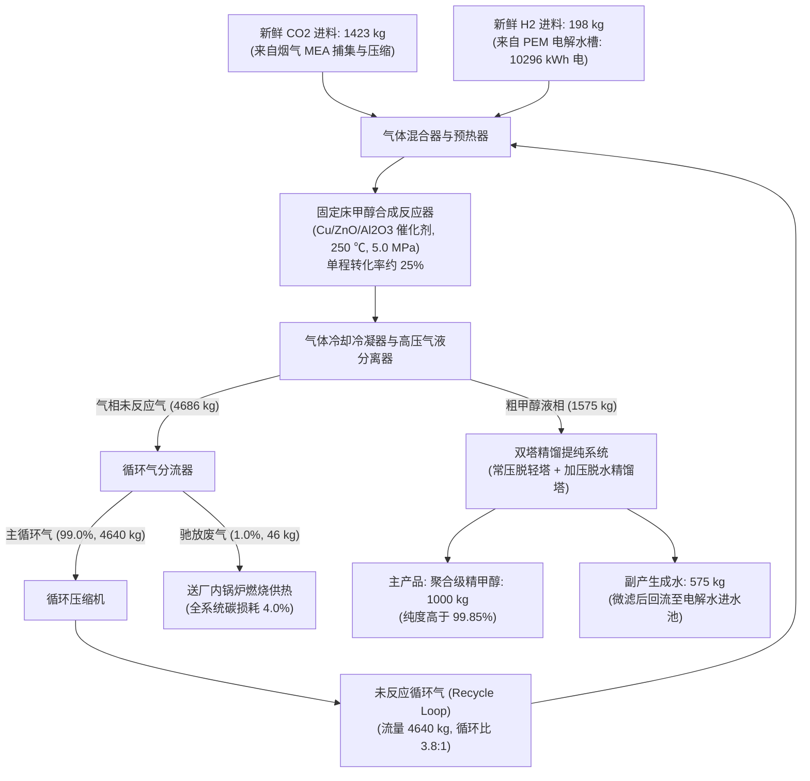
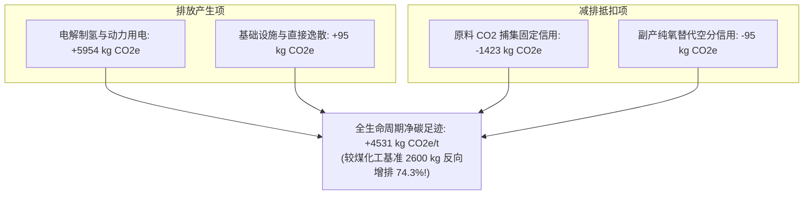
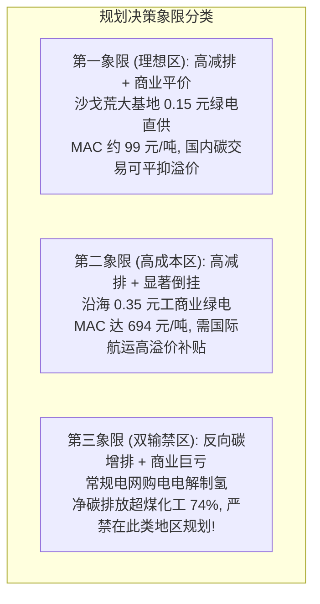

# 案例二讲义：工业园区 CO2 捕集与绿氢合成绿色甲醇系统（MFA-LCA-TEA 进阶训练）

> **【课程导览与核心指标速查】**
>
> - **系统定位**：重大双碳战略 CCUS / 绿氢耦合 Power-to-X（含复杂反应动力学、气液分离与未反应气循环回路 Recycle Loop）。
> - **功能单位**：生产 1 t（1000 kg）聚合级绿色精甲醇（门到门 / Cradle-to-Gate）。
> - **MFA 关键指标**：反应器单程转化率 25.0%，循环比 3.8:1，分离器未反应气分流比为 99.0% 循环 / 1.0% 驰放，全系统总体碳转化利用率高达 96.0%（全流程碳损耗 4.0%）。吨产品单耗：新鲜 CO₂ 1.423 t，绿氢 H₂ 0.198 t，综合电耗 10,826 kWh。
> - **LCA 绿电悖论对比**：
>   - 100% 风光可再生绿电情景：净碳足迹为 **-1,044.1 kg CO₂e/t**（实现显著净负碳固定，较煤制甲醇减排 140.2%）。
>   - 现行区域工业电网情景：净碳足迹飙升至 **+4,531.3 kg CO₂e/t**（比传统煤制甲醇基准高出 74.3%，沦为“严重负向增排”）。
> - **TEA 平准化成本与边际减排成本**：
>   - 总投资 CAPEX：8.20 亿元（10 万吨/年规模，含 130 MW PEM 电解水制氢站）。
>   - 当工业电价为 0.35 元/kWh 时，LCOM = 5,027.5 元/t，绿色溢价为 +2,527.5 元/t，对应边际减排成本 MAC ≈ 693.6 元/t CO₂e（约合 98 美元/吨）；
>   - 当利用大基地消纳电价为 0.15 元/kWh 时，LCOM = 2,862.3 元/t，边际减排成本大幅下降至 MAC ≈ 99.4 元/t CO₂e（约合 14 美元/吨，与全国碳市场价格完美衔接）。
> - **教学重点**：解耦单程转化率与总体转化率、剖析绿电悖论的热力学成因、推导边际减排成本并指导沙戈荒工业园区空间布局规划。

***

## 一、 工程背景与系统结构图

二氧化碳捕集利用与封存（CCUS）及“绿氢消纳”是我国实现碳达峰碳中和、重塑化工产业原料结构的关键战略技术。传统的甲醇生产以煤炭或天然气为原料（灰色甲醇），全生命周期碳排放极高。利用工业点源捕集的 CO₂ 与电解水制备的绿氢催化加氢合成**绿色甲醇（Power-to-Methanol / e-Methanol）**，不仅可实现高价值化学品合成，更可作为远洋船舶绿色航运燃料和长周期储能介质。

### 工艺流程拓扑与内循环控制体



***

## 二、 模块一：MFA 物质平衡与反应分离回路推演

### 1. 化学计量学与核心热力学反应

催化加氢合成甲醇体系主要由以下两个平行反应控制：

1. **甲醇合成主反应（放热）**：
   $$
   \text{CO}_2 + 3\text{H}_2 \rightleftharpoons \text{CH}_3\text{OH} + \text{H}_2\text{O} \quad (\Delta H_{298\text{K}} = -49.5\text{ kJ/mol})
   $$
   *理论化学计量摩尔比* *$\text{H}_2 : \text{CO}_2 = 3 : 1$。*
2. **逆水汽变换副反应（RWGS，吸热）**：
   $$
   \text{CO}_2 + \text{H}_2 \rightleftharpoons \text{CO} + \text{H}_2\text{O} \quad (\Delta H_{298\text{K}} = +41.2\text{ kJ/mol})
   $$
   *副产微量* *$\text{CO}$。*
3. **副产物** **$\text{CO}$** **加氢合成甲醇反应（强放热）**：
   $$
   \text{CO} + 2\text{H}_2 \rightleftharpoons \text{CH}_3\text{OH} \quad (\Delta H_{298\text{K}} = ??\text{ kJ/mol})
   $$

### 2. 反应器单程转化率与循环流（Recycle Loop）解析

在商业催化剂（如铜锌铝 $\text{Cu/ZnO/Al}_2\text{O}_3$）及标准操作工况（250 ℃, 5.0 MPa）下，受到热力学平衡与动力学速率限制：

- **单程转化率（Single-pass Conversion,** **$X_{\text{sp}}$）**：反应器入口混合气体通过催化剂床层一次，$\text{CO}_2$ 的单程转化率仅约 **25.0%**。
- **分离与循环**：反应产物经冷却后气液冷凝分离。液体粗甲醇送入精馏工段；未反应的气体中含有大量的 $\text{H}_2$ 和 $\text{CO}_2$，绝大部分必须经循环压缩机升压后重返反应器。
- **驰放排气（Purge Gas）设计与分流比解析**：
  - 由于原料气中不可避免含有微量惰性杂质（如 $\text{N}_2, \text{Ar}$）以及微量副反应生成的烷烃，若 100% 循环会导致惰气在回路中无限积聚；
  - **分流器分流比**：高压气液分离器顶部分离出的气相总流为 4,686 kg，其中 **99.0%（4,640 kg）回流进入循环流**，**1.0%（46 kg）作为驰放气（Purge Gas）排出**；
  - **系统总碳利用率与碳损耗**：由于极高比例的循环气回流再反应，使得新鲜补入的 1,423 kg $\text{CO}_2$ 中有 96.0% 的碳原子最终固定在精甲醇产品中，**全流程仅有 4.0% 的新鲜碳源随驰放气损失**。
  $$
  \text{总碳转化利用率} \ \eta_{\text{carbon}} = \frac{\text{合成精甲醇产品中的碳量}}{\text{新鲜输入 } \text{CO}_2 \text{ 中的总碳量}} \approx \mathbf{96.0\%}
  $$

### 3. MFA 严格物料平衡表（基于生产 1 吨聚合级绿色精甲醇）

*分子量基准：$\text{CO}_2 = 44.01$,* *$\text{H}_2 = 2.016$,* *$\text{CH}_3\text{OH} = 32.04$,* *$\text{H}_2\text{O} = 18.016$。*

- 理论化学计量生产 1 t（1,000 kg）精甲醇需：$\text{CO}_2 = 1,373.6\text{ kg}$，$\text{H}_2 = 188.8\text{ kg}$，理论副产水 $562.3\text{ kg}$。
- 计入副反应与全流程 4% 驰放损耗后，**实际工程物料平衡清单如下表**（详见 `data_cohort/mfa_reaction_recycle_balance.csv`）：

| 进出节点         | 物质组分名称          |   质量 (kg)  | 摩尔数 (kmol) | 核心功能与后续去向说明                                   |
| :----------- | :-------------- | :--------: | :--------: | :-------------------------------------------- |
| **Input 1**  | 新鲜捕集高纯 CO₂      | **1423.0** |    32.33   | 来自燃煤电厂烟气 MEA 化学吸收提纯（纯度 > 99.5%）               |
| **Input 2**  | 新鲜 PEM 电解绿氢     |  **198.0** |    98.21   | 包含主反应需求 188.8 kg 与副反应/吹扫带走 9.2 kg             |
| **Input 3**  | 电解水原料除盐纯水       | **1960.0** |   108.80   | PEM 制氢进水（扣除 575 kg 回收水后外购净补水 1385 kg，含适度操作余量） |
| **Output 1** | **主产品：聚合级精甲醇**  | **1000.0** |    31.21   | **目标产品（甲醇质量纯度 > 99.85 wt%）**                  |
| **Output 2** | 副产物：高纯工业氧气      | **1584.0** |    49.50   | 来自 PEM 电解槽阳极释放，经脱水压缩外售                        |
| **Output 3** | 反应分离副产生成水       |  **575.0** |    31.92   | 精馏塔脱水产物，经过微滤处理后**闭环回流至电解水进水池**                |
| **Output 4** | 驰放废气（Purge Gas） |  **46.0**  |    3.97    | 含未反应 CO₂, H₂, CO，热值 18.5 MJ/kg，送厂内锅炉燃烧供热      |

- **元素守恒验证（C, H, O 严密校验）**：
  - **碳（C）守恒**：输入碳源全部来自新鲜 CO₂（$1423 \times 12/44.01 = 388.0\text{ kg}$）；输出甲醇固定碳 $1000 \times 12/32.04 = 374.5\text{ kg}$，驰放气带走碳量 $13.5\text{ kg}$（合计 $374.5 + 13.5 = 388.0\text{ kg}$，**100% 严格守恒**）。
  - **氢（H）守恒**：输入氢全部来自新鲜 H₂（$198.0\text{ kg}$）；输出甲醇固定氢 $125.8\text{ kg}$，反应生成水氢含量 $64.3\text{ kg}$，驰放气带走氢量 $7.9\text{ kg}$（合计 $125.8 + 64.3 + 7.9 = 198.0\text{ kg}$，**100% 严格守恒**）。

### 4. 吨甲醇综合电耗分解（能量流底座）

- **PEM 电解水制氢耗电**：行业先进水平 $52.0\text{ kWh/kg H}_2$，制氢电耗 $= 198\text{ kg} \times 52.0 = \mathbf{10,296.0\text{ kWh}}$（**占全厂总用电量 95.1%**）；
- **CO₂ 捕集与多级加压压缩**（压缩至 5.0 MPa）：$255.0\text{ kWh}$；
- **循环气压缩机与反应换热循环泵**：$155.0\text{ kWh}$；
- **精馏塔脱水泵与冷冻脱轻机组**：$120.0\text{ kWh}$；
- **吨甲醇总综合电耗**：$10,296 + 255 + 155 + 120 = \mathbf{10,826.0\text{ kWh/t 甲醇}}$（即约 **10.83 MWh/t**）。

***

## 三、 模块二：LCA 环境评价——“绿电悖论”批判性推演

### 1. 目标、范围与功能单位

- **功能单位**：生产 1 t 聚合级精甲醇（门到门 / Cradle-to-Gate）。
- **对比基准（Benchmark）**：中国主流煤制甲醇（Coal-to-Methanol, CtM）全生命周期碳排放基准值约为 **+2,600.0 kg CO₂e/t 甲醇**。
- **情景设置（核心教学对比）**：
  - **情景 A（100% 绿色风光电）**：直接接入西部风电光伏专线，$EF_{\text{grid}} = 0.035\text{ kg CO}_2\text{e/kWh}$；
  - **情景 B（区域工业电网电）**：直接从华中区域公共电网购电（以煤电为主），$EF_{\text{grid}} = 0.550\text{ kg CO}_2\text{e/kWh}$。

### 2. GWP100 全生命周期碳足迹核算模型

$$
\text{GWP}_{\text{net}} = \text{GHG}_{\text{power}} + \text{GHG}_{\text{infra}} - \text{Credit}_{\text{CO}_2 \text{ capture}} - \text{Credit}_{\text{O}_2}
$$

*公式说明：排放产生项（动力电耗、基建催化剂）为正，环境减排抵扣项为负。其中* *$\text{Credit}_{\text{CO}_2 \text{ capture}}$* *为原料* *$\text{CO}_2$* *捕集并化学固定为甲醇分子的碳信用（1,423.0 kg CO₂e/t）；$\text{Credit}_{\text{O}_2}$* *为 PEM 电解水阳极副产高纯工业纯氧（1,584 kg/t）替代传统高能耗深冷空分制氧（Cryogenic ASU）所获得的避免排放信用（$1,584\text{ kg} \times 0.06\text{ kg CO}_2\text{e/kg} = 95.0\text{ kg CO}_2\text{e/t}$）。*

| 核算清单分项              | 清单实物指标       | 排放因子取值                  |     情景 A：100% 清洁绿电     |      情景 B：区域电网工业电      |
| :------------------ | :----------- | :---------------------- | :--------------------: | :--------------------: |
| **原料 CO₂ 捕集固定信用**   | -1,423.0 kg  | -1.00 kg CO₂e/kg        |  **-1,423.0 kg CO₂e**  |  **-1,423.0 kg CO₂e**  |
| 生产动力用电间接排放          | 10,826.0 kWh | 绿电: 0.035 / 网电: 0.550   |     +378.9 kg CO₂e     |  **+5,954.3 kg CO₂e**  |
| 基础设施建材与直接逸散折算       | 分摊定额         | 综合背景清单（含催化剂80kg+逸散15kg） |      +95.0 kg CO₂e     |      +95.0 kg CO₂e     |
| 副产高纯氧气替代空分信用        | 1,584.0 kg   | -0.06 kg CO₂e/kg O₂     |      -95.0 kg CO₂e     |      -95.0 kg CO₂e     |
| **全生命周期净碳足迹**       | —            | —                       | **-1,044.1 kg CO₂e/t** | **+4,531.3 kg CO₂e/t** |
| **较煤制甲醇（2.6 t）减排率** | —            | —                       |  **实现净负碳（减排 140.2%）**  |    **反向增排 +74.3%！**    |



> 💡 **课堂讨论点（绿电悖论的热力学成因）**：
> 为什么在情景 B 下，耗费巨资建设的所谓“低碳 CCU 绿色甲醇”，排放反而比传统“傻大黑粗”的煤化工还要高出整整 74.3%？
> **热力学原因**：电网中火电发电效率仅约 40%，电解水制氢效率约 64%，合成反应器转化能量又有损失。三次串联的热力学折损导致每焦耳甲醇化学能背后消耗了数倍的化石煤炭燃烧！
> **环境规划铁律**：**严禁在未实现电力深度脱碳的地区盲目规划电氢化工（Power-to-X）项目！**

***

## 四、 模块三：TEA 技术经济分析与“绿色溢价”拆解

### 1. 厂级规模与财务基准假设

- **生产规模**：年产 100,000 t（10 万吨）聚合级绿色精甲醇；年满负荷运行 8,000 h；
- **折现率（WACC）**：8.0%；运营周期：20 年。
- **资本回收系数**：
  $$
  CRF = \frac{i(1+i)^n}{(1+i)^n - 1} = \frac{0.08(1.08)^{20}}{(1.08)^{20} - 1} \approx 0.10185
  $$

### 2. CAPEX（固定资产投资，总计 8.20 亿元）

- **130 MW PEM 电解水制氢站**（含整流柜、纯化去离子与冷却，按 3,500 元/kW）：4.55 亿元（占比 55.5%）；
- **CO₂ 烟气捕集装置、脱硫脱硝及三级压缩缓冲站**：1.10 亿元；
- **甲醇合成反应器回路、热回收蒸汽发生器及气液分离系统**：1.20 亿元；
- **双塔常压加压精馏系统、纯水系统及产品储罐区**：0.65 亿元；
- **土建工程、给排水管网、电气接入及工程不可预见费**：0.70 亿元；
- **单吨甲醇资本化摊销成本**：
  $$
  \frac{8.20\text{ 亿元} \times 0.10185}{100,000\text{ 吨}} \approx \mathbf{835.2\text{ 元/t 甲醇}}
  $$

### 3. OPEX 与平准化甲醇成本（LCOM）对电价的极端敏感性

传统煤制甲醇市场售价基准：$\text{Price}_{\text{fossil}} \approx 2,500\text{ 元/t}$。

| 成本构成分项                   | 吨产品实物定额              |   电价情景 1（当前工商业绿电：0.35 元/度）  |   电价情景 2（大基地消纳电价：0.15 元/度）  |
| :----------------------- | :------------------- | :-------------------------: | :-------------------------: |
| **电解水及合成电力消耗**           | 10,826.0 kWh         | **3,789.1 元/t（占总成本 75.4%）** | **1,623.9 元/t（占总成本 56.7%）** |
| 资本支出（CAPEX 年金摊销）         | 20 年期 8% 折现          |          835.2 元/t          |          835.2 元/t          |
| 原料 CO₂ 捕集提纯成本            | 1.423 t × 260 元/t    |          370.0 元/t          |          370.0 元/t          |
| 除盐水原料及催化剂损耗              | 纯水 1.96 t + 催化剂      |           65.0 元/t          |           65.0 元/t          |
| 固定运维、人工与检修费              | 按 CAPEX 2.5% + 人工    |          285.0 元/t          |          285.0 元/t          |
| **副产工业氧气外售抵扣**           | 1.584 t × 200 元/t    |        **-316.8 元/t**       |        **-316.8 元/t**       |
| **平准化甲醇成本 (LCOM)**       | —                    |       **5,027.5 元/t**       |       **2,862.3 元/t**       |
| **绿色溢价 (Green Premium)** | $\text{LCOM} - 2500$ | **+2,527.5 元/t（高出 101.1%）** |  **+362.3 元/t（仅高出 14.5%）**  |

***

## 五、 模块四：三工具联合决策——边际减排成本（MAC）与规划推演

### 1. 边际减排成本（Marginal Abatement Cost, MAC）公式推导

$$
\text{MAC} = \frac{\text{LCOM}_{\text{green}} - \text{Price}_{\text{fossil}}}{\text{GHG}_{\text{fossil}} - \text{GHG}_{\text{green}}} \quad (\text{元/吨 } \text{CO}_2\text{e 避免})
$$

在 100% 绿电驱动下：

- 相对化石甲醇的净减排量：$\Delta \text{GHG} = 2.600 - (-1.0441) = 3.644\text{ t CO}_2\text{e/t 甲醇}$；
- **当电力价格为 0.35 元/度时**：
  $$
  \text{MAC}_{0.35} = \frac{5,027.5 - 2,500.0}{3.644} = \frac{2,527.5\text{ 元}}{3.644\text{ 吨}} \approx \mathbf{693.6\text{ 元/吨 CO}_2\text{e}} \quad (\text{约 } \$98/\text{t CO}_2)
  $$
- **当电力价格为 0.15 元/度时**：
  $$
  \text{MAC}_{0.15} = \frac{2,862.3 - 2,500.0}{3.644} = \frac{362.3\text{ 元}}{3.644\text{ 吨}} \approx \mathbf{99.4\text{ 元/吨 CO}_2\text{e}} \quad (\text{约 } \$14/\text{t CO}_2)
  $$

### 2. 环境规划与政策工具推演决策矩阵

| 规划落地情景            | 电力供应模式             |   平准化成本 LCOM  |     净碳足迹 GWP    |   边际减排成本 MAC  | 规划可行性与政策落地建议                                      |
| :---------------- | :----------------- | :-----------: | :-------------: | :-----------: | :------------------------------------------------ |
| **情景 1：大基地清洁消纳**  | 西部沙戈荒直供（0.15 元/度）  | **2,862 元/t** | **-1,044 kg/t** |  **99.4 元/t** | **【典范可行】** 依托国家碳市场（约 100 元/吨）即可抹平绿色溢价，实现商业自平衡     |
| **情景 2：沿海高成本绿电**  | 工商业分布式绿电（0.35 元/度） | **5,027 元/t** | **-1,044 kg/t** | **693.6 元/t** | **【严重倒挂】** 国内市场无法承受，必须通过 ISCC 绿色航运认证出口欧盟以赚取航运脱碳溢价 |
| **情景 3：常规区域工业电网** | 公共工业电网直抽（0.55 元/度） | **7,193 元/t** | **+4,531 kg/t** |    **倒挂恶化**   | **【规划禁区】** 经济重度亏损且全生命周期碳排较煤化工高出 74.3%，严禁在此类地区审批立项 |



***

## 六、 实践任务与 GitHub PR 提交指南（Task & Pull Request Submission）

> **【课程大仓协同说明】**
> 本案例对应的随堂实操与课后作业需提交至课程官方实践大仓：
> 🔗 [whu-course-cohort/LCA\_Practice\_Coursework-2026fall](https://github.com/whu-course-EnvironPlanManag/LCA_Practice_Coursework-2026fall)
> 每位同学需基于本组工作空间以独立分支形式完成提交，并遵照 PR 规范发起合并请求（Pull Request）。
> 📖 **Git 协作避坑与排错救急**：遇到网络克隆、分支隔离、拉取 main 防覆盖或 PR 撤销等问题，详见大仓公共手册：[starter\_materials/troubleshooting.md](../../troubleshooting.md)

***

### 1. 随堂演练研讨任务（小组 15 分钟规划对抗）

- **情景背景**：某大型煤化工园区管委会拟规划投资一条 10 万吨/年的绿氢合成绿色甲醇示范线，园区电网由两部分组成：自备燃煤电厂（供电价 0.32 元/度，碳因子 0.75 kg CO₂e/kWh）和配套建设的屋顶分布式光伏（年利用 1200 小时，供电价 0.20 元/度，碳因子 0.04 kg CO₂e/kWh）。
- **研讨对抗任务**：
  1. 为什么“屋顶分布式光伏”无法独立支撑该电解水制甲醇项目（提示：关注连续化化工运转、PEM 电解槽频繁启停衰减与设备容量因子对 CAPEX 摊销的倍增效应）？
  2. 若光伏与自备电混供，根据 LCA“绿电悖论”推算，光伏绿电占比至少必须达到多少百分比，该甲醇产品的全生命周期碳排放才能勉强低于传统煤制甲醇（2.6 t CO₂e/t）？
- **思考路径与提示指引（Pedagogical Hints & Self-Check）**：
  - **提示 1（热力学与设备负荷）**：化工加氢固定床反应器要求高温高压连续稳定运行（通常要求年运行 8,000 小时），而屋顶光伏年有效满发仅约 1,200 小时。若完全依赖离网光伏，设备利用率骤降至 15%，意味着单位产品的 CAPEX 设备摊销成本将飙升至原先的 6.7 倍！
  - **提示 2（临界代数方程推导）**：设绿电占比为 $x$（$0 \le x \le 1$），则系统总用电量 10,826 kWh 对应的加权电网碳排放因子为 $EF(x) = x \times 0.04 + (1-x) \times 0.75$。全流程净碳足迹满足：
    $$
    \text{GWP}_{\text{net}}(x) = 10,826 \times [0.75 - 0.71x] - 1,423.0 \le 2,600.0
    $$
  - **提示 3（数值自检范围）**：经严密推导，使项目不发生“反向碳增排”的最低临界绿电替代率 $x$ 位于 **50% \~ 55%** 之间。

***

### 2. 核心作业任务内容

#### 任务 1：Python 实现复杂反应-循环回路代数求解与守恒验证

每位同学需基于 `data_cohort/mfa_reaction_recycle_balance.csv` 的物料流数据，编写 Python 脚本（利用 `scipy.optimize.fsolve` 或联立代数方程组）：

1. 建立包含新鲜气体进料、固定床反应器（单程转化率 25%）、冷凝气液分离器与循环气分流器（分流比 99% 循环 / 1% 驰放）的质量守恒方程；
2. 求解并验证循环比（Recycle Ratio = 循环气量 / 新鲜气量）及全系统总碳转化利用率（验证是否严格等于 96.0%）；
3. 严格打印碳（C）、氢（H）、氧（O）三元素的质量守恒核算结果（输入与输出差值需小于 0.01%）。

#### 任务 2：LCA 绿电悖论与 TEA 平准化甲醇成本（LCOM）多情景敏感性分析

1. 依据 `data_cohort/lca_grid_scenarios_lci.csv` 与 `data_cohort/tea_lcom_sensitivity_data.csv`，编写数据分析脚本；
2. 绘制电价从 0.05 元/度变化至 0.60 元/度时，平准化甲醇成本（LCOM）、绿色溢价（Green Premium）以及边际减排成本（MAC）的联动响应折线图；
3. 输出在全国统一碳市场当前碳价（约 100 元/吨）背景下，绿色甲醇能够实现商业自平衡的最高临界电价阈值。

#### 任务 3：调用 Python 第三方包自主绘制“工艺物质流程图”

依据讲义展示的工艺流向，编写 Python 绘图脚本，生成高清流程图（推荐格式 `.png` 或 `.svg`，分辨率不低于 300 dpi）：

- **推荐选型工具**：
  1. **`schemdraw`（`schemdraw.flow`）**：纯 Python 轻量级工程流程图，支持工程框图、反应器与未反应气循环回路箭头标注；
  2. **`plotly`（`plotly.graph_objects.Sankey`）**：物质流桑基图，直观展现质量通量分配；
  3. **`graphviz`**：工业方框流程图（BFD）。

***

### 3. Git 分支创建与 PR 提交全流程

#### 第一步：拉取大仓最新代码并创建个人专属分支

进入本地大仓目录，严格遵循 **`dev-group-XX-name`** 命名规范（杜绝学号，保护个人隐私）：

```bash
# 进入课程大仓目录
cd LCA_Practice_Coursework-2026fall

# 切换并同步主分支最新状态
git checkout main
git pull origin main

# 以 tangsiqi 为例，创建并切换到个人专属分支 (格式: dev-group-XX-姓名拼音)
git checkout -b dev-tangsiqi-case2

# 立即将分支发布到 GitHub 远端并建立追踪绑定
git push -u origin dev-tangsiqi-case2
```

#### 第二步：在小组工作空间建立任务专属目录并放置作业成果

```bash
# 进入本组专属工作区 (以测试组为例)
cd groups/group-test/

# 复制案例二任务包模板到本组：
cp -r ../../starter_materials/lecture9-20261022-classroom_case2 ./case2-green-methanol/
cd case2-green-methanol/
```

#### 第三步：编写代码、生成图表并提交暂存

在 `code_implementation/` 中完成 Python 脚本编写并输出高清图片，随后执行 Git 提交：

```bash
git add .
git commit -m "feat(group-test): complete case2 green methanol MFA-LCA-TEA modeling"
git push origin dev-tangsiqi-case2
```

#### 第四步：在 GitHub 网页端发起 Pull Request 并对照核验

1. 访问 GitHub 仓库页面，点击 **"Compare & pull request"**；
2. PR 标题严格按照规范填写：`feat(group-test): 案例二 绿氢合成绿色甲醇系统 MFA-LCA-TEA 建模实训`；
3. PR 模板将自动加载 `lecture9_20261022_case2-green-methanol.md`，对照其中的理论预期范围核对实测结果，并在自检合格后勾选交付清单。

***

## 七、 参考文献与学术数据源对照

1. **NREL Technical Report**. (2021). *Techno-Economic and Life Cycle Assessment of Power-to-Gas and Power-to-Liquid Pathways*. National Renewable Energy Laboratory (NREL/TP-5400-81146).
2. **Mahmud, R., Moni, S. M., High, K., & Carbajales-Dale, M.** (2021). Integration of techno-economic analysis and life cycle assessment for sustainable process design–A review. *Journal of Cleaner Production*, 317, 128247.
3. **Pérez-Fortes, M., Schöneberger, J. C., Boulamanti, A., & Tzimas, E.** (2016). Methanol synthesis using captured CO2 as raw material: Techno-economic and environmental assessment. *Applied Energy*, 161, 718-732.
4. **IRENA**. (2020). *Green Hydrogen Cost Reduction: Scaling up Electrolysers to Meet the 1.5°C Climate Goal*. International Renewable Energy Agency, Abu Dhabi.
5. **Dieterich, V., Buttler, A., Hanel, A., Spliethoff, H., & Fendt, S.** (2020). Power-to-liquid via synthesis of green methanol to reduce greenhouse gas emissions: A review. *Energy & Environmental Science*, 13(10), 3207-3252.

