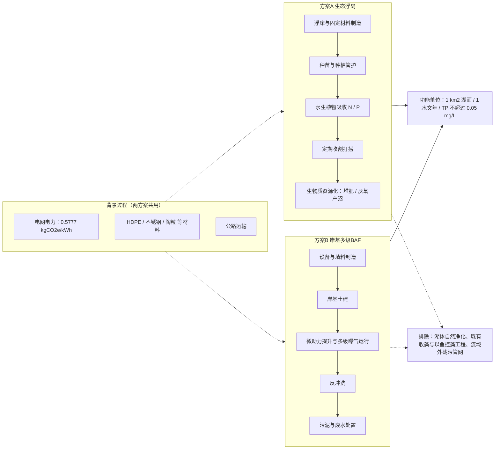
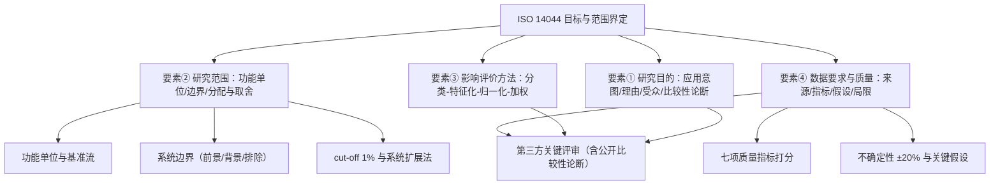

# 武汉东湖水质原位提升与富营养化治理
## 生命周期评价（LCA）目标与范围界定规范报告

> **依据标准**：ISO 14040:2006 / ISO 14044:2006 §4.2（目标与范围界定）、§6（关键评审）；水质基准 GB 3838—2002
> **编制**：环境工程助教　｜　**日期**：2026-10-15
> **方案 A**：生态浮岛原位水生植物吸收 + 定期打捞资源化
> **方案 B**：岸基一体化多级曝气生物滤池（BAF）微动力水循环处理

---

## 0　研究背景

东湖是典型半封闭浅水型城中湖：蓝线水域面积 33.63 km²，平均水深约 2.4 m。水质持续改善，2025 年 1—11 月整体达 Ⅲ 类，较 2023 年总磷浓度下降 19.9%；但**总磷仍是唯一主要超标污染物**——2025 年 1—5 月 TP 为 0.038 mg/L（同比下降 25.5%），而 9 月单月水质回落至 Ⅳ 类、轻度富营养，TP 超标 0.24 倍（约 0.062 mg/L，Ⅲ 类湖库限值 0.05 mg/L）。蓝藻防控现仍以加压控藻船、收藻船与"以鱼控藻"等应急手段为主，**内源氮磷负荷尚未稳定受控**。

---

## 一、法定要素 ①：研究目的

- **应用意图**：为东湖水域管理部门提供方案 A 与方案 B 的"功能等效—环境影响"量化比选依据，识别环境负担在**材料、能耗、药剂、打捞与处置**间的转移热点。
- **研究理由**：两方案目标同为削减氮磷、抑制藻类，但机理（生物吸收移除 vs. 物理—生物强化）差异显著，须在统一功能单位下比较其全生命周期代价。
- **目标受众**：课程评审与指导教师、东湖风景区水务与生态环境管理部门。
- **比较性论断**：本研究含**公开的方案间比较论断**，依 ISO 14044 §6 必须实施第三方**关键评审**。
- **研究类型**：归因型（attributional），范围覆盖材料/建造—运维—废弃或资源化的全过程。

## 二、法定要素 ②：研究范围

### 2.1　功能与功能单位
- **系统功能**：在给定湖面与时间尺度内削减氮磷负荷、抑制藻类生物量，维持湖体 Ⅲ 类水质。
- **功能单位（FU）**：**在东湖 1 km² 湖面（平均水深 2.4 m，约 240 万 m³ 水体）上，于 1 个水文年（365 d）内使 TP 稳定不超过 0.05 mg/L，并实现等效的 TN、TP 负荷削减（建议以年削减 TP ≥ 1 t·a⁻¹ 为等效基准）**。
- **基准流**：方案 A 以"浮岛面积 + 植物生物量/打捞量"表征；方案 B 以"年循环处理水量 + 装机功率 + 填料体积"表征。

### 2.2　系统边界（见图 1）
- **纳入（前景过程）**：A——浮床与固定材料制造、种苗培育、种植管护、定期收割打捞、运输、生物质资源化（堆肥/厌氧产沼）；B——设备与填料制造、岸基土建、微动力提升与曝气运行电力、反冲洗、污泥与废水处置、非正常工况药剂投加。
- **纳入（背景过程）**：电网电力（全国电力平均碳足迹因子 0.5777 kgCO₂e/kWh，2024 年数据）、HDPE/不锈钢/陶粒等材料、公路运输。
- **排除**：湖体自然净化与既有工程（收藻船、以鱼控藻）的贡献，作为基线单独核算；流域外截污管网改造，仅作情景假设。
- **时空与技术边界**：数据时间 2020—2025（优先 2023—2025）；地理范围武汉/华中；技术为现行工程化水平。

### 2.3　取舍准则与分配
质量/能量取舍线取 1%（cut-off）。生物质资源化按**系统扩展法**处理（即计入替代堆肥或化石能源所避免的排放），同时报告替代分配法结果用于敏感性分析。

## 三、法定要素 ③：生命周期影响评价方法

- 按 ISO 14044 四步实施：**分类—特征化—归一化—加权**；
- **特征化方法**：气候变化采用 IPCC 2021 GWP₁₀₀；ReCiPe 2016 (H) 与 CML-IA baseline 并行，覆盖淡水富营养化、海洋富营养化、酸化、淡水/陆地生态毒性、土地利用、水资源消耗；
- **必报核心类别**：水体富营养化潜势（本研究的功能性指标）；
- **不做归一化与加权**，或以等权加权仅作参考并明确披露价值选择；
- **平行保留的非 LCA 指标**：TN/TP 实测削减量、单位水量运行成本（BAF 深度处理约 0.55 元·t⁻¹）、社会接受度，留待解释阶段。

## 四、法定要素 ④：数据要求、质量与局限性

- **来源优先级**：武汉市生态环境局月度水质状况、东湖管委会公示（实测与官方数据）＞ 国内同行评议文献与工程案例 ＞ 数据库（ecoinvent 3.10、CLCD）。
- **质量要求**：按时间、地理、技术代表性及精度、完整性、一致性、可追溯性七项逐条打分并记录出处。
- **关键假设**：A 方案氮磷直接吸收取文献值（水蕹菜 TN 52.35、TP 5.39 kg·hm⁻²·a⁻¹，100 d；地上生物量收割量 0.4—0.6 t·hm⁻²·a⁻¹）；B 方案按 HRT 9 h、气水比 5:1 运行，TN 去除 58%—60%、TP 去除约 94%，出水与湖水混合后评估湖体浓度。
- **不确定性**：不同来源对东湖面积（33.0/33.63 km²）、平均水深（2.2/2.4/2.61 m）、容积（1.1/2.45 亿 m³）的表述不一致，本报告以 33.63 km²、2.4 m、1.1 亿 m³ 为基准并做 ±20% 敏感性分析；浮岛受风浪与季节影响，吸收效率波动大。
- **局限性**：未涵盖微塑料、抗生素等新兴污染物；生物质资源化的替代减排效应缺乏实测验证。
- **报告与评审**：本报告为"目标与范围界定"专项报告，后续另出 LCI/LCIA 与解释报告；因含公开比较性论断，须经第三方关键评审。

---

## 图 1　系统边界与两个方案的过程分解

## 图 2　目标与范围四大法定要素与 ISO 14044 条款的对应

## 表 1　两方案关键参数与环境热点对比

| 维度 | 方案 A 生态浮岛 | 方案 B 岸基多级 BAF |
| --- | --- | --- |
| 去除机理 | 植物直接吸收 + 收割移除 | 生物膜硝化/反硝化 + 吸附过滤除磷 |
| 关键参数 | 收割量 0.4—0.6 t·hm⁻²·a⁻¹；TN 52.35、TP 5.39 kg·hm⁻²·a⁻¹ | HRT 9 h、气水比 5:1；TN 去除 58%—60%、TP 去除约 94% |
| 直接能耗 | 低（打捞船与运输为主） | 较高（提升 + 多级曝气） |
| 造价参考 | 国产浮岛裸板 180—350 元/m²；含基质种苗 400—600 元/m² | 岸基站点运维 0.52 元/m³；BAF 深度处理 ~0.55 元/t |
| 主要环境热点 | 材料生产、打捞运输、生物质处置 | 运行电力、填料消耗、污泥处置 |
| 主要不确定性 | 风浪损毁、季节效率、实际收获率 | 出水稀释效应、低温期效率下降 |

## 表 2　关键数据及其来源

| 数据项 | 数值 | 来源 |
| --- | --- | --- |
| 东湖水域面积 | 33.63 km² | 东湖风景区管委会《防汛抗旱应急预案》 |
| 平均水深 | 2.4 m | 新华社《武汉：东湖治理四十年》 |
| 常水位 / 最大库容 | 19.15 m / 约 1.1 亿 m³ | 武汉市水务局转载武汉电视台报道 |
| 2025 年整体水质 | Ⅲ 类，TP 为主要超标污染物 | 东湖管委会省生态环保督察整改公示 |
| 2025 年 1—5 月 TP | 0.038 mg/L，同比 ↓25.5% | 东湖管委会（2025-05） |
| 2025 年 9 月单月水质 | Ⅳ 类、轻度富营养，TP 超标 0.24 倍 | 武汉市生态环境局月度地表水环境质量状况 |
| Ⅲ 类湖库 TP 限值 | 0.05 mg/L | GB 3838—2002 |
| 电力碳足迹因子 | 0.5777 kgCO₂e/kWh（2024） | 生态环境部 2025 年 10 月例行新闻发布会 |
| 浮岛氮磷吸收率 | TN 52.35 / TP 5.39 kg·hm⁻²·a⁻¹ | Review of Ecological Floating Bed Restoration |
| BAF 去除率 | TN 58%—60% / TP ~94% | 维普期刊文献摘要 |
| 浮岛造价与运维 | US$15—2537/m²；OPEX US$0.5—181/m²·a | ACS ES&T Water（2025） |

## 参考资料

- 武汉东湖生态旅游风景区管理委员会：[省生态环境保护督察整改情况公示](https://www.whdonghu.gov.cn/ztzl_6323/hbdc/202512/t20251208_2692027.shtml)、[东湖水污染防治](https://www.whdonghu.gov.cn/zwgk_6255/xxgkml/gysyjs/hjxx/202505/t20250529_2587677.shtml)
- 武汉市生态环境局：[2025 年 9 月武汉市地表水环境质量状况](http://hbj.wuhan.gov.cn/fbjd_19/xxgkml/zwgk/hjjc/dbsjjzsyysydjcbg/202510/t20251015_2660510.html)
- 武汉市水务局：[新华社：武汉东湖治理四十年](https://swj.wuhan.gov.cn/tzdt/jcss/202106/t20210607_1715147.html)
- 生态环境部：[2025 年 10 月例行新闻发布会答问实录](https://www.mee.gov.cn/ywdt/xwfb/202510/t20251030_1131010.shtml)
- 生态环境部：[地表水环境质量标准 GB 3838—2002](http://mee.gov.cn/ywgz/fgbz/bz/bzwb/shjbh/shjzlbz/200206/W020061027509896672057.pdf)
- [Review of Ecological Floating Bed Restoration in Polluted Water](https://www.scirp.org/journal/paperinformation?paperid=40868)
- [Assessing the Costs of Constructed Floating Wetlands, ACS ES&T Water (2025)](https://pubs.acs.org/doi/full/10.1021/acsestwater.5c00439)
- [拼装湿地循环处理对城市水体水质改善的效果](https://www.hjgcjsxb.org.cn/article/doi/10.12153/j.issn.1674-991X.20240033?viewType=HTML)
- ISO：[ISO 14044:2006 Environmental management — Life cycle assessment](https://www.iso.org/obp/ui/#iso:std:iso:14044:en)

## 五、深度反思
在利用 AI 编写“武汉东湖水质提升” LCA 目标与范围界定报告过程中，发现 AI 在定义“功能单位（Functional Unit）”时给出了精准的建议，辅助明确了在 1 km² 湖面上于 1 个水文年内削减氮磷负荷的具体指标。然而，在讨论系统边界时，AI 一度模糊了哪些因素应当被纳入分析，进行纠正时，通过引入 ISO 14044 的原则明确了系统边界，包括背景过程和前景过程。这一反思不仅加深了我对 LCA 方法论的理解，也提升了对 AI 辅助规划过程中的潜在逻辑漏洞的警觉性。

## 六、AI 工具使用声明

- **使用工具**：DeepSeek-V4-Pro
- **具体用途**：用于生成关于“武汉东湖水质提升”的 LCA 目标与范围界定报告。
- **人工校验**：手动审查了 AI 提供报告中的每一个部分，核查了其中的数据部分以确保所有数据来源于可靠的文献，并进行了必要的实证分析以验证其准确性。