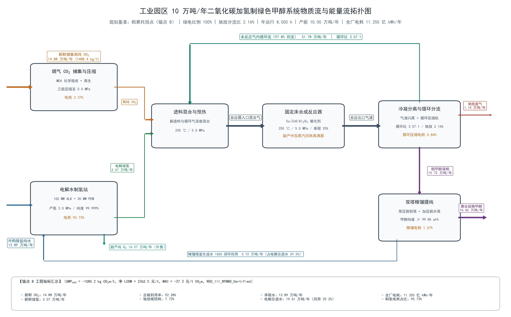
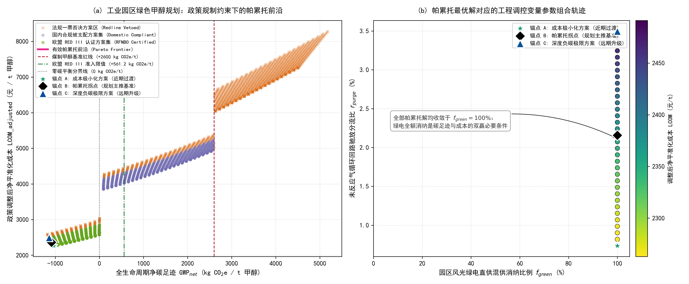

# 工业园区10万吨/年二氧化碳捕集耦合绿氢合成绿色甲醇项目环境规划与管理方案报告

编制日期：2026年10月27日。编制对象：课程设定的现代煤化工园区示范线。近期规划阶段为2027—2028年，建设衔接及投产核验延至2029年，远期管理阶段为2029—2035年。全文年通量均按10万吨/年完整设计运营年核算，不代表2028年已经实现的产量。

## 报告摘要

本报告面向煤化工园区拟建的10万吨/年绿色甲醇示范线，依据工程背景、四张政策卡片及前四项程序结果，开展物质流、环境影响、经济性与实施条件的联合核查。固定床反应器二氧化碳单程转化率取25.0%，纯组分稳态模型的总碳转化利用率为96.5221%，合成段碳、氢、氧相对误差均低于0.01%；该结果不能代替原始工程组成表的实测守恒认证。完整遍历3000组工况后，2400组物料无非负稳态解，320组被政策否决，280组合规，非支配前沿仅含一个工况。因此，成本最小、归一化距离最小及碳足迹最小三个锚点重合，设计核算基准取绿电比例100%、驰放比0.4%，净碳足迹为−990.0千克二氧化碳当量/吨，政策修正平准化成本为1799.245元/吨，边际减排成本为−195.196元/吨二氧化碳当量。五项工程沿用8.20亿元固定投资核算假定，基础净运行成本等价额为25683.8189万元/年，分项目非电费用仍待报价分解。方案综合取水为1.405吨/吨，须计征超定额部分水税；电解槽定额与模型水回用组合存在17858.21吨/年未闭合差额。项目推进应以可靠绿电供给、空间安全校核、缺失物流补测和资金兑现条件为前提，建立合同、监测核查、环境应急及动态修编机制，不将课程模型判定直接表述为真实认证或工程可实施性证明。

## 核心术语与缩写中英文对照

术语以[政策卡片包](../data_cohort/policy_clauses_pack.md)为主要依据；计量单位中的 t 为吨，a 为年，kWh 为千瓦时，MW 为兆瓦，GWh 为百万千瓦时。

| 缩写 | 英文全称 | 中文规范名称与本报告用途 |
| :--- | :--- | :--- |
| MFA | Material Flow Analysis | 物质流分析，核查组分及元素输入输出 |
| EFA | Energy Flow Analysis | 能量流分析，本报告量化四工段电耗，不虚构热流负荷 |
| LCA | Life Cycle Assessment | 全生命周期评价，按课程限定生产边界核算 |
| TEA | Techno-Economic Analysis | 技术经济分析，核算资本年金、基础及政策修正成本 |
| GWP | Global Warming Potential | 全球变暖潜势，以 kg CO₂e/t甲醇表示 |
| LCOM | Levelized Cost of Methanol | 平准化甲醇成本，以元/t甲醇表示 |
| MAC | Marginal Abatement Cost | 边际减排成本，以元/t CO₂e表示 |
| PEM | Proton Exchange Membrane | 质子交换膜，本报告指相应电解水制氢工艺 |
| ALK | Alkaline Electrolyzer | 碱性电解槽，仅作为尚待论证的工艺比选对象 |
| CCUS | Carbon Capture, Utilization, and Storage | 二氧化碳捕集利用与封存；本项目模型只量化捕集与转化利用 |
| PtM | Power-to-Methanol | 电力制甲醇系统 |
| CtM | Coal-to-Methanol | 煤制甲醇行业比较基准 |
| CAPEX | Capital Expenditure | 固定资产资本支出 |
| OPEX | Operating Expenditure | 运行维护支出；本报告区分实付费用与反推的净运行成本等价额 |
| CRF | Capital Recovery Factor | 资本回收系数 |
| WACC | Weighted Average Cost of Capital | 加权平均资本成本 |
| RED III | Renewable Energy Directive III | 欧盟《可再生能源指令》第三版，在本报告中按课程卡片数值规则映射 |
| RFNBO | Renewable Fuels of Non-Biological Origin | 非生物源可再生燃料 |
| ISCC EU | International Sustainability and Carbon Certification EU | 欧盟国际可持续发展与碳认证体系；实际认证结果尚未提供 |
| ETS | Emissions Trading System | 碳排放权交易体系 |
| CCER | China Certified Emission Reduction | 国家核证自愿减排量 |
| MRV | Monitoring, Reporting, and Verification | 可测量、可报告、可核查体系 |
| PDCA | Plan-Do-Check-Act | 策划、实施、检查、改进动态管理循环 |
| MEA | Monoethanolamine | 单乙醇胺，课程烟气吸收工艺的吸收剂 |
| VOCs | Volatile Organic Compounds | 挥发性有机物，本项目重点关注有机胺逸散 |
| CEMS | Continuous Emission Monitoring System | 烟气排放连续监测系统，用于拟建监测方案 |
| ESD | Emergency Shutdown | 紧急停车/切断系统，用于拟建安全联锁方案 |

## 编制依据与数据使用原则

本报告以[工程背景](../task_docs/background_engineering_docs.md)、[任务手册](../task_docs/lecture10_task_manual.md)及[评分量表](report_writing_rubric.md)确定结构，以同组原始数据和四项任务输出支撑定量结论。资料包含课程情景参数、工程定额与模型结果，未提供园区现场调查。文中“拟”“建议”“设计目标”表示规划安排，不能解释为已建成事实；“模型合规”表示课程卡片判定，不能解释为已取得行政许可、认证证书或资金。

数据优先级为：当前任务3实际锚点表及其对应模型结果、能够追溯的原始数据、工程背景公式。示例模板中的空白项与示例参数不作为实测值。相互矛盾的数据并列说明，不通过修改反应式、补造物流、分摊未知费用或新增经验成本曲线使其表面一致。所有年净碳足迹和减排量均为课题边界下的核算结果，不涵盖甲醇终端燃烧，也不等同永久地质封存。

## 第1章 园区现状诊断与碳源—新能源基准线核算

### 1.1 园区产业结构与物质、能量代谢边界

任务手册将对象设定为拥有自备燃煤电厂并拟配套屋顶光伏的现代煤化工园区。拟建系统包括烟气二氧化碳捕集与压缩、绿氢制备、气体混合预热、固定床催化合成、冷凝气液分离、未反应气分流回用及双塔精馏。项目将原料捕集、制氢和甲醇生产纳入同一计算边界，以1000 kg甲醇为功能单位。

园区现有企业名单、煤耗、电力消费总量、存量甲醇产能及余热温位分布均未提供，因而本报告不编制虚构的园区现状排放清单。2600.0 kg CO₂e/t是课程指定的CtM行业比较强度，不是园区2026年实测值；按同等10万吨/年产品规模换算的26.00万吨CO₂e/年仅是项目等功能比较基准。

### 1.2 工业点源清单与烟气预处理条件

锚点B需获得14.23万吨/年新鲜提纯二氧化碳，按8000 h/年运行相当于17.7875 t/h。此数值是捕集产品需求，不能直接当作原烟气二氧化碳排放量或实际减排量。原料表S01列示的是提纯后物流：质量1423.0 kg/t甲醇、温度40 ℃、压力5.0 MPa，二氧化碳质量分数99.80%。

**表1-1 点源现状证据及补测要求**

| 核查项目 | 已有资料 | 规划核查与责任建议 |
| :--- | :--- | :--- |
| 捕集产品需求 | 142300.00 t/a，由S01及锚点B确定 | 热电企业与捕集运营方核实连续可供量 |
| 原烟气流量、CO₂体积分数 | 未提供；提纯产品组成不能替代原烟气组成 | 热电企业开展进出口同步测量，建立物料基线 |
| 原烟气温度、SO₂、NOₓ和颗粒物浓度 | 未提供 | 环保管理部门组织监测，作为洗涤、脱硫及吸收剂保护设计输入 |
| 捕集脱除率及再生热负荷 | 未提供可用于计算的参数 | 捕集设备供应方提交设计及保证条件，不能由1423 kg/t反推 |
| 现有尾气和废液治理设施能力 | 未提供 | 水务与环保运营方核实可接纳性及剩余能力 |

捕集单元拟在核实烟气条件后配置相应预处理及除胺措施。烟气降温、颗粒物去除和含硫组分控制的具体工艺负荷应由入口监测及吸收剂要求确定，现阶段不填报未经来源支持的脱硫效率、溶剂损耗或污染物排放浓度。

### 1.3 新能源与公用工程承载力

手册主情景采用光伏电价0.20元/kWh、因子0.04 kg CO₂e/kWh，自备煤电电价0.32元/kWh、因子0.75 kg CO₂e/kWh，光伏年有效利用小时数为1200 h。任务3及本报告使用这一成套情景；数据表的0.035/0.550因子属于另一组参考情景，不混入锚点B。

锚点B全厂年用电10.826亿kWh，8000 h运行时平均负荷135.325 MW，其中电解制氢128.700 MW。若仅按1200 h作全年电量平衡，对应光伏名义装机约902.167 MW；该数值由年需电量除以给定利用小时数得到，不是经屋顶面积、电网接入与逐时出力校核的可建装机。现有资料不能证明园区屋顶资源足以支撑该规模。

课程净除盐水定额为1.385 t/t；卡片另计冷却补水。在锚点B下综合取水为1.405 t/t，即14.05万吨/年，其中净除盐水13.85万吨/年、冷却补水0.20万吨/年。1.405高于1.400的基本定额，但未超过1.425的强制空冷技改触发值，须核实水源许可并按卡片对超定额部分计税，不能仅以1.385认定全厂用水定额以内达标。

### 1.4 管理瓶颈与规划问题界定

本项目首先受电力来源而非“电制”工艺名称约束。电解环节占95.1044%的综合用电，煤电占比过高时，间接排放可能超过捕集信用。光伏年电量充足也不能证明连续供氢可靠，电力时序、设备利用小时及缓冲库存须共同核实。

同时，原始物流组成、部分摩尔流量和碳利用率标称值不一致；合成段纯组分模型通过守恒校验并不能消除电解槽缺失物流。MEA逸散、驰放气锅炉处置和非电成本分解尚缺现场依据。因此，当前工作的管理重点是将可复现的模型筛选结果转化为可核验的供能、供水、总图、污染控制与预算条件。

## 第2章 多情景预测与系统规模匹配核算

### 2.1 等功能规模情景及规划期解释

各情景均按10万吨/年甲醇完整运营年比较。除行业基准外，定量工况取自[3000组工况表](../figures_output/task3_all_scenarios.csv)，不另设未经记录的减排系数。

**表2-1 等功能规模情景比较**

| 情景 | 工艺与参数 | GWP（kg CO₂e/t） | 年核算值（t CO₂e/a） | 解释 |
| :--- | :--- | ---: | ---: | :--- |
| 行业基准 | CtM指定比较强度 | 2600.000 | 260000.00 | 行业基准，不是园区现状实测 |
| 常规节能改造 | 对存量煤化工设备实施能效改善 | 未量化 | 未量化 | 缺少改造幅度和活动量，不虚构规划期降幅 |
| 自备煤电供给的PtM | 工况0，绿电0%，驰放0.4% | 6696.460 | 669646.00 | 物料可行但政策否决 |
| 过渡混供PtM | 工况1900，绿电64.4068%，驰放0.4% | 1745.859 | 174585.86 | 国内模型合规，未满足卡片欧盟资格 |
| 锚点B | 工况2950，绿电100%，驰放0.4% | −990.000 | −99000.00 | 相对行业基准核算避免359000.00 t CO₂e/a |

2027—2028年以测量、许可及建设条件核实为近期目标，2029年完成衔接工程和运行核验的安排属于规划建议。2035年仍以本项目10万吨/年为评价边界，不将模板示例中的扩大捕集规模自动计入本项目投资与效益。没有园区产业增长、存量改造和分年投产负荷数据，不能据本表推算整个园区2028年或2035年的排放总量。

### 2.2 反应—分离—循环衡算与工程通量

#### 2.2.1 化学反应及稳态方程

采用工程背景第2.1节的三条反应：

$$
\mathrm{CO_2+3H_2\rightleftharpoons CH_3OH+H_2O},\qquad \Delta H_{298K}=-49.5\ \mathrm{kJ/mol}
$$

$$
\mathrm{CO_2+H_2\rightleftharpoons CO+H_2O},\qquad \Delta H_{298K}=+41.2\ \mathrm{kJ/mol}
$$

$$
\mathrm{CO+2H_2\rightleftharpoons CH_3OH},\qquad \Delta H_{298K}=-90.7\ \mathrm{kJ/mol}
$$

第三条反应可由前两条相减得到，三条反应进度不能由当前资料独立识别。任务1使用两个独立净反应坐标：甲醇净生成量为 $a=1000/32.042$ kmol/t，CO净生成量为 $b$ kmol/t，则CO₂消耗和水生成均为 $a+b$，H₂消耗为 $3a+b$。这来自上述反应计量关系，不是经验拟合。

令 $X=0.25$、驰放分流比为 $p$，稳态CO₂回路满足：

$$
n_{\mathrm{CO_2,in}}=n_{\mathrm{CO_2,fresh}}+(1-p)n_{\mathrm{CO_2,out}},\qquad
n_{\mathrm{CO_2,out}}=(1-X)n_{\mathrm{CO_2,in}}.
$$

因此 $n_{\mathrm{CO_2,in}}=n_{\mathrm{CO_2,fresh}}/[X+p(1-X)]$，并由 $b=Xn_{\mathrm{CO_2,in}}-a$、氢气和CO稳态方程求得尾气组分。各组分流量均须非负。固定当前进料与甲醇产量时，仅CO净生成非负条件就要求 $p\le0.01201065$；不能在较大驰放比下继续用相同进料并强行截断负流量。网格中的物料不可行记录予以保留并剔除出优化集合。

单程转化率是反应器一次通过的CO₂转化比例，总碳利用率则是甲醇产品碳量与新鲜CO₂输入碳量之比。沿用工程背景的纯组分口径：

$$
\eta_C=\frac{1000\times(12.011/32.042)}{1423\times(12.011/44.010)}=96.522120\%.
$$

这不严格等于资料标称的96.0%。原始CSV质量循环比为2.862431:1，表列摩尔流量算得摩尔循环比为2.796997:1，不能把标称3.8:1作为已验证结果。任务1在1%驰放下的纯组分模型循环气为5489.076439 kg/t，质量比3.386229:1、摩尔比4.192820:1；报告的工程主表采用任务3锚点B的0.4%驰放结果，不能混用这两个工况。

#### 2.2.2 锚点B通量与内部循环

*图1 根据任务3实际锚点B和任务4导出数据绘制。实线为过程物流，蓝色虚线为水回用，线宽不表示质量比例；图中quota表示原始工程定额，合成段采用纯组分、完全冷凝模型。PNG为4800×3120像素、300 DPI，另有可编辑SVG与PDF。*

**表2-2 锚点B的10万吨/年通量清单**

| 物流或指标 | 原CSV参考值（kg/t，电耗除外） | 锚点B值（kg/t，电耗除外） | 锚点B年通量 | 口径与来源 |
| :--- | ---: | ---: | ---: | :--- |
| 新鲜捕集CO₂ | 1423.000000 | 1423.000000 | 142300.00 t/a | S01质量定额；模型按纯CO₂折算 |
| 新鲜H₂ | 198.000000 | 198.000000 | 19800.00 t/a | S02质量定额；模型按纯H₂折算 |
| 外购净除盐水 | 1385.000000 | 1385.000000 | 138500.00 t/a | S03工程定额 |
| 反应水回用 | 575.000000 | 575.582108 | 57558.21 t/a | 同一锚点的反应计量与完全冷凝模型 |
| 循环气 | 4640.000000 | 11301.099496 | 1130109.95 t/a | 内循环，不能计入新鲜资源消耗 |
| 分离器气相总流 | 4686.000000 | 11346.485438 | 1134648.54 t/a | 分为99.6%回流、0.4%驰放 |
| 驰放气 | 46.000000 | 45.385942 | 4538.59 t/a | 模型组分流量，送锅炉的处置负荷 |
| 反应器入口混合物 | 6261.000000 | 12922.099496 | 1292209.95 t/a | 新鲜CO₂+H₂+循环气 |
| 反应器出口 | 6261.000000 | 12922.067546 | 1292206.75 t/a | 分子量舍入质量差额单列 |
| 粗甲醇液体 | 1575.000000 | 1575.582108 | 157558.21 t/a | 模型甲醇与生成水之和 |
| 精甲醇产品 | 1000.000000 | 1000.000000 | 100000.00 t/a | 计算功能单位；不以模型替代产品纯度检验 |
| 副产氧气 | 1584.000000 | 1584.000000 | 158400.00 t/a | S05工程定额，未作电解槽全组分认证 |
| 冷却补水 | 原表未单列 | 20.000000 | 2000.00 t/a | 政策取水模型与净除盐水之差 |
| 综合新鲜取水 | 原表未单列 | 1405.000000 | 140500.00 t/a | 1.385净补水+0.020冷却补水 |
| 综合电耗 | 10826.000 kWh/t | 10826.000 kWh/t | 10.826亿kWh/a | 四工段定额，非变负荷压缩机计算值 |

表2-2的14.23万吨CO₂、1.98万吨H₂、13.85万吨净除盐水、15.84万吨氧气及10.826亿kWh与评分量表给定的工程定额一致；循环气和反应水采用实际锚点结果，而非复用参考工况。详细物流见[任务4物料表](../figures_output/task4_material_flows.csv)。

**表2-3 四工段能耗分布**

| 工段 | kWh/t甲醇 | 亿kWh/a | 占比 |
| :--- | ---: | ---: | ---: |
| PEM电解水制氢 | 10296.0 | 10.296 | 95.1044% |
| CO₂捕集与压缩 | 255.0 | 0.255 | 2.3554% |
| 循环压缩与泵 | 155.0 | 0.155 | 1.4317% |
| 精馏与冷却 | 120.0 | 0.120 | 1.1084% |
| 合计 | 10826.0 | 10.826 | 100.0000% |

数据来自[任务4能耗表](../figures_output/task4_energy_flows.csv)。资料未给出循环压缩功随循环气流量变化的曲线，因此0.4%驰放下仍沿用155 kWh/t定额。这一假定限制设备选型和真实变负荷经济性结论。

#### 2.2.3 元素守恒与数据完整性审计

元素核查从求解得到的各组分摩尔量独立计算，而非用总输入减去其他输出定义尾气元素量。按 $\varepsilon_E=|m_{E,in}-m_{E,out}|/m_{E,in}$ 核查：

**表2-4 锚点B合成段元素校验（kg/t甲醇）**

| 元素 | 输入 | 输出 | 相对误差 | 判定 |
| :--- | ---: | ---: | ---: | :--- |
| C | 388.358396 | 388.358396 | 1.464×10⁻¹⁴% | 小于0.01% |
| H | 198.000000 | 198.000000 | 1.435×10⁻¹⁴% | 小于0.01% |
| O | 1034.609271 | 1034.609271 | 0 | 小于0.01% |

混合、反应、冷凝精馏和分流单元也通过元素核查。原框架给定的CO₂分子量与C、O原子量求和存在舍入差异，年总质量残差3.195016 t，相对新鲜合成气输入约0.001971%，不应人为补为另一条物流。

上述通过结论仅适用于理想合成段。原CSV的S08组成合计102.40%、S09合计100.31%，已知组分C/H/O核查误差分别为0.902190%、1.052104%、0.174938%，且其他组分缺化学式，不能通过全组成认证。电解槽外购水定额与模型回用水合计196058.21 t/a，而H₂加氧气定额为178200.00 t/a，存在17858.21 t/a未解释差额。该差额需要补充电解槽进出水、含湿气体和其他实际出口信息，不能直接认定为排水量。模型反应水与原表回水还相差58.21 t/a，相关水处理能力需复核。

### 2.3 连续运行与柔性配置边界

130 MW PEM站是工程背景给定配置，不是任务3重新求得的设备组合。任务3没有ALK与PEM投资、效率、寿命和动态响应曲线，因此不能将模板的混联示例写成已完成优化的方案，也不能把储能追加投资视为已包含在8.20亿元之外的确定金额。

固定床需按8000 h连续运行。若无储能、储氢及可靠外部电源，只随1200 h光伏时段运行，则相对设计利用小时仅15%，同一投资分摊到较少产量时资本年金单耗约增至6.667倍；这不是对PEM启停寿命衰减的量化预测，后者尚缺设备数据。

绿氢平均需求2.475 t/h，任何供氢中断时长对应的最低可用缓冲质量应从该需求累积核算。资料没有逐时供电序列、允许中断时长、储罐压力温度、可用库存范围和压缩机参数，不能给出可信的储氢球罐容积。本报告将稳定绿电合同、逐时平衡和缓冲设计列为投产前条件；100%年绿电占比的模型解不等同全年离网供电可行。

## 第3章 规划目标与指标体系设计

### 3.1 总体目标与阶段任务

近期以完成碳源和水量调查、原始数据修正、逐时电力平衡、总图安全核查及工程报价为重点，形成可审查的10万吨/年设计方案。2029年拟开展衔接与性能验证，实际投产取决于前置条件。远期以同一项目规模的稳定运行、核查和技术更新为目标，不在缺乏增量投资与资源承载力数据时承诺扩产。

锚点B保留为四项程序和工程表之间的一致核算基准。其水量、设备能力与资金条件仍须核实，不能仅因模型成本最低即视为已经具备开工条件。

### 3.2 指标矩阵与考核方法

**表3-1 规划指标矩阵**

| 指标与单位 | 2026年基线 | 2028年设计/审查目标 | 2035年运行/更新目标 | 属性及核查方法 |
| :--- | :--- | :--- | :--- | :--- |
| 甲醇设计产能，t/a | 新建项目，实产未提供 | 100000设计条件核实，不作当年产量承诺 | 在该设计规模内验收与运行 | 约束性设计规模；产品计量 |
| 新鲜CO₂需求，t/a | 园区实测捕集量未提供 | 142300连续供应条件核实 | 与实际产量按1.423 t/t核查 | 物料计划约束；流量计 |
| CO₂捕集脱除率 | 未提供 | 由烟气测量、吸收设计和合同核定 | 按核定值验收 | 待核定约束；进出口CO₂监测，不填造数值 |
| GWP，kg CO₂e/t | 2600仅为行业比较值 | 方案预期−990；课程国内准入不高于2600 | 保持经核查的低碳供电及产品强度 | 约束性准入与预期绩效分列；LCA清单及MRV |
| 欧盟资格数值条件 | 证书与存量产品数据未提供 | GWP≤561.2且绿电≥80%；B在模型中满足 | 拟外销批次须完成实际认证核查 | 课程门槛约束；实际认证不以代码标签代替 |
| 绿电占比，% | 园区实测未提供 | B设计目标100，并核查逐时可靠性 | 按供电合同与溯源记录核验 | 规划约束；分来源电表和购电凭证 |
| 制氢电耗，kWh/kg H₂ | 工程定额52.0，非实测 | 用52.0核算并提交性能保证 | 按验收与设备实测改进 | 预期性；用电量/氢气质量，不擅自换算体积指标 |
| 净除盐水，t/t | 工程定额1.385 | B核算1.385 | 与回用水及实际产量同步核查 | 资源核算指标；新水计量 |
| 综合取水，t/t | 园区实测未提供 | B为1.405，许可审查并对超定额计税 | 优先论证降至≤1.400，须重核方案及费用 | 约束性管理；不将净补水替代总取水 |
| 反应水回用率，% | 现状未提供 | 完全回用模型目标100，处理水质与能力待验 | 根据回水计量及水质验收考核 | 预期性转验收约束，不认定现状已达标 |
| 驰放比，% | 参考工况1.0，非现状测量 | B设定0.4；卡片否决线为>3.5 | 组分与惰性累积试验后确定可运行区间 | 工况控制；分流和组分监测 |
| 总碳利用率，% | 表列96.0，纯组分计算96.5221 | 模型96.5221；实际物料需闭合 | 按实测碳收支核验，不低于核定目标 | 预期性；产品/新鲜进料碳量 |
| MEA/VOCs与NOₓ | 排放浓度未提供 | 完成基线监测与治理设计 | 满足实际核定排放限值 | 污染控制约束；不把卡片税费公式当浓度达标证明 |
| 涉氢空间控制 | 无总图实测 | 依评分要求预留≥150 m并完成专项核查 | 保持经核准的安全边界 | 课程空间控制项；距离及适用条件需实测审查 |

若取水许可把≤1.400 t/t直接作为硬条件，而不接受现方案的阶梯管理，则现B需调整。已有网格中的工况2952为绿电100%、驰放0.567347%，综合取水1.399101 t/t，政策成本1802.261422元/t。它在原双目标模型中被B支配，但可作为追加取水约束后的候选，仍需重新筛选；不能用该工况替换B的水量后保留B的1799.245元/t成本。

## 第4章 空间落位布局与重点工程实施方案

### 4.1 功能分区与空间控制

拟以碳捕集单元靠近可供烟气点源、制氢及缓冲设施设置独立防护区、合成与精馏设施集中于化工装置区、管廊及监管设施布置于公用工程区为原则安排功能关系。未提供地形图、主导风向、用地权属和敏感目标坐标，不使用“厂区北侧已预留”等模板示例作为现状事实。

评分量表给出的涉氢防护控制值为≥150 m，本报告将其作为课程总图核查项。应由总图和安全设计单位明确设施与防护对象、测量边界及适用条件，并结合专项安全评价校核；在没有实际总图时只能提出预留要求，不能声称已满足实际工程的全部防火防爆间距。

生态保护红线、敏感水体、居民点与取水保护范围应由园区管理方提供正式空间数据。选址阶段拟完成设施边界叠加和管线走向核查，对冲突位置调整布局。当前不能以缺少空间数据为依据认定“无生态红线占用”或“对水体无影响”。

### 4.2 工艺比选与设计负荷约束

捕集部分沿用背景给定的烟气MEA化学吸收与压缩路线。资料未提供相变胺相对于MEA的再生热耗、投资和逸散对比，不能直接写成已经选定的低能耗工艺。制氢部分以130 MW PEM为核算配置，ALK/PEM混联和新增储氢作为后续设计比选，不将缺参数的混联方案填入已核算投资。

合成部分采用铜基催化固定床及冷凝、分流、循环压缩系统。锚点B循环气为141.263744 t/h，是原CSV参考回流58.0 t/h的2.435582倍。固定投资仍取8.20亿元、循环电耗仍取155 kWh/t，仅反映任务3定额假定；不能据此认定参考压缩机和反应器已具备新负荷能力。循环压缩、换热和反应器容量复核是投资落实前的必要工作。

主反应放热而逆水煤气变换吸热，存在与蒸汽或再沸热需求进行热集成的工程可能。现资料未给出再生热负荷、蒸汽压力温度及换热温差，不能给出蒸汽产率、热回收效率或确定节能收益。双塔精馏及回用水处理应按157558.21 t/a模型粗液负荷和57558.21 t/a回用水量核查，不直接沿用参考工况而忽略差异。

### 4.3 重点工程项目库及责任主体

**表4-1 重点工程-01至05总表（全部为拟建安排；核算基准统一为B）**

| 工程编号与名称 | 性质及拟建周期 | 拟空间落位 | 核心工艺及B设计核算规模 | CAPEX（亿元） | 已量化运行费（万元/年） | 预期效益与核查边界 | 拟责任实施主体 |
| :--- | :--- | :--- | :--- | ---: | :--- | :--- | :--- |
| 工程-01 碳源捕集与精制 | 新建；2027—2028 | 可供烟气点源邻近的捕集功能区；具体方位待核 | MEA吸收、预处理和三级压缩；CO₂ 14.23万吨/a、17.7875 t/h | 1.10 | 电费510.0000；非电费用未单独分配 | 提供项目碳源；捕集量不等于LCA避免排放量，逸散需监测 | 热电企业与捕集运营方 |
| 工程-02 绿氢制备与缓冲 | 新建；2027—2028，缓冲方案随可靠性论证确定 | 独立涉氢防护功能区，储氢边界待专项设计 | 背景130 MW PEM；H₂ 1.98万吨/a、平均2.475 t/h；未附加无依据储罐容量 | 4.55 | 电费20592.0000；非电费用未单独分配 | 消纳制氢用电10.296亿kWh/a；氧气15.84万吨/a为工程定额，非兑现收入 | 拟设绿氢投资运营主体 |
| 工程-03 甲醇合成与循环 | 新建；2027—2029 | 化工装置功能区及合规尾气处置接口 | 10万吨/a合成；驰放0.4%、循环气113.010995万吨/a；循环机组容量待复核 | 1.20 | 循环压缩及泵电费310.0000；其余非电费用未分配 | 模型碳利用率96.5221%；锅炉处置负荷4538.59 t/a，不虚报污染物减排量 | 甲醇生产运营主体 |
| 工程-04 精馏提纯与回水 | 新建；2028—2029 | 化工装置区内精馏及水处理功能区 | 双塔精馏、回水净化；粗液15.755821万吨/a、产品10万吨/a、模型回水5.755821万吨/a | 0.65 | 精馏冷却电费240.0000；非电费用未单独分配 | 产品品质须检验；水回用须进行水质、流量与电解槽边界复核 | 甲醇企业与水务运营主体 |
| 工程-05 公用管廊、输配及MRV | 新建/改扩建；2027—2028并随主装置衔接 | 公用管廊及管理控制功能区 | 与B相匹配的气水输配、计量和管理接口；不新增未核算的储能、电站容量 | 0.70 | 未单列独立费用；不得将未知OPEX填为0 | 建立物料、电力与碳数据可追溯记录；管线安全需实测与设计审查 | 园区平台公司及各运营方 |
| 合计 | 2027—2029拟建安排 | 具体总图待核 | 10万吨/a，绿电100%、驰放0.4%、GWP −990.0、政策LCOM 1799.245 | **8.20** | 已识别电费21652.0000；加全厂非电净运行余额4031.8189，模型净OPEX等价额25683.8189 | 与第2、5章同一B核算；工程可实施性尚有前置条件 | 园区协调机制及合同约定的项目主体 |

投资逐项取自工程背景第4.2节：1.10+4.55+1.20+0.65+0.70=8.20亿元。工程-05未采用报告模板中的0.97亿元示例值。表中“缓冲”不表示已经对新增储罐投资作出报价；全部CAPEX是任务3固定基准的项目库映射，不是经新负荷报价确认的施工预算。

表4-1运行费首先列示由四工段用电与B电价0.20元/kWh直接计算的电费。其余非电净运行余额只在全厂口径列示，不按任意比例分摊到各工程。现有资料不能完整给出每项工程的实付OPEX，这是评分量表所要求的分项目预算中尚待补充的部分，而不是费用已经为零。

### 4.4 投资、运行与政策成本一致性核对

**表4-2 锚点B全厂年度成本等价额核对**

| 项目 | 元/t甲醇 | 万元/年 | 解释 |
| :--- | ---: | ---: | :--- |
| 四工段电费 | 2165.200000 | 21652.0000 | 10826×0.20 |
| 非电成本总额 | 1238.370000 | 12383.7000 | TEA表定额，含任务3假定的资本年金 |
| 其中资本年金 | 835.188112 | 8351.8811 | 8.20亿元、8%、20年，不能再次叠加 |
| 非电净运行余额 | 403.181888 | 4031.8189 | 上两行之差，费用明细及可能抵扣项未分解 |
| 基础净OPEX等价额 | 2568.381888 | 25683.8189 | 电费+非电净运行余额；不等同未经核实的现金预算 |
| 基础LCOM对应总额 | 3403.570000 | 34035.7000 | 基础净OPEX等价额+资本年金 |
| 欧盟资格溢价模型抵扣 | −1200.000000 | −12000.0000 | 卡片条件收益，非已到账补助 |
| 碳收益模型抵扣 | −430.800000 | −4308.0000 | 卡片负碳阶梯，需实际方法学及权益核查 |
| 取水税费 | 7.075000 | 70.7500 | 1.400×5+0.005×15 |
| 环保税与末端运维修正 | 19.400000 | 194.0000 | 12+18.5×0.4 |
| 政策修正合计 | −1604.325000 | −16043.2500 | 四项政策修正之和 |
| 政策修正净运行成本等价额 | 964.056888 | 9640.5689 | 基础净OPEX等价额+政策修正，非单纯实付OPEX |
| 政策LCOM对应总额 | **1799.245000** | **17992.4500** | 政策修正净运行成本等价额+资本年金 |

从LCOM反推净运行成本的分解沿用任务3“资本年金已包含在非电项”的假定。非电总额没有材料、人工、维护、原料、氧气收入等独立账目，不能把余额全称为固定运维费或再次新增氧气收入。分项目报价、储氢与电网接入方案确定后，应替换当前定额模型并同步更新第2—5章，不得只修改工程表。

## 第5章 全生命周期环境影响、技术经济与帕累托多目标决策评估

### 5.1 LCA边界、情景差异与间接增排

课程边界覆盖捕集、制氢、合成、精馏及所给电力和设备折算项，未包含甲醇终端使用的完整生命周期。工程背景同时使用“门到门”和“Cradle-to-Gate”字样，本报告采用上述明确列出的清单边界，不凭名称扩大覆盖范围。

以减排信用的正数幅值表示扣除项，代码实际使用：

$$
GWP(f)=10826\,[0.04f+0.75(1-f)]+95-1423-95.04.
$$

95.04来自1584 kg氧气乘以0.06 kg CO₂e/kg的替代信用，保留清单精度；95为设备、催化剂与逸散折算总额。该形式与工程背景的“排放项减信用项”一致，避免把已经为负的信用再减一次。在B处，电力排放433.04，加95，减1423及95.04，得到−990.0 kg CO₂e/t。

**表5-1 不同电力数据组的核算边界**

| 数据组 | 电力因子（kg CO₂e/kWh） | 参考GWP（kg CO₂e/t） | 使用说明 |
| :--- | ---: | ---: | :--- |
| LCI绿色电力参考组 | 0.035 | 表列−1044.12；总电耗未分项舍入计算−1044.13 | 0.01差异来自分项显示精度；不是B |
| LCI区域电网参考组 | 0.550 | 4531.26 | 对应背景约4531.3，较2600增加约74.3% |
| 手册光伏组，即B | 0.040 | −990.00 | 任务3和项目库统一采用 |
| 手册自备煤电组 | 0.750 | 6696.46 | 触发国内反向增排否决 |

基于同一手册电力组，国内行业比较条件为 $GWP(f)\le2600$，按当前清单精度解得 $f\ge53.2945\%$。手册给出的53.37%与其展示系数的直接计算存在差异；不将该示例数值用作代码阈值。60档离散网格实际从54.2373%的绿电档起满足该碳条件，不能把连续临界值直接当作已取到的网格方案。

背景给出的煤电效率约40%、电解能量转化效率约64%解释了电氢串联系统的一次能源折损，二者乘积约25.6%，不代表另行构建的项目全链效率模型。大量制氢电耗使电力间接排放成为控制项，因此电源低碳化与供电可靠性应在PtM项目环境审查中先于低碳收益承诺得到验证。

负GWP源于课程将全部新鲜捕集CO₂和氧气替代作用记为信用。1423 kg捕集进料信用不同于产品实际固定碳量，且尾气燃烧只采用既定逸散折算，未由实测尾气逐项重建排放清单。后续须核对碳源归属、尾气处置、产品用途及信用边界，不能把−990直接称为永久移除或认证已批准的净负排放。

### 5.2 TEA年金模型与成本敏感性

工程背景设WACC $i=0.08$、运营期 $n=20$ 年：

$$
CRF=\frac{i(1+i)^n}{(1+i)^n-1}=0.1018522088,
\qquad
C_{\rm capital}=\frac{820000000\times CRF}{100000}=835.188112\ \mathrm{元/t}.
$$

因此，表4-1的8.20亿元在第5章中对应8351.8811万元/年资本回收年金；这不是会计直线折旧或贷款利息。TEA数据给出非电成本1238.37元/t，任务3将年金视为已含于该项。基础模型为：

$$
LCOM_{\rm base}(f)=10826\,[0.20f+0.32(1-f)]+1238.37.
$$

B的基础成本3403.57元/t，与表4-2一致。保持同一电耗及非电定额时，电价每增加0.01元/kWh，基础成本增加108.26元/t；该关系直接来自电费恒等式，未引入经验曲线。

**表5-2 原始TEA价格敏感性核对（未加政策修正）**

| 电价（元/kWh） | 电费（元/t） | 基础LCOM（元/t） | 来源 |
| ---: | ---: | ---: | :--- |
| 0.15 | 1623.90 | 2862.27 | TEA数据行 |
| 0.20 | 2165.20 | 3403.57 | TEA数据行，亦与B电价相同 |
| 0.35 | 3789.10 | 5027.47 | TEA数据行 |

此表只改变价格，不更换碳因子。原TEA表内MAC采用另一组绿色电力碳基准，不能直接作为B的MAC。按工程背景的定义：

$$
MAC=\frac{LCOM-2500}{(2600-GWP)/1000}.
$$

B的正向减排量为3.590 t CO₂e/t，基础MAC为251.690808元/t CO₂e，政策修正MAC为−195.196379元/t CO₂e。负MAC表示在所设价格和政策兑现假定下成本低于2500元/t行业比较价格，不等于已经证明实际项目盈利、资金可得或财务内部收益率达标。

### 5.3 四张政策卡片的规则与标准工况复核

任务2头部已保留完整生成Prompt，函数直接作用于任务3工况。卡片1以GWP≤561.2且绿电比例≥80%给−1200元/t修正；公式推导未取整值561.18与判定条款561.2的差异在脚本中明示，程序采用明确判定条款的561.2。

卡片2基准2600 kg CO₂e/t、碳价100元/t CO₂e。GWP≤0时按相对基准减排量给1.2倍收益；0<GWP≤2600给1.0倍收益；GWP>2600时否决，并按超额排放2倍碳价加0.10元/kWh惩罚电价计算修正。GWP等于2600时不触发碳否决，但减排量为零，MAC无定义，不用无穷大或负数替代。

卡片3的 $W=1.385+0.008(0.010/p)$ 在B处为1.405 t/t：定额内1.400按5元/t水，超额0.005按15元/t水，总计7.075元/t甲醇。超过1.425时强制增加85元/t空冷年金并以1.390 t/t计税，合计91.95元/t；该条规定的是技改而非一票否决。卡片4按 $12+18.5(p/0.010)$ 计环保税及末端运维，B为19.4元/t；$p>0.035$ 直接触发清洁生产否决，等于0.035不触发。

综合状态按“一票否决优先、其次欧盟资格、最后国内合规”输出。B的课程标签为`RED_III_RFNBO_Certified`。所有成本分项遵循各自卡片公式，不自行新增“否决后撤回某笔补贴”的规则；否决工况无论计算成本多少都不进入有效前沿。卡片4的经验尾气量代理与任务1计量尾气不是同一模型，不能将环保税函数当作B真实NOₓ排放量或排放浓度预测。

**表5-3 任务2标准自检结果与源表算术差异**

| 工况 | 状态 | 认证修正（元/t） | 碳市场修正（元/t） | 卡片公式LCOM（元/t） | 原表LCOM（元/t） |
| :--- | :--- | ---: | ---: | ---: | ---: |
| 1：输入−1044.1、2862.3、10826、1.00、0.010 | `RED_III_RFNBO_Certified` | −1200.00 | −437.292（显示−437.29） | 1262.473000 | 1262.51 |
| 2：输入800、4200、10826、0.65、0.015 | `Domestic_Compliant` | 0.00 | −180.00 | 4066.701667 | 4089.47 |
| 3：输入4531.3、7193、10826、0、0.010 | `Redline_Vetoed` | 0.00 | 1468.86 | 8699.325000 | 8706.36 |

三个标准工况的状态、补贴和碳价修正与表列值一致；总LCOM原表存在算术不一致，程序测试采用卡片公式值并保留差异。表中工况2的800 kg/t是政策函数的给定测试输入，不是本报告手册混供电力模型在65%绿电时自动计算的结果。

### 5.4 多目标寻优、锚点比较与采纳条件

任务3按 $f\in[0,1]$ 的60档及 $p\in[0.004,0.045]$ 的50档完整遍历3000组。物料不可行2400组，余下600组中政策否决320组、国内合规160组、欧盟数值资格120组，最终合规集合280组。候选解仅在GWP及政策LCOM均不劣且至少一项严格更优时支配另一个解；物料无解和政策否决解先行剔除。

对有效前沿上的两个目标分别执行最小—最大归一化 $z_j=(y_j-y_{j,\min})/(y_{j,\max}-y_{j,\min})$，以 $d=\sqrt{z_{GWP}^2+z_{LCOM}^2}$ 最小识别B；某目标范围为零时该维记0，避免除零。A取成本最小，C取GWP最小。

*图2 左图显示600组物料可行工况的目标与政策否决边界，右图保留完整3000组决策域及物料不可行分类。最终非支配集合只有一个网格工况，星号标记A=B=C，未绘制不存在的连续前沿或内点拐点。PNG为3840×1860像素、300 DPI。*

**表5-4 三类锚点的完整技术经济比较**

| 锚点 | 工况ID | 绿电/驰放 | 碳利用率 | GWP（kg CO₂e/t） | 基础LCOM（元/t） | 政策LCOM（元/t） | 政策MAC（元/t CO₂e） | CAPEX（亿元） | 模型合规标签与采纳解释 |
| :--- | ---: | :--- | ---: | ---: | ---: | ---: | ---: | ---: | :--- |
| A 成本最小 | 2950 | 100% / 0.4% | 96.5221% | −990.0 | 3403.570 | 1799.245 | −195.196379 | 8.20 | `RED_III_RFNBO_Certified`；与B重合 |
| B 归一化距离最小 | 2950 | 100% / 0.4% | 96.5221% | −990.0 | 3403.570 | 1799.245 | −195.196379 | 8.20 | 同上；报告统一核算基准，实施附条件 |
| C GWP最小 | 2950 | 100% / 0.4% | 96.5221% | −990.0 | 3403.570 | 1799.245 | −195.196379 | 8.20 | 同上；不能另称更优的远期独立方案 |

三锚点重合是对3000组进行排序的结果，并非只计算了一个固定工况。手册情景中绿电同时更便宜、因子更低，且电耗和非电定额固定，故当前模型没有识别出成本—排放之间的内部权衡。B的距离为0，但不构成可解释为“多目标折中”的内点拐点。不能为形成三种不同方案而补加储能成本幂函数或任意碳利用率拟合。

保留B作为四项任务一致的规划核算基准，依据是其在当前离散合规集合中同时达到两个目标最小；工程实施仍受第3章取水条件及第4章容量、空间和报价复核限制。后续若取得逐时供电、压缩功、惰性组分、储氢和设备报价，应重建可变负荷模型；是否产生非退化前沿需要新证据，不预先承诺。

## 第6章 制度保障、商业模式与智慧环境管理机制

### 6.1 合同、融资与收益兑现条件

资金安排以8.20亿元固定投资核算值为总额约束。拟由项目投资主体落实资本金、申请适用绿色信贷，并研究符合条件的示范项目资金；国债或其他公共资金只能在申报范围、批复和合规用途明确后计入融资方案。现资料没有资本金比例、贷款期限和利率、分年建设支出及资金批复，不虚构资金来源占比、贷款承诺、项目净现值或内部收益率。WACC 8%是模型折现参数，不能直接替代贷款利率。

商业安排拟包括绿色燃料长期购销合同、可核验绿电供应合同、捕集CO₂供应合同、回用水与氧气外售接口。B的−1200元/t资格溢价在10万吨设计年相当于1.20亿元，−430.8元/t碳收益相当于4308万元；这些是卡片情景收益，不是无条件财政补助或已经批准的CCER收入。应核实权益归属、适用方法学、核证成本、交付条件和违约机制，防止同一减排量在捕集企业、燃料生产方和使用方重复主张。

取消认证溢价、保留其余卡片项时，B成本升至2999.245元/t；认证和碳收益均不能兑现、但仍计取水及环保费用时升至3430.045元/t，均高于2500元/t比较价格。融资判断应先评估无条件收益与必要成本，再评估条件性政策收入。氧气仅有15.84万吨/年产量定额与95.04 kg CO₂e/t替代信用，没有独立售价和包销合同，不能把环境信用当销售收入，也不能在1238.37非电总额之外重复加一笔假定收入。

### 6.2 MRV配置与数据质量责任

拟按原料、设备、产品和环境接口配置计量与核查职责。绿电比例、产品质量与碳强度应形成可追溯批次记录；课程标签不能代替完整RFNBO/ISCC EU认证程序。

**表6-1 监测与核查任务**

| 对象 | 拟监测量与证据 | 校核用途 | 拟责任主体 |
| :--- | :--- | :--- | :--- |
| 捕集进出口与CO₂专线 | 烟气条件、CO₂组分、质量流量和捕集用能 | 明确原烟气基线、捕集量及信用边界 | 热电企业、捕集运营方 |
| 电源与四工段 | 分来源电量、时间记录、结算价、供电溯源和设备负荷 | 核查100%绿电、52 kWh/kg H₂及连续运行条件 | 供电方、绿氢及甲醇运营方 |
| 合成与循环 | 新鲜气、循环/驰放流量、CO₂/H₂/CO及杂质组分 | 独立C/H/O收支、惰性积聚、实际可行驰放区间 | 甲醇运营方 |
| 产品与水系统 | 甲醇产量纯度、回用水水质及流量、净补水和冷却补水 | 区分内部循环与总新鲜取水，关闭电解槽缺项 | 生产、水务及检测机构 |
| 氧气与尾气 | 氧气质量、销售接口；尾气组分、锅炉运行和污染监测 | 复核替代信用、收益与污染控制效果 | 氧气使用方、锅炉运营方 |
| 逸散及废液 | MEA/VOCs监测、吸收液更换和处置记录、NOₓ记录 | 治理及实际排放许可核查，不以缴税替代治理 | 环保运营方与园区管理部门 |
| 财务与认证 | 项目报价、非电费用明细、合同与核证文件 | 分项目OPEX核对、政策收入条件确认 | 财务负责人、独立核查机构 |

数据平台拟保存原始计量记录、校准文件、版本化计算程序、异常处理与复核记录，建立跨企业一致的时间和产品口径。区块链等特定存证技术未有必要性及预算论证，现阶段不将其视为模型结果可信的前提，也不宣称已经部署。实际排放浓度限值与监测频次应依据核定要求确定，不从环保税公式反推。

### 6.3 环境应急与PDCA动态管理

涉氢部分拟在危险区域划分和设备选型完成后落实防爆电气、通风、泄漏检测与ESD联锁，并明确人员疏散和失电处置流程。设备防爆型式与温度组别须由专项设计核定，不以模板型号统一替代选型论证。CO₂专线应针对泄漏、积聚及作业场所暴露安排检测与隔离；管线应设检修、切断和泄压管理接口。

MEA吸收液和相关废液拟采取相容的防渗、围护、分流收集及合规转移措施；应急池有效容积需依据事故情景、装置存量、消防排水及降雨等设计输入核算。现无上述数据，不填造储液事故量、事故池可用容积或污染物处置效率。水量缺项补测不得通过把17858.21 t/a直接定义为某种废水来替代。

PDCA机制以已核实资料为起点：策划阶段明确源数据、许可条件和项目目标；实施阶段落实工程、合同和计量；检查阶段比较实际通量、费用、GWP与模型误差，并核查空间条件及资金兑现；改进阶段据实修正模型和工程清单。拟采用三年一次的常规修编安排，并在电源结构、设备规模、取水条件、认证规则或重大事故风险变化时及时专项更新，不能等待固定周期才纠偏。

本项目现阶段具备课程模型和数据可复现的规划比较基础，但未形成现场数据完整、全系统收支闭合、设备报价确认且所有行政和认证条件落实的建设结论。实施前应优先完成烟气与水量补测、循环机组容量与投资复核、分项目OPEX分解、可靠绿电与储氢设计、空间安全和生态边界核查，并同步更新两张图表及第2—5章数值。

## 证据来源与提交前自检记录

### 来源索引

1. [工程背景与理论核算手册](../task_docs/background_engineering_docs.md)：反应、功能单位、基本电耗、CRF和CAPEX构成。
2. [实训任务手册](../task_docs/lecture10_task_manual.md)及[评分量表](report_writing_rubric.md)：情景、六章结构和考核要求。
3. [MFA原始物流表](../data_cohort/mfa_reaction_recycle_balance.csv)、[LCA清单](../data_cohort/lca_grid_scenarios_lci.csv)、[TEA敏感性表](../data_cohort/tea_lcom_sensitivity_data.csv)：工程定额与参考情景。
4. [政策卡片包](../data_cohort/policy_clauses_pack.md)和[任务2代码](../code_implementation/task2_policy_vibe_engine.py)：术语、规则、完整Prompt、标准工况及边界测试。法规名称按课程卡片使用，本报告不把其简化数值映射表述为实际项目全部法规要求。
5. [任务1代码](../code_implementation/task1_mfa_recycle_solver.py)：化学计量、纯组分边界及原始数据审计。
6. [任务3代码](../code_implementation/task3_pareto_frontier_decision.py)、[完整工况](../figures_output/task3_all_scenarios.csv)、[前沿](../figures_output/task3_pareto_frontier.csv)、[锚点](../figures_output/task3_anchors.csv)与[模型审计](../figures_output/task3_model_audit.json)：3000组、筛选、退化前沿及统一B。
7. [任务4代码](../code_implementation/task4_process_sankey_flow.py)、[物流](../figures_output/task4_material_flows.csv)、[电耗](../figures_output/task4_energy_flows.csv)与[模型审计](../figures_output/task4_model_audit.json)：工艺图、尺度换算和电解槽缺项。
8. [图1质量记录](../figures_output/task4_figure_qa.json)与[图2质量记录](../figures_output/task3_figure_qa.json)：300 DPI、可编辑矢量文件、文字及碰撞核查。

### 程序自检记录

2026年10月27日对报告所依赖的四项脚本执行`--self-test`，分别通过6、6、5、4项测试，共21项。此项记录证明程序自检通过，不代替现场验收。图表按任务要求嵌入相应章节，代码、清单与报告须随未来模型更新同步维护。
