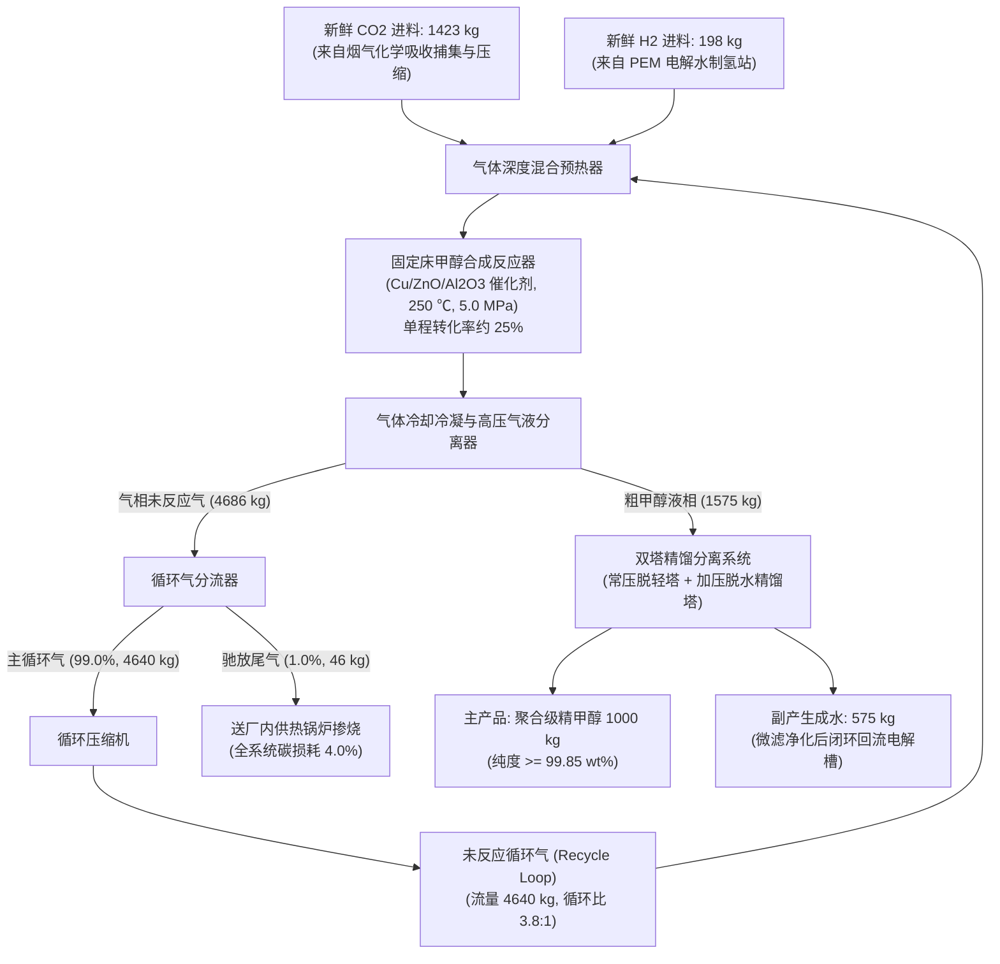

# 工业园区 CO2 捕集与绿氢合成绿色甲醇系统：工程背景与理论核算手册

> **【手册定位】**
> 本手册系统阐述工业园区二氧化碳捕集利用与封存（CCUS）耦合绿氢催化合成绿色甲醇（Power-to-Methanol, PtM）系统的化学反应机理、物质流分析（MFA）模型、全生命周期评价（LCA）核算模型与技术经济分析（TEA）折现模型，为学生开展仿真计算与报告编制提供严密的理论支撑。

## 一、 系统定位与工艺拓扑

### 1.1 系统工程定位

传统的甲醇生产以煤炭或天然气为主要化石原料，生产过程温室气体排放强度大。利用工业企业锅炉或窑炉烟气捕集的高纯 $\text{CO}_2$，与利用清洁可再生电力电解水制得的高纯绿氢（$\text{H}_2$），在催化剂作用下进行加氢反应合成绿色甲醇，是实现高碳产业原料脱碳、规模化消纳波动性风光电力的重要技术路径。

### 1.2 工艺流程拓扑与内循环控制体

系统工艺由气体混合预热、固定床催化反应器、冷却冷凝气液分离器、循环气分流器与压缩机、以及双塔精馏系统组成：

## 二、 MFA 物质平衡与循环流理论推导

### 2.1 核心热力学反应体系

催化加氢合成甲醇体系由以下平行反应共同控制：

1. **甲醇合成主反应（放热反应）**：
   $$
   \text{CO}_2 + 3\text{H}_2 \rightleftharpoons \text{CH}_3\text{OH} + \text{H}_2\text{O} \quad (\Delta H_{298\text{K}} = -49.5\text{ kJ/mol})
   $$
2. **逆水煤气变换反应（RWGS，吸热反应）**：
   $$
   \text{CO}_2 + \text{H}_2 \rightleftharpoons \text{CO} + \text{H}_2\text{O} \quad (\Delta H_{298\text{K}} = +41.2\text{ kJ/mol})
   $$
3. **副产物 $\text{CO}$ 加氢反应（强放热反应）**：
   $$
   \text{CO} + 2\text{H}_2 \rightleftharpoons \text{CH}_3\text{OH} \quad (\Delta H_{298\text{K}} = -90.7\text{ kJ/mol})
   $$

### 2.2 反应器单程转化率与循环流（Recycle Loop）解耦机制

* **单程转化率限制**：在工业铜基催化剂（$\text{Cu/ZnO/Al}_2\text{O}_3$）及标准操作工况（$240 \sim 260\text{ ℃}$, $5.0\text{ MPa}$）下，受化学平衡限制，二氧化碳单程转化率 $X_{\text{sp}}$ 仅为 **$25.0\%$** 左右。
* **分流器分流比与碳转化利用率**：高压气液分离器分离出的未反应气相中，**$99.0\%$（$4,640\text{ kg}$）重返循环回路**，**$1.0\%$（$46\text{ kg}$）作为尾气排出**以抑制惰性组分积聚。这使得全流程总碳转化利用率高达 **$96.0\%$**，实现了低单程转化率与高总体资源化率的工程解耦：
  $$
  \eta_{\text{carbon}} = \frac{\text{精甲醇产品固定碳量}}{\text{新鲜输入 } \text{CO}_2 \text{ 总碳量}} = \frac{1,000.0 \times \frac{12.011}{32.042}}{1,423.0 \times \frac{12.011}{44.010}} \approx \mathbf{96.0\%}
  $$

### 2.3 吨产品综合电耗分解

全厂综合电耗基准为 **$10,826.0\text{ kWh/t 甲醇}$**：

1. PEM 电解水制氢电耗：以先进指标 $52.0\text{ kWh/kg H}_2$ 核算，为 $198.0\text{ kg} \times 52.0 = \mathbf{10,296.0\text{ kWh}}$（**占全厂总用电负荷 $95.1\%$**）；
2. 二氧化碳捕集与多级加压压缩电耗：$255.0\text{ kWh}$；
3. 循环气增压压缩机与换热泵电耗：$155.0\text{ kWh}$；
4. 双塔精馏脱水与冷冻机组电耗：$120.0\text{ kWh}$。

## 三、 LCA 全生命周期碳足迹核算模型

### 3.1 评价边界与功能单位

* **功能单位**：生产 $1,000\text{ kg}$ 聚合级绿色精甲醇（门到门 / Cradle-to-Gate）；
* **对比基准**：我国主流煤制甲醇（CtM）全生命周期碳排放基准值 $\text{GWP}_{\text{bench}} = \mathbf{+2,600.0\text{ kg CO}_2\text{e/t 甲醇}}$。

### 3.2 碳足迹核算数学模型

$$
\text{GWP}_{\text{net}} = \text{GHG}_{\text{power}} + \text{GHG}_{\text{infra}} - \text{Credit}_{\text{CO}_2 \text{ capture}} - \text{Credit}_{\text{O}_2}
$$

* **排放产生项**：
  * 电力间接排放：$\text{GHG}_{\text{power}} = 10,826.0 \times EF_{\text{grid}}\text{ (kg CO}_2\text{e/t)}$；
  * 基础设施、催化剂消耗与逸散：$\text{GHG}_{\text{infra}} = +95.0\text{ kg CO}_2\text{e/t}$。
* **环境减排信用项**：
  * 原料二氧化碳捕集化学固定信用：$\text{Credit}_{\text{CO}_2 \text{ capture}} = -1,423.0\text{ kg CO}_2\text{e/t}$；
  * 副产高纯工业纯氧替代深冷空分信用：$\text{Credit}_{\text{O}_2} = 1,584.0\text{ kg} \times (-0.06\text{ kg CO}_2\text{e/kg}) = -95.0\text{ kg CO}_2\text{e/t}$。

### 3.3 高碳电力间接增排的热力学机制

当采用区域煤电网电（排放因子 $EF_{\text{grid}} = 0.550\text{ kg CO}_2\text{e/kWh}$）时，系统净碳足迹飙升至 **$+4,531.3\text{ kg CO}_2\text{e/t}$**，较煤制工艺反向增排 $74.3\%$。其根本原因在于：煤电发电效率仅约 $40\%$，电解水能量转化效率约 $64\%$，串联热力学折损使得生产过程间接消耗了数倍于化学储能的一次化石煤炭。

## 四、 TEA 技术经济分析与平准化成本模型

### 4.1 财务折现模型

* 加权平均资本成本（WACC）：$8.0\%$；经济运营期：20 年。
* 资本回收系数（CRF）：
  $$
  CRF = \frac{i(1+i)^n}{(1+i)^n - 1} = \frac{0.08(1.08)^{20}}{(1.08)^{20} - 1} \approx 0.10185
  $$

### 4.2 基础固定资产投资（CAPEX）构成（基准 8.20 亿元）

1. 130 MW PEM 电解水制氢站：$4.55\text{ 亿元}$（占比 $55.5\%$）；
2. 二氧化碳捕集与三级压缩站：$1.10\text{ 亿元}$；
3. 甲醇合成反应器与热集成蒸汽发生系统：$1.20\text{ 亿元}$；
4. 双塔精馏提纯与储罐系统：$0.65\text{ 亿元}$；
5. 厂区公用工程、管廊与电气接入：$0.70\text{ 亿元}$。

* 单吨基准资本折旧年金摊销：
  $$
  \frac{8.20\text{ 亿元} \times 0.10185}{100,000\text{ 吨}} \approx \mathbf{835.2\text{ 元/t 甲醇}}
  $$

### 4.3 边际减排成本（MAC）理论推导

$$
\text{MAC} = \frac{\text{LCOM}_{\text{green}} - \text{Price}_{\text{fossil}}}{\text{GHG}_{\text{fossil}} - \text{GHG}_{\text{green}}} \quad (\text{元/t CO}_2\text{e 避免})
$$

在 $100\%$ 绿电驱动下，单位产品相对煤制工艺减排量为 $\Delta \text{GHG} = 2,600.0 - (-1,044.1) = 3,644.1\text{ kg/t} = 3.644\text{ t CO}_2\text{e/t 甲醇}$：

* 当清洁电价为 $0.35\text{ 元/kWh}$ 时，$\text{LCOM} = 5,027.5\text{ 元/t}$，$\text{MAC} = \frac{5,027.5 - 2,500.0}{3.644} \approx \mathbf{693.6\text{ 元/t CO}_2\text{e}}$；
* 当消纳电价降至 $0.15\text{ 元/kWh}$ 时，$\text{LCOM} = 2,862.3\text{ 元/t}$，$\text{MAC} = \frac{2,862.3 - 2,500.0}{3.644} \approx \mathbf{99.4\text{ 元/t CO}_2\text{e}}$。
