# 湖北省退役动力电池锂资源回收环境规划与管理方案报告

**方向A｜规划期2026—2040年｜基准节点2025年｜计算代表年2030年**  
编制日期：2026年11月3日。本文为**有证据边界的条件情景规划研究**。正文中的模型结果均由本项目CSV与脚本复算，未将研究假设写成湖北观测事实。与输入有关的16项审查发现另见[数据与代码核查说明](Data_and_Code_Audit.md)。

## 模块0 摘要、团队分工与术语

### 0.1 执行摘要

本方案以湖北省17个核算单元为对象，以2025年为基准节点，分析2026—2040年退役动力电池与二次锂资源回收。采用安装队列动态物质流、政策数值筛选、环境与费用清单和容量约束物流模型，对组员补充资料进行复算。输入包含公开统计锚点及未经充分核验的安装、寿命、材料、工艺与报价情景，因此结果用于条件比较，不作为实证预测或投资可研。情景计算2040年首次退役电池24.53万吨、蕴含锂3,914.95吨，四种金属守恒误差均低于0.05%。4000组组合中2200组满足设定的近期收集率目标。代表B采用湿法、收集率71.32%、绿电50%，2030年处理3.44万吨、产出2,504.77吨LCE。全链环境负荷计入LCE后，单位碳影响筛查值为6.87吨CO2e，未计固定费用的LCOR为13.23万元/吨。方案仍存在经营缺口，项目总概算尚未形成，不能将零计列投资解释为零建设成本。建议先核实厂址能力、完善回收溯源与工艺清单，再分阶段验证扩容需求；采用生产者责任延伸、直接取水核查和监测报告核查机制，未核定碳信用不确认交易收入。

### 0.2 团队成员分工与贡献声明

| 姓名 | GitHub账号 | 角色及实际负责工作 | 贡献比例 | 签名确认 |
| --- | --- | --- | --- | --- |
| 张宏生 | 待本人补充 | 数据收集、文献检索与来源核查 | 33.33% | 待本人确认 |
| 曾飞楊 | 待本人补充 | 报告撰写、章节整合与文字核对 | 33.33% | 待本人确认 |
| 陈海滨 | dev-group-01-chb为工作分支，账号待本人补充 | 核心模型、代码实现、复算与结果核对 | 33.34% | 待本人确认 |
| 合计 | — | 三位成员共同审阅最终交付 | 100.00% | 未代签 |

贡献比例按小组要求近似均分，须由全员确认。AI用于代码辅助、数据一致性检查和报告文本整理；成员承担参数适用性与最终结论的审核责任。

### 0.3 术语与核算定义

| 缩写 | 英文全称 | 中文及本报告口径 |
| --- | --- | --- |
| LIB | Lithium-ion Battery | 锂离子电池；质量口径为退役整包 |
| LFP | Lithium Iron Phosphate | 磷酸铁锂正极体系 |
| NMC/NCM | Nickel Manganese Cobalt Oxide | 镍钴锰三元体系；输入NCM为聚合情景，不是单一固定配方 |
| NCA | Nickel Cobalt Aluminium Oxide | 镍钴铝体系；未单独设安装队列 |
| LCE | Lithium Carbonate Equivalent | 碳酸锂当量；主比较假定产出电池级Li₂CO₃ |
| dMFA | Dynamic Material Flow Analysis | 动态物质流分析 |
| LCA / GWP100 | Life Cycle Assessment / Global Warming Potential | 生命周期评价/100年全球增温潜势；本次仅完成代理因子下的影响筛查 |
| TEA / LCOR | Techno-economic Analysis / Levelized Cost of Recycling | 技术经济分析/平准化回收成本；正文主值未覆盖未知固定费用与税费 |
| SOH | State of Health | 健康状态；报价固定0.8的情景值 |
| CRF / WACC | Capital Recovery Factor / Weighted Average Cost of Capital | 资本回收系数/加权平均资本成本 |
| MAC | Marginal Abatement Cost | 相对同口径原生基准的单位减排费用 |
| EPR / MRV | Extended Producer Responsibility / Monitoring, Reporting and Verification | 生产者责任延伸/监测、报告与核查 |
| CCER / PDCA | China Certified Emission Reduction / Plan–Do–Check–Act | 国家核证自愿减排量/策划—实施—检查—改进 |

## 第1章 现状诊断、系统边界与基准线

### 1.1 空间与时间范围

核算覆盖12个地级市、恩施州、仙桃/潜江/天门3个省直管县级市及神农架林区，共17个单元，并非17个地级市州。队列从2010年起算至2040年；2025年为规划基准节点，2030年为网络与费用比选代表年，2040年只开展规模压力测试，未求解逐年投资路径。跨省电池迁移未实测，采用封闭区域情景，其法律边界与审批条件见1.5；模型起点的电池及梯次库存边界不能解释为历史观测。

### 1.2 新能源汽车基础与安装数据边界

湖北日报2024年12月25日报道：当年1—11月新注册新能源汽车34.4万辆，当时保有量96.7万辆。武汉2024年末新能源车58.02万辆。两者统计时点不同，不能将其比值60%当成同一时点精确份额；现有安装表中的人口分配及年份插值只保留为情景。[S2–S3] 2025年乘用车销量乘新能源占比也不能直接替代全口径电池安装容量。完整安装量还需车辆类型、BEV/PHEV、单车容量、换包和迁移等资料。

年鉴2024年新能源汽车507318辆是工业产量，不是省内新增注册量；锂离子电池自然只数不能转换成整包数量。图1-1给出各类燃料私人汽车背景，用于解释交通基础，未作为EV安装量替代。

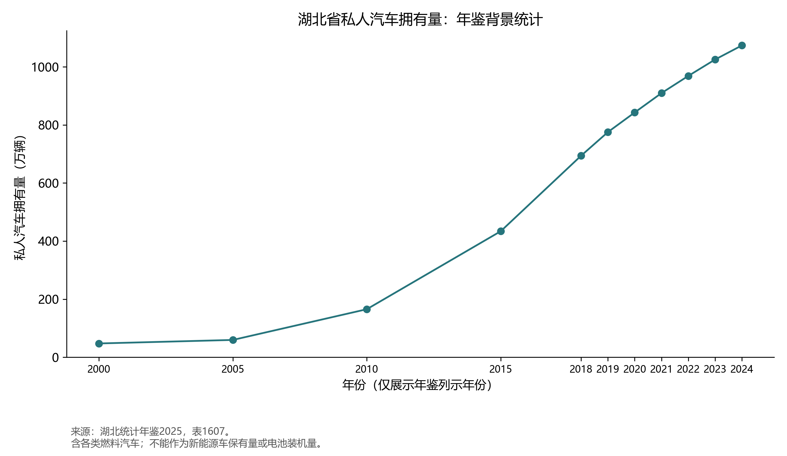

### 1.3 电源与区域负荷

年鉴电力平衡表列示2019—2023年，不能因书名为2025年鉴就称其为2024年电力结构。图1-2表明生产构成与消费规模存在差异，发电结构不能直接代替消费侧绿电份额。图1-3仅包含原表12个主要城市，不能给其余地区补零。[S1]

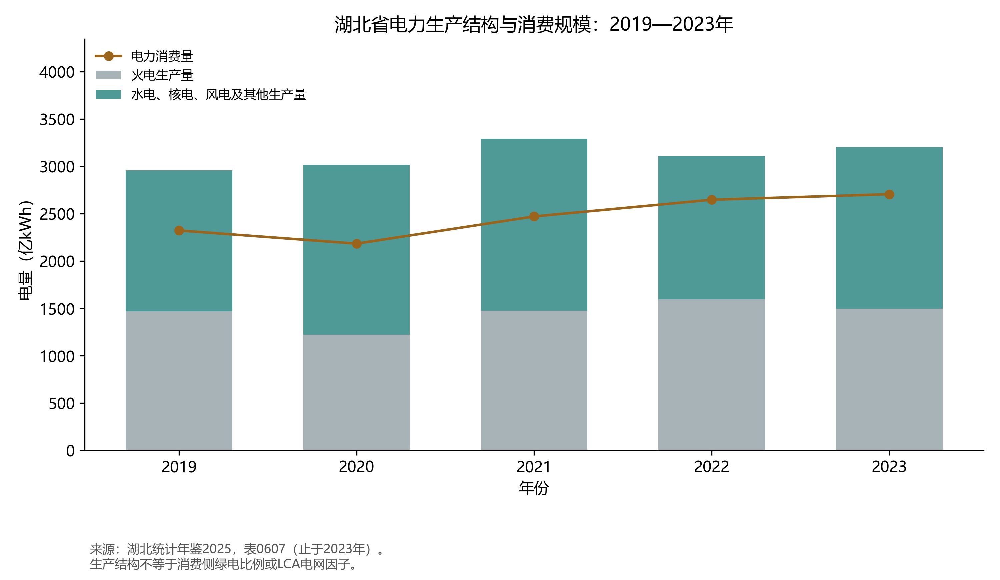

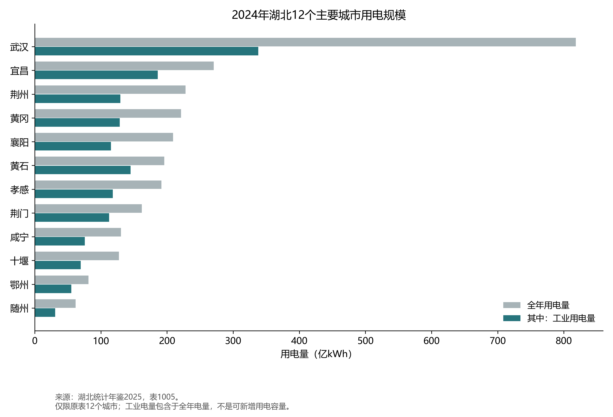

模型采用官方2023年湖北电力CO₂因子0.4044 kgCO₂/kWh，并假定2030年不变；该数值不是完整电力生命周期GWP100因子。与0.02 kgCO₂e/kWh绿电代理值混合会存在边界差异，本次因此只报告碳影响筛查值，不声称获得核证产品碳足迹。电网耗水2与绿电耗水0.05 L/kWh也属于待核代理。[S4]

### 1.4 管理问题与核算边界

规划需要同时处理回收流向不完整、废料计价口径不一致、低值LFP回收收益有限及含氟废水等次生污染问题。本次没有企业级实测证据证明湖北各厂普遍亏损，也没有以行业规范公告替代环评或排污许可。

物质流边界为省内安装—在用—首次退役—正规收集—梯次库存或再生产品/残余。当前梯次分流设0只是比选设置。环境清单按每吨进入精炼的退役整包建立，最终换算为1吨LCE；包括已列运输、电力、预处理、热源、试剂和污染治理代理负荷。废电池进入边界前的原始制造负荷未再次计入，其他产品未获得环境替代信用。主值不是完整全生命周期服务比较。

### 1.5 政策与合规边界

国家法律与部门规章设有罚则或审批程序，构成硬边界；行业规范条件、国家与省级规划属引导性文件，只提供目标与依据。两类文件不能混用：前者决定项目能否落地，后者只解释目标来源。

回收责任与网点。车用动力电池已纳入生产者责任延伸制度（固废法第66条），生产者须建立与销售量匹配的回收体系。2026年4月施行的六部门令第73号进一步规定，电池企业按省级、汽车企业按地市级配置网点，且不得拒收。据此，17个核算单元的收集点不能只按行政层级布设，必须区分两类责任主体的网点；模型中的“非正规系统流出”在政策上属于违法流出，而非“未收集”。报废环节须由具备资质的回收拆解企业承担。[S14]

流向与梯次。退役电池只能交由综合利用企业或回收网点，并禁止直接或加工后用于电动自行车等禁用领域。旧梯次管理文件已随2026年管理办法废止，本方案因此不设梯次白名单；若要保留梯次，只能按产品安全、认证与适用法律逐项论证，不能仅凭SOH分流。[S6]

属性与转移。废锂离子电池及黑粉未列入《国家危险废物名录》，按一般工业固体废物管理，但仍须满足GB 18599的贮存要求；拆解产生的废电解液需另行鉴别。按固废法第22条，跨省贮存、处置须经省级审批，跨省利用不适用该审批。1.1的封闭区域情景因此是建模简化，不是法律限制：省内收集、荆门精炼是合法主路径，跨省只宜利用、不宜贮存。[S12–S13]

准入与出口。综合利用项目须办理核准或备案、环评与排污许可；行业规范条件声明不具有行政审批前置性，其公告名单是招标与绿色金融的事实门槛，企业在申报时受行政处罚记录约束。[S5] 荆门已批项目只能表述为含锂废料综合利用项目，不能等同整包处理能力或合规再生资质。欧盟2023/1542仅约束投放欧盟市场的电池，再生含量（2031年锂6%、2036年锂12%）与电池护照（2027年2月18日）不适用于省内销售电池，故本方案不将其作为全省目标，只列为出口高值情景。[S7]

省级层面未检索到专门的动力电池回收实施方案，地方依据主要是国家规章与省级固体废物规划；引用地方文件中的“梯次利用产业基地”表述时，应按现行制度改称再生利用。

## 第2章 退役预测情景与元素平衡

### 2.1 队列模型与年度退役概率

输入为安装年份v、地区i与化学体系c的容量I，单位kWh。双参数Weibull生存函数为：

```math
S_c(a)=\exp\left[-\left(\frac{a}{\eta_c}\right)^{\beta_c}\right],\qquad p_c(a)=S_c(a-1)-S_c(a),\quad a\geq1.
```

```math
R_{i,c,t}=\sum_{v\lt t} I_{i,c,v}\,p_c(t-v),\qquad K_{i,c,t}=\sum_{v\leq t} I_{i,c,v}\,S_c(t-v).
```

安装按年末计，当年不退役；年度概率采用CDF差分，不能把Weibull密度在整数年上的取值当作概率。预测末年的生存尾部保留在库存。输入采用η=10年、β=3.5，但原始寿命表尚未完整核验，因此是条件参数，不是本组对湖北车队拟合出的寿命。[R3]

每个队列的整包比能量和Li/Ni/Co/Mn强度按原安装年固定，容量分别除以kWh/kg或乘以kg元素/kWh得到质量。NCM输入为随年份演变的聚合代表值，不能宣称已独立预测NMC111/523/622/811及NCA六类队列。

### 2.2 规模结果及其解释

| 年份 | 在用Li/t | 退役电池/t | 退役Li/t | 基准收集电池/t | 基准再生Li/t |
| --- | --- | --- | --- | --- | --- |
| 2020 | 837.92 | 617.08 | 9.61 | 61.71 | 0.84 |
| 2024 | 5,391.58 | 3,774.70 | 61.33 | 849.31 | 11.97 |
| 2025 | 7,948.66 | 5,987.73 | 97.59 | 1,496.93 | 21.14 |
| 2030 | 23,398.14 | 48,238.60 | 767.56 | 24,119.30 | 329.89 |
| 2040 | 40,668.56 | 245,317.85 | 3,914.95 | 208,520.18 | 2,843.72 |

表2-1来自`annual_summary.csv`，基准收集率取原输入逐年值，**不是推荐B的固定规划期收集率**。2040年首次退役电池为245,317.85吨，蕴含Li为3,914.95吨。这两个数由完整情景队列产生，不能用少数年度公开注册锚点证明其预测精度。

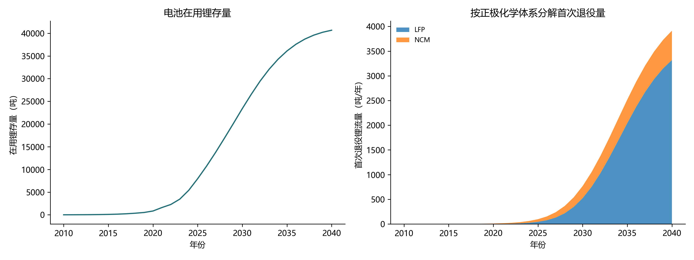

图2-1区分在用存量与年度退役流量：2030—2040年在用Li从23,398.14吨增至40,668.56吨，年度首次退役Li由767.56吨增至3,914.95吨，为2030年的5.10倍。退役量取决于历年安装队列及其服役年龄，不能直接用当年新能源汽车产量或安装量代替；在用Li也不能全部视为当年可回收资源。

按正极体系分解，LFP在2030年和2040年的首次退役Li分别为522.54吨和3,320.19吨，占相应年份退役Li的68.08%和84.81%。在给定安装结构与材料参数下，远期资源流中LFP占比上升，工艺与费用评估应保留分体系清单，不能把全部退役整包套用三元电池的金属强度或采购价格。该变化来自当前安装与材料情景，不是对湖北未来市场份额的独立验证。

### 2.3 正规收集、有效供应与守恒

正规收集率与工序回收率不同。在本次梯次分流为0的情景中，各元素再生产品为“退役元素量×正规收集率×全链有效回收率”。有梯次分流时，需要对往年进入库存的元素按延迟释放，不能简单把当年退役量相乘后计为当年产品。

元素平衡核查关系为：

**期初在用 + 新增安装 + 期初梯次库存 = 期末在用 + 期末梯次库存 + 再生产品 + 精炼残余 + 非正规系统流出。**

相对误差取两端差的绝对值除以输入总量，零元素流入单独处理。程序逐年打印并导出`element_balance.csv`：

| 元素 | 最大相对误差 | 阈值 | 程序检查 |
| --- | --- | --- | --- |
| Li | 4.520e-16 | <5×10⁻⁴ | 通过 |
| Ni | 4.182e-16 | <5×10⁻⁴ | 通过 |
| Co | 4.279e-16 | <5×10⁻⁴ | 通过 |
| Mn | 4.277e-16 | <5×10⁻⁴ | 通过 |

上述结果证明账面元素去向闭合，不证明寿命、装机、收集率或排放清单准确。Cu、Al、P、F未纳入完整元素平衡，不能从四种金属的闭合推称整包电池所有元素已核验。

### 2.4 二次锂供应演变与代表年流向

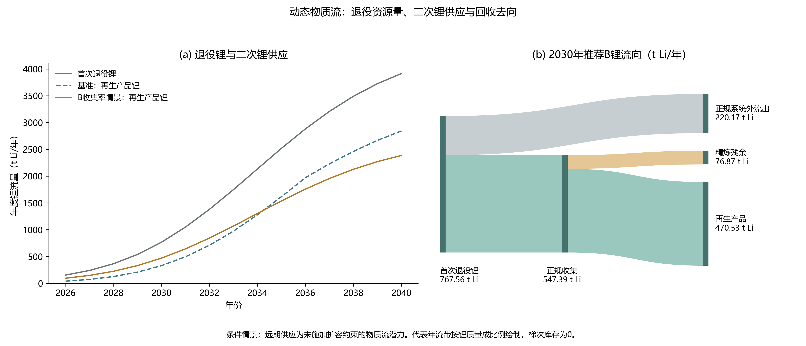

图2-2(a)将首次退役Li、基准再生产品Li与B收集率情景的再生产品Li并列，说明退役资源量需要经过正规收集和有效回收后才能形成二次锂供应。基准采用逐年收集率，B将规划期收集率固定为71.32%，两者采用同一湿法回收参数。该年度延伸只核算物质流潜力，尚未逐年施加网络容量约束或优化扩建；不能把2040年的曲线值直接作为现有设施可交付产品量。

表2-3 二次锂供应的情景比较，单位为锂元素吨，不是整包电池吨或LCE吨。

| 年份 | 首次退役Li/t | 基准收集率/% | 基准再生Li/t | B收集率/% | B再生Li/t | B正规系统外Li/t |
| --- | --- | --- | --- | --- | --- | --- |
| 2030 | 767.56 | 50.00 | 329.89 | 71.32 | 470.53 | 220.17 |
| 2035 | 2,519.09 | 75.00 | 1,616.67 | 71.32 | 1,537.25 | 722.58 |
| 2040 | 3,914.95 | 85.00 | 2,843.72 | 71.32 | 2,385.90 | 1,122.97 |

2030年B的再生Li为470.53吨，比基准329.89吨增加140.64吨，增幅42.63%，差异来自正规收集率由50%提高到71.32%，不是工艺回收率提高。基准收集率到2040年升至85%，高于固定B，因此基准再生Li达到2,843.72吨，B为2,385.90吨；B是2030年代表方案，不能据此宣称其固定收集率在整个规划期始终优于逐年改善的基准。

图2-2(b)展开2030年B的流向：首次退役Li为767.56吨，其中547.39吨进入正规收集和精炼，220.17吨未进入本模型的正规回收系统。精炼进料进一步分成470.53吨再生产品Li和76.87吨残余Li；两级分流均闭合。正规系统外流出是边界外去向，不等同于全部排入环境；精炼残余是所跟踪Li的去向，不代表残渣、废水等全部介质的总质量。

本情景的湿法全链Li有效回收率分别为LFP 85%、NCM 88%，按2030年精炼进料锂量加权为85.96%；相对于全部退役Li，实际进入再生产品的比例为61.30%。全链有效值与第3章的单一冶炼工序90%筛选值分母不同，不能直接互换。再生产品中的470.53吨Li换算为2,504.77吨LCE，与第4章工程清单和第5章B一致；增加的碳、氧质量不来自退役锂，不能将LCE吨数直接代入Li守恒。当前梯次分流和库存均为0，图中未绘制无数值依据的梯次利用流带。

图2-2与表2-3由`plot_dmfa.py`汇总`dmfa_annual.csv`、`element_balance.csv`及两张推荐B对应表生成，逐年锂流写入`dmfa_lithium_flow_summary.csv`。据此，近期应分别跟踪正规收集缺口与精炼残余，远期则在核实安装队列和企业能力后重新评估收集率与扩建节奏；现有物质流潜力不能替代产能、产品质量和市场消纳论证。

## 第3章 规划目标与指标体系

### 3.1 分期目标

近期目标是在2030年情景比选中要求正规收集率不低于70%，远期将85%作为进一步压力测试目标。二者均为小组规划目标，不是已查明的全国法定收集率。将不满足70%的1800组工况标为`Below_Planning_Target`，与法律红线否决分开。

### 3.2 指标矩阵

| 维度 | 指标 | 2030年要求/目标 | 2040年要求/目标 | 性质及监测依据 |
| --- | --- | --- | --- | --- |
| 资源循环 | 正规收集率 | ≥70% | 85%压力测试 | 小组预期目标；溯源进出库、车队清单核对 |
| 资源循环 | 冶炼Li回收率 | ≥90% | ≥90%，以届时规定为准 | 2024年本数值筛选，工序元素收支 |
| 资源循环 | Ni/Co/Mn回收率 | 含有时≥98% | 同左 | 同上；不能用混合物总回收率替代 |
| 资源循环 | 电极粉料/材料修复 | 粉料≥98%；修复路线目标材料≥99% | 同左 | 路线适用性不同，不叠加错用 |
| 能源降碳 | Li₂CO₃产品综合能耗 | <2200 kgce/t产品 | 按实际技术改善，不另造法定值 | 工艺、产品分母与能耗台账；不能使用每吨电池数值替代 |
| 能源降碳 | 绿电占比 | B代表情景50% | 另行论证 | 预期变量，不是已核实消纳承诺 |
| 能源降碳 | 欧盟新电池再生Li含量 | 2030年尚未到6%生效日 | 2036-08-18起12%适用要求 | 合同及适用产品约束；2031-08-18起6% |
| 污染水效 | 工艺废水循环率 | ≥90% | 不低于适用标准 | 工序水量计量与核查 |
| 污染控制 | 氟固化率 | ≥99.5% | 不低于适用标准 | 工艺物料/固体产品检测；CEMS不能代替全部氟收支 |

2024年本行业规范是引导性文件，不是行政审批前置条件。模型的`Redline_Vetoed`表示不满足课程方案筛选规则，不自动构成行政违法认定。新电池再生Li含量、废电池中Li材料回收率以及本地区正规收集率必须分别计量。[S5,S7]

### 3.3 政策数值引擎与验证

引擎支持湿法、火法和材料修复分支、能源/杂质严格不等式、是否含Ni/Co/Mn、欧盟生效日期及电池护照条件。代表工况包括不达标粗放回收、常规达标湿法和先进材料修复；与其他模型测试合计27项通过。输入中的1900 kgce/t产品及达标率为工况假设，不是从当前聚合LCI独立证实的企业数据。

欧盟材料Li回收要求为2027年末50%、2031年末80%；再生含量6%/12%的日期分别是2031与2036年8月18日，不能提前列为2030年义务。相关产品的电池护照要求另按法规第77条核查。出口溢价没有法规统一固定金额，本项目没有合同凭证，未计入收入。[S7]

## 第4章 技术路径、空间配置与工程实施

### 4.1 工艺比选边界

本次计算两条假定产出电池级LCE的湿法与火法工艺，保留LFP及聚合NCM物质流。火法需要相应后处理才能形成LCE，输入中的产品假设尚需工艺证明。直接正极修复的产品通常是修复材料，不能套用LCE售价、原生Li₂CO₃基准后作出同功能经济排序。SOH=0.8仅用于报价匹配，不是所有应用通用的梯次分流阈值。[R4–R6]

2026年管理办法废止旧梯次管理文件，不等于对所有梯次利用实行普遍禁止；同时明确不得将废旧动力电池直接或加工后用于电动自行车等禁止领域。规划应以适用产品安全、认证与法律要求进行逐项筛选，不能仅凭SOH将电池分流至某类产品。[S6]

### 4.2 2030年固定目的地物流配置

网络含17个城市起点、17个同城收集点和1个荆门代表性处理点。该处理点容量上限100000 t/年是**模型假设**；现有资料不能证实这是荆门单厂已核准、已建成且可供本组物料使用的净能力。只有一个精炼候选地时，MILP解决的是容量和费用约束下的运输配置，不能称为全省最优厂址选择。

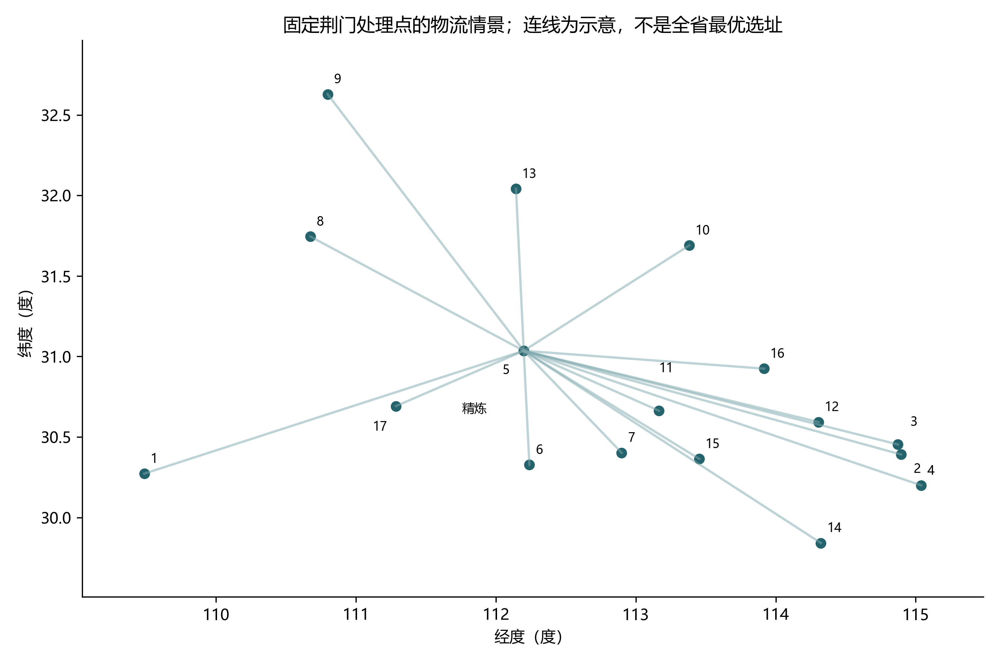

| 图中序号 | 核算单元 | B年收集量/t | 至假设精炼点道路km |
| --- | --- | --- | --- |
| 1 | 恩施 | 1,033.55 | 321.0 |
| 2 | 鄂州 | 328.32 | 296.4 |
| 3 | 黄冈 | 1,772.70 | 296.8 |
| 4 | 黄石 | 745.29 | 323.1 |
| 5 | 荆门 | 780.61 | 0.0 |
| 6 | 荆州 | 1,567.99 | 89.5 |
| 7 | 潜江 | 254.29 | 114.7 |
| 8 | 神农架 | 17.72 | 245.4 |
| 9 | 十堰 | 961.63 | 286.5 |
| 10 | 随州 | 613.27 | 178.8 |
| 11 | 天门 | 331.75 | 121.4 |
| 12 | 武汉 | 20,773.58 | 224.1 |
| 13 | 襄阳 | 1,615.79 | 126.3 |
| 14 | 咸宁 | 795.82 | 282.8 |
| 15 | 仙桃 | 331.01 | 172.4 |
| 16 | 孝感 | 1,276.76 | 182.7 |
| 17 | 宜昌 | 1,201.66 | 115.7 |

表4-1序号对应图4-1的城市起点编号；精炼点单列标记。推荐B的道路加权平均运距为212.46 km。城市起点至同城收集点取0 km，会低估市内接驳；OSRM距离未包含道路限制、危货许可、动态拥堵及过路费用的完整审查，后续须保留原始OD响应。

### 4.3 五项衔接工程与费用一致性

以下为规划工程组成，建设周期是拟议安排，责任主体是建议角色，并非已获授权的建设单位。未知投资不写0元；代码中0表示未纳入本次费用口径。P01—P03的已计变动费互不重叠，其合计与B年已计费用一致；P04—P05不另加一笔重复公用工程费或虚构预算。

| 编号/项目 | 性质、空间与拟议周期 | 规模与核心工艺 | 固定投资CAPEX | 年已计变动费用 | 资源环境效益与建议责任主体 |
| --- | --- | --- | --- | --- | --- |
| P01 收集溯源与放电预处理 | 存量整合；17单元；2026—2030 | B年经手34,401.74 t；编码、检测、合规包装和预处理 | 新增投资待概算；17点各50000 t/y上限为情景，不能相加称精炼产能 | 965.19万元；已计运输和预处理，不含未知固定运维 | 为P02输送同一批物料，不重复计LCE或减排；生产企业、回收网点及运输单位 |
| P02 再生提锂处理能力核实与工艺改造 | 荆门代表点；先核实再决策；2026—2030 | 假设设计100000 t/y；B实流34,401.74 t/y；湿法 | 未获本厂概算；同规模重置代理6.20—23.24亿元，不作新增预算承诺 | 31,521.53万元；含采购、电力、热源和试剂，未含未知固定成本 | 年LCE 2,504.77 t；主效益只归属此项，综合利用企业 |
| P03 副产品分离与水污染治理 | 与P02一体化；2026—2030 | 治理服务同一34,401.74 t/y进料，废水循环按工艺核实 | 包含关系待设备报价，不单独编造投资 | 653.31万元，来自LCI治理项 | 副产物数量与收入未核实，暂不计销售收益；运营企业 |
| P04 绿电合同与计量改造 | 处理点及供电侧；2026—2030 | B绿电份额50%情景；不是已核准微网设计规模 | 待概算 | 电力费用已在P02，不再重复加总 | 碳/水效益纳入整体B，不重复分配；运营企业与供电交易服务方 |
| P05 数字护照与MRV平台 | 省级数据汇聚及17单元接入；2026—2030 | 电池编码、SOH、进出库、水电与产品材料归属 | 待系统需求及报价 | 未计入；不能认为免费 | 管理效益待绩效评估，不虚增吨数；生产企业及依法履职部门 |

P01—P03已计费用合计33,140.03万元/年，与`anchors.csv`中`annual_base_opex_cny`一致。项目总CAPEX和完整固定OPEX尚未形成，不能出具完整工程总投资结论。资本敏感性用于说明遗漏固定成本可能改变经济判断，不代替项目概算。

整体B相对盐湖基准的年度碳影响差为16,110.20 t CO₂e，年度节水代理量为446,793.89 m³；相对锂辉石基准分别为17,613.06 t CO₂e和96,126.20 m³。此为同一物料系统在给定基准下的筛查差额，不是五项目分别产生、可再次加总的效益，更不是已签发碳信用。

### 4.4 远期规模压力与安全约束

基准85%收集率下，2040年收集量208,520.18 t，较假设100000 t/y上限多108,520.18 t/y。即使固定采用B的71.32%，2040年也需处理174,950.36 t/y。本次未完成远期多厂容量扩建优化，不能将这些流量直接承诺由现有单厂消纳。

新增候选地必须核查用地、环境容量、许可、消防与运输条件。储运、带电隔离、放电、拆解、热处理、酸浸、危废暂存和污水单元分别组织，按适用标准确定安全间距，本文不编造统一防护距离或事故池容积。

## 第5章 环境、经济与多目标评估

### 5.1 功能单位和分配修正

Li转LCE的化学计量系数为M(Li₂CO₃)/(2M(Li))≈5.323；它只转换实际回收Li的当量，不能把混合金属盐直接认证为电池级碳酸锂。B的年度Li产品为470.53 t，对应2,504.77 t LCE。

原组员结果采用0.32环境分配比例，但该比例来自不同产品组合的收入信息，本项目又未提供对应副产品产量和收入。修正后把**全部已计系统环境负荷归入LCE**，不凭未核实副产品取得环境信用。该方案偏保守，仍不能弥补清单缺项。

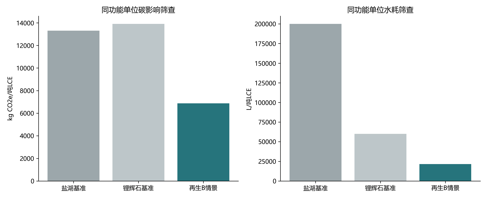

盐湖和锂辉石13.3、13.9 t CO₂e/t Li₂CO₃为中国企业产能平均参考，不能称为澳大利亚硬岩矿专属值；200和60 m³/t LCE水耗为本次研究设计。原论文中14.5 kg CO₂e、193.9 MJ、77.3 L等按kg NCA-eq计的数值，没有套作LCE基准。[R4,S8]

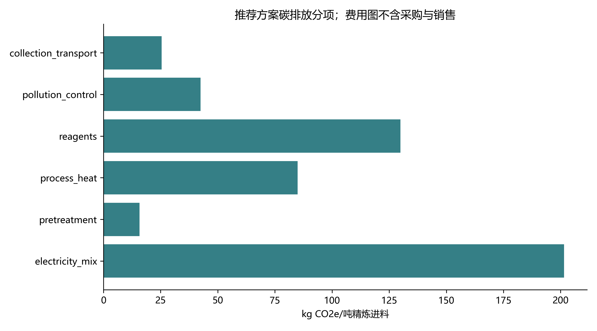

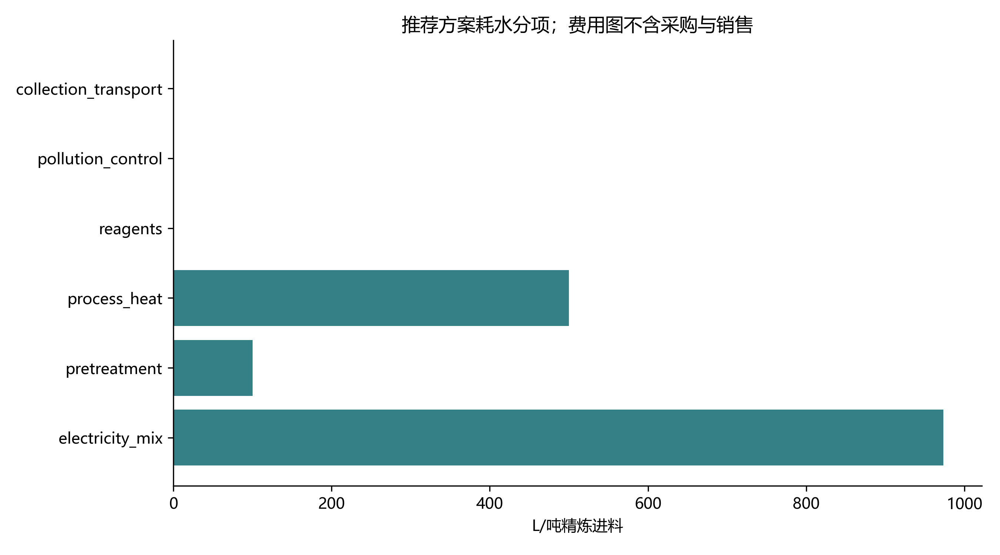

清单覆盖电力、热源、预处理、试剂、治理与收集运输，但热源和试剂多数仍以聚合每吨代表值表示，尚不能回溯每种化学品的单耗、数据库活动和地区化排放因子。图5-2、5-3用于识别后续应优先核实的负荷，不足以出具产品环境认证。

### 5.2 水—碳关系

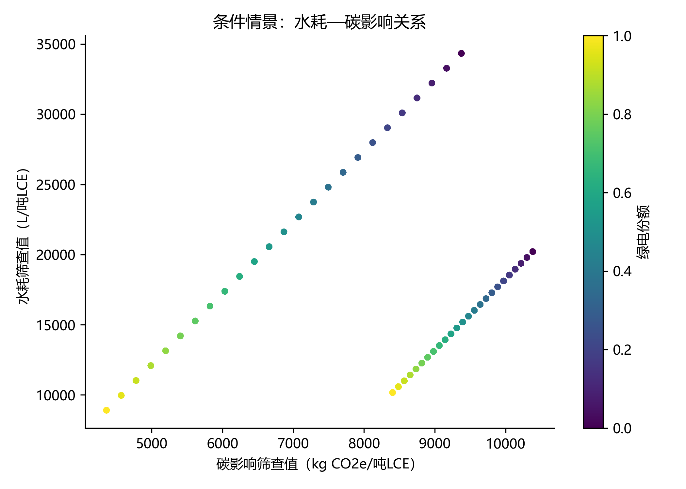

当前设定中绿电碳、水因子均低于电网，随着绿电份额增加，两项筛查指标同时下降，不能据图宣称已经识别出方向相反的“水碳权衡”。水电、风电和光伏的实际水耗、时空电力匹配和绿证额外性未核实，关系方向可能改变。绿证价格也不能自动证明一项工程获得了全生命周期低水耗的电力。

### 5.3 成本、收益与资本年金

资本年金采用CRF=i(1+i)ⁿ/[(1+i)ⁿ−1]，i=0时为1/n。资本敏感性取WACC=8%、15年，二者是研究设计。LCOR在计入采购、过程与物流费用及政策修正后减去副产品收入，**不先抵扣主LCE销售收入**；年度净收益再减主产品销售，避免与原生生产成本比较时混用口径。

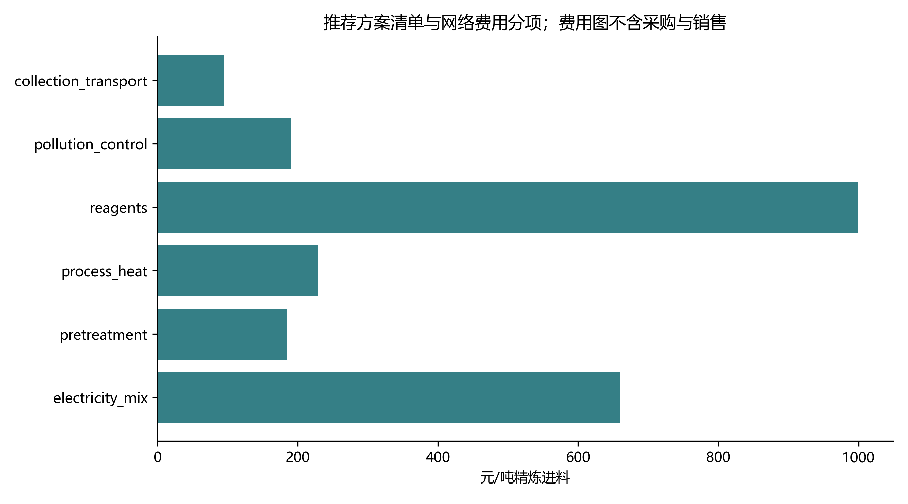

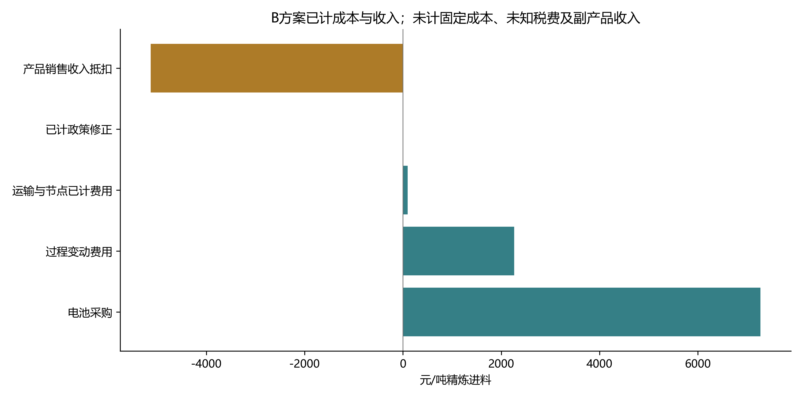

B每吨进料已计采购7,274.42元、过程费用2,263.21元、网络费用95.61元，销售收入5,133.06元；净成本4,500.18元/吨电池，年度经营缺口15,481.41万元。由于缺少固定费用、未知税费及副产品收益，这不是完整净利润，也不是完整工程LCOR。

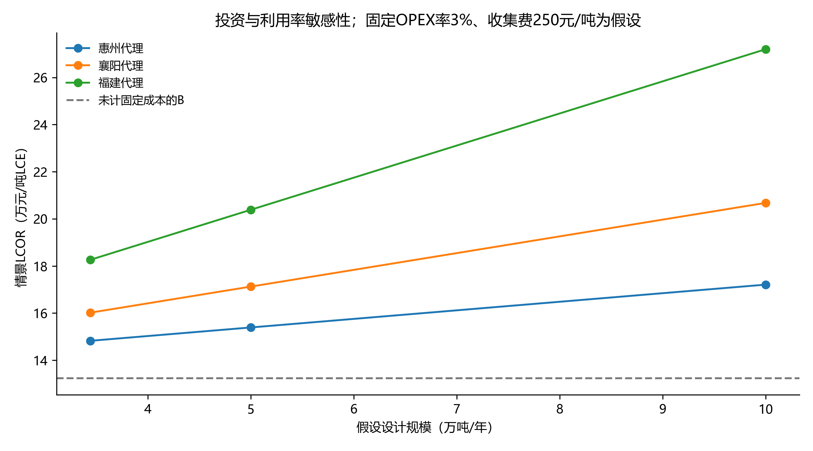

`postprocess.py`将同一B与三类项目单位投资、三档设计容量、3%/6%固定费用率及0/250元每吨收集暂存费用叠加。可用敏感性LCOR为14.48—29.98万元/t LCE。项目工艺、地区与边界不同，投资代理不能直接当作荆门报价。新增完整固定成本会提高成本，而副产品收入可能降低成本，不能把遗漏后的主值解释为成本上界或下界。

### 5.4 帕累托、锚点与推荐规则

组合为20档收集率×25档绿电×2档Li价×2条工艺×2种原生基准，共4000组。政策分层后保留两类集合：法规可行域只排除`Redline_Vetoed`与`Data_Incomplete`，共4000组；规划情景另行施加小组自定的近期70%收集率目标，剔除1800组后2200组参与比较。两层各自独立排序与归一化，不交叉计算距离。所给政策工况参数通过数值筛选，并不证明相应企业真实合规。

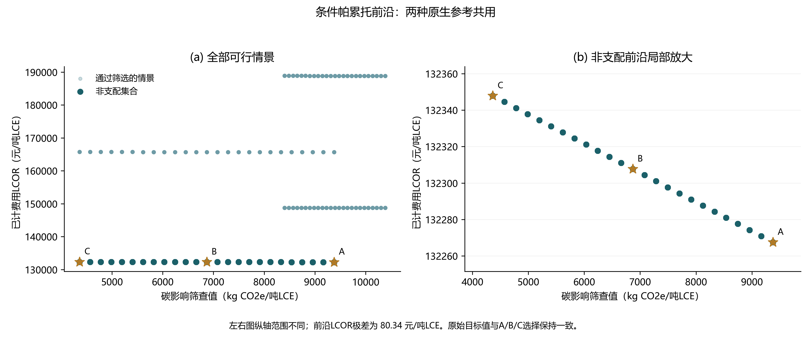

目标为最小化碳影响筛查值和LCOR。目标按非支配集合的各维极值归一化，B最小化距理想点的欧氏距离，A取最低LCOR，C取最低碳影响。1×10⁻⁹相对尺度内的浮点差异按并列处理，避免因舍入产生虚假支配。容差内保留不同物理方案；并列时按固定输入顺序选代表。

| 锚点 | 收集率/% | 绿电/% | 碳筛查kg CO2e/t LCE | 水筛查m³/t LCE | LCOR元/t LCE | MAC元/t CO2e |
| --- | --- | --- | --- | --- | --- | --- |
| A | 71.32 | 0.00 | 9,374.75 | 34.34 | 132,267.55 | 23,506.15 |
| B | 71.32 | 50.00 | 6,868.19 | 21.62 | 132,307.72 | 14,351.75 |
| C | 71.32 | 100.00 | 4,361.63 | 8.91 | 132,347.89 | 10,331.62 |

**从4000组到3个锚点的筛选链。** 锚点不是从4000组中直接挑“最好的一条”，而是逐级筛除、归并后按三条明确规则选出，每一步剩余量如下：

| 步骤 | 规则 | 剩余 |
| --- | --- | --- |
| 1 | 全部组合（收集率×绿电×Li价×工艺×原生基准） | 4,000 |
| 2 | 法规/课程红线数值筛选与数据完整性 | 4,000（0组否决） |
| 3 | 小组近期70%收集率目标 | 2,200（剔除1,800） |
| 4 | 按原生基准分组，不混合比较 | 1,100/基准 |
| 5 | 组内严格非支配排序（碳筛查值，LCOR） | 275/基准（支配825） |
| 6 | 1×10⁻⁹容差内目标等价归并 | 25个目标向量×11方案 |
| 7 | A取LCOR最小、C取碳最小、B取归一化距离最小 | 3个锚点 |

第5步后前沿只剩湿法、LCE价格70500元/t：同一绿电档下，价格93481.3元/t的湿法与两种火法方案的碳相同或更高、成本更高，均被支配。第7步中，B所在目标向量有11个仅收集率不同的并列方案，按固定输入顺序取收集率最低者71.32%作为代表；因此B的单位碳与LCOR由绿电档决定，而其71.32%是并列规则的代表值，不是独立优化出的最优收集率。若并列规则改取最高收集率（95%），B的单位指标不变，但年供应量与网络负荷会随之改变。

**政策分层复核。** 法规可行域前沿在每种原生基准下均为500组，恰为20档收集率×25档绿电的完整网格；按1×10⁻⁹相对容差归并后只有25个目标向量，每个向量对应20个仅收集率不同的方案，组内碳与LCOR差异约10⁻¹²，属浮点舍入而非真实改进。本模型的单位碳与单位LCOR不随收集率变化，收集率只改变绝对供应量：同一绿电档下，2030年LCE由1,756.1吨增至3,336.6吨，单位指标保持9,374.75 kg CO₂e/t LCE与132,267.55元/t LCE。因此法规前沿沿收集率方向退化，其三个锚点都落在50%下界，只能说明该区间内单位绩效相同，不能据此选择收集率或厂址。规划情景前沿为11档收集率×25档绿电共275组，同样归并为25个目标向量、每个对应11个方案；A/B/C锚点与推荐规则不变。据此，法规前沿只用于合规敏感性说明，选点仍以规划情景前沿为准——既不把70%目标写成法规约束，也不把50%下界方案当作优于B。

B为湿法、LCE价格70500元/t、收集率71.32%、绿电50%，该规则下有11个距离并列的物理方案，因此不能称为唯一厂址或唯一最优收集率。只按单位指标寻优且未计固定成本时，不同收集规模可能具有相同单位绩效；若希望在并列中偏向更高回收量，应新增绝对二次锂供应目标或正式定下排序规则，不能暗中改变本次规则。

相对锂辉石参考，B的MAC为9,330.13元/t CO₂e，与盐湖参考不同；再生绝对环境与成本值不因改用哪种原生基准而改变。因此本报告合并重复图，在同一图和比选表中交代两种参考。若没有正向减排，程序返回空MAC，不填0。

### 5.5 敏感性、技术含义与适用范围

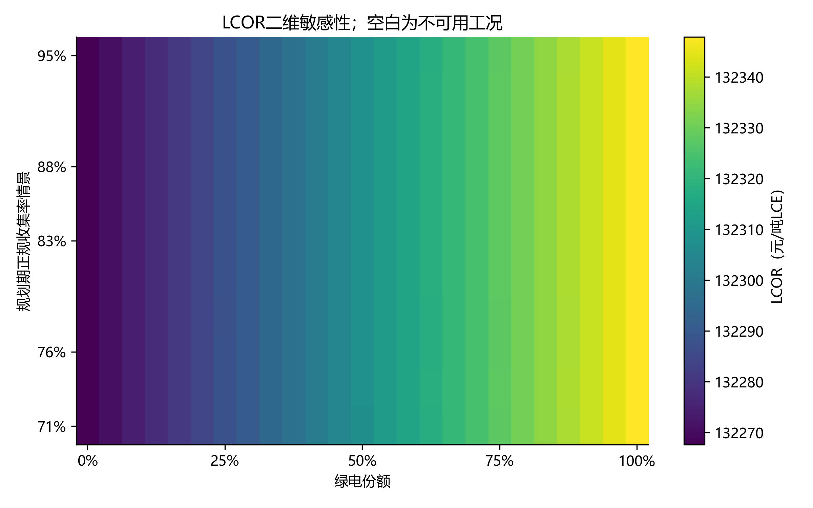

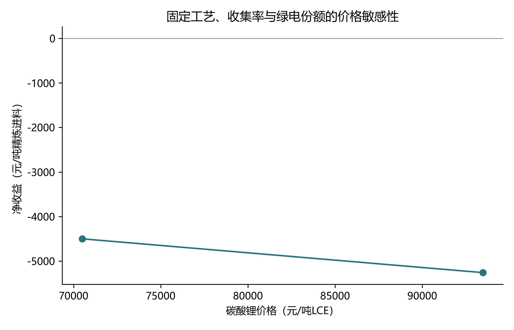

在未计固定费用且数量近似同比放大的设定下，单位碳筛查值与单位LCOR对收集率不敏感，程序内差异仅约10⁻¹⁰，属舍入；这来自模型结构，不证明现实回收网络不存在规模效应。Li销售价从70500变为93481.3元/t时，采购报价也改变，净收益变化反映两个离散报价的共同作用，不能视为一般价格弹性，更不能据此证明所有价格区间内的工艺排序。

本组没有建立直接修复CAM功能单位，也没有优化梯次终止SOH、年度扩建投资或所有空间网络。费用最小网络先求解、外层再比较的前沿是**固定候选点、代理参数与情景网格下的条件前沿**。

## 第6章 制度、商业闭环与环境风险管理

### 6.1 生产者责任延伸与财务约束

按2026年管理办法，生产与相关回收主体应履行相应回收和信息义务。建议以可追溯回收量、合规交付和产品质量作为费用结算条件，建立车企、电池企业、回收服务网点和综合利用企业的责任清单。[S6] 对本次B约4,500.18元/吨电池的已计费用缺口，优先核实副产品收益、采购计价与固定费用，再讨论EPR服务费、商业合同或依法适用的支持政策；不能据代理亏损直接确定财政补贴。

技术减排差额不自动成为CCER收入。当前未核定适用方法学、额外性、权属或出口溢价合同，相关收入不确认。未知税费未计入不等于法定税额为0，工程预算不得沿用这一漏项。

### 6.2 水资源税、环境税与MRV

湖北直接工业取用地表水和地下水的参考税额分别为0.15、0.2元/m³，超许可取水的超量部分分段适用2、3、5倍，未经批准取水适用3倍。`hubei_industrial_water_tax()`按给定主体、水源和许可量计算。例如地表水许可100 m³、实际160 m³的算法示例税额为40.5元；该示例不是本项目真实应纳税额。公共供水购水不能机械再按取水人直接套税，须先核定纳税主体。[S9]

环境保护税需以实际排放、应税污染物和计量口径核算，污染治理支出不等于环保税。含氟废水、酸雾、挥发性有机物和残渣的实际排放资料尚缺，当前不出具完整税额结论。

MRV数据链为“电池唯一编码—安装与退役记录—SOH和安全检测—交接与称重—过程能水及化学品—元素收支—产品批次与再生材料归属”。使用平台记录、智能表计、必要在线监测和有资质检测互相核对，不用烟气CEMS替代固体及废水元素化验。

### 6.3 环境风险与PDCA

储运环节设置带电/损伤电池隔离、温度和烟雾预警、事故分区与消防响应；工艺环节识别电解液挥发、LiPF₆遇水产生HF、酸浸泄漏和高盐重金属废水风险，按实际工艺设置收集、负压、相应尾气净化、含氟废水处理与防渗。事故池按事故消防水、泄漏量、降雨及可用收集设施等实际边界核算，数据未取得前不填固定容积。

近期先核验输入、许可和单厂能力，运行阶段以月度进出库及能水台账检查偏差，年度复核安装与退役队列、费用与排放因子，并根据容量压力更新近期和远期方案。2030—2040年若退役规模持续增加，必须新增候选处理能力与投资时序模型，再作扩容决策，不能沿用单一目的地情景作为全省建设承诺。

## 第7章 参考文献与数据源声明

### 7.1 预编译文献

- [R1] Peiseler L, et al. (2024). Carbon footprint distributions of lithium-ion batteries and their materials. *Nature Communications*, 15:10301. [DOI](https://doi.org/10.1038/s41467-024-54634-y)。
- [R2] Yao A, Benson S M, Chueh W C. (2025). Critically assessing sodium-ion technology roadmaps and scenarios for techno-economic competitiveness against lithium-ion batteries. *Nature Energy*, 10:404–416。以本地预编译PDF书目信息为准。
- [R3] Wu et al. (2024). Impact of circular economy on the long-term allocation structure of primary and secondary lithium. *Communications Earth & Environment*, 5:503. [DOI](https://doi.org/10.1038/s43247-024-01667-2)。
- [R4] Machala et al. (2025). Life cycle comparison of industrial-scale lithium-ion battery recycling and mining supply chains. *Nature Communications*, 16:988. [DOI](https://doi.org/10.1038/s41467-025-56063-x)。
- [R5] Zhang et al. (2025). Lithium-ion battery recycling relieves the threat to material scarcity amid China’s electric vehicle ambitions. *Nature Communications*, 16:6661. [DOI](https://doi.org/10.1038/s41467-025-61481-y)。
- [R6] Ma R, et al. (2024). Pathway decisions for reuse and recycling of retired lithium-ion batteries considering economic and environmental functions. *Nature Communications*. [DOI](https://doi.org/10.1038/s41467-024-52030-0)。

### 7.2 统计、政策与补充来源

- [S1] 湖北省统计局，《湖北统计年鉴2025》，本地20张.xls；每个单元格及SHA见`data_cohort/yearbook_cells.csv`和`yearbook_source_manifest.json`。重点使用表1607、0607和1005。
- [S2] 湖北日报，2024-12-25，新能源汽车注册及充电设施报道。[原报PDF](https://epaper.hubeidaily.net/pc/attachment/202412/25/dd813655-57ba-4723-a3ea-b70a494479fb.pdf)。34.4万辆为1—11月新增注册，96.7万辆为报道所载当时存量，未当作同年全年安装。
- [S3] 武汉市人民政府转载长江日报，2025-01-20，《武汉卖的新车一半是新能源》。[原文](https://www.wuhan.gov.cn/sy/whyw/202501/t20250120_2520341.shtml)。
- [S4] 生态环境部、国家统计局，《2023年电力二氧化碳排放因子》，湖北0.4044 kgCO₂/kWh。[官方说明](https://www.mee.gov.cn/ywdt/zbft/202601/t20260105_1139911.shtml)。与[2023年电力碳足迹因子说明](https://www.mee.gov.cn/ywdt/zbft/202501/t20250123_1101258.shtml)的系统边界不同。
- [S5] 工信部公告2024年第42号，《新能源汽车废旧动力电池综合利用行业规范条件（2024年本）》。[湖北省经信厅正式转发](https://jxt.hubei.gov.cn/bmdt/rdjj/202412/t20241228_5481302.shtml)。
- [S6] 工信部等六部门令第73号，《新能源汽车废旧动力电池回收和综合利用管理暂行办法》，2026-04-01施行。[官方原文](https://www.miit.gov.cn/gyhxxhb/jgsj/cyzcyfgs/bmgz/jdcjxl/art/2026/art_392462fdc40c415ea4a4129cac3028c2.html)。
- [S7] Regulation (EU) 2023/1542，Article 8、77及Annex XII。[EUR-Lex](https://eur-lex.europa.eu/eli/reg/2023/1542/oj)。具体实施授权法案和后续修订仍需持续核查。
- [S8] 清华大学环境学院，2025-07-11，张少君课题组电池关键材料碳足迹研究介绍。[原文](https://www.tsinghua.edu.cn/info/1175/119485.htm)。中国企业产能平均13.3/13.9 t CO₂e/t Li₂CO₃。
- [S9] 湖北省财政厅、税务局、水利厅，《关于湖北省水资源税改革试点有关事项的通知》，2024-12-24。[武汉财政局正式发布](https://czj.wuhan.gov.cn/FBJD/ZCWJ/GFWJ/202412/t20241231_2511060.html)。
- [S10] 福建省工信厅，闽工信行政服务〔2024〕78号，5万吨/年磷酸铁锂综合利用项目。[原文](https://gxt.fujian.gov.cn/zwgk/jsxm/xmhz/202408/t20240812_6500736.htm)。单位投资为总投资116200.42万元除以50000 t/y，适用边界见敏感性说明。
- [S11] 工信部，2021-04-25，格林美动力电池综合利用案例。[原文](https://www.miit.gov.cn/jgsj/jns/dfdt/art/2021/art_9ce9372f0e1946c6bafca43baf8a03b4.html)。多企业合计能力不能直接分派给荆门单厂。
- [S12] 全国人大常委会，《中华人民共和国固体废物污染环境防治法》（2020年修订），第22条（跨省贮存、处置审批）、第66条（车用动力电池生产者责任延伸）。[官方原文](https://www.mee.gov.cn/ywgz/fgbz/fl/202004/t20200430_777580.shtml)。
- [S13] 生态环境部，《国家危险废物名录》（现行版）。废锂离子电池及黑粉未列入，按一般工业固体废物管理；具体版本号及拆解废液鉴别条款以现行发布为准，尚待逐条核对。
- [S14] 国务院，《报废机动车回收管理办法》（国务院令第715号，2019-06-01施行），报废机动车须由具备资质的回收拆解企业回收拆解。[官方原文](https://www.gov.cn/zhengce/zhengceku/2019-05/06/content_5389079.htm)。

### 7.3 核心参数溯源与仍需核实的部分

| 参数/文件 | 当前值或口径 | 证据属性与定位 |
| --- | --- | --- |
| 安装队列 | 2010—2040、17单元、LFP/NCM，共1054行 | `installation_cohorts.csv`；全为documented_scenario，注册锚点、人口权重与插值并存 |
| 寿命与材料强度 | η=10、β=3.5，按安装年变化 | `material_parameters.csv`；原寿命表与材料演变未充分核验，不能称湖北校准 |
| 工序/全链回收率 | 工序Li90%，全链按工艺与体系另填 | `model_config.json`、`recovery_parameters.csv`；不可混用分母 |
| 电力CO₂、价格与绿电因子 | 0.4044；0.691333/0.697493元/kWh；绿电0.02 | `energy_factors.csv`；统计CO₂与生命周期代理混合，保留筛查边界 |
| 过程清单 | 电、热、试剂、预处理、治理 | `lci.csv`；聚合代表值待工厂单耗和数据库核验 |
| 环境分配 | 全部已计负荷归LCE，系数1 | 修正后的保守情景；没有未证实的副产品环境信用 |
| 原生参考 | 碳13.3/13.9 t/t；水200/60 m³/t；成本40000/66700元/t | `primary_lce_baselines.csv`；碳参考已核原文，水和成本口径待完善 |
| 采购及SOH | 两档LCE价格、SOH0.8、LFP/NCM报价 | `procurement_quotes.csv`；价格日期、形态与含税运边界不完全一致 |
| 设施、道路及费用 | 假设单点100000 t/y；17条跨城路段 | `network_nodes.csv`、`road_distances.csv`；原始OD响应和厂级可用能力待补 |
| 投资及固定费用敏感性 | 6200/12117.42/23240.08元/(t·年)，WACC8%、15年 | `tea_cost_benchmarks.csv`；异地投资代理，3%/6%固定费用率及250元/t收集费为假设 |
| 政策合规边界 | 固废法第22/66条、73号令、危废名录、EU 2023/1542 | 见1.5节；国家层面条文已核，省级专项实施方案未检索到，危废名录具体版本号待逐条核对 |
| 帕累托政策分层 | 法规可行域4000组、规划情景2200组；前沿分别500与275组 | `run_manifest.json`的`policy_layers`与`frontier_diagnostics`；两层前沿均归并为25个目标向量，组内仅收集率不同（20或11个方案），单位指标不随收集率变化 |

全部结果表位于`data_cohort/results/`；图形仅保存PNG 300 DPI，正文已逐一引用。原始论文、补充来源与年鉴在`data_cohort/raw/`。本报告不包含学号，不代替成员签字、行政许可、企业认证或正式投资概算。
