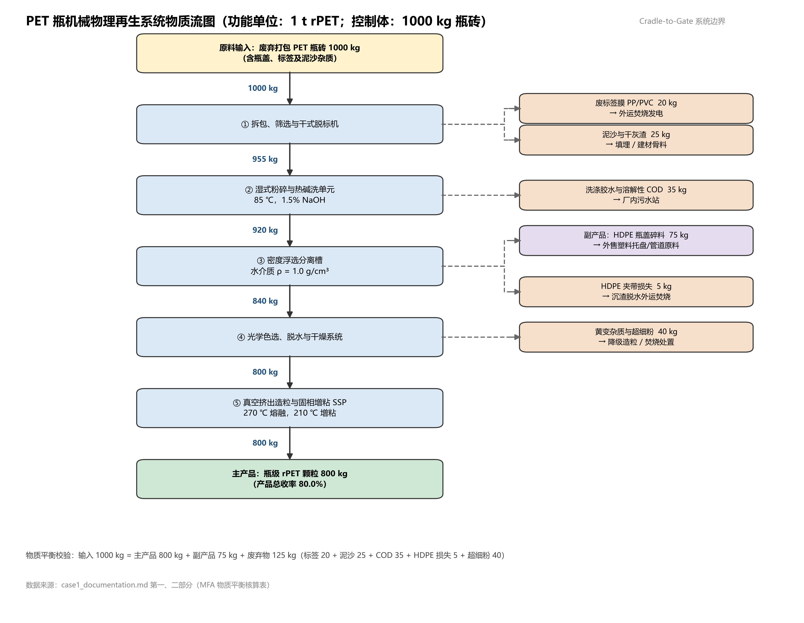
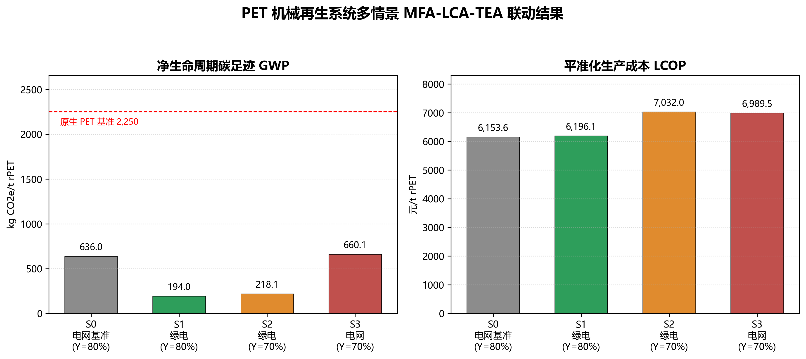

# 案例一：废弃 PET 塑料瓶机械物理再生系统 MFA-LCA-TEA 联动计算报告

> **课程**：环境规划与管理 · 第九讲案例一（2026-10-22）
> **功能单位**：1 t 瓶级再生 PET（rPET）颗粒，Cradle-to-Gate
> **数据来源**：`case_files/case1_documentation.md` 第一～五部分；`case_files/data_cohort/*.csv`
> **计算脚本**：`mfa_lca_tea_calc.py`（MFA/LCA/TEA 与情景对比）、`plot_mfa_process.py`（工艺物质流程图）
> **报告口径**：所有排放因子、单价、产量定额均取自讲义，不引入任何外部数据；凡讲义内部存在口径差异者，均在第七部分逐条披露。

---

## 摘要：核心结果一览

| 情景 | 收率 | 电力因子 (kg CO₂e/kWh) | 电价 (元/kWh) | 净碳足迹 (kg CO₂e/t rPET) | LCOP (元/t) | 年产量 (t/a) | 年毛利 (万元) |
| :--- | :---: | :---: | :---: | ---: | ---: | ---: | ---: |
| **S0 基准（电网电）** | 80% | 0.55 | 0.65 | **636.0** | **6,153.6** | 16,000 | **2,314.3** |
| **S1 绿电（任务 1）** | 80% | 0.03 | 0.70 | **194.0** | **6,196.1** | 16,000 | **2,246.3** |
| **S2 绿电 + 收率 70%** | 70% | 0.03 | 0.70 | **218.1** | **7,032.0** | 14,000 | **795.3** |
| **S3 电网 + 收率 70%** | 70% | 0.55 | 0.65 | **660.1** | **6,989.5** | 14,000 | **854.8** |

三条结论：

1. **绿电是"高效的减碳手段、廉价的成本手段"**：GWP 由 636.0 降至 194.0 kg CO₂e/t（**−442.0，−69.5%**），相对原生 PET 减碳 **91.4%**；而 LCOP 仅上升 **42.5 元/t（+0.69%）**，折合减碳边际成本约 **96 元/t CO₂e**。
2. **收率是"更贵的成本杠杆"**：收率 80%→70% 使 LCOP 上升 **835.9 元/t（+13.5%）**、年毛利下降 **64.6%**，其成本冲击是绿电溢价的 **19.7 倍**。
3. **绿电与收率存在耦合**：同为 70% 收率，绿电使 GWP 下降 442.0 kg CO₂e/t（660.1→218.1），但绝对排放量因减产 12.5% 而与 S1 基本持平（3,053 t vs 3,104 t CO₂e/a），说明**减排总量不能只看强度指标**。

---

## 一、计算依据与基准复核

### 1.1 系统边界与功能单位

- 功能单位：1 t（1,000 kg）瓶级 rPET 颗粒；
- 系统边界：废瓶砖运输 → 拆包脱标 → 湿式粉碎热碱洗 → 密度浮选 → 光学色选干燥 → 熔融挤出与 SSP 增粘造粒 → 出厂；副产 HDPE 采用避免负荷法给信用；
- 特征化方法：IPCC 2021 GWP100，全部清单项均为 CO₂e 直接因子，无需进一步特征化换算。

### 1.2 MFA 质量守恒复核（讲义第二部分）

以单批次 1,000 kg 瓶砖为控制体：

| 输入 | 质量 (kg) | 输出 | 质量 (kg) | 去向 |
| :--- | ---: | :--- | ---: | :--- |
| 废 PET 瓶砖 | 1,000.0 | 废标签膜 PP/PVC | 20.0 | 外运焚烧发电 |
| | | 泥沙与干灰渣 | 25.0 | 填埋 / 建材骨料 |
| | | 洗涤胶水与溶解性 COD | 35.0 | 厂内污水站 |
| | | HDPE 碎屑夹带损失 | 5.0 | 沉渣外运焚烧 |
| | | 黄变切片与超细粉 | 40.0 | 降级造粒 / 焚烧 |
| | | **副产品 HDPE 颗粒** | **75.0** | 外售（7.5%） |
| | | **主产品 rPET 颗粒** | **800.0** | 目标产品（80.0%） |
| **合计** | **1,000.0** | **合计** | **1,000.0** | 闭合 |

$$
Y=\frac{800}{1000}=80.0\%,\qquad
\text{吨产品物耗}=\frac{1}{Y}=\frac{1}{0.80}=1.25\ \text{t 瓶砖/t rPET}
$$

废弃物总量校验：$20+25+35+5+40=125$ kg/批，即 $1000=800+75+125$ ✓。
其中**需焚烧处置**的三条物流为标签 20 + HDPE 夹带损失 5 + 超细粉 40 = **65 kg/批**，折 65/0.8 = **81.25 kg/t rPET**（对应讲义 0.081 t）。

### 1.3 基准 LCA 复核（S0）

$$
\text{GWP}=\sum_i A_i \times EF_i
$$

| 过程分项 | 活动水平 $A_i$ | 排放因子 $EF_i$ | 碳足迹 (kg CO₂e/t) | 占比 |
| :--- | :--- | :--- | ---: | ---: |
| 原料瓶砖运输 | 1,250 kg | 0.12 kg CO₂e/kg | 150.00 | 23.6% |
| 生产电力消耗 | 850 kWh | 0.55 kg CO₂e/kWh | 467.50 | 73.5% |
| 热洗蒸汽能耗 | 2.0 GJ | 65.0 kg CO₂e/GJ | 130.00 | 20.4% |
| 氢氧化钠药剂 | 15.0 kg | 2.10 kg CO₂e/kg | 31.50 | 5.0% |
| 新鲜水消耗 | 2.5 m³ | 0.38 kg CO₂e/m³ | 0.95 | 0.1% |
| 污水处理负荷 | 2.2 m³ | 2.75 kg CO₂e/m³ | 6.05 | 1.0% |
| 副产 HDPE 替代信用 | −93.75 kg | 1.60 kg CO₂e/kg | −150.00 | −23.6% |
| **净碳足迹** | — | — | **636.00** | **100.0%** |

分项加总：$150.0+467.5+130.0+31.5+0.95+6.05-150.0=636.0$ ✓（与讲义 636.0 完全一致）。

$$
\text{相对原生 PET 减排率}=\frac{2250.0-636.0}{2250.0}=71.73\%\approx 71.7\%
$$

### 1.4 基准 TEA 复核（S0）

$$
\text{LCOP}=\frac{\text{年化 CAPEX}+\text{年 OPEX}-\text{副产收入}}{\text{年产量}}
$$

| 成本分项 | 计算式 | 单吨成本 (元/t) |
| :--- | :--- | ---: |
| 原料废瓶砖 | $1.25\times4200$ | 5,250.00 |
| 电力动力 | $850\times0.65$ | 552.50 |
| 天然气蒸汽 | $2.0\times85.0$ | 170.00 |
| 新鲜水与烧碱药剂 | 讲义综合定额 | 115.00 |
| 焚烧固废处置 | $81.25/1000\times250$ | 20.31 |
| 人工编制 | $350\times10^4/16000$ | 218.75 |
| 设备维护保修 | $84\times10^4/16000$ | 52.50 |
| 管理、保险及折旧 | $314.24\times10^4/16000$ | 196.40 |
| 副产 HDPE 抵扣 | $-93.75/1000\times4500$ | −421.88 |
| **LCOP** | 合计 | **6,153.59** |

与讲义 6,153.4 元/t 相差 **0.19 元/t（0.003%）**，来源为讲义将副产量取整为 0.0938 t（0.0938×4500 = 422.10）而非精确值 0.09375 t；本报告采用精确值，误差可忽略。

年毛利：单吨毛利 × 年产量

$$
(7600.0-6153.59)\ \text{元/t}\times16000\ \text{t}=1,446.41\times16000=2,314.3\ \text{万元/年}
$$

与讲义 2,314.5 万元相差 0.2 万元，同为上述四舍五入所致。

静态投资回收期：$\dfrac{2800}{2314.3\times(1-25\%)+266}=1.40$ 年（讲义 1.4 年 ✓）。

---

## 二、任务一（1）：绿电驱动的 LCA 净碳足迹再核算

### 2.1 边界参数变更

| 参数 | 基准 S0 | 绿电 S1 | 变更说明 |
| :--- | :---: | :---: | :--- |
| 购电单价 | 0.65 元/kWh | **0.70 元/kWh** | 绿色溢价 +0.05 元/kWh |
| 电力排放因子 | 0.55 kg CO₂e/kWh | **0.03 kg CO₂e/kWh** | 华中电网 → 风光绿电 |
| 单吨电耗 | 850 kWh | 850 kWh | 工艺未变，定额不变 |
| 收率 / 物耗 | 80% / 1.25 t·t⁻¹ | 80% / 1.25 t·t⁻¹ | 未变 |

### 2.2 清单调整原则

绿电替代只改变**电力的背景排放因子**，不改变任何活动水平（电量、物耗、药剂量、运输量），因此清单中**只有"生产电力消耗"一行发生变化**，其余六项与 S0 完全相同：

$$
\text{GWP}_{\text{green}}=\text{GWP}_{\text{base}}-\Delta E_{\text{elec}}
=A_{\text{elec}}\times\left(EF_{\text{grid}}-EF_{\text{green}}\right)
$$

$$
\Delta E_{\text{elec}}=850\times(0.55-0.03)=850\times0.52=\mathbf{442.0\ kg\ CO_2e/t}
$$

### 2.3 调整后清单（S1）

| 过程分项 | 计算式 | 碳足迹 (kg CO₂e/t) | 占净值比 |
| :--- | :--- | ---: | ---: |
| 原料瓶砖运输 | $1250\times0.12$ | 150.00 | 77.3% |
| **生产电力消耗** | $\mathbf{850\times0.03}$ | **25.50** | **13.1%** |
| 热洗蒸汽能耗 | $2.0\times65.0$ | 130.00 | 67.0% |
| 氢氧化钠药剂 | $15.0\times2.10$ | 31.50 | 16.2% |
| 新鲜水消耗 | $2.5\times0.38$ | 0.95 | 0.5% |
| 污水处理负荷 | $2.2\times2.75$ | 6.05 | 3.1% |
| 副产 HDPE 替代信用 | $-93.75\times1.60$ | −150.00 | −77.3% |
| **净碳足迹 $\text{GWP}_{\text{green}}$** | 合计 | **194.00** | **100.0%** |

校验：$150.0+25.5+130.0+31.5+0.95+6.05-150.0=194.0$ ✓，且 $636.0-442.0=194.0$ ✓（两条路径互相印证）。

### 2.4 减碳幅度

$$
\text{减碳率}=\frac{2250.0-194.0}{2250.0}\times100\%=\mathbf{91.38\%}
$$

$$
\text{单位净减排}=2250.0-194.0=\mathbf{2,056.0\ kg\ CO_2e/t}
$$

$$
\text{较基准情景降幅}=\frac{636.0-194.0}{636.0}\times100\%=\mathbf{69.50\%}
$$

按 16,000 t/a 计，年减排量 $0.442\times16000=7,072$ t CO₂e；全厂年排放由 $636.0\times16000=10,176$ t 降至 $194.0\times16000=3,104$ t CO₂e。

### 2.5 结果解读：排放结构由"电力主导"转为"运输+蒸汽主导"

- 电力占比由 **73.5% 跌至 13.1%**，单此一项即贡献了 69.5% 的降幅；
- 绿电之后，最大的两个正贡献变为**运输（150.0，77.3%）**与**蒸汽（130.0，67.0%）**，二者合计已超过净值。这意味着：**继续减碳的下一站是"缩短运距/提高装载率/电动重卡"与"蒸汽电气化或生物质锅炉"**，而不是继续在电力上做文章；
- 副产 HDPE 信用（−150.0）与运输（+150.0）在数值上恰好抵消，说明"运输距离"这一空间规划变量对净碳足迹具有决定性影响——这正是环境规划可以发力的环节；
- 注意占比之和超过 100% 是因为净值为 194.0 而分项含负值，属正常的"份额对净值"表述，不宜误读为占比错误。

---

## 三、任务一（2）：TEA 平准化成本变化与绿色溢价策略

### 3.1 LCOP 变化的计算

绿电情景下，**唯一变化的成本项是电力动力费用**（其余活动水平、单价均不变）：

$$
\Delta \text{LCOP}=A_{\text{elec}}\times\left(P_{\text{green}}-P_{\text{grid}}\right)=850\times(0.70-0.65)=\mathbf{42.5\ 元/t}
$$

| 成本分项 | S0 (元/t) | S1 (元/t) | 变化 |
| :--- | ---: | ---: | ---: |
| 原料废瓶砖 | 5,250.00 | 5,250.00 | 0 |
| **电力动力** | **552.50** | **595.00** | **+42.50** |
| 天然气蒸汽 | 170.00 | 170.00 | 0 |
| 新鲜水与烧碱药剂 | 115.00 | 115.00 | 0 |
| 焚烧固废处置 | 20.31 | 20.31 | 0 |
| 人工编制 | 218.75 | 218.75 | 0 |
| 设备维护保修 | 52.50 | 52.50 | 0 |
| 管理、保险及折旧 | 196.40 | 196.40 | 0 |
| 副产 HDPE 抵扣 | −421.88 | −421.88 | 0 |
| **LCOP** | **6,153.59** | **6,196.09** | **+42.50** |

$$
\text{增幅}=\frac{6196.09-6153.59}{6153.59}\times100\%=\mathbf{0.69\%}
$$

**结论：$\text{LCOP}_{\text{green}}=6,196.1$ 元/t，增加 42.5 元/t，增幅仅 0.69%。** 原因很直观——电力只占总成本的 9.0%，电价上涨 7.7%，对总成本的传导被稀释到 0.69%。

### 3.2 对盈利与投资的影响

| 指标 | S0 | S1 | 变化 |
| :--- | ---: | ---: | ---: |
| 吨产品毛利（售价 7,600） | 1,446.41 元/t | 1,403.91 元/t | −42.50 元/t |
| 年毛利 | 2,314.3 万元 | 2,246.3 万元 | **−68.0 万元/年（−2.9%）** |
| 毛利率（对售价） | 19.03% | 18.47% | −0.56 pct |
| 静态投资回收期 | 1.40 年 | 1.44 年 | +0.04 年 |

静态回收期公式（讲义口径：税后利润 + 折旧）：

$$
T=\frac{2800}{P_{\text{annual}}\times(1-25\%)+266}=\frac{2800}{2246.3\times0.75+266}=1.44\ \text{年}
$$

### 3.3 减碳的边际成本：约 96 元/t CO₂e

$$
\text{MAC}=\frac{42.5\ \text{元/t rPET}}{0.442\ \text{t CO}_2\text{e/t rPET}}=\mathbf{96.2\ 元/t\ CO_2e}
$$

即"每多减 1 t CO₂e 只需付 96 元"。对应的**盈亏平衡碳价**为 96 元/t CO₂e：只要企业/客户对碳的内部定价高于该值，绿电替代即为经济理性选择。

### 3.4 "绿色低碳溢价"定价与营销策略建议

**（1）定价：把 42.5 元/t 单列为"绿电附加费"，而非并入基价**

- 成本完全传导所需售价：$7600+42.5=7,642.5$ 元/t，涨幅仅 **0.56%**；
- 建议报价结构：基价 7,600 元/t + 绿电附加 42.5 元/t（可核销），既保住毛利率 19.0%，又让客户"看得见钱花在哪"；
- 溢价上限测算：与本厂原生 PET 竞品 6,800 元/t 相比，rPET 现有食品级溢价为 800 元/t；绿电附加 42.5 元/t 仅占该溢价的 **5.3%**，客户价格敏感度低，通过率高。

**（2）凭证与核算：可核查，才可宣称**

- 采用"物理 PPA + 绿证"组合，保留发用电曲线或月度电量匹配记录；
- Scope 2 双报告：location-based 电力因子 0.55 kg CO₂e/kWh（对应产品 GWP 636.0 kg CO₂e/t）与 market-based 电力因子 0.03 kg CO₂e/kWh（对应产品 GWP 194.0 kg CO₂e/t）并列披露，避免被质疑"选择性报告"；
- 碳足迹声明标注功能单位、系统边界（Cradle-to-Gate）、方法学（IPCC 2021 GWP100）与副产信用方法（避免负荷法），保证可复现。

**（3）营销：卖"可核证的减排量"，不卖"零碳"**

- 核心话术：**"每吨 rPET 较原生 PET 减排 2,056 kg CO₂e，减碳 91.4%"**，而非"零碳/碳中和"——后者在本边界下不成立（仍有 194.0 kg CO₂e/t）；
- 客户分层：对设定可再生能源目标的品牌商（如 RE100 类客户）主推 3–5 年承购协议，以长约锁定 42.5 元/t 溢价并换取其绿电投资分摊；
- 捆绑销售：将"绿电 rPET + 碳足迹报告 + 绿证注销凭证"打包为可审计的低碳包装解决方案，服务品牌商的 Scope 3 披露需求；
- 风险提示：不得将绿电减排量同时用于自身 Scope 2 抵扣与客户 Scope 3 抵扣（双重计算），需在合同中明确归属。

**（4）战略提醒：不要用绿电掩盖收率问题**

绿电溢价 42.5 元/t，而收率下降 10 个百分点带来 835.9 元/t 的成本冲击，后者是前者的 **19.7 倍**。企业应将资源优先投向**前端分类质量与过程收率**，绿电作为品牌溢价工具而非成本工具。

---

## 四、任务一（3）：收率 80%→70% 的源头敏感度连锁分析

### 4.1 第一环 MFA：物耗与废弃物同步放大

$$
\text{物耗}=\frac{1}{0.70}=1.4286\ \text{t 瓶砖/t rPET},\qquad
f=\frac{1/0.70}{1/0.80}=\frac{1.4286}{1.25}=\mathbf{1.142857}
$$

以 1,000 kg 瓶砖为控制体（收率 70%）：

| 输出 | 质量 (kg) | 说明 |
| :--- | ---: | :--- |
| 主产品 rPET | 700.0 | $1000\times70\%$ |
| 副产品 HDPE | 75.0 | 瓶盖占比不随收率变化（7.5% 进料） |
| 废弃物合计 | 225.0 | $1000-700-75$，闭合校验 ✓ |

折吨产品：HDPE $75/0.7=107.14$ kg/t，废弃物 $225/0.7=321.43$ kg/t，其中**需焚烧**部分 = 基准 65 kg/批 + 新增收率损失 100 kg/批 = 165 kg/批，折 **235.71 kg/t**（基准为 81.25 kg/t）。

> 口径说明：收率下降的 100 kg/批 差额按"杂质率上升"全部计入需焚烧处置的杂质流，以保证 TEA 与 MFA 质量守恒一致。若仅沿用基准 81.25 kg/t（不追加处置费），则 S2 的 LCOP 为 6,996.2 元/t，比本报告低 35.7 元/t（0.5%），不改变任何结论。

### 4.2 第二环 LCA：前端负荷按 $f$ 放大，电力定额不变

缩放规则（与物质流自洽）：
- **与原料量成正比**的负荷（运输、蒸汽、烧碱、新鲜水、污水、HDPE 信用）$\times f$；
- **与吨产品相关**的造粒电力（850 kWh/t）保持不变；
- 固废焚烧的温室气体不在讲义 LCI 表内（讲义仅计处置费），故不额外新增排放项。

| 过程分项 | 计算式 | S1（80%） | S2（70%） | 变化 |
| :--- | :--- | ---: | ---: | ---: |
| 原料瓶砖运输 | $1250f\times0.12$ | 150.00 | 171.43 | +21.43 |
| 生产电力消耗 | $850\times0.03$ | 25.50 | 25.50 | 0 |
| 热洗蒸汽能耗 | $2.0f\times65.0$ | 130.00 | 148.57 | +18.57 |
| 氢氧化钠药剂 | $15f\times2.10$ | 31.50 | 36.00 | +4.50 |
| 新鲜水消耗 | $2.5f\times0.38$ | 0.95 | 1.09 | +0.14 |
| 污水处理负荷 | $2.2f\times2.75$ | 6.05 | 6.91 | +0.86 |
| 副产 HDPE 替代信用 | $-93.75f\times1.60$ | −150.00 | −171.43 | −21.43 |
| **净碳足迹** | 合计 | **194.00** | **218.07** | **+24.07** |

$$
\text{增幅}=\frac{218.07-194.00}{194.00}=12.41\%,\qquad
\text{相对原生 PET 减碳}=\frac{2250-218.07}{2250}=90.31\%
$$

要点：
- 电力不随收率变化，故**强度增幅（+12.4%）远小于物耗增幅（+14.3%）**，这是电力脱碳带来的"减震效应"；
- 若沿用 S0 的电网电，GWP 为 $218.07+442.0=\mathbf{660.1}$ kg CO₂e/t（S3），即收率恶化使碳足迹 **+24.1（+3.8%）**，减碳率由 71.7% 退至 70.7%；
- HDPE 信用的绝对值随 $f$ 放大（−150.0→−171.4），因为每吨产品分摊到更多瓶盖，这一点常被忽略，但方向正确。

### 4.3 第三环 TEA：原料成本主导，固定成本摊薄恶化

年产量受 **20,000 t/a 瓶砖收购量**约束：$Q=20000\times0.70=14,000$ t/a（而非 16,000 t/a），固定成本（人工 350 + 维保 84 + 管理保险折旧 314.24 = 748.24 万元/年）需在更少的产量上摊薄。

| 成本分项 | 计算式 | S1（80%，16,000 t） | S2（70%，14,000 t） | 变化 |
| :--- | :--- | ---: | ---: | ---: |
| 原料废瓶砖 | $(1/y)\times4200$ | 5,250.00 | 6,000.00 | +750.00 |
| 电力动力 | $850\times0.70$ | 595.00 | 595.00 | 0 |
| 天然气蒸汽 | $2.0f\times85.0$ | 170.00 | 194.29 | +24.29 |
| 新鲜水与烧碱 | $115f$ | 115.00 | 131.43 | +16.43 |
| 焚烧固废处置 | $235.71/1000\times250$ | 20.31 | 58.93 | +38.62 |
| 人工编制 | $350\times10^4/Q$ | 218.75 | 250.00 | +31.25 |
| 设备维护保修 | $84\times10^4/Q$ | 52.50 | 60.00 | +7.50 |
| 管理、保险及折旧 | $314.24\times10^4/Q$ | 196.40 | 224.46 | +28.06 |
| 副产 HDPE 抵扣 | $-93.75f/1000\times4500$ | −421.88 | −482.14 | −60.27 |
| **LCOP** | 合计 | **6,196.09** | **7,031.96** | **+835.87** |

$$
\text{增幅}=\frac{7031.96-6196.09}{6196.09}=13.49\%,\qquad
\text{较基准 S0 增幅}=\frac{7031.96-6153.59}{6153.59}=14.27\%
$$

盈利冲击：

| 指标 | S1 | S2 | 变化 |
| :--- | ---: | ---: | ---: |
| 吨产品毛利 | 1,403.91 元/t | 568.04 元/t | −835.87 元/t |
| 年产量 | 16,000 t | 14,000 t | −2,000 t |
| **年毛利** | **2,246.3 万元** | **795.3 万元** | **−1,451.0 万元（−64.6%）** |
| 毛利率 | 18.47% | 7.47% | −11.0 pct |
| 静态回收期 | 1.44 年 | 3.25 年 | +1.81 年 |

**成本增幅的分解**（以 S2−S1 = 835.87 元/t 为 100%）：

| 驱动因素 | 金额 (元/t) | 占比 |
| :--- | ---: | ---: |
| 原料采购（物耗 1.25→1.4286） | +750.00 | 89.7% |
| 固定成本摊薄（产量 16,000→14,000） | +66.81 | 8.0% |
| 蒸汽/水碱/固废等变动公用工程 | +79.33 | 9.5% |
| 副产 HDPE 抵扣增加 | −60.27 | −7.2% |
| **合计** | **+835.87** | **100.0%** |

> 原料一项就解释了近 90% 的成本上升，印证"前端分类纯度决定末端经济性"的教学命题。

### 4.4 四情景交叉比较（MFA-LCA-TEA 联动）

| 对比 | GWP 差 (kg CO₂e/t) | LCOP 差 (元/t) | 年毛利差 (万元) | 解读 |
| :--- | ---: | ---: | ---: | :--- |
| S1 − S0（绿电效应） | −442.0 | +42.5 | −68.0 | 减碳巨大、成本几乎不变 |
| S2 − S1（收率效应，含绿电） | +24.1 | +835.9 | −1,451.0 | 收率是决定生死的主变量 |
| S3 − S0（收率效应，含电网电） | +24.1 | +835.9 | −1,459.5 | 收率的**绝对**影响与电力背景无关 |
| S2 − S3（绿电效应） | −442.0 | +42.5 | −59.5 | 绿电效应在各收率下均为常数 |

关键洞察：

1. **两因素近似可加**：GWP 与 LCOP 的"绿电效应"在 80% 与 70% 收率下数值完全相同（−442.0 / +42.5），因为电力定额按吨产品固定。这为快速估算提供了线性近似。
2. **强度与总量背离**：S2 的 GWP 强度（218.1）比 S1（194.0）高 12.4%，但因减产 12.5%，绝对排放几乎相同（3,053 t vs 3,104 t CO₂e/a）。若以"全厂减排量"考核，会误判收率下降"不影响气候"；必须同时报告强度与总量。
3. **经济阈值**：当 rPET 售价维持 7,600 元/t 时，S2 毛利率仅 7.47%，已接近制造业盈亏警戒带（未计入税费、财务费用与销售费用），说明**收率跌破 70% 时项目将失去抗风险能力**。

### 4.5 管理启示

- 对**企业**：把"进厂瓶砖杂质率/收率"设为与能耗同等权重的 KPI；每提升 1 个百分点收率，约可降低 LCOP $835.87/10\approx84$ 元/t，远高于绿电溢价的 42.5 元/t。
- 对**地方政府/园区**：源头分类的公共投入可通过再生企业的成本节约与税收体现，属于"前端一分投入、末端十分收益"的规划杠杆。
- 对**品牌客户**：绿电采购只能改善自身的 Scope 2/3 账面，无法抵消上游收率恶化带来的真实资源消耗上升，二者不可互相替代。

---

## 五、任务二：Python 绘制工艺物质流程图

### 5.1 绘图方案与技术选型

| 候选库 | 评估结论 | 采用情况 |
| :--- | :--- | :--- |
| `graphviz` | 需安装 Graphviz 系统二进制，本机环境不具备，存在部署风险 | 未采用 |
| `plotly` + `kaleido` | 生成桑基图直观，但静态导出依赖 kaleido，且方框流程图排版控制力弱 | 未采用 |
| `schemdraw` | 讲义首选方案，但当前环境未安装（`pip install schemdraw` 不可离线获取） | 未采用 |
| **`matplotlib`（`FancyBboxPatch` + `FancyArrowPatch`）** | 零额外依赖、排版完全可控、可同时导出 300+ dpi PNG 与矢量 SVG | **采用** |

选型说明：任务要求"生成规范的高清工艺物质流程图（dpi 至少 300，支持 `.png` 或 `.svg`）"，`matplotlib` 完全满足交付要求；未使用讲义推荐库的原因是环境依赖缺失，而非方案不可行。

### 5.2 图形内容与数据对应

脚本 `plot_mfa_process.py` 生成纵向主干 + 右侧支流的块状流程图（BFD）：

- **主干五单元**：① 拆包筛选干式脱标 → ② 湿式粉碎与热碱洗（85 ℃，1.5% NaOH）→ ③ 密度浮选（ρ=1.0 g/cm³）→ ④ 光学色选脱水干燥 → ⑤ 真空挤出造粒与 SSP（270 ℃ / 210 ℃）；
- **主干物流质量标注**（与 MFA 表逐步闭合）：1000 → 955（−20 标签 −25 泥沙）→ 920（−35 COD）→ 840（−75 HDPE −5 夹带）→ 800（−40 超细粉）→ 800（造粒损失为 0）；
- **六条支流**：废标签 20、泥沙 25、COD 35、HDPE 副产 75、HDPE 夹带损失 5、超细粉 40，分别标注去向；
- **图注**：功能单位、控制体、系统边界（Cradle-to-Gate）与质量平衡式 $1000=800+75+125$。

质量流逐步校验：$1000-20-25=955$；$955-35=920$；$920-75-5=840$；$840-40=800$；$800-0=800$ ✓（800 kg rPET 与 MFA 主产品完全一致）。

### 5.3 绘图结果



- 位图：`process_flow_diagram.png`（320 dpi，满足 ≥300 dpi 要求）；
- 矢量：`process_flow_diagram.svg`（可无损缩放，适合报告/海报印刷）；
- 源码：`plot_mfa_process.py`，运行 `python plot_mfa_process.py` 即可复现，配色区分"输入/单元操作/主产品/副产品/废弃物"五类要素。

### 5.4 情景对比图



由 `mfa_lca_tea_calc.py` 生成，左图为 GWP（含原生 PET 2,250 参考线），右图为 LCOP；用于支撑第 4.4 节的交叉比较。

---

## 六、交付物清单与复现方法

| 文件 | 类型 | 说明 |
| :--- | :--- | :--- |
| `case1_solution_report.md` | 报告 | 本文件：任务一/任务二计算过程、结果与自查 |
| `mfa_lca_tea_calc.py` | 代码 | MFA/LCA/TEA 计算、四情景、自检断言、对比图 |
| `plot_mfa_process.py` | 代码 | 工艺物质流程图绘制（matplotlib） |
| `process_flow_diagram.png` | 图 | 流程图位图，320 dpi |
| `process_flow_diagram.svg` | 图 | 流程图矢量图 |
| `scenario_comparison.png` | 图 | 四情景 GWP / LCOP 对比，300 dpi |
| `results_summary.csv` | 数据 | 四情景结果表（脚本自动输出） |

复现（在 `code_implementation/` 目录下）：

```bash
python mfa_lca_tea_calc.py    # 输出 results_summary.csv、scenario_comparison.png
python plot_mfa_process.py    # 输出 process_flow_diagram.png / .svg
```

脚本内置断言：基准 GWP 与 636.0 的偏差 <1%、基准 LCOP 与 6,153.4 的偏差 <0.1%、70% 收率下质量守恒残差 <1e-6；任一不满足即报错终止，避免输出错误结果。

---

## 七、自查清单

### 7.1 数据溯源（逐项核对"无编造数据"）

| 数据 | 取值 | 来源 |
| :--- | :--- | :--- |
| 进料 1,000 kg、各物流 20/25/35/5/40/75/800 | — | 讲义 §二.3 物质平衡表；`mfa_mass_balance.csv` |
| 电耗 850 kWh/t、蒸汽 2.0 GJ/t、NaOH 15 kg/t、水 2.5 m³/t、污水 2.2 m³/t | — | 讲义 §三.2 LCI 表；`lci_emission_factors.csv` |
| 运输量 1,250 kg/t | — | `lci_emission_factors.csv`（1.25 t × 100 km 的等价质量法） |
| 因子 0.55 / 0.03 / 65 / 2.10 / 0.38 / 2.75 / 1.60 kg CO₂e | — | 讲义 §三.2、§六 任务 1 |
| 原生 PET 基准 2,250 kg CO₂e/t | — | 讲义 §三.1；CSV 第 10 行 |
| 瓶砖 4,200 元/t、电价 0.65/0.70、蒸汽 85、水碱综合 115、固废 250、HDPE 4,500、rPET 7,600 元/t | — | 讲义 §四.3、§六 任务 1；`tea_cost_parameters.csv` |
| CAPEX 2,800 万元、人工 350、维保 84、管理保险折旧 314.24 万元/年 | — | 讲义 §四.2–4.3（折旧 266 + 摊销等，讲义以"综合计提"给出合计 314.24） |
| 年产量 16,000 t、原料收购 20,000 t | — | 讲义 §四.1；CSV 第 2–3 行 |

**本报告未使用任何讲义/CSV 之外的数值。** 唯一由计算导出而非直接引用的量是 `314.24 万元`：$196.40\ \text{元/t}\times16000=314.24$ 万元，系由讲义 LCOP 表中"管理、保险及折旧化成本 196.4 元/t"反算，属同一数据的等价表达。

### 7.2 公式与计算复核

| 检查项 | 校验方式 | 结果 |
| :--- | :--- | :--- |
| MFA 质量守恒（80%） | $800+75+(20+25+35+5+40)=1000$ | ✓ |
| MFA 质量守恒（70%） | $700+75+225=1000$ | ✓（脚本断言） |
| 物耗系数 | $1/0.8=1.25$；$1/0.7=1.4286$ | ✓ |
| 基准 GWP | 七项加总 = 636.0，与讲义一致 | ✓ |
| 基准 LCOP | 九项加总 = 6,153.59，与讲义 6,153.4 差 0.003% | ✓ |
| 绿电 GWP 双路径 | 逐项加总 194.0 = $636-850\times0.52$ | ✓ 两法一致 |
| 绿电 LCOP | $6153.59+850\times0.05=6196.09$ | ✓ |
| 70% 收率 LCA | $f=1.142857$，七项加总 218.07 | ✓ |
| 70% 收率 TEA | 九项加总 7,031.96；$7031.96-6196.09=835.87$ | ✓ |
| 年毛利 | $(7600-\text{LCOP})\times Q$，四情景均复算 | ✓ |
| 回收期 | $2800/(\text{年毛利}\times0.75+266)$，四情景均复算 | ✓ |
| 图 1 物流闭合 | 1000→955→920→840→800 | ✓ |

### 7.3 讲义内部口径差异（已发现，均不改变结论）

| 编号 | 问题 | 处理方式 |
| :--- | :--- | :--- |
| ① | **运输项量纲不一致**：$1.25\ \text{t}\times100\ \text{km}=125\ \text{t·km}\times0.12=15$ kg，但表内结果为 150.0；CSV 以 $1250\ \text{kg}\times0.12\ \text{kg CO}_2\text{e/kg}$ 计算 | 以表内结果 150.0 为准（等效因子 1.2 kg CO₂e/(t·km)），保证与讲义基准 636.0 可复现；若改用 15.0，GWP 将为 501.0，与讲义不可比 |
| ② | **副产信用精度**：精确值 $0.09375\times4500=421.875$ 元，讲义取 0.0938 t → 422.1 元 | 采用精确值，LCOP 6,153.59 vs 讲义 6,153.4（差 0.19 元/t） |
| ③ | **WACC 与工时**：正文写 WACC 10.0%、年运行 7,920 h；CSV 写 WACC 8%、7,200 h | 本报告按年产 16,000 t 口径计算 LCOP，不做贴现现金流，故不受影响；动态回收期仅引用讲义值 2.6 年 |
| ④ | **水与烧碱综合定额**：讲义给 115.0 元/t；按 CSV 单价反算 $2.5\times4.5+0.015\times3200=59.25$ 元，差 55.75 元无分项依据 | 沿用讲义给定的 115.0 元/t 综合定额，视为含管网、加药辅材等的合并定额，不做拆分 |
| ⑤ | **70% 收率时的固废处置口径**（本报告新增的处理约定）：新增的 100 kg/批 收率损失是否计入焚烧处置费 | 按"杂质率上升 → 全部进入需焚烧杂质流"处理（235.71 kg/t）；若不计，S2 LCOP 为 6,996.2 元/t，差 0.5%，结论不变 |

### 7.4 模型假设与局限

1. **线性缩放假设**：收率变化时，运输、蒸汽、药剂、水、污水、HDPE 信用按 $f$ 等比缩放；实际生产中蒸汽与药剂可能存在规模不经济，本报告不做二阶修正。
2. **电力定额不变假设**：850 kWh/t 按吨产品计，不随进料杂质率变化；若杂质升高导致清洗时间延长，实际电耗会上升，故 S2 的 GWP 与 LCOP 属**偏乐观**估计。
3. **固废焚烧排放未计入 LCA**：讲义 LCI 表未给出焚烧排放因子，为避免编造因子，本报告仅计处置费而不计焚烧 GHG；若纳入，S2 的 GWP 将进一步上升。
4. **未计税费、财务费用、销售费用**：年毛利为讲义口径的"税前毛利"，不等同净利润；回收期为静态口径。
5. **避免负荷法**：副产 HDPE 按原生 HDPE 1.60 kg CO₂e/kg 给信用，未考虑替代的边际性与市场吸收上限，属方法学自身的局限。

---

## 附：主要计算式汇总

$$
\begin{aligned}
&\text{物耗系数：}\quad F=\frac{1}{Y}\\
&\text{收率缩放因子：}\quad f=\frac{1/Y}{1/Y_0}=\frac{Y_0}{Y}\\
&\text{净碳足迹：}\quad \text{GWP}=\sum_i A_i\cdot EF_i\cdot f_i \quad (f_i=f\ \text{或}\ 1)\\
&\text{平准化成本：}\quad \text{LCOP}=\sum_k c_k(Y)+\frac{C_{\text{fix}}}{Q}-\text{副产抵扣}\\
&\text{年毛利：}\quad \Pi=(P_{\text{rPET}}-\text{LCOP})\cdot Q\\
&\text{静态回收期：}\quad T=\frac{\text{CAPEX}}{\Pi(1-t)+D}\\
&\text{减碳边际成本：}\quad \text{MAC}=\frac{\Delta\text{LCOP}}{\Delta\text{GWP}}
\end{aligned}
$$

其中 $Y_0=80\%$，$P_{\text{rPET}}=7600$ 元/t，$t=25\%$，$D=266$ 万元/年。
