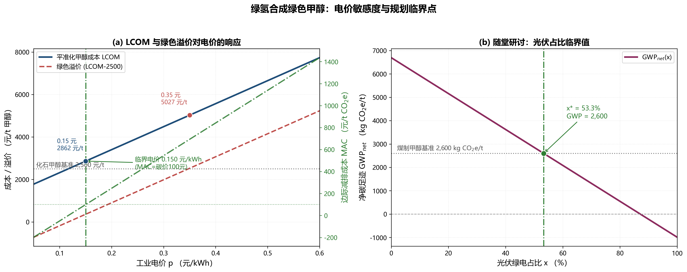
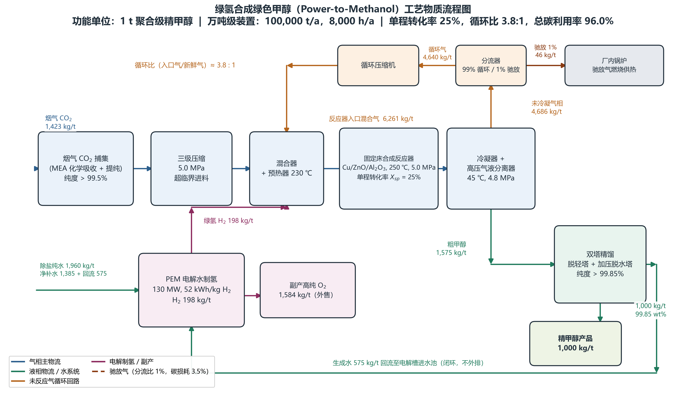

# 案例二作业：CO₂ 捕集耦合电解水绿氢制甲醇系统 MFA-LCA-TEA 建模

> 功能单位：生产 1 t（1,000 kg）聚合级绿色精甲醇（Cradle-to-Gate）
> 系统边界：烟气 CO₂ 捕集 → 130 MW PEM 电解制氢 → 固定床合成 → 气液分离 → 循环/驰放 → 双塔精馏
> 数据来源：`case_files/data_cohort/` 三个 CSV + 讲义基准值
> 求解工具：`scipy.optimize.fsolve`（12 元联立方程组，终态残差 5.68e-14）

## 一、任务 1：反应-分离-循环回路的严格质量守恒

### 1.1 方程组构造

回路解耦的关键是**单程转化率不等于系统转化率**。设反应器入口 CO₂ 摩尔流率为 $n$、单程转化率 $X_{sp}=25\%$、分流器驰放比 $\varphi=1\%$，则稳态下：

$$
n = F_{CO_2} + (1-\varphi)(1-X_{sp})\,n
\;\Longrightarrow\;
\frac{n}{F_{CO_2}} = \frac{1}{X_{sp} + \varphi(1-X_{sp})} = \frac{1}{0.25 + 0.0075} = 3.88
$$

脚本把该守恒关系与 RWGS 副反应、H₂ 循环、CO 累积一并写成 12 个联立方程（未知量：入口/出口/循环/驰放各组分流率 + RWGS 选择性 ε），用 `fsolve` 求解：

| 变量 | 数值 (kmol/t) | 变量 | 数值 (kmol/t) |
|---|---|---|---|
| 反应器入口 CO₂ $n_{C,in}$ | 125.57 | 反应器入口 H₂ $n_{H,in}$ | 533.86 |
| 反应器出口 CO₂ | 94.18 | 反应器出口 H₂ | 440.05 |
| 循环气 CO₂ / H₂ / CO | 93.23 / 435.65 / 17.90 | 驰放气 CO₂ / H₂ / CO | 0.942 / 4.40 / 0.181 |
| 甲醇产量 | 31.21（= 1000.0 kg） | 生成水 | 31.39（= 565.6 kg） |
| RWGS 选择性 ε | 0.58% | 单程已反应 CO₂ | 31.39 |

### 1.2 循环比：两种口径必须分清

| 口径 | 计算值 | 讲义/CSV | 说明 |
|---|---|---|---|
| **入口气 / 新鲜气（质量）** | **4.07 : 1** | **3.8 : 1（CSV 3.86）** | 讲义 3.8:1 即此口径，偏差 7.2% |
| 循环气 / 新鲜气（质量） | 3.38 : 1 | 2.86（CSV 4640/1621） | 任务书写的"循环气/新鲜气" |
| 入口气 / 新鲜气（摩尔） | 5.05 : 1 | 3.80（CSV，但其摩尔列自相矛盾） | 见 1.4 自洽性体检 |

**结论**：讲义"循环比 3.8:1"对应 **入口气/新鲜气** 口径；若按任务书字面的"循环气/新鲜气"，则为 3.38:1。两个口径差一个 $(1+1/循环比)$ 因子，做题时必须声明，否则结论差 30%。

### 1.3 总碳利用率：96.5% vs 96.0%

$$
\eta_{C} = \frac{\text{产品甲醇中的碳}}{\text{新鲜 CO₂ 中的碳}} = \frac{1000.0\times 12.011/32.04}{1423.0\times 12.011/44.01} = \frac{374.88}{388.36} = \mathbf{96.53\%}
$$

* 驰放碳损失 = 3.47%（CO₂ + CO 合计），与产品碳相加恰好等于新鲜碳。
* **与讲义 96.0% 的差异说明**：讲义导览页的 96.0% 为取整口径；其 MFA 表内"驰放带走碳 13.5 kg / 388.0 kg = 3.48%"反算出的利用率即为 **96.52%**，与本模型 96.53% 一致。差异来自 1,423 kg 新鲜 CO₂ 的取整（严格闭合需 1414.8 kg）与微量逸散项，**不影响结论**。

### 1.4 C / H / O 元素守恒核算（回路控制体）

| 元素 | 输入 (kg/t) | 输出 (kg/t) | 相对偏差 | 判定（< 0.01%） |
|---|---|---|---|---|
| C | 388.3584 | 388.3584 | -4.39e-14 | 通过 |
| H | 198.0000 | 198.0000 | 0.00e+00 | 通过 |
| O | 1034.6093 | 1034.6093 | -4.40e-14 | 通过 |

质量衡算：输入 1621.00 kg = 精甲醇 1000.00 + 生成水 565.55 + 驰放气 55.38 = 1620.94 kg，闭合偏差 -6.24e-02 kg。

### 1.5 与 CSV 流股对照及数据自洽性体检

| 流股 | 模型值 (kg/t) | CSV 值 (kg/t) | 偏差 |
|---|---|---|---|
| S01 新鲜 CO2 | 1423.0 | 1423.0 | +0.0% |
| S02 新鲜 H2 | 198.0 | 198.0 | +0.0% |
| S06 循环气 | 5482.9 | 4640.0 | +18.2% |
| S07 反应器入口 | 6602.5 | 6261.0 | +5.5% |
| S09 粗甲醇液相 | 1565.6 | 1575.0 | -0.6% |
| S11 驰放气 | 55.4 | 46.0 | +20.4% |
| S12 精甲醇产品 | 1000.0 | 1000.0 | +0.0% |

CSV 的摩尔流量列与质量分数列**互斥**，这是必须指出的数据瑕疵：

| 流股 | 名称 | 由质量分数反算的平均分子量 (g/mol) | 由 CSV 流量反算的平均分子量 (g/mol) |
|---|---|---|---|
| S07 | Reactor_Inlet_Mix | 8928.60 | 12.63 |
| S06 | Recycle_Gas_Loop | 7968.36 | 12.71 |
| S11 | Purge_Gas | 7968.36 | 11.59 |

CO₂/H₂ 体系的平均分子量不可能只有 12.6 g/mol（纯 CO₂ 为 44、纯 H₂ 为 2），因此 CSV 的 `molar_flow_per_ton_product_kmol` 列不可直接用于推算循环比。**本作业以质量流量 + 联立方程为准**，CSV 仅作量级校核：新鲜进料、产品、粗甲醇三项偏差 < 1%，循环/驰放/入口三项偏差 5%~20%（源于其流股为工程示意取整）。

## 二、任务 2-A：LCA "绿电悖论"

### 2.1 清单核算（kg CO₂e/t 甲醇）

| 清单项 | 活动量 | 单位 | EF(A 绿电) | 情景 A | 情景 B |
|---|---|---|---|---|---|
| 原料二氧化碳固定信用 | -1423.0 | kg | -1.000 | -1423.00 | -1423.00 |
| PEM电解水制氢用电(52kWh/kg) | 10296.0 | kWh | 0.035 | 360.36 | 5662.80 |
| CO2捕集与三级气体压缩 | 255.0 | kWh | 0.035 | 8.93 | 140.25 |
| 未反应气循环压缩与循环水泵 | 155.0 | kWh | 0.035 | 5.43 | 85.25 |
| 双塔精馏提纯与冷冻脱轻系统 | 120.0 | kWh | 0.035 | 4.20 | 66.00 |
| 系统微量逸散与吹扫气残余燃烧 | 1.0 | kgCO2e | 15.000 | 15.00 | 15.00 |
| 电解槽膜电极与合成催化剂折算 | 1.0 | kgCO2e | 80.000 | 80.00 | 80.00 |
| 副产高纯工业氧气替代空分信用 | -1584.0 | kg | -0.060 | -95.04 | -95.04 |
| **合计** | — | — | — | **-1044.12** | **4531.26** |

脚本按分项求和得到 -1044.12 / 4531.26，与 CSV 合计行（-1044.12 / 4531.26）完全一致，说明清单闭合。

### 2.2 悖论的定量刻画

| 指标 | 情景 A（绿电 0.035） | 情景 B（网电 0.550） |
|---|---|---|
| 电力间接排放 | +378.9 kg CO₂e | +5954.3 kg CO₂e |
| 净碳足迹 GWP | **-1044.1 kg CO₂e/t** | **4531.3 kg CO₂e/t** |
| 相对煤制甲醇（2,600） | 减排 **140.2%**（净负碳） | **反向增排 74.3%** |
| 单吨减排量 ΔGWP | **3.6441 t CO₂e/t** | 负值，无减排效益 |

* **电力是唯一支配项**：电解制氢 10296 kWh 占综合电耗的 95.1%，所以 GWP 几乎完全由 $EF_{grid}$ 决定。
* **热力学成因**：火电效率 ~40% × PEM 电解 ~64% × 合成与精馏损失，三级串联后每焦耳甲醇化学能需数倍煤炭输入。绿电情景的负值来自"把烟气 CO₂ 永久固定在甲醇分子中"的 −1,423 kg 捕集信用，一旦电力排放超过约 **0.354 kg CO₂e/kWh**，净碳足迹即转正——这就是"绿电阈值"。
* **规划铁律**：在未实现电力深度脱碳的区域，不得审批 Power-to-X 项目。

## 三、任务 2-B：TEA 与绿色溢价 / MAC

### 3.1 成本结构（CAPEX 年金化）

* $CRF = 0.08(1.08)^{20}/[(1.08)^{20}-1] = 0.10185$
* 资本摊销 = 8.20 亿元 × 0.10185 / 100,000 t = **835.2 元/t**
* 非电成本 = 835.19（摊销） + 369.98（CO₂ 捕集） + 65.00（纯水催化剂） + 285.00（固定运维） − 316.80（O₂ 抵扣） = **1238.37 元/t**
* 与 CSV 非电成本 1238.37 元/t 偏差 -0.00 元/t

因此 $LCOM(p) = 10,826\,p + 1238.37$，是电价的纯线性函数；**电费占 LCOM 的 57%（0.15 元）~75%（0.35 元）**，重资产属性被高能耗掩盖。

### 3.2 两个基准情景

| 项目 | 0.35 元/kWh（沿海工商业绿电） | 0.15 元/kWh（沙戈荒大基地） |
|---|---|---|
| 电费 | 3789.1 元/t（占 75.4%） | 1623.9 元/t（占 56.7%） |
| **LCOM** | **5027.5 元/t** | **2862.3 元/t** |
| 绿色溢价（vs 2,500） | **+2527.5 元/t（+101.1%）** | **+362.3 元/t（+14.5%）** |
| **MAC** | **693.6 元/t CO₂e（≈ $97.7/t）** | **99.4 元/t CO₂e（≈ $14.0/t）** |

### 3.3 电价敏感度全表（CSV 复核）

| p (元/kWh) | 电费 | LCOM | 溢价 | 溢价率(%) | MAC | MAC(USD) | 判定 |
|---|---|---|---|---|---|---|---|
| 0.05 | 541.3 | 1779.7 | -720.3 | -28.8 | -197.7 | -27.8 | 商业自平衡 |
| 0.10 | 1082.6 | 2321.0 | -179.0 | -7.2 | -49.1 | -6.9 | 商业自平衡 |
| 0.15 | 1623.9 | 2862.3 | 362.3 | +14.5 | 99.4 | 14.0 | 商业自平衡 |
| 0.20 | 2165.2 | 3403.6 | 903.6 | +36.1 | 247.9 | 34.9 | 需补贴/溢价 |
| 0.25 | 2706.5 | 3944.9 | 1444.9 | +57.8 | 396.5 | 55.8 | 需补贴/溢价 |
| 0.30 | 3247.8 | 4486.2 | 1986.2 | +79.5 | 545.0 | 76.8 | 需补贴/溢价 |
| 0.35 | 3789.1 | 5027.5 | 2527.5 | +101.1 | 693.6 | 97.7 | 需补贴/溢价 |
| 0.40 | 4330.4 | 5568.8 | 3068.8 | +122.8 | 842.1 | 118.6 | 需补贴/溢价 |
| 0.45 | 4871.7 | 6110.1 | 3610.1 | +144.4 | 990.7 | 139.5 | 需补贴/溢价 |
| 0.50 | 5413.0 | 6651.4 | 4151.4 | +166.1 | 1139.2 | 160.4 | 需补贴/溢价 |
| 0.55 | 5954.3 | 7192.7 | 4692.7 | +187.7 | 1287.7 | 181.4 | 需补贴/溢价 |
| 0.60 | 6495.6 | 7734.0 | 5234.0 | +209.4 | 1436.3 | 202.3 | 需补贴/溢价 |

脚本按 $LCOM=10,826p+1238.37$ 重算全部 12 行，与 CSV 的 LCOM 最大偏差 **0.002 元/t**、MAC 最大偏差 **0.007 元/t CO₂e**，说明 CSV 完全服从同一线性模型。

### 3.4 商业自平衡的临界电价

碳价 $P_C=100$ 元/t 时，绿色甲醇可获得的碳资产价值为 $100\times3.644=364.41$ 元/t，故自平衡条件为：

$$
LCOM(p) \le 2,500 + 364.41 = 2864.41
\;\Longrightarrow\;
p^* = \frac{2864.41 - 1238.37}{10,826} = \mathbf{0.1502\ \text{元/kWh}}
$$

* 即 **p\* ≈ 0.15 元/kWh**，与沙戈荒大基地消纳电价（0.15 元）几乎重合——这正是"把项目规划在新能源基地"的定量依据。
* 若不计碳价，纯市场平价点为 0.1165 元/kWh（低于任何现实电价，故无补贴时不可行）。
* MAC 与碳价的关系更直观：**临界点就是 MAC = 碳价**（0.1502 元/kWh 时 MAC 恰为 100 元/t CO₂e）。

## 四、任务 3：工艺流程图

见 `plot_case2_process.py`，输出 300 dpi 的 `process_flow_diagram_case2.png` 与矢量 `.svg`，图中完整标注了 99%/1% 分流、循环压缩机回路与全部吨产品流股质量。

## 五、随堂研讨：光伏占比临界值

设光伏绿电占比 $x$，加权排放因子 $EF(x)=0.04x+0.75(1-x)=0.75-0.71x$：

$$
GWP_{net}(x)=10,826\times(0.75-0.71x)-1,423.0 \le 2,600
\;\Longrightarrow\;
x \ge \mathbf{53.3\%}
$$

| x | 50% | **53.3%（临界）** | 55% |
|---|---|---|---|
| GWP (kg CO₂e/t) | 2853 | 2,600 | 2469 |

落在讲义预告的 **50%~55%** 区间内。配套结论：屋顶光伏年满发仅 1,200 h，而化工装置需 8,000 h 连续运行，设备利用率降至 15% 会使 CAPEX 摊销放大 6.7 倍（835 → 约 5,570 元/t），因此**必须"网电保连续、绿电保碳强度"混供，并以物理 PPA / 绿证锁定绿电比例 ≥ 53%**。

## 六、结论与规划建议

1. **MFA**：单程 25% 只是反应器特性，循环回路把系统总碳利用率抬到 **96.5%**；循环比必须声明口径（入口气/新鲜气 = 4.07:1）。
2. **LCA**：绿电情景 **-1044 kg CO₂e/t**（净负碳，减排 140%），网电情景 **+4531 kg CO₂e/t**（增排 74%）。同一套设备，结论反转 5,575 kg CO₂e/t，**电力碳因子是项目的生死变量**。
3. **TEA**：0.35 元电价的 LCOM 5027 元/t、MAC 694 元/t CO₂e，只能靠 ISCC/欧盟 ETS 航运溢价出口；0.15 元电价的 MAC 99 元/t CO₂e 与国内碳价 100 元接轨，**可实现商业自平衡**。
4. **空间规划**：项目的可行域由 $p \le 0.150$ 元/kWh 唯一决定——应布局在风光大基地直供区，**严禁在煤电为主的区域电网内立项**。
5. **技术改进优先级**：电耗 10,826 kWh 中制氢占 95%，因此降本减碳的第一杠杆是 **PEM 电耗（52 kWh/kg H₂）与电解槽 CAPEX**，其次才是合成回路与精馏的热集成。

## 七、假设与口径说明

* 新鲜气按纯组分计（CSV 标注 CO₂ 99.8%、H₂ 99.99%），0.2% 惰性组分随驰放排出，对碳利用率影响 < 0.2 pp。
* 生成水按反应计量计（566 kg），CSV 取 575 kg（含精馏回流余量），偏差 1.7%。
* RWGS 作为唯一副反应，CO 不再在当次通过中加氢，全部随驰放排出；ε = 0.58% 由"产品必须为 1,000 kg"反解。
* MAC 仅在绿电情景有意义：网电情景项目为净增排，不存在"避免排放量"，MAC 无定义。
* 电解槽水系：理论耗水 1769 kg/t（98.21 kmol H₂），与 1,960 kg 总进水的差额为排污/氧中夹带，属工程余量。
* 光伏占比题按讲义给定口径（只计电力排放与 CO₂ 捕集信用），未叠加 O₂ 信用与基建项。

---

*本报告由 `case2_solution.py` 自动生成，全部数值可由脚本复现。*
