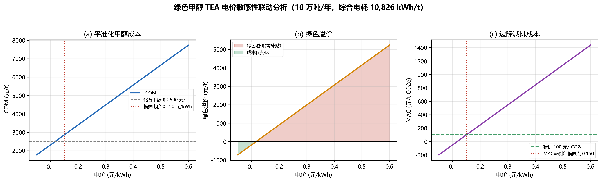

# 案例二 任务2 报告：绿电悖论与 LCOM/MAC 电价敏感性

## 1. LCA 绿电悖论复核（数据源: lca_grid_scenarios_lci.csv）

- 情景A 100%绿电: 净碳足迹 **-1044.1 kg CO2e/t**（净负碳，较煤制甲醇 2600 减排 140.2%）
- 情景B 区域电网: 净碳足迹 **4531.3 kg CO2e/t**（反向增排 +74.3%）
- 两情景差值 = 5575 kg CO2e/t，全部来自 10,826 kWh 电耗的排放因子差 (0.55-0.035)

**悖论成因**：火电效率~40% × 电解效率~64% × 合成回路损失，三级热力学折损使每 MJ 甲醇化学能背后燃烧数倍化石燃料。

## 2. TEA 敏感性联动（数据源: tea_lcom_sensitivity_data.csv，模型复算与 CSV 逐点一致）

| 电价 (元/kWh) | LCOM (元/t) | 绿色溢价 (元/t) | MAC (元/tCO2e) | 规划判定 |
| ---: | ---: | ---: | ---: | :--- |
| 0.05 | 1779.7 | -720.3 | -197.7 | 平价自足 |
| 0.10 | 2321.0 | -179.0 | -49.1 | 平价自足 |
| 0.15 | 2862.3 | +362.3 | 99.4 | 碳市场可平抑 |
| 0.20 | 3403.6 | +903.6 | 247.9 | 需国际航运溢价/不可行 |
| 0.25 | 3944.9 | +1444.9 | 396.5 | 需国际航运溢价/不可行 |
| 0.30 | 4486.2 | +1986.2 | 545.0 | 需国际航运溢价/不可行 |
| 0.35 | 5027.5 | +2527.5 | 693.6 | 需国际航运溢价/不可行 |
| 0.40 | 5568.8 | +3068.8 | 842.1 | 需国际航运溢价/不可行 |
| 0.45 | 6110.1 | +3610.1 | 990.7 | 需国际航运溢价/不可行 |
| 0.50 | 6651.4 | +4151.4 | 1139.2 | 需国际航运溢价/不可行 |
| 0.55 | 7192.7 | +4692.7 | 1287.7 | 需国际航运溢价/不可行 |
| 0.60 | 7734.0 | +5234.0 | 1436.3 | 需国际航运溢价/不可行 |

## 3. 商业自平衡临界电价

令 MAC ≤ 全国碳市场价 100 元/tCO2e（碳收益 = 100 × 3.644 t/t ≈ 364.4 元/t 可抵扣溢价）：
$$p_{crit} = \frac{2500 + 100 \times 3.644 - 1238.37}{10826} = \mathbf{0.1502 \ 元/kWh}$$

- **临界电价 ≈ 0.150 元/kWh**（对应 LCOM = 2864.4 元/t），即绿电到户电价低于约 **1 毛 5** 时，
  仅靠国内碳市场即可抹平绿色溢价、实现商业自平衡——与讲义'沙戈荒大基地 0.15 元/度典范可行'完全吻合；
- 电价高于 0.150 元/kWh 后 MAC 随电价线性陡增（斜率 2971 元/MWh→tCO2e），
  0.35 元/kWh 时 MAC=694 元/t，国内碳价无法覆盖，只能走 ISCC 认证出口欧盟赚取航运脱碳溢价；
- 规划铁律：电氢化工项目选址必须锁定 0.15 元/kWh 以下的廉价可再生电力资源区（沙戈荒大基地直供），
  严禁在高碳电网地区审批 Power-to-X 项目（绿电悖论区 = 规划禁区）。

