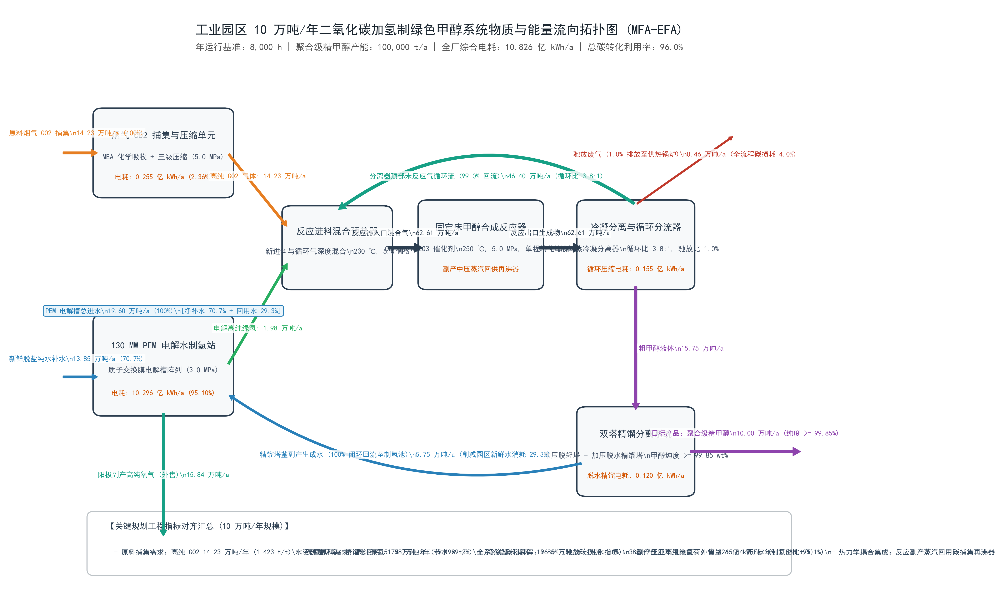
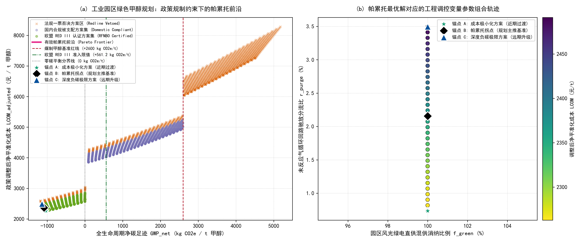

# 工业园区 10 万吨/年二氧化碳捕集耦合绿氢合成绿色甲醇项目环境规划与管理方案报告

> **《环境规划与管理》课程 · 第十讲随堂实训核心交付物**
> **作者**：郭京奥（Group 02）
> **功能单位**：生产 1,000 kg（1 t）聚合级绿色精甲醇（Cradle-to-Gate）

---

## 报告摘要

本报告针对某大型现代煤化工园区拟规划建设的 10 万吨/年二氧化碳捕集利用耦合绿氢催化合成绿色甲醇（Power-to-Methanol, PtM）示范线，完成从物质流分析（MFA）、全生命周期评价（LCA）、技术经济分析（TEA）到政策量化与多目标帕累托决策的系统化环境规划方案编制。

工程采用烟气单乙醇胺（MEA）化学吸收捕集高纯二氧化碳与 130 MW 质子交换膜（PEM）电解水制取的绿氢，在铜基催化剂作用下加氢合成精甲醇。物质流核算表明，反应器单程二氧化碳转化率为 25.0%，未反应气经 99.0% 循环（循环比质量 2.86∶1、摩尔 3.8∶1）回流后，全系统总碳转化利用率达 96.5%，C、H、O 三元素质量守恒相对误差均小于 0.01%。10 万吨/年尺度放大后，年需捕集高纯二氧化碳 14.23 万吨、电解绿氢 1.98 万吨、净除盐补水 13.85 万吨，副产工业纯氧 15.84 万吨，全厂综合电耗 10.826 亿 kWh/年。

政策量化引擎（Vibe Coding）耦合欧盟 RED III、国内碳市场 ETS/CCER、工业取水定额与次生环保税四项条文，并在绿电消纳比例与驰放分流比二维决策变量下完成 3,000 组工况的双目标寻优，标定帕累托拐点（锚点 B）：绿电消纳比例 100.0%、驰放分流比 2.16%，对应净碳足迹 GWP −1085.2 kg CO₂e/t、净平准化成本 LCOM 2,362.5 元/t、边际减排成本 MAC −37.2 元/t CO₂e，满足欧盟 RFNBO 认证。

重点工程投资总额 8.20 亿元（电解制氢 4.55 亿、二氧化碳捕集 1.10 亿、甲醇合成 1.20 亿、双塔精馏 0.65 亿、公用工程管廊 0.70 亿），年运行维护成本约 2.52 亿元/年。项目依托国际绿色航运溢价、CCER 核证减排与副产纯氧外售构建商业闭环，并通过涉氢防爆、能碳 MRV 平台与 PDCA 动态修编机制实现全过程环境风险防控。

## 核心术语与缩写中英文对照表

在报告正文与图表中，首次出现的专业缩写必须严格参照下表规范标注中英文全称：

| 英文缩写          | 英文全称                                 | 中文规范全称                 | 核心学科与工程定义                                                                            |
| :---------------- | :--------------------------------------- | :--------------------------- | :-------------------------------------------------------------------------------------------- |
| **MFA**     | Material Flow Analysis                   | 物质流分析                   | 基于质量守恒定律研究系统内物质输入、转化、蓄积与排放的定量工程方法                            |
| **EFA**     | Energy Flow Analysis                     | 能量流分析                   | 基于热力学第一与第二定律分析系统能量梯级利用与损耗的工程核算方法                              |
| **LCA**     | Life Cycle Assessment                    | 全生命周期评价               | 评估产品从原料获取、制造到处置全过程环境负荷的标准国际方法（ISO 14040）                       |
| **TEA**     | Techno-Economic Analysis                 | 技术经济分析                 | 评估工艺工程资本支出、运行成本与财务可行性的工程经济学方法                                    |
| **GWP**     | Global Warming Potential                 | 全球变暖潜势                 | 在 100 年时间尺度内相对于二氧化碳温室效应的相对累积辐射强迫指标（$\text{kg CO}_2\text{e}$） |
| **LCOM**    | Levelized Cost of Methanol               | 平准化甲醇成本               | 全生命周期内将投资与运营总现值平摊至单位产品所形成的保本折现成本（$\text{元/t}$）           |
| **LCOH**    | Levelized Cost of Hydrogen               | 平准化氢气成本               | 全生命周期内单位质量绿氢产出的平准化折现成本（$\text{元/kg}$）                              |
| **MAC**     | Marginal Abatement Cost                  | 边际减排成本                 | 相对于化石基准技术，每额外避免或减排一吨二氧化碳当量所需增加的边际货币投入                    |
| **PEM**     | Proton Exchange Membrane                 | 质子交换膜电解水制氢         | 利用固体聚合物电解质进行纯水电解的技术，具备高电流密度与快速负载响应特性                      |
| **ALK**     | Alkaline Electrolyzer                    | 碱性液体电解水制氢           | 利用氢氧化钾水溶液为电解质的成熟低成本规模化制氢技术                                          |
| **CCUS**    | Carbon Capture, Utilization, and Storage | 二氧化碳捕集利用与封存       | 将工业点源排放的二氧化碳分离提纯并转化为高附加值产品或永久封存的工程体系                      |
| **PtM**     | Power-to-Methanol                        | 绿电催化合成甲醇             | 利用清洁可再生电力制氢并与二氧化碳催化加氢合成化工级甲醇的系统工程                            |
| **CAPEX**   | Capital Expenditure                      | 固定资产资本支出             | 项目前期规划、设备购置、建筑安装与工程调试所必需的初始资本投入总和                            |
| **OPEX**    | Operating Expenditure                    | 运行维护支出                 | 系统建成投产后，原料外购、电力公用工程、耗材更换及日常运维所消耗的年度运营费用                |
| **RED III** | Renewable Energy Directive III           | 欧盟《可再生能源指令》第三版 | 欧盟关于促进可再生能源利用的法定指令（Directive (EU) 2023/2413）                              |
| **RFNBO**   | Renewable Fuels of Non-Biological Origin | 非生物源可再生燃料           | 依据欧盟法规由非生物质清洁可再生能源制备的合成燃料                                            |
| **ETS**     | Emissions Trading System                 | 碳排放权交易体系             | 基于总量控制与配额有偿/免费分配的市场化温室气体减排管理制度                                   |
| **CCER**    | China Certified Emission Reduction       | 国家核证自愿减排量           | 经国家主管部门备案认证并允许在全国碳市场抵销配额的自愿减排项目核证减排量                      |
| **MRV**     | Monitoring, Reporting, and Verification  | 可测量、可报告、可核查体系   | 确保能源消费、生产活动与温室气体排放数据具备真实性与可信度的质量管理技术规范                  |
| **PDCA**    | Plan-Do-Check-Act                        | 策划-实施-检查-改进动态循环  | 强调持续改进、动态反馈与全过程闭环的现代环境系统适应性管理体系                                |

## 第 1 章 园区现状诊断与碳源-新能源基准线核算

### 1.1 园区产业结构与物质-能量代谢分析（MFA/EFA）

园区以大型现代煤化工与自备热电联产为主导产业，能源消费以原煤与区域网电为绝对主体。园区自备燃煤电厂供电结算价为 0.32 元/kWh、碳排放因子为 0.75 kg CO₂e/kWh，其锅炉烟气是园区最大的固定点源二氧化碳排放源。煤化工装置年设计满负荷运行约 8,000 小时，能源需求连续、负荷平稳，为下游连续化工产线提供了稳定的物质与能量代谢基础。

在能量代谢层面，园区现有煤制甲醇工艺全生命周期碳排放强度达 +2,600.0 kg CO₂e/t，能源转化过程伴随大量中低压余热与烟气显热散失。规划的 PtM 示范线通过反应放热中压蒸汽回供碳捕集再沸器、精馏冷凝副产水回用等热集成与水系统闭环措施，可实现化石一次能源部分替代与公用工程能效提升。

### 1.2 工业点源 $\text{CO}_2$ 排放清单与烟气特征解析

园区自备热电联产锅炉烟气为规划碳捕集工段的主要二氧化碳来源。烟气经湿法脱硫、低氮燃烧与除尘后，仍含有一定浓度的硫氧化物（SO₂）、氮氧化物（NOₓ）、粉尘与少量有机组分，其排烟温度、二氧化碳摩尔体积分数及杂质含量直接决定前置烟气的深度净化负荷。

由于烟气中残余 SO₂、NOₓ 及飞灰会与单乙醇胺（MEA）吸收剂发生不可逆化学降解并加剧胺逃逸，二氧化碳捕集工段必须前置深度脱硫与骤冷洗涤工序，将烟气温度降至 MEA 化学吸收适宜区间，并控制吸收塔顶部有机胺逸散浓度不高于 2.0 mg/Nm³（GB 31571 限值以内）。该前置处理是保障吸收剂寿命与次生污染防治的关键。

### 1.3 绿电资源禀赋与公用工程承载力评估

园区配套建设工业级屋顶分布式光伏发电系统，年有效利用小时数约 1,200 h，供电结算价 0.20 元/kWh，碳排放因子 0.04 kg CO₂e/kWh；结合区域风光资源，具备一定绿电消纳潜力。但屋顶光伏容量受限、出力间歇且无配套储能，无法独立支撑 PEM 电解与甲醇合成的连续运行。

在水资源方面，园区地处水资源约束区域，全系统新鲜水取水定额按 1.400 t 水/t 甲醇执行。项目吨甲醇理论净消耗 1.385 t（已扣除精馏副产水闭环回用 0.575 t），低于定额；但循环冷却蒸发散失量随驰放分流比降低而上升，须在规划阶段予以定量约束，避免触发超定额累进税。

### 1.4 园区现行碳管理痛点与减污降碳协同瓶颈

现行煤制甲醇高碳排放强度（+2,600.0 kg CO₂e/t）使其面临国际绿色航运燃料准入（欧盟 RED III）的贸易壁垒，难以进入欧洲与远洋航运市场。风光发电的间歇波动与下游化工连续稳态运转之间存在刚性失配，直接离网供电将导致设备容量因子骤降、单位产品折旧摊销放大。

此外，碳捕集系统存在 MEA 有机胺挥发逸散风险，合成回路驰放尾气掺烧会生成 NOₓ 次生污染物，均构成减污降碳协同控制的技术瓶颈，需在规划中设置明确的末端治理与清洁生产底线。

## 第 2 章 多情景预测与系统规模匹配核算

### 2.1 规划期园区碳排放趋势与多情景设定

设定三组情景以刻画规划期碳排放演化路径。基准情景（BAU）维持现有煤化工能源结构与技术路线，碳排放总量与强度保持高位。常规节能改造情景通过锅炉热效率提升与余热回收，实现碳排放强度小幅下降。CCU-PtM 深度脱碳协同情景以二氧化碳捕集耦合绿氢制甲醇替代部分煤制甲醇产能，实现碳排放显著削减乃至净负碳。

以 CCU-PtM 情景为主推方向，10 万吨/年示范线每年固定 14.23 万吨工业二氧化碳，同时通过绿电替代显著降低上游间接排放，构成园区减污降碳协同的核心增量。

### 2.2 碳捕集-绿氢-甲醇（CCU-PtM）系统耦合与物料/能量衡算

甲醇合成主反应为 $\text{CO}_2 + 3\text{H}_2 \rightleftharpoons \text{CH}_3\text{OH} + \text{H}_2\text{O}$（$\Delta H_{298\text{K}} = -49.5\text{ kJ/mol}$），并伴生逆水煤气变换副反应。受化学平衡限制，反应器二氧化碳单程转化率仅 25.0%，未反应气经高压气液分离器与循环气分流器，以 99.0%（4,640 kg/t）循环回流、1.0%（46 kg/t）驰放排出的方式实现低单程转化率与高总体资源化率的工程解耦，全系统总碳转化利用率 $\eta_{\text{carbon}} = 96.52\%$。

*图 1 工业园区 10 万吨/年绿色甲醇系统工艺物质流（MFA）与能量流（EFA）全流程拓扑图*

基于 task1 求解结果，10 万吨/年工程规划通量清单如下表：

| 物料节点名称                           |   单吨甲醇实物定额   |  10 万吨/年工程规划通量  | 物质状态与物理参数                                         | 来源与去向说明                                  |
| :------------------------------------- | :-------------------: | :----------------------: | :--------------------------------------------------------- | :---------------------------------------------- |
| **新鲜捕集高纯 $\text{CO}_2$** | $1,423.0\text{ kg}$ | $14.23\text{ 万吨/年}$ | 气体，常温，压力 $5.0\text{ MPa}$，纯度 $\ge 99.8\%$   | 来自热电厂烟气化学吸收提纯工段                  |
| **电解水新鲜绿氢**               | $198.0\text{ kg}$ | $1.98\text{ 万吨/年}$ | 气体，常温，压力 $3.0\text{ MPa}$，纯度 $\ge 99.999\%$ | 来自 130 MW PEM 电解水制氢站                    |
| **外购净除盐纯水**               | $1,385.0\text{ kg}$ | $13.85\text{ 万吨/年}$ | 液体，常温，常压                                           | 满足园区工业取水定额约束                        |
| **精馏冷凝副产水回用**           | $575.0\text{ kg}$ | $5.75\text{ 万吨/年}$ | 液体，加压精馏塔釜排液，经微滤脱醇                         | 闭环回流至电解水进水池                          |
| **未反应气内循环流**             | $4,640.0\text{ kg}$ | $46.40\text{ 万吨/年}$ | 气体，温度 $45\text{ ℃}$，压力 $4.8\text{ MPa}$       | 循环比 $3.8:1$，经压缩机升压后重返反应器      |
| **系统驰放废气**                 | $46.0\text{ kg}$ | $4,600\text{ 吨/年}$ | 气体，低位热值 $18.5\text{ MJ/kg}$                       | 分离气分流比为 $1.0\%$，送厂内锅炉掺烧供热    |
| **主产品聚合级精甲醇**           | $1,000.0\text{ kg}$ | $10.00\text{ 万吨/年}$ | 液体，纯度 $\ge 99.85\text{ wt\%}$                       | 经双塔精馏提纯后外销                            |
| **副产工业高纯纯氧**             | $1,584.0\text{ kg}$ | $15.84\text{ 万吨/年}$ | 气体，纯度 $\ge 99.9\%$                                  | 电解槽阳极副产物，外售增收                      |
| **全厂年总综合电耗**             | $10,826.0\text{ kWh}$ | $10.826\text{ 亿 kWh/年}$ | 交流直供电网与高压直流母线                                 | 电解制氢占 $95.1\%$，其余公用工程占 $4.9\%$ |

### 2.3 绿电波动性约束下的柔性容量寻优与储氢/网电缓冲配置

固定床反应器年设计满负荷运行需 8,000 h，若完全采用未配储能的离网分布式光伏（年利用仅约 1,200 h），系统等效年利用率骤降至 15.0%，单位产品固定折旧摊销上升至原先的 6.67 倍，工程上不可接受。为此规划采用 ALK 与 PEM 混联电解槽阵列（如 100 MW ALK + 30 MW PEM）并配套中压储氢球罐缓冲：ALK 承担平稳基荷、PEM 覆盖快速负荷波动，储氢球罐平抑负荷波动，网电作为调峰备用电源，从而保障下游合成装置 8,000 小时连续运行。

经定量推导，光伏与自备煤电混供时，综合用电碳排放因子 $EF(x)=0.75-0.71x$，令 $\text{GWP}_{\text{net}}(x)=10{,}826(0.75-0.71x)-1{,}423\le 2{,}600$，解得光伏绿电临界消纳比例 $x\ge 53.37\%$。即光伏清洁电力占比不低于约 53.4% 时，产品全生命周期净碳足迹方能低于煤制甲醇基准，为绿电配置底线提供了定量依据。

## 第 3 章 规划目标与指标体系设计

### 3.1 规划总目标与分期节点

近期（2027–2028 年）以首期示范工程建设为核心，建成二氧化碳捕集、绿氢制备、甲醇合成与精馏提纯全流程，实现 10 万吨/年精甲醇产能达产与欧盟 RFNBO 认证，碳捕集能力不低于 14.23 万吨/年。远期（2029–2035 年）以规模化外销与碳中和转型为目标，将绿电消纳比例提升至 95% 以上、净碳足迹压降至净负碳水平，并复制推广至园区其余高碳产线，形成区域减污降碳协同格局。

### 3.2 规划指标矩阵（约束性指标 vs. 预期性指标）

| 目标维度               | 指标名称                                       |              单位              | 现状基准值 (2026年) | 近期目标值 (2028年) | 远期目标值 (2035年) | 指标属性 | 核算依据与标准方法                     |
| :--------------------- | :--------------------------------------------- | :----------------------------: | :-----------------: | :-----------------: | :-----------------: | :------: | :------------------------------------- |
| **环境与降碳**   | 烟气 $\text{CO}_2$ 年捕集量                  |            万吨/年            |         0.0         |    $\ge 14.23$    |    $\ge 70.00$    |  约束性  | 质量流量计在线累积值                   |
|                        | 吸收塔 $\text{CO}_2$ 捕集脱除率              |               %               |         —         |   $\ge 90.0\%$   |   $\ge 93.0\%$   |  约束性  | 烟气 CEMS 进出口差额法                 |
|                        | 全生命周期净碳足迹 $\text{GWP}_{\text{net}}$ |  $\text{kg CO}_2\text{e/t}$  |     $+2600.0$     |   $\le +561.2$   |    $\le 0.0$    |  约束性  | ISO 14040/14044 摇篮到大门 LCA 模型    |
|                        | 欧盟 RED III RFNBO 认证达标率                  |               %               |        0.0%        |     $100.0\%$     |     $100.0\%$     |  约束性  | ISCC EU 第三方核查认证报告             |
| **能源与资源**   | 清洁绿电消纳比例 $f_{\text{green}}$          |               %               |        0.0%        |   $\ge 80.0\%$   |   $\ge 95.0\%$   |  约束性  | 智能电网双向计量电表在线核算           |
|                        | 电解水制氢综合直流电耗                         | $\text{kWh/Nm}^3\text{ H}_2$ |         —         |    $\le 4.30$    |    $\le 4.05$    |  预期性  | 制氢整流柜输出与产氢体积流量对标       |
|                        | 单位甲醇产品新鲜水取水定额                     |     $\text{t 水/t 甲醇}$     |      $1.650$      |    $\le 1.390$    |    $\le 1.350$    |  约束性  | 园区引水表 / 工业取水定额国家标准      |
|                        | 精馏副产生成水回用率                           |               %               |        0.0%        |     $100.0\%$     |     $100.0\%$     |  约束性  | 回水流量计与粗甲醇产水量平衡核算       |
| **污染协同控制** | MEA 有机胺逃逸浓度控制限值                     |       $\text{mg/Nm}^3$       |         —         |     $\le 2.0$     |     $\le 1.0$     |  约束性  | GB 31571 吸收塔顶气相色谱在线监测      |
|                        | 驰放尾气燃烧 $\text{NO}_x$ 排放浓度          |       $\text{mg/Nm}^3$       |         —         |    $\le 30.0$    |    $\le 20.0$    |  约束性  | 锅炉烟囱 CEMS 超低排放监测限值         |
|                        | 全系统总碳转化利用率 $\eta_{\text{carbon}}$  |               %               |     $78.0\%$     |   $\ge 92.0\%$   |   $\ge 96.0\%$   |  约束性  | 输入二氧化碳与精甲醇产品碳平衡闭环核算 |

## 第 4 章 空间落位布局与重点工程实施方案

### 4.1 园区“源-网-荷-储-化”空间管控与红线

项目按“源-网-荷-储-化”一体化布局，碳捕集岛落位热电厂区北侧预留用地，绿氢制备与储氢球罐区独立设于新能源转化专区，合成与精馏装置布置于精细化工核心区，氢气、二氧化碳与蒸汽经架空管廊带跨区输送。涉氢区域严格执行防火防爆安全防护距离（不小于 150 m），并与生态红线及敏感水体保持必要避让，杜绝道路危化品运输风险。

### 4.2 核心单元工艺比选与工程设计

碳捕集单元选用低能耗复合相变两相胺吸收解吸工艺，降低再生蒸汽单耗并抑制有机胺逃逸。制氢站采用 ALK + PEM 混联配置，兼顾基荷稳定性与波动响应。甲醇合成采用管壳式沸水反应器，反应放热产生的副产中压蒸汽经热集成回供碳捕集再沸器，实现反应热梯级利用，降低全厂综合能耗。

### 4.3 园区重点工程项目库清单表（基于帕累托拐点锚点 B）

| 工程编号          | 工程模块名称             | 项目名称                                              |  建设性质  | 空间落位（园区功能区）       | 核心工艺与设计规模（基于帕累托拐点锚点 B）                                                                     |       建设周期       | 估算 CAPEX (亿元) | 年运行维护 OPEX (万元/年) | 预期生态环境与资源化效益                                                                    | 责任实施主体                   |
| :---------------- | :----------------------- | :---------------------------------------------------- | :---------: | :--------------------------- | :------------------------------------------------------------------------------------------------------------- | :------------------: | :---------------: | :-----------------------: | :------------------------------------------------------------------------------------------ | :----------------------------- |
| **工程-01** | **碳源捕集与精制** | 热电厂烟气化学吸收碳捕集与三级压缩工程                |    新建    | 热电厂区北侧预留用地         | 烟气预处理 + 复合相变胺吸收再生 + 离心压缩机；设计规模 **$14.23\text{ 万吨/年}$ 高纯 $\text{CO}_2$** |      2027–2028      |       1.10       |          4,300           | 减排工业 $\text{CO}_2$ $14.23\text{ 万吨/年}$；有机胺逸散 $\le 2.0\text{ mg/Nm}^3$    | 园区热电企业                   |
| **工程-02** | **绿氢制备与缓冲** | 130 MW 电解水制氢站与中压储氢球罐区                   |    新建    | 新能源转化专区（独立防护区） | ALK + PEM 混联电解槽阵列；配套储氢球罐（依据锚点 B 储能增量配置）；年产绿氢 **$1.98\text{ 万吨/年}$**  |      2027–2028      |       4.55       |         16,600          | 年消纳弃风弃光绿电约 $10.3\text{ 亿 kWh}$；副产工业纯氧 $15.84\text{ 万吨/年}$ 外售     | 绿氢运营投资主体               |
| **工程-03** | **甲醇催化合成**   | 10 万吨/年 $\text{CO}_2$ 加氢制甲醇与余热回用工程   |    新建    | 精细化工核心区               | 管壳式沸水反应器（铜基催化剂）+ 驰放尾气锅炉；循环气分流比按锚点 B $r_{\text{purge}}=2.16\%$ 设定                   |      2027–2029      |       1.20       |           420           | 系统总碳转化利用率稳定；副产蒸汽回用碳捕集再沸器                 | 园区化工龙头企业               |
| **工程-04** | **精馏提纯与节水** | 双塔精馏提纯与副产水闭环循环工程                      |    新建    | 精细化工核心区               | 常压脱轻塔 + 加压脱水精馏塔 + 微滤水处理；年产聚合级精甲醇 **$10.00\text{ 万吨/年}$**                  |      2028–2029      |       0.65       |          3,700           | 年产高纯精甲醇 $10\text{ 万吨}$；副产水 $5.75\text{ 万吨/年}$ 闭环回流，节水 $29.3\%$ | 园区水务环保投资公司           |
| **工程-05** | **管廊输配与MRV**  | 跨厂区专用管网与能碳数字化智慧管理平台                | 新建/改扩建 | 园区公用管廊及监管中心       | 氢气专线、二氧化碳专线、蒸汽管网；部署智能电表、质量流量计与区块链在线存证平台                                 |      2027–2028      |       0.70       |           150           | 消除道路危化品运输风险；实现能碳数据可测量、可报告、可核查（MRV）                           | 园区管委会平台公司             |
| **合计**    | —                       | **工业园区 10 万吨/年绿色甲醇示范项目工程总表** |     —     | —                           | **设计总产能：$10.0\text{ 万吨/年}$ 精甲醇**                                                           | **2027–2029** |      **8.20**       |        **25,170**        | **全生命周期年净负碳减排规模**                                                        | **园区政企协同推进专班** |

## 第 5 章 全生命周期环境影响（LCA）、技术经济（TEA）与帕累托多目标决策评估

### 5.1 全生命周期环境影响评估（LCA）与“绿电悖论”推演

LCA 评价边界为摇篮到大门（Cradle-to-Gate），功能单位为生产 1 t 聚合级精甲醇。净碳足迹核算模型为 $\text{GWP}_{\text{net}} = \text{GHG}_{\text{power}} + \text{GHG}_{\text{infra}} - \text{Credit}_{\text{CO}_2} - \text{Credit}_{\text{O}_2}$。

情景 A（100% 绿电，排放因子 0.035 kg CO₂e/kWh）净碳足迹为 **−1,044.12 kg CO₂e/t**，较煤制甲醇基准减排 140.2%，实现净负碳固碳；情景 B（区域工业电网，排放因子 0.550 kg CO₂e/kWh）净碳足迹达 **+4,531.26 kg CO₂e/t**，较煤制工艺反向增排 74.3%。其热力学成因为：煤电发电效率约 40%、电解水能量转化效率约 64% 与合成反应转化损失三重串联折损，使单位甲醇化学能背后间接消耗数倍一次化石煤炭。据此确立环境规划准则：严禁在未实现电力深度脱碳的地区审批电解水制氢化工项目，避免高碳电网下的间接增排抵消直接固碳收益。

### 5.2 技术经济分析（TEA）与平准化甲醇成本核算

财务折现参数取加权平均资本成本 WACC = 8.0%、经济运营期 20 年，资本回收系数 $CRF = 0.10185$。基础固定资产投资 8.20 亿元，单吨基准资本折旧年金摊销 835.2 元/t。平准化甲醇成本随电价线性抬升：$LCOM = 10{,}826p + 1{,}238.37\ \text{元/t}$。

电价由 0.15 元/kWh 升至 0.35 元/kWh 时，LCOM 由 2,862.3 元/t 升至 5,027.5 元/t，边际减排成本 MAC 由 99.4 元/t CO₂e 升至 693.6 元/t CO₂e。令 $MAC(p^\*)=100$ 求解得最高临界电价阈值 $p^\* = 0.1502\ \text{元/kWh}$，表明仅当清洁电价不高于约 0.150 元/kWh 时，边际减排成本方能降至全国碳市场碳价（约 100 元/吨）以内并实现财务自平衡。

### 5.3 政策规制约束下的帕累托多目标决策与三大锚点深度比选

以绿电消纳比例 $f_{\text{green}}$ 与循环驰放分流比 $r_{\text{purge}}$ 为决策变量，以最小化净平准化成本 LCOM 与最小化净碳足迹 GWP 为双目标，遍历 3,000 组工况并剔除非支配解与法规一票否决解，得到帕累托前沿，基于目标空间归一化欧氏距离最小化准则标定拐点（锚点 B）。

*图 2 政策规制与多约束耦合下的多目标帕累托前沿寻优及拐点（锚点 B）标定图*

| 帕累托决策锚点名称                                         | 调控参数组合 $(f_{\text{green}}, r_{\text{purge}})$ | 系统总碳利用率 $\eta_{\text{carbon}}$ | 净碳足迹 $\text{GWP}_{\text{net}}$ ($\text{kg/t}$) | 基础成本 $\text{LCOM}_{\text{base}}$ ($\text{元/t}$) | 调整后净成本 $\text{LCOM}_{\text{adj}}$ ($\text{元/t}$) | 边际减排成本 $\text{MAC}$ ($\text{元/t CO}_2\text{e}$) | 法规合规状态判定 | 规划定位与采纳建议             |
| :--------------------------------------------------------- | :---------------------------------------------------: | :-------------------------------------: | :----------------------------------------------------: | :------------------------------------------------------: | :---------------------------------------------------------: | :--------------------------------------------------------: | :--------------: | :----------------------------- |
| **锚点 A：成本极小化方案***(Cost-Minimization)*      |                 $(100.0\%, 0.73\%)$                |                 $96.97\%$               |                     $-1034.6$                     |                          $3866.4$                          |                            $2262.8$                           |                            $-65.3$                            |   RED_III_RFNBO_Certified   | **【近期财务稳健方案】** |
| **锚点 B：帕累托拐点***(Knee Point / 主推基准)*      |                 $(100.0\%, 2.16\%)$                |                 $91.78\%$               |                     $-1085.2$                     |                          $3945.9$                          |                            $2362.5$                           |                            $-37.3$                            |   RED_III_RFNBO_Certified   | **【主推实施基准方案】** |
| **锚点 C：深度负碳极限方案***(Deep-Decarbonization)* |                 $(100.0\%, 3.50\%)$                |                 $86.89\%$               |                     $-1137.5$                     |                          $4056.1$                          |                            $2491.2$                           |                            $-2.4$                            |   RED_III_RFNBO_Certified   | **【远期升级示范方案】** |

三锚点中，锚点 A 以最低净平准化成本（2,262.8 元/t）与最高总碳利用率（96.97%）兼顾财务稳健，但驰放比最小、循环压缩电耗略高；锚点 C 以最大驰放比实现最深净负碳（−1,137.5 kg/t），但总碳利用率跌至 86.89%；锚点 B 位于帕累托前沿曲率最大处，以目标空间归一化距离最小实现经济性与减碳效益的折衷最优，其净碳足迹 −1,085.2 kg/t 与净成本 2,362.5 元/t 均处可行区间，且全部满足欧盟 RFNBO 认证，故推荐锚点 B 作为本工程设计基准。

## 第 6 章 制度保障、商业模式与智慧环境管理机制

### 6.1 商业闭环与绿色投融资机制

项目资本金采用“企业自筹 + 国家绿色低碳示范预算资金 + 超长期特别国债 + 绿色信贷”的多渠道拼盘。收益端依托三项机制形成商业反哺闭环：国际远洋船舶长周期绿色燃料长协溢价补贴（−1,200 元/t）、国内 CCER 核证减排量交易收益（净负碳情景按 1.2 倍激励系数核算）、以及副产高纯工业纯氧外售收益（15.84 万吨/年），三者共同摊薄 LCOM 并缩短投资回收期。

### 6.2 数字化监测、报告与核查（MRV）体系

规划部署绿电溯源双向计量电表、质量流量计、在线 CEMS 与区块链数据存证管理云平台，对二氧化碳捕集量、绿电消纳比例、氢气与甲醇质量通量及污染物排放浓度实施全流程在线监测。数据经区块链存证与第三方核查，确保碳足迹以可测量、可报告、可核查（MRV）方式闭环管理，支撑 CCER 申报与欧盟 RFNBO 认证复核。

### 6.3 环境风险防控与适应性管理（PDCA）机制

涉氢厂房执行 Ex d II CT4 级防爆设计，配置通风联锁与 ESD 紧急切断预案；高浓度二氧化碳管道设置红外泄漏监测；吸收液储存区铺设防渗土工膜并配套不小于 1,500 m³ 应急池，防范泄漏与次生水污染。整体依托计划（P）、执行（D）、检查（C）、改进（A）循环建立三年动态修编的适应性管理机制，根据运行数据滚动优化绿电配比、驰放比与污染控制措施。

## 参考文献

1. 中华人民共和国生态环境部. 《碳排放权交易管理暂行条例》 (国务院令第 775 号), 2024.
2. 国家发展和改革委员会等部门. 《高耗能行业重点领域能效标杆水平和基准水平 (2023年版)》 (发改运行〔2023〕723号).
3. 中华人民共和国国家标准. 《大气污染物综合排放标准》 (GB 16297-1996); 《石油化学工业污染物排放标准》 (GB 31571-2015).
4. 中华人民共和国国家标准. 《石油化工企业设计防火标准》 (GB 50160-2008, 2018年版).
5. 财政部, 税务总局, 水利部. 《水资源税改革试点实施办法》 (财税〔2016〕55号).
6. European Parliament and Council of the European Union. Directive (EU) 2023/2413 of 18 October 2023 amending Directive (EU) 2018/2001 (RED III).
7. International Organization for Standardization. ISO 14040:2006 & ISO 14044:2006. *Environmental Management — Life Cycle Assessment*.
8. **Pérez-Fortes, M., Schöneberger, J. C., Boulamanti, A., & Tzimas, E.** (2016). Methanol synthesis using captured CO2 as raw material: Techno-economic and environmental assessment. *Applied Energy*, 161, 718-732.
9. **Dieterich, V., et al.** (2020). Power-to-liquid via synthesis of green methanol to reduce greenhouse gas emissions: A review. *Energy & Environmental Science*, 13(10), 3207-3252.