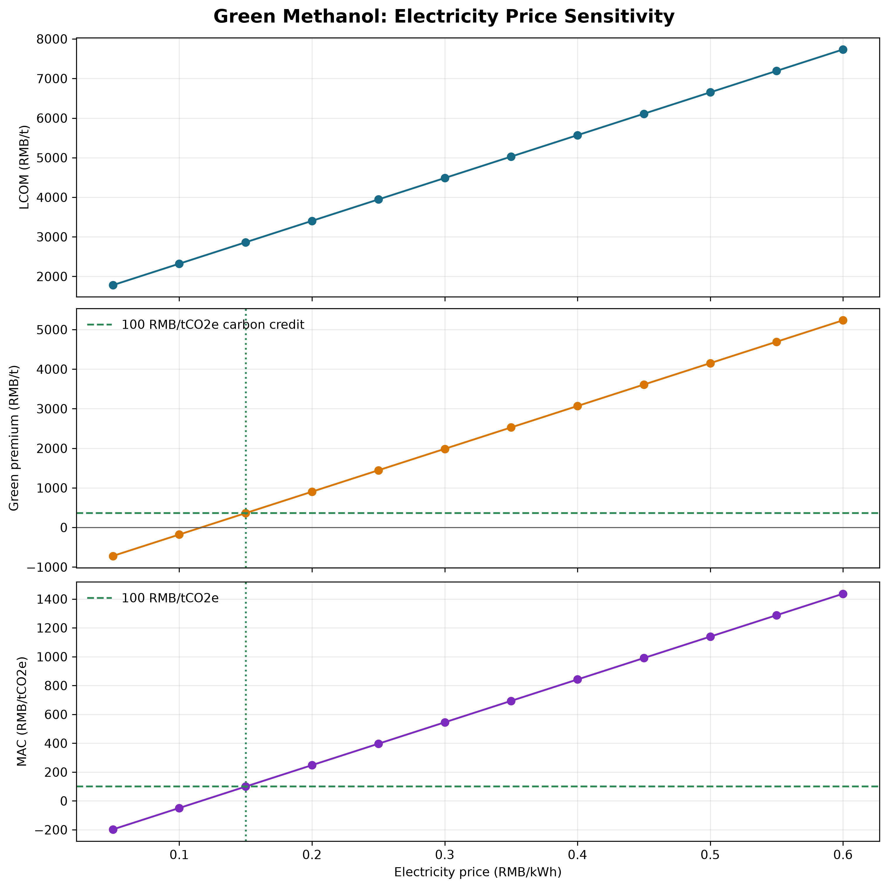
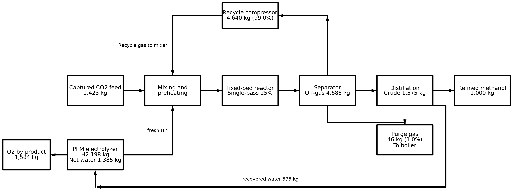

# 案例二作业报告：CO2 捕集与绿氢合成甲醇的 MFA-LCA-TEA 联动分析

**小组：** group-02  
**个人作业分支：** `dev-group-02-帕娜尔-case2`  
**功能单位：** 生产 1 t 聚合级绿色精甲醇（Cradle-to-Gate）  
**流程图工具：** `schemdraw` 0.23  
**数据来源：** 本目录 `case_files/data_cohort/` 中老师发布的三个案例 CSV

## 1. 交付文件与复现

- `case2_analysis.py`：读取原始 CSV，求解循环回路、核算 LCA/TEA 与规划敏感度、审计原始流量表，并生成两组图表。
- `test_case2_analysis.py`：关键数值回归测试，并验证程序会明确暴露原始 MFA 全系统不守恒。
- `methanol_recycle_process.png` / `.svg`：包含 300 dpi PNG 和可缩放 SVG 的甲醇工艺流程图。
- `tea_lcom_mac_sensitivity.png` / `.svg`：LCOM、绿色溢价和 MAC 随电价变化的敏感性图。

README 推荐 Python 3.10/3.11 与 Conda；此工作站当前可用的 Python 启动器只提供 Python 3.13，因此使用独立虚拟环境并安装 `numpy`、`pandas`、`scipy`、`matplotlib` 和所选 `schemdraw`，没有改动仓库依赖文件。

首次建立隔离环境（当前机器可用 Python 3.13；README 推荐的 Python 3.10/3.11 在该终端不可用）：

```powershell
$envPath = Join-Path $env:LOCALAPPDATA 'venvs\mfa_lca_tea_case2'
py -3.13 -m venv $envPath
& (Join-Path $envPath 'Scripts\python.exe') -m pip install numpy pandas scipy matplotlib schemdraw
```

在 Windows PowerShell 中运行分析与测试：

```powershell
$python = Join-Path $env:LOCALAPPDATA 'venvs\mfa_lca_tea_case2\Scripts\python.exe'
& $python .\groups\group-02\case2-green-methanol\code_implementation\case2_analysis.py
& $python -m unittest discover -s .\groups\group-02\case2-green-methanol\code_implementation -p 'test_*.py' -v
```

脚本基于自身文件位置查找相邻 `case_files/data_cohort/`，无需先切换到特定目录。

## 2. 任务一：循环回路求解与 MFA 数据核验

### 2.1 回路方程与求解

以新鲜 CO2 流量 `F = 1,423 kg/t 产品` 为 CO2 当量基准。CSV 给出的分离器气相为 `4,686 kg`，循环气为 `4,640 kg`，因此循环分率为 `r = 4,640 / 4,686 = 99.0184%`。单程转化率取讲义给定的 `X = 25%`，循环方程为：

```text
R = r × (1 - X) × (F + R)
R/F = r × (1 - X) / [1 - r × (1 - X)]
```

`scipy.optimize.fsolve` 求得 CO2 当量回流量约 `4,106.169 kg/t`，方程残差低于 `1e-8 kg`，回流比为 **2.8856:1**。列出的混合气总质量流比另为 `4,640 / (1,423 + 198) = 2.8624:1`。按模型中未反应 CO2 的驰放损失计算，总碳利用率为 **97.1393%**。

### 2.2 原始数据守恒审计（重要限制）

以上是明示假设下的单组分 CO2 当量回路模型，不能替代 CSV 全流程各组分守恒。将外部输入定义为新鲜 CO2、新鲜 H2 和净脱盐水，外部输出定义为副产氧、驰放气和精甲醇（精馏水 575 kg 是内部回流，不重复计作外排）后，原始数据得到：

| 核算项 | 输入 | 输出 | 输出 - 输入 | 相对输入偏差 |
|---|---:|---:|---:|---:|
| 总质量 (kg/t) | 3,006.000 | 2,630.000 | -376.000 | -12.508% |
| C (kg/t) | 387.590 | 383.977 | -3.613 | -0.932% |
| H (kg/t) | 353.133 | 136.053 | -217.079 | -61.472% |
| O (kg/t) | 2,263.854 | 2,108.911 | -154.943 | -6.844% |

因此，**原始流量表无法满足作业要求的全系统 C/H/O 输入输出差值小于 0.01%**。不能在不修改老师数据或伪造组分的情况下把全系统自检标成通过。为区分方程正确性与输入数据问题，脚本还单独检查了讲义中的两个化学反应式：

- CO2 + 3H2 -> CH3OH + H2O
- 2H2O -> 2H2 + O2

两个反应的 C/H/O 化学计量守恒误差均为 0.000000%。这不代表整厂流量表已经闭合。

### 2.3 讲义基准与数据差异

讲义/README 声称循环比 `3.8:1`、总体碳利用率 `96.0%`；而同一案例数据中的 4,640 kg 循环气与 1,423 kg CO2 + 198 kg H2 新鲜气对应总气质量比 `2.8624:1`，单组分方程给出 `2.8856:1` 和 `97.1393%`。数据流量本身表示约 `99.0184%` 循环 / `0.9816%` 驰放，约等于讲义中的 `99%/1%`，但与 PR 模板中写的 `96%/4%` 不同。本报告和流程图保留讲义及 CSV 的 `99%/1%`，不把不同定义混为一谈。

在获得老师对新鲜气基准、循环流组成、反应/分离组分及驰放定义的修订说明前，不应声称满足全系统元素守恒要求。

## 3. 任务二：LCA 绿电悖论

电耗依据四个电力清单行相加：`10,296 + 255 + 155 + 120 = 10,826 kWh/t`。其余环境因子依照 `lca_grid_scenarios_lci.csv`，包括 CO2 固定信用 `-1,423 kg CO2e/t`、基础设施与逸散 `+95 kg CO2e/t`、副产氧信用 `-95.04 kg CO2e/t`。

| 电力情景 | 重算净 GWP (kg CO2e/t) | 煤制甲醇基准 (kg CO2e/t) | 对比结果 |
|---|---:|---:|---:|
| 100% 绿电，0.035 kg CO2e/kWh | **-1,044.12** | 2,600 | 减排 **140.16%**，净负碳 |
| 区域电网，0.550 kg CO2e/kWh | **+4,531.26** | 2,600 | 增排 **74.28%** |

区域网电情景下，即使计入 CO2 固定和副产氧信用，电力排放仍使净足迹比煤制甲醇基准高。因此，项目选址必须将实际可追溯的低碳电力供应作为前提；不能仅凭“绿氢/绿醇”名称推断低碳。

## 4. 任务二：TEA、绿色溢价与 MAC

TEA CSV 的成本结构为：

```text
LCOM = 电价 × 10,826 kWh/t + 非电成本 1,238.37 RMB/t
绿色溢价 = LCOM - 煤制甲醇价格 2,500 RMB/t
MAC = 绿色溢价 / 绿电情景减排量 3.64412 t CO2e/t
```

| 电价 (RMB/kWh) | LCOM (RMB/t) | 绿色溢价 (RMB/t) | MAC (RMB/t CO2e) |
|---:|---:|---:|---:|
| 0.15 | 2,862.27 | 362.27 | 99.41 |
| 0.35 | 5,027.47 | 2,527.47 | 693.57 |
| 0.55 | 7,192.67 | 4,692.67 | 1,287.74 |

上表 MAC 曲线沿用 TEA 敏感性表的边界：变动的是电价，减排量使用绿电 LCA。若 0.55 元/kWh 同时代表区域煤电情景，则不能把该 MAC 当作适用于区域网电的减排成本，因为该电力情景相对煤制甲醇是增排而非减排。

按碳价 `100 RMB/t CO2e` 计，绿电情景每吨产品的碳价值为 `100 × 3.64412 = 364.41 RMB/t`。实现成本与碳价值抵消的最高电价为：

```text
p = (2,500 + 364.412 - 1,238.37) / 10,826
  = 0.15020 RMB/kWh
```

因此，约 `0.15 RMB/kWh` 的大基地消纳电价接近碳价 100 元下的自平衡点；不计碳价值时，产品达到煤制甲醇成本平价的电价约为 `0.11654 RMB/kWh`。电价敏感性图见下方交付文件。



## 5. 规划研讨题

### 5.1 屋顶光伏为何难以单独支撑连续化甲醇项目

讲义设定化工装置年运行 `8,000 h`，屋顶光伏等效满发 `1,200 h`，对应约 `15%` 的时间利用率。若项目仍要求全年稳定产出，仅依靠该光伏供能将面临电量与连续运行不匹配，需要大规模储能、备用电源或电解槽/合成装置超配。按相同装置投资、有效运行小时由 8,000 降为 1,200 的简化摊销，单位产出的资本成本约放大 `8,000/1,200 = 6.67` 倍；这还没有计入储能、弃电、启停损耗和设备寿命影响。

因此，屋顶分布式光伏可作为电源组合的一部分，但不能未经负荷时序、储能和设备利用率核算就视作本项目独立、稳定的电力来源。

### 5.2 混合电力中最低光伏占比

按讲义给定的边界，设光伏电量占比为 `x`，则：

```text
EF(x) = 0.04x + 0.75(1 - x)
GWP(x) = 10,826 × EF(x) - 1,423
```

令 `GWP(x) = 2,600 kg CO2e/t`，求得最低光伏占比 **约 53.30%**；若要严格低于煤制甲醇基准，则占比需略高于此阈值。该结果落在讲义提示的 50%–55% 区间内。

## 6. 任务三：工艺物质流程图

流程图使用 `schemdraw` 绘制 CO2 与 H2 混合、反应器单程转化、气液分离、甲醇精馏、循环压缩、驰放锅炉及水回流。标注质量流量来自 MFA CSV；循环与驰放百分比按 CSV 流量计算后四舍五入。提供 300 dpi PNG 和 SVG：



## 7. 提交边界及数据说明

- 按 troubleshooting 的“四步同步法”更新到最新 `main` 后，案例二的教师 `code_implementation/` 仍只有 `.gitkeep` 占位文件，没有参考答案代码。本组在 `groups/group-02/case2-green-methanol/code_implementation/` 编写了自己的实现，没有修改 `starter_materials/`。
- PR 文件均位于 `groups/group-02/case2-green-methanol/`，不包含其他小组或根目录改动。
- 原始数据与参考指标之间的守恒差异已在报告和脚本输出中明示，保留源 CSV，不擅自改写。
- 报告不填写学号等个人敏感信息。
