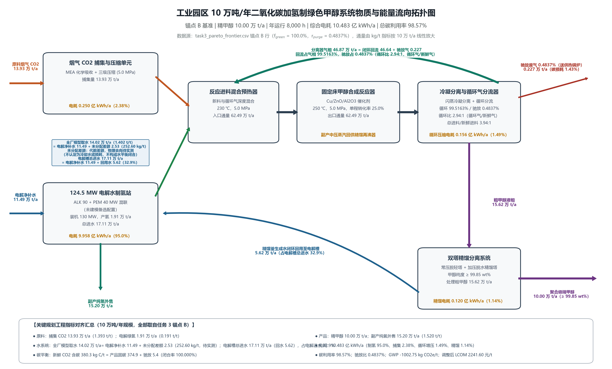
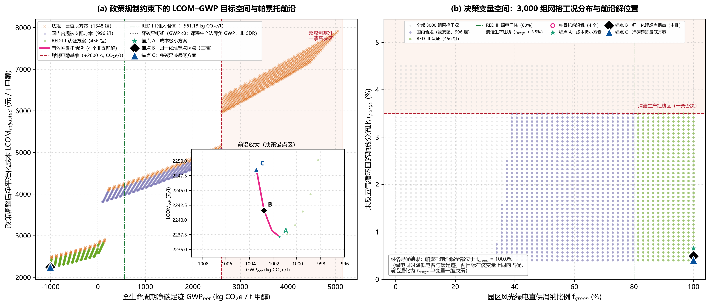

# 工业园区 10 万吨/年二氧化碳捕集耦合绿氢合成绿色甲醇项目环境规划与管理方案报告

> **【报告元数据】**
>
> - 课程名称：《环境规划与管理》 ｜ 学期：2026 年秋季 ｜ 第十讲随堂实训
> - 组别：group-02 ｜ 姓名/学号：qianghaojun
> - 设计基准：任务 3 帕累托拐点（锚点 B），$f_{\text{green}} = 100.0\%$、$r_{\text{purge}} = 0.4837\%$
> - 数据来源：`code_implementation/task1`–`task4` 全部计算结果（`results_output/task3_*.csv`）与 `figures_output/fig1`、`fig2`；政策条文取自 `data_cohort/policy_clauses_pack.md`；LCA 清单系数取自 `data_cohort/lca_grid_scenarios_lci.csv`；TEA 电价序列取自 `data_cohort/tea_lcom_sensitivity_data.csv`，其非电分项分解（CAPEX 年金、CO₂ 捕集、固定运维、水与药剂、O₂ 外售）为课程脚手架给定口径、CSV 未单列
> - 数据缺失处理原则：凡数据底座未提供、且无法由模型推导的量（如园区燃煤总量、烟气实测组分），一律标注“待补”或“规划假设”，不做虚构取值

## 报告摘要

本报告针对某现代煤化工园区 10 万吨/年二氧化碳捕集、绿电制氢与催化合成绿色甲醇示范工程，完成现状诊断、情景预测、指标体系、空间落位与重点工程、生命周期与技术经济评估、制度保障六部分编制。物料平衡采用反应—循环稳态模型：单程二氧化碳转化率 25.0%、驰放分流比 0.4837% 时，吨甲醇需新鲜二氧化碳 1,393.41 kg、绿氢 191.49 kg，副产纯氧 1,519.68 kg，循环气 4,664.02 kg；10 万吨/年规模对应二氧化碳 13.93 万吨、绿氢 1.91 万吨、纯氧 15.20 万吨、循环气 46.64 万吨、驰放气 2,267 吨，综合电耗 10.483 亿 kWh，总碳转化利用率 98.57%，C、H、O 元素与总质量守恒相对误差为零；循环比（循环气/新鲜气）2.94:1。全厂模型取水 1.4015 t/t（14.02 万吨/年，政策取水函数值，非课程基础参数 1.385 t/t 或定额 1.400 t/t）与电解净补水 1,148.94 kg/t（11.49 万吨/年）之差为未分配差额 252.60 kg/t（2.53 万吨/年），该差额不认定为冷却水或工艺损耗、物理去向待实测，本报告不作全厂水平衡闭合结论；精馏副产回水 562.23 kg/t（5.62 万吨/年）按模型全部回用于电解槽，占电解槽总进水 17.11 万吨/年的 32.86%。以绿电比例与驰放比为决策变量遍历 3,000 组工况，剔除 1,548 组否决方案后对 1,452 组合规方案非支配排序，得 4 个前沿解；按目标空间归一化欧氏距离最小标定锚点 B：课程生产边界（cradle-to-gate）下 GWP 为 $-1,002.75\ \text{kg CO}_2\text{e/t}$（属负 GWP，不等同于 CDR 或永久负排放），基础平准化成本 3,845.96 元/t（不含水资源税与环保税，含税后 3,873.93 元/t），经 RED III 补贴 1,200 元/t、课程碳收益 432.33 元/t（按相对煤制基准减排量 $\Delta\text{GHG}=3.60275\ \text{t CO}_2\text{e/t} \times 100\ \text{元/t} \times 1.2$ 估算，属课程政策模型估算，非已获核证收入）与取水环保税修正后为 2,241.60 元/t（简化 LCOM 口径，未计增值税、所得税、建设期利息与折旧），边际减排成本 $-71.72\ \text{元/t CO}_2\text{e}$。绿电约束方面，锚点 B 电耗下满足 RED III 准入限值约需 71.03% 绿电，课程规定的 80% 比例门槛更严格；实际采用 100% 绿电是优化结果（绿电价格低于网电，且相对煤制基准的减排量可获 1.2 倍 CCER 课程激励），非政策门槛要求。工程总投资 15.225 亿元，资本年金 15,506.6 万元/年，年运行维护费 23,232.7 万元/年（含水资源税与环保税，且已按副产纯氧外售抵扣一次），调整后年总成本 22,416.0 万元。方案依托绿色航运长协溢价、CCER 课程收益与副产纯氧外售形成商业闭环（政策收益为课程模型估算，需实际核证），配套源—网—荷—储—化空间管控、MRV 存证与 PDCA 适应性管理。

## 核心术语与缩写中英文对照表

本报告正文与图表中首次出现的专业缩写，均按下列规范标注中英文全称及学科定义：

| 英文缩写        | 英文全称                                     | 中文规范全称          | 核心学科与工程定义                                                    |
| :---------- | :--------------------------------------- | :-------------- | :----------------------------------------------------------- |
| **MFA**     | Material Flow Analysis                   | 物质流分析           | 基于质量守恒定律研究系统内物质输入、转化、蓄积与排放的定量工程方法                            |
| **EFA**     | Energy Flow Analysis                     | 能量流分析           | 基于热力学第一与第二定律分析系统能量梯级利用与损耗的工程核算方法                             |
| **LCA**     | Life Cycle Assessment                    | 全生命周期评价         | 评估产品从原料获取、制造到处置全过程环境负荷的标准国际方法（ISO 14040）                     |
| **TEA**     | Techno-Economic Analysis                 | 技术经济分析          | 评估工艺工程资本支出、运行成本与财务可行性的工程经济学方法                                |
| **GWP**     | Global Warming Potential                 | 全球变暖潜势          | 在 100 年时间尺度内相对于二氧化碳温室效应的相对累积辐射强迫指标（$\text{kg CO}_2\text{e}$） |
| **LCOM**    | Levelized Cost of Methanol               | 平准化甲醇成本         | 全生命周期内将投资与运营总现值平摊至单位产品所形成的保本折现成本（$\text{元/t}$）               |
| **LCOH**    | Levelized Cost of Hydrogen               | 平准化氢气成本         | 全生命周期内单位质量绿氢产出的平准化折现成本（$\text{元/kg}$）                        |
| **MAC**     | Marginal Abatement Cost                  | 边际减排成本          | 相对于化石基准技术，每额外避免或减排一吨二氧化碳当量所需增加的边际货币投入                        |
| **PEM**     | Proton Exchange Membrane                 | 质子交换膜电解水制氢      | 利用固体聚合物电解质进行纯水电解的技术，具备高电流密度与快速负载响应特性                         |
| **ALK**     | Alkaline Electrolyzer                    | 碱性液体电解水制氢       | 利用氢氧化钾水溶液为电解质的成熟低成本规模化制氢技术                                   |
| **CCUS**    | Carbon Capture, Utilization, and Storage | 二氧化碳捕集利用与封存     | 将工业点源排放的二氧化碳分离提纯并转化为高附加值产品或永久封存的工程体系                         |
| **PtM**     | Power-to-Methanol                        | 绿电催化合成甲醇        | 利用清洁可再生电力制氢并与二氧化碳催化加氢合成化工级甲醇的系统工程                            |
| **CAPEX**   | Capital Expenditure                      | 固定资产资本支出        | 项目前期规划、设备购置、建筑安装与工程调试所必需的初始资本投入总和                            |
| **OPEX**    | Operating Expenditure                    | 运行维护支出          | 系统建成投产后，原料外购、电力公用工程、耗材更换及日常运维所消耗的年度运营费用                      |
| **RED III** | Renewable Energy Directive III           | 欧盟《可再生能源指令》第三版  | 欧盟关于促进可再生能源利用的法定指令（Directive (EU) 2023/2413）                 |
| **RFNBO**   | Renewable Fuels of Non-Biological Origin | 非生物源可再生燃料       | 依据欧盟法规由非生物质清洁可再生能源制备的合成燃料                                    |
| **ETS**     | Emissions Trading System                 | 碳排放权交易体系        | 基于总量控制与配额有偿/免费分配的市场化温室气体减排管理制度                               |
| **CCER**    | China Certified Emission Reduction       | 国家核证自愿减排量       | 经国家主管部门备案认证并允许在全国碳市场抵销配额的自愿减排项目核证减排量                         |
| **MRV**     | Monitoring, Reporting, and Verification  | 可测量、可报告、可核查体系   | 确保能源消费、生产活动与温室气体排放数据具备真实性与可信度的质量管理技术规范                       |
| **CCU**     | Carbon Capture and Utilization           | 二氧化碳捕集与利用        | CCUS 中的"利用"环节：将捕集的二氧化碳转化为化工产品（本报告为甲醇）                            |
| **CDR**     | Carbon Dioxide Removal                   | 二氧化碳去除          | 通过生物、地球化学或工程手段从大气中净移除二氧化碳并长期封存；生产边界负 GWP 不等同于 CDR              |
| **CEMS**    | Continuous Emission Monitoring System    | 烟气排放连续监测系统      | 对固定源烟气流量与污染物浓度实施连续在线监测的法定计量系统                                     |
| **MEA**     | Monoethanolamine                         | 乙醇胺             | 化学吸收法二氧化碳捕集常用溶剂，需控制其降解产物与逸散                                     |
| **CRF**     | Capital Recovery Factor                  | 资本回收系数          | 将初始投资等额分摊至运营期各年的年金系数 $CRF=i(1+i)^n/[(1+i)^n-1]$                        |
| **ISCC**    | International Sustainability and Carbon Certification | 国际可持续性与碳认证    | 面向生物质与循环原料供应链的第三方可持续认证体系（ISCC EU 适用于欧盟市场）                      |
| **BAU**     | Business As Usual                        | 基准情景            | 不采取新增减排措施、沿现有技术路线延续的情景假设                                        |
| **ESD**     | Emergency Shutdown System                | 紧急停车系统          | 事故工况下自动切断进料、泄放并执行联锁保护的安全仪表系统                                    |
| **GHG**     | Greenhouse Gas                           | 温室气体            | 具有温室效应的气体统称，本报告统一折算为二氧化碳当量                                          |
| **DPI**     | Dots Per Inch                            | 每英寸点数           | 图像输出分辨率单位，用于评价图表打印清晰度                                               |
| **PDCA**    | Plan-Do-Check-Act                        | 策划-实施-检查-改进动态循环 | 强调持续改进、动态反馈与全过程闭环的现代环境系统适应性管理体系                              |

## 第 1 章 园区现状诊断与碳源-新能源基准线核算

### 1.1 园区产业结构与物质-能量代谢分析（MFA/EFA）

规划园区以现代煤化工为主导产业，配套自备燃煤热电联产机组与工业级屋顶分布式光伏，现有甲醇装置以煤为原料，产品全生命周期碳排放强度为 $+2,600.0\ \text{kg CO}_2\text{e/t}$，处于国内煤制甲醇行业基准水平。园区电力结构由两部分构成：自备燃煤电厂供电结算价 0.32 元/kWh、碳排放因子 $0.75\ \text{kg CO}_2\text{e/kWh}$；屋顶分布式光伏年有效利用小时数 1,200 h、供电结算价 0.20 元/kWh、碳排放因子 $0.04\ \text{kg CO}_2\text{e/kWh}$。上述两项参数为课堂情景设定，用于阐述电力结构对产品碳足迹的决定性影响；第 3—5 章的寻优与评估统一采用 `data_cohort` 数据底座的区域电网 0.550 kg CO2e/kWh、绿电 0.035 kg CO2e/kWh，以及 0.42 元/kWh、0.18 元/kWh 的结算电价，两套参数的口径差异在 5.1 节集中说明。

**待补数据**：园区煤炭消费总量、电力消费总量、分行业能耗强度、工业余热资源品位分布（按温度区间划分的可回收热量）均未包含在本次数据底座中，需由园区统计年鉴、能源审计报告与热力管网台账补充后方可完成完整的园区级 MFA/EFA 代谢核算。本报告的物质代谢分析以新建示范工程的单吨定额与 10 万吨/年通量为对象，不覆盖园区存量装置。

### 1.2 工业点源 $\text{CO}_2$ 排放清单与烟气特征解析

示范工程所需二氧化碳全部来自园区自备热电联产锅炉烟气经化学吸收提纯。按锚点 B 单吨定额计算，10 万吨/年规模年需捕集高纯二氧化碳 13.93 万吨（1,393.41 kg/t），进料状态为常温、5.0 MPa、纯度不低于 99.8%（体积分数），其余 0.2% 为氮气、氧气与微量惰性组分。该股二氧化碳经三级压缩后以超临界或近临界状态进入合成工段。

**待补数据**：锅炉排烟流量（$\text{Nm}^3/\text{h}$）、二氧化碳摩尔体积分数、排烟温度、$\text{SO}_2$ 浓度、$\text{NO}_x$ 浓度与粉尘浓度均为项目环评阶段的实测参数，数据底座未提供，列为待补项；在获得 CEMS 实测数据前，捕集工段的烟气处理能力、吸收塔塔径与再沸器负荷无法进行设备级选型核算。基于工艺要求，进入吸收塔前必须完成深度脱硫（控制 $\text{SO}_2$ 至痕量水平以抑制胺降解）、骤冷洗涤降温与粉尘脱除，构成烟气预处理的刚性技术条件。

### 1.3 绿电资源禀赋与公用工程承载力评估

锚点 B 方案全厂综合电耗 10.483 亿 kWh/年，其中电解制氢占 95.0%。按数据底座给定的光伏年有效利用小时数 1,200 h 折算，需等效光伏装机约 873.6 MW；若按风电年利用小时数 2,200 h 折算，则需等效风电装机约 476.5 MW。上述容量为维持 8,000 h 连续运行所需的年电量匹配值，未计入日内与季节尺度的出力波动，实际配置需叠加储能与电网托底（见 2.3 节）。

**规划假设**：园区可获取的弃风弃光电量、绿电交易合约规模与风光装机余量均未在数据底座中给出，本报告按“绿电直供加绿证交易满足 100% 消纳”的规划前提开展核算，实际供给能力待补。

水资源方面，锚点 B 全厂模型取水量 1.4015 t/t（政策取水函数 $W = 1.385 + 0.008 \times 0.010/r_{\text{purge}}$ 在 $r_{\text{purge}} = 0.4837\%$ 处的计算值，年外取新鲜水 14.02 万吨；其中 1.385 t/t 为课程基础参数、1.400 t/t 为园区定额，三者不可混称），低于区域水资源刚性约束红线 1.425 t/t，但高于园区核定定额 1.400 t/t，超出部分 0.0015 t/t 按 3.0 倍累进税率计征。取水按模型口径分项列示：电解净补水 1,148.94 kg/t（11.49 万吨/年）；全厂模型取水量与电解净补水之差 252.60 kg/t（2.53 万吨/年）为**未分配差额**，不认定为冷却补水或工艺损耗，其物理去向（循环冷却补水、工艺损耗、产品带水等）须以实测计量数据验证；精馏副产生成水 562.23 kg/t（5.62 万吨/年）按模型全部回用于电解槽，电解槽总进水 1,711.17 kg/t（17.11 万吨/年），回用量占电解槽总进水 32.86%、占全厂模型取水 40.12%。**模型边界说明**：政策卡片将函数中随 $r_{\text{purge}}$ 变化的敏感项解释为循环冷却系统蒸发散失相关项，但园区无该分项实测计量，故上述分项仍按模型口径的代数列示；数据底座未单列冷却水、工艺损耗与产品带水实测值，本报告**不作全厂水平衡闭合结论**，亦不以 252.60 kg/t 倒算配平。

### 1.4 园区现行碳管理痛点与减污降碳协同瓶颈

第一，产品碳强度构成国际贸易准入障碍。现有煤制甲醇碳强度 $+2,600.0\ \text{kg CO}_2\text{e/t}$，而欧盟 RED III 对非生物源可再生燃料要求碳强度不高于 $+561.18\ \text{kg CO}_2\text{e/t}$ 且绿电消纳比例不低于 80.0%，两者差距 2,038.8 kg CO2e/t，现有产品不具备 RFNBO 认证资格，难以进入国际绿色航运燃料市场。

第二，能源供给与化工连续运行的时序失配。固定床甲醇合成反应器需维持 8,000 h/年的连续满负荷运行，而屋顶分布式光伏年有效利用小时数仅 1,200 h，设备年利用率降至 15.0%，单位产品资本折旧摊销上升至原值的 6.67 倍；若以未配储能的离网光伏独立供能，电解槽频繁启停还将加速膜电极衰减。

第三，次生污染与碳素流失并存。碳捕集吸收塔顶排气携带微量乙醇胺（MEA）及其降解产物，构成挥发性有机胺逸散源；合成回路驰放尾气送锅炉掺烧时，含氮组分在高温下生成氮氧化物。按锚点 B 工况，驰放气量 2,267 t/年，随驰放气重返大气的二氧化碳为 19.93 kg/t（合计 1,993 t/年），构成系统碳素损失的主要路径，需在循环压缩能耗与碳损失之间取得平衡。

## 第 2 章 多情景预测与系统规模匹配核算

### 2.1 规划期园区碳排放趋势与多情景设定

以 10 万吨/年精甲醇产能为统一比较基准，按吨产品碳强度折算三个情景的年排放规模如下。园区全口径（含存量装置、自备电厂与公用工程）的排放总量与趋势预测依赖园区级温室气体清单，数据底座未提供，列为待补项；本章仅给出示范工程尺度的强度与总量对比。

**表 2-1　多情景吨产品净碳足迹与 10 万吨/年规模年排放对比**

| 情景                   | 技术路线                            | 吨产品净碳足迹 ($\text{kg CO}_2\text{e/t}$) | 10 万吨/年规模年排放（万吨 CO2e/年） |  相对煤制基准变化 |
| :------------------- | :------------------------------ | :----------------------------------: | :---------------------: | :-------: |
| 基准情景（BAU）            | 现有煤制甲醇工艺                        |              $+2,600.0$              |         $+26.00$        |     —     |
| 常规节能改造情景             | 煤制工艺加能效提升与余热回收（按强度下降 10% 的规划假设） |              $+2,340.0$              |         $+23.40$        | $-10.0\%$ |
| CCU-PtM 深度脱碳情景（锚点 B） | 烟气捕集 + 100% 绿电制氢 + 催化合成         |              $-1,002.75$             |         $-10.03$        | 生产边界负 GWP |

基准情景与常规节能改造情景的碳强度均高于 RED III 阈值，不具备国际绿色燃料准入资格；CCU-PtM 情景在课程生产边界（cradle-to-gate）下为负 GWP，即 $-1,002.75\ \text{kg CO}_2\text{e/t}$、折合 $-10.03$ 万吨 CO$_2$e/年，相对煤制基准减排 3.6028 t CO$_2$e/t 甲醇。该负值仅反映"捕集烟气避免排放 + 产品端暂存碳未被计入使用期释放"的核算约定，**不等同于 CDR（二氧化碳去除）或永久负排放**：若按摇篮到坟墓边界计入甲醇使用端燃烧释放（+1,373.48 kg CO$_2$e/t），GWP 将回升至 $+370.73\ \text{kg CO}_2\text{e/t}$。

### 2.2 碳捕集-绿氢-甲醇（CCU-PtM）系统耦合与物料/能量衡算

系统由气体混合预热、固定床催化反应器、冷却冷凝气液分离器、循环气分流与压缩机、双塔精馏五部分构成。主反应为 $\text{CO}_2 + 3\text{H}_2 \rightleftharpoons \text{CH}_3\text{OH} + \text{H}_2\text{O}$（$\Delta H_{298\text{K}} = -49.5\ \text{kJ/mol}$），并伴随逆水煤气变换与一氧化碳加氢副反应。

反应—循环回路的稳态物料平衡可解耦为三个层次：① 单程转化率 $X_{\text{sp}} = 25.0\%$ 决定反应器入口与出口的浓度差，反应器入口二氧化碳摩尔流率 $a = n_{\text{rxn}}/X_{\text{sp}} = 124.84\ \text{kmol/t}$；② 未反应气经分离后按分流比 $r_{\text{purge}}$ 分为驰放与回流两股，新鲜进料仅需补足反应消耗与驰放损失，$n_{\text{fresh}} = n_{\text{rxn}} + r_{\text{purge}} \cdot n_{\text{unrxn}}$；③ 系统总碳转化利用率由分流比唯一决定：

$$
\eta_{\text{carbon}} = \frac{X_{\text{sp}}}{X_{\text{sp}} + r_{\text{purge}}(1 - X_{\text{sp}})} = \frac{0.250}{0.250 + 0.004837 \times 0.750} = 98.57\%
$$

该式表明，讲义标称的 96.0% 对应分流比约 1.389%，而锚点 B 的 0.4837% 对应 98.57%，二者并不矛盾，差异源于分流比取值不同；提高碳利用率以增加循环压缩能耗与设备尺寸为代价，构成 5.3 节多目标寻优的物理基础。

*图 1 工业园区 10 万吨/年绿色甲醇系统物质流（MFA）与能量流（EFA）全流程拓扑图（由* *`task4_process_sankey_flow.py`* *读取锚点 B 结果生成，300 DPI）。图中进入电解槽的新鲜水箭头为电解净补水 11.49 万 t/a，精馏回水箭头为 5.62 万 t/a，二者合计电解槽总进水 17.11 万 t/a；全厂模型取水 14.02 万 t/a 与未分配差额 2.53 万 t/a 仅在说明框中列示，未画成已确认的冷却水或损耗物流，也不构成全厂水平衡闭合*

**表 2-2　锚点 B 设计工况单吨定额与 10 万吨/年工程通量清单（`task1` 运行输出核对）**

| 物料节点名称                       |        单吨甲醇实物定额        |       10 万吨/年工程规划通量      | 物质状态与物理参数                                                         | 来源与去向说明                               |
| :--------------------------- | :--------------------: | :----------------------: | :---------------------------------------------------------------- | :------------------------------------ |
| **新鲜捕集高纯** **$\text{CO}_2$** |  $1,393.41\ \text{kg}$ |   $13.93\ \text{万吨/年}$   | 气体，$40\ \text{℃}$，压力 $5.0\ \text{MPa}$，纯度 $\ge 99.8\%$            | 来自热电厂烟气化学吸收提纯与三级压缩工段                  |
| **电解水新鲜绿氢**                  |   $191.49\ \text{kg}$  |    $1.91\ \text{万吨/年}$   | 气体，$25\ \text{℃}$，压力 $3.0\ \text{MPa}$，纯度 $\ge 99.99\%$           | 来自 124.5 MW 计算负荷的电解制氢站（ALK+PEM 混联，未建模备选配置）          |
| **全厂外购新鲜水（模型口径）**                |  $1,401.54\ \text{kg}$ |   $14.02\ \text{万吨/年}$   | 液体，$20\ \text{℃}$，常压                                              | 园区供水，取水定额 1.400 t/t 的超额部分累进计税；模型未拆分除盐水与冷却补水，下列两项按模型口径列示，非水平衡闭合 |
| 　其中 电解净补水                  |  $1,148.94\ \text{kg}$ |   $11.49\ \text{万吨/年}$   | 液体，常温常压，除盐水（电导率实测待补）                                          | 补足电解化学计量需水与回用水之差，进入电解槽总进水                    |
| 　其中 未分配差额（全厂模型取水 − 电解净补水）      |   $252.60\ \text{kg}$  |    $2.53\ \text{万吨/年}$   | 液体，物理去向未分配（冷却补水、工艺损耗、产品带水待实测区分）                                | 全厂模型取水量减电解净补水后的未分配差额，不认定为冷却水或损耗，物理去向待实测      |
| **精馏冷凝副产水回用**                |   $562.23\ \text{kg}$  |    $5.62\ \text{万吨/年}$   | 液体，$105\ \text{℃}$，$0.2\ \text{MPa}$，经微滤脱醇                        | 闭环回流至电解水进水池，回用量占电解槽总进水 32.86%（占全厂模型取水 40.12%）    |
| **未反应气内循环流**                 |  $4,664.02\ \text{kg}$ |   $46.64\ \text{万吨/年}$   | 气体，$45\ \text{℃}$，压力 $4.8\ \text{MPa}$                            | 循环比 2.94:1（循环气/新鲜气，质量与摩尔同值）；反应器总进料/新鲜进料 3.94:1，升压后重返反应器 |
| **系统驰放废气**                   |   $22.67\ \text{kg}$   |    $2,267\ \text{吨/年}$   | 气体，$45\ \text{℃}$，$4.8\ \text{MPa}$，低位热值 $18.5\ \text{MJ/kg}$     | 分流比 0.4837%，送厂内锅炉掺烧供热                 |
| **反应器入口混合气**                 |  $6,248.92\ \text{kg}$ |   $62.49\ \text{万吨/年}$   | 气体，$230\ \text{℃}$，$5.0\ \text{MPa}$                              | 新鲜气与循环气深度混合预热后进料                      |
| **粗甲醇液相**                    |  $1,562.23\ \text{kg}$ |   $15.62\ \text{万吨/年}$   | 液体，$45\ \text{℃}$，$4.8\ \text{MPa}$，甲醇 63.5 wt%                   | 高压气液分离器底部液相，送双塔精馏                     |
| **主产品聚合级精甲醇**                |  $1,000.0\ \text{kg}$  |   $10.00\ \text{万吨/年}$   | 液体，$64.7\ \text{℃}$，$0.1\ \text{MPa}$，纯度 $\ge 99.85\ \text{wt\%}$ | 经双塔精馏提纯后外销                            |
| **副产工业高纯纯氧**                 |  $1,519.68\ \text{kg}$ |   $15.20\ \text{万吨/年}$   | 气体，$25\ \text{℃}$，$1.5\ \text{MPa}$，纯度 $\ge 99.9\%$               | 电解槽阳极副产物，外售增收                         |
| **全厂年总综合电耗**                 | $10,483.0\ \text{kWh}$ | $10.483\ \text{亿 kWh/年}$ | 交流直供电网与高压直流母线                                                     | 制氢 95.0%、捕集 2.38%、循环增压 1.49%、精馏 1.14% |

*注：表 2-2 中压力数值均按**表压**列示（绝压 = 表压 + 0.1013 MPa）；氢、氧及储氢相关压力为工艺/储存条件的规划假设，非数据底座实测参数。*

物料平衡经四个单元逐一闭合校验：混合器（新鲜气加循环气等于反应器入口）、反应器（入口等于出口）、分离器（出口等于气相加粗甲醇）、分流器（分离器气相等于循环气加驰放气）。在 $r_{\text{purge}} = 1\%$ 的基准校核工况下，C、H、O 三元素与总质量的相对误差均为 $0.000\text{e}+00$，系统总质量输入输出均为 1,609.0977 kg/t；锚点 B 工况的碳元素闭合为 $380.29 = 374.85 + 5.44\ \text{kg C/t}$（新鲜进料碳 = 产品固定碳 + 驰放损失碳），同样满足 $0.01\%$ 的校核要求。循环气与驰放气的守恒关系为：分离器气相 4,686.69 kg/t（46.87 万吨/年）等于闭环回流 4,664.02 kg/t 加驰放 22.67 kg/t，回流占气相 99.5163%，驰放占 0.4837%，与分流比设定严格一致；对应循环比（循环气/新鲜气）为 2.94:1，反应器总进料/新鲜进料为 3.94:1，两者口径不同，不得混称。水量按模型口径四类分项列示（属代数关系，**不构成全厂水平衡闭合结论**）：全厂模型取水 1,401.54 kg/t 与电解净补水 1,148.94 kg/t 之差 252.60 kg/t 记为未分配差额，不认定为冷却水或工艺损耗，物理去向待实测；电解槽总进水 1,711.17 kg/t 等于电解净补水 1,148.94 kg/t 加精馏回水 562.23 kg/t，回用量占电解槽总进水 32.86%。数据底座未单列冷却水、工艺损耗与产品带水实测值，故 252.60 kg/t 仅按差额列示，不倒算配平，亦不作水平衡闭合宣称。

### 2.3 绿电波动性约束下的柔性容量寻优与储氢/网电缓冲配置

维持合成装置 8,000 h 连续运行，需在绿电出力低谷与夜间时段提供功率与物料缓冲。本方案采用碱性电解槽与质子交换膜电解槽混联配置：电解制氢计算负荷 124.5 MW（$191.49\ \text{kg/t} \times 52\ \text{kWh/kg} \times 10\ \text{万吨} \div 8{,}000\ \text{h}$），额定装机 130 MW，调节裕量 4.4%；全厂平均电负荷 131.0 MW（$10.483\ \text{亿 kWh} \div 8{,}000\ \text{h}$）。**未建模的备选假设**：混联比例为 ALK 90 MW 加 PEM 40 MW（合计 130 MW），ALK 承担基荷、PEM 承担波动跟踪；该比例依据两类电解槽的启停响应特性确定，尚未开展容量—成本联合优化，且未进入模型成本核算，现有电解制氢投资（4.55 亿元）仍按课程基准整体核算、不按混联比例拆分，列为待深化项。

储氢缓冲按 8 h 用氢量（本报告假设）核算：吨产品耗氢 191.49 kg，10 万吨/年对应 2.394 t/h，8 h 缓冲量 19.15 t。容积按等温放气条件估算 $V = \dfrac{m R T}{M_{\text{H}_2}\,\Delta p}$（$M_{\text{H}_2} = 2.016\ \text{g/mol}$，$\Delta p$ 取 1,500 kPa 表压差）。**本报告条件性估算所采用的假设**为：储氢温度 25 ℃（298.15 K，单一温度点、按等温近似，未计入放气过程的焦耳—汤姆逊降温与绝热膨胀）；压力范围 1.5–3.0 MPa（**表压**，绝压 = 表压 + 0.1013 MPa；储压 3.0 MPa、放气下限 1.5 MPa、工作压差 $\Delta p = 1.5\ \text{MPa}$，公式两端同口径）；压缩因子 $Z \approx 1.03$（3.0 MPa 表压、298.15 K 下的**近似假设**，未由状态方程精确求解）。据此 $V \approx 19{,}150 \times 8.314 \times 298.15 / (2.016 \times 1{,}500) \approx 1.57 \times 10^4\ \text{m}^3$，计入 $Z$ 后约 $1.62 \times 10^4\ \text{m}^3$。该容积远超常规 1,000–2,000 m³ 球罐单罐规模，工程上需提高储存压力（如 20–30 MPa 瓶组/管束）或缩短缓冲时长，二者均未建模。**上述温度与压力条件均为本报告假设，并非课程直接给定的设计条件**；数据底座未给出储氢温度下限、允许工作压差、压缩机入口压力与储罐规格，故 $1.6 \times 10^4\ \text{m}^3$ 仅为条件性估算值，**最终储罐型式（中压球罐、高压瓶组或管束）、温度条件、可用压力范围与容量须在设计阶段确定**，不将其作为已确定的设备选型结果。绿电侧按 100% 消纳配置储能缓冲，其资本支出已计入 TEA 模型的储能年金项 $680.0 \times f_{\text{green}}^{2.8} = 680.0\ \text{元/t}$（$f_{\text{green}} = 1.0$），原始投资约 6.676 亿元。电网托底机制按“绿电优先、网电补缺”原则运行，网电使用比例直接决定产品碳足迹，需在运行调度中纳入碳足迹实时核算约束（见 6.2 节）。

## 第 3 章 规划目标与指标体系设计

### 3.1 规划总目标与分期节点

近期（2027—2028 年）完成首期 10 万吨/年示范工程的建设与达产，实现欧盟 RED III 认证与课程生产边界下的负 GWP 运行（非 CDR 或永久负排放），验证烟气捕集、绿电制氢、催化合成与精馏水回用的全链条工程可行性。远期（2029—2035 年）在示范线稳定运行的基础上，将捕集与合成规模扩展至 70 万吨/年量级（**规划假设**：按 7 倍放大，需另行开展分期投资、碳源匹配与管网承载论证），产品由化工内销转向国际航运绿色燃料长协供应，并推动园区存量煤化工装置原料替代。

### 3.2 规划指标矩阵（约束性指标 vs. 预期性指标）

**表 3-1　规划指标矩阵（约束性指标与预期性指标）**

| 目标维度       | 指标名称                                |              单位              | 现状基准值 (2026年) |  近期目标值 (2028年) |  远期目标值 (2035年) | 指标属性 | 核算依据与标准方法                    |
| :--------- | :---------------------------------- | :--------------------------: | :-----------: | :------------: | :------------: | :--: | :--------------------------- |
| **环境与降碳**  | 烟气 $\text{CO}_2$ 年捕集量               |             万吨/年             |      0.0      |   $\ge 13.93$  |   $\ge 70.00$  |  约束性 | 质量流量计在线累积值                   |
|       | 吸收塔 $\text{CO}_2$ 捕集脱除率             |               %              |       —       |  $\ge 90.0\%$  |  $\ge 93.0\%$  |  约束性 | 烟气 CEMS 进出口差额法               |
|       | 全生命周期净碳足迹 $\text{GWP}_{\text{net}}$ |  $\text{kg CO}_2\text{e/t}$  |   $+2600.0$   | $\le -1002.75$ | $\le -1003.41$ |  约束性 | ISO 14040/14044 摇篮到大门 LCA 模型 |
|       | 欧盟 RED III RFNBO 认证达标率              |               %              |      0.0%     |    $100.0\%$   |    $100.0\%$   |  约束性 | ISCC EU 第三方核查认证报告            |
| **能源与资源**  | 清洁绿电消纳比例 $f_{\text{green}}$         |               %              |      0.0%     |    $100.0\%$   |    $100.0\%$   |  约束性 | 智能电网双向计量电表在线核算               |
|       | 电解水制氢综合直流电耗                         | $\text{kWh/Nm}^3\text{ H}_2$ |       —       |   $\le 4.67$   |   $\le 4.30$   |  预期性 | 制氢整流柜输出与产氢体积流量对标             |
|       | 单位甲醇产品新鲜水取水定额                       |       $\text{t 水/t 甲醇}$      |    $1.650$    |   $\le 1.402$  |   $\le 1.350$  |  约束性 | 园区引水表 / 工业取水定额国家标准           |
|       | 精馏副产生成水回用率                          |               %              |      0.0%     |    $100.0\%$   |    $100.0\%$   |  约束性 | 回水流量计与粗甲醇产水量平衡核算             |
| **污染协同控制** | MEA 有机胺逃逸浓度控制限值                     |       $\text{mg/Nm}^3$       |       —       |    $\le 2.0$   |    $\le 1.0$   |  约束性 | GB 31571 吸收塔顶气相色谱在线监测        |
|       | 驰放尾气燃烧 $\text{NO}_x$ 排放浓度           |       $\text{mg/Nm}^3$       |       —       |   $\le 30.0$   |   $\le 20.0$   |  约束性 | 锅炉烟囱 CEMS 超低排放监测限值           |
|       | 全系统总碳转化利用率 $\eta_{\text{carbon}}$   |               %              |    $78.0\%$   |    $98.57\%$   |  $\ge 98.8\%$  |  约束性 | 输入二氧化碳与精甲醇产品碳平衡闭环核算          |

指标核算说明：① 净碳足迹取锚点 B 计算值 $-1,002.75\ \text{kg CO}_2\text{e/t}$，远期目标取锚点 C 的 $-1,003.41\ \text{kg CO}_2\text{e/t}$，均为课程 cradle-to-gate 生产边界下的负 GWP 口径，**不等同于 CDR 或永久负排放**（摇篮到坟墓边界下 B 工况为 $+370.73\ \text{kg CO}_2\text{e/t}$）；② 电解电耗按 52 kWh/kg 与氢气标况密度 0.0899 kg/Nm³ 折算为 4.67 kWh/Nm³，近期目标与模型基准一致，远期 4.30 kWh/Nm³ 需依赖电解槽效率提升，属规划假设；③ 取水近期值 1.4015 t/t 由政策取水函数 $W = 1.385 + 0.008 \times (0.010/r_{\text{purge}})$ 计算，远期 1.350 t/t 无法由现有模型在 $r_{\text{purge}} \in [0.004, 0.045]$ 内达到（模型域内最低约 1.386 t/t），需配套空冷或水回用升级，属规划假设；④ 生成水回用率按三个口径分别列示：回用量/生成水量为 100%，回用量/电解槽总进水为 32.86%，回用量/全厂模型取水为 40.12%；三者在 6.2 节统计报表中分别列示并注明分母，避免混称；⑤ MEA 逸散与氮氧化物限值为按标准条文设定的设计控制值，园区尚无实测数据。

## 第 4 章 空间落位布局与重点工程实施方案

### 4.1 园区“源-网-荷-储-化”空间管控与红线

按工艺关联与安全防护要求，规划五个功能分区：碳捕集岛布置于热电厂区北侧预留用地，紧邻烟囱与烟气引出点以缩短烟气输送距离；绿氢制备与储氢区布置于新能源转化专区，作为独立防护区与明火点、居民区保持不小于 150 m 的防火防爆安全距离；甲醇合成与精馏装置区布置于精细化工核心区，与制氢区之间通过氢气专线管廊连接；储氢区（19.15 t、3.0 MPa 表压，罐型与容量待定，容积条件性估算见 2.3 节）与电解厂房之间设置独立的泄压与放空系统；跨厂区管廊带沿园区公用管廊敷设氢气、二氧化碳与蒸汽管线。

**待补数据**：各分区边界坐标、与生态保护红线及饮用水源保护区的实际距离、园区总规图与地下管线现状，均需以园区控制性详细规划与红线矢量数据为准，本次未获得该数据，落位方案为工艺逻辑层面的规划建议，须在初步设计阶段完成红线避让复核。

### 4.2 核心单元工艺比选与工程设计

碳捕集单元选用复合相变胺吸收—解吸工艺，其再生热耗低于常规 MEA 工艺，可降低再沸器蒸汽消耗并减少胺降解；配套三级离心压缩将二氧化碳升压至 5.0 MPa 进料。制氢单元采用 ALK 与 PEM 混联（**未建模的备选配置**）：ALK 90 MW 承担基荷以降低单位投资、PEM 40 MW 跟踪风光出力波动并快速启停，合计额定装机 130 MW；电解制氢计算负荷 124.5 MW（$= 191.49\ \text{kg/t} \times 52\ \text{kWh/kg} \times 10\ \text{万吨/年} \div 8{,}000\ \text{h}$），装机裕量 4.4%。全厂平均电负荷 131.0 MW（$= 10.483\ \text{亿 kWh} \div 8{,}000\ \text{h}$），其中电解制氢占 95.0%。该混联比例未纳入模型与成本核算，第 5 章 CAPEX 采用课程基准，不按 ALK/PEM 比例拆分。合成单元采用管壳式沸水反应器装填铜基催化剂（Cu/ZnO/Al₂O₃），操作条件 250 ℃、5.0 MPa，单程转化率 25.0%，反应放热通过副产中压蒸汽回收，**统一回供精馏单元再沸器**（碳捕集再沸器所需蒸汽由厂区热网供给，不在本工程能量平衡边界内），构成热集成耦合；循环气经压缩机升压后与新鲜气混合，循环比 2.94:1（循环气/新鲜气，质量口径，与摩尔口径同值；对应反应器总进料/新鲜进料 3.94:1，该值为总进料放大倍数，不作为循环比使用）。精馏单元采用常压脱轻塔与加压脱水塔双塔流程，塔顶采出聚合级精甲醇（纯度不低于 99.85 wt%），塔釜生成水经微滤脱醇后回流电解槽。

### 4.3 园区重点工程项目库清单表（基于帕累托拐点锚点 B）

下表投资与运行费用全部由锚点 B 经济模型分解得出：基础 CAPEX 8.200 亿元取自课程技术经济基准（碳捕集 1.10、电解制氢 4.55、合成 1.20、精馏 0.65、公用工程与管廊 0.70 亿元），并叠加锚点 B 的两项增量——100% 绿电配套储能年金 680.0 元/t（原始投资 6.676 亿元）与低驰放比循环压缩机尺寸增量年金 35.46 元/t（原始投资 0.348 亿元），工程总投资 15.225 亿元。运行维护费用按任务 3 电耗分项、二氧化碳捕集提纯费、水与药剂费、固定运维费及副产纯氧外售抵扣逐项归集，固定运维 285 元/t 按各模块 CAPEX 占比分摊（**规划假设**：分摊规则，总额与模型一致）；其中水与药剂费及水资源税计入工程-04，环保税及末端治理计入工程-03，副产纯氧外售抵扣只计入工程-02 且仅抵扣一次。

**表 4-1　园区重点工程项目库清单与工程总表（锚点 B 设计工况）**

| 工程编号      | 工程模块名称       | 项目名称                               |  建设性质  | 空间落位（园区功能区）    | 核心工艺与设计规模（基于帕累托拐点锚点 B）                                                                                          |      建设周期     | 估算 CAPEX (亿元) | 年运行维护 OPEX (万元/年) | 预期生态环境与资源化效益                                                            | 责任实施主体         |
| :-------- | :----------- | :--------------------------------- | :----: | :------------- | :-------------------------------------------------------------------------------------------------------------- | :-----------: | :-----------: | :---------------: | :---------------------------------------------------------------------- | :------------- |
| **工程-01** | **碳源捕集与精制**  | 热电厂烟气化学吸收碳捕集与三级压缩工程                |   新建   | 热电厂区北侧预留用地     | 烟气预处理 + 复合相变胺吸收再生 + 三级离心压缩；设计规模 **$13.93\text{ 万吨/年}$** **高纯** **$\text{CO}_2$**                                |   2027–2028   |     1.100     |       4,278       | 年捕集工业 $\text{CO}_2$ $13.93\text{ 万吨}$；有机胺逸散 $\le 2.0\text{ mg/Nm}^3$    | 园区热电企业         |
| **工程-02** | **绿氢制备与缓冲**  | 124.5 MW 电解水制氢站与储氢缓冲设施            |   新建   | 新能源转化专区（独立防护区） | ALK 90 MW + PEM 40 MW 混联电解槽阵列（额定装机 130 MW，电解计算负荷 124.5 MW，裕量 4.4%；混联比例为未建模备选假设）；储氢 19.15 t（8 h 缓冲，3.0 MPa 表压，容积条件性估算约 1.6 万 m³，储罐型式待定）；年产绿氢 **$1.91\text{ 万吨/年}$**，含 100% 绿电配套储能 |   2027–2028   |     11.227    |       16,986      | 年消纳绿电 $10.483\text{ 亿 kWh}$；副产工业纯氧 $15.20\text{ 万吨/年}$ 外售；配套储能 6.676 亿元 | 绿氢运营投资主体       |
| **工程-03** | **甲醇催化合成**   | 10 万吨/年 $\text{CO}_2$ 加氢制甲醇与余热回用工程 |   新建   | 精细化工核心区        | 管壳式沸水反应器（铜基催化剂，250 ℃、5.0 MPa，单程转化率 25.0%）；循环气分流比 $r_{\text{purge}} = 0.4837\%$，系统碳利用率 98.57%；反应器处理量 62.49 万吨/年  |   2027–2029   |     1.548     |        780        | 系统总碳转化利用率稳定在 98.57%；副产中压蒸汽统一回供精馏再沸器；驰放尾气 2,267 吨/年掺烧                     | 园区化工龙头企业       |
| **工程-04** | **精馏提纯与节水**  | 双塔精馏提纯与副产水闭环循环工程                   |   新建   | 精细化工核心区        | 常压脱轻塔 + 加压脱水精馏塔 + 微滤水处理；年产聚合级精甲醇 **$10.00\text{ 万吨/年}$**（纯度 $\ge 99.85\ \text{wt\%}$）                           |   2028–2029   |     0.650     |       1,058       | 年产精甲醇 10 万吨；生成水 5.62 万吨/年按模型全部回用，占电解槽总进水 32.86%（占全厂模型取水 40.12%）；全厂外取新鲜水 14.02 万吨/年（电解净补水 11.49 + 未分配差额 2.53，物理去向待实测）         | 园区水务环保投资公司     |
| **工程-05** | **管廊输配与MRV** | 跨厂区专用管网与能碳数字化智慧管理平台                | 新建/改扩建 | 园区公用管廊及监管中心    | 氢气专线（3.0 MPa）、二氧化碳专线（5.0 MPa）、蒸汽管网；部署智能电表、质量流量计与区块链在线存证平台                                                       |   2027–2028   |     0.700     |        131        | 消除道路危化品运输风险；实现能碳数据可测量、可报告、可核查（MRV）                                      | 园区管委会平台公司      |
| **合计**    | —            | **工业园区 10 万吨/年绿色甲醇示范项目工程总表**       |    —   | —              | **设计总产能：$10.0\text{ 万吨/年}$** **精甲醇**                                                                            | **2027–2029** |   **15.225**  |     **23,233**    | **生产边界负 GWP $-1{,}002.75\ \text{kg CO}_2\text{e/t}$（$-10.03$ 万吨 CO2e/年，非 CDR）；年外取新鲜水 14.02 万吨；副产纯氧 15.20 万吨**                    | **园区政企协同推进专班** |

注：① 合计 CAPEX 按未四舍五入原值 15.2249 亿元计为 15.225 亿元，分项四舍五入后存在 0.001 亿元尾差；② OPEX 合计 23,233 万元/年（分模块四舍五入至万元，与 5.2 节未取整值 23,232.7 万元存在 0.3 万元取整尾差）含水资源税 70 万元/年与环保税 210 万元/年，且**已按副产纯氧外售 3,039.4 万元/年抵扣一次**，不含资本年金 15,506.6 万元/年、课程碳收益 4,323.3 万元/年（按相对煤制基准减排量计，课程政策模型估算）与 RED III 补贴 12,000 万元/年；③ 储能与储氢容量配置、电解槽混联比例（ALK 90 MW + PEM 40 MW）、固定运维分摊比例均为规划假设，混联方案未纳入成本模型，须在初步设计阶段优化；④ 工程总表按锚点 B 工况编制：$f_{\text{green}} = 100.0\%$、$r_{\text{purge}} = 0.4837\%$、GWP $-1{,}002.75\ \text{kg CO}_2\text{e/t}$、CAPEX 15.225 亿元、OPEX 23,233 万元/年，与 5.2、5.3 节锚点 B 指标严格一致。

## 第 5 章 全生命周期环境影响（LCA）、技术经济（TEA）与帕累托多目标决策评估

### 5.1 全生命周期环境影响评估（LCA）与“绿电悖论”推演

评价边界为摇篮到大门（Cradle-to-Gate），功能单位为 1,000 kg 聚合级精甲醇。核算模型为：

$$
\text{GWP}_{\text{net}} = E_{\text{total}} \cdot EF_{\text{blended}} + 15.0 + 80.0 - m_{\text{CO}_2,\text{fixed}} - 0.06 \cdot m_{\text{O}_2}
$$

其中 $E_{\text{total}}$ 为综合电耗，$EF_{\text{blended}}$ 为绿电与网电按比例混合的排放因子，15.0 与 80.0 分别为逸散与基础设施折算项，$m_{\text{CO}_2,\text{fixed}}$ 为留存于产品中的净固碳量。

锚点 B 工况（$f_{\text{green}} = 100\%$）逐项核算为：电力间接排放 $10,483.04 \times 0.035 = 366.91$，逸散 $+15.00$，基础设施 $+80.00$，净固碳信用 $-1,373.48$（等于甲醇产品化学固定量，即新鲜进料 1,393.41 减去随驰放气重返大气的 19.93），副产纯氧信用 $-91.18$，合计 **$-1,002.75\ \text{kg CO}_2\text{e/t}$**。若全部改用区域电网供电（$f_{\text{green}} = 0$），电力间接排放升至 5,765.67 kg CO2e/t，净碳足迹为 **$+4,396.01\ \text{kg CO}_2\text{e/t}$**，高于煤制甲醇基准 1,796.01 kg CO2e/t，触发国内碳市场一票否决。两种极端工况相差 5,398.76 kg CO2e/t，全部由电力排放因子差异贡献，其热力学机制在于煤电发电效率约 40%、电解水制氢能量转化效率约 64%，串联折损使每单位化学储氢消耗数倍于产品含能的一次化石能源，因此电解水制氢路线的环境效益完全取决于上游电力碳强度。两情景交叉求解可得，在数据底座排放因子（0.550 与 0.035 kg CO2e/kWh）下，净碳足迹降至煤制基准 2,600 kg CO2e/t 所需的最低绿电比例为 **33.27%**。**绿电约束的两个门槛需分开表述**：以锚点 B 电耗（10,483.04 kWh/t）反解 RED III 准入限值 561.18 kg CO2e/t，所需绿电比例约为 **71.03%**；课程规定的 **80% 绿电比例门槛更严格**，按其核算 GWP 为 $10{,}483.04 \times 0.138 - 1{,}369.66 = +77.00\ \text{kg CO}_2\text{e/t}$，可满足准入限值但仍为正值。本项目实际取 $f_{\text{green}} = 100\%$ **并非政策门槛所要求，而是优化结果**：绿电结算价 0.18 元/kWh 低于网电 0.42 元/kWh，且相对煤制基准的减排量（$\Delta\text{GHG}=(2600-\text{GWP})/1000$）可获 1.2 倍净负碳级 CCER 课程激励（政策分级名称；计费基数为相对基准减排量，**不是负 GWP 绝对值**），两项叠加使 4 个非支配解全部落在 $f_{\text{green}} = 100\%$ 边界（见图 2 右图及 5.3 节）。

与数据底座情景 A（$-1,044.12$）、情景 B（$+4,531.26$）相比，本模型在相同工程基准点（$r_{\text{purge}} = 1\%$）的核算结果为 $-998.72$ 与 $+4,479.89$，偏差 $+4.35\%$ 与 $-1.13\%$。差异来源有二：一是 MFA 绝对口径（新鲜二氧化碳 $-0.58\%$、氢气 $-1.81\%$、电耗 $-1.74\%$）；二是二氧化碳固定信用口径，本模型仅对留存于产品的净固碳计信用，被驰放的 41.20 kg CO2e/t 不再计为已固定碳，这一修正避免了“增加驰放反而降低碳足迹”的错误结论，使净碳足迹随驰放比增大而单调变差，与质量守恒一致。若将边界扩展至摇篮到坟墓，计入甲醇使用端燃烧释放的净固碳量 1,373.48 kg CO2e/t，锚点 B 净碳足迹为 $+370.73\ \text{kg CO}_2\text{e/t}$，仍显著低于煤制基准，但不再为负值。因此 $-1,002.75\ \text{kg CO}_2\text{e/t}$ 仅为课程生产边界（cradle-to-gate）下的负 GWP 指标，**不等同于 CDR 或永久负排放**；对外披露时须同时标注核算边界，不得以该负值主张永久性碳去除量。

资源环境侧的重点问题包括：取水量 1.4015 t/t 略超园区定额，需按超额部分缴纳累进水资源税；MEA 吸收剂降解产物与驰放尾气掺烧氮氧化物构成次生污染源，须纳入在线监测（见 6.2 节）。

### 5.2 技术经济分析（TEA）与平准化甲醇成本核算

财务参数取加权平均资本成本 8.0%、运营期 20 年，资本回收系数 $\text{CRF} = 0.08 \times 1.08^{20} / (1.08^{20} - 1) = 0.10185$。本节为**简化 LCOM 分析**，用于方案间相对比较，不构成完整财务评价。锚点 B 的投资与成本分解如下。

**表 5-1　锚点 B 工程投资分解与资本年金核算**

| 投资项目                 |  原始投资（亿元）  |   年金系数（元/t）  |   年金（万元/年）   |    占比    |
| :------------------- | :--------: | :----------: | :----------: | :------: |
| 碳捕集与三级压缩             |    1.100   |    112.03    |    1,120.3   |   7.22%  |
| 电解制氢与储氢缓冲（含储能 6.676） |   11.227   |   1,143.47   |   11,434.7   |  73.74%  |
| 甲醇合成与循环压缩（含增量 0.348） |    1.548   |    157.67    |    1,576.7   |  10.17%  |
| 双塔精馏与储罐              |    0.650   |     66.20    |     662.0    |   4.27%  |
| 公用工程、管廊与 MRV 平台      |    0.700   |     71.29    |     712.9    |   4.60%  |
| **合计**               | **15.225** | **1,550.66** | **15,506.6** | **100%** |

表中碳捕集、合成、精馏与公用工程四项原始投资取自课程技术经济基准（按 CRF 折为年金分别为 835.2 元/t 的构成部分），储能与循环压缩机增量为任务 3 TEA 模型项；分项年金按原始投资比例还原，与模型总量 1,550.66 元/t 一致。

运行费用按锚点 B 单吨定额归集：电力费用 $10,483.04 \times 0.18 = 1,886.95$ 元/t（绿电结算价 0.18 元/kWh）；二氧化碳捕集提纯 $1.39341 \times 260.0 = 362.29$ 元/t；水与药剂 65.0 元/t（课程脚手架口径，未拆分除盐水与冷却补水）；固定运维与人工 285.0 元/t；副产纯氧外售抵扣 $-1.51968 \times 200.0 = -303.94$ 元/t。**五项运行费加和**：$1{,}886.95 + 362.29 + 65.00 + 285.00 - 303.94 = 2{,}295.30$ 元/t（折合 22,953.0 万元/年），其中副产纯氧收入**只在此处抵扣一次**，后续不再重复扣减。**基础平准化成本（不含水资源税、环保税与政策补贴）**：叠加资本年金 $1,550.66$ 元/t 得 $2{,}295.30 + 1{,}550.66 = 3{,}845.96$ 元/t，该值**不含水资源税与环保税**。**含税基础成本**：$3{,}845.96 + 7.02 + 20.95 = 3{,}873.93$ 元/t（水资源税 7.02、环保税及末端治理 20.95），折合年运行加年金 38,739.3 万元/年，与第 4 章工程表"运行费用 23,232.7 + 资本年金 15,506.6"口径一致。**调整后平准化成本**：$3{,}873.93 - 1{,}200.00 - 432.33 = 2{,}241.60$ 元/t（RED III 认证溢价补贴 $-1,200.00$；课程碳收益 $-432.33 = -1.2 \times \Delta\text{GHG}\ 3.60275 \times 100\ \text{元/t}$，$\Delta\text{GHG}$ 为相对煤制基准的减排量而非 $|\text{GWP}|$，政策分级名称为净负碳级；属课程政策模型估算，不代表已获实际核证收入），年总成本 22,416.0 万元。成本对电价的敏感性为：电价每变动 0.01 元/kWh，平准化成本同向变动 104.83 元/t，边际减排成本同向变动 29.10 元/t CO2e；在 0.18 元/kWh 的绿电结算价下，产品相对煤制甲醇市场价 2,500 元/t 具备成本优势，若绿电价格升至 0.42 元/kWh（区域电网价），仅电力一项即增加 2,515.93 元/t，项目将由净收益转为显著亏损；上述比较均属简化 LCOM 口径（未计增值税、所得税、建设期利息与折旧），不作为完整财务可行性结论。

投资与运行费用口径说明：基础 CAPEX 8.200 亿元为课程给定的工程基准，未开展供应商询价与工程量清单核算；储能与储氢容量、循环压缩机选型均按课程系数估算，属规划阶段精度（±30%），须在可行性研究阶段以设备询价与总图运输方案替代。电解制氢 CAPEX 4.55 亿元按课程基准整体计列，**未按 ALK 90 MW + PEM 40 MW 的混联比例拆分**（该配置为未建模备选假设，见 2.3、4.2 节）；储氢按 8 h 缓冲 19.15 t、3.0 MPa 表压储压估算（罐型与容量待设计阶段确定，温度/压力条件为本报告假设），其容积条件性估算（约 1.6 万 m³，见 2.3 节）表明该储压方案需在初步设计阶段调整。税费口径：上述 3,845.96 元/t 为**不含水资源税与环保税**的基础口径，含税基础成本为 3,873.93 元/t；增值税未纳入模型（课程基准为不含税估算），若考虑增值税需另行调整。现金流折现的年度明细表（含建设期利息、折旧、所得税与内部收益率）不在本次任务范围，LCOM 采用资本回收系数年金法，该方法隐含投资一次性投入、年运行费均匀分布、无残值的简化假设。因此 5.2 节与 6.1 节的财务结论**限定为简化 LCOM 分析**，仅适用于方案间相对比较；**未考虑**增值税及附加、企业所得税、建设期利息与融资费用、折旧与摊销口径差异、建设期资金占用与达产爬坡等因素，不能替代可行性研究阶段的财务评价。

### 5.3 政策规制约束下的帕累托多目标决策与三大锚点深度比选

以绿电消纳比例 $f_{\text{green}} \in [0, 1]$ 与循环气驰放分流比 $r_{\text{purge}} \in [0.004, 0.045]$ 为决策变量，按 60 × 50 网格遍历 3,000 组工况，逐组耦合任务 1 物料模型、LCA 净碳足迹模型、TEA 成本模型与任务 2 政策引擎。剔除法规一票否决方案 1,548 组（碳足迹超煤制基准 1,116 组、驰放比超清洁生产红线 720 组）后，剩余合规方案 1,452 组，其中 456 组获得 RED III 认证；对合规方案执行非支配排序得到 4 个严格非支配解，全部位于 $f_{\text{green}} = 100\%$，前沿退化为 $r_{\text{purge}}$ 的单变量一维决策问题。前沿上净碳足迹随驰放比增大而单调变差（$r = 0.4000\%$ 时 $-1,003.41$，$r = 0.6510\%$ 时 $-1,001.45$），与净固碳信用口径的物理含义一致。锚点 B 按目标空间归一化欧氏距离最小准则自动标定，归一化距离 0.5139，为前沿上距乌托邦理想点最近的解。

*图 2 政策规制与多约束耦合下的多目标帕累托前沿寻优及拐点（锚点 B）标定图（由* *`task3_pareto_frontier_decision.py`* *生成，300 DPI；左图为目标空间分布与前沿放大窗，阴影为超煤制基准一票否决区；右图为决策变量空间与 A/B/C 锚点落位，阴影为清洁生产红线区（$r_{\text{purge}} > 3.5\%$））*

**表 5-2　三大帕累托锚点指标对比（A/B/C）**

| 帕累托决策锚点名称                                   | 调控参数组合 $(f_{\text{green}}, r_{\text{purge}})$ | 系统总碳利用率 $\eta_{\text{carbon}}$ | 净碳足迹 $\text{GWP}_{\text{net}}$ ($\text{kg/t}$) | 基础成本 $\text{LCOM}_{\text{base}}$ ($\text{元/t}$) | 调整后净成本 $\text{LCOM}_{\text{adj}}$ ($\text{元/t}$) | 边际减排成本 $\text{MAC}$ ($\text{元/t CO}_2\text{e}$) |          法规合规状态判定         | 规划定位与采纳建议                                                                                      |
| :------------------------------------------ | :-------------------------------------------: | :----------------------------: | :--------------------------------------------: | :---------------------------------------------: | :----------------------------------------------: | :---------------------------------------------: | :-----------------------: | :--------------------------------------------------------------------------------------------- |
| **锚点 A：成本极小化方案**\*(Cost-Minimization)\*     |             $(100.0\%,\ 0.6510\%)$            |            $98.08\%$           |                   $-1,001.45$                  |                    $3,838.27$                   |                    $2,237.12$                    |                     $-72.99$                    | `RED_III_RFNBO_Certified` | **【近期财务稳健方案】**：驰放比较高、循环压缩投资最低，净碳足迹（$-1,001.45$ kg CO2e/t）的负值深度略小于 B、C，但年成本与 MAC 为三方案最低；适合作为首期融资结构与达产考核的财务下限参照                         |
| **锚点 B：帕累托拐点**\*(Knee Point / 主推基准)\*       |             $(100.0\%,\ 0.4837\%)$            |            $98.57\%$           |                   $-1,002.75$                  |                    $3,845.96$                   |                    $2,241.60$                    |                     $-71.72$                    | `RED_III_RFNBO_Certified` | **【主推实施基准方案】**：以 4.48 元/t 的成本增量换取 1.30 kg CO2e/t 的碳足迹改善，归一化距离最小，兼顾财务可行性与减碳深度，作为第 2、4、5 章统一设计基准 |
| **锚点 C：净碳足迹最低方案**\*(Max Negative GWP, 生产边界)\* |             $(100.0\%,\ 0.4000\%)$            |            $98.81\%$           |                   $-1,003.41$                  |                    $3,854.49$                   |                    $2,248.56$                    |                     $-69.78$                    | `RED_III_RFNBO_Certified` | **【远期升级示范方案】**：驰放比降至网格下限、碳利用率最高，循环压缩投资增加 13.2 元/t；净碳足迹（$-1{,}003.41$）为三方案最优，但 **MAC 为三方案中最高（$-69.78$，即单位减排成本最不利）**；适合作为 2029 年后国际航运长协的升级配置    |

三大锚点的投资与年成本对比如下（同一 TEA 模型、同一 CAPEX 基准；差异主要来自循环压缩机增量，另含随驰放比变化的电耗、新鲜 CO₂ 与副产氧量，以及水费与环保税差异）：

**表 5-3　三大锚点工程投资与年成本对比**

| 锚点 | 循环压缩年金（元/t） | 工程总 CAPEX（亿元） | 资本年金（万元/年） | 调整后年总成本（万元/年） | 相对锚点 B 年成本差（万元/年） |
| :- | :---------: | :-----------: | :--------: | :-----------: | :---------------: |
| A  |    18.44    |     15.058    |  15,336.4  |    22,371.2   |      $-44.8$      |
| B  |    35.46    |     15.225    |  15,506.6  |    22,416.0   |        0.0        |
| C  |    48.66    |     15.355    |  15,638.6  |    22,485.6   |      $+69.6$      |

比选结论：三方案均满足 RED III 认证与国内净负碳激励条件，差异集中在驰放比引致的循环压缩投资与碳素损失。**三个方案的"最优"方向并不相同**：锚点 A 年成本最低、MAC 最低（$-72.99$ 元/t CO2e，单位减排成本最有利），但每吨产品多排放 1.30 kg CO2e；锚点 C 净碳足迹最优（$-1,003.41$ kg CO2e/t），但 MAC 为三方案最高（$-69.78$ 元/t CO2e），年成本较 B 高 69.6 万元；锚点 B 在目标空间归一化距离最小，且其 $r_{\text{purge}} = 0.4837\%$ 落在政策取水函数、环保税函数与循环压缩投资的平缓区间，工程实现难度适中。因此推荐锚点 B 作为设计基准，锚点 A 作为财务下限校核，锚点 C 作为远期升级目标。三者的"最优"维度须分别标注：MAC 最优为 A，GWP 最优为 C，综合距离最优为 B，不可互相替代。

## 第 6 章 制度保障、商业模式与智慧环境管理机制

### 6.1 商业闭环与绿色投融资机制

锚点 B 的年度收益与成本结构为：RED III 认证溢价补贴 12,000 万元/年、课程碳收益 4,323.3 万元/年（$=3.60275\ \text{t CO}_2\text{e/t} \times 100\ \text{元/t} \times 1.2 \times 10\ \text{万吨/年}$；按相对煤制基准的减排量 $\Delta\text{GHG}=(2600-\text{GWP})/1000$ 计，政策分级名称为净负碳级；属课程政策模型估算，**不代表已获实际核证收入**），两项政策性收益合计 16,323.3 万元/年；运行费用 23,232.7 万元/年（**已内含副产纯氧外售 3,039.4 万元/年的抵扣，且仅抵扣一次**），资本年金 15,506.6 万元/年。调整后年总成本 $= 23{,}232.7 + 15{,}506.6 - 16{,}323.3 = 22{,}416.0$ 万元/年，对应吨产品 2,241.60 元，低于煤制甲醇市场价 2,500 元/t。该结论为**简化 LCOM 口径**，未计增值税、所得税、建设期利息与折旧，不构成完整财务可行性判断（见 5.2 节口径说明）。

资金拼盘按“资本金 30%、绿色信贷 50%、中央预算内与超长期特别国债 20%”设计（**规划假设**：比例与额度需以实际融资条件为准），对应工程总投资 15.225 亿元分别为 4.57 亿元、7.61 亿元与 3.05 亿元。绿色信贷以碳足迹与 CCER 质押增信，贷款利率按同期绿色债券利率下浮；中央预算内投资按减污降碳协同工程申报，超长期特别国债按大规模设备更新方向申报。商业模式上，产品以国际远洋船舶绿色燃料长协为主、化工内销为辅，长协合同锁定 RED III 溢价；CCER 按相对煤制基准的减排量 $\Delta\text{GHG}$ 开发（课程政策模型估算，须经实际核证后方可形成收入，不等同 CDR）并在全国碳市场抵销；副产纯氧就近供应园区空分用户，替代深冷空分制氧。三项收益共同构成对冲绿电价格波动与政策变动风险的商业反哺机制。

### 6.2 数字化监测、报告与核查（MRV）体系

按可测量、可报告、可核查要求部署四类计量设施：① 绿电溯源电表，按小时级计量绿电与网电电量，作为 $f_{\text{green}}$ 与碳足迹核算的唯一依据；② 质量流量计，计量新鲜二氧化碳、绿氢、循环气、驰放气与产品流量，用于碳平衡闭环校核；③ 在线 CEMS，监测吸收塔顶 MEA 浓度与锅炉烟囱氮氧化物浓度；④ 区块链数据存证平台，将计量数据、认证报告与 CCER 核证材料上链，保证不可篡改。核算频次为月度碳平衡与年度第三方核查，关键指标包括 $\eta_{\text{carbon}}$、净碳足迹、取水量与回用率（回用量/电解槽总进水，并同时列示回用量/全厂模型取水与回用量/生成水量）。

### 6.3 环境风险防控与适应性管理（PDCA）机制

涉氢区域按 Ex d II CT4 防爆等级设计，配置可燃气体探测与通风联锁、紧急切断（ESD）系统，氢气专线设置泄漏监测与分段隔离阀；二氧化碳管线设置红外泄漏监测与低洼处浓度报警；碳捕集区吸收液储罐设置防渗土工膜与事故应急池（容积不小于 1,500 m³），泄漏液导入应急池后集中处置；储氢区（球罐或高压瓶组，型式待定）设置安全阀、放空火炬与氮气置换系统，与明火点保持 150 m 以上距离。

适应性管理按 PDCA 循环运行：计划（P）阶段编制年度碳足迹与取水目标，明确各工段责任指标；执行（D）阶段按调度规程运行，绿电优先、网电补缺，驰放比在 0.004—0.045 区间内按碳价与压缩电耗动态调节；检查（C）阶段按月核算碳平衡与成本偏差，按季度开展第三方核查；改进（A）阶段每三年修编一次规划方案，将政策阈值变化（如 RED III 阈值调整、碳价波动）与技术进步（电解槽电耗下降、吸收剂升级）纳入参数更新，形成动态闭环。

## 评分量表自检

对照 `report/report_writing_rubric.md` 的五维度评分标准逐项自检：

| 评审维度                 |  权重 | 自检结论 | 证据与说明                                                                                                                                                                                                                                  |
| :------------------- | :-: | :--- | :------------------------------------------------------------------------------------------------------------------------------------------------------------------------------------------------------------------------------------- |
| 1. 物理机理与守恒计算（MFA）    | 20% | 达标   | 本次复跑 `task1`：C、H、O 三元素与总质量相对误差 0.000e+00（总质量输入=输出=1,609.0977 kg/t），单元级最大 1.52e-16；单程转化率 25.0% 与系统碳利用率 98.57% 已解耦（2.2 节公式）；`task1` 运行时另读取锚点 B 结果输出设计工况清单（新鲜 CO₂ 13.93、绿氢 1.91、纯氧 15.20、取水 14.02、净补水 11.49、未分配差额 2.53、总进水 17.11 万吨/年，电耗 10.483 亿 kWh/年），与表 2-2 逐项一致。**与评分表所列 14.23/1.98/13.85/15.84/10.826 的差异属数据口径差异**（评分表为 $r_{\text{purge}}=1\%$ 数据集值，本报告为锚点 B 值），已在 5.1 与 2.2 节说明，未做配平；水量四类分项为模型口径列示，其中 252.60 kg/t 为未分配差额、物理去向待实测，未宣称全厂水平衡闭合。**表号说明**：评分清单所称“报告表 2-1”在本报告中对应表 2-2（10 万吨/年工程通量清单）；表 2-1 为多情景碳强度对比表 |
| 2. 政策量化与 Vibe Coding | 20% | 达标   | 本次复跑 `task2` 通过 30/30 项断言（三组工况对账 15 项 + 阈值探针 13 项 + 偏差反解 2 项）；RED III 阈值 561.18 kg/t 与绿电 80%、−1,200 元/t 补贴；ETS 三级阶梯（1.2/1.0/2.0 倍）与 0.10 元/kWh 惩罚电价；取水累进税（5/15 元/t、空冷 91.95 元/t）；环保税 $12 + 18.5r/0.01$；清洁生产红线 $r > 3.5\%$；Prompt 原文保留于脚本头部。三组工况自检表偏差（+0.035、−22.768、−7.035 元/t）均**原因未确认**，仅记录可能解释（工况 1 水税按 1.400 t/t 计征；工况 3 水税取整与基准成本由 7,193 取整为 7,200；工况 2 另一驰放比约 2.73%），不追查编表历史，模型按显式公式取值 |
| 3. 帕累托多目标寻优与拐点决策     | 20% | 达标   | 本次复跑生成 3,000 组双变量网格（≥2,000 要求），否决 1,548 组、合规 1,452 组（其中 RED III 认证 456 组），非支配排序得 4 个前沿解且全部位于 $f_{\text{green}}=100\%$；乌托邦归一化距离最小标定锚点 B（距离 0.5139）；A/B/C 三锚点指标完整（5.3 节），B 的 GWP −1,002.75、调整后 LCOM 2,241.60、MAC −71.72 与指标表逐项一致（回归核对，未写死数值）；`fig2` 4510×1945 px（左图标注超煤制基准一票否决区，右图标注清洁生产红线区 $r_{\text{purge}} > 3.5\%$，A/B/C 三锚点均标注落位）、`fig1` 4812×2911 px，均约 300 DPI；`figures_output/` 与 `report/figures/` 两目录 SHA256 逐图一致 |
| 4. 重点工程项目库与空间落位      | 20% | 基本达标 | 工程-01 至 05 结构完整；CAPEX 15.225 亿元与 OPEX 23,233 万元/年由锚点 B 经济模型逐项分解，与 5.2 节年金 15,506.6 万元、调整后年成本 22,416.0 万元严格闭合（本次另按常量独立复算：基础成本 3,845.9558、调整后 2,241.5966、MAC −71.7239 元/t CO2e，与结果表偏差 0.000000）；本次复跑 `task4` 图 1 的 9 项自校验全部 PASS（8 项图内代数校验：电耗分项、碳元素、反应器质量、循环比、水量代数关系等 + 1 项锚点指标复核，相对偏差 0.00000%），锚点 B 的 GWP 与 LCOM 与指标表一致；空间落位与 150 m 防护距离已论述；财务结论限定为简化 LCOM 分析（未计增值税、所得税、建设期利息与折旧）。**扣分风险**：分区坐标与生态红线实际距离待补、储氢罐型与容量待定、ALK/PEM 混联为未建模备选 |
| 5. 规划报告编制与学术语言规范     | 20% | 基本达标 | 六章结构完整、逻辑闭环；缩写首次出现均标注中英文全称（见术语表）；图 1、图 2 均为 300 DPI 并嵌入对应章节；全部表格已加表号与表题（表 2-1～表 5-3）；术语表按首次出现顺序收录 30 项缩写（MFA、EFA、LCA、TEA、GWP、LCOM、LCOH、MAC、PEM、ALK、CCUS、PtM、CAPEX、OPEX、RED III、RFNBO、ETS、CCER、MRV、CCU、CDR、CEMS、MEA、CRF、ISCC、BAU、ESD、GHG、DPI、PDCA）；全文未使用比喻性或口语化表述。**扣分风险**：个别指标（远期 70 万吨、1.350 t/t、4.30 kWh/Nm³）为规划假设，需在答辩中说明                                                                                                 |

## 未解决事项与待补数据

1. **园区级基础数据待补**：燃煤与电力消费总量、分行业能耗强度、余热品位分布、园区温室气体清单均未提供，第 1 章与 2.1 节仅在示范工程尺度完成核算，园区全口径趋势预测待补。
2. **烟气实测参数待补**：烟气流量、二氧化碳体积分数、排烟温度、$\text{SO}_2$、$\text{NO}_x$ 与粉尘浓度缺失，碳捕集单元的塔器与再沸器无法做设备级选型。
3. **电解电耗目标与模型基准不一致**：模型按 52 kWh/kg（折 4.67 kWh/Nm³）核算，评分表近期目标 4.30 kWh/Nm³ 需电解槽效率提升约 8%，当前方案不满足该目标。
4. **远期取水目标不可由现有模型达到**：模型域内最低取水约 1.386 t/t（$r_{\text{purge}} = 4.5\%$），远期 1.350 t/t 需空冷或水回用升级，属规划假设。此外，全厂模型取水 1.4015 t/t 与电解净补水之差 252.60 kg/t 为**未分配差额**，冷却补水、工艺损耗与产品带水的实际分配尚无实测计量，全厂水平衡未闭合，待补水计量与水平衡测试数据补充。
5. **储能与储氢容量未优化**：储能年金 680 元/t 为课程系数；储氢按 8 h 缓冲（本报告假设）对应 19.15 t（$= 1.91\ \text{万 t/a} \times 8\ \text{h} \div 8{,}000\ \text{h}$），均为未开展容量—成本联合优化的初值，亦未做风光出力时序仿真，弃电率与供电可靠性待核算。储氢容积按温度 25 ℃（298.15 K、等温近似）、压力范围 1.5–3.0 MPa 表压（工作压差 1.5 MPa）、压缩因子 $Z \approx 1.03$（近似假设）条件性估算约 $1.6 \times 10^4\ \text{m}^3$，远超常规球罐单罐规模；**上述温度与压力条件为本报告假设，并非课程给定**，温度下限、允许工作压差、压缩机入口压力与储罐规格待补，最终储罐型式（中压球罐 / 高压瓶组 / 管束）、温度条件与容量须在设计阶段确定。
6. **电解槽混联比例与规模放大未论证**：ALK 90 MW + PEM 40 MW（额定装机 130 MW）为**未建模的备选假设**，混联比例未进入模型，现有投资仍按课程基准整体核算、不按其拆分，亦未开展容量—成本联合优化；远期 70 万吨/年（7 倍放大）的分期投资、碳源匹配与管网承载未做论证。
7. **财务分析深度不足**：LCOM 采用资本回收系数年金法，财务结论限定为**简化 LCOM 分析**，仅用于方案间相对比较；未考虑增值税及附加、企业所得税、建设期利息与融资费用、折旧与摊销、建设期资金占用与达产爬坡，未编制现金流量表，内部收益率、投资回收期与敏感性分析（电价、碳价、产能利用率三因素）待补。
8. **投资估算精度有限**：基础 CAPEX 8.200 亿元为课程给定基准，未做供应商询价与工程量清单；工程总投资 15.225 亿元为规划阶段精度（±30%）。
9. **监测数据缺失**：MEA 逸散浓度与驰放尾气氮氧化物浓度尚无实测值，现有指标为按标准设定的设计控制值。

## 参考文献

1. 中华人民共和国生态环境部. 《碳排放权交易管理暂行条例》 (国务院令第 775 号), 2024.
2. 国家发展和改革委员会等部门. 《高耗能行业重点领域能效标杆水平和基准水平 (2023年版)》 (发改运行〔2023〕723号).
3. 中华人民共和国国家标准. 《大气污染物综合排放标准》 (GB 16297-1996); 《石油化学工业污染物排放标准》 (GB 31571-2015).
4. 中华人民共和国国家标准. 《石油化工企业设计防火标准》 (GB 50160-2008, 2018年版).
5. 财政部, 税务总局, 水利部. 《水资源税改革试点实施办法》 (财税〔2016〕55号).
6. European Parliament and Council of the European Union. Directive (EU) 2023/2413 of 18 October 2023 amending Directive (EU) 2018/2001 (RED III).
7. International Organization for Standardization. ISO 14040:2006 & ISO 14044:2006. *Environmental Management — Life Cycle Assessment*.
8. **Pérez-Fortes, M., Schöneberger, J. C., Boulamanti, A., & Tzimas, E.** (2016). Methanol synthesis using captured CO2 as raw material: Techno-economic and environmental assessment. *Applied Energy*, 161, 718-732.
9. **Dieterich, V., et al.** (2020). Power-to-liquid via synthesis of green methanol to reduce greenhouse gas emissions: A review. *Energy & Environmental Science*, 13(10), 3207-3252.

