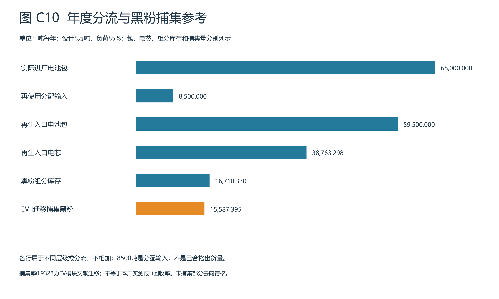
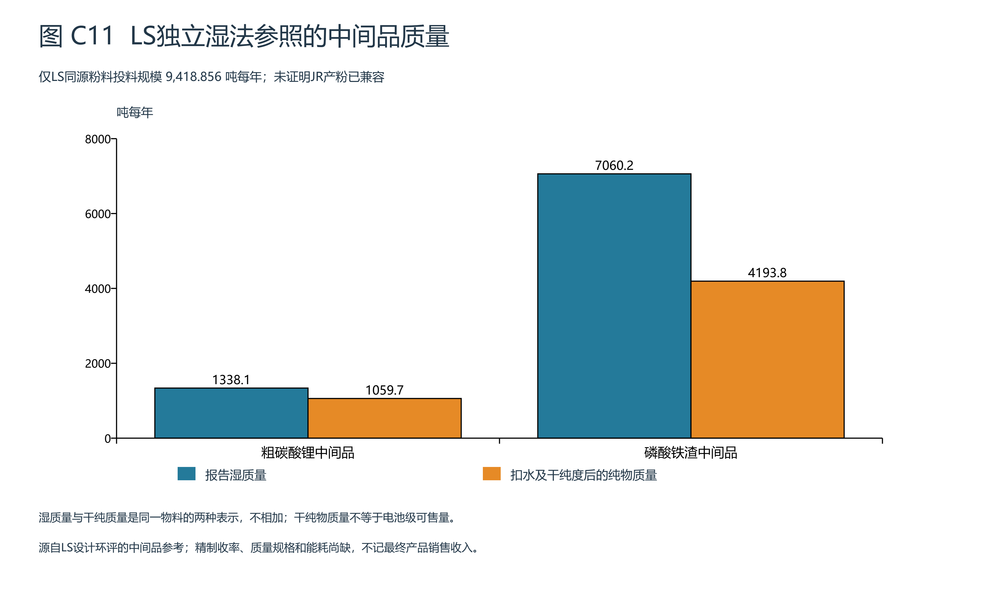

# 宜昌退役动力电池园区成员C年度清单接续报告

成员C · 2026年11月3日 · A补充接入v2。本稿接续A_BC核查与数据补充_20261103，更新C年度物料接口、费用映射、政策复跑和B交接。A原包与B原结果不改。此前年LCE3000吨的5148组财务情景保留为历史条件分析，不是本轮年度物料的产量证据。

## 1 本轮完成范围与当前结论

本轮已接入A确认的同工况包量、分流、电芯及组分库存；复算机械捕集代理、LS独立湿法中间品和商品试剂、ANL独立通用电芯活动量；将C计算入口改为年度清单，不再由假设LCE产量乘占位单耗生成全部物耗。TEA引擎保持复用，新增缺失值、商品单位、可售资格与路线边界检查。

本包不是全厂LCOR定稿。A补充readiness明确full_plant_saleable_products_ready=false、whole_plant_annual_utilities_ready=false、formal_LCOR_ready=false。LS粗品、ANL默认收率和JR组分各有自己的分母和边界；不得拼成一条已经验证的园区生产线。formal_LCOR、全厂利润、MAC仍为空，而不是零。未获厂测并不妨碍规划假设分析，但必须选择完整相容的物理路线、记录假设和缺项，不能把不完整清单称完整结果。

## 2 同一运行工况与年度实物量

设计接收80000吨/年电池包，设计再使用能力10000吨/年，设计再生70000吨/年。负荷85%只乘一次：年度接收68000吨，分配再使用8500吨，进入再生59500吨电池包当量。同体系12.5%分流是规划设定，不是SOH合格率推导；8500吨不等于再使用产品合格销量。

| 项目（t/a） | LFP | 未细分NMC | 合计 |
| --- | --- | --- | --- |
| 实际接收电池包 | 40800 | 27200 | 68000 |
| 再使用分配输入 | 5100 | 3400 | 8500 |
| 再生入口电池包 | 35700 | 23800 | 59500 |
| 再生入口电芯 | 23658.390 | 15104.908 | 38763.298 |
| 黑粉组分库存 | 10097.401 | 6612.929 | 16710.330 |
| EV I文献迁移捕集参考 | 9418.856 | 6168.540 | 15587.395 |

EV I的0.9328捕集率来自同源模块手工拆解黑粉基准，实验SD0.0405，不是本厂实际率，也不是锂回收率。跨LFP体系及装置放大均是迁移假设。组分未进入捕集流不代表全部成为大气排放或危废；损失流仍需追踪。EV II为另一流程，单列情景而不平均。

## 3 LS湿法：独立参考清单与产品基准

LS是同源LFP粉料湿法参考。以9418.856吨粉料作规模示例，另以入料达到LS质量为条件；这只是借用一个投料规模，未证明JR产粉与LS原料匹配。只年化粉料湿法段，不加入按电芯计量的前处理，也不把LS组合电耗拆成单线电耗。

| 项目 | 年量 | 计量/资格 |
| --- | --- | --- |
| 粗碳酸锂中间品 | 1338.051 t/a | 湿质量，含水20% |
| 其中干纯Li2CO3 | 1059.736 t/a | 扣水、干纯度99%；未证明可售电池级 |
| 磷酸铁渣中间品 | 7060.243 t/a | 湿质量，含水40% |
| 其中干纯FePO4 | 4193.784 t/a | 扣水、干纯度99%；非最终产品 |
| 98%硫酸，总表版本 | 5303.312 t/a | 商品溶液质量 |
| 32%液碱 | 13788.612 t/a | 商品质量；有效NaOH约4412.356 t/a |
| 蒸汽 | 11065.041 t/a | 压力/温度未核，不转MJ |
| 外供纯水 | 3288.247 m3/a | 不与同量制水原水重复计 |

粗品内部进入下游生产，未给精制合格收率与精制能耗，不能直接乘电池级产品售价。外售Cu-40海绵铜也不等于阴极铜；硫酸钠水合形态尚未明确。水、气、废水和残渣均保留来源层级，不把所有残渣按同一危废报价结算。

硫酸0.5630527与0.4902吨98%酸/吨粉料分别给总表采购参照及独立敏感性；每个工况只取其中一个，不叠加。两种版本不能解释为统计上下限。液碱商品吨乘0.32得到有效吨，不能直接套99%片碱商品价格；等有效量价格另作为独立假设表，不计入匹配报价小计。

## 4 ANL三元电芯：独立通用模型参考

以15104.908吨/年电芯作为年化基准，不用23800吨电池包替代。ANL整套电芯级路线包含模型内机械与湿法，不再额外乘EV黑粉损失，也不叠加LS前处理。原模型为通用参数的透明线性年化，不代表已完整运行EverBatt设备规模模型。

| 活动 | 年度参考量 | 使用限制 |
| --- | --- | --- |
| 电 | 524475.972 kWh/a | 0.125MJ/kg电芯换算；非全园区电量 |
| 天然气热值 | 37762270.000 MJ/a | 不用蒸汽MJ价格代替燃料价格 |
| 水 | 57178.297 m3/a | 原作者water consumption估计，不自动当新水取水 |
| 硫酸 | 16313.301 t/a | 原模型声明化学品量；商品浓度未明 |
| 双氧水 | 5528.396 t/a | 不擅自当27.5%商品溶液 |
| NaOH | 8473.853 t/a | 不擅自当32%液碱或99%片碱 |

ANL Li0.90和Ni/Co/Mn0.98是全路线默认，不能在外乘粉料损失后仍称同一总回收率。没有配套最终盐类水合形态、纯度与可售年量，本轮不据此生成三元产品收入。

## 5 C经济模型复跑与结果资格

正式接口为annual_tea_interface.evaluate_annual_case(case)，年度数量和价格分别输入；成本=年度商品量×同商品单位价，收入仅接收已确认可售的同规格产品量。独立参考路线与全厂预算分别计算，不能把它们的小计相加成园区全成本。来源/商品单位/货币/价格年不符或数值缺失时保留NOT_READY及字段清单；只有数量和边界完整时调用tea_model.evaluate_tea输出LCOR。LCOR仍按资本年金加OPEX减同边界收入后除以可售LCE年量定义，资本年金不再叠折旧。

| 计算边界 | 当前已定价运行费用部分 | 资本年金 | 完整OPEX/收入/LCOR |
| --- | --- | --- | --- |
| 园区共同预算 | 47984.000 万元/a | 4304.317 万元/a | 未齐，不输出 |
| LS独立湿法参考 | 254.559 万元/a | 未分配 | 仅98%酸报价匹配，其余未齐 |
| ANL独立电芯参考，绿电50% | 27.011 万元/a | 未分配 | 仅电费用暂有同单位报价，其余未齐 |

共同预算采用C先前显式假设：预处理、再使用、湿法、环保、公辅、数字平台投资报价合计45600万元，实际折现率7%、20年，120人×85000元/年、维修2%、研发500万元/年、其他服务300万元/年、其他费用100万元/年。采购按68000×6640=45152万元/年，到厂价已含进厂运费，额外该段运费为0。以上预算仍未确认完整工程量和原报价条件，不是实际支出。47,984万元小计尚缺全厂水、电、热、药剂和治理等；不能据此称园区成本降低或有利润。

本轮报价现金口径不作VAT清算，不计未确认补贴、退税或碳信用。38项公开来源复核仍适用，磷酸铁商品、绿电到户费用和纯碱规格/年份应优先处理。旧3000吨LCE参照下的单位差额64251.71元/t及1.9276亿元缺口不应用作本轮新年度清单的经济结论；旧图C6—C9作为历史条件分析保存。新图C10—C11对应本轮输入。

完成8个LS捕集/硫酸版本参照和11个ANL绿电电价参照，共19个独立敏感性工况；它们不构成全厂优化前沿。EV I均值±SD为实验离散扰动，不是本园区95%置信区间。对未知浓度、产品售价和未定价活动，不用零补齐来画盈亏线。

## 6 政策检查与管理安排

2026、2030、2035三个日期分别运行coursework与verified_current两套已编码检查，共6组。均为UNKNOWN：可核设计再生能力70000吨/年，但完整综合能耗、实际元素回收、杂质、固氟、回用及研发/销售收入分母尚缺。EV模块捕集率不填作电极粉料规范回收率，LS粗品分配不填作本厂Li回收率；不借阈值补齐实际指标。未来年份检查是规则情景，不承诺届时政策不变。再使用用途/质量证据仍UNKNOWN，8500吨分流量不能证明质量和可售资格。

A负责确认JR粉料与最终所选工艺的同基准化验、精制合格产品及损失/返流；C负责对应商品的价格、投资/费用边界和经济规则；B负责同口径因子、缺失活动覆盖及环境边界。每批来料保持体系、SOH、重量与来源编码；分线计量水电、药剂、产品与废物流，月度复核；工艺变更后重跑成本和适用指标。原料运输排放与其货币费用可以各核算一次，“到厂价含运”仅防止现金费用重复，不删环境运输活动。

## 7 给B的v2接口与版本关系

给B_年度接口v2/C_to_B_annual_bundle_v2.json包含同一case_id、中心运行口径、独立年度物理清单、费用映射、缺项与政策结果。run_annual_case.py可直接运行并输出NOT_READY及部分费用，不依赖B的合成LCOR。现有3267个B工况ID与五项情景参数完整保留在状态映射表；正式LCOR列为空，formal_result_eligible=false。不要用旧297条条件值填充这些行，或把不完整费用小计除以粗品量画正式帕累托。

B待完整case到齐后按年度电量分网电/绿电，按同商品价格调整，再传入C接口；不同工况不得只读同一个固定case。直接修复和湿法先统一产品篮子或服务功能，再比较，不能假设直接修复也产相同碳酸锂。

## 8 仍需补齐的最小数据与本轮验收

不是要求A从头查资料或必须取得真实厂测，而是从已给候选中选定相容的规划路线，并补齐精制阶段、产品规格和分线能耗。最小缺口：JR至所选工艺的入料基准；粗品至合格最终产品的收率、精制耗量与可售规格；三元产品形态/年量；整包拆解与再使用环节的公辅、合格出货容量、共用工程分配；匹配浓度/废物类别的价格。规划假设可用，但须有依据、声明范围并测试区间。

A补充25项校验是其资料结构/算术验证，不是C全厂经济或合规验收。本轮C测试记录另附；包括年度输入联动、商品浓度、原水/纯水范围、粗品不自动记销售、未知不等零、路线不拼接、单位/币种拒绝以及不同case驱动TEA。程序通过不能替代参数确认或本人签认。A/B原始交接不改，SHA256清单另附。本轮贡献为C年度接口、核算、测试、图文更新与交接，保留A数据贡献和AI辅助说明，不代填人工签名。

## 9 来源与复现

本轮数值来自A_给BC的补充数据.json及其来源定位：LS表3.4-1、3.5-1、3.5-4和分线水/固废；ANL2019表10/12；EV I论文Table1。A补充已包含原文URL和表页码，随包保存。本轮外网再次尝试核读ANL、期刊及机械论文时连接失败，未声称在C侧独立重核全文。国内产品标准目录不等于本厂检测合格证。

- [LS原环评](https://hbj.yueyang.gov.cn/uploadfiles/202312/2023120609494581990.pdf)
- [EverBatt2019](https://publications.anl.gov/anlpubs/2019/07/153050.pdf)
- [机械捕集参考论文](https://www.sciencedirect.com/science/article/pii/S258900422603110X)
- [江洋等中试研究](https://hgxb.cip.com.cn/CN/10.11949/0438-1157.20240004)

执行code_implementation/integrate_a_supplement.py生成年度数据与接口，write_a_update_report.py生成本稿和两张图，package_a_update_delivery.py完成测试和打包。复现使用随包数据快照，不需要修改A/B目录。旧finalize_member_c.py是历史财务扫描入口，不是本轮年度生成器。
