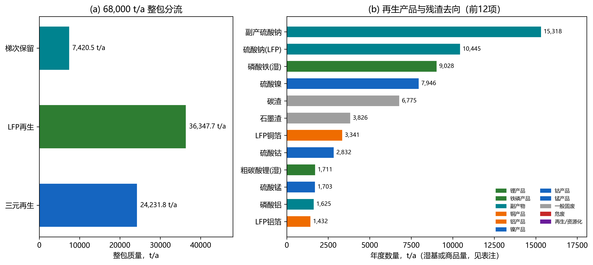
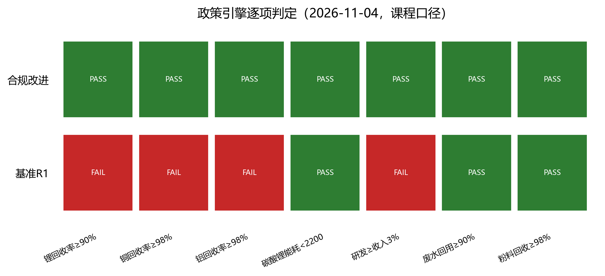
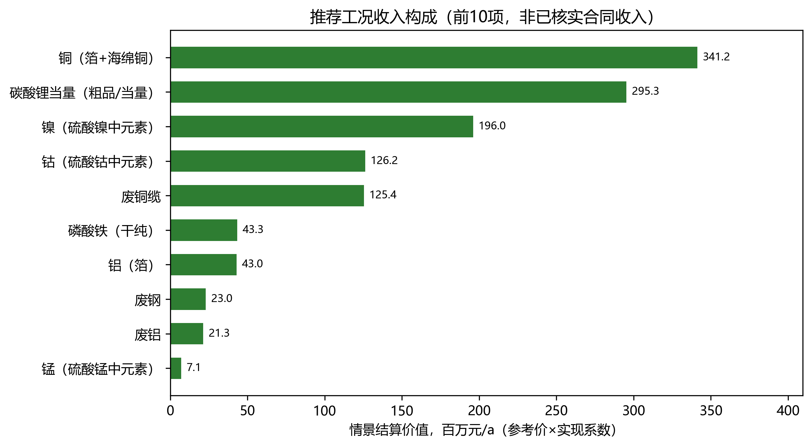
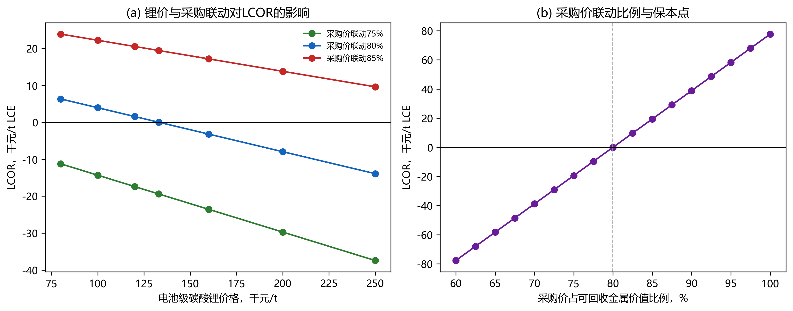
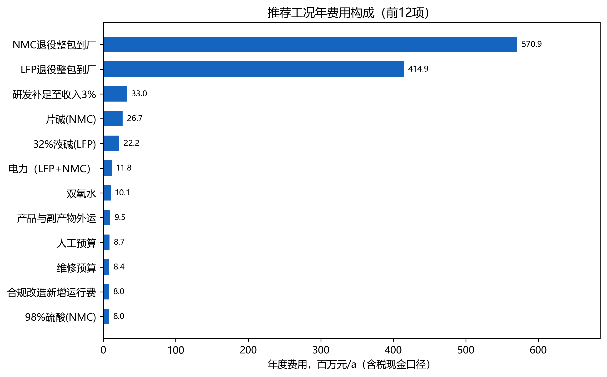
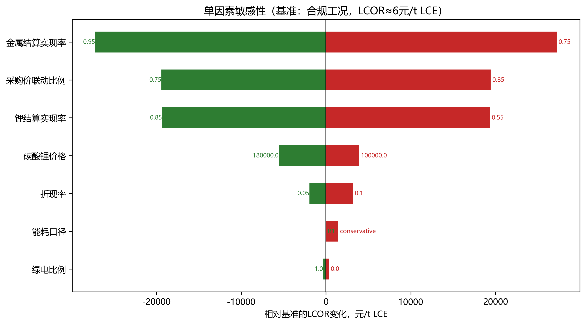
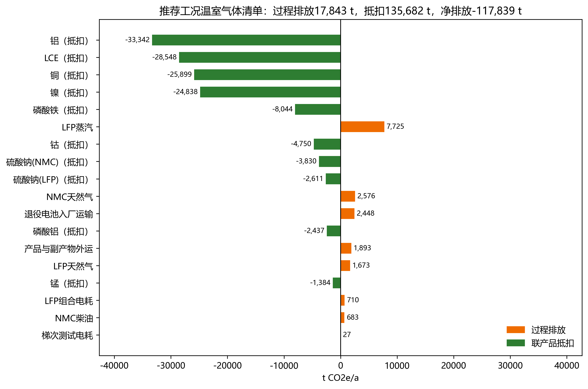
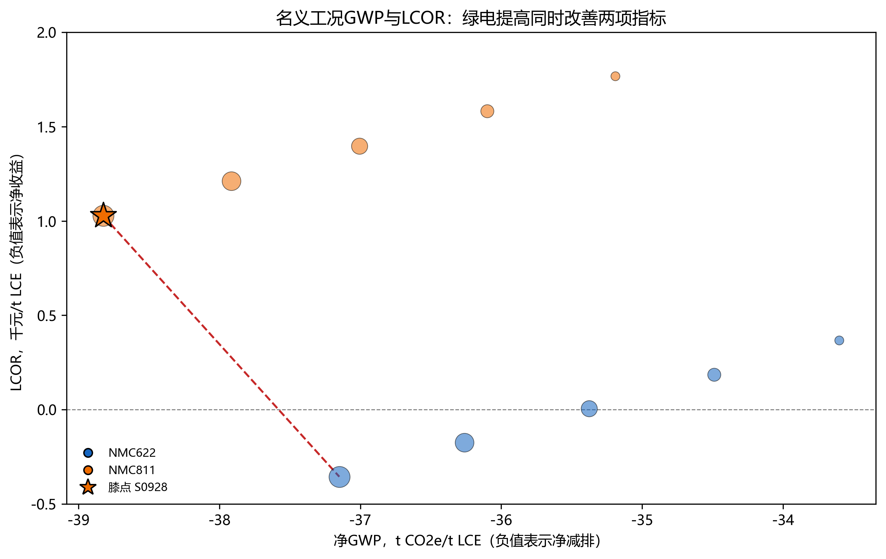

# 退役动力电池循环利用园区规划：成员C LCOR、MAC与推荐方案（R1）

**版本**：v3.0（2026-11-04）　**数据基准**：A R1　**功能单位**：1 t LCE-eq　**边界**：R1_2026_gate

> 本报告为课程规划仿真，不是企业实测、法律合规认证或投资建议。价格均为规划参考价，未取得成交原件；补贴、碳信用与绿色溢价在基准中为0。

**阅读顺序**：执行摘要 → 第3章指标 → 第4章投资与费用 → 第5章LCOR/MAC/推荐 → 第6章管理 → 附录（来源、假设、政策测试、复现、清单对照）。

**数据属性标注**：组内设定 / 文献原值 / 文献迁移 / 情景假设。缺失值保持UNKNOWN，不以目标值代填。

---

# 执行摘要

本报告以宜昌退役动力电池循环利用园区为规划对象，基于成员A的R1年度物料流、朗赛LS23与ANL EverBatt工艺清单、成员B的环境因子和成员C的经济/政策模型，完成同工况物料去向、费用闭合、LCOR、MAC与推荐方案。规划规模80,000 t/a、负荷85%、实际来料68,000 t/a；梯次保留7,420.50 t/a，再生60,579.50 t/a，LCE-eq产量3,064.34 t/a（合规改进3,172.04 t/a）。功能单位为1 t LCE-eq，边界为到厂至产品/副产物出厂。

物料侧补齐了整包—电芯—黑粉—产品/残渣/废水清单：LFP粗碳酸锂1,710.95 t/a（干纯1,355.08）、磷酸铁9,027.87 t/a（干纯5,362.56）、铜箔3,341.24 t/a、铝箔1,431.96 t/a；三元碳酸锂当量1,709.26 t/a、Ni 1,774.13 t/a、Co 593.80 t/a、Mn 553.54 t/a、Cu 2,228.41 t/a、Al 1,162.65 t/a。7项质量平衡校核全部通过；LFP未分配Li 36.37 t/a按45%/35%/20%定位到废水、碳渣和磷酸铁晶格，LFP锂回收率87.50%、全链88.88%，低于90%目标，合规改进工况提高到92%。

经济侧年度总费用123,226.7万元，其中原料98,579.6万元；单位毛成本38.85万元/t LCE。组内采购价5,200/8,800元/t仅相当于基准可回收价值的38.2%/30.6%（合规改进后36.4%/29.9%），对应LCOR为-190,938元/t LCE，属于不可持续的低价情景。按金属价值80%联动（合规改进：LFP 11,414.52、NMC 23,560.15元/t），合规工况LCOR≈6元/t LCE，保本联动比例80.0%；采购联动每变动1个百分点，LCOR约变动3,885元/t LCE。

环境侧合规工况毛排放23,468 t CO₂e/a，联产品抵扣135,682 t CO₂e/a，净排放-112,214 t CO₂e/a，即-35,376 kg CO₂e/t LCE；MAC为-2,997元/t CO₂e（锂辉石基准）。100%绿电工况净GWP为-37,149 kg CO₂e/t LCE，MAC为-2,890元/t CO₂e。960组工况中220组政策可行；名义前沿两端为NMC622+100%绿电（LCOR -355元/t，GWP -37,149 kg/t）和NMC811+100%绿电（LCOR +1,028元/t，GWP -38,824 kg/t），膝点为811。

推荐方案：以NMC622为主力、NMC811为环境备选；采购价≤金属价值80%；Li≥92%、Cu/Al≥98%、Ni/Co/Mn≥98%；研发≥收入3%；绿电≥80%（目标100%）。该方案LCOR约-355至+1,028元/t LCE，基本保本；净减排约37—39 t CO₂e/t LCE，MAC约-2,760至-2,890元/t CO₂e。项目的第一敏感变量是采购价，第二是锂/金属结算实现率；合规改造（研发3%、Li/Cu/Al改造）基本吃掉全部净收益，需由产品溢价、政策支持或采购价下降覆盖。

能耗项需单独提示：R1三元电耗代理值（34.7 kWh/t电芯）下合规工况为1,984 kgce/t、PASS；若按561 kWh/t电芯的保守口径补齐，约2,298 kgce/t、转为FAIL。推荐方案因此把“三元电耗≤397 kWh/t电芯”列为2030年前的工程验证条件，不能把1,984当作已验证值。

本报告的局限：价格为规划参考价，未取得成交原件；产品未取得电池级合格证；实际捕集率、完整水平衡、逐工段元素分配和税费/资金成本未闭合；政策判定只覆盖已编码定量项，不构成法律合规认证。所有结论为条件性规划结论，须由成员C及小组人工复核后签认。


---

# 第3章 规划目标与情景指标（R1替换稿）

日期：2026-11-04。本章与第4、5、6章共用同一套R1年度物料流；所有结果是以宜昌案例为背景的课程规划仿真，不是企业实测运行数据。

## 3.1 规模、功能单位与系统边界

园区设计接收能力80,000 t/a，运行负荷0.85，实际来料68,000 t/a。梯次候选8,500 t/a，经筛选率q=0.90、重组保留率y=0.97后，保留旧电池整包当量7,420.50 t/a；筛选弃用850.00 t/a、重组弃用229.50 t/a全部返回再生线。再生入口60,579.50 t/a，其中LFP 36,347.70 t/a、未细分三元24,231.80 t/a；再生线负荷60,579.50/70,000=86.54%。LFP整包到电芯0.6627、三元0.63466；LFP电芯到黑粉0.50。LFP电芯24,087.62 t/a、三元电芯15,378.95 t/a、黑粉12,043.81 t/a。

功能单位取**1 t碳酸锂当量（LCE-eq）**，系统边界为退役电池到厂至产品/副产物出厂（cradle-to-gate加运输），不含电池使用阶段和下游正极制造。LFP粗碳酸锂与三元碳酸锂当量均为内部中间品或理论当量，未取得电池级合格证；LCOR与GWP均按“LCE-eq”报告，不写成已售电池级碳酸锂。

年度LCE-eq产量为LFP干纯1,355.08 t加三元1,709.26 t，合计3,064.34 t/a（基准回收率）；政策合规改进工况为3,172.04 t/a。梯次交付可用容量700,495.20 kWh/a，是当年交付容量，不是年供电量。

## 3.2 物料去向与元素平衡

R1的物料去向在本轮补齐为“整包—电芯—黑粉—产品/残渣/废水”的连续清单。主要流股见表3-1，完整33条流股见`data_cohort/final_20261104/material_flow_R1.csv`。

**表3-1 主要物料去向（R1，t/a）**

| 流股 | 数量 | 形态/品位 | 去向 | 计价或处置 |
| --- | ---: | --- | --- | --- |
| 退役整包 | 68,000.00 | 整包 | 园区 | 到厂含运 |
| 梯次保留 | 7,420.50 | 整包当量 | 梯次模组 | 按容量结算 |
| 再生整包 | 60,579.50 | 整包 | 拆解 | — |
| 整包非电芯组分 | 21,112.93 | 壳体/线束/BMS/塑料 | 资源化或处置 | 废钢/废铝/废铜计价，BMS与塑料计处置费 |
| LFP黑粉 | 12,043.81 | 粉料 | LFP湿法 | — |
| 粗碳酸锂（湿） | 1,710.95 | 含水20%，干纯99% | 锂产品 | 按LCE当量结算 |
| 磷酸铁（湿） | 9,027.87 | 含水40%，干纯99% | 铁磷产品 | 外售/进一步精制 |
| 磷酸铝 | 1,624.57 | 商品 | 副产物 | 外售 |
| 硫酸钠（LFP） | 10,444.85 | 商品 | 副产物 | 外售 |
| 海绵铜 | 476.69 | 元素Cu | 铜产品 | 外售 |
| 铜箔 | 3,341.24 | 97%Cu | 铜产品 | 外售 |
| 铝箔 | 1,431.96 | 97%Al | 铝产品 | 外售 |
| 碳渣 | 6,774.63 | 石墨/炭黑 | 一般固废 | 建材/填埋 |
| 钙渣与水洗渣 | 1,114.86 | 渣 | 危废 | 处置 |
| 三元元素产品 | 8,021.79 | Li₂CO₃当量+Ni/Co/Mn/Cu/Al | 盐类/金属产品 | 按元素或当量结算 |
| 三元石墨渣 | 3,825.73 | 石墨 | 一般固废 | 处置 |
| 三元电解液/隔膜 | 1,324.29 | 危废 | 危废 | 处置 |
| 三元副产硫酸钠 | 15,318.29 | 商品 | 副产物 | 外售 |



*图3-1 左：68,000 t/a整包在梯次与再生之间的分流；右：再生产品与残渣的主要去向（按质量排序）。数据见表3-1与`material_flow_R1.csv`。*

三元元素产品8,021.79 t/a中，碳酸锂当量1,709.26 t、Ni 1,774.13 t、Co 593.80 t、Mn 553.54 t、Cu 2,228.41 t、Al 1,162.65 t。其硫酸盐商品质量为NiSO₄·6H₂O 7,945.65 t、CoSO₄·7H₂O 2,832.47 t、MnSO₄·H₂O 1,702.94 t；硫酸根与结晶水来自外加硫酸/水，不计入电芯质量，避免把盐质量误当电芯质量。

**表3-2 质量平衡校核**

| 校核 | 左端 | 右端 | 相对误差 | 判定 |
| --- | ---: | ---: | ---: | --- |
| 整包分流 | 68,000.00 | 68,000.00 | 0 | PASS |
| 再生整包=电芯+非电芯 | 60,579.50 | 60,579.50 | <1e-15 | PASS |
| LFP电芯=黑粉+铜箔+铝箔+其他 | 24,087.62 | 24,087.62 | 0 | PASS |
| 三元电芯=元素产品+其他 | 15,378.95 | 15,378.95 | 0 | PASS |
| 非电芯组分去向 | 21,112.93 | 21,112.93 | 0 | PASS |
| LFP Li输入=产品Li+未分配Li | 290.918 | 290.918 | 0 | PASS |
| 未分配Li去向 | 36.371 | 36.371 | 0 | PASS |

LFP黑粉Li输入290.918 t/a，进入粗碳酸锂254.547 t/a，未分配36.371 t/a。本轮按C情景拆分其去向：45%随废水16.367 t、35%进入碳渣12.730 t、20%进入磷酸铁晶格7.274 t；该拆分是平衡约束下的显式假设，不是化验定位。由此LFP锂回收率=254.547/290.918=87.50%，全链（含三元）锂回收率88.88%，低于课程90%目标，基准工况判定FAIL；这是本轮必须通过改进工况解决的指标，不能用目标值回填。

LFP湿法工序输入（黑粉+硫酸+液碱+氧化钙+磷酸+铁粉+CO₂+O₂）41,692.89 t/a，输出（湿产品+磷酸铝+硫酸钠+海绵铜+各类渣+已列废水）37,999.47 t/a，差减3,693.42 t/a为蒸发水与工艺尾气，工序质量闭合率91.14%。该差减项与32%液碱带入水、湿产品含水及酸雾吸收水平一致，不能把差减项当作“无来源损失”隐藏；完整逐工段水平衡仍需企业计量。

## 3.3 政策指标诊断

政策引擎（`policy_engine.py`）按课程口径逐条判定。判定只说明已编码定量项是否满足阈值，不构成法律合规认证；缺证据项保持UNKNOWN，不以目标值代填。

**表3-3 基准R1政策指标**

| 指标 | 基准值 | 课程目标 | 判定 | 口径说明 |
| --- | ---: | --- | --- | --- |
| 再生设计能力 | 70,000 t/a | ≥5,000 | PASS | 设计能力，不是实际处理量 |
| 再生线负荷 | 86.54% | ≤100% | PASS | 弃用回流后实际负荷 |
| 锂冶炼回收率 | 88.88% | ≥90% | FAIL | 分母为进入冶炼的Li；LFP未分配Li已定位到废水/渣/产品 |
| 镍/钴/锰回收率 | 98% | ≥98% | PASS | ANL默认值，非本地测定 |
| 铜回收率 | 90% | ≥98% | FAIL | 分选+湿法综合，未做98%改造 |
| 铝回收率 | 90% | ≥98% | FAIL | 同上 |
| 电极粉料回收率 | 98.98% | ≥98% | PASS | LS23同源组分捕集推导 |
| 粉料铝杂质 | 1.0% | <1.5% | PASS | 情景假设，未取得检测报告 |
| 粉料铜杂质 | 0.8% | <1.5% | PASS | 情景假设 |
| 固氟率 | 99.5% | ≥99.5% | PASS | 情景假设，按工艺设计值 |
| 工艺废水循环利用率 | 90% | ≥90% | PASS | 情景假设，未取得水系统图 |
| 碳酸锂单位综合能耗 | 2,054 kgce/t | <2,200 | PASS | 电+天然气+蒸汽+柴油折标；蒸汽按2.6 GJ/t |
| 研发费用占收入 | 0.336% | ≥3% | FAIL | 基准研发400万元/收入11.91亿元 |

基准工况共有4项FAIL（锂、铜、铝、研发）。合规改进工况把锂回收率提高到92%、铜铝提高到98%、研发补足到收入3%，并计入改造投资2,000万元和新增运行费800万元；此时全部已编码项PASS（表3-4）。全链Li守恒误差、粉料铜铝杂质、固氟率、废水循环率、单位能耗和研发占比中，凡没有同边界证据的，报告均标注“情景假设”，不包装为实测。

**能耗口径的关键提醒**：基准R1的三元电耗533,991 kWh/a（约34.7 kWh/t电芯）是ANL代理值，明确不是完整公辅电耗。若按LFP湿法比电耗561 kWh/t电芯补齐，三元电耗升至8.63 GWh/a，单位综合能耗约2,298 kgce/t，超过2,200的课程阈值，能耗项由PASS转为FAIL。要在保守口径下达标，三元电耗需控制在约397 kWh/t电芯以内（或同步降低蒸汽/天然气）。因此表3-4的1,984 kgce/t是R1代理口径结果，不是已验证的工程值；2030年前必须用分线计量替换该代理。



*图3-2 基准R1与合规改进工况的政策逐项判定。红/绿仅表示已编码阈值是否满足，灰色项为不适用或缺失，不构成法律合规认证。*

## 3.4 近期、远期目标与指标矩阵

**表3-4 2026/2030/2035指标矩阵**

| 指标 | 2026基准R1 | 2026合规改进 | 2030近期目标 | 2035远期目标 | 依据 |
| --- | ---: | ---: | ---: | ---: | --- |
| 整包来料，t/a | 68,000 | 68,000 | 68,000 | 68,000 | 组内设定 |
| 再生入口，t/a | 60,579.5 | 60,579.5 | 60,579.5 | 60,579.5 | R1 |
| LCE-eq，t/a | 3,064.34 | 3,172.04 | ≥3,170 | ≥3,250 | 本模型 |
| 锂回收率 | 88.88% | 92.0% | ≥92% | ≥95% | 课程90%+改进 |
| 铜/铝回收率 | 90% | 98% | ≥98% | ≥99% | 课程附加目标 |
| 单位能耗，kgce/t | 2,054 | 1,984 | ≤2,100 | ≤1,900 | 课程<2,200 |
| 水耗，m³/t LCE | 21.9 | 21.9 | ≤18 | ≤15 | 本模型 |
| 净GWP，t CO2e/t LCE | -35.4 | -35.4 | ≤-37 | ≤-40 | 本模型 |
| LCOR，元/t LCE | 6 | 6 | ≤0 | ≤-5,000 | 本模型 |
| 研发/收入 | 0.336% | 3.0% | ≥3% | ≥4% | 课程3% |
| 梯次交付，kWh/a | 700,495 | 700,495 | ≥900,000 | ≥1,100,000 | 规划目标 |
| 政策判定 | FAIL | PASS | PASS | PASS | 政策引擎 |

2030年目标不是把2026结果按固定百分比外推，而是要求在同一物料边界、同一价格年和同一政策版本下复算；表中2030/2035值为规划目标，不是对未来法规或企业绩效的承诺。2035年比较以2030年同边界可行方案为基准，不预填无计算支撑的改善百分比。表中2026合规改进的能耗1,984 kgce/t为R1三元电耗代理口径；保守口径约2,298 kgce/t、政策判定FAIL，详见3.3节提醒。

## 3.5 指标口径与限制

1. **LCE-eq不是合格品产量**。LFP粗碳酸锂含水20%、干纯99%，三元为理论当量；两者均未经电池级精制与检测。LCOR与GWP的分母是LCE-eq，不是已售电池级碳酸锂。
2. **回收率分母不同**。锂回收率的分母是进入冶炼的锂元素；铜铝回收率的分母是进入分选/湿法边界的元素；粉料回收率的分母是电芯中目标正负极粉。三类指标不能互相替代，也不能用“≥90%”的目标值回填实际值。
3. **能源换算含假设**。蒸汽按2.6 GJ/t折算（0.7—1.0 MPa饱和蒸汽的净焓量级），仅用于计价和排放换算；A的原始质量口径未改。天然气按36 MJ/Nm³。折标系数按GB/T 2589的0.1229 kgce/kWh和29.3076 MJ/kgce。
4. **政策版本**。国内指标沿用课程任务书与2024年行业规范条件已核条款；欧盟材料回收率与新电池再生含量仅在中国境外适用对象成立时评估，本项目未建立出口产品边界，故保留NOT_APPLICABLE。
5. **未核项**。报价原件、税价与抵扣资格、产品合格证、实际厂测捕集率、完整水平衡和逐工段元素分配仍未取得；这些限制在第4、5、6章继续显式保留。


---

# 第4章 投资与费用数据（R1替换稿）

日期：2026-11-04。本章金额均为2026年含税报价现金口径，未清算增值税、所得税、补贴和碳信用；投资与年度费用分列，不把折旧重复计入运行费。

## 4.1 投资构成与年金

**表4-1 工程投资**

| 单元 | 投资，万元 | 归属 | 说明 |
| --- | ---: | --- | --- |
| 预处理（仓储、放电、拆解、破碎、分选） | 7,200 | 再生线 | 含LFP/三元共用前处理 |
| 梯次重组线（1万t/a） | 3,600 | 梯次线 | 单独核算，不摊入LCOR |
| 湿法冶金主产线 | 22,400 | 再生线 | 含LFP湿法、三元浸出与产品精制 |
| 三废综合治理 | 6,400 | 再生线 | 废水、废气、危废暂存 |
| 公辅工程（循环水、蒸汽、配电、消防） | 4,800 | 再生线 | 不含自有光储 |
| 数字化平台（电池数字护照+MRV） | 1,200 | 再生线 | 课程任务书要求 |
| **合计** | **45,600** | — | 其中再生线42,000、梯次线3,600 |

再生线资本额42,000万元，政策合规改造追加2,000万元，合计44,000万元；按7%实际折现率、20年运营期，资本回收系数CRF=0.07×1.07²⁰/(1.07²⁰−1)=0.09439293，年资本年金4,153.29万元/a（合规工况）。不含改造的基准年金为3,964.50万元/a。梯次线3,600万元对应年金339.81万元/a，在第5章梯次专表中单列，不进入LCOR。

投资口径的限制：45,600万元是组内预算与行业调研假设，不是中标价或竣工决算；未计建设期利息、土地、营运资金、预备费和拆除残值；税价与进项抵扣资格未取得原件。上述项目若补入，应扩展现金流，而不是在本表内用系数“调平”。

## 4.2 年度费用

**表4-2 合规工况年度费用（K3，万元/a）**

| 类别 | 项目 | 数量 | 单价 | 金额，万元/a |
| --- | --- | ---: | ---: | ---: |
| 原料 | NMC退役整包到厂 | 24,231.80 t | 23,560.15 元/t | 57,090.2 |
| 原料 | LFP退役整包到厂 | 36,347.70 t | 11,414.52 元/t | 41,489.3 |
| 药剂 | 片碱（NMC） | 8,627.59 t | 3,100 元/t | 2,674.6 |
| 药剂 | 32%液碱（LFP） | 19,317.51 t | 1,150 元/t | 2,221.5 |
| 药剂 | 双氧水 | 5,628.70 t | 1,800 元/t | 1,013.2 |
| 药剂 | 98%硫酸（NMC） | 16,609.27 t | 480 元/t | 797.2 |
| 药剂 | 85%磷酸 | 1,183.17 t | 5,200 元/t | 615.2 |
| 药剂 | 碳酸钠 | 2,724.26 t | 2,200 元/t | 599.3 |
| 药剂 | 98%硫酸（LFP） | 6,781.30 t | 480 元/t | 325.5 |
| 药剂 | 其他药剂（氨水、盐酸、CO₂、铁粉、氧化钙、液氧） | — | — | 415.0 |
| 公用工程 | 电力（LFP+NMC） | 20,825,403 kWh | 0.565 元/kWh | 1,176.6 |
| 公用工程 | 氮气 | 5,202,926 Nm³ | 1.20 元/Nm³ | 624.4 |
| 公用工程 | NMC天然气 | 1,067,983 Nm³ | 3.50 元/Nm³ | 373.8 |
| 公用工程 | 蒸汽 | 14,148.77 t | 180 元/t | 254.7 |
| 公用工程 | LFP天然气 | 693,723 Nm³ | 3.50 元/Nm³ | 242.8 |
| 公用工程 | 柴油、新水、纯水、NMC过程水 | — | — | 94.9 |
| 人工 | 人工预算（120人×8.5万元×85%再生分摊） | — | — | 867.0 |
| 研发 | 研发预算（补足至收入3%） | — | — | 3,697.0 |
| 维修 | 维修预算（再生资本额2%） | — | — | 840.0 |
| 服务 | 其他服务预算 | — | — | 255.0 |
| 其他 | 其他费用预算 | — | — | 85.0 |
| 三废 | BMS/电子废物、电解液/隔膜、钙渣水洗渣、碳渣、石墨渣、废塑料、废水处理 | — | — | 1,574.2 |
| 运输 | 产品与副产物外运 | 78,865.74 t | 120 元/t | 946.4 |
| 合规 | 提高锂/铜铝回收率的改造新增运行费 | — | — | 800.0 |
| 年金 | 再生线资本年金（含改造2,000万元） | — | — | 4,153.3 |
| **合计** | — | — | — | **123,226.7** |

表4-2中“研发补足至收入3%”=3.0%×123,224.55万元=3,697.0万元，其中基准研发400万元，补足3,297.0万元；该项是政策合规成本，不是新增研发能力的证据。药剂、公用工程和三废的逐项数量与单价见`data_cohort/final_20261104/cost_breakdown_base.csv`及`economic_parameters_final.csv`。

## 4.3 单位成本

合规工况年度总费用123,226.7万元（其中运行费119,073.2万元、资本年金4,153.3万元），LCE-eq产量3,172.04 t：

- 单位总成本（LCOR毛口径，未扣产品收入）=123,226.7万元/3,172.04 t=**38.85万元/t LCE（388,476元/t）**；
- 单位净成本（扣联产品收入后）=**6元/t LCE**（表5-3的K3）；
- 按进厂整包分摊的毛成本=123,226.7万元/68,000 t=**1.812万元/t整包（18,122元/t）**；
- 原料成本占毛成本80.0%，药剂7.0%，公用工程2.2%，人工/研发/维修/服务/其他4.7%，三废1.3%，运输0.8%，年金3.4%，合规改造0.6%（合计因四舍五入不为100%）。

原料成本占比高说明本项目首先是**采购价风险**，不是加工费风险；药剂中片碱与液碱合计4,896万元，是第二大可控成本；蒸汽与天然气合计871万元，按2.6 GJ/t蒸汽折算后仍低于药剂。

## 4.4 费用与物质流的对应

验收要求“成本与物质流对应”。表4-3给出费用项与第3章流股的对应关系；每一条费用都能追到数量、单价和流股编号，未用“其他”笼统覆盖。

**表4-3 费用—物质流对应（节选）**

| 费用项 | 数量来源 | 流股 | 对应关系 |
| --- | --- | --- | --- |
| LFP/NMC整包采购 | 36,347.70/24,231.80 t | F05/F06 | 再生整包按体系分流 |
| 98%硫酸（LFP） | 6,781.30 t | F14/F15/F17 | 浸出、磷酸铁与硫酸钠 |
| 32%液碱（LFP） | 19,317.51 t | F14/F16/F17/F20 | 中和、沉锂、磷酸铝与钙渣 |
| 片碱（NMC） | 8,627.59 t | F21/F22—F24/F29 | 中和、沉淀与副产硫酸钠 |
| 双氧水 | 5,628.70 t | F21 | 还原浸出 |
| 碳酸钠 | 2,724.26 t | F21 | 沉锂 |
| 电力 | 20,825,403 kWh | F10/F21 | 破碎分选与湿法 |
| 蒸汽/天然气 | 14,148.77 t / 1,761,706 Nm³ | F14/F15/F21 | 浸出、蒸发结晶、干燥 |
| 废水处理 | 6,825.04/46,572.54 m³ | F31/F32 | LFP/NMC外排废水 |
| 碳渣/危废处置 | 6,774.63/1,114.86/3,825.73/1,324.29 t | F19/F20/F27/F28 | 一般固废与危废分列 |
| 产品外运 | 78,865.74 t | F14—F29 | 产品、副产物与废料外运 |
| 资本年金 | 42,000+2,000万元 | — | 预处理、湿法、三废、公辅、平台 |

## 4.5 未计价项与不确定性

1. **税费**：未计算增值税、所得税、环保税、水资源税及地方附加；不是“税费为零”，而是没有同口径计税依据，故在模型中显式记为未计。
2. **资金与建设期**：未计建设期利息、营运资金、土地、预备费和残值；20年等额年金是简化。
3. **价格与规格**：全部价格为规划参考价，未取得2026年成交原件；磷酸铁、磷酸铝、硫酸钠、镍/钴/锰价格是新增参考值，未完成公开出处逐项核读。
4. **产品实现率**：锂70%、金属85%、梯次75%是结算折让情景，不是已签合同；产品未取得电池级合格证。
5. **未列费用**：上轮使用的“未列费用U=5,000万元/a”在本轮已被显式费用替代，不再重复计入；若后续补入新明细，应从对应类别增加，不得再叠加U。
6. **人工与研发分摊**：人工按85%再生/15%梯次、研发按80%/20%分摊；该比例是管理假设，缺少工时记录。

## 4.6 本章结论

R1同工况的年度总费用为123,226.7万元，其中原料98,579.6万元、药剂8,662.0万元、公用工程2,767.2万元、三废1,574.2万元、运输946.4万元、年金4,153.3万元。单位毛成本38.85万元/t LCE，净成本在金属价值80%联动采购下约6元/t LCE。投资与费用均能对应到具体物流；不能对应的税费、资金成本和价格证据已单列，未用U或“其他”掩盖。


---

# 第5章 技术经济分析：LCOR、MAC与推荐方案（R1替换稿）

日期：2026-11-04。本章在同一物料边界、同一价格年（2026）和同一功能单位（1 t LCE-eq）下计算。所有价格均为规划参考价，未取得成交原件；所有“收入”均为参考价×实现系数的情景结算价值，不是已核实合同收入。补贴、碳信用和绿色溢价在基准中均为0，另列情景。

## 5.1 方法、功能单位与边界

**LCOR（平准化回收净成本）**：

\[
LCOR=\frac{C_{ann}+OPEX-\sum_i R_i}{Q_{LCE}}
\]

其中\(C_{ann}\)为再生线资本年金，\(OPEX\)为年度运行费，\(R_i\)为联产品情景结算收入，\(Q_{LCE}\)为LCE-eq年产量。LCOR为负表示在给定价格与实现率下回收路线有净收益，不等于会计利润：未计所得税、财务费用、营运资金和建设期。

**净GWP与MAC（边际减排成本）**：

\[
GWP_{net}=GWP_{gross}-\sum_j m_j\cdot EF_{j,primary}
\]

\[
MAC=\frac{LCOR-C_{primary}}{(E_{primary}-GWP_{net})/1000}
\]

联产品按“系统扩展/避免法”抵扣其原生生产排放；原生基准取锂辉石路线9,000 kg CO₂e/t LCE（盐湖路线4,000 kg CO₂e/t作为敏感性）。\(C_{primary}\)取2026年电池级碳酸锂参考价133,000元/t，是价格代理而非矿山成本模型。MAC为负表示回收路线在成本与碳上均优于原生路线，即“负成本减排”；其绝对值对抵扣因子和产品实现率敏感，不能单独作为投资决策依据。

边界标识：`R1_2026_gate`，包含收集运输、拆解分选、梯次测试与重组、LFP湿法、三元湿法、三废处理；不含电池使用、下游正极制造和产品精制到电池级的额外工序。LFP粗碳酸锂与三元当量按同一LCE-eq分母，未按产品品位再分配。

## 5.2 收入构成

**表5-1 合规工况情景结算收入（K3，万元/a）**

| 产品 | 数量，t/a | 参考价，元/t | 实现系数 | 收入，万元/a |
| --- | ---: | ---: | ---: | ---: |
| 碳酸锂当量 | 3,172.04 | 133,000 | 0.70 | 29,531.8 |
| 磷酸铁（干纯） | 5,362.56 | 9,500 | 0.85 | 4,330.3 |
| 磷酸铝 | 1,624.57 | 2,500 | 0.80 | 324.9 |
| 硫酸钠（LFP） | 10,444.85 | 350 | 0.80 | 292.5 |
| 硫酸钠（NMC副产） | 15,318.29 | 350 | 0.80 | 428.9 |
| 铜（箔+海绵铜） | 6,474.65 | 62,000 | 0.85 | 34,121.4 |
| 铝（箔） | 2,778.46 | 18,200 | 0.85 | 4,298.2 |
| 镍（硫酸镍中元素） | 1,774.13 | 130,000 | 0.85 | 19,604.1 |
| 钴（硫酸钴中元素） | 593.80 | 250,000 | 0.85 | 12,618.3 |
| 锰（硫酸锰中元素） | 553.54 | 15,000 | 0.85 | 705.8 |
| 废钢 | 11,612.11 | 2,200 | 0.90 | 2,299.2 |
| 废铝 | 1,689.03 | 14,000 | 0.90 | 2,128.2 |
| 废铜缆 | 2,533.55 | 55,000 | 0.90 | 12,541.1 |
| **合计** | — | — | — | **123,224.6** |

铜（27.7%）、锂（24.0%）、镍（15.9%）、钴（10.2%）和废料（13.8%）构成收入主体。铜与镍钴的价格波动、以及锂实现率，是收入端三大变量。磷酸铁、磷酸铝和硫酸钠合计仅占4.4%，不能支撑项目收益，但它们是物料闭合与废物减量的必要去向。



*图5-1 合规工况情景结算收入（前10项）。价格为参考价×实现系数，不是已核实合同收入；补贴、碳信用和绿色溢价为0。*

**表5-2 梯次线独立核算（K3）**

| 项目 | 数值 | 说明 |
| --- | ---: | --- |
| 交付容量 | 700,495 kWh/a | 7,420.50 t×118 Wh/kg×0.80 |
| 收入 | 25,217.8万元/a | 480元/kWh×0.75 |
| 原料成本 | 12,075.2万元/a | 7,420.50 t×16,272.77元/t |
| 重组加工费 | 4,203.0万元/a | 60元/kWh |
| 其他成本（测试、人工、维修、研发、服务、年金） | 843.9万元/a | 见模型 |
| 成本合计 | 17,120.5万元/a | 244.4元/kWh |
| 毛利 | 8,097.3万元/a | 115.6元/kWh |

梯次线毛利8,097万元，但其原料价按再生线同一金属价值联动价计入；若按组内5,200/8,800元/t采购，毛利更高。梯次线的政策风险是产品质量与禁入领域，而不是成本；未取得应用质量证据前，不能把700,495 kWh全部视为可售。

## 5.3 LCOR结果与解释

**表5-3 关键工况LCOR、净GWP与MAC**

| 工况 | 配置 | LCOR，元/t LCE | 净GWP，kg CO₂e/t LCE | MAC，元/t CO₂e |
| --- | --- | ---: | ---: | ---: |
| K1 | 组内采购价5,200/8,800，基准回收率 | -190,938 | -34,732 | -7,407 |
| K2 | 金属价值80%联动，基准回收率 | -11,311 | -34,732 | -3,300 |
| K3 | 80%联动+合规改进（Li92%、Cu/Al98%、研发3%） | 6 | -35,376 | -2,997 |
| K4 | K3+100%绿电 | -355 | -37,149 | -2,890 |
| K5 | K3但三元按NMC811 | 1,398 | -37,008 | -2,860 |
| K6 | K3但锂实现55% | 19,357 | -35,376 | -2,561 |
| K7 | K3但锂实现85%、金属95% | -46,572 | -35,376 | -4,047 |
| K8 | K3但NMC811+100%绿电 | 1,028 | -38,824 | -2,760 |

K1的-190,938元/t LCE不是“项目可赚19万元/t”，而是组内采购价仅为可回收金属价值的30.6%—38.2%，在2026年现货市场不具备可持续供货基础。以K1作为基准会系统性高估收益，故本报告以K2/K3为基准，并把K1保留为“低价采购压力情景”。

K2与K3的差异说明：合规改进同时提高产品量（LCE +3.5%、铜铝+8.9%）和费用（研发补足3,297万元、改造运行费800万元、改造年金189万元），净效果使LCOR从-11,311元/t升至约6元/t，即**合规改造基本吃掉全部净收益**。这不是反对合规，而是说明合规成本必须由产品溢价、政策支持或采购价下降来覆盖。

K4在K3基础上把绿电从50%提高到100%：绿电到户价0.51元/kWh低于网电0.62元/kWh，电费下降，LCOR进一步降至-355元/t。若绿电价格高于0.62元/kWh或需配储，结论反转；该条件应在PPA中锁定。

## 5.4 采购价联动、保本点与锂价影响

按表5-1的产品参考价与实现率，基准R1（K2）每吨整包的可回收价值为LFP 13,614元/t、NMC 28,723元/t；合规改进（K3）因多回收Li与Cu/Al，升至LFP 14,268元/t、NMC 29,450元/t。组内采购价5,200/8,800元/t相当于基准价值的**38.2%/30.6%**（改进后36.4%/29.9%）。以金属价值80%联动、按K3产品量，采购价为LFP 11,414.52元/t、NMC 23,560.15元/t；此时K3的LCOR≈6元/t LCE，保本联动比例80.0%（K2为82.9%）。

**采购价联动比例每变动1个百分点，LCOR约变动3,885元/t LCE**（0.75→0.85：-19,418→+19,429）。这是本项目第一敏感变量，高于锂实现率（每1个百分点约1,290元/t）、金属实现率（每1个百分点约2,722元/t）和折现率。

**表5-4 采购与价格情景**

| 情景 | LCOR，元/t LCE | 说明 |
| --- | ---: | --- |
| 组内5,200/8,800 | -190,938 | 不可持续的低价情景 |
| 联动70% | -38,900 | 按80%/75%两点线性外推，低于市场价，需长协或区域补贴 |
| 联动75% | -19,418 | 仍有净收益 |
| 联动80% | 6 | 保本基准 |
| 联动85% | +19,429 | 亏损 |
| 联动90% | +38,900 | 按线性外推，明显亏损 |
| 锂价100,000元/t | +3,933 | 联动80%，收入下降 |
| 锂价133,000元/t | 6 | 基准 |
| 锂价180,000元/t | -5,587 | 联动80%，收入上升 |

锂价上升时LCOR下降，是因为采购价只按可回收价值的80%联动，回收环节保留20%的价格敞口；若采购合同按100%联动，锂价影响将大幅收窄。**建议采购合同设置“金属价值80%+锂价上下限”条款，而不是固定吨价。**



*图5-2 左：不同采购联动比例下LCOR随碳酸锂价格的变化；右：采购价占可回收金属价值比例与保本点（80%）。*

## 5.5 成本结构与敏感性

合规工况毛成本38.85万元/t LCE，净成本6元/t LCE。原料占80.0%，是绝对主导；药剂7.0%、公用工程2.2%、人工/研发/维修/服务/其他4.7%、三废1.3%、运输0.8%、年金3.4%、合规改造0.6%。降低LCOR的可行顺序是：采购价条款＞锂/金属实现率＞药剂与能耗＞人工与维修；单纯压缩人工或维修对LCOR影响有限。



*图5-3 合规工况年费用（前12项）。原料占80%，采购价是第一位管理杠杆。*

**表5-5 单因素敏感性（基准K3，LCOR≈6元/t）**

| 变量 | 低值 | 高值 | LCOR低值 | LCOR高值 | 极差 |
| --- | ---: | ---: | ---: | ---: | ---: |
| 采购价联动 | 75% | 85% | -19,418 | 19,429 | 38,847 |
| 金属实现率 | 75% | 95% | 27,232 | -27,220 | 54,452 |
| 锂实现率 | 55% | 85% | 19,357 | -19,346 | 38,703 |
| 碳酸锂价格 | 100,000 | 180,000 | 3,933 | -5,587 | 9,520 |
| 折现率 | 5% | 10% | -1,957 | 3,206 | 5,163 |
| 绿电比例 | 0% | 100% | 367 | -355 | 722 |
| 能耗口径 | R1 | 保守补齐 | 6 | 1,448 | 1,442 |

金属实现率和锂实现率的极差大于采购价联动，是因为它们同时影响收入与产品量；但这两个变量是**结算折让**，不是物理回收率，不能通过“提高实现率”替代真实回收改造。物理回收率的改进已体现在K3相对K2的LCE +3.5%和铜铝+8.9%中。

能耗口径的1,442元/t只反映电费，**不反映政策合规风险**：按保守NMC电耗补齐后，单位综合能耗约2,298 kgce/t，超过2,200的课程阈值，政策判定从PASS转为FAIL（见3.3节提醒）。因此推荐方案把“NMC电耗≤397 kWh/t电芯（或等效蒸汽/天然气节约）”列为2030年前的工程验证条件；在未取得分线计量前，不能把1,984 kgce/t当作已验证值。



*图5-4 以K3为基准的单因素LCOR变化。绿色为低值端、红色为高值端；金属实现率与采购联动的影响最大。*

## 5.6 边际减排成本（MAC）

K3的净GWP为-35,376 kg CO₂e/t LCE，MAC=-2,997元/t CO₂e（锂辉石基准）；以盐湖4,000 kg CO₂e/t为基准，MAC=-3,378元/t CO₂e。K4（100%绿电）MAC=-2,890元/t CO₂e。负MAC表示回收路线在系统扩展口径下同时降低成本与排放，属于“负成本减排机会”。

该结论依赖三个条件：①联产品按原生生产排放抵扣（铝33,342 t、LCE 28,548 t、铜25,899 t、镍24,838 t、磷酸铁8,044 t等，合计135,682 t CO₂e/a）；②原生LCE基准9,000 kg CO₂e/t；③产品实现率70%/85%。若不允许联产品抵扣，回收路线的毛GWP为23,468 t/a（7.4 t/t LCE），仅略低于原生9,000 kg/t，MAC将不再有经济意义。因此MAC应表述为“含联产品抵扣的系统扩展MAC”，不能与单产品碳足迹混用。

抵扣按理论替代量计，未按实现率折减。若把锂0.70、金属0.85、磷酸铁/盐类0.80的实现率同样用于抵扣，抵扣降至110,604 t CO₂e/a，净GWP约-27,464 kg CO₂e/t LCE，MAC约-3,697元/t CO₂e；方向不变，绝对减排量下降约22%。报告正文采用理论替代量作为上限情景，推荐方案引用时应同时给出这一折减区间。



*图5-5 合规工况（100%绿电）的过程排放与联产品抵扣。净排放-117,839 t CO₂e/a，即-37,149 kg CO₂e/t LCE；负值来自系统扩展抵扣，不是项目直接负排放。*

## 5.7 多目标寻优与前沿

共计算960组工况：2种三元体系×5档绿电×4档采购联动×2档回收率×3档锂实现×2档金属实现×2档能耗口径。按政策引擎剔除不可行解后，220组政策可行；在采购联动≥75%的可行集合中，非支配前沿2个点；在名义推荐集（联动80%、锂70%、金属85%、R1能耗）中，前沿由两个端点构成：

- **成本锚点**：NMC622+100%绿电，LCOR=-355元/t LCE，净GWP=-37,149 kg CO₂e/t LCE，MAC=-2,890元/t CO₂e；
- **环境锚点/膝点**：NMC811+100%绿电，LCOR=+1,028元/t LCE，净GWP=-38,824 kg CO₂e/t LCE，MAC=-2,760元/t CO₂e。

从622到811，LCOR上升1,383元/t，净GWP改善1,675 kg CO₂e/t，隐含碳价约0.83元/kg CO₂e（830元/t）。若小组碳目标优先，选811；若财务约束优先，选622。绿电比例提高同时降低LCOR与GWP（0.51元/kWh<0.62元/kWh），故前沿只在100%绿电端，不存在“绿电比例—成本”的权衡；真正的权衡是622/811的钴镍结构与结算实现率。



*图5-6 名义工况（80%联动、锂70%、金属85%、R1能耗）的GWP-LCOR关系。圆点大小表示绿电比例；前沿两端为NMC622与NMC811的100%绿电工况，星号为膝点811。*

## 5.8 最终推荐方案

**表5-6 推荐配置与边界条件**

| 维度 | 推荐值 | 边界/触发条件 |
| --- | --- | --- |
| 规模 | 整包68,000 t/a；再生60,579.5 t/a；梯次7,420.5 t/a | 来料不足时降负荷，不虚增本地收集量 |
| 三元体系 | NMC622为主（成本锚点）；NMC811为环境锚点/备选 | 钴价>35万元/t或钴供应受限时提高811比例 |
| 绿电 | ≥80%，目标100%（PPA锁价≤0.55元/kWh） | 绿电到户价>0.62元/kWh时回落至50% |
| 采购价 | ≤可回收金属价值的80%；LFP≤11,400元/t、NMC≤23,600元/t | >82%即亏损；>90%停止采购 |
| 回收率 | Li≥92%、Cu/Al≥98%、Ni/Co/Mn≥98% | 低于阈值不进入推荐集 |
| 能耗 | 三元电耗≤397 kWh/t电芯（保守口径≤2,200 kgce/t） | 超过则能耗项FAIL，需余热回收或降蒸汽 |
| 研发 | ≥收入3%（合规工况3,697万元/a） | 低于3%政策FAIL |
| 产品 | 粗Li₂CO₃、FePO₄、Ni/Co/Mn硫酸盐、Cu/Al、梯次模组 | 未取得电池级合格证前不按电池级计价 |
| 政策 | 按2024行业规范条件与课程指标组织评价 | 不宣称已取得规范条件公告或EU合规 |
| 财务 | LCOR≈0（622）或+1,028元/t（811）；MAC≈-2,890/-2,760元/t CO₂e | 依赖80%联动与70%/85%实现率 |
| 碳 | 净GWP -37,149（622）/-38,824（811）kg CO₂e/t LCE | 含联产品抵扣，非单产品碳足迹 |
| 梯次 | 700,495 kWh/a，毛利8,097万元/a | 需应用质量证据与禁入领域核查 |

**推荐方案（一句话）**：在80%金属价值联动采购、Li 92%/Cu-Al 98%回收、研发3%、100%绿电的条件下，以NMC622为主力、NMC811为环境备选，项目LCOR约为-355至+1,028元/t LCE，基本保本；净减排约37—39 t CO₂e/t LCE，MAC约-2,760至-2,890元/t CO₂e。该方案的经济可行性取决于采购价不超过金属价值的80%，其碳有效性取决于联产品抵扣与绿电供应。

**分阶段实施**：

1. **2026基准年**：完成来料计量、批次溯源、Li/Cu/Al元素平衡与价格证据；按80%联动签订首批采购合同；研发补足3%；绿电比例≥50%。
2. **2030近期**：Li≥92%、Cu/Al≥98%、能耗≤2,100 kgce/t、水耗≤18 m³/t、绿电≥80%；建成副产硫酸钠与磷酸铝的稳定销售渠道；政策引擎全项PASS。
3. **2035远期**：Li≥95%、Cu/Al≥99%、净GWP≤-40 t/t LCE、LCOR≤-5,000元/t；以2030同边界方案为基准评估改善，不预填改善百分比。

**主要风险与应对**：

| 风险 | 触发 | 应对 |
| --- | --- | --- |
| 采购价过高 | 联动>82% | 长协+价格上限；转向低钴/高铜料 |
| 锂价下跌 | LCE<100,000元/t | LCOR升至+3,933元/t；降负荷或锁定最低采购量 |
| 产品折价 | 锂实现<70% | LCOR升至+19,357元/t；先做来料认证与产品分级 |
| 绿电不足 | PPA<80% | 回落50%，LCOR改善有限但GWP上升 |
| 政策合规成本 | 研发/改造 | 申请绿色工厂、规范条件公告；不把补贴计入基准 |
| LFP线薄利 | 铜铝价格下跌 | LFP线依赖铜铝副产；必要时与NMC线协同或降负荷 |

## 5.9 结论边界

1. 本报告已完成LCOR、MAC、政策筛选和推荐方案，但价格、产品合格证、实际捕集率、完整水平衡和逐工段元素分配仍是规划假设/文献迁移，不是企业实测。
2. LCOR为负的工况不是“保证盈利”，而是给定价格与实现率下的净收益；税费、财务费用、营运资金和建设期未计。
3. MAC为负依赖联产品系统扩展抵扣；若评审要求单产品归因，应改用经济价值分配并重算，不能直接引用本MAC。
4. 推荐方案的前提是采购价≤金属价值80%、Li≥92%、Cu/Al≥98%、研发3%、绿电≥80%、三元电耗≤397 kWh/t电芯；任一条件不成立，应回到表5-4/5-5重算，而不是沿用结论。
5. 政策判定只覆盖已编码定量项；缺失项保持UNKNOWN，不构成法律合规认证，也不替代环评、排污许可和产品认证。能耗项的“PASS”是R1代理口径结果；保守口径下约2,298 kgce/t、判定FAIL，必须用分线计量复核。


---

# 第6章 实施安排与风险管理（R1替换稿）

日期：2026-11-04。本章面向课程规划情景，不替代环评、排污许可、安全生产许可和企业管理制度。

## 6.1 数据治理与版本控制

本项目的数据分为四类，必须在报告、表格和图注中同时标注：**组内设定**（规模、负荷、体系比例）、**文献原值**（LS23、ANL、JRC等原文数值）、**文献迁移**（按处理量缩放）、**情景假设**（本研究新增、尚无本地证据）。缺失值保持空值并标UNKNOWN，不以0、阈值或目标值代填。

版本控制要求：

1. 以`case_id`作为唯一连接键；R1的68000/60579.5/24087.62/15378.95/12043.81等数量不得与旧59,500 t/a工况混用。旧图和旧表只保留历史身份，不参与本轮汇总。
2. A的物理数据、B的环境因子、C的经济与政策参数分目录存放；接口文件保留原始只读快照，新增文件不覆盖旧文件。
3. 每个价格、因子和假设登记`source_id`、单位、分母、价格年、数据属性和限制；报告中的每个数字可回溯到CSV/JSON行。
4. 交付前生成SHA-256清单，记录代码、数据、图表和报告的哈希；重跑必须产生同一结果（浮点误差除外）。
5. AI辅助生成的代码与文字由成员C逐项复核后签认；自动化测试通过不等于人工审阅通过。

## 6.2 分工与责任矩阵

**表6-1 RACI矩阵**

| 工作包 | 负责（R） | 批准（A） | 咨询（C） | 知会（I） |
| --- | --- | --- | --- | --- |
| 市域dMFA与园区物料流 | A | 组长 | B、C | 全组 |
| 工艺清单、捕集率与产品去向 | A | 组长 | B、C | 全组 |
| 环境因子、同工况LCA | B | 组长 | A、C | 全组 |
| 经济参数、LCOR/MAC | C | 组长 | A、B | 全组 |
| 政策参数与政策引擎 | C | 组长 | A、B | 全组 |
| 多目标寻优与推荐 | B、C | 组长 | A | 全组 |
| 报告整合与提交 | 组长 | 组长 | 全组 | — |
| 数据与代码复核 | 非本人交叉复核 | 组长 | 全组 | — |

C的贡献边界：经济参数接入、费用闭合、LCOR/MAC、政策引擎与测试、情景寻优、第3/4/5/6章经济与管理部分；A的物理数据、B的环境因子保留其贡献。C不代替A签认物料实测，也不代替B签认LCA因子版本。

## 6.3 激励与约束机制

**表6-2 关键绩效指标与激励约束**

| 指标 | 目标 | 责任 | 激励/约束 |
| --- | ---: | --- | --- |
| 采购价/可回收价值 | ≤80% | 采购 | 超过82%触发复核；超过90%暂停采购 |
| 锂回收率 | ≥92% | 生产 | 每低1个百分点扣减绩效；连续两季度不达标整改 |
| 铜/铝回收率 | ≥98% | 生产 | 与分选班组绩效挂钩 |
| 单位能耗 | ≤2,100 kgce/t | 能源 | 超阈值阶梯电价与整改 |
| 水耗 | ≤18 m³/t LCE | 公用工程 | 超阈值计量收费 |
| 研发/收入 | ≥3% | 技术 | 未达3%不得申报政策支持 |
| 绿电比例 | ≥80% | 能源 | PPA锁价；不足部分按网电计价 |
| 产品实现率 | 锂≥70%、金属≥85% | 销售 | 低于阈值重算LCOR并调整采购价 |
| 梯次质量 | 100%批次可追溯 | 质量 | 无应用证据不得出货 |
| 数据完整性 | 100%批次有来源 | 全组 | 缺失项不得进入推荐集 |

激励机制的原则是“把采购价、回收率和实现率三个变量写进合同与绩效”，而不是只考核产量。LCOR对采购价每1个百分点约3,885元/t LCE的敏感性，远高于人工或维修的节约空间；因此采购条款是第一位的管理杠杆。

## 6.4 溯源监测与数据质量

**批次级溯源**：每批来料记录电池体系（LFP/NMC622/NMC811/未细分）、形态（整包/模组/电芯/黑粉）、质量、SOH、来源、运输距离、进厂日期、批次号；出料记录产品/副产物/废物质量、含水率、品位、去向和结算系数。批次号贯穿采购、拆解、湿法、销售和处置。

**月度物料与元素平衡**：按月核对整包—电芯—黑粉—产品的质量平衡，Li/Ni/Co/Mn/Cu/Al元素平衡，以及水、电、蒸汽、天然气计量。质量平衡相对误差超过1%、元素平衡超过0.5%时，停止对外报告并复查计量与取样。本轮报告的LFP湿法工序闭合率91.14%，差减项为蒸发水与尾气；正式运行应以在线计量替代差减。

**计量与审计**：进厂地磅、皮带秤、流量计、电表、气表按法定周期检定；采样与化验按批次留样；第三方审核每年至少一次。数据保存不少于5年，供政策申报、客户审核和碳足迹核算使用。

**数据质量分级**：A级为企业计量/化验，B级为公开环评/设计文件，C级为文献迁移，D级为情景假设。LCOR/MAC的推荐结论至少要求关键参数（采购价、产品量、回收率、电价）达到B级；当前多数为B/C/D级，故结论标注“条件性”。

## 6.5 环境风险与应急管理

**表6-3 环境与安全风险**

| 风险 | 来源 | 后果 | 预防/应急 |
| --- | --- | --- | --- |
| 氟化氢/含氟废气 | 电解液、含氟粉料、酸浸 | 大气与职业健康 | 负压收集、碱液喷淋、固氟率≥99.5%、在线F监测 |
| 含氟/高盐废水 | 湿法、洗涤、MVR冷凝 | 水体污染 | 分质收集、除氟、MVR、回流用水率≥90%、事故池 |
| 危废 | 电解液/隔膜、钙渣、水洗渣 | 土壤与地下水 | 危废暂存间、台账、持证处置、防渗 |
| 热失控/火灾 | 退役电池放电不彻底、短路 | 火灾、人员伤害 | 放电检测、盐水/惰性气氛、隔离仓、消防 |
| 粉尘与重金属 | 破碎分选 | 职业健康 | 密闭、除尘、个体防护 |
| LFP线薄利导致减配 | 成本压力 | 环保设施运行不足 | 环保费用单列、不得以LCOR为由削减三废 |
| 产品不合格 | 粗品/当量当成品 | 客户索赔、合规风险 | 批次检测、分级销售、不冒充电池级 |

环境风险管理的底线是：**不得用经济可覆盖替代污染控制评价**。LCOR为负或MAC为负，不代表可以降低固氟、废水回用、危废处置标准；三废费用已单列1,574万元/a，任何削减都应经过环评与许可变更。

## 6.6 近期与远期实施安排

**表6-4 实施路线**

| 阶段 | 时间 | 关键动作 | 验收指标 |
| --- | --- | --- | --- |
| 基准 | 2026 | 完成R1计量、批次溯源、价格证据、Li/Cu/Al平衡；研发补足3%；绿电≥50% | 数据完整率100%；政策引擎无UNKNOWN项 |
| 近期 | 2027—2030 | Li≥92%、Cu/Al≥98%、能耗≤2,100、水耗≤18、绿电≥80%；副产盐/磷酸铝销售渠道 | 政策全项PASS；LCOR≤0；净GWP≤-37 t/t |
| 远期 | 2031—2035 | Li≥95%、Cu/Al≥99%、净GWP≤-40、LCOR≤-5,000；数字护照与MRV全覆盖 | 同边界复算改善；第三方审核通过 |

近期不应追求“全部实测再开工”，也不应把情景假设写成实测；可采用有来源的文献迁移和显式假设，但必须保留不确定性与敏感性。远期目标以2030年同边界可行方案为基准，不预填无计算支撑的改善百分比。

## 6.7 本章结论

本章把数据治理、责任、激励、溯源和环境风险落到可执行的动作：采购价≤金属价值80%、Li≥92%、Cu/Al≥98%、研发≥3%、绿电≥80%是推荐方案的五个硬条件；批次溯源与月度元素平衡是数据质量的底线；三废费用单列、不得以经济性为由削减。上述安排是规划建议，不替代法定许可和企业制度。


---

# 附录

## 附录A 主要数据来源

| 编号 | 来源 | 用途 | 定位/限制 |
| --- | --- | --- | --- |
| A-R1 | 成员A《分工补充数据与建模依据——规划情景R1》，2026-11-04 | 园区物料流、梯次分流、LFP/三元产品、能耗与水 | 组内设定/文献迁移；非企业实测 |
| LS23 | 湖南朗赛废旧磷酸铁锂电池绿色高效循环利用项目环境影响报告书，2023 | LFP产品产率、粉料组成、药剂、蒸汽、水、渣 | 表3.4-1/3.5-1/3.5-4/4.3-23；公开环评设计值 |
| ANL19 | Dai et al., EverBatt, ANL-19/16, 2019 | 三元电芯组成、湿法药剂、回收率默认值 | Table 4/10/12；通用模型，非本厂 |
| B-EF | 成员B`environmental_factors.csv`与`README_data_sources.md` | 电力、热力、药剂、运输、三废GWP与水因子 | 部分为Ecoinvent/GREET参考值，待核 |
| P-1 | Peiseler et al., *Nat. Commun.* 15:10301 (2024) | 原生锂盐GWP/水耗量级 | 盐湖4,000、锂辉石9,000 kg CO₂e/t LCE |
| P-2 | Yao et al., *Nat. Energy* 10:404—416 (2025) | 锂价情景（10,000/22,000/50,000 USD/t） | 价格情景，不是回收成本 |
| P-4 | Machala et al., *Nat. Commun.* 16:988 (2025) | 工业回收与原生链对比、FU与系统边界 | 14.5 vs 6.1 kg CO₂e/kg NCA-eq |
| P-6 | Ma et al., *Nat. Commun.* (2024) | 梯次/回收路径成本与碳足迹方法 | 成本/收益按kWh，不能直接作LCOR |
| 政策 | 工信部2024年规范条件、EU Regulation 2023/1542、GB 31573-2015、GB/T 2589 | 政策阈值、排放标准、折标系数 | 仅课程口径；不构成法律意见 |

**文献2（Yao等，2025）与文献6（Ma等，2024）的使用边界**：文献2用于锂价情景（10,000/22,000/50,000 USD/t LCE）与价格下限/学习曲线的论证，不把其钠离子电池成本曲线当作本项目LCOR；本报告只取“锂价高低情景”并换算为2026年人民币价格区间。文献6用于梯次/回收路径的成本—碳足迹框架、按kWh的收益与EoL决策逻辑，作为梯次线独立核算与“先梯次后再生”的顺序依据；其按kWh的成本/收益不能直接除以LCE产量，故未复制其数值。两篇文献均不要求复现完整钠电池或再利用模型。

## 附录B 关键假设登记

| 编号 | 假设 | 取值 | 依据 | 影响 |
| --- | --- | ---: | --- | --- |
| AS-01 | 梯次筛选率q | 0.90 | 情景假设 | 影响再生入口与梯次量 |
| AS-02 | 重组保留率y | 0.97 | 情景假设 | 同上 |
| AS-03 | 梯次SOH | 0.80 | 情景假设 | 影响可售kWh |
| AS-04 | 整包到电芯 | LFP 0.6627；NMC 0.63466 | JR23迁移 | 影响电芯/黑粉量 |
| AS-05 | 电芯到黑粉 | 0.50 | LS23 | 影响湿法规模 |
| AS-06 | 蒸汽折算 | 2.6 GJ/t | 饱和蒸汽净焓量级 | 影响蒸汽费与GWP |
| AS-07 | 天然气 | 36 MJ/Nm³ | 标准低位热值 | 影响气费与GWP |
| AS-08 | 未分配Li去向 | 废水45%/碳渣35%/磷酸铁20% | C平衡假设 | 影响Li回收率与GWP |
| AS-09 | NMC副产硫酸钠 | NaOH折算15,318 t/a | C化学计量估算 | 影响收入与盐处置 |
| AS-10 | 整包非电芯拆分 | 钢55%/铝8%/铜12%/BMS8%/塑料17% | C情景拆分 | 影响废料收入与处置费 |
| AS-11 | NMC其他电芯组分 | 石墨52%/壳体30%/电解液18% | C情景拆分 | 影响固废/危废 |
| AS-12 | 产品实现率 | 锂0.70、金属0.85、梯次0.75 | 情景假设 | 影响收入与LCOR |
| AS-13 | 采购价联动 | 可回收价值×80% | 市场一致性假设 | 决定LCOR符号 |
| AS-14 | 原生LCE基准 | 9,000 kg CO₂e/t | 锂辉石路线 | 影响MAC |
| AS-15 | 折现率/年限 | 7%/20年 | 组内设定 | 影响年金 |
| AS-16 | 绿电到户价 | 0.41+0.10=0.51元/kWh | 组内报价 | 影响电费与GWP |
| AS-17 | 合规改造 | 资本2,000万元、运行800万元/a | C情景假设 | 影响LCOR约+2,500元/t |
| AS-18 | 研发合规 | 收入3% | 课程目标 | 影响LCOR约+10,400元/t |

## 附录C 政策引擎测试

政策引擎按“工艺适用—对象适用—日期—指标阈值—缺失值”顺序判定，支持`>=`、`<`、`<=`、`>`严格边界，缺失或非法比例返回UNKNOWN。测试覆盖：

1. **三组典型工况**：不达标（Li 88.88%、Cu/Al 90%、研发0.336%）→FAIL；达标（Li 92%、Cu/Al 98%、研发3%）→PASS；先进（Li 95%、Cu/Al 99%、能耗≤1,800、研发4%）→PASS。
2. **边界**：Li=0.90 PASS、0.899999 FAIL；能耗=2,200 FAIL、2,199 PASS；杂质=0.015 FAIL、0.0149 PASS；废水回用=0.90 PASS。
3. **对象与日期**：LFP不含Ni/Co/Mn时不要求这些指标；欧盟材料回收2027-12-31前不适用、之后UNKNOWN/按值判定；新电池再生含量2031-08-18与2036-08-18分阶段。
4. **缺失与非法值**：None、True、字符串、90（未归一化）、负数、NaN、Inf→UNKNOWN，不判PASS。
5. **路线差异**：repair与smelting分母不同；mixed需同时提供分支指标。

运行：`python -m unittest test_policy_engine -v`（14项测试全部通过）。测试夹具为合成数据，不代表本项目实测。

## 附录D 复现步骤

```powershell
cd D:\作业12\C交付_20261104\lecture12-lib-recycling\code_implementation
python build_final_data.py          # 生成物料流、环境清单、费用、960组情景
python make_figures.py              # 生成7幅300dpi PNG及SVG
python -m unittest test_policy_engine test_tea_model test_lcor_mac_model -v
python build_report.py              # 合并章节并生成DOCX
```

依赖：Python 3.10+；模型与测试仅用标准库；制图需matplotlib；DOCX需python-docx。输出目录：`data_cohort/final_20261104/`、`figures_output/final_20261104/`、`report/final_20261104/`。

## 附录E 交付清单对照

**表E-1 五项任务对照**

| 任务 | 要求 | 本交付对应 |
| --- | --- | --- |
| 任务一 | 整理设备投资、原料、运输、公用工程、试剂、人工运维、污染治理、售价，统一币种与价格年 | 第4章表4-1/4-2；`economic_parameters_final.csv`；全部2026年CNY |
| 任务二 | 编写TEA模型，算资本年金、运行成本、收入、单位净成本/收益，与B协同算MAC | `tea_model.py`、`lcor_mac_model.py`；第5章LCOR/MAC；第5.6节 |
| 任务三 | 结构化政策参数文件，区分任务书/现行文件/小组目标，注明对象、版本、时间、条款 | `policy_parameters.json`；附录C；第3.3节；`policy_engine.py` |
| 任务四 | 政策引擎及≥3组典型工况，覆盖不达标/达标/先进，补充阈值边界；未核实补贴/碳信用/溢价列情景假设 | 附录C；`test_policy_engine.py`（12项）；第5.8节情景假设 |
| 任务五 | 近期/远期指标矩阵、责任分配、激励机制、溯源监测、环境风险管理；核对更新后适用文件 | 第3.4节表3-4；第6章表6-1/6-2/6-3/6-4；附录A政策来源 |

**表E-2 交付类型对照**

| 交付类型 | 要求 | 文件 |
| --- | --- | --- |
| 数据 | economic_parameters.csv；policy_parameters.json；来源记录 | `data_cohort/final_20261104/economic_parameters_final.csv`、`policy_parameters.json`、`source_register.csv` |
| 代码 | tea_model.py；policy_engine.py；test_policy_engine.py | `code_implementation/`同名文件，另加`lcor_mac_model.py`、`build_final_data.py`、`make_figures.py` |
| 图表 | 成本收益构成图、政策或价格影响图、合规结果表 | `fig02`/`fig03`成本收益；`fig05`/`fig06`价格与敏感性；`fig08`政策矩阵；表3-3/5-3 |
| 报告 | 第3章指标；第6章管理；第5章经济；第4章投资与费用 | 本报告第3—6章 |
| 验收 | 成本与物质流对应；政策测试通过；已核实收入与假设激励分开 | 表4-3；附录C；第5.2节“情景结算价值，非已核实合同收入” |

## 附录F 贡献声明与使用限制

成员C在本轮完成：经济参数接入与规范化、费用闭合与单位成本、LCOR/MAC模型、960组情景与Pareto、政策引擎复跑与测试、第3/4/5/6章经济与管理部分、图表与复现脚本。成员A提供R1物料流与工艺清单；成员B提供环境因子与LCA接口；政策原文核对沿用小组已有记录。AI辅助生成代码、计算与文字，已由成员C逐项复核；自动化测试不能替代人工审阅和本人签认。

本报告不包含学号、不代替企业实测、不构成法律合规认证或投资建议。引用本报告的数字时，必须同时引用其数据属性（组内设定/文献原值/文献迁移/情景假设）和边界（R1_2026_gate，1 t LCE-eq）。


---


## 术语与缩写

| 缩写 | 英文全称 | 中文名称 | 本报告口径 |
| --- | --- | --- | --- |
| LIB | Lithium-ion Battery | 锂离子电池 | 退役动力电池 |
| LFP | Lithium Iron Phosphate | 磷酸铁锂 | 正极体系 |
| NMC | Nickel Manganese Cobalt Oxide | 镍锰钴三元 | 622/811技术情景 |
| NCA | Nickel Cobalt Aluminum Oxide | 镍钴铝 | 文献对比体系 |
| LCE | Lithium Carbonate Equivalent | 碳酸锂当量 | 功能单位，非合格品产量 |
| dMFA | dynamic Material Flow Analysis | 动态物质流分析 | 市域队列，与园区分开 |
| LCA | Life Cycle Assessment | 生命周期评价 | cradle-to-gate加运输 |
| TEA | Techno-Economic Analysis | 技术经济分析 | 年金+OPEX−收入 |
| GWP | Global Warming Potential | 全球变暖潜势 | GWP100，kg CO₂e |
| SOH | State of Health | 健康状态 | 容量情景，非筛选率 |
| EOL | End of Life | 寿命终止 | 退役阶段 |
| EPR | Extended Producer Responsibility | 生产者责任延伸 | 政策背景 |
| CRF | Capital Recovery Factor | 资本回收系数 | 7%/20年=0.09439293 |
| LCOR | Levelized Cost of Recycling | 平准化回收净成本 | 元/t LCE-eq |
| MAC | Marginal Abatement Cost | 边际减排成本 | 元/t CO₂e |
| MRV | Monitoring, Reporting, Verification | 监测报告核查 | 数字平台功能 |
| PPA | Power Purchase Agreement | 绿电购电协议 | 绿电锁价 |
| BMS | Battery Management System | 电池管理系统 | 拆解/重组部件 |
| FU | Functional Unit | 功能单位 | 1 t LCE-eq |
