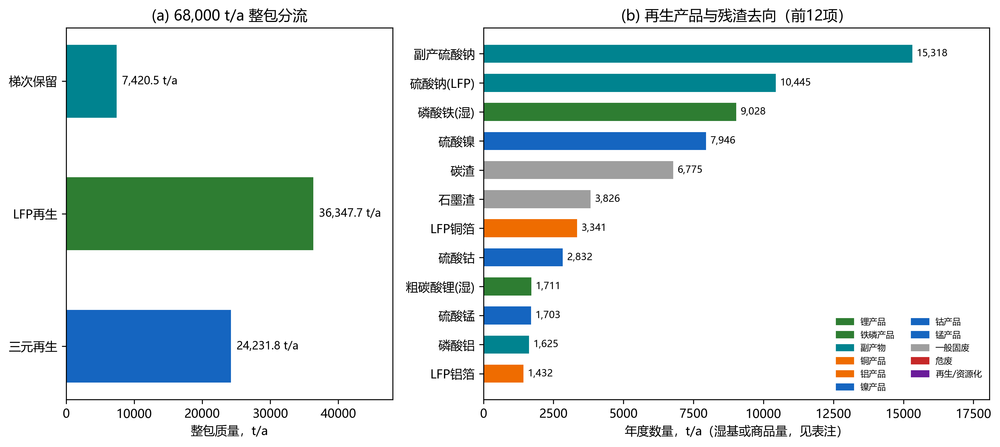
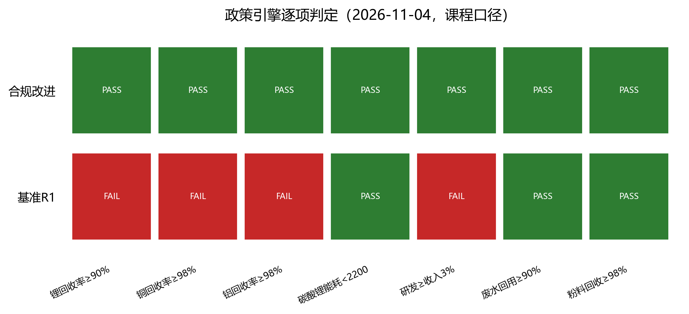

# 第3章 规划目标与情景指标（R1替换稿）

日期：2026-11-04。本章与第4、5、6章共用同一套R1年度物料流；所有结果是以宜昌案例为背景的课程规划仿真，不是企业实测运行数据。

## 3.1 规模、功能单位与系统边界

园区设计接收能力80,000 t/a，运行负荷0.85，实际来料68,000 t/a。梯次候选8,500 t/a，经筛选率q=0.90、重组保留率y=0.97后，保留旧电池整包当量7,420.50 t/a；筛选弃用850.00 t/a、重组弃用229.50 t/a全部返回再生线。再生入口60,579.50 t/a，其中LFP 36,347.70 t/a、未细分三元24,231.80 t/a；再生线负荷60,579.50/70,000=86.54%。LFP整包到电芯0.6627、三元0.63466；LFP电芯到黑粉0.50。LFP电芯24,087.62 t/a、三元电芯15,378.95 t/a、黑粉12,043.81 t/a。

功能单位取**1 t碳酸锂当量（LCE-eq）**，系统边界为退役电池到厂至产品/副产物出厂（cradle-to-gate加运输），不含电池使用阶段和下游正极制造。LFP粗碳酸锂与三元碳酸锂当量均为内部中间品或理论当量，未取得电池级合格证；LCOR与GWP均按“LCE-eq”报告，不写成已售电池级碳酸锂。

年度LCE-eq产量为LFP干纯1,355.08 t加三元1,709.26 t，合计3,064.34 t/a（基准回收率）；政策合规改进工况为3,172.04 t/a。梯次交付可用容量700,495.20 kWh/a，是当年交付容量，不是年供电量。

## 3.2 物料去向与元素平衡

R1的物料去向在本轮补齐为“整包—电芯—黑粉—产品/残渣/废水”的连续清单。主要流股见表3-1，完整33条流股见`data_cohort/final_20261104/material_flow_R1.csv`。

**表3-1 主要物料去向（R1，t/a）**

| 流股 | 数量 | 形态/品位 | 去向 | 计价或处置 |
| --- | ---: | --- | --- | --- |
| 退役整包 | 68,000.00 | 整包 | 园区 | 到厂含运 |
| 梯次保留 | 7,420.50 | 整包当量 | 梯次模组 | 按容量结算 |
| 再生整包 | 60,579.50 | 整包 | 拆解 | — |
| 整包非电芯组分 | 21,112.93 | 壳体/线束/BMS/塑料 | 资源化或处置 | 废钢/废铝/废铜计价，BMS与塑料计处置费 |
| LFP黑粉 | 12,043.81 | 粉料 | LFP湿法 | — |
| 粗碳酸锂（湿） | 1,710.95 | 含水20%，干纯99% | 锂产品 | 按LCE当量结算 |
| 磷酸铁（湿） | 9,027.87 | 含水40%，干纯99% | 铁磷产品 | 外售/进一步精制 |
| 磷酸铝 | 1,624.57 | 商品 | 副产物 | 外售 |
| 硫酸钠（LFP） | 10,444.85 | 商品 | 副产物 | 外售 |
| 海绵铜 | 476.69 | 元素Cu | 铜产品 | 外售 |
| 铜箔 | 3,341.24 | 97%Cu | 铜产品 | 外售 |
| 铝箔 | 1,431.96 | 97%Al | 铝产品 | 外售 |
| 碳渣 | 6,774.63 | 石墨/炭黑 | 一般固废 | 建材/填埋 |
| 钙渣与水洗渣 | 1,114.86 | 渣 | 危废 | 处置 |
| 三元元素产品 | 8,021.79 | Li₂CO₃当量+Ni/Co/Mn/Cu/Al | 盐类/金属产品 | 按元素或当量结算 |
| 三元石墨渣 | 3,825.73 | 石墨 | 一般固废 | 处置 |
| 三元电解液/隔膜 | 1,324.29 | 危废 | 危废 | 处置 |
| 三元副产硫酸钠 | 15,318.29 | 商品 | 副产物 | 外售 |

*图3-1 左：68,000 t/a整包在梯次与再生之间的分流；右：再生产品与残渣的主要去向（按质量排序）。数据见表3-1与`material_flow_R1.csv`。*

三元元素产品8,021.79 t/a中，碳酸锂当量1,709.26 t、Ni 1,774.13 t、Co 593.80 t、Mn 553.54 t、Cu 2,228.41 t、Al 1,162.65 t。其硫酸盐商品质量为NiSO₄·6H₂O 7,945.65 t、CoSO₄·7H₂O 2,832.47 t、MnSO₄·H₂O 1,702.94 t；硫酸根与结晶水来自外加硫酸/水，不计入电芯质量，避免把盐质量误当电芯质量。

**表3-2 质量平衡校核**

| 校核 | 左端 | 右端 | 相对误差 | 判定 |
| --- | ---: | ---: | ---: | --- |
| 整包分流 | 68,000.00 | 68,000.00 | 0 | PASS |
| 再生整包=电芯+非电芯 | 60,579.50 | 60,579.50 | <1e-15 | PASS |
| LFP电芯=黑粉+铜箔+铝箔+其他 | 24,087.62 | 24,087.62 | 0 | PASS |
| 三元电芯=元素产品+其他 | 15,378.95 | 15,378.95 | 0 | PASS |
| 非电芯组分去向 | 21,112.93 | 21,112.93 | 0 | PASS |
| LFP Li输入=产品Li+未分配Li | 290.918 | 290.918 | 0 | PASS |
| 未分配Li去向 | 36.371 | 36.371 | 0 | PASS |

LFP黑粉Li输入290.918 t/a，进入粗碳酸锂254.547 t/a，未分配36.371 t/a。本轮按C情景拆分其去向：45%随废水16.367 t、35%进入碳渣12.730 t、20%进入磷酸铁晶格7.274 t；该拆分是平衡约束下的显式假设，不是化验定位。由此LFP锂回收率=254.547/290.918=87.50%，全链（含三元）锂回收率88.88%，低于课程90%目标，基准工况判定FAIL；这是本轮必须通过改进工况解决的指标，不能用目标值回填。

LFP湿法工序输入（黑粉+硫酸+液碱+氧化钙+磷酸+铁粉+CO₂+O₂）41,692.89 t/a，输出（湿产品+磷酸铝+硫酸钠+海绵铜+各类渣+已列废水）37,999.47 t/a，差减3,693.42 t/a为蒸发水与工艺尾气，工序质量闭合率91.14%。该差减项与32%液碱带入水、湿产品含水及酸雾吸收水平一致，不能把差减项当作“无来源损失”隐藏；完整逐工段水平衡仍需企业计量。

## 3.3 政策指标诊断

政策引擎（`policy_engine.py`）按课程口径逐条判定。判定只说明已编码定量项是否满足阈值，不构成法律合规认证；缺证据项保持UNKNOWN，不以目标值代填。

**表3-3 基准R1政策指标**

| 指标 | 基准值 | 课程目标 | 判定 | 口径说明 |
| --- | ---: | --- | --- | --- |
| 再生设计能力 | 70,000 t/a | ≥5,000 | PASS | 设计能力，不是实际处理量 |
| 再生线负荷 | 86.54% | ≤100% | PASS | 弃用回流后实际负荷 |
| 锂冶炼回收率 | 88.88% | ≥90% | FAIL | 分母为进入冶炼的Li；LFP未分配Li已定位到废水/渣/产品 |
| 镍/钴/锰回收率 | 98% | ≥98% | PASS | ANL默认值，非本地测定 |
| 铜回收率 | 90% | ≥98% | FAIL | 分选+湿法综合，未做98%改造 |
| 铝回收率 | 90% | ≥98% | FAIL | 同上 |
| 电极粉料回收率 | 98.98% | ≥98% | PASS | LS23同源组分捕集推导 |
| 粉料铝杂质 | 1.0% | <1.5% | PASS | 情景假设，未取得检测报告 |
| 粉料铜杂质 | 0.8% | <1.5% | PASS | 情景假设 |
| 固氟率 | 99.5% | ≥99.5% | PASS | 情景假设，按工艺设计值 |
| 工艺废水循环利用率 | 90% | ≥90% | PASS | 情景假设，未取得水系统图 |
| 碳酸锂单位综合能耗 | 2,054 kgce/t | <2,200 | PASS | 电+天然气+蒸汽+柴油折标；蒸汽按2.6 GJ/t |
| 研发费用占收入 | 0.336% | ≥3% | FAIL | 基准研发400万元/收入11.91亿元 |

基准工况共有4项FAIL（锂、铜、铝、研发）。合规改进工况把锂回收率提高到92%、铜铝提高到98%、研发补足到收入3%，并计入改造投资2,000万元和新增运行费800万元；此时全部已编码项PASS（表3-4）。全链Li守恒误差、粉料铜铝杂质、固氟率、废水循环率、单位能耗和研发占比中，凡没有同边界证据的，报告均标注“情景假设”，不包装为实测。

**能耗口径的关键提醒**：基准R1的三元电耗533,991 kWh/a（约34.7 kWh/t电芯）是ANL代理值，明确不是完整公辅电耗。若按LFP湿法比电耗561 kWh/t电芯补齐，三元电耗升至8.63 GWh/a，单位综合能耗约2,298 kgce/t，超过2,200的课程阈值，能耗项由PASS转为FAIL。要在保守口径下达标，三元电耗需控制在约397 kWh/t电芯以内（或同步降低蒸汽/天然气）。因此表3-4的1,984 kgce/t是R1代理口径结果，不是已验证的工程值；2030年前必须用分线计量替换该代理。

*图3-2 基准R1与合规改进工况的政策逐项判定。红/绿仅表示已编码阈值是否满足，灰色项为不适用或缺失，不构成法律合规认证。*

## 3.4 近期、远期目标与指标矩阵

**表3-4 2026/2030/2035指标矩阵**

| 指标 | 2026基准R1 | 2026合规改进 | 2030近期目标 | 2035远期目标 | 依据 |
| --- | ---: | ---: | ---: | ---: | --- |
| 整包来料，t/a | 68,000 | 68,000 | 68,000 | 68,000 | 组内设定 |
| 再生入口，t/a | 60,579.5 | 60,579.5 | 60,579.5 | 60,579.5 | R1 |
| LCE-eq，t/a | 3,064.34 | 3,172.04 | ≥3,170 | ≥3,250 | 本模型 |
| 锂回收率 | 88.88% | 92.0% | ≥92% | ≥95% | 课程90%+改进 |
| 铜/铝回收率 | 90% | 98% | ≥98% | ≥99% | 课程附加目标 |
| 单位能耗，kgce/t | 2,054 | 1,984 | ≤2,100 | ≤1,900 | 课程<2,200 |
| 水耗，m³/t LCE | 21.9 | 21.9 | ≤18 | ≤15 | 本模型 |
| 净GWP，t CO2e/t LCE | -35.4 | -35.4 | ≤-37 | ≤-40 | 本模型 |
| LCOR，元/t LCE | 6 | 6 | ≤0 | ≤-5,000 | 本模型 |
| 研发/收入 | 0.336% | 3.0% | ≥3% | ≥4% | 课程3% |
| 梯次交付，kWh/a | 700,495 | 700,495 | ≥900,000 | ≥1,100,000 | 规划目标 |
| 政策判定 | FAIL | PASS | PASS | PASS | 政策引擎 |

2030年目标不是把2026结果按固定百分比外推，而是要求在同一物料边界、同一价格年和同一政策版本下复算；表中2030/2035值为规划目标，不是对未来法规或企业绩效的承诺。2035年比较以2030年同边界可行方案为基准，不预填无计算支撑的改善百分比。表中2026合规改进的能耗1,984 kgce/t为R1三元电耗代理口径；保守口径约2,298 kgce/t、政策判定FAIL，详见3.3节提醒。

## 3.5 指标口径与限制

1. **LCE-eq不是合格品产量**。LFP粗碳酸锂含水20%、干纯99%，三元为理论当量；两者均未经电池级精制与检测。LCOR与GWP的分母是LCE-eq，不是已售电池级碳酸锂。
2. **回收率分母不同**。锂回收率的分母是进入冶炼的锂元素；铜铝回收率的分母是进入分选/湿法边界的元素；粉料回收率的分母是电芯中目标正负极粉。三类指标不能互相替代，也不能用“≥90%”的目标值回填实际值。
3. **能源换算含假设**。蒸汽按2.6 GJ/t折算（0.7—1.0 MPa饱和蒸汽的净焓量级），仅用于计价和排放换算；A的原始质量口径未改。天然气按36 MJ/Nm³。折标系数按GB/T 2589的0.1229 kgce/kWh和29.3076 MJ/kgce。
4. **政策版本**。国内指标沿用课程任务书与2024年行业规范条件已核条款；欧盟材料回收率与新电池再生含量仅在中国境外适用对象成立时评估，本项目未建立出口产品边界，故保留NOT_APPLICABLE。
5. **未核项**。报价原件、税价与抵扣资格、产品合格证、实际厂测捕集率、完整水平衡和逐工段元素分配仍未取得；这些限制在第4、5、6章继续显式保留。
