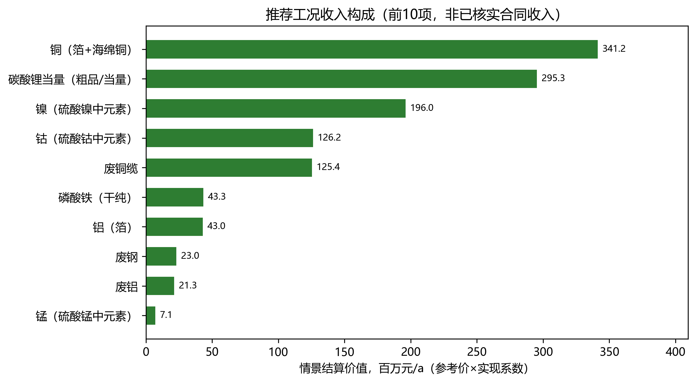
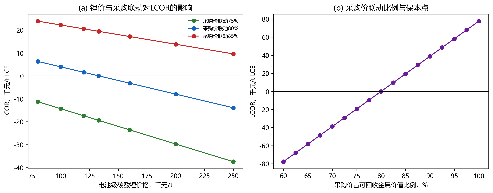
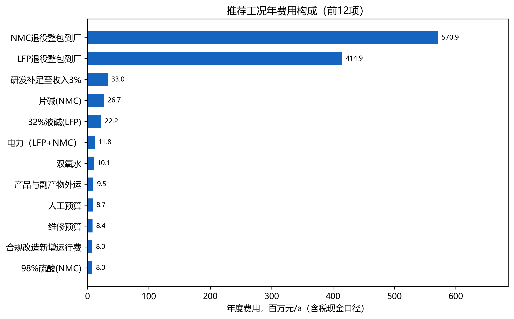
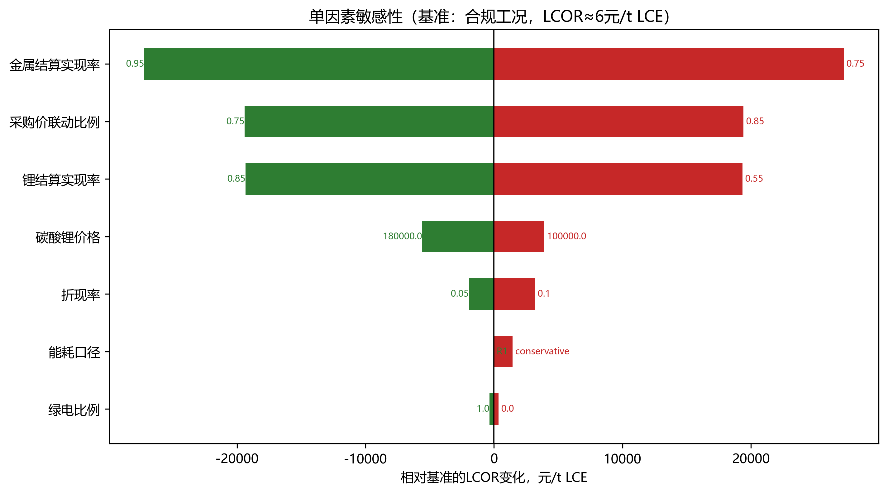
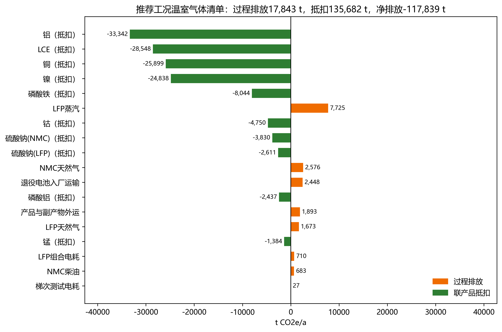
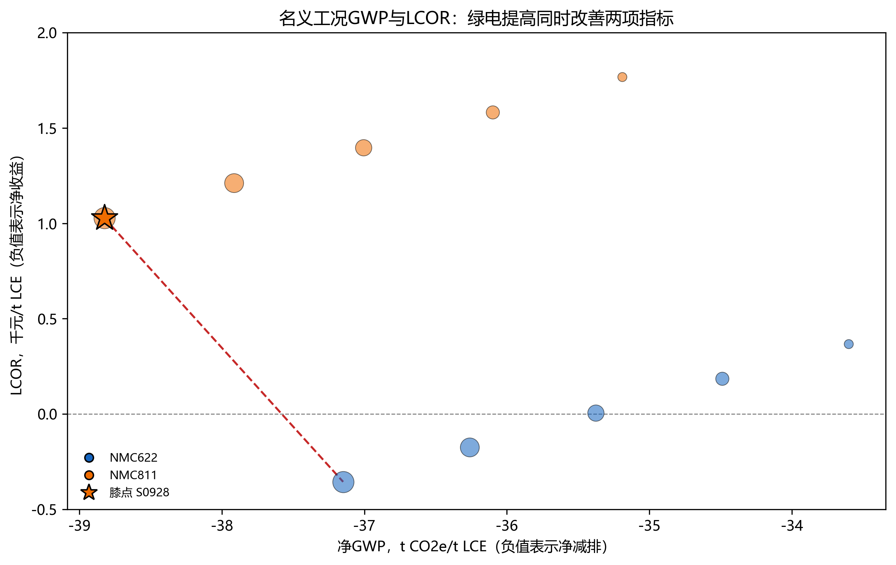

# 第5章 技术经济分析：LCOR、MAC与推荐方案（R1替换稿）

日期：2026-11-04。本章在同一物料边界、同一价格年（2026）和同一功能单位（1 t LCE-eq）下计算。所有价格均为规划参考价，未取得成交原件；所有“收入”均为参考价×实现系数的情景结算价值，不是已核实合同收入。补贴、碳信用和绿色溢价在基准中均为0，另列情景。

## 5.1 方法、功能单位与边界

**LCOR（平准化回收净成本）**：

\[
LCOR=\frac{C_{ann}+OPEX-\sum_i R_i}{Q_{LCE}}
\]

其中\(C_{ann}\)为再生线资本年金，\(OPEX\)为年度运行费，\(R_i\)为联产品情景结算收入，\(Q_{LCE}\)为LCE-eq年产量。LCOR为负表示在给定价格与实现率下回收路线有净收益，不等于会计利润：未计所得税、财务费用、营运资金和建设期。

**净GWP与MAC（边际减排成本）**：

\[
GWP_{net}=GWP_{gross}-\sum_j m_j\cdot EF_{j,primary}
\]

\[
MAC=\frac{LCOR-C_{primary}}{(E_{primary}-GWP_{net})/1000}
\]

联产品按“系统扩展/避免法”抵扣其原生生产排放；原生基准取锂辉石路线9,000 kg CO₂e/t LCE（盐湖路线4,000 kg CO₂e/t作为敏感性）。\(C_{primary}\)取2026年电池级碳酸锂参考价133,000元/t，是价格代理而非矿山成本模型。MAC为负表示回收路线在成本与碳上均优于原生路线，即“负成本减排”；其绝对值对抵扣因子和产品实现率敏感，不能单独作为投资决策依据。

边界标识：`R1_2026_gate`，包含收集运输、拆解分选、梯次测试与重组、LFP湿法、三元湿法、三废处理；不含电池使用、下游正极制造和产品精制到电池级的额外工序。LFP粗碳酸锂与三元当量按同一LCE-eq分母，未按产品品位再分配。

## 5.2 收入构成

**表5-1 合规工况情景结算收入（K3，万元/a）**

| 产品 | 数量，t/a | 参考价，元/t | 实现系数 | 收入，万元/a |
| --- | ---: | ---: | ---: | ---: |
| 碳酸锂当量 | 3,172.04 | 133,000 | 0.70 | 29,531.8 |
| 磷酸铁（干纯） | 5,362.56 | 9,500 | 0.85 | 4,330.3 |
| 磷酸铝 | 1,624.57 | 2,500 | 0.80 | 324.9 |
| 硫酸钠（LFP） | 10,444.85 | 350 | 0.80 | 292.5 |
| 硫酸钠（NMC副产） | 15,318.29 | 350 | 0.80 | 428.9 |
| 铜（箔+海绵铜） | 6,474.65 | 62,000 | 0.85 | 34,121.4 |
| 铝（箔） | 2,778.46 | 18,200 | 0.85 | 4,298.2 |
| 镍（硫酸镍中元素） | 1,774.13 | 130,000 | 0.85 | 19,604.1 |
| 钴（硫酸钴中元素） | 593.80 | 250,000 | 0.85 | 12,618.3 |
| 锰（硫酸锰中元素） | 553.54 | 15,000 | 0.85 | 705.8 |
| 废钢 | 11,612.11 | 2,200 | 0.90 | 2,299.2 |
| 废铝 | 1,689.03 | 14,000 | 0.90 | 2,128.2 |
| 废铜缆 | 2,533.55 | 55,000 | 0.90 | 12,541.1 |
| **合计** | — | — | — | **123,224.6** |

铜（27.7%）、锂（24.0%）、镍（15.9%）、钴（10.2%）和废料（13.8%）构成收入主体。铜与镍钴的价格波动、以及锂实现率，是收入端三大变量。磷酸铁、磷酸铝和硫酸钠合计仅占4.4%，不能支撑项目收益，但它们是物料闭合与废物减量的必要去向。

*图5-1 合规工况情景结算收入（前10项）。价格为参考价×实现系数，不是已核实合同收入；补贴、碳信用和绿色溢价为0。*

**表5-2 梯次线独立核算（K3）**

| 项目 | 数值 | 说明 |
| --- | ---: | --- |
| 交付容量 | 700,495 kWh/a | 7,420.50 t×118 Wh/kg×0.80 |
| 收入 | 25,217.8万元/a | 480元/kWh×0.75 |
| 原料成本 | 12,075.2万元/a | 7,420.50 t×16,272.77元/t |
| 重组加工费 | 4,203.0万元/a | 60元/kWh |
| 其他成本（测试、人工、维修、研发、服务、年金） | 843.9万元/a | 见模型 |
| 成本合计 | 17,120.5万元/a | 244.4元/kWh |
| 毛利 | 8,097.3万元/a | 115.6元/kWh |

梯次线毛利8,097万元，但其原料价按再生线同一金属价值联动价计入；若按组内5,200/8,800元/t采购，毛利更高。梯次线的政策风险是产品质量与禁入领域，而不是成本；未取得应用质量证据前，不能把700,495 kWh全部视为可售。

## 5.3 LCOR结果与解释

**表5-3 关键工况LCOR、净GWP与MAC**

| 工况 | 配置 | LCOR，元/t LCE | 净GWP，kg CO₂e/t LCE | MAC，元/t CO₂e |
| --- | --- | ---: | ---: | ---: |
| K1 | 组内采购价5,200/8,800，基准回收率 | -190,938 | -34,732 | -7,407 |
| K2 | 金属价值80%联动，基准回收率 | -11,311 | -34,732 | -3,300 |
| K3 | 80%联动+合规改进（Li92%、Cu/Al98%、研发3%） | 6 | -35,376 | -2,997 |
| K4 | K3+100%绿电 | -355 | -37,149 | -2,890 |
| K5 | K3但三元按NMC811 | 1,398 | -37,008 | -2,860 |
| K6 | K3但锂实现55% | 19,357 | -35,376 | -2,561 |
| K7 | K3但锂实现85%、金属95% | -46,572 | -35,376 | -4,047 |
| K8 | K3但NMC811+100%绿电 | 1,028 | -38,824 | -2,760 |

K1的-190,938元/t LCE不是“项目可赚19万元/t”，而是组内采购价仅为可回收金属价值的30.6%—38.2%，在2026年现货市场不具备可持续供货基础。以K1作为基准会系统性高估收益，故本报告以K2/K3为基准，并把K1保留为“低价采购压力情景”。

K2与K3的差异说明：合规改进同时提高产品量（LCE +3.5%、铜铝+8.9%）和费用（研发补足3,297万元、改造运行费800万元、改造年金189万元），净效果使LCOR从-11,311元/t升至约6元/t，即**合规改造基本吃掉全部净收益**。这不是反对合规，而是说明合规成本必须由产品溢价、政策支持或采购价下降来覆盖。

K4在K3基础上把绿电从50%提高到100%：绿电到户价0.51元/kWh低于网电0.62元/kWh，电费下降，LCOR进一步降至-355元/t。若绿电价格高于0.62元/kWh或需配储，结论反转；该条件应在PPA中锁定。

## 5.4 采购价联动、保本点与锂价影响

按表5-1的产品参考价与实现率，基准R1（K2）每吨整包的可回收价值为LFP 13,614元/t、NMC 28,723元/t；合规改进（K3）因多回收Li与Cu/Al，升至LFP 14,268元/t、NMC 29,450元/t。组内采购价5,200/8,800元/t相当于基准价值的**38.2%/30.6%**（改进后36.4%/29.9%）。以金属价值80%联动、按K3产品量，采购价为LFP 11,414.52元/t、NMC 23,560.15元/t；此时K3的LCOR≈6元/t LCE，保本联动比例80.0%（K2为82.9%）。

**采购价联动比例每变动1个百分点，LCOR约变动3,885元/t LCE**（0.75→0.85：-19,418→+19,429）。这是本项目第一敏感变量，高于锂实现率（每1个百分点约1,290元/t）、金属实现率（每1个百分点约2,722元/t）和折现率。

**表5-4 采购与价格情景**

| 情景 | LCOR，元/t LCE | 说明 |
| --- | ---: | --- |
| 组内5,200/8,800 | -190,938 | 不可持续的低价情景 |
| 联动70% | -38,900 | 按80%/75%两点线性外推，低于市场价，需长协或区域补贴 |
| 联动75% | -19,418 | 仍有净收益 |
| 联动80% | 6 | 保本基准 |
| 联动85% | +19,429 | 亏损 |
| 联动90% | +38,900 | 按线性外推，明显亏损 |
| 锂价100,000元/t | +3,933 | 联动80%，收入下降 |
| 锂价133,000元/t | 6 | 基准 |
| 锂价180,000元/t | -5,587 | 联动80%，收入上升 |

锂价上升时LCOR下降，是因为采购价只按可回收价值的80%联动，回收环节保留20%的价格敞口；若采购合同按100%联动，锂价影响将大幅收窄。**建议采购合同设置“金属价值80%+锂价上下限”条款，而不是固定吨价。**

*图5-2 左：不同采购联动比例下LCOR随碳酸锂价格的变化；右：采购价占可回收金属价值比例与保本点（80%）。*

## 5.5 成本结构与敏感性

合规工况毛成本38.85万元/t LCE，净成本6元/t LCE。原料占80.0%，是绝对主导；药剂7.0%、公用工程2.2%、人工/研发/维修/服务/其他4.7%、三废1.3%、运输0.8%、年金3.4%、合规改造0.6%。降低LCOR的可行顺序是：采购价条款＞锂/金属实现率＞药剂与能耗＞人工与维修；单纯压缩人工或维修对LCOR影响有限。

*图5-3 合规工况年费用（前12项）。原料占80%，采购价是第一位管理杠杆。*

**表5-5 单因素敏感性（基准K3，LCOR≈6元/t）**

| 变量 | 低值 | 高值 | LCOR低值 | LCOR高值 | 极差 |
| --- | ---: | ---: | ---: | ---: | ---: |
| 采购价联动 | 75% | 85% | -19,418 | 19,429 | 38,847 |
| 金属实现率 | 75% | 95% | 27,232 | -27,220 | 54,452 |
| 锂实现率 | 55% | 85% | 19,357 | -19,346 | 38,703 |
| 碳酸锂价格 | 100,000 | 180,000 | 3,933 | -5,587 | 9,520 |
| 折现率 | 5% | 10% | -1,957 | 3,206 | 5,163 |
| 绿电比例 | 0% | 100% | 367 | -355 | 722 |
| 能耗口径 | R1 | 保守补齐 | 6 | 1,448 | 1,442 |

金属实现率和锂实现率的极差大于采购价联动，是因为它们同时影响收入与产品量；但这两个变量是**结算折让**，不是物理回收率，不能通过“提高实现率”替代真实回收改造。物理回收率的改进已体现在K3相对K2的LCE +3.5%和铜铝+8.9%中。

能耗口径的1,442元/t只反映电费，**不反映政策合规风险**：按保守NMC电耗补齐后，单位综合能耗约2,298 kgce/t，超过2,200的课程阈值，政策判定从PASS转为FAIL（见3.3节提醒）。因此推荐方案把“NMC电耗≤397 kWh/t电芯（或等效蒸汽/天然气节约）”列为2030年前的工程验证条件；在未取得分线计量前，不能把1,984 kgce/t当作已验证值。

*图5-4 以K3为基准的单因素LCOR变化。绿色为低值端、红色为高值端；金属实现率与采购联动的影响最大。*

## 5.6 边际减排成本（MAC）

K3的净GWP为-35,376 kg CO₂e/t LCE，MAC=-2,997元/t CO₂e（锂辉石基准）；以盐湖4,000 kg CO₂e/t为基准，MAC=-3,378元/t CO₂e。K4（100%绿电）MAC=-2,890元/t CO₂e。负MAC表示回收路线在系统扩展口径下同时降低成本与排放，属于“负成本减排机会”。

该结论依赖三个条件：①联产品按原生生产排放抵扣（铝33,342 t、LCE 28,548 t、铜25,899 t、镍24,838 t、磷酸铁8,044 t等，合计135,682 t CO₂e/a）；②原生LCE基准9,000 kg CO₂e/t；③产品实现率70%/85%。若不允许联产品抵扣，回收路线的毛GWP为23,468 t/a（7.4 t/t LCE），仅略低于原生9,000 kg/t，MAC将不再有经济意义。因此MAC应表述为“含联产品抵扣的系统扩展MAC”，不能与单产品碳足迹混用。

抵扣按理论替代量计，未按实现率折减。若把锂0.70、金属0.85、磷酸铁/盐类0.80的实现率同样用于抵扣，抵扣降至110,604 t CO₂e/a，净GWP约-27,464 kg CO₂e/t LCE，MAC约-3,697元/t CO₂e；方向不变，绝对减排量下降约22%。报告正文采用理论替代量作为上限情景，推荐方案引用时应同时给出这一折减区间。

*图5-5 合规工况（100%绿电）的过程排放与联产品抵扣。净排放-117,839 t CO₂e/a，即-37,149 kg CO₂e/t LCE；负值来自系统扩展抵扣，不是项目直接负排放。*

## 5.7 多目标寻优与前沿

共计算960组工况：2种三元体系×5档绿电×4档采购联动×2档回收率×3档锂实现×2档金属实现×2档能耗口径。按政策引擎剔除不可行解后，220组政策可行；在采购联动≥75%的可行集合中，非支配前沿2个点；在名义推荐集（联动80%、锂70%、金属85%、R1能耗）中，前沿由两个端点构成：

- **成本锚点**：NMC622+100%绿电，LCOR=-355元/t LCE，净GWP=-37,149 kg CO₂e/t LCE，MAC=-2,890元/t CO₂e；
- **环境锚点/膝点**：NMC811+100%绿电，LCOR=+1,028元/t LCE，净GWP=-38,824 kg CO₂e/t LCE，MAC=-2,760元/t CO₂e。

从622到811，LCOR上升1,383元/t，净GWP改善1,675 kg CO₂e/t，隐含碳价约0.83元/kg CO₂e（830元/t）。若小组碳目标优先，选811；若财务约束优先，选622。绿电比例提高同时降低LCOR与GWP（0.51元/kWh<0.62元/kWh），故前沿只在100%绿电端，不存在“绿电比例—成本”的权衡；真正的权衡是622/811的钴镍结构与结算实现率。

*图5-6 名义工况（80%联动、锂70%、金属85%、R1能耗）的GWP-LCOR关系。圆点大小表示绿电比例；前沿两端为NMC622与NMC811的100%绿电工况，星号为膝点811。*

## 5.8 最终推荐方案

**表5-6 推荐配置与边界条件**

| 维度 | 推荐值 | 边界/触发条件 |
| --- | --- | --- |
| 规模 | 整包68,000 t/a；再生60,579.5 t/a；梯次7,420.5 t/a | 来料不足时降负荷，不虚增本地收集量 |
| 三元体系 | NMC622为主（成本锚点）；NMC811为环境锚点/备选 | 钴价>35万元/t或钴供应受限时提高811比例 |
| 绿电 | ≥80%，目标100%（PPA锁价≤0.55元/kWh） | 绿电到户价>0.62元/kWh时回落至50% |
| 采购价 | ≤可回收金属价值的80%；LFP≤11,400元/t、NMC≤23,600元/t | >82%即亏损；>90%停止采购 |
| 回收率 | Li≥92%、Cu/Al≥98%、Ni/Co/Mn≥98% | 低于阈值不进入推荐集 |
| 能耗 | 三元电耗≤397 kWh/t电芯（保守口径≤2,200 kgce/t） | 超过则能耗项FAIL，需余热回收或降蒸汽 |
| 研发 | ≥收入3%（合规工况3,697万元/a） | 低于3%政策FAIL |
| 产品 | 粗Li₂CO₃、FePO₄、Ni/Co/Mn硫酸盐、Cu/Al、梯次模组 | 未取得电池级合格证前不按电池级计价 |
| 政策 | 按2024行业规范条件与课程指标组织评价 | 不宣称已取得规范条件公告或EU合规 |
| 财务 | LCOR≈0（622）或+1,028元/t（811）；MAC≈-2,890/-2,760元/t CO₂e | 依赖80%联动与70%/85%实现率 |
| 碳 | 净GWP -37,149（622）/-38,824（811）kg CO₂e/t LCE | 含联产品抵扣，非单产品碳足迹 |
| 梯次 | 700,495 kWh/a，毛利8,097万元/a | 需应用质量证据与禁入领域核查 |

**推荐方案（一句话）**：在80%金属价值联动采购、Li 92%/Cu-Al 98%回收、研发3%、100%绿电的条件下，以NMC622为主力、NMC811为环境备选，项目LCOR约为-355至+1,028元/t LCE，基本保本；净减排约37—39 t CO₂e/t LCE，MAC约-2,760至-2,890元/t CO₂e。该方案的经济可行性取决于采购价不超过金属价值的80%，其碳有效性取决于联产品抵扣与绿电供应。

**分阶段实施**：

1. **2026基准年**：完成来料计量、批次溯源、Li/Cu/Al元素平衡与价格证据；按80%联动签订首批采购合同；研发补足3%；绿电比例≥50%。
2. **2030近期**：Li≥92%、Cu/Al≥98%、能耗≤2,100 kgce/t、水耗≤18 m³/t、绿电≥80%；建成副产硫酸钠与磷酸铝的稳定销售渠道；政策引擎全项PASS。
3. **2035远期**：Li≥95%、Cu/Al≥99%、净GWP≤-40 t/t LCE、LCOR≤-5,000元/t；以2030同边界方案为基准评估改善，不预填改善百分比。

**主要风险与应对**：

| 风险 | 触发 | 应对 |
| --- | --- | --- |
| 采购价过高 | 联动>82% | 长协+价格上限；转向低钴/高铜料 |
| 锂价下跌 | LCE<100,000元/t | LCOR升至+3,933元/t；降负荷或锁定最低采购量 |
| 产品折价 | 锂实现<70% | LCOR升至+19,357元/t；先做来料认证与产品分级 |
| 绿电不足 | PPA<80% | 回落50%，LCOR改善有限但GWP上升 |
| 政策合规成本 | 研发/改造 | 申请绿色工厂、规范条件公告；不把补贴计入基准 |
| LFP线薄利 | 铜铝价格下跌 | LFP线依赖铜铝副产；必要时与NMC线协同或降负荷 |

## 5.9 结论边界

1. 本报告已完成LCOR、MAC、政策筛选和推荐方案，但价格、产品合格证、实际捕集率、完整水平衡和逐工段元素分配仍是规划假设/文献迁移，不是企业实测。
2. LCOR为负的工况不是“保证盈利”，而是给定价格与实现率下的净收益；税费、财务费用、营运资金和建设期未计。
3. MAC为负依赖联产品系统扩展抵扣；若评审要求单产品归因，应改用经济价值分配并重算，不能直接引用本MAC。
4. 推荐方案的前提是采购价≤金属价值80%、Li≥92%、Cu/Al≥98%、研发3%、绿电≥80%、三元电耗≤397 kWh/t电芯；任一条件不成立，应回到表5-4/5-5重算，而不是沿用结论。
5. 政策判定只覆盖已编码定量项；缺失项保持UNKNOWN，不构成法律合规认证，也不替代环评、排污许可和产品认证。能耗项的“PASS”是R1代理口径结果；保守口径下约2,298 kgce/t、判定FAIL，必须用分线计量复核。
