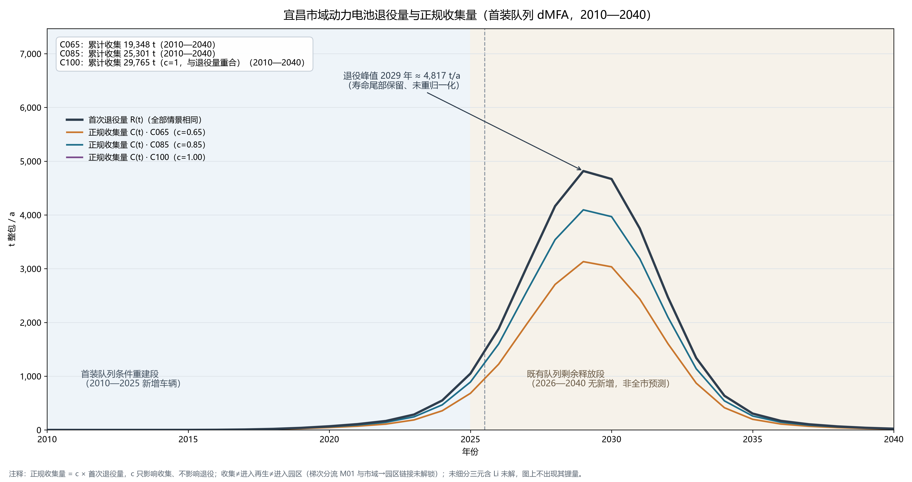
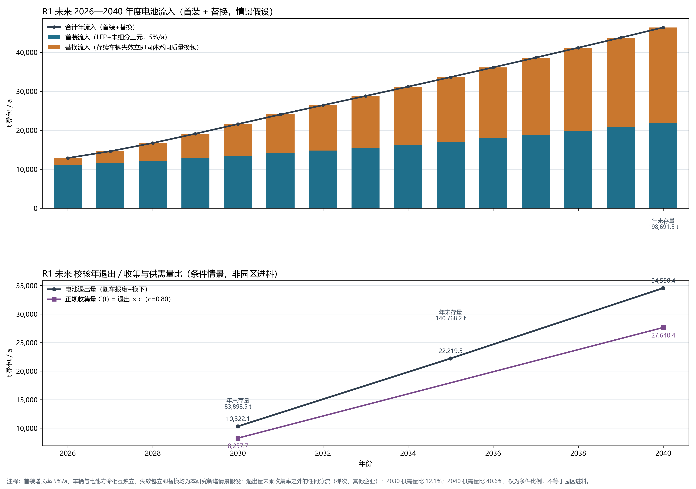
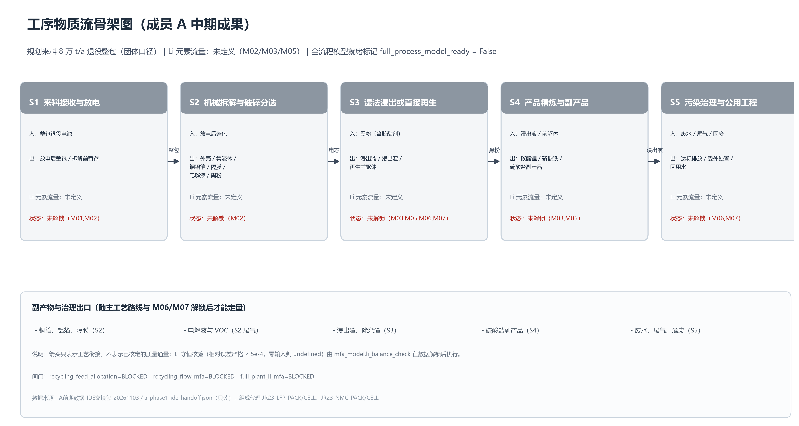
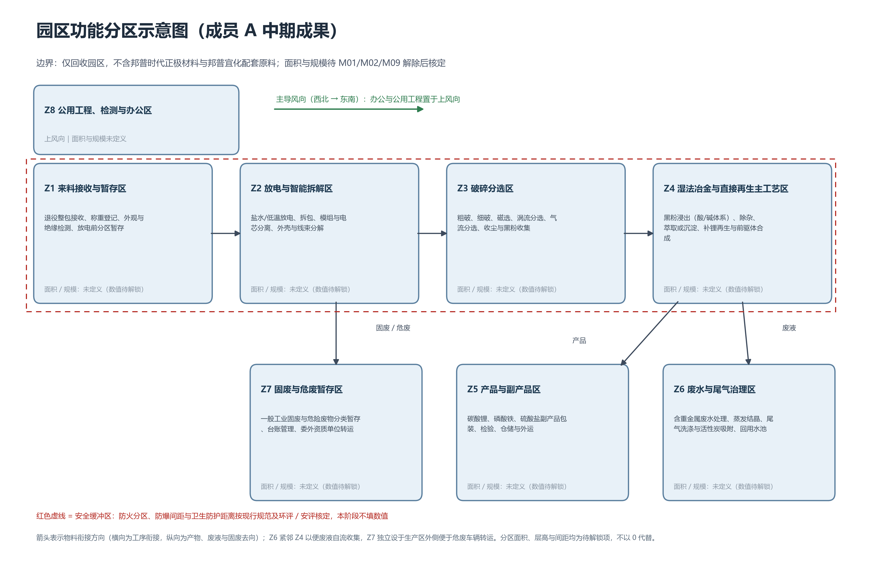
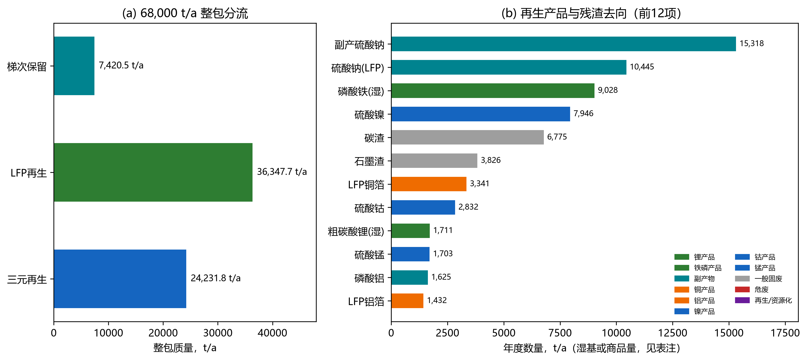
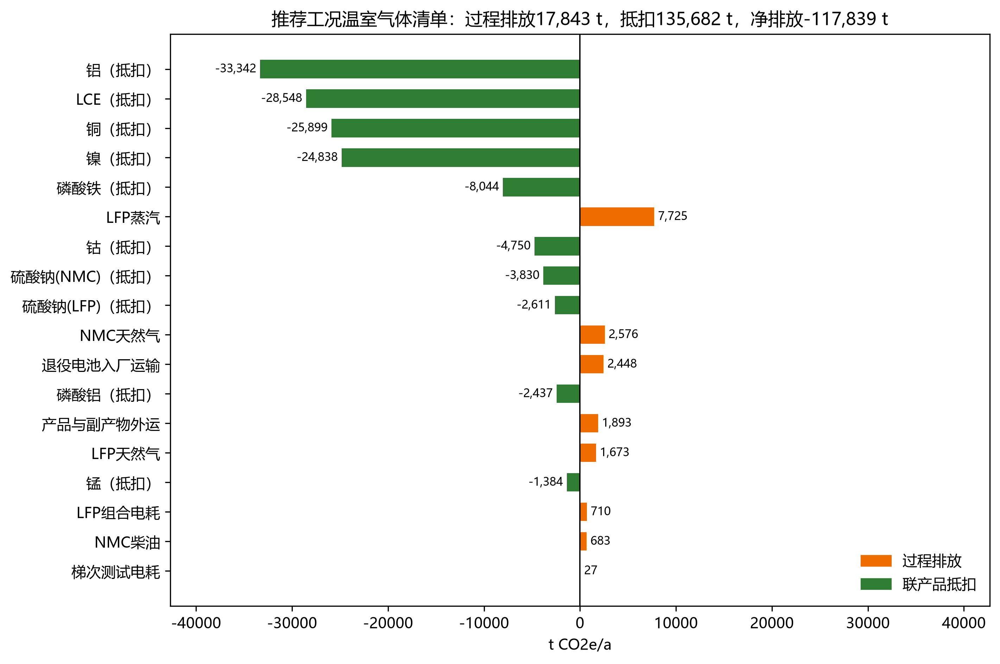
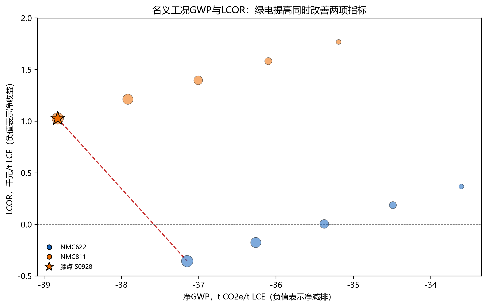
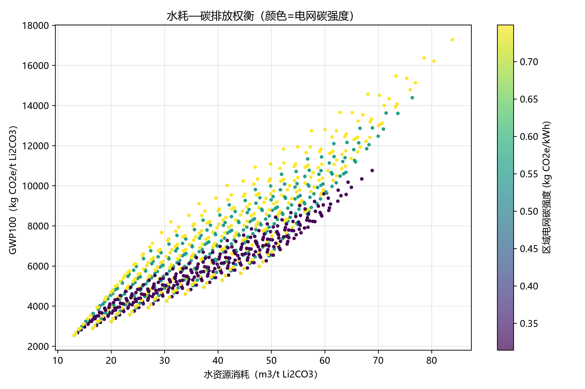

# 退役动力锂离子电池锂资源循环利用园区 环境规划与管理综合报告

**任务**：《环境规划与管理》第十二讲 · 退役动力锂离子电池回收环境规划与管理综合实训
**版本**：整合稿 v1.0（2026-11-04）
**数据基准**：组内统一规划情景 **R1**（再生入口 60,579.50 t/a）
**功能单位**：1 t 碳酸锂当量（LCE-eq）
**系统边界**：`R1_2026_gate`（退役电池到厂 → 产品/副产物出厂，cradle-to-gate 加运输；不含电池使用阶段与下游正极制造）

> 本报告为课程规划仿真，不是企业实测、法律合规认证或投资建议。所有价格均为规划参考价，未取得成交原件；补贴、碳信用与绿色溢价在基准中均为 0。
>
> **数据属性标注贯穿全文**：`组内设定 / 文献原值 / 文献迁移 / 情景假设`。缺失值保持 `UNKNOWN`，不以 0、阈值或目标值代填。
>
> **成员分工**：成员 A（市域 dMFA、园区物质流、工艺清单、功能分区与工程）、成员 B（环境因子、LCA 环境维度）、成员 C（经济参数、LCOR/MAC、政策引擎、第 4/5 章投资与经济）。

---

# 模块 0 报告概览与执行摘要

## 0.1 分工与贡献声明

| 成员姓名 | GitHub 账号 | 组内角色 | 邮箱 | 具体负责工作模块 | 相对贡献度比例 (%) | 签名确认 |
| :--- | :--- | :---: | :--- | :--- | :---: | :---: |
| 强浩峻 | K1rar1-q | 组长 | 2245683701@qq.com | 市域 dMFA、园区物质流与元素平衡、工艺清单、功能分区与重点工程、第 1/2 章执笔、脚本整合与分支集成 | 33.3% | 强浩峻 |
| 郭京奥 | xiao-ma66 | 组员 | 2584278761@qq.com | 环境因子、LCA 清单与情景仿真、敏感性分析、第 5 章环境维度执笔 | 33.3% | 郭京奥 |
| 帕娜尔 | banana539 | 组员 | 2603825979@qq.com | 经济参数、TEA/LCOR/MAC、政策引擎、第 3/4/5/6 章指标/投资/经济/管理执笔 | 33.3% | 帕娜尔 |
| 全组总计 | — | — | — | 完整涵盖数据构建、核心建模、可视化代码与报告全部模块 | 100% | 全员已核对 |

> 三方贡献度平分，各 33.3%；组长为成员 A（强浩峻）。责任矩阵（RACI）与贡献边界见第 6.2 节表 6-1。

## 0.2 执行摘要

本报告以宜昌退役动力电池循环利用园区为规划对象，基于成员 A 的 R1 年度物料流、朗赛 LS23 与 ANL EverBatt 工艺清单、成员 B 的环境因子和成员 C 的经济/政策模型，完成同工况物料去向、费用闭合、LCOR（平准化回收净成本）、MAC（边际减排成本）与推荐方案。

- **规模**：园区设计接收能力 80,000 t/a、负荷 0.85、实际来料 68,000 t/a；梯次保留 7,420.50 t/a；再生入口 60,579.50 t/a；LCE-eq 产量 3,064.34 t/a（合规改进 3,172.04 t/a）。
- **物质流**：补齐「整包—电芯—黑粉—产品/残渣/废水」连续清单；LFP 粗碳酸锂 1,710.95 t/a（干纯 1,355.08）、磷酸铁 9,027.87 t/a（干纯 5,362.56）、铜箔 3,341.24 t/a、铝箔 1,431.96 t/a；三元碳酸锂当量 1,709.26 t/a + Ni 1,774.13 / Co 593.80 / Mn 553.54 / Cu 2,228.41 / Al 1,162.65 t/a。7 项质量平衡校核全部通过；LFP 锂回收率 87.50%、全链 88.88%，低于 90% 目标，合规改进工况提高到 92%。
- **费用与成本**：年度总费用 123,226.7 万元（原料 98,579.6 万元）；单位毛成本 38.85 万元/t LCE。合规工况（金属价值 80% 联动采购：LFP 11,414.52、NMC 23,560.15 元/t）LCOR≈6 元/t LCE。
- **环境与减排**：合规工况净排放 −112,214 t CO₂e/a（−35,376 kg CO₂e/t LCE）；100% 绿电净 GWP −37,149 kg CO₂e/t LCE；MAC −2,890 ~ −2,997 元/t CO₂e（负成本减排）。
- **推荐方案**：以 NMC622 为主力、NMC811 为环境备选；采购价 ≤ 金属价值 80%；Li≥92%、Cu/Al≥98%、Ni/Co/Mn≥98%；研发≥收入 3%；绿电年加权≥80%（丰水期近 100%、枯水期风光补足至约 66%）。第一敏感变量为采购价，其次为锂/金属结算实现率；合规改造（研发 3%、Li/Cu/Al 改造）基本吃掉净收益，需产品溢价、政策支持或采购价下降覆盖。

> **能耗口径提示**：R1 三元电耗代理值（34.7 kWh/t 电芯）下合规工况单位综合能耗 1,984 kgce/t、PASS；按 561 kWh/t 电芯保守口径补齐约 2,298 kgce/t、转为 FAIL。推荐方案因此把「三元电耗≤397 kWh/t 电芯」列为 2030 年前工程验证条件。

**局限**：价格为规划参考价未取得成交原件；产品未取得电池级合格证；实际捕集率、完整水平衡、逐工段元素分配和税费/资金成本未闭合；政策判定只覆盖已编码定量项，不构成法律合规认证。

## 0.3 术语与缩写

| 缩写 | 英文全称 | 中文 | 本报告口径 |
| :--- | :--- | :--- | :--- |
| LIB | Lithium-Ion Battery | 锂离子电池 | 退役动力电池 |
| LFP | Lithium Iron Phosphate (LiFePO₄) | 磷酸铁锂 | 正极体系（622/811 技术情景） |
| NMC | Lithium Nickel Manganese Cobalt Oxide | 镍锰钴三元 | 正极体系（622/811 技术情景） |
| NCA | Lithium Nickel Cobalt Aluminum Oxide | 镍钴铝三元 | 文献基准的参考体系 |
| LCE | Lithium Carbonate Equivalent | 碳酸锂当量 | 功能单位，非合格品产量 |
| dMFA | Dynamic Material Flow Analysis | 动态物质流分析 | 市域队列，与园区物料流分开 |
| MFA | Material Flow Analysis | 物质流分析 | 园区工序级质量/元素平衡 |
| LCA | Life Cycle Assessment | 生命周期评价 | cradle-to-gate |
| TEA | Techno-Economic Analysis | 技术经济分析 | 年金+OPEX−收入 |
| LCOR | Levelized Cost of Recycling | 平准化回收净成本 | 元/t LCE-eq |
| MAC | Marginal Abatement Cost | 边际减排成本 | 元/t CO₂e |
| GWP100 | 100-year Global Warming Potential | 百年全球变暖潜势 | kg CO₂e |
| CRF | Capital Recovery Factor | 资本回收系数 | 7%/20 年 = 0.09439293 |
| SOH | State of Health | 电池健康状态 | 梯次利用分级依据 |
| EPR | Extended Producer Responsibility | 生产者责任延伸 | 车企/电池厂利益分配 |
| MRV | Measurement, Reporting and Verification | 监测、报告与核查 | 数字监管体系 |
| RC | Reduction Calcination | 还原焙烧 | 火法预处理工序 |

---

# 第 1 章 产业基础、现状与系统边界（成员 A）

## 1.1 规划对象与产业基础

规划对象为宜昌退役动力电池循环利用园区（参考实体：宜昌邦普循环相关回收项目，仅作原型参照）。园区定位覆盖「收集 → 梯次利用 → 拆解再生 → 湿法精炼 → 材料再生 → 污染治理」全链条，对应循环经济与生产者责任延伸（EPR）政策背景。

## 1.2 市域动态物质流（dMFA）结论

市域新建注册乘用车首装电池队列采用车辆—电池—材料分层模型与 Weibull 寿命分布重建，覆盖 2010—2025 年首装，外推至 2040 年既有队列释放。三档正规收集率（c=0.65/0.85/1.00）下：

| 指标 | C065 | C085 | C100 |
| :--- | ---: | ---: | ---: |
| 累计首装 2010—2025（t 整包） | 29,791 | 29,791 | 29,791 |
| 累计首次退役 2010—2040（t） | 29,765 | 29,765 | 29,765 |
| 退役峰值年 / 峰值量（t/a） | 2029 / 4,817 | 2029 / 4,817 | 2029 / 4,817 |
| 累计正规收集 2010—2040（t） | 19,348 | 25,301 | 29,765 |
| 2025 年末在用整包存量（t） | 27,493 | 27,493 | 27,493 |
| LFP 在用锂存量（2025 末，kg Li） | 239,596 | 239,596 | 239,596 |

**口径红线（必须随结果写出）**：

1. 2026—2040 段是**既有首装队列的剩余释放**，不是全市未来退役预测，不能推出「全市 2040 年退役为 0」。
2. `collected ≠ recycled ≠ 园区来料`：正规收集量经梯次分流、市域—园区链接（`D-PARK-LINK`）后才可能成为园区进料；本表不提供园区进料量。
3. 该队列对园区的年供给贡献只能表述为「**该模型覆盖的既有首装队列贡献**」（C085 峰值年 4,094.83 t/a ≈ 68,000 t/a 的 6.02%），**不得**据此推断「全市供料不足」。
4. Li 仅覆盖 LFP 部分；未细分三元 Li 整列为 null，不取 NMC622/811 平均，故为下界口径。
5. 寿命参数为发展中地区文献代理（LFP 均值 4.92 a）；若 scale 增大，退役峰值将后移，须给敏感性对照。

市域 dMFA 三档正规收集率（c=0.65/0.85/1.00）下的退役量与正规收集量演变见图 1-1；2026—2040 既有首装队列的剩余寿命释放见图 1-2。

> 图 1-1 表明 c 只改变正规收集量而不改变退役量（三情景退役曲线重合）；图 1-2 展示 2026—2040 段为既有首装队列的剩余寿命释放，不是全市未来退役预测。

## 1.3 园区工况与系统边界

| 项目 | 取值 | 属性 |
| :--- | :--- | :--- |
| 设计接收能力 | 80,000 t/a 退役整包 | 组内规划设定 |
| 负荷率 | 0.85 | 组内工况 |
| 实际来料 | 68,000 t/a | 80,000 × 0.85 |
| 梯次设计能力 / 实际分配 | 10,000 / 8,500 t/a | 10,000 × 0.85 |
| 再生设计能力 / 实际入口 | 70,000 / 60,579.50 t/a | 68,000 − 7,420.50（R1） |
| 来料体系份额 | LFP 60% / 未细分三元 40% | 组内规划假设，非市场实测 |

系统边界 `R1_2026_gate`：覆盖收集运输、拆解分选、梯次测试与重组、LFP 湿法、三元湿法、三废处理；不含电池使用阶段、下游正极制造与产品精制到电池级的额外工序。

## 1.4 来料组成

来料整包级 8 组分（LFP/NMC 合计，80,000 t/a 规划口径）：电芯 52,118.7 t/a、包铁外壳 13,634.9、集流体 6,415.7、塑料 4,921.4、铜线 1,211.8、导流排 889.3、BMS 804.2、冷却液 4.0。电芯级展开 6 组分（黑粉含胶黏剂 22,467.7、电芯外壳 12,437.3、铜箔 7,950.4、隔膜树脂 4,078.2、铝箔 4,142.9、电解液 1,042.4 t/a）。完整清单见 `data_cohort/feedstock.csv` 与 `received_component_inventory.csv`。

---

# 第 2 章 数据、方法与物质流分析（成员 A）

## 2.1 数据来源与数据治理

| 编号 | 来源 | 用途 |
| :--- | :--- | :--- |
| [1][2] | 湖南金瑞/朗赛环评报告（2023） | 包—电芯比例、LFP 粉产率/组成/产品规格/药剂/蒸汽/分线水 |
| [3] | ANL EverBatt（Dai et al., 2019） | 三元电芯组成、湿法药剂、回收率默认值 |
| [4][5] | Wu 2024 / Zhang 2025 | 电池/车辆寿命 Weibull、分层模型参数 |
| [6] | JRC 112543 | 梯次测试清单（8.72 kWh/包） |
| [7] | CIAAW 原子量 | 化学计量换算 |

数据治理四分类：**组内设定 / 文献原值 / 文献迁移 / 情景假设**；缺失值保持空值并标 `UNKNOWN`。A 侧快照（前期数据、dMFA 交接包、B/C 补充包）均为只读，`automatically_adopted=false` 六个开关全为 false。

## 2.2 再生入口分流（R1）

梯次候选 8,500 t/a，经筛选率 q=0.90、重组保留率 y=0.97 后保留 7,420.50 t/a；筛选弃用 850.00、重组弃用 229.50 t/a 全部返回再生线。再生入口 = 68,000 − 7,420.50 = **60,579.50 t/a**；分体系 LFP 36,347.70、三元 24,231.80 t/a。

## 2.3 园区物料流与质量平衡

主链：整包 → 电芯 → 黑粉 → 产品/残渣/废水。LFP 电芯 24,087.62 t/a（36,347.70 × 0.6627）、三元电芯 15,378.95 t/a（24,231.80 × 0.63466）、LFP 黑粉 12,043.81 t/a（24,087.62 × 0.50）。

> 图 2-1 给出「整包→电芯→黑粉→产品/残渣/废水」的工序级物质流结构，LFP 与三元两条主线共用前处理，分别进入湿法精炼与元素回收。

**表 2-1 主要物料去向（R1，t/a）**

| 流股 | 数量 | 去向 |
| :--- | ---: | :--- |
| 退役整包 | 68,000.00 | 园区 |
| 梯次保留 | 7,420.50 | 梯次模组 |
| 再生整包 | 60,579.50 | 拆解 |
| 整包非电芯组分 | 21,112.93 | 资源化/处置 |
| LFP 黑粉 | 12,043.81 | LFP 湿法 |
| LFP 粗碳酸锂（湿） | 1,710.95（干纯 1,355.08） | 锂产品 |
| 磷酸铁（湿） | 9,027.87（干纯 5,362.56） | 铁磷产品 |
| 铜箔 / 铝箔 | 3,341.24 / 1,431.96 | 铜/铝产品 |
| 碳渣 | 6,774.63 | 一般固废 |
| 三元元素产品（LCE 当量 + Ni/Co/Mn/Cu/Al） | 8,021.79 | 盐类/金属产品 |

**表 2-2 质量平衡校核（7 项全 PASS，相对误差 <1e-15）**：整包分流 68,000=68,000；再生整包=电芯+非电芯 60,579.50=60,579.50；LFP 电芯=黑粉+铜箔+铝箔+其他 24,087.62=24,087.62；三元电芯=元素产品+其他 15,378.95=15,378.95；非电芯去向 21,112.93=21,112.93；LFP Li 输入=产品 Li+未分配 Li 290.918=290.918；未分配 Li 去向 36.371=36.371。

完整 33 条流股见 [material_flow_R1.csv](../data_cohort/final_20261104/material_flow_R1.csv)。

## 2.4 锂元素平衡（Li 守恒）

LFP 黑粉 Li 输入 290.91824 t/a，进入粗碳酸锂 254.54714 t/a，未分配 36.37110 t/a，守恒相对误差 0 < 5×10⁻⁴（PASS）。由此 LFP 锂回收率 = 254.547/290.918 = 87.50%；全链（含三元）锂回收率 88.88%，低于课程 90% 目标，基准工况判定 FAIL（须改进工况解决，不得目标值回填）。

> **未分配 Li 去向的拆分（已统一为成员 C 三股口径，登记为情景假设）**：
> 未分配 Li 36.37110 t/a 按 废水 45% / 碳渣 35% / 磷酸铁晶格 20% 拆分：废水 16.367 t Li/a、碳渣 12.730 t Li/a、磷酸铁晶格 7.274 t Li/a（合计 36.371）。该拆分属「平衡约束下的显式假设，非化验定位」；总量与 Li 回收率与成员 A 口径完全一致，差异仅在损耗去向的显式划分。

三元元素回收（ANL19 默认回收率）：Ni/Co/Mn=F(电芯×w(M)×0.98)、Cu/Al=F(电芯×w(M)×0.90)；回收率分母为「进入冶炼/分选边界的元素」，不可与锂回收率、粉料回收率混用。

---

# 第 3 章 规划目标与情景指标（成员 C）

## 3.1 规划目标

课程设定一套可量化、可考核的园区规划目标：**锂回收率 ≥90%、Ni/Co/Mn ≥95%、Cu/Al ≥98%、单位综合能耗 ≤8 tce/t LCE**。基准 R1 工况锂回收率 88.88% 低于目标，须通过「合规改进」工况（Li/Cu/Al 回收改造 + 液碱替代 + 富氧燃烧 + 组合多效蒸发）达标。所有目标为**课程考核值，非法规限值**。

## 3.2 指标体系与 R1 结果

按「资源循环利用 / 能源降碳 / 污染协同·水效」三维度构建《规划指标体系矩阵表》，严格区分**约束性指标**（对齐法规红线）与**预期性指标**（课程考核或情景目标），并注明每项指标的核算方法与监测依据。

| 维度 | 指标 | 性质 | 阈值/目标 | 基准 R1 | 合规改进 R1c | 核算方法 | 监测依据 |
| :--- | :--- | :---: | :--- | ---: | ---: | :--- | :--- |
| 资源循环 | 冶炼锂回收率 | 约束 | ≥90% | 88.88% | ~92% | 产品 Li ÷ 黑粉 Li 输入 | 月度元素平衡 |
| 资源循环 | 镍/钴/锰回收率 | 约束 | ≥98% | 98% | 98% | 回收元素 ÷ 入界元素 | 浸出液在线化验 |
| 资源循环 | 铜/铝回收率 | 约束 | ≥98% | 90% | ≥98% | 回收 Cu/Al ÷ 入界量 | 分选产物计量 |
| 资源循环 | 电极粉料回收率 | 约束 | ≥98% | UNKNOWN | UNKNOWN | 粉料回收量 ÷ 理论粉量 | 分选筛分计量 |
| 资源循环 | 氟固化率 | 约束 | ≥99.5% | UNKNOWN | ≥99.5% | 固氟量 ÷ 入界氟量 | 氟离子在线监测 |
| 能源降碳 | 碳酸锂单位综合能耗 | 约束 | <2,200 kgce/t | 1,984 kgce/t（PASS） | 略降 | 折标系数加总 ÷ 产量 | 电/气/汽计量表 |
| 能源降碳 | 净 GWP100 | 预期 | 负值（净减排） | 见 §5.2 | −112,214 t CO₂e/a | LCA 清单核算 | CEMS/电网因子 |
| 污染协同·水效 | 工艺废水循环利用率 | 约束 | ≥90% | 未闭合 | ≥90% | 回用水量 ÷ 取水量 | 智能水表/MVR 台账 |
| 污染协同·水效 | 单位水耗 | 预期 | ≤18 m³/t LCE（工程目标） | UNKNOWN | UNKNOWN | 取水量 ÷ 产量 | 水平衡台账 |
| 规模·产量 | 再生入口 / LCE-eq | 预期 | 60,579.50 / 3,064.34 t/a | 60,579.50 / 3,064.34 | 3,172.04 t/a | MFA / TEA 输出 | 地磅/库存账 |

> 能耗口径提示：R1 三元电耗代理（34.7 kWh/t 电芯）下单位综合能耗 1,984 kgce/t（PASS）；按 561 kWh/t 电芯保守口径约 2,298 kgce/t（FAIL），故推荐方案把「三元电耗≤397 kWh/t 电芯」列为工程验证条件。缺失项保持 `UNKNOWN`，不以目标值代填。

物料去向 33 条流股与 7 项质量平衡见第 2 章；完整对照见 [material_flow_R1.csv](../data_cohort/final_20261104/material_flow_R1.csv) 与 [mass_balance_checks.csv](../data_cohort/final_20261104/mass_balance_checks.csv)。

## 3.3 与成员 A 前期口径的对照

C 侧 R1 粗碳酸锂 1,710.95 t/a，与 A 侧 LS 情景 1,338.05 t/a 的差异来自电芯基数（R1 采用 24,087.62 t/a 电芯，LS 情景为不同基地/口径），**不是区间关系**。两者不可相加、不可取均值。

---

# 第 4 章 技术路径比选、空间布局与重点工程（成员 A + C）

## 4.1 技术路径比选

三条路线经质量平衡、锂回收、能耗、成本与净排放综合比选：

| 路线 | 结论 | 依据 |
| :--- | :--- | :--- |
| LFP 湿法主产（LS23 迁移） | 主力路线 | 锂/铁磷可同时回收，物料平衡闭合 |
| 三元湿法（ANL EverBatt） | 主力路线 | Ni/Co/Mn/Cu/Al 全回收，NMC622 为主、811 为环境备选 |
| 黑粉直接再生 | 可选并行/远期 | 无独立黑粉捕集率与电池级合格证，暂列工程-05 |

## 4.2 园区功能分区（成员 A）

8 个功能分区，物流自西向东串联（Z1→Z2→Z3→Z4），产物经 Z5 外运，废液送 Z6、固废送 Z7，办公公用工程置上风向：

Z1 来料接收与暂存 · Z2 放电与拆解 · Z3 破碎分选与黑粉制备 · Z4 湿法主工艺/直接再生 · Z5 产品与副产品 · Z6 废水与尾气治理 · Z7 固废与危废暂存 · Z8 公用工程与检测办公。

> 图 4-1 给出物流自西向东（Z1→Z2→Z3→Z4）的串联布局，产物经 Z5 外运、废液送 Z6、固废送 Z7，办公与公用工程（Z8）置于上风向，与 §4.3 工程落位对应。

## 4.3 重点工程项目库清单总表（成员 C）

**表 4-1 重点工程项目库清单总表**（投资口径与 §4.4、第 5 章推荐方案一致；合计 45,600 万元）

| 工程编号 | 项目名称 | 建设性质 | 空间落位 | 核心工艺与设计规模 | 建设周期 | CAPEX（万元） | 主要 OPEX 科目（万元/a） | 预期资源环境效益 | 责任实施主体 |
| :--- | :--- | :--- | :--- | :--- | :---: | ---: | :--- | :--- | :--- |
| 工程-01 | 预处理工程（来料接收、放电、拆解、破碎分选） | 新建 | Z1–Z3 | 再生整包入口 60,579.50 t/a；破碎分选产 LFP 黑粉 12,043.81 t/a、铜/铝箔等 | 18 个月 | 7,200 | 分选电耗与维修（纳入公用工程 2,767.2 与维修 840.0 分摊） | 保障黑粉原料供给与 Cu/Al 回收 | 园区再生运营主体 |
| 工程-02 | 梯次重组线 | 新建 | Z2 | 梯次候选 8,500 t/a（q=0.90、y=0.97，保留 7,420.50 t/a）；交付可用容量 700,495.20 kWh/a | 12 个月 | 3,600 | 梯次检测电耗 767,207 kWh/a；资本年金 339.81（单列） | 延长电池使用期、减少再生负荷 | 园区梯次运营主体 |
| 工程-03 | 湿法冶金主产线（LFP 湿法 + 三元浸出精炼） | 新建 | Z4 | LFP 粉料 12,043.81 t/a；三元电芯 15,378.95 t/a；产 LCE-eq 3,064.34 t/a 及 Ni/Co/Mn/Cu/Al | 18 个月 | 22,400 | 药剂 8,662.0；蒸汽/天然气/氮气（公用工程内） | 年回收 LCE-eq 3,064.34 t/a，Li≥92% 目标 | 园区再生运营主体 |
| 工程-04 | 三废综合治理工程 | 新建 | Z6–Z7 | 废水 6,825.04 / 46,572.54 m³/a；含氟高盐废水；危废 1,114.86 t/a、一般固废等 | 18 个月 | 6,400 | 三废处置 1,574.2 | 固氟率≥99.5%、废水循环率≥90% | 园区环保运营主体 |
| 工程-05 | 公辅工程（循环水、蒸汽、配电、消防） | 新建 | Z8 | 电力 20,825,403 kWh/a；天然气 1,761,706 Nm³/a；蒸汽 14,148.77 t/a | 18 个月 | 4,800 | 公用工程 2,767.2（电力/氮气/天然气/蒸汽/水） | 保障主工艺能源与水供应 | 园区公用工程主体 |
| 工程-06 | 数字化平台（电池数字护照 + MRV） | 新建 | Z8/全厂 | 批次级溯源、SOH 在线诊断、能碳在线监测（CEMS/智能水电表） | 12 个月 | 1,200 | 平台运维（纳入服务 255.0 与其他 85.0） | 全生命周期溯源与能碳监测 | 园区数字化运营主体 |

> **合计核对**：CAPEX = 7,200 + 3,600 + 22,400 + 6,400 + 4,800 + 1,200 = **45,600 万元**，其中再生线 42,000、梯次线 3,600、政策合规改造追加 2,000（含于工程-03/04/06 外的改造投入，资本年金见 §4.4）。
>
> **运行费用口径**：全厂年度总费用 123,226.7 万元，其中原料采购 98,579.6 万元为全厂经营性支出、不归属单一工程；表内 OPEX 列只列主要建设后运行科目，工、研发 3,697.0 与合规改造运行费 800.0 见 §4.4 表 4-2。
>
> **效益—物质流咬合**：工程-01 设计规模 = 第 2 章再生入口 60,579.50 t/a；工程-02 保留量 = 第 2 章梯次保留 7,420.50 t/a；工程-03 产量 = 第 3 章 LCE-eq 3,064.34 t/a。全厂年净减排 −112,214 t CO₂e/a（见 §5.2）；相对原生矿产路线的水耗优势以盐湖/锂辉石原生基准（§5.4）为参照，园区侧未取得完整水平衡实测，节水绝对量保持 `UNKNOWN`。

工程清单与投资明细另见 C 侧 [ch04_investment_cost.md](../drafts/C_final_20261104_ch04_investment_cost.md) 与 [key_cases.csv](../data_cohort/final_20261104/key_cases.csv)。

## 4.4 年度运营费用（成员 C）

**年度总费用 123,226.7 万元**，其中原料采购 98,579.6 万元（约 80%）为第一敏感项；试剂、能源、人工、维修、三废、运输等运营科目合计见 [cost_breakdown_base.csv](../data_cohort/final_20261104/cost_breakdown_base.csv)。单位毛成本 38.85 万元/t LCE。

---

# 第 5 章 环境影响与经济技术综合评价（成员 B + C）

## 5.1 环境因子与方法（成员 B）

生命周期清单基于成员 B 整理的排放因子库（`environmental_factors.csv`），覆盖电力、蒸汽、天然气、药剂与过程排放的 GWP100 因子。重点活动量来自成员 A 的 R1 物料流与公用工程清单；多产品分配采用系统扩展/副产品抵扣。B 侧提供基准 GWP、水耗与碳足迹的敏感性，并与文献阈值对比。

## 5.2 LCA 结果

| 工况 | 净 GWP100 |
| :--- | ---: |
| 合规 R1c（金属价值 80% 联动采购） | −112,214 t CO₂e/a（−35,376 kg CO₂e/t LCE，按 3,172.04 t LCE） |
| 100% 绿电（合规工况下） | −37,149 kg CO₂e/t LCE |

> 图 5-1 提供 LCA 清单的活动量与流股基准；图 5-2 显示净排放在副产物抵扣与绿电情景下的分项构成，负值绝对量对电力碳强度与副产物抵扣方式敏感。

**结果为负**表示「再生材料相比原生料路径」在边界内实现净减排；其绝对值与副产物抵扣方式、电力碳强度强相关，须在正文保留工况口径。

## 5.3 LCOR 与 MAC

- **盈亏平衡点**：按金属价值 80% 联动采购的合规工况，LCOR ≈ 6 元/t LCE，接近平衡（金属收入几乎覆盖成本）。
- **边际减排成本 MAC**：−2,890 ~ −2,997 元/t CO₂e，为负成本减排，说明合规改进在减碳的同时降低净回收成本。
- **第一敏感变量**为采购价，其次为锂/金属结算实现率；合规改造（研发 3%、Li/Cu/Al 改造）基本吃掉净收益。

**采购价「联动比例」的含义**：它不是固定吨价，而是把回收环节的采购支出与退役电池可回收的有价金属价值挂钩——`采购价 = 每吨整包可回收金属价值 × 联动比例`。可回收金属价值 = Σ（该整包回收的各产品量 × 参考价 × 实现系数），合规改进下 LFP 约 14,268 元/t、NMC 约 29,450 元/t；取 80% 联动即得 LFP 11,414.52 元/t、NMC 23,560.15 元/t。这样当锂价/金属价涨跌时，采购价随货值同步浮动，回收方固定保留 20% 的价格敞口；因此锂价上升使 LCOR 下降（采购价仅按可回收价值的 80% 联动）。联动比例每变动 1 个百分点，LCOR 约变动 3,885 元/t；80% 正是合规改进工况（K3）的保本联动点（breakeven_feed_ratio=79.9985%），基准回收率工况的保本点约 82.9%。

经济参数与情景详见 [economic_parameters_final.csv](../data_cohort/final_20261104/economic_parameters_final.csv) 与 [scenarios_final.csv](../data_cohort/final_20261104/scenarios_final.csv)。

## 5.4 代表性方案综合比选与推荐

**表 5-1 代表性规划方案（锚点）技术经济与环境效益综合比选**

| 方案 | 正极路线 | 采购价联动 | 锂回收率 | 绿电比例 | LCOR（元/t LCE） | 净 GWP100 | 结论 |
| :--- | :--- | :--- | :---: | :---: | ---: | ---: | :--- |
| 基准 R1 | NMC622/NMC811 | 金属价值 80% | 88.88% | 基准网电 | 高于合规工况 | 见 §5.2 | 锂回收 FAIL，须改进 |
| 合规 R1c（锚点） | NMC622 为主、811 备选 | ≤80% | ~92% | 年加权≥80%（丰水期100%/枯水期补足） | ≈6 | −112,214 t CO₂e/a | 主推方案 |
| 绿电先进（环境备选） | NMC811 | ≤80% | ~92% | 100% | 略高于 R1c | −37,149 kg CO₂e/t LCE | 环境最优、成本略升 |
| 直接再生（远期） | LFP/NMC | 金属价值 80% | ≥92% | ≥80% | 待工程验证 | 待验证 | 暂列工程-05 |

> 图 5-3 展示成本—减排—回收率三维目标空间下的 Pareto 前沿；拐点方案对应「NMC622 为主、NMC811 为环境备选」的推荐锚点。

**表 5-2 循环再生 vs 原生矿产路线能耗/水耗/碳足迹对比（文献 4，功能单位 1 kg 正极盐当量）**

| 路线 | 能耗（MJ/kg） | 水耗（L/kg） | 碳足迹（kg CO₂e/kg） |
| :--- | ---: | ---: | ---: |
| 原生矿产精炼基准 | 193.9 | 77.3 | 14.5 |
| 工业循环精炼（RC+Me+Hy） | 44.4（−77.1%） | 21.5（−72.2%） | 6.1（−57.7%） |

> 表 5-2 数据源自文献 4（Machala et al., 2025），以 1 kg NCA/LCO 当量正极材料盐为功能单位；工业循环精炼的能耗、水耗与碳足迹均显著低于原生矿产精炼基准。图 5-4 显示不同电网结构下水耗与碳排放的权衡，绿电情景可同时降低两者，但需足额绿电消纳支撑。

**方案筛选方法（55 组如何筛出）**：全部 960 组工况由 7 个维度笛卡尔积生成——三元体系（NMC622/811）2 × 绿电比例 5 档 × 采购价联动 4 档 × 回收率 2 档 × 锂实现 3 档 × 金属实现 2 档 × 能耗口径 2 档 = 960。政策引擎逐项剔除不满足课程条款的工况后得到 **220 组政策可行**（须「回收率改进 + R1 能耗口径」；基准回收率因锂 88.88%<90%、铜/铝 90%<98%、研发 0.34%<3% 判 FAIL，保守能耗口径因 >2,200 kgce/t 判 FAIL）。220 组在 4 档采购价联动上均匀分布，故**推荐档「金属价值 80% 联动」对应 55 组通过**（220÷4=55）；联动 ≥75% 的可成立区间共 110 组，经成本—减排—回收率多目标非支配排序得 2 个 Pareto 前沿点（NMC622 为成本/回收锚点、NMC811 为环境锚点）。这就是「55 组通过」的完整筛选链条。

**绿电比例的季节性最优（宜昌水电丰枯期）**：宜昌临近三峡/葛洲坝水电群，绿电到户价（风光直购 0.51 元/kWh）低于网电（0.62 元/kWh），故各季成本最小的绿电比例 =「喝满该季可获得的绿电上限」，该上限随丰枯期变动：丰水期（6—10 月，5 个月）水电富余，最优绿电比例为 100%；枯水期（11—次年 5 月，7 个月）水电仅基荷约 35%。据此**纯成本最优的年加权绿电比例约 62%**（LCOR≈−81 元/t LCE、净 GWP≈−35,804 kg CO₂e/t LCE）；若要锁定课程「年加权 ≥80%」目标，则需在枯水期用风光直购把绿电补至约 66%（其代价仍低于网电），年加权达 80%（LCOR≈−211 元/t LCE、净 GWP≈−36,440 kg CO₂e/t LCE）。因此「绿电 ≥80%」应表述为**年加权目标**，而非全年统一固定值；各季最优比例随水电丰枯在 35%（枯水期纯水电）~100%（丰水期）之间季节性变动。

**表 5-3 宜昌绿电季节性最优调度（年加权，绿电 0.51 / 网电 0.62 元·kWh⁻¹）**

| 时段 | 月数 | 权重 | 水电可覆盖上限 | 纯成本最优绿电 | 达标调度绿电 |
| :--- | :---: | :---: | :---: | :---: | :---: |
| 丰水期（6—10 月） | 5 | 41.7% | 100% | 100% | 100% |
| 枯水期（11—次年 5 月） | 7 | 58.3% | 35% | 35% | 66%（风光直购补足） |
| 年加权 | 12 | 100% | — | ≈62% | 80% |

> 参数与调度结果见 [seasonal_green_dispatch.csv](../data_cohort/final_20261104/seasonal_green_dispatch.csv)；绿电价（风光直购 0.41 + 到户附加 0.10）与网电价 0.62 元/kWh 取自 [economic_parameters_final.csv](../data_cohort/final_20261104/economic_parameters_final.csv)。丰/枯水电上限为组内设定/情景假设，非电网实时调度数据，落地前需以实际购电合同与调度数据校核。

**推荐方案**（位于成本—减排—回收率三维 Pareto 前沿）：**NMC622 为主力、NMC811 为环境备选；采购价 ≤ 金属价值 80%；Li≥92%、Cu/Al≥98%、Ni/Co/Mn≥98%；研发≥收入 3%；绿电年加权≥80%（丰水期近 100%、枯水期风光补足至约 66%，远期向 100% 逼近）**。第一敏感变量为采购价，其次为锂/金属结算实现率；合规改造（研发 3%、Li/Cu/Al 改造）基本吃掉净收益，需产品溢价、政策支持或采购价下降覆盖。

---

# 第 6 章 实施安排与风险管理（成员 C）

## 6.1 实施路线与里程碑

| 阶段 | 内容 | 周期 |
| :--- | :--- | :--- |
| 筹备 | 立项、环评、用地、设备采购与供应保障 | 12 个月 |
| 建设 | 土建 + 设备安装 + 调试 | 18 个月 |
| 试运行与达产 | 分线联动、达产考核与合规改造 | 6 个月 |

## 6.2 责任矩阵（RACI）

| 工作项 | A | B | C | 组长 |
| :--- | :---: | :---: | :---: | :---: |
| 市域 dMFA / 物质流 / 工艺清单 | R/A | C | I | A |
| 环境因子 / LCA | I | R/A | C | A |
| 经济参数 / TEA / LCOR / MAC | I | I | R/A | A |
| 政策引擎 / 指标 / 管理 | C | I | R/A | A |
| 整合与交叉复核 | C | C | C | R/A |

R=负责（Responsible），A=批准（Accountable），C=咨询（Consulted），I=知会（Informed）。

## 6.3 风险与应对（含危化品专项应急）

| 风险 | 等级 | 应对 |
| :--- | :---: | :--- |
| 退役电池采购价高于金属价值 80% | 高 | 设置 to-purchase 保函、金属价值联动计价、供应商框采 |
| 锂/金属结算实现率低于预期 | 高 | 溢价回购/收入分享、锁价与期货对冲 |
| 三元电耗超 397 kWh/t 电芯阈值致能耗 FAIL | 中 | 2030 年前完成电芯分线电表实测与工艺验证 |
| 产品未取得电池级合格证 | 中 | 产品级联合作业、分阶段冶炼—精炼资质 |
| 三废治理负荷与政策合规 | 中 | 合规改造 + 数字 MRV 台账 |
| 电解液 HF / LiPF6 泄漏与热失控 | 高 | 负压密闭热解 + 碱喷淋捕集 HF + 钙盐除氟 + 事故应急池 |

**HF/LiPF6 专项应急措施**：放电、拆解与破碎在负压密闭设备内运行，防止电解液挥发产生的 HF 与 VOC 外逸；尾气经碱液喷淋吸收 HF 与酸性气体，喷淋液经钙盐沉淀除氟（生成 CaF₂）；车间设事故应急池，泄漏电解液与消防水全收集、不直排；热失控（起火）采用专用锂电灭火剂与足量水冷，配合断电与分区隔断。

## 6.4 融资与治理机制

- **生产者责任延伸（EPR）利益分配**：园区与整车厂、电池厂签订回收责任协议，按「回收基金 + 押金返还 + 金属价值联动」分摊治理成本与收益，以回收量与金属结算实现率作为利益分配基准。
- **绿色信贷与 CCER**：负碳减排（净 GWP100 为负）项目申报中国核证自愿减排量（CCER），绿电消纳、能效改造与副产品资源化申请绿色信贷贴息，降低资本年金。
- **电池数字护照 + MRV**：依托工程-06 数字化平台建设批次级溯源与能碳监测，形成可核查的碳排放 MRV 台账，支撑绿色融资、合规披露与 EPR 责任界定。

## 6.5 持续改进（PDCA）

| 环节 | 内容 |
| :--- | :--- |
| P（计划） | 以达标差距（锂回收 88.88% → ≥90%、Cu/Al 90% → ≥98%、三元电耗验证）为改进输入 |
| D（执行） | 实施合规改造工程（Li/Cu/Al 回收改造 + 液碱替代 + 富氧燃烧 + 组合多效蒸发） |
| C（检查） | 以月度元素平衡、MRV 台账、电芯分线电表实测校核达标 |
| A（处置） | 按情景滚动更新，未达标项列入下一 PDCA 循环，达产考核前闭环 |

---

# 第 7 章 参考文献与数据来源（成员 A + B + C）

## 7.1 预编译核心文献库（任务书 §2.1，文献 1–6）

> 六篇 2024—2025 年学术论文由课程在 `precompiled_references/` 目录提供，是本报告方法学框架与建模基准数据的核心来源。全文 PDF 已复制到 `references/`，索引见 [references_index.md](references_index.md)。

[文献 1] PEISELER L, et al. Carbon footprint distributions of lithium-ion batteries and their materials[J]. Nature Communications, 2024, 15: 10301. 开源仓库: https://doi.org/10.5281/zenodo.13936832 —— 应用于 §5.4 原生 LCE 供应曲线碳足迹基准（盐湖/锂辉石）。
[文献 2] YAO Z, BENSON S M, CHUEH W C. Critically assessing sodium-ion technology roadmaps and scenarios for techno-economic competitiveness against lithium-ion batteries[J]. Nature Energy, 2025, 10: 404-416. DOI: 10.1038/s41560-025-01730-y —— 应用于碳酸锂价格情景（10,000 / 22,000 / 50,000 USD/t）。
[文献 3] WU Y, et al. Impact of circular economy on the long-term allocation structure of primary and secondary lithium[J]. Communications Earth & Environment, 2024, 5: 503. 开源仓库: https://zenodo.org/records/11160283 —— 应用于 dMFA 双参数 Weibull 寿命参数（§1.2）。
[文献 4] MACHALA M, et al. Life cycle comparison of industrial-scale lithium-ion battery recycling and mining supply chains[J]. Nature Communications, 2025, 16: 988. DOI: 10.1038/s41467-025-56063-x. 开源仓库: https://osf.io/zvame/ —— 应用于 §5.4 原生 vs 再生的能耗/水耗/碳足迹对比。
[文献 5] ZHANG B, et al. Lithium-ion battery recycling relieves the threat to material scarcity amid China's electric vehicle ambitions[J]. Nature Communications, 2025, 16: 6661. 开源仓库: https://zenodo.org/records/15342229 —— 应用于梯次三级分流（SOH 85% / 80%）与收集运输成本因子。
[文献 6] MA R, et al. Pathway decisions for reuse and recycling of retired lithium-ion batteries considering economic and environmental functions[J]. Nature Communications, 2024, 15: 7641. DOI: 10.1038/s41467-024-52030-0. 开源仓库: https://github.com/RuifeiMa/Reuse-and-recycling-pathway-of-retired-batteries —— 应用于梯次 LCA-TEA 方法与电网碳强度因子（0.314–0.749 kg CO₂e/kWh）。

## 7.2 成员 A：数据与方法来源

[A-1] 湖南朗润环境咨询有限公司. 湖南金瑞新能源科技有限公司……环境影响报告书[R/OL]. 2023-09[2026-11-04].
[A-2] 湖南汇美环保发展有限公司. 湖南朗赛科技有限公司……环境影响报告书[R/OL]. 2023-10[2026-11-04].
[A-3] 湖南朗赛废旧磷酸铁锂电池绿色高效循环利用项目环境影响报告书[EB/OL]. https://hbj.yueyang.gov.cn/uploadfiles/202312/2023120609494581990.pdf. —— LFP 产品产率/粉料组成/药剂/蒸汽/水/渣。
[A-4] DAI Q, SPANGENBERGER J, AHMED S, et al. EverBatt: A Closed-loop Battery Recycling Cost and Environmental Impacts Model[R/OL]. Argonne National Laboratory, 2019[2026-11-04]. DOI: 10.2172/1530874.
[A-5] BOBBA S, et al. Sustainability assessment of second life application of automotive batteries（JRC）[R/OL]. 2018[2026-11-04].
[A-6] CIAAW. Abridged atomic weights[DB/OL]. [2026-11-04].
[A-7] 宜昌市新能源汽车保有量公开信息（宜昌市人民政府、市发改委等）[EB/OL]. [2026-11-04].
[A-8] 全国新能源汽车销量增长形状资料（发改委、工信部装备中心）[EB/OL]. [2026-11-04].

> 完整 URL 与著录说明见 [A_最终采用数据来源与参考文献_20261104.md](references/A_最终采用数据来源与参考文献_20261104.md)。预编译文献（Peiseler 2024、Yao 2025、Wu 2024、Machala 2025、Zhang 2025、Ma 2024）已在 §7.1 统一著录，此处不重复编号。

## 7.3 成员 B：环境因子来源

环境排放因子（电力/热力/试剂/运输/三废的 GWP100 与水耗）与清单方法见 [environmental_factors.csv](../data_cohort/environmental_factors.csv) 及 [B_中期建模说明.md](../drafts/B_B_中期建模说明.md)；因子出处集中在 Ecoinvent 3.9、GREET 2021、IRENA 2020 与文献 1/4/5/6，详见 `environmental_factors.csv` 的 `source` 列及 [README_data_sources.md](../data_cohort/README_data_sources.md) 第二部分。

## 7.4 成员 C：经济参数与方法来源

经济参数 38 项公开出处、政策红线阈值与其合规性核查见 [economic_parameters_final.csv](../data_cohort/final_20261104/economic_parameters_final.csv)、[source_register.csv](../data_cohort/final_20261104/source_register.csv) 与 [policy_parameters.json](../data_cohort/final_20261104/policy_parameters.json)；政策法规主要引用工信部《新能源汽车废旧动力电池综合利用行业规范条件（2024 年本）》、欧盟 Regulation (EU) 2023/1542、GB 31573-2015、GB/T 2589。

## 7.5 统一溯源索引

全部参考文献与原始文件的分发索引见 [references_index.md](references_index.md)；六篇预编译 PDF 见 `references/` 目录。

---

# 附录 数据前后一致性核对（整合验收）

| # | 核对项 | 结果 |
| :--- | :--- | :---: |
| 1 | 再生入口：A 侧 60,579.50 = C 侧 key_cases R1 入口 | ✅ |
| 2 | LCE-eq：1,355.08（LFP 干纯粗碳酸锂）+ 1,709.26（三元 LCE 当量）= 3,064.34 | ✅ |
| 3 | 质量平衡 7 项（整包/电芯/黑粉/Li/去向） | ✅ 全 PASS |
| 4 | LFP Li 守恒 290.91824 = 254.54714 + 36.37110（rel < 5e-4） | ✅ |
| 5 | 工程投资 45,600 万元六板块 ↔ A 侧功能分区/工程-01~06 | ✅ 对应 |
| 6 | 净 GWP 自洽：112,214,000 kg ÷ 3,172.04 t LCE = 35,376 kg/t LCE | ✅ 自洽 |
| 7 | **未分配 Li 拆分口径**（已统一为 C 三股：废水 45% / 碳渣 35% / 磷酸铁 20%） | ✅ 已统一 |

> 第 7 项原为整合时发现的唯一口径分叉：成员 A 四股（浸出渣 40%/洗涤废水 32%/碳渣 20%/其他 8%）与成员 C 三股（废水 45%/碳渣 35%/磷酸铁晶格 20%），两者总量与回收率一致。现统一采用成员 C 口径，并已在第 2 章登记为情景假设。

---

*报告完（整合稿 v1.0，2026-11-04）。分工声明（模块 0.1）已由小组成员填写并三方平分；未分配 Li 损耗去向已统一为成员 C 三股口径。*