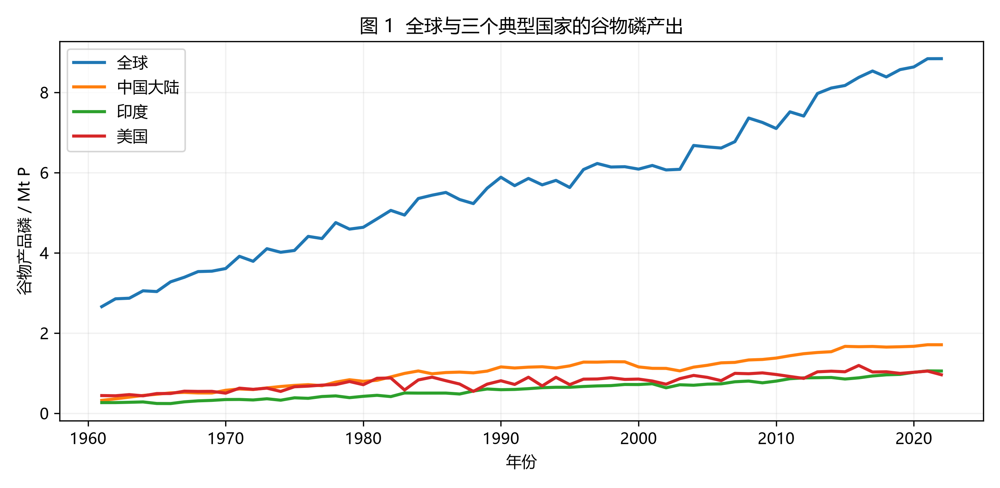
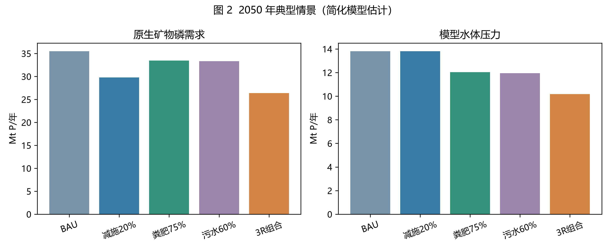
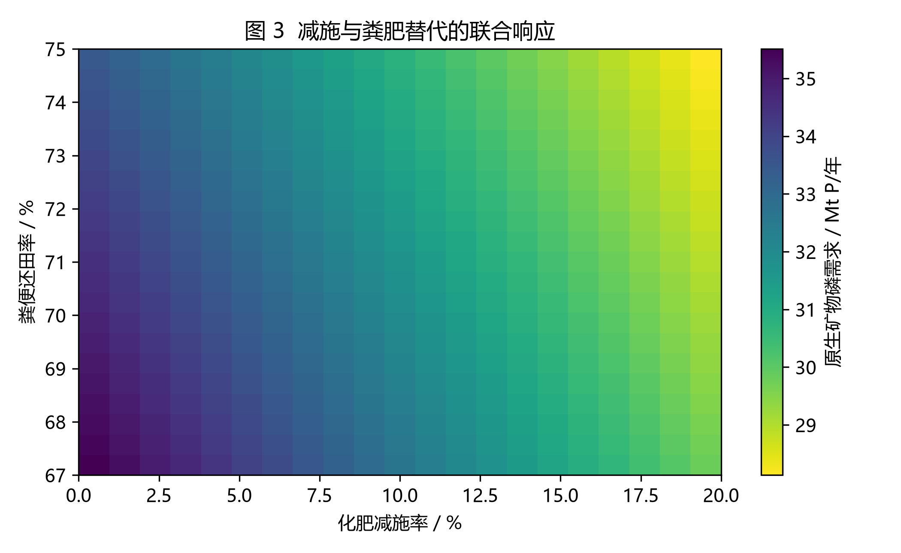
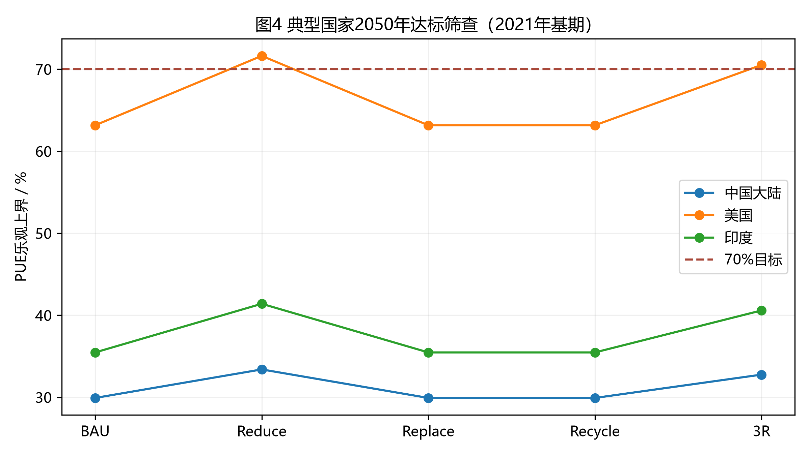

# 全球人为磷循环典型案例复算与3R管理情景分析

《环境规划与管理》第十五讲实训作业

## 一 研究目的与计算范围

磷既是农业生产必需养分，也是水体富营养化的重要驱动因素。Liu等构建了从磷矿开采到生产、消费和废弃物处理的全过程物质流框架，指出单独增加资源供应不能解决低利用效率和废弃物流失问题[1]。本作业依据课程任务书，完成历史序列整理、面向对象预算、守恒检查、桑基图以及2050年3R情景与交互回归。

考虑教师允许仅计算典型案例，历史分析选择全球及中国大陆、美国、印度，原始产量换算选择水稻、小麦、玉米。三种作物2022年全球收获物磷合计7.425 Mt P，占源表谷物类别磷产出的84.0%，能够覆盖谷物磷流的主要部分。政策比较保留BAU、减施、粪肥替代、污水回收及3R组合，不穷举35国和论文全部情景。

本次五子系统模型属于简化年度预算。它利用实际产出数据和文献系数，补充少量明确列示的分配假设与残差项；其数值不能替代论文完整模型的精确复现。国家案例补充采用2021年同年数据进行2050年农田PUE乐观上界筛查，不冒充完整国家模型。

## 二 数据整理与纯磷换算

生产及贸易历史表使用1961—2022年列，地区分别筛选，全球仅取World行，避免与洲际或国家汇总重复相加。源表已采用吨纯磷，不能再次乘含磷率。另将2022年三种作物的Production记录与含磷率字典按产品名称连接，按“产量×磷质量分数”得到纯磷吨数，再除以10⁶转为Mt P。

实际字典中的小麦、水稻、玉米系数分别为0.00341、0.00282、0.00213 t P/t，等价于3.41、2.82、2.13 g P/kg[2]。因此，全球小麦8.0844亿吨乘0.00341得到2.7568 Mt P，不能再除以1000。印度1961、1962年进口类别存在缺报，保留NA，未以零值替代。表1列示独立连接换算结果，图1展示完整历史变化。

表1 典型作物2022年收获物磷含量（Mt P）

| 地区 | 玉米 | 水稻 | 小麦 |
| --- | --- | --- | --- |
| 全球 | 2.4782 | 2.1896 | 2.7568 |
| 中国大陆 | 0.5904 | 0.5880 | 0.4696 |
| 美国 | 0.7428 | 0.0205 | 0.1531 |
| 印度 | 0.0718 | 0.5534 | 0.3674 |

表2 典型国家2022年产品磷与贸易特征（Mt P）

| 地区 | 谷物磷 | 动物产品磷 | 净进口磷 |
| --- | --- | --- | --- |
| 中国大陆 | 1.7057 | 1.7074 | 0.7962 |
| 印度 | 1.0508 | 0.4898 | -0.1659 |
| 美国 | 0.9578 | 0.4315 | -0.6046 |

表2净进口为产品贸易磷的进口减出口，不能直接解释为污染排放。中国大陆应关注输入饲料和养殖排泄物的区域衔接；美国应关注谷物生产端养分输出及面源损失；印度应同时检验养分供给和利用效率，不能把全球统一减肥比例直接推广到所有农田。

## 三 五子系统预算与守恒

模型包括磷矿开采PMS、磷化工CIS、农田种植ACS、畜禽养殖LBS和居民消费RCS。食品加工并入消费端，水产和林业未单独展开。所有流量统一为Mt P/年；土壤净积累单列，不与水体损失混淆。

ACS接收化肥、粪肥、人源回收磷、沉降与秸秆还田，输出收获物、未还田秸秆和水体流失，差额记为土壤净积累。2022年输入36.490，初级植物收获物14.127，含典型秸秆的吸收量18.663，水体流失3.367，土壤净积累14.460。秸秆回流在子系统两侧同时出现，在外边界求和时消去。

守恒按“绝对输入输出差额扣除库存变化，再除以输入加10⁻⁶”计算，阈值严格小于10⁻⁴。表3同时列示各子系统与外边界结果。共享内部流另作一致性检查，向测试节点注入10%不平衡后能够触发报错。由于部分流量采用残差闭合，零误差仅表示预算自洽，不能证明绝对流量已经获得独立观测验证。

表3 2022年物质平衡（Mt P/年）

| 系统 | 输入 | 输出 | 库存变化 | 相对误差 |
| --- | --- | --- | --- | --- |
| PMS | 29.4744 | 29.4744 | 0.0000 | 0.00e+00 |
| CIS | 26.5269 | 26.5269 | 0.0000 | 0.00e+00 |
| ACS | 36.4900 | 22.0302 | 14.4598 | 0.00e+00 |
| LBS | 23.9555 | 23.9555 | 0.0000 | 0.00e+00 |
| RCS | 16.7881 | 16.7881 | 0.0000 | 0.00e+00 |
| External_boundary | 49.4356 | 34.9758 | 14.4598 | 2.16e-16 |

[打开2022年交互桑基图](figures/sankey_2022.html)。图中保留粪肥、人源磷和秸秆回流，矿业残余、土壤积累及水体压力分别显示。

## 四 2050年典型3R情景

配套人口表实际为联合国WPP 2024，而非SSP数据。全球7月1日人口由2022年80.214亿增至2050年96.644亿，倍率为1.2048。按人均消费结构不变外推需求，耕地面积和单位面积流失系数保持不变。BAU化肥量为24.699 Mt P，比论文26.9 Mt P低8.18%；差异与人口版本、需求外推路径及边界简化有关。

Reduce设为化肥减施20%；Replace将粪便还田率从67%提高至75%；Recycle从尚未直接还田的人源排泄磷中回收60%，视为鸟粪石等再生磷的技术替代潜力。组合情景先扣除新增回收替代，再对剩余化肥减施，以避免重复计入节约量；作物和动物产品需求保持不变。

表4 2050年情景结果（Mt P/年；均为简化模型估计）

| 情景 | 化肥磷 | 矿物磷需求 | 水体压力 | 土壤净积累 |
| --- | --- | --- | --- | --- |
| BAU | 24.6989 | 35.5114 | 13.8121 | 17.9823 |
| Reduce | 19.7591 | 29.7813 | 13.8121 | 13.0425 |
| Replace | 22.9210 | 33.4490 | 12.0342 | 17.9823 |
| Recycle | 22.8321 | 33.3460 | 11.9453 | 17.9823 |
| 3R组合 | 16.8434 | 26.3990 | 10.1674 | 13.7714 |

3R组合相对BAU减少化肥31.81%、矿物磷需求25.66%和模型水体压力26.39%。单独减施并未改变水体压力，因为本模型农田水损失由固定面积系数确定，其主要效果表现为减少土壤积累和上游矿业负荷。该结果是模型结构所致，不能解释为现实减肥对水质无效。

## 五 交互回归与论文基准对照

采用三变量各5个水平、共125点的小规模设计，因变量改为农田PUE（收获物磷/农田总磷输入），不再将土壤库存并入总磷流失。变量先均值中心化，再构造乘积项并Z-score标准化，按显著性和交互系数方向解释。表5中节肥与粪肥、节肥与污水回收均为负交互，表明两项措施共享化肥替代空间，联合节约小于单措施效果简单相加。正的总减排效果与负交互项可以同时成立。

表5 政策响应面的标准化回归

| 变量 | 标准化系数 | p值 | 解释 |
| --- | --- | --- | --- |
| Reduce | 0.9967 | <1e-12 | 主效应 |
| Replace | -0.0409 | <1e-12 | 主效应 |
| Recycle | -0.0430 | <1e-12 | 主效应 |
| Reduce*Replace | -0.0305 | <1e-12 | 拮抗削弱 |
| Reduce*Recycle | -0.0321 | <1e-12 | 拮抗削弱 |
| Replace*Recycle | 0.0002 | 0.9454 | 无显著交互 |

政策回归R²=0.99893，表示125个确定性情景的二阶近似拟合，p值不能作为现实政策因果证据。节肥与粪肥替代交互系数为-0.03055，p=8.83e-18，属于拮抗。单独回收等量替代化肥时总投入不变，所以PUE不变；组合中回收先减少可减施化肥，导致PUE增益小于单独减施。这不否定回收的资源与水体收益。历史产品类别回归另存输出，未将其当作政策效应。

表6 独立核算与基准偏差（流量单位Mt P；化肥占比单位%）

| 指标 | 本次计算 | 参照值 | 相对偏差% |
| --- | --- | --- | --- |
| 2022全球谷物磷 | 8.8115 | 8.8390 | -0.3113 |
| 2022全球动物产品磷 | 5.4943 | 5.5098 | -0.2806 |
| 1961全球矿物磷肥 | 4.8165 | 4.9000 | -1.7034 |
| 2022 ACS化肥占比 | 56.1797 | 64.0000 | -12.2192 |
| 2050 BAU化肥 | 24.6989 | 26.9000 | -8.1826 |

谷物和动物产品分别由2022年原始产量乘字典系数重建，对照课程汇总表；这属于同源处理链核验。1961年化肥由国家P₂O₅记录汇总乘0.4364，对照论文约数4.9。三项偏差均小于3%，但不能代表所有指标达标。ACS化肥占比与BAU化肥仍偏低，保留误差，不以调参消除；64%为下限参照。全部任务书基准及未复算项列于量规附件。

表7 典型国家2050年PUE乐观上界（%，养殖PUE假设23%）

| 地区 | BAU | Reduce | Replace | Recycle | 3R |
| --- | --- | --- | --- | --- | --- |
| 中国大陆 | 29.9100 | 33.3872 | 29.9100 | 29.9100 | 32.7524 |
| 印度 | 35.4599 | 41.3917 | 35.4599 | 35.4599 | 40.5780 |
| 美国 | 63.1590 | 71.6222 | 63.1590 | 63.1590 | 70.5121 |

国家基期统一为2021年，避免将末年化肥冒充2022年；按各国2021—2050年人口倍率放大产出和投入。已知投入计化肥、估算粪肥和人源回收，未计种子、沉降及秸秆，故所得是PUE上界。中国与印度在该假设下未达70%；美国3R上界70.51%，但只容许另外0.0213 Mt P投入，不能确认真实达标。养殖PUE取16%、23%、30%的45组筛查已输出，国家结论受此假设影响。论文中国达标而此处未达，主要涉及完整措施、国家养殖参数与边界差异，不能以全球平均23%替代国家校准。

论文图4A核实S4.3的NPR约−22.1%、CFR约−76.9%；补充文字存在归属不一致，以明确图格及正文交叉核对。课堂75%回用与论文100%不同。论文S5、35国8/17达标等仅作阅读基准，没有伪称完成全部复现。

## 六 环境规划建议与研究限制

第一，建立化肥与再生磷联合预算。按本模型2050年新增粪肥替代约1.778 Mt P、污水回收约1.867 Mt P的量级，分别核查可消纳土地与处理设施；回收量必须同步计入施肥总量，防止回收增加而化肥不减。

第二，将国家筛查用于确定核查重点：美国优先核对遗漏投入是否超过0.0213 Mt P，中国与印度优先校准国家养殖效率及养分收支。将土壤检测作为减施前提。优先在磷盈余区域开展减施与种养衔接，在磷不足地区保障作物养分需求；不能仅以全球平均20%作为统一行政指标。实施考核分别记录化肥投入、作物移除、土壤盈余及实际入水负荷。

第三，对污水回收开展分区技术经济评估。本次60%是可回收磷的情景比例，未核算镁盐、能耗、污染物限值、运输成本和季节供需。应优先选择高浓度、稳定运行且邻近消纳农田的设施，再验证等量替代假设。

本作业的可靠结论是典型产品换算、预算守恒和既定假设下的相对变化，而非真实世界的精确预测。养殖效率、采矿收得率、饲草和消费残余均需进一步校准；所有论文原值、输入参数和本次输出已分别标识，未用论文百分比硬编码结果。

## 参考文献与数据

[1] Liu W, et al. Future strategies for phosphorus sustainability amid worsening global cycle imbalances. PNAS, 2026, 123(13): e2512673123. [论文及补充材料](https://doi.org/10.1073/pnas.2512673123)。

[2] Liu W. Global-scale raw data sets on production, trade and consumption of phosphorus-containing products. [Dryad数据](https://doi.org/10.5061/dryad.bzkh189n2)，本次使用课程随附版本。

[3] United Nations, DESA, Population Division. World Population Prospects 2024. 使用课程随附人口工作簿的Estimates与Medium variant。

[4] 《环境规划与管理》第十五讲实训任务书及配套资料。[课程目录](https://github.com/whu-course-EnvironPlanManag/LCA_Practice_Coursework-2026fall/tree/main/starter_materials/lecture15-20261117-Journal_Article2)。

详细计算口径、参数出处、材料覆盖和复现限制见[方法与数据核查](方法与数据核查.md)。数表由[模型代码](model.py)及[补充核验代码](enhancements.py)生成。考核证据及剩余限制见[量规逐项对照](量规逐项对照.md)。
