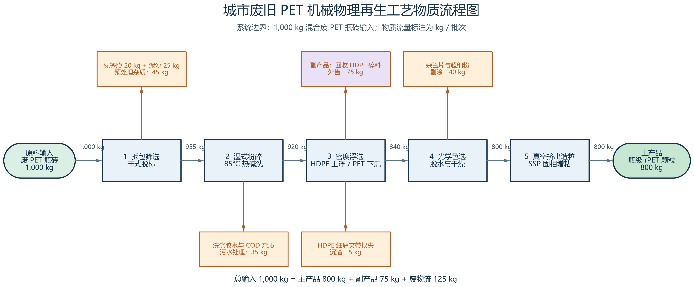

# 案例一作业报告：废旧 PET 再生的 MFA-LCA-TEA 联动与 100% 绿电情景

**小组：** group-02
**个人分支：** `dev-group-02-帕娜尔`
**功能单位：** 生产 1 t 瓶级 rPET 颗粒（Cradle-to-Gate）
**流程图选型：** 选项 A，使用 `schemdraw` 绘制方框工艺流程图

## 1. 交付内容与复现方法

- `plot_mfa_process.py`：读取随附案例 CSV，核验 MFA 质量守恒，计算基准与绿电情景，并生成工艺流程图。
- `process_flow_diagram.png`：300 dpi 高清流程图。
- `process_flow_diagram.svg`：矢量版流程图。

在课程案例 Conda 环境中运行：

```powershell
conda activate mfa_lca_tea
python -m pip install schemdraw
python .\plot_mfa_process.py
```

脚本从相邻的 `case_files/data_cohort/` 读取原始数据，不依赖当前工作目录；脚本会在本目录生成 PNG 和 SVG。

## 2. MFA 物质平衡

以 1,000 kg 废 PET 瓶砖为控制体。按 `mfa_mass_balance.csv`：

| 输出流 | 质量 (kg) | 去向 |
|---|---:|---|
| 废标签膜 | 20 | 焚烧处置 |
| 表面泥沙 | 25 | 筛分残渣 |
| 胶水及 COD 杂质 | 35 | 厂内污水处理 |
| HDPE 细屑损失 | 5 | 沉渣处置 |
| 杂色片与超细粉 | 40 | 降级利用或处置 |
| 副产品：回收 HDPE | 75 | 外售 |
| 主产品：瓶级 rPET | 800 | 目标产品 |
| **合计** | **1,000** | **与输入相等** |

质量守恒：`1,000 kg 输入 = 1,000 kg 输出`。主产品总收率为
`800 / 1,000 = 80.0%`，每吨 rPET 需废瓶砖 `1 / 0.8 = 1.25 t`。

## 3. 任务 1：100% 绿电情景 LCA

### 3.1 清单调整与计算

按 `lci_emission_factors.csv` 的基准清单，只将电力排放因子从
`0.55` 改为绿电的 `0.03 kg CO₂e/kWh`；功能单位电耗仍为 `850 kWh`。
其余清单项维持案例给定值：

| 生命周期清单项 | 基准 (kg CO₂e/t) | 绿电情景 (kg CO₂e/t) | 计算说明 |
|---|---:|---:|---|
| 瓶砖运输 | 150.00 | 150.00 | 1,250 kg × 0.12 kg CO₂e/kg |
| 生产电力 | 467.50 | 25.50 | 850 kWh × 0.55（基准）或 0.03（绿电） |
| 天然气蒸汽 | 130.00 | 130.00 | 2.0 GJ × 65 |
| 烧碱 | 31.50 | 31.50 | 15 kg × 2.10 |
| 新鲜水 | 0.95 | 0.95 | 2.5 m³ × 0.38 |
| 污水处理 | 6.05 | 6.05 | 2.2 m³ × 2.75 |
| HDPE 避免负荷信用 | -150.00 | -150.00 | -93.75 kg × 1.60 |
| **净 GWP** | **636.00** | **194.00** | **逐项求和** |

因此：

```text
GWP_green = 636.00 + 850 × (0.03 - 0.55)
          = 194.00 kg CO₂e/t rPET
```

相对原生 PET 基准 `2,250 kg CO₂e/t`：

```text
减排量 = 2,250 - 194 = 2,056 kg CO₂e/t
减排率 = 2,056 / 2,250 × 100% = 91.38%
```

这里按题目要求保留原清单中的运输、公用工程、药剂、污水和副产品信用，仅改变电力排放因子。若绿电供应导致其他生命周期清单变化，需另有数据再更新。

## 4. 任务 1：绿电溢价与 TEA

`tea_cost_parameters.csv` 给出的基准 LCOP 为 `6,153.4 元/t`，工业电价为
`0.65 元/kWh`。题目设定绿电价格上浮 `0.05 元/kWh`，功能单位用电量为
`850 kWh/t`：

```text
绿电增量成本 = 850 × 0.05 = 42.50 元/t
LCOP_green = 6,153.4 + 42.5 = 6,195.90 元/t
LCOP 增幅 = 42.5 / 6,153.4 × 100% = 0.69%
```

该计算只把新增电价溢价计入原基准 LCOP，不改变其他 OPEX、CAPEX、产量和副产品收入。若完整成本结构发生变化，应基于更新后的 TEA 清单另行重算。

### 绿色低碳溢价定价与营销建议

1. **设定可核验的溢价底线**：以 `42.50 元/t` 作为覆盖绿电电价增量的最低单位溢价；报价还应考虑认证、审计、交易和合同履约成本，不能将这 `42.50 元/t` 误称为完整的绿电产品价值。
2. **采用分层、可追溯的长期合同**：对有范围 2 减排目标的饮料品牌提供批次级电力来源凭证、能耗与产品碳足迹数据，并将绿电比例、核算边界、审计和环境声明要求写入长期采购协议。
3. **用情景数据支持溢价沟通**：在本案例边界下，绿电令净足迹从 `636` 降至 `194 kg CO₂e/t`。与客户共同确认基准、功能单位和核算边界后，再协商分享减排价值的溢价，而非仅靠“绿色”标签定价。

## 5. 任务 1：收率降至 70% 的敏感性分析

### 5.1 MFA 与产能影响

收率从 `80%` 降至 `70%` 后：

```text
每吨 rPET 原料需求：1 / 0.70 = 1.4286 t
相对原情景原料增幅：(1.4286 / 1.25 - 1) × 100% = 14.29%
```

若仍生产 `16,000 t/y` rPET，原料需求由 `20,000` 增至约 `22,857 t/y`；
若瓶砖供应/处理量仍限定为 `20,000 t/y`，产量将降至约 `14,000 t/y`。
二者分别代表保持产品目标和保持原料规模的两种约束。

### 5.2 LCA 方向与可计算边界

讲义没有提供 70% 收率情景的新组分流向，也没有给出新增杂质对电力、蒸汽、药剂、污水和固废处置的单位影响，因此不能仅凭现有资料精确计算实际新 GWP。为给出透明的**一阶敏感性**，先保持每吨产品的用电及其他清单项不变，并将原料运输随原料需求按比例放大：

```text
运输排放增量 = 150 × (1.4286 / 1.25 - 1) = 21.43 kg CO₂e/t
```

若保守地把 HDPE 避免负荷信用固定为 `-150 kg CO₂e/t`，则绿电情景估算为
`194 + 21.43 = 215.43 kg CO₂e/t`，比 80% 收率绿电情景高约 `11.05%`。
若进一步假设 HDPE 回收量也严格按每吨瓶砖的原基准比例增加，则该副产品信用会随原料量同比增加；基准运输项 `+150` 与 HDPE 信用 `-150` 在这组因子下恰好抵消，计算结果仍为 `194 kg CO₂e/t`，但**尚未计入**额外杂质处置及新增加工负荷。该结果不是对真实高杂质原料情景的预测，真实 GWP 需要补充扰动后的质量平衡和工艺数据。

### 5.3 TEA 方向与一阶估算

保持基准 LCOP 中除原料以外的单吨成本不变、暂不改变副产品收入时：

```text
80% 收率原料费 = 1.25 × 4,200 = 5,250 元/t
70% 收率原料费 = 1.4286 × 4,200 = 6,000 元/t
原料费增加 = 750 元/t
LCOP_green,70% ≈ 6,195.90 + 750 = 6,945.90 元/t
相对 80% 收率绿电 LCOP 增加 = 750 / 6,195.90 × 100% = 12.10%
```

若另行假设 HDPE 副产品按每吨瓶砖的基准回收量同步增加，则 70% 收率下每吨产品对应约 `107.14 kg` HDPE，收入约 `482.14 元/t`；按 MFA 质量平衡算出的基准收入约 `421.88 元/t`，于是 LCOP 一阶估算约为 `6,885.63 元/t`。由于杂质率升高是否会影响 HDPE 回收量并无题给数据，主结果仍采用固定副产品收入的 `6,945.90 元/t`。两种情景均未计入额外能耗、药剂、污水、废物处置或设备瓶颈成本，实际 LCOP 可能更高。城市源头分类质量下降还可能同时提高分选残渣、降低合格品率并压缩产能，因此优先改善分类纯度通常比单纯采购更多瓶砖更能降低全链条成本和足迹。

## 6. 任务 2：选项 A 工艺物质流程图

使用 `schemdraw` 按案例边界绘制线性工艺方框图，展示五个单元操作，以及脱标杂质、洗涤残渣、HDPE 副产品、夹带损失和光选残渣支流。主流程及分流质量取自 MFA CSV，输出的 PNG 为 300 dpi，同时提供可缩放 SVG。



## 7. 计算限制与复核说明

- `plot_mfa_process.py` 会校验 CSV 中输入/输出质量守恒、LCI 活动量乘排放因子与行排放量的一致性，并以 CSV 中记录的基准 LCOP 为成本起点。
- 报告采用资料给出的 80% 基准收率、LCI 清单、单位 LCOP 和绿电情景边界。70% 收率没有完整扰动数据，因此敏感性结果明确标为一阶估算，不作为精确预测。
- 作业文件位于 `starter_materials/lecture9-20261022-classroom_case1/code_implementation/`，工作分支为 `dev-group-02-帕娜尔`；未使用 `group-test`。
