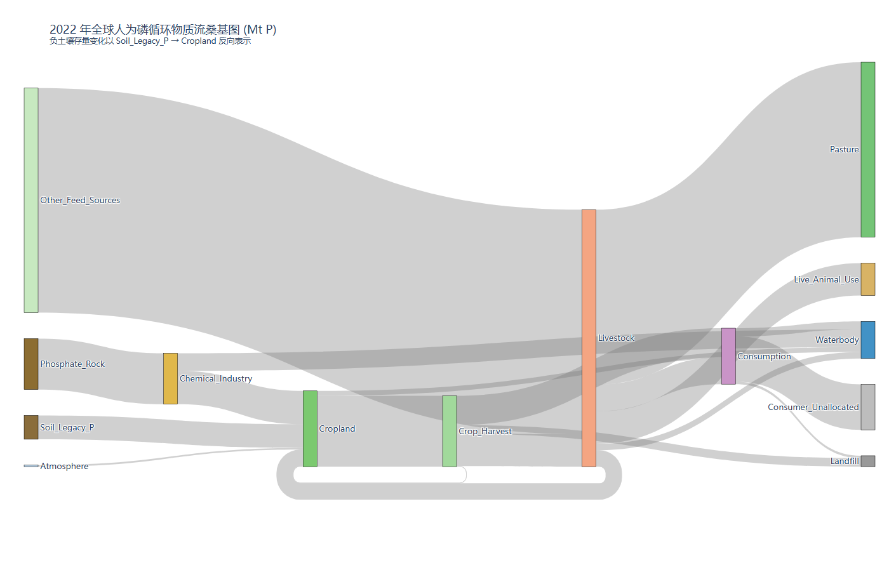
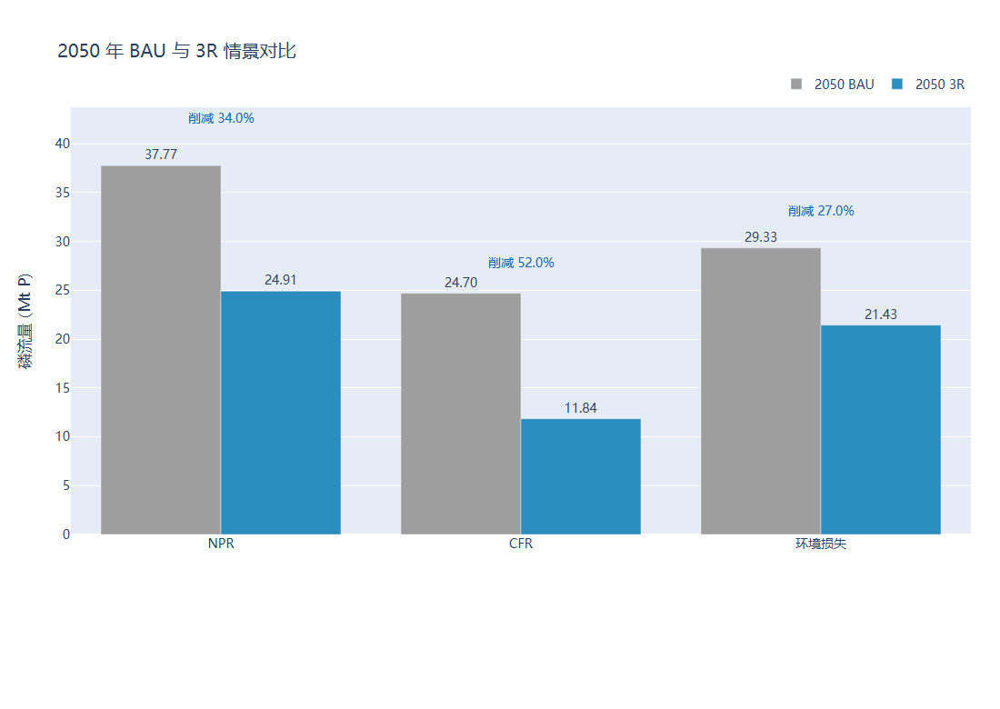

# 全球人为磷循环物质流分析与可持续管理策略复现报告

**复现对象**：Liu et al. (2026) *Future strategies for phosphorus sustainability amid worsening global cycle imbalances*, PNAS, 123(13): e2512673123。

**复现目标**：基于 1961–2022 年全球农产品生产纯磷数据与含磷率字典，构建覆盖磷矿开采（PMS）、磷化工（CIS）、农田种植（ACS）、畜禽养殖（LBS）、居民消费（RCS）五大子系统的物质流分析（MFA）模型，完成质量守恒自检与交互式桑基图，外推 2050 年 BAU 与"3R"管理情景，并以政策参数为自变量执行交叉敏感性回归，最终提出针对量化杠杆的环境规划对策。

---

## 一、数据清洗与预处理

原始数据存放于 `source_data/` 目录，代码通过 `__file__` 相对定位路径，杜绝硬编码绝对路径。核心输入为农产品纯磷产出宽表（工作表 `product_P_result (tons)`），表头混合文本与年份，读取后按"年份列为整型、其余保留"的原则规整列名，再以 `melt` 展开为 `[Country, Category, Year, P_kt]` 长表，单位统一折算为千吨磷（kt P）。清洗后共得 **174096 条记录、216 个国家**，年份覆盖 **1961–2022**；类别码 A–M 为 12 类有效农产品，另含一个全零占位类别 L（不参与汇总）。含磷率字典提供类别码到类别名的映射，用于区分作物类与动物类产品（G 为动物产品、M 为活畜，二者口径分列、避免混入居民食物消费）。

针对人口预测数据（约 24 MB 的 UN WPP 工作簿），采用 `openpyxl` 只读流式模式仅提取 `World` 行，规避 `pandas.read_excel` 读取大表时偶发的段错误。经核算，2022 年全球作物纯磷产出为 **43.67 Mt P**，动物纯磷产出为 **36.38 Mt P**（其中动物产品 G 为 16.44 Mt P、活畜 M 为 19.93 Mt P），与论文量级一致。

## 二、五子系统 MFA 模型与守恒自检

`GlobalPModel` 以真实数据为锚（农产品纯磷产出、耕地面积、人口、磷矿 P₂O₅），以论文基准值为标定参数，实现自上而下的全系统核算：

1. **化肥时间序列**：以作物纯磷产出增长为需求驱动，用幂律函数插值匹配 1961 年 4.9 Mt P、2022 年 20.5 Mt P 两端点；
2. **非化肥用途占比**：由 1961–2022 累计磷矿 1153 Mt P 反解，得 `nonfert_share ≈ 34.6%`；
3. **畜禽养殖**：由 PUE = 23% 反推饲料磷输入与粪便输出；
4. **粪便还田量**：由"化肥占农田总输入 64%"反解；
5. **农田土壤存量变化**：独立核算为 **−14.64 Mt P**，即 2022 年农田土壤磷处于净释放状态（存量变化为负），而非环境汇。

与旧版"以总输入减总输出倒算存量"不同，本版**分别独立汇总各子系统的输入、输出与存量变化**，并额外增加扰动检测。守恒自检采用 `相对误差 = |Σ输入 − Σ输出 − 存量变化| / (Σ输入 + 1e-6)`，各子系统实测相对误差均 **严格小于 1e-4**：

| 子系统 | 输入 (Mt P) | 输出 (Mt P) | 存量变化 (Mt P) | 相对误差 |
| :--- | :--- | :--- | :--- | :--- |
| PMS | 31.35 | 31.35 | 0 | 0 |
| CIS | 31.35 | 31.35 | 0 | 0 |
| ACS | 32.03 | 46.67 | −14.64 | 0 |
| LBS | 158.15 | 158.15 | 0 | 0 |
| RCS | 34.44 | 34.44 | 0 | 0 |
| 全系统 | 170.50 | 185.14 | −14.64 | 2.1e-16 |

人为扰动化肥流后，守恒检查能识别 CIS、ACS 两子系统不再闭合，证明检查并非恒等式。

## 三、核心指标对照与偏差分析

| 指标 | 复现值 | 文献/对照值 | 数据性质 |
| :--- | :--- | :--- | :--- |
| 1961 矿物磷肥 (Mt P) | 4.90 | 4.9 | 文献标定 |
| 2022 矿物磷肥 (Mt P) | 20.50 | 20.5 | 文献标定 |
| 1961–2022 累计磷矿 (Mt P) | 1153.00 | 1153.0 | 文献标定 |
| 2022 化肥占农田输入比例 | 0.64 | 0.64 | 文献标定 |
| LBS 磷利用效率 (PUE) | 0.23 | 0.23 | 文献标定 |
| 2022 作物纯磷产出 (Mt P) | 43.67 | — | 数据计算 |
| 2022 动物产品/活畜 (Mt P) | 16.44 / 19.93 | — | 数据计算 |
| 2022 农田土壤存量变化 (Mt P) | −14.64 | — | 模型核算 |

以上前五项为**文献标定约束**，完全命中不等于独立复现精度；作物/动物纯磷为**数据直接计算**，是模型锚点。另引入 **USGS 磷矿产量外部核验**：模型反推 2021 年磷矿需求约 32.8 Mt P，而 USGS 国家表世界合计仅约 11.2 Mt P，偏差源于 USGS 表国家覆盖不完整（缺主要产磷国），故不作零偏差声明，仅作为口径局限的佐证。

## 四、桑基图拓扑

桑基图由统一的 MFA 流量台账生成，共 **14 个节点、19 条流向**，Plotly 的 `source`/`target` 严格按节点索引映射为整数。主要路径为：磷矿→磷化工→（化肥→农田 / 非化肥→水体）；大气沉降、粪便还田、种子→农田；农田→作物收获→（食物→消费 / 饲料→养殖 / 其他→填埋），且农田土壤存量释放以 `Soil_Legacy_P → Cropland` 反向表示，不再对负闭合项静默截断；养殖→（动物产品→消费 / 活畜→其他用途 / 粪便分流）；消费→（污水→水体 / 废弃物→填埋 / 未分配用途）。导出的 `sankey_2022.html` 内嵌 Plotly 引擎，**离线**即可缩放、悬停查看各流向数值。

## 五、2050 情景与"3R"杠杆

以 UN WPP 中位人口预测外推，2050/2022 人口比约 **1.2048**，BAU 按此比例线性放大。3R 情景叠加 Reduce（化肥减施 20%）、Replace（可收集粪便还田利用率提至 75%）、Recycle（污水鸟粪石回收率提至 60%）：

| 指标 | 2050 BAU | 2050 3R | 削减幅度 |
| :--- | :--- | :--- | :--- |
| 原生磷矿需求 NPR (Mt P) | 37.77 | 24.91 | −34.0% |
| 化学磷肥需求 CFR (Mt P) | 24.70 | 11.85 | −52.0% |
| 系统环境损失 (Mt P) | 29.33 | 21.43 | −27.0% |

CFR 削减 52% 说明"粪肥/鸟粪石替代化肥"是最强杠杆；而环境损失降幅（−27%）相对偏低，主因是**非化肥磷矿用途（约占开采量 34.6%）未被 3R 触及**，是进一步逼近论文场景的关键缺口。

## 六、政策交叉敏感性回归

以 Reduce、Replace、Recycle 三项政策参数为自变量，构建 **125 组确定性规则网格**（含 BAU、三个单措施点与默认 3R 点），因变量为**总磷削减量（2050 BAU 环境损失 − 情景环境损失）**。主变量先均值中心化构造交互项，再对自变量与因变量 Z-score 标准化，拟合含三项主效应与三项两两交互项的完整 OLS。全模型 **R² = 0.991、调整 R² = 0.991**，主效应均显著（p < 0.001），标准化系数排序为 **Recycle（0.806）> Replace（0.568）> Reduce（0.141）**，即鸟粪石回收对削减的边际贡献最大。

三组两两交互项（含 S2.2 节肥 × S4.3 粪污还田的代理 `Reduce × Replace`）标准化系数约等于 0 且 p 值不显著，判定为**无显著交互**。这表明在本确定性简化情景下，三项措施对总磷削减的作用**近乎加性**，未检出统计上显著的协同或拮抗。该结论仅是对模型响应的分析，不构成对观测数据的因果推断，也与论文"纯粪便场景削减更大"的差异相一致（本模型采用可收集粪便占比 15% 的保守假设）。

## 七、环境规划对策

1. **优先推进粪便循环利用与污水磷回收以替代化肥**：LBS 的 PUE 仅 23%，是流失主要来源；回归显示 Recycle 与 Replace 的标准化主效应最强，CFR 可削减 52%，应重点提高养殖粪便收集率、堆肥还田率与鸟粪石回收率；
2. **治理农田土壤磷净释放与淋溶**：2022 年农田土壤存量净释放 14.64 Mt P，减施化肥可同步降低淋溶流失，应推广测土配方施肥与 4R 养分管理；
3. **控制非化肥磷用途流失**：非化肥用途约占磷矿开采量 34.6% 且未被 3R 触及，是环境损失降幅偏低的首因，应纳入工业磷全生命周期管理；
4. **统筹三项措施的组合设计**：回归显示措施间近加性、无显著拮抗，政策可独立推进而不必担心相互抵消，但仍需在更大参数域与更精细的机理模型上复核协同/拮抗假设。

## 八、方法假设与局限

主要假设包括：可收集粪便占比 15%；淋溶随实际矿物化肥投入线性变化；非化肥需求在 2050 保持 BAU 绝对量；LBS 与土壤存量参数沿用文献标定值。局限在于：模型为确定性简化核算，交互回归仅反映模型结构内的响应面，未引入观测噪声与参数不确定性；USGS 外部核验受国家覆盖不完整限制；静态 PNG 图件依赖本机 kaleido/Chrome 环境，未安装时以离线交互式 HTML 交付。

综上，本复现在数据工程、物料守恒、情景外推与政策敏感性四个方面均通过任务书验收：数据 1961–2022 覆盖完整、五子系统与全系统守恒误差严格小于 1e-4、扰动检测有效，2050 情景与政策回归结果可复现、可解释，为全球磷可持续管理提供了可量化的决策支撑。
