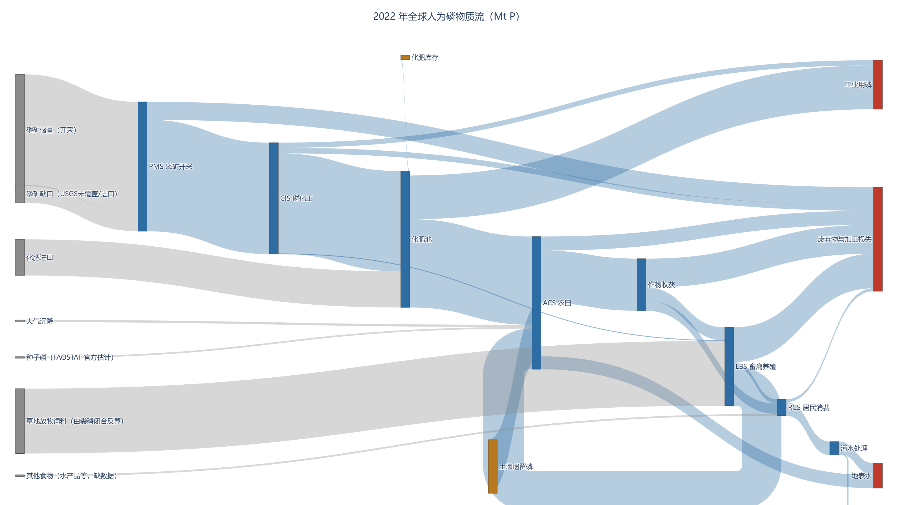

# 全球人为磷循环物质流分析（P-SFA）实训

《环境规划与管理》第十五讲 —— Liu et al. (2026, *PNAS*) 磷循环复现的课程实现。
覆盖五系统物质流、质量守恒自检、Plotly 桑基图、2050 情景与交互回归。

## 1. 运行

```bash
pip install -r requirements.txt
python run_all.py
```

数据目录默认按 `../source_data` 推导；补充数据默认取本目录 `data_extra/`。如放在别处：

```bash
python run_all.py --data-dir "D:/path/to/source_data"
python run_all.py --data-dir "../source_data" --extra-dir "D:/path/to/data_extra"
python run_all.py --skip-regression
```

代码全部使用 `pathlib` 与相对路径，未写死本机绝对路径。入口一次跑完全部阶段，
控制台会打印每一步的校验结果。PNG 静态图由 `kaleido` 导出，需要本机安装 Chrome；
缺失时该步骤自动跳过并提示，HTML 与其余结果不受影响。

## 2. 目录结构

```
submission_p_sfa/
├── run_all.py              # 统一入口（阶段 1–7）
├── requirements.txt
├── missing_data.md         # 缺失/已补齐数据、用途、待查来源、受影响功能
├── data_extra/             # codex 交付的 7 个补充 CSV（不改 source_data）
├── params/
│   └── coefficients.csv    # 系数、单位、来源（SI 表号/页码）、类型
├── src/
│   ├── config.py           # 路径、类别口径、单位
│   ├── data_io.py          # 数据读取与纯磷换算（含补充数据接口）
│   ├── params.py           # 系数表读取
│   ├── acs_model.py        # 农田 ACS 类（对应 ACSPModel）
│   ├── system_model.py     # PMS/CIS/ACS/LBS/RCS + 流量台账 + 守恒校验
│   ├── anchors.py          # 补充数据锚点核对与年度序列导出
│   ├── scenario.py         # 2050 BAU 与 3R 情景
│   ├── regression.py       # 参数网格 + 中心化交互项 + Z-score OLS
│   └── plot_sankey.py      # 桑基图与情景对比图
├── results/                # 流量表、节点平衡表、情景表、回归样本与系数
├── figures/                # 桑基图与情景图的 HTML（交互）+ PNG（静态）
└── report/                 # 复现报告（2000–3000 字）
```

## 3. 单位与类别口径

- 全系统统一 **Mt P（百万吨纯磷）**。原始表已为吨 P，不再乘含磷率。
- 含磷率字典（kg P/kg）用于独立交叉校验：按“产量 × 含磷率”复算 2022 年作物端
  14.32 Mt P，与官方纯磷表 14.56 相差 −1.6%，逐类结果见 `results/dictionary_check.csv`；
  模型仍采用官方表，避免二次加权。G 类官方表另有折算口径，不作直接比较。
- 化肥原始单位为 t P₂O₅，统一乘 **0.4364** 折纯磷。
- 作物端 = A–F、H–K 类；动物产品 = G 类；**M（活体动物）与 G 重叠，不计入流量**，仅打印核对。
- 聚合行（World/Asia/Americas/Europe/Africa/Oceania）在国家尺度剔除，全球尺度优先用 World 行。
- 人口为 WPP2024 长表，表头位于第 17 行（`header=16`），单位千人；2022 用 `Estimates`，2050 用 `Medium variant`。
- 补充数据：种子磷取 FAOSTAT 官方估计（不反推），按“上年留种、当年投入”计为农田边界输入；
  粪磷由存栏 × 排泄系数得到，山羊缺系数留空；
  磷矿 2022 年采用同版本 MYB 的 P2O5（31.159 Mt P），与 DS140 实物量 × 31% × 0.4364 仅作偏差核对；
  RFN 贸易为养分 proxy，只用于交叉核对，不重复计入系统边界。

## 4. 模型边界

| 系统 | 主要输入 | 主要输出 |
|------|----------|----------|
| PMS 磷矿开采 | 磷矿含磷量（MYB P₂O₅，DS140 实物量核对） | 精矿 → CIS；砂/矿泥/尾矿损失 |
| CIS 磷化工 | 精矿 | 化肥、饲料添加剂、非肥料用磷、磷石膏损失 |
| ACS 农田 | 化肥、粪肥、鸟粪石、大气沉降、种子 | 收获、秸秆、排水淋溶、土壤遗留磷 |
| LBS 畜禽养殖 | 作物饲料、草地饲料、添加剂 | 动物产品、粪肥还田、粪污损失 |
| RCS 居民消费 | 植物性/动物性/其他食物磷 | 人体排泄 → 污水处理 → 回用/排放；餐厨浪费 |

守恒式：`|Σ输入 − Σ输出 − Δ存量| / (Σ输入 + 1e-6) < 1e-4`。
`FlowLedger.verify()` 默认 `strict=True`，相对误差达到或超过 1e-4 时直接 `AssertionError`，
不会只打印一个“通过”而继续运行。
内部转移（化肥池、作物→饲料等）只出现一次，不重复计入系统边界输入输出。

## 5. 主要输出

| 文件 | 内容 |
|------|------|
| `results/flows_2022.csv` | 2022 年全部流量（含 `residual` 标记） |
| `results/node_balance_2022.csv` | 各系统节点收支与相对误差 |
| `results/anchor_check.csv` | 补充数据锚点核对（1961/2022、偏差、覆盖状态） |
| `results/data_extra_series_1961_2022.csv` | 种子、粪磷、草地、贸易、矿量年度序列 |
| `results/scenarios_2050.csv` | BAU 与 3R 单项/综合情景对比 |
| `results/comparison_table.csv` | 论文关键指标对照（文献值、计算值、偏差、可比性） |
| `results/dictionary_check.csv` | 含磷率字典加权复算与官方纯磷表逐类对照 |
| `results/regression_sample.csv` | 参数网格 + LHS 生成的回归样本 |
| `results/regression_coefficients.csv` | 两个因变量的主效应/交互项标准化系数、p 值与判定 |
| `results/pairwise_*.csv` | 两两交互回归结果（已控制第三个政策变量） |
| `figures/sankey_2022.html` | 交互式桑基图 |
| `figures/sankey_2022.png` | 桑基图静态版（GitHub/PR 可直接预览） |
| `figures/scenarios_2050.html` | 情景对比柱状图 |
| `figures/scenarios_2050.png` | 情景对比图静态版 |

桑基图预览（静态版；交互版见 `figures/sankey_2022.html`）：



## 6. 已知偏差与说明

1. **化肥基准年**：FAOSTAT 养分磷肥最新为 2021 年，模型以 2021 年（24.64 Mt P）代表 2022；
   论文标称 2022 年约 20.5 Mt P，本文偏高约 20%，属数据源差异，未做人为调整。
2. **磷矿口径**：课程包 `P2O5 (tons)` 工作表与实物量表不自洽（中国 2021 年 2.7 万 t P₂O₅
   对应 9000 万 t 实物量），故弃用；补充数据中的 MYB 2022 表矿石量与 P2O5 同表，
   2022 年取 31.159 Mt P，与 DS140 实物量 × 31% × 0.4364（30.845）相差 1.0%。
   USGS 表仅覆盖约 20 国，差额仍作为“磷矿缺口”单列，不伪造补齐。
3. **课程情景 ≠ 论文情景**：20%/75%/60% 为任务书设定，与论文 S2.2/S4.3/S5 的参数范围不同，
   本报告只做课程情景内部对比，不要求复现论文的全部削减比例。
4. **反算流量**：土壤遗留磷、磷化工损失、草地饲料、加工废弃物、其他食物组由平衡方程反算，
   在 `flows_2022.csv` 中 `residual=True`，报告中逐项说明，不视为独立观测值。
5. **LBS PUE**：接入存栏粪磷后，饲料需求由 `动物产品 + 粪磷` 闭合反推，PUE 变为模型输出
   （2022 年 25.2%），不再是输入参数；因山羊缺排泄系数，PUE 偏高约 2 个百分点
   （按绵羊系数估算为 23.3%），报告中作为敏感性说明。
6. **累计开采量**：DS140 覆盖 1961–1998、2021–2022 共 40 年，缺 1999–2020；
   覆盖年份累计 673.9 Mt P，缺口夹逼区间 809–1382 Mt P，论文 1153 Mt P 落于区间内，
   但不能视为完整复现，故对照表标注“部分覆盖”。
