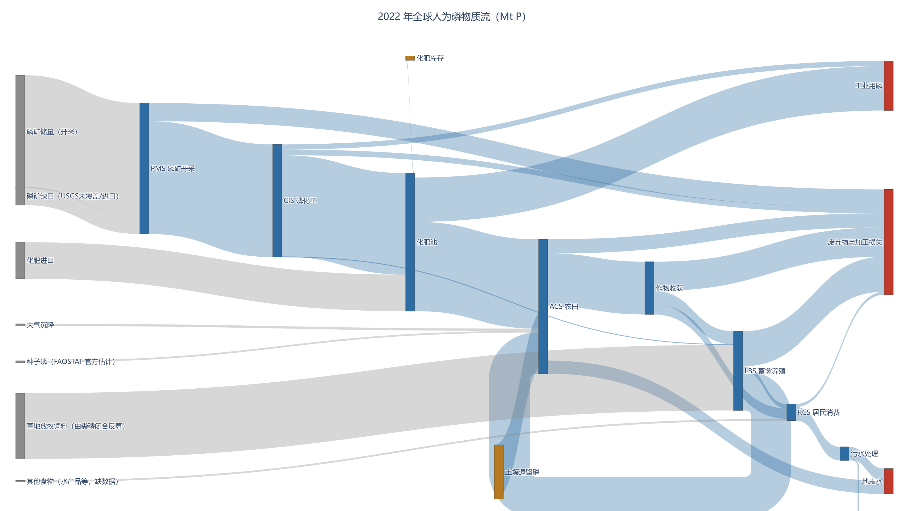
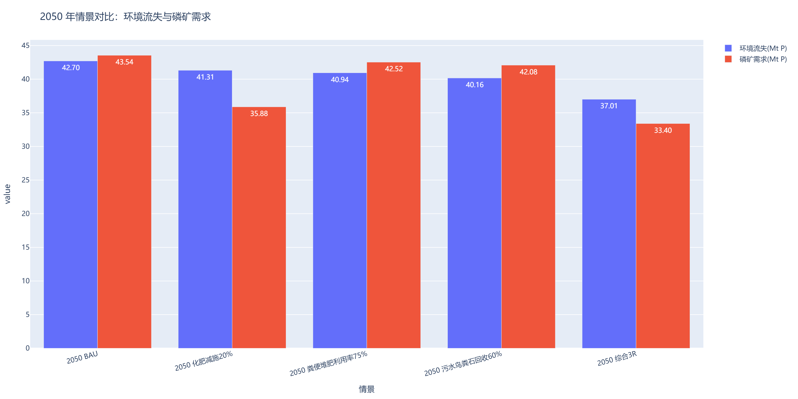

# 全球人为磷循环物质流复现报告

**课程**：环境规划与管理（2023 级）　**文献**：Liu et al., *PNAS*, 2026, 123(13): e2512673123
**代码**：`submission_p_sfa/`　**运行**：`python run_all.py`

## 一、数据口径与模型方法

模型统一以 **Mt P** 计量，覆盖磷矿开采（PMS）、磷化工（CIS）、农田种植（ACS）、畜禽养殖（LBS）与居民消费（RCS）五个子系统。原始产出表本身已是吨纯磷，直接汇总，不再乘含磷率；化肥原始单位为 t P₂O₅，统一乘 0.4364。为核对这一口径，另用含磷率字典（kg P/kg）按“产量 × 含磷率”独立复算 2022 年作物端，得 14.32 Mt P，与官方表 14.56 相差 **−1.6%**，两者一致；G 类因官方表另有折算口径不作直接比较。模型仍以官方表为准，避免二次加权。类别口径上，作物端取 A–F、H–K；G（动物产品）归 LBS；M（活体动物）与 G 存在口径重叠，**不计入流量**，仅作核对。国家尺度剔除 World 等 6 个聚合行；人口采用 WPP2024 长表，表头位于第 17 行，2022 年取 Estimates、2050 年取 Medium variant。

本轮在课程数据之外接入 7 份补充数据（共 609 条记录，存于 `data_extra/`，未改动 `source_data`）：种子磷、畜禽存栏与粪磷、永久草地面积、草地吸收单产 proxy、磷肥养分贸易 proxy、DS140 磷矿实物量、MYB 成套 P₂O₅。接入严格遵循四条口径：空字段不填 0；矿石吨数与 P₂O₅ 不跨版本拼接；RFN 贸易仅用于核对、不重复计为边界输入输出；山羊缺排泄系数则粪磷留空，不套用绵羊系数。

各系统优先用“活动量 × 系数”独立计算：磷矿 2022 年采用 MYB 同表 P₂O₅ 折算的 31.159 Mt P，并以 DS140 实物量 × 31% 品位 × 0.4364（30.845）交叉核对，偏差 1.0%；采矿损失按砂废弃物、矿泥、尾矿三项系数计算，磷化工按 90% 肥料产出率与 5% 非肥料用磷拆分。农田新增种子磷 0.475 Mt P。LBS 用存栏 × 排泄系数得到的粪磷（四畜种 16.367 Mt P）闭合饲料需求，**PUE 由输入参数转为输出指标**。确实无法独立计算的土壤遗留磷、磷化工损失、草地饲料、加工废弃物、其他食物组仍用平衡方程反算，并在 `flows_2022.csv` 中标 `residual=True`，不冒充观测值。

## 二、2022 年现状

2022 年全球作物收获磷 14.56 Mt P、动物产品磷 5.51 Mt P。农田收支见表 1，化肥占农田总输入 **66.4%**，仍与论文“64% 以上”的方向一致，略高的原因是山羊粪磷缺口压低了粪肥还田。

**表 1　2022 年农田磷收支（Mt P）**

| 输入项 | 数值 | 输出项 | 数值 |
|---|---|---|---|
| 化肥 | 24.64 | 作物收获 | 14.56 |
| 粪肥与鸟粪石回收 | 11.34 | 秸秆废弃 | 3.93 |
| 大气沉降 | 0.63 | 排水与淋溶 | 3.62 |
| 种子 | 0.48 | 土壤遗留磷（平衡项） | 14.98 |
| **合计** | **37.09** | **合计** | **37.09** |

全系统边界输入 65.94 Mt P，边界输出 49.72 Mt P，存量变化 16.22 Mt P，守恒相对误差 **5.4×10⁻¹⁷**，远优于 10⁻⁴；8 个内部节点全部闭合。需要强调，该守恒是“账本闭合”，草地饲料（18.13）与磷矿缺口（4.98）仍是反算外源项，其绝对量依赖饲料口径与肥料产量。真正由统计直接支撑的锚点见表 2。

**表 2　由统计直接支撑的锚点（Mt P）**

| 锚点 | 数值 | 锚点 | 数值 |
|---|---|---|---|
| 作物收获 | 14.56 | 化肥出口 | 12.22 |
| 动物产品 | 5.51 | 磷矿（228 Mt 实物量折纯） | 31.16 |
| 化肥施用 | 24.64 | 种子磷 | 0.48 |
| 化肥进口 | 10.09 | 畜禽粪磷（四畜种） | 16.37 |

把草地饲料 18.13 Mt P 除以永久草地面积 3.108 Gha，得隐含单产 **5.83 kg P/ha/yr**，落在 Sattari 等（2016）1.4–15.7 的区间内，与中心值 4.6 同量级。这不能证明草地饲料正确，但说明闭合结果没有量级失真的迹象——这是以往仅凭 PUE 假设无法获得的独立检验。LBS 输出 PUE 为 **25.2%**，高于论文 23%，主因同样是山羊粪磷缺失：若按绵羊系数 1.60 kg/头/年补入约 1.82 Mt P，PUE 降至 23.3%，粪肥还田增至 12.56 Mt P，化肥占比降至 64.3%，与论文更吻合。该敏感性只在报告中说明，未写入模型，以免把估算值混入观测口径。

作物收获的内部去向为：饲料 3.64、植物性食物 2.86、加工与流通损失 8.05 Mt P；动物产品中进入膳食 1.24、屠宰与加工损失 4.27 Mt P。可见“收获—餐桌”之间的加工、流通与屠宰损耗合计约 12.3 Mt P，与农田排水淋溶（3.62）加粪污未利用（5.40）之和相当，是容易被忽视的流失环节。图 1 给出全系统拓扑（20 节点 31 连线，交互版见 `figures/sankey_2022.html`）：矿石经 PMS、CIS、化肥池进入农田，粪肥与回收返回农田，土壤与地表水为环境汇。

## 三、2050 年情景

以 2022→2050 年世界人口比 9.664/8.021≈1.205 同比例外推作物、动物产品与化肥需求，得 BAU：化肥 29.69、粪肥还田 13.67、磷矿需求 43.54、环境流失 42.70 Mt P，农田 PUE 0.543。

**表 3　2050 年 BAU 与 3R 情景**

| 情景 | 磷矿需求 | 相对 BAU | 环境流失 | 相对 BAU | 农田 PUE |
|---|---|---|---|---|---|
| 2050 BAU | 43.54 | — | 42.70 | — | 0.543 |
| 化肥减施 20% | 35.88 | −17.6% | 41.31 | −3.3% | 0.626 |
| 粪便堆肥利用率 75% | 42.52 | −2.3% | 40.94 | −4.1% | 0.533 |
| 污水鸟粪石回收 60% | 42.08 | −3.4% | 40.16 | −5.9% | 0.529 |
| 综合 3R | 33.40 | −23.3% | 37.01 | −13.3% | 0.596 |

三项措施的作用位置不同（图 2）：减施化肥直接压缩矿需，是单项中最有效的杠杆；粪肥利用率由 67% 提至 75% 仅增加 1.58 Mt P 还田，在 0.5 的替代系数下只减少 2.3% 矿需，但对粪污流失的削减（−4.1%）更明显；污水回收对流失的削减（−5.9%）大于对矿需的削减（−3.4%），因为其回收磷直接回到农田。

矿需的综合削减（−23.3%）与三项简单相加（−23.30%）几乎完全相等，说明在本模型代数结构下，矿需对三项措施近似可加：新增粪肥与回收量不随化肥减施比例变化，替代项彼此独立。PUE 则因分母含化肥、粪肥、沉降与种子而呈明显拮抗，综合 PUE（0.596）低于减施单项（0.626）。

必须说明，课程设定的 20%/75%/60% 与论文 S2.2、S4.3、S5 的情景范围不同。论文 S4.3 的 −22.1% 来自全链条粪便循环，课程仅把利用率提高 8 个百分点，故 −2.3% 不构成对论文的否定，二者不可直接比较。有机肥替代系数仍是本节最关键的行为假设：取 0 时综合情景只剩减施（−17.6%），取 1.0 时扩大到约 −29.6%，报告给出区间而非单一“好看”的点估计。

## 四、交叉敏感性与交互检验

在“减施比例 0–40% × 堆肥利用率 30–90% × 回收率 0–80%”上做全因子网格并补 200 组拉丁超立方样本，共 767 组，每组由模型重新计算总环境流失与 PUE。自变量均值中心化后构造两两乘积项，再对自变量与因变量做 Z-score 标准化，用 OLS 估计。

总环境流失的拟合 R²=0.9987，交互项为 +0.0113、+0.0090、+0.0012；在两两模型中控制第三个政策变量后，前两项 p 分别为 2.8×10⁻¹⁶ 与 1.7×10⁻¹⁰，第三项 p=0.47，与三因子全模型一致。按流失量口径，正交互系数意味着两项措施合并后的流失削减小于单独削减之和，方向为拮抗；若改以削减率为因变量，则 β₁₂ 为 −0.0113。论文 S11/S12 报告的是削减率口径下的正号，与本模型方向相反，原因有二：课程情景只把堆肥利用率由 67% 提至 75%，而 S4.3 是全链条粪便循环；本模型粪肥以 0.5 的系数替代化肥，替代项独立于减施比例，减施的边际收益随粪肥增加而下降。因此不能把论文的协同结论直接移植到课程参数区间。

农田 PUE 的拟合 R²=0.9764，系数见表 4。

**表 4　农田 PUE 的标准化回归（R²=0.9764）**

| 项 | 标准化系数 | p 值 | 判定 |
|---|---|---|---|
| 化肥减施（主效应） | +0.730 | ≈0 | 提升 PUE |
| 堆肥利用率（主效应） | −0.639 | ≈0 | 降低 PUE |
| 鸟粪石回收（主效应） | −0.121 | 5.5×10⁻⁸² | 降低 PUE |
| 减施 × 堆肥 | −0.1357 | 3.7×10⁻⁹⁷ | 拮抗 |
| 减施 × 回收 | −0.0260 | 3.8×10⁻⁶ | 拮抗 |
| 堆肥 × 回收 | +0.0232 | 3.5×10⁻⁵ | 协同 |

机理清楚：PUE 的分母是化肥 + 粪肥 + 沉降 + 种子，粪肥增加抬高分母，削弱减施带来的 PUE 增益；减施幅度越大，追加粪肥的边际代价越小。堆肥与回收都以替代化肥方式改善 PUE，故呈协同。交互结论应以 PUE 为准。

## 五、管理建议

法典（2026 年 8 月 15 日施行，5 编 1242 条）为中国法，模型为全球尺度；本文未拆分中国份额，故条款只作制度可行性论证，不进入模型参数。

1. **优先压减化肥总量**。第 420 条规定农用地化肥使用总量控制，第 308、423 条配套测土配方与有机肥，使“减施 20%”有指标分解通道；该单项使 2050 矿需降 17.6%、PUE 升至 0.626。
2. **粪肥全链条，先无害化**。第 171、309 条要求粪污全链条处理和散养密集区分户收集，第 1231、1160 条分别对粪污处理和超标污泥入田设罚则；第 171、422 条禁止不合标准粪肥、污泥进田，故还田率须与重金属、兽药残留达标绑定。基准利用率 67%、仅提到 75% 对矿需只有 −2.3%，真正空间在减少粪污未利用（2022 年约 5.4 Mt P，未含山羊）；山羊缺口也应补数。
3. **污水磷回收定位为“削减流失”**。第 351 条要求入海河流加强总氮、总磷管控，第 327 条允许水源区限制含磷洗涤剂、化肥；第 111–114、170 条提供补偿与资金。回收率 60% 使流失降 5.9%、矿需仅降 3.4%。
4. **组合政策按“拮抗”打折**。减施与粪肥替代在 PUE 上互相削弱；第 149、66–67 条同样要求综合设目标。矿需可加，PUE 以 0.596 为参考并留 10%–20% 余量。
5. **区域差异化落到分区管控**。土壤遗留磷每年仍累积约 15.0 Mt P，“总量控制”与“存量活化”须并行；第 66–67 条分区管控、第 327 条水源区禁限施可承载“高积累区活化、低投入区增量”。
6. **补齐监测底座**。山羊排泄系数、1999–2020 年磷矿 P₂O₅、草地实测生产力，分别对应第 160 条排放源统计、第 631 条排污许可记载、第 1035–1036 条碳核算与碳足迹；第 54 条信用监管可约束数据造假，否则结论只能停留在“方向可信、量级待核”。
7. **把磷石膏、尾矿与伴生放射性纳入边界**。第 976、496–498 条要求磷石膏与尾矿综合利用、减量，第 629–631 条对列入名录的磷酸盐矿要求环评、纳入辐射名录、许可记载核素；磷矿属战略性矿产，第 772、936 条约束开采端。

**表 5　管理措施与法典条款的对应**

| 措施 | 法典条款 | 主要执行主体 |
|---|---|---|
| 化肥减施 | 第 420、308、423 条 | 农业农村部门 |
| 粪污全链条 | 第 171、309、422、1160、1231 条 | 养殖场、县级政府 |
| 污水磷回收 | 第 351、327、111–114、170 条 | 流域、地方政府 |
| 组合政策 | 第 149、66–67 条 | 规划部门 |
| 区域差异化 | 第 66–67、327、421 条 | 地方政府 |
| 监测底座 | 第 160、631、1035–1036、54 条 | 生态环境部门 |
| 磷石膏与放射性 | 第 976、496–498、629–631、772、936 条 | 企业、生态环境部门 |

法典工具分工与流失结构一致：排污许可（第 174–175 条）覆盖磷化工与规模化养殖等点源；农田排水淋溶（3.62 Mt P）与散养粪污属面源，只能靠第 171–172、308、420、66–67 条系统治理，这也解释了面源响应最弱。

## 六、局限

一是化肥基准年为 2021 年（FAOSTAT 最新），24.64 Mt P 比论文 2022 年 20.5 高约 20%，未做人为调整；二是山羊粪磷缺失使粪肥还田偏低约 1.2 Mt P、PUE 偏高约 2 个百分点，本文以敏感性方式披露而未回填；三是 USGS DS140 仅覆盖 40/62 年，覆盖年份累计 673.9 Mt P、22 年缺口夹逼为 809–1382 Mt P，论文 1153 Mt P 虽落在区间内，但不能视为完整复现；四是草地饲料与磷矿缺口仍为平衡反算项；五是国家尺度耕地面积缺失，本文仅完成全球尺度；六是未按国别拆分，法典条款未量化；模型亦未计磷石膏、尾矿与伴生放射性。上述数据与边界局限均已在 `missing_data.md`、`README.md` 与 `results/anchor_check.csv` 中列明，后续补齐数据后可直接替换接口，不改动模型结构。

## 附：论文指标对照

| 指标 | 文献值 | 课程值 | 判断 |
|---|---|---|---|
| 1961 年化肥施用 | 4.9 Mt P | 4.82 | 偏差 −1.7%，可比 |
| 农田化肥占总输入 | ≥64% | 66.4%（山羊敏感性 64.3%） | 方向一致 |
| LBS 磷利用效率 | 23% | 25.2%（山羊敏感性 23.3%） | 量级一致 |
| 化肥减施对 2050 矿需 | −17%（S2.3） | −17.6% | 情景相近 |
| 粪便循环对 2050 矿需 | −22.1%（S4.3） | −2.3% | 不可比（情景范围不同） |
| 综合管理对 2050 矿需 | −97%（S5） | −23.3% | 不可比（仅 3R） |
| 累计磷矿开采 | 1153 Mt P | 673.9（覆盖 40/62 年） | 部分覆盖，不直接比较 |
