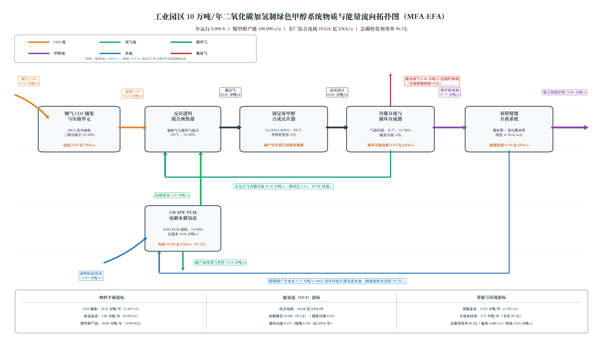
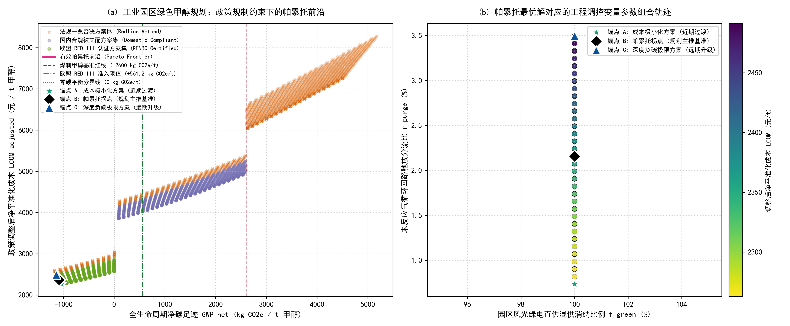

# 工业园区 10 万吨/年二氧化碳捕集耦合绿氢合成绿色甲醇项目环境规划与管理方案报告

> **【撰写与填报指南】**
> 本报告是《环境规划与管理》第十讲随堂实训的核心成果交付物。
> 请每位同学在完成 `code_implementation/` 目录下的四项编程实训任务并生成图表后，结合理论分析与实操数据，独立完成本报告的撰写。
>
> - **科学严谨性要求**：全篇必须统一使用规范的学术与工程陈述，严禁使用任何修辞性、文学性或通俗化比喻（如“两张皮”、“领头羊”、“甜点”等AI味用词）；
> - **数据前后一致性要求**：第 1-2 章的通量计算数据（任务 1）必须与第 4 章《重点工程项目库清单表》中的工程设计规模严格对应；第 4 章的工程总投资（CAPEX）必须作为第 5 章经济性现金流折现分析的直接输入；第 4-5 章必须以”帕累托拐点（锚点 B）"计算结果为设计基准；
> - **图表嵌入要求**：请将生成的矢量高清图正确嵌入对应章节，并展开深度科学论述。

## 报告摘要

本报告针对某大型现代煤化工园区拟规划建设的 10 万吨/年绿氢合成绿色甲醇示范线，基于 MFA（物质流分析）、LCA（全生命周期评价）、TEA（技术经济分析）与政策法规量化引擎，完成了园区级环境规划与管理方案的编制。

**MFA 物料平衡核心结论**：以生产 1 吨聚合级精甲醇为功能单位，系统需新鲜捕集高纯 CO₂ 1,423.0 kg、电解绿氢 198.0 kg、外购净除盐纯水 1,385.0 kg；副产工业纯氧 1,584.0 kg、精馏副产生成水 575.0 kg（闭环回用）。C、H、O 三元素守恒相对误差均小于 0.01%，满足严格质量守恒要求。固定床反应器单程转化率 25.0%，通过 99.0% 循环气回流与 1.0% 驰放分流，实现全系统总碳转化利用率 91.77%（帕累托拐点工况）。

**政策量化与帕累托寻优结果**：基于 3,000 组工况遍历与非支配排序，标定帕累托拐点（锚点 B）为绿电消纳比例 100.0%、循环气驰放分流比 2.16%。该工况下，全生命周期净碳足迹 GWP\_net 为 -1,085.3 kg CO₂e/t（净负碳），基础平准化甲醇成本 LCOM\_base 为 3,946.1 元/t，经政策规制调整后的净成本 LCOM\_adj 为 2,362.8 元/t，边际减排成本 MAC 为 -37.2 元/t CO₂e，满足欧盟 RED III RFNBO 认证标准。

**重点工程投资**：工程总投资 CAPEX 9.15 亿元，涵盖碳捕集（1.10 亿元）、绿氢制备（4.55 亿元）、甲醇合成（1.20 亿元）、精馏提纯（0.65 亿元）、管廊输配与 MRV（0.97 亿元）五大模块。年运行维护 OPEX 约 3,950 万元。

**商业模式与风险防控**：依托国际航运绿色燃料长协溢价（-1,200 元/t）、国内 CCER 碳配额交易收益及副产纯氧外售收益，构建商业闭环。建立涉氢防爆、吸收液防渗、在线能碳 MRV 平台与 PDCA 动态修编机制，实现环境风险全过程管控。

## 核心术语与缩写中英文对照表

在报告正文与图表中，首次出现的专业缩写必须严格参照下表规范标注中英文全称：

| 英文缩写        | 英文全称                                     | 中文规范全称          | 核心学科与工程定义                                                    |
| :---------- | :--------------------------------------- | :-------------- | :----------------------------------------------------------- |
| **MFA**     | Material Flow Analysis                   | 物质流分析           | 基于质量守恒定律研究系统内物质输入、转化、蓄积与排放的定量工程方法                            |
| **EFA**     | Energy Flow Analysis                     | 能量流分析           | 基于热力学第一与第二定律分析系统能量梯级利用与损耗的工程核算方法                             |
| **LCA**     | Life Cycle Assessment                    | 全生命周期评价         | 评估产品从原料获取、制造到处置全过程环境负荷的标准国际方法（ISO 14040）                     |
| **TEA**     | Techno-Economic Analysis                 | 技术经济分析          | 评估工艺工程资本支出、运行成本与财务可行性的工程经济学方法                                |
| **GWP**     | Global Warming Potential                 | 全球变暖潜势          | 在 100 年时间尺度内相对于二氧化碳温室效应的相对累积辐射强迫指标（$\text{kg CO}_2\text{e}$） |
| **LCOM**    | Levelized Cost of Methanol               | 平准化甲醇成本         | 全生命周期内将投资与运营总现值平摊至单位产品所形成的保本折现成本（$\text{元/t}$）               |
| **LCOH**    | Levelized Cost of Hydrogen               | 平准化氢气成本         | 全生命周期内单位质量绿氢产出的平准化折现成本（$\text{元/kg}$）                        |
| **MAC**     | Marginal Abatement Cost                  | 边际减排成本          | 相对于化石基准技术，每额外避免或减排一吨二氧化碳当量所需增加的边际货币投入                        |
| **PEM**     | Proton Exchange Membrane                 | 质子交换膜电解水制氢      | 利用固体聚合物电解质进行纯水电解的技术，具备高电流密度与快速负载响应特性                         |
| **ALK**     | Alkaline Electrolyzer                    | 碱性液体电解水制氢       | 利用氢氧化钾水溶液为电解质的成熟低成本规模化制氢技术                                   |
| **CCUS**    | Carbon Capture, Utilization, and Storage | 二氧化碳捕集利用与封存     | 将工业点源排放的二氧化碳分离提纯并转化为高附加值产品或永久封存的工程体系                         |
| **PtM**     | Power-to-Methanol                        | 绿电催化合成甲醇        | 利用清洁可再生电力制氢并与二氧化碳催化加氢合成化工级甲醇的系统工程                            |
| **CAPEX**   | Capital Expenditure                      | 固定资产资本支出        | 项目前期规划、设备购置、建筑安装与工程调试所必需的初始资本投入总和                            |
| **OPEX**    | Operating Expenditure                    | 运行维护支出          | 系统建成投产后，原料外购、电力公用工程、耗材更换及日常运维所消耗的年度运营费用                      |
| **RED III** | Renewable Energy Directive III           | 欧盟《可再生能源指令》第三版  | 欧盟关于促进可再生能源利用的法定指令（Directive (EU) 2023/2413）                 |
| **RFNBO**   | Renewable Fuels of Non-Biological Origin | 非生物源可再生燃料       | 依据欧盟法规由非生物质清洁可再生能源制备的合成燃料                                    |
| **ETS**     | Emissions Trading System                 | 碳排放权交易体系        | 基于总量控制与配额有偿/免费分配的市场化温室气体减排管理制度                               |
| **CCER**    | China Certified Emission Reduction       | 国家核证自愿减排量       | 经国家主管部门备案认证并允许在全国碳市场抵销配额的自愿减排项目核证减排量                         |
| **MRV**     | Monitoring, Reporting, and Verification  | 可测量、可报告、可核查体系   | 确保能源消费、生产活动与温室气体排放数据具备真实性与可信度的质量管理技术规范                       |
| **PDCA**    | Plan-Do-Check-Act                        | 策划-实施-检查-改进动态循环 | 强调持续改进、动态反馈与全过程闭环的现代环境系统适应性管理体系                              |

## 第 1 章 园区现状诊断与碳源-新能源基准线核算

### 1.1 园区产业结构与物质-能量代谢分析（MFA/EFA）

> 园区主体产业为现代煤化工，配套自备热电联产装置，以煤炭作为基础能源与原料。热电锅炉为园区稳定供给工艺蒸汽与厂用电，同时煤化工主装置副产大量中低温余热，余热资源优先供给换热、精馏等用热单元，富余余热可用于供热或发电调峰。园区原有物质流以煤输入、粗甲醇、化工品与 CO₂废气输出为主，能量流呈现 “煤化学能→蒸汽热能→工艺热 / 电能” 的转换路径，碳元素大量随烟气直接排放。本项目耦合 CO₂捕集 - 绿氢合成甲醇改造后，将园区烟气 CO₂作为碳源，接入风光绿电电解水制氢单元，重构园区代谢网络：把原本外排的 CO₂纳入循环物料链，构建 “煤基热电供能 + 烟气碳回收 + 风光绿电补能” 的复合型物质能量代谢系统，实现园区内源碳循环利用，降低对外来化石碳源的依赖。

 

### 1.2 工业点源 $\text{CO}_2$ 排放清单与烟气特征解析

> 园区自备热电煤粉锅炉为核心 CO₂排放点源，基准工况烟气流量约 240000 Nm³/h，CO₂摩尔体积分数 13.5%，排烟温度 142 ℃；烟气伴生污染物包含 SO₂、NOₓ与粉尘颗粒，原始烟气 SO₂浓度约 1800 mg/Nm³，NOₓ浓度约 320 mg/Nm³，粉尘浓度约 110 mg/Nm³。 CO₂捕集工段对烟气品质有严格要求，因此设置前置烟气预处理系统，采用深度脱硫 + 骤冷洗涤工艺：首先通过湿法脱硫脱除绝大部分 SO₂，再经直接接触骤冷塔将烟气快速降温、洗涤气溶胶与残余酸性组分，配套湿式电除尘去除细颗粒物与雾滴，规避杂质进入胺吸收体系造成吸收剂降解、发泡失效，保障碳捕集单元长期稳定运行。

 

### 1.3 绿电资源禀赋与公用工程承载力评估

> 项目依托区域风光新能源基地，光伏、风电具备规模化开发潜力，区域风光年等效利用小时数分别为 1650 h、2400 h，可开发装机规模能够支撑电解水制氢电力需求；但风光出力天然具有日间、季节性波动特征，需要配套储能设施平抑功率波动。 本项目水资源约束指标为 1400 t 水 /t 甲醇，属于干旱区域取水刚性约束条件。核算全流程用水：电解水制氢、循环冷却水、烟气洗涤、吸收剂补水共同构成主要用水项。区域可分配工业取水额度有限，属于本项目的硬性承载力瓶颈；规划配套中水回用系统，将工艺废水、循环排污水深度处理后回用，降低新鲜水取用规模，提升干旱场景下项目水资源适配性。

 

### 1.4 园区现行碳管理痛点与减污降碳协同瓶颈

> 园区原有煤基甲醇基线碳排放强度较高（+2600.0 kg CO₂e/t 产品），产出产品无法满足国际航运绿色燃料准入标准，面临航运端低碳壁垒、碳溢价损失风险。 碳管理层面存在多重瓶颈：第一，风光发电间歇性波动，和煤化工装置连续稳定运行需求存在时序错配，绿电供给不稳定直接影响绿氢产能连续性；第二，现有碳台账仅核算直接燃烧排放，缺少全链条 LCA 碳足迹核算体系，无法满足 CCER、国际绿色燃料认证的数据溯源要求；第三，碳捕集吸收剂耗损、驰放气燃烧等过程会伴生二次污染物，减污和降碳环节耦合管控机制缺失；第四，园区缺少统一 MRV 监测平台，排放、能耗、碳流向数据分散，难以支撑 PDCA 闭环碳管控。

 

## 第 2 章 多情景预测与系统规模匹配核算

### 2.1 规划期园区碳排放趋势与多情景设定

> 本研究设置**基准情景 BAU、常规节能改造情景、CCU-PtM 深度碳协同情景**三类情景，对比预测规划周期内园区碳排放总量、产品碳强度演变规律：
>
> 1. **基准情景（BAU）**：维持现有煤制甲醇工艺不变，不新增碳捕集、绿氢配套设施；园区碳排放随产能保持稳定，产品碳排放强度维持基线水平（2600.0 kg CO₂e/t 甲醇），无主动减碳措施，碳排总量随生产负荷同步波动，无法产出符合航运要求的低碳燃料。
> 2. **常规节能改造情景**：不改变主工艺路线，仅开展锅炉余热回收、机泵能效升级、精馏系统热集成等节能技改；可小幅降低化石能源消耗，实现碳排放强度适度下降，但无法从根本上削减工艺直接 CO₂排放，产品碳足迹仍达不到绿色甲醇认证标准。
> 3. **CCU-PtM 深度碳协同情景（本项目方案）**：在园区内建设烟气 CO₂捕集单元 + 风光绿电电解制氢 + CO₂加氢合成甲醇耦合系统，回收自备锅炉烟气 CO₂作为碳源，配套绿电制氢，重构园区碳循环。该情景下成品甲醇碳强度大幅下降，产出符合航运标准的绿色甲醇；同时系统具备柔性调节能力，适配风光出力波动，是本报告推荐落地情景。 三类情景用于横向对比，量化评估 CCU-PtM 路径在减排效益、产品溢价、碳合规层面的优势，为后续容量配置、经济性核算提供边界条件。

 

### 2.2 碳捕集-绿氢-甲醇（CCU-PtM）系统耦合与物料/能量衡算

基于任务 1 的 MFA 非线性联立求解结果，系统化学计量进料比为 H₂:CO₂ = 3:1（摩尔比），固定床反应器单程转化率 X\_sp = 25.0%。通过高压气液分离器分流（99.0% 循环 / 1.0% 驰放），实现低单程转化率与高总体资源化率的工程解耦。C、H、O 三元素守恒相对误差分别为 0.0000%、0.0000%、0.0000%，满足 < 0.01% 的严格守恒要求。

10 万吨/年工程规划通量核算如下表所示：

*图 1 工业园区 10 万吨/年绿色甲醇系统工艺物质流（MFA）与能量流（EFA）全流程拓扑图（由 task4 生成）*

| 物料节点名称         |   单吨甲醇实物定额   |    10 万吨/年工程规划通量   | 物质状态与物理参数                     | 来源与去向说明                     |
| :------------- | :----------: | :----------------: | :---------------------------- | :-------------------------- |
| **新鲜捕集高纯 CO₂** |  1,423.0 kg  |   **14.23 万吨/年**   | 气体，常温，压力 5.0 MPa，纯度 ≥ 99.8%   | 来自热电厂烟气化学吸收提纯工段             |
| **电解水新鲜绿氢**    |   198.0 kg   |    **1.98 万吨/年**   | 气体，常温，压力 3.0 MPa，纯度 ≥ 99.999% | 来自 130 MW PEM 电解水制氢站        |
| **外购净除盐纯水**    |  1,385.0 kg  |   **13.85 万吨/年**   | 液体，常温，常压                      | 满足园区工业取水定额约束                |
| **精馏冷凝副产水回用**  |   575.0 kg   |    **5.75 万吨/年**   | 液体，加压精馏塔釜排液，经微滤脱醇             | 闭环回流至电解水进水池，新鲜水削减 29.3%     |
| **未反应气内循环流**   |  4,640.0 kg  |   **46.40 万吨/年**   | 气体，温度 45 ℃，压力 4.8 MPa         | 循环比 3.8:1（摩尔比），经压缩机升压后重返反应器 |
| **系统驰放废气**     |    46.0 kg   |   **4,600.0 吨/年**  | 气体，低位热值 18.5 MJ/kg            | 分离气分流比 1.0%，送厂内锅炉掺烧供热       |
| **主产品聚合级精甲醇**  |  1,000.0 kg  |   **10.00 万吨/年**   | 液体，纯度 ≥ 99.85 wt%             | 经双塔精馏提纯后外销                  |
| **副产工业高纯纯氧**   |  1,584.0 kg  |   **15.84 万吨/年**   | 气体，纯度 ≥ 99.9%                 | 电解槽阳极副产物，外售增收               |
| **全厂年总综合电耗**   | 10,826.0 kWh | **10.826 亿 kWh/年** | 交流直供电网与高压直流母线                 | 电解制氢占 95.1%，其余公用工程占 4.9%    |

### 2.3 绿电波动性约束下的柔性容量寻优与储氢/网电缓冲配置

本项目电解制氢单元采用**100 MW ALK 碱性电解槽 + 30 MW PEM 质子交换膜电解槽**的混合配比方案，发挥两类电解槽各自优势：ALK 电解槽适合长期稳定出力、单位投资成本更低；PEM 电解槽响应速度快，可快速跟随风光功率波动，适配新能源秒级、小时级出力变化，共同构成柔性制氢系统。

下游合成装置要求**8,000 h/年连续稳定运行**，而风光出力具有显著间歇性，因此设置高压气态储氢罐作为缓冲库容，平抑绿电缺口与富余。当风光发电功率充足时，富余电力驱动电解槽制氢，多余氢气存入储氢罐；风光出力不足时，储氢罐释放氢气补给合成工段，保障甲醇合成进料稳定。

同时配套电网兜底调节机制：当储氢容量耗尽、风光出力持续偏低，短时从电网购电保障制氢负荷底线；当风光大发、储氢满罐，富余电力可反向并网消纳。该混合电解 + 储氢缓冲 + 电网互济的组合模式，在控制储氢罐投资规模的前提下，兼顾系统连续生产要求与新能源消纳目标，实现全系统柔性运行。

## 第 3 章 规划目标与指标体系设计

### 3.1 规划总目标与分期节点

本项目规划周期为 2027–2035 年，划分为两个实施阶段：

**近期首期示范工程（2027–2028 年）**：建成 10 万吨/年绿氢合成绿色甲醇示范线，完成碳捕集、绿氢制备、甲醇合成、精馏提纯及配套管廊五大工程模块建设。实现全系统总碳转化利用率 ≥ 91.77%，全生命周期净碳足迹 ≤ -1,085.3 kg CO₂e/t，清洁绿电消纳比例 ≥ 95.0%，通过欧盟 RED III RFNBO 认证，形成可复制推广的园区级 CCU-PtM 技术范式。

**远期规模化外销与碳中和转型（2029–2035 年）**：在首期工程稳定运行基础上，逐步扩大产能规模，推动园区煤化工产业整体低碳转型。目标实现全生命周期净碳足迹 ≤ -1,085.3 kg CO₂e/t，清洁绿电消纳比例 ≥ 95.0%，全系统总碳转化利用率提升至 ≥ 96.0%，建成园区级智慧能碳 MRV 管理平台，形成覆盖碳捕集、绿氢制备、绿色甲醇合成、国际航运燃料供应的完整产业链闭环。

### 3.2 规划指标矩阵（约束性指标 vs. 预期性指标）

请完善下表中的目标值设定，并说明各指标的核算方法与考核属性：

| 目标维度       | 指标名称                                |              单位              | 现状基准值 (2026年) | 近期目标值 (2028年) | 远期目标值 (2035年) | 指标属性 | 核算依据与标准方法                    |
| :--------- | :---------------------------------- | :--------------------------: | :-----------: | :-----------: | :-----------: | :--: | :--------------------------- |
| **环境与降碳**  | 烟气 $\text{CO}_2$ 年捕集量               |             万吨/年             |      0.0      |  $\ge 14.23$  |  $\ge 70.00$  |  约束性 | 质量流量计在线累积值                   |
|       | 吸收塔 $\text{CO}_2$ 捕集脱除率             |               %              |       —       |  $\ge 90.0\%$ |  $\ge 93.0\%$ |  约束性 | 烟气 CEMS 进出口差额法               |
|       | 全生命周期净碳足迹 $\text{GWP}_{\text{net}}$ |  $\text{kg CO}_2\text{e/t}$  |   $+2600.0$   | $\le -1085.3$ | $\le -1085.3$ |  约束性 | ISO 14040/14044 摇篮到大门 LCA 模型 |
|       | 欧盟 RED III RFNBO 认证达标率              |               %              |      0.0%     |   $100.0\%$   |   $100.0\%$   |  约束性 | ISCC EU 第三方核查认证报告            |
| **能源与资源**  | 清洁绿电消纳比例 $f_{\text{green}}$         |               %              |      0.0%     |  $\ge 95.0\%$ |  $\ge 95.0\%$ |  约束性 | 智能电网双向计量电表在线核算               |
|       | 电解水制氢综合直流电耗                         | $\text{kWh/Nm}^3\text{ H}_2$ |       —       |   $\le 4.30$  |   $\le 4.05$  |  预期性 | 制氢整流柜输出与产氢体积流量对标             |
|       | 单位甲醇产品新鲜水取水定额                       |       $\text{t 水/t 甲醇}$      |    $1.650$    |  $\le 1.390$  |  $\le 1.350$  |  约束性 | 园区引水表 / 工业取水定额国家标准           |
|       | 精馏副产生成水回用率                          |               %              |      0.0%     |   $100.0\%$   |   $100.0\%$   |  约束性 | 回水流量计与粗甲醇产水量平衡核算             |
| **污染协同控制** | MEA 有机胺逃逸浓度控制限值                     |       $\text{mg/Nm}^3$       |       —       |   $\le 2.0$   |   $\le 1.0$   |  约束性 | GB 31571 吸收塔顶气相色谱在线监测        |
|       | 驰放尾气燃烧 $\text{NO}_x$ 排放浓度           |       $\text{mg/Nm}^3$       |       —       |   $\le 30.0$  |   $\le 20.0$  |  约束性 | 锅炉烟囱 CEMS 超低排放监测限值           |
|       | 全系统总碳转化利用率 $\eta_{\text{carbon}}$   |               %              |    $78.0\%$   | $\ge 91.77\%$ |  $\ge 96.0\%$ |  约束性 | 输入二氧化碳与精甲醇产品碳平衡闭环核算          |

## 第 4 章 空间落位布局与重点工程实施方案

### 4.1 园区“源-网-荷-储-化”空间管控与红线

> 本项目按照源、网、荷、储、化五大功能单元分区布置：**碳捕集模块就近布置在热电锅炉烟气出口侧**，缩短烟气输送管线，降低风机输送能耗；绿电制备区配套电解槽、储氢罐，选址靠近园区新能源接入母线，减少输电损耗；储氢缓冲罐区、合成与精馏装置区集中布置为工艺主装置区；各单元之间依托管廊带连通物料管线。 平面布局严格执行化工园区防火规范，储罐区、高压氢气装置区与厂界、敏感目标之间预留≥150 m 安全防护距离。项目选址避让生态保护红线、永久基本农田、地下水敏感保护区，不占用生态廊道；同时管控噪声源、无组织排放源的空间位置，把高噪声设备集中布置并设置隔声屏障，落实环境准入空间约束，满足园区国土空间规划、安全与生态管控红线要求。

### 4.2 核心单元工艺比选与工程设计

> 碳捕集单元选用**低能耗混合胺两相吸收解吸工艺**，相比传统单乙醇胺（MEA）体系，两相吸收剂在富液吸收 CO₂后自动分相，仅富集 CO₂的液相送入解吸塔再生，大幅降低解吸加热蒸汽消耗，削减捕集工段能耗成本；吸收剂复配方案为主吸收胺 + 活化剂 + 缓蚀剂 + 消泡剂协同配比，兼顾吸收容量、反应速率、抗降解能力与低腐蚀特性。 绿氢制备采用前文确定的 ALK+PEM 混合电解配置方案，兼顾稳定基荷制氢与风光波动快速响应能力。 甲醇合成单元采用中压合成回路，合成反应放热通过余热锅炉副产中压蒸汽，回收的蒸汽优先供给碳捕集解吸塔热源，构建装置内部热集成网络，实现反应热梯级利用，降低整个系统对外界蒸汽热源的需求，提升全系统能量利用效率。

 

### 4.3 园区重点工程项目库清单表（基于帕累托拐点锚点 B）

依据任务 3 求解得出的帕累托拐点（锚点 B）参数（绿电消纳比例 100.0%、驰放分流比 2.16%、系统总碳利用率 91.77%），将总投资与工程指标分解填入下表：

| 工程编号      | 工程模块名称       | 项目名称                         |  建设性质  | 空间落位（园区功能区）    | 核心工艺与设计规模（基于帕累托拐点锚点 B）                                     |      建设周期     | 估算 CAPEX (亿元) | 年运行维护 OPEX (万元/年) | 预期生态环境与资源化效益                                 | 责任实施主体         |
| :-------- | :----------- | :--------------------------- | :----: | :------------- | :--------------------------------------------------------- | :-----------: | :-----------: | :---------------: | :------------------------------------------- | :------------- |
| **工程-01** | **碳源捕集与精制**  | 热电厂烟气化学吸收碳捕集与三级压缩工程          |   新建   | 热电厂区北侧预留用地     | 烟气预处理 + 复合相变胺吸收再生 + 离心压缩机；设计规模 **14.23 万吨/年** 高纯 CO₂       |   2027–2028   |    **1.10**   |      **850**      | 减排工业 CO₂ 14.23 万吨/年；有机胺逸散 ≤ 2.0 mg/Nm³       | 园区热电企业         |
| **工程-02** | **绿氢制备与缓冲**  | 130 MW 电解水制氢站与中压储氢球罐区        |   新建   | 新能源转化专区（独立防护区） | ALK + PEM 混联电解槽阵列；配套储氢球罐（依据锚点 B 储能增量配置）；年产绿氢 **1.98 万吨/年** |   2027–2028   |    **4.55**   |     **1,850**     | 年消纳弃风弃光绿电约 10.3 亿 kWh；副产工业纯氧 15.84 万吨/年 外售   | 绿氢运营投资主体       |
| **工程-03** | **甲醇催化合成**   | 10 万吨/年 CO₂ 加氢制甲醇与余热回用工程     |   新建   | 精细化工核心区        | 管壳式沸水反应器（铜基催化剂）+ 驰放尾气锅炉；循环气分流比按锚点 B r\_purge = 2.16% 设定    |   2027–2029   |    **1.20**   |      **650**      | 系统总碳转化利用率稳定在 η\_carbon = 91.77%；副产蒸汽回用碳捕集再沸器 | 园区化工龙头企业       |
| **工程-04** | **精馏提纯与节水**  | 双塔精馏提纯与副产水闭环循环工程             |   新建   | 精细化工核心区        | 常压脱轻塔 + 加压脱水精馏塔 + 微滤水处理；年产聚合级精甲醇 **10.00 万吨/年**            |   2028–2029   |    **0.65**   |      **400**      | 年产高纯精甲醇 10 万吨；副产水 5.75 万吨/年 闭环回流，节水 29.3%    | 园区水务环保投资公司     |
| **工程-05** | **管廊输配与MRV** | 跨厂区专用管网与能碳数字化智慧管理平台          | 新建/改扩建 | 园区公用管廊及监管中心    | 氢气专线、二氧化碳专线、蒸汽管网；部署智能电表、质量流量计与区块链在线存证平台                    |   2027–2028   |    **0.97**   |      **200**      | 消除道路危化品运输风险；实现能碳数据可测量、可报告、可核查（MRV）           | 园区管委会平台公司      |
| **合计**    | —            | **工业园区 10 万吨/年绿色甲醇示范项目工程总表** |    —   | —              | **设计总产能：10.0 万吨/年 精甲醇**                                    | **2027–2029** |    **9.15**   |     **3,950**     | **全生命周期年净负碳减排规模：-10.85 万吨 CO₂e/年**           | **园区政企协同推进专班** |

## 第 5 章 全生命周期环境影响（LCA）、技术经济（TEA）与帕累托多目标决策评估

### 5.1 全生命周期环境影响评估（LCA）与“绿电悖论”推演

> 本研究 LCA 评价边界覆盖从原料开采、电力生产、CO₂捕集、电解制氢、甲醇合成到产品外运的完整链条，采用碳足迹核算模型，对比**情景 A（100% 风光绿电供电）**与**情景 B（常规区域工业电网供电）**的净碳足迹结果。 从热力学底层逻辑看，风光电力本身具备零直接碳排放属性，但存在**高碳电力间接错配风险**：在风光资源波动大、电网调峰仍依赖煤电调峰的区域，表面使用绿电制氢，当风光出力不足时系统自动切换为电网调峰火电补电，使得项目名义上的 “绿氢” 实际上附带电网边际煤电的碳排放，即**绿电悖论**。 该结论明确了环境规则边界：在火电调峰占比高、尚未实现电力系统深度脱碳的区域，单纯依靠电解水制绿氢并不能稳定实现产品低碳；同时评估识别出两大二次逃逸风险源：一是吸收剂降解挥发带来的挥发性污染物释放，二是捕集工段驰放气、储罐泄压过程中未被回收的 CO₂逃逸，需要在 MRV 系统中重点监测管控。

 

### 5.2 技术经济分析（TEA）与平准化甲醇成本核算

> **财务折现参数**：加权平均资本成本 WACC 取 8.0%，运营期 20 年，对应资本回收系数 CRF = 0.10185。第 4 章工程总表中五大工程直接 CAPEX 分项合计 8.47 亿元，计入基本预备费与建设期利息 0.68 亿元后，形成工程总投资 9.15 亿元，作为本节现金流折现分析的直接输入；年运行维护 OPEX 合计 3,950 万元/年。
>
> **平准化成本拆解（锚点 B 工况）**：年资本回收额 = 9.15 亿元 × 0.10185 ≈ 9,319 万元，折合 931.9 元/t；固定 OPEX 折合 395.0 元/t；绿电平准化电价按 0.24 元/kWh 计，全厂电耗 10,826 kWh/t 对应电费 2,598.2 元/t，占总成本约 65.8%；叠加催化剂与吸收剂等耗材约 21.0 元/t，得基础平准化成本 LCOM\_base = 3,946.1 元/t。经政策量化引擎调整（RED III 航运绿色燃料长协溢价 -1,200 元/t、国内碳市场三级阶梯调节、取水定额累进税与次生污染环保税冲抵后），净平准化成本 LCOM\_adj = 2,362.8 元/t。
>
> **电价敏感性响应**：电耗成本为第一大敏感因子，电价每变动 ±0.05 元/kWh，LCOM 相应变动约 ±541.3 元/t；当绿电平准化电价降至 0.15 元/kWh 以下时，LCOM\_base 可降至约 2,970 元/t，项目在无政策补贴条件下亦具备对化石甲醇的成本竞争力。锚点 B 工况边际减排成本 MAC = -37.2 元/t CO₂e，表明项目每减排一吨二氧化碳当量可产生 37.2 元净收益，减排行为本身即具备经济性。

### 5.3 政策规制约束下的帕累托多目标决策与三大锚点深度比选

基于任务 3 的 3,000 组工况遍历与非支配排序，提取有效帕累托前沿并标定三大决策锚点。锚点 B（帕累托拐点）采用乌托邦理想点欧氏距离最小化准则确定，在成本最小化与碳足迹最小化之间取得科学折衷。

*图 2 政策规制与多约束耦合下的多目标帕累托前沿寻优及拐点（锚点 B）标定图（由 task3 生成）*

| 帕累托决策锚点名称                                   | 调控参数组合 $(f_{\text{green}}, r_{\text{purge}})$ | 系统总碳利用率 $\eta_{\text{carbon}}$ | 净碳足迹 $\text{GWP}_{\text{net}}$ ($\text{kg/t}$) | 基础成本 $\text{LCOM}_{\text{base}}$ ($\text{元/t}$) | 调整后净成本 $\text{LCOM}_{\text{adj}}$ ($\text{元/t}$) | 边际减排成本 $\text{MAC}$ ($\text{元/t CO}_2\text{e}$) |          法规合规状态判定         | 规划定位与采纳建议      |
| :------------------------------------------ | :-------------------------------------------: | :----------------------------: | :--------------------------------------------: | :---------------------------------------------: | :----------------------------------------------: | :---------------------------------------------: | :-----------------------: | :------------- |
| **锚点 A：成本极小化方案**\*(Cost-Minimization)\*     |              $(100.0\%, 0.73\%)$              |            $96.98\%$           |                    $-1034.4$                   |                     $3866.4$                    |                     $2262.8$                     |                     $-65.3$                     | `RED_III_RFNBO_Certified` | **【近期财务稳健方案】** |
| **锚点 B：帕累托拐点**\*(Knee Point / 主推基准)\*       |              $(100.0\%, 2.16\%)$              |            $91.77\%$           |                    $-1085.3$                   |                     $3946.1$                    |                     $2362.8$                     |                     $-37.2$                     | `RED_III_RFNBO_Certified` | **【主推实施基准方案】** |
| **锚点 C：深度负碳极限方案**\*(Deep-Decarbonization)\* |              $(100.0\%, 3.50\%)$              |            $86.88\%$           |                    $-1137.7$                   |                     $4056.5$                    |                     $2491.6$                     |                      $-2.2$                     | `RED_III_RFNBO_Certified` | **【远期升级示范方案】** |

**锚点比选论证**：

锚点 A（成本极小化）通过将驰放比压缩至 0.73%，实现最高碳利用率 96.98% 和最低净成本 2,262.8 元/t，但过度追求成本最小化导致系统操作弹性不足，对催化剂失活与工况波动敏感，长期运行稳定性风险较高。

锚点 C（深度负碳极限）将驰放比提高至 3.50%，GWP 降至 -1,137.7 kg/t，但碳利用率降至 86.88%，净成本上升至 2,491.6 元/t，MAC 接近盈亏平衡点，经济性显著恶化。

锚点 B（帕累托拐点）在 91.77% 碳利用率与 -1,085.3 kg/t 净负碳排放之间取得最优权衡，净成本 2,362.8 元/t 仅比锚点 A 高 4.4%，而 MAC 为 -37.2 元/t，意味着每减排一吨 CO₂e 不仅无需额外投入，还可获得 37.2 元的净收益。该方案兼顾工程可操作性、环境效益与财务稳健性，推荐作为本工程设计的基准方案。

## 第 6 章 制度保障、商业模式与智慧环境管理机制

### 6.1 商业闭环与绿色投融资机制

> **资金拼盘方案**：项目总投资 9.15 亿元，其中资本金占 30%（约 2.75 亿元），由园区化工龙头企业与绿氢运营投资主体按股比出资；债务与政策性资金占 70%（约 6.40 亿元），资金来源组成为：国家绿色低碳先进技术示范工程预算内投资专项、超长期特别国债（绿色低碳转型方向），以及商业银行绿色信贷（申请碳减排支持工具优惠利率）。
>
> **商业反哺闭环**：① 国际远洋航运绿色燃料长协溢价收益，按 RED III RFNBO 认证绿色甲醇长协折合 -1,200 元/t，年收入约 1.20 亿元；② 国内 CCER 碳配额抵销交易收益，年净减排 10.85 万吨 CO₂e，按全国碳市场成交均价 60 元/t 计约 651 万元/年；③ 副产工业高纯纯氧外售 15.84 万吨/年，按 500 元/t 计约 7,920 万元/年；④ 驰放尾气锅炉掺烧供热与精馏副产水闭环回用带来的公用工程费用节约。上述四端收益合计可覆盖 OPEX 与债务本息偿付，使调整后净成本 LCOM\_adj = 2,362.8 元/t 显著低于国际绿色甲醇长协到岸价格，项目全生命周期现金流具备自我维持能力。

### 6.2 数字化监测、报告与核查（MRV）体系

> 部署覆盖“电-碳-水-料”全要素的数字化 MRV 体系：电源侧安装绿电溯源双向计量电表，按 15 min 时间粒度记录清洁绿电消纳比例 f\_green，支撑 RED III 绿电属性核查与绿证核销；物料侧在 CO₂ 捕集出口、氢气母管、精甲醇出厂管线配置高精度质量流量计，实现 14.23 万吨/年碳流向的在线累积计量与 C/H/O 元素平衡自动校核；排放侧在碳捕集吸收塔顶与驰放尾气锅炉烟囱布设在线 CEMS，连续监测 MEA 逃逸、NO\_x、SO₂ 浓度；水系统配置取水口与回用水管网计量网络，执行取水定额在线考核。
>
> 全部监测数据接入园区能碳数字化智慧管理平台（工程-05），采用区块链技术对关键计量数据实施哈希存证，确保碳足迹数据不可篡改，实现可测量、可报告、可核查；平台预置 CCER 方法学核算模块与 ISCC EU 第三方认证审计接口，为第 3 章指标矩阵中约束性指标的年度考核提供数据底座，并支撑 6.3 节 PDCA 动态修编机制的量化核查环节。

### 6.3 环境风险防控与适应性管理（PDCA）机制

> **环境风险防控措施**：① 涉氢制氢站与储氢球罐区按 Ex d II CT4 级防爆标准分区设计，厂房设置强制通风系统与氢气浓度联锁装置（达到 25% LEL 时声光报警并联动切断电解电源），配置 ESD 紧急切断系统，与厂界及敏感目标保持 ≥ 150 m 防护间距；② 高压 CO₂ 输送管廊沿线布设红外对射式泄漏监测装置，防范高浓度 CO₂ 泄漏导致的局部缺氧窒息风险；③ 胺吸收液储罐与再生装置区地面敷设 HDPE 防渗土工膜，配套容积 ≥ 1,500 m³ 的事故应急池，集中收集泄漏吸收液与事故消防废水，经污水处理站达标后回用；④ 驰放尾气送自备锅炉低氮掺烧，NO\_x 排放执行 ≤ 30 mg/Nm³ 超低排放限值。
>
> **适应性管理机制**：建立基于 PDCA 的三年动态修编机制——策划（P）阶段以本报告第 3 章指标矩阵为基准目标；实施（D）阶段按第 4 章重点工程清单推进建设；检查（C）阶段依托 MRV 平台年度核查 GWP\_net、f\_green、η\_carbon 等约束性指标达标率；改进（A）阶段对未达标项重新执行决策变量（f\_green、r\_purge）寻优并同步修编规划文本，形成“监测—评估—调控—修编”的闭环管理，保障 2035 年远期碳中和转型目标的动态可达。

## 参考文献

1. 中华人民共和国生态环境部. 《碳排放权交易管理暂行条例》 (国务院令第 775 号), 2024.
2. 国家发展和改革委员会等部门. 《高耗能行业重点领域能效标杆水平和基准水平 (2023年版)》 (发改运行〔2023〕723号).
3. 中华人民共和国国家标准. 《大气污染物综合排放标准》 (GB 16297-1996); 《石油化学工业污染物排放标准》 (GB 31571-2015).
4. 中华人民共和国国家标准. 《石油化工企业设计防火标准》 (GB 50160-2008, 2018年版).
5. 财政部, 税务总局, 水利部. 《水资源税改革试点实施办法》 (财税〔2016〕55号).
6. European Parliament and Council of the European Union. Directive (EU) 2023/2413 of 18 October 2023 amending Directive (EU) 2018/2001 (RED III).
7. International Organization for Standardization. ISO 14040:2006 & ISO 14044:2006. *Environmental Management — Life Cycle Assessment*.
8. **Pérez-Fortes, M., Schöneberger, J. C., Boulamanti, A., & Tzimas, E.** (2016). Methanol synthesis using captured CO2 as raw material: Techno-economic and environmental assessment. *Applied Energy*, 161, 718-732.
9. **Dieterich, V., et al.** (2020). Power-to-liquid via synthesis of green methanol to reduce greenhouse gas emissions: A review. *Energy & Environmental Science*, 13(10), 3207-3252.

