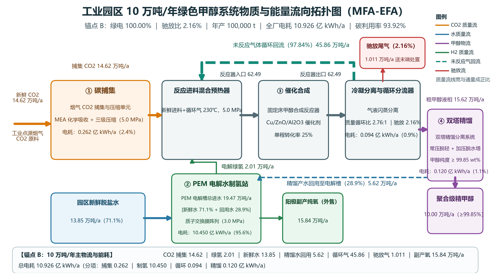

# 工业园区 10 万吨 / 年二氧化碳捕集耦合绿氢合成绿色甲醇项目环境规划与管理方案报告

> **【撰写与填报指南】**
> 本报告是《环境规划与管理》第十讲随堂实训的核心成果交付物。
> 请每位同学在完成 
>
> `code_implementation/`
>
>  目录下的四项编程实训任务并生成图表后，结合理论分析与实操数据，独立完成本报告的撰写。
> **科学严谨性要求**
>
> ：全篇必须统一使用规范的学术与工程陈述，严禁使用任何修辞性、文学性或通俗化比喻（如 “两张皮”、“领头羊”、“甜点” 等 AI 味用词）；
> **数据前后一致性要求**
>
> ：第 1-2 章的通量计算数据（任务 1）必须与第 4 章《重点工程项目库清单表》中的工程设计规模严格对应；第 4 章的工程总投资（CAPEX）必须作为第 5 章经济性现金流折现分析的直接输入；第 4-5 章必须以” 帕累托拐点（锚点 B）" 计算结果为设计基准；
> **图表嵌入要求**
>
> ：请将生成的矢量高清图正确嵌入对应章节，并展开深度科学论述。

## 报告摘要

> 📝 
>
> **【撰写指引】**
> 请在报告全部完成后撰写摘要（约 400–600 字）。需概括：① 规划项目的工程背景与建设规模；② MFA 物料平衡与全流程总碳利用率核心结论；③ 政策量化与帕累托多目标寻优得出的主推工程参数（绿电比例、驰放比、GWP 净碳足迹、LCOM 净平准化成本及 MAC 边际减排成本）；④ 重点工程项目库投资构成与年运行成本；⑤ 商业模式闭环与环境风险防控机制。

## 核心术语与缩写中英文对照表

在报告正文与图表中，首次出现的专业缩写必须严格参照下表规范标注中英文全称：

| 英文缩写        | 英文全称                                     | 中文规范全称                | 核心学科与工程定义                                                    |
| ----------- | ---------------------------------------- | --------------------- | ------------------------------------------------------------ |
| **MFA**     | Material Flow Analysis                   | 物质流分析                 | 基于质量守恒定律研究系统内物质输入、转化、蓄积与排放的定量工程方法                            |
| **EFA**     | Energy Flow Analysis                     | 能量流分析                 | 基于热力学第一与第二定律分析系统能量梯级利用与损耗的工程核算方法                             |
| **LCA**     | Life Cycle Assessment                    | 全生命周期评价               | 评估产品从原料获取、制造到处置全过程环境负荷的标准国际方法（ISO 14040）                     |
| **TEA**     | Techno-Economic Analysis                 | 技术经济分析                | 评估工艺工程资本支出、运行成本与财务可行性的工程经济学方法                                |
| **GWP**     | Global Warming Potential                 | 全球变暖潜势                | 在 100 年时间尺度内相对于二氧化碳温室效应的相对累积辐射强迫指标（$\text{kg CO}_2\text{e}$） |
| **LCOM**    | Levelized Cost of Methanol               | 平准化甲醇成本               | 全生命周期内将投资与运营总现值平摊至单位产品所形成的保本折现成本（$\text{元/t}$）               |
| **LCOH**    | Levelized Cost of Hydrogen               | 平准化氢气成本               | 全生命周期内单位质量绿氢产出的平准化折现成本（$\text{元/kg}$）                        |
| **MAC**     | Marginal Abatement Cost                  | 边际减排成本                | 相对于化石基准技术，每额外避免或减排一吨二氧化碳当量所需增加的边际货币投入                        |
| **PEM**     | Proton Exchange Membrane                 | 质子交换膜电解水制氢            | 利用固体聚合物电解质进行纯水电解的技术，具备高电流密度与快速负载响应特性                         |
| **ALK**     | Alkaline Electrolyzer                    | 碱性液体电解水制氢             | 利用氢氧化钾水溶液为电解质的成熟低成本规模化制氢技术                                   |
| **CCUS**    | Carbon Capture, Utilization, and Storage | 二氧化碳捕集利用与封存           | 将工业点源排放的二氧化碳分离提纯并转化为高附加值产品或永久封存的工程体系                         |
| **PtM**     | Power-to-Methanol                        | 绿电催化合成甲醇              | 利用清洁可再生电力制氢并与二氧化碳催化加氢合成化工级甲醇的系统工程                            |
| **CAPEX**   | Capital Expenditure                      | 固定资产资本支出              | 项目前期规划、设备购置、建筑安装与工程调试所必需的初始资本投入总和                            |
| **OPEX**    | Operating Expenditure                    | 运行维护支出                | 系统建成投产后，原料外购、电力公用工程、耗材更换及日常运维所消耗的年度运营费用                      |
| **RED III** | Renewable Energy Directive III           | 欧盟《可再生能源指令》第三版        | 欧盟关于促进可再生能源利用的法定指令（Directive (EU) 2023/2413）                 |
| **RFNBO**   | Renewable Fuels of Non-Biological Origin | 非生物源可再生燃料             | 依据欧盟法规由非生物质清洁可再生能源制备的合成燃料                                    |
| **ETS**     | Emissions Trading System                 | 碳排放权交易体系              | 基于总量控制与配额有偿 / 免费分配的市场化温室气体减排管理制度                             |
| **CCER**    | China Certified Emission Reduction       | 国家核证自愿减排量             | 经国家主管部门备案认证并允许在全国碳市场抵销配额的自愿减排项目核证减排量                         |
| **MRV**     | Monitoring, Reporting, and Verification  | 可测量、可报告、可核查体系         | 确保能源消费、生产活动与温室气体排放数据具备真实性与可信度的质量管理技术规范                       |
| **PDCA**    | Plan-Do-Check-Act                        | 策划 - 实施 - 检查 - 改进动态循环 | 强调持续改进、动态反馈与全过程闭环的现代环境系统适应性管理体系                              |

## 第 1 章 园区现状诊断与碳源 - 新能源基准线核算

### 1.1 园区产业结构与物质 - 能量代谢分析（MFA/EFA）

> 📝 
>
> **【撰写指引】**
> 请描述规划园区主导产业（煤化工、自备热电联产等）的能源消耗基准、煤炭与电力消费总量、以及工业余热资源品位分布。

本规划以大型现代煤化工园区为应用场景，园区能源系统包括煤化工生产装置、自备燃煤热电及公用工程设施；规划新增二氧化碳捕集、质子交换膜（PEM）电解水制氢、甲醇催化合成和双塔精馏单元，形成以工业点源二氧化碳和可再生电力为输入、年产 10 万吨聚合级甲醇为目标的物质与能量转换系统。现有材料未提供园区煤炭年消费量、全园区电力负荷、蒸汽平衡和余热温度分布，故本章不对其作定量外推；后续初步设计应以企业能源统计台账、计量仪表数据及热平衡测试结果补充核算。

任务 3 锚点 B 的运行参数为绿电消纳比例 $f_{\text{green}}=100.0\%$、驰放比 $r_{\text{purge}}=2.157\%$，年产甲醇 100,000 t。模型给出的单位产品综合电耗为约 $10,926.4\text{ kWh/t}$，折算年用电量约 $1.093\times10^9\text{ kWh}$。任务 4 按同一锚点及任务 1 物流模型计算，年捕集二氧化碳约 146,239.55 t、年电解绿氢约 20,096.72 t；甲醇产品产量为 100,000 t/a。以上为规划模型工况值，不代表园区现状实测消费量或现有设施产能。

该系统的主要物质代谢路径为：烟气二氧化碳经预处理、胺法捕集和压缩后，与电解制得的氢气混合；反应器出口经冷却、气液分离后，气相未反应组分按设定比例回流，少量驰放气送后续锅炉处置；粗甲醇进入双塔精馏，产品外送，副产水回用于电解槽。锚点 B 的循环气回流量约 458,568.54 t/a，精馏水回用量约 56,223.08 t/a。上述回流均为系统内部物流，不能重复计入外部原料输入或产品输出。

### 1.2 工业点源 $\text{CO}_2$ 排放清单与烟气特征解析

> 📝 
>
> **【撰写指引】**
> 结合工业实测背景，列明自备热电联产锅炉排烟参数（烟气流量、
>
> $\text{CO}_2$
>
>  摩尔体积分数、排烟温度、
>
> $\text{SO}_2$
>
>  浓度、
>
> $\text{NO}_x$
>
>  浓度、粉尘浓度），明确二氧化碳捕集工段对前置烟气预处理（深度脱硫、骤冷洗涤）的刚性技术要求。

任务 3 与任务 4 的锚点 B 计算结果表明，年捕集并送入合成系统的高纯二氧化碳约为 146,239.55 t，对应约 1,462.4 kg/t 甲醇。任务 1 数据表将捕集提纯后的新鲜二氧化碳物流标注为质量纯度 99.80%，温度 40 ℃、压力 5.0 MPa；该组参数描述的是捕集后原料气，不是锅炉原烟气。原料气进入合成工段前还需满足相应的脱水、压缩和质量控制要求。

现有数据文件未提供锅炉原烟气的标态流量、二氧化碳摩尔 / 体积分数、排烟温度、二氧化硫、氮氧化物及颗粒物浓度，也未给出各指标的连续监测时序。因此，当前模型只能确定二氧化碳捕集产品流量，不能据此反算原烟气总量、捕集率或污染物年排放量。工程设计阶段须调取烟囱连续排放监测系统（CEMS）数据，并开展代表性烟气采样，核实燃料、负荷和烟气含水率等边界条件。

在原烟气进入胺液吸收系统前，应设置与实测烟气性质相适配的除尘、深度脱硫、冷却及洗涤预处理，以降低颗粒物和酸性气体对胺液降解、腐蚀及吸收性能的不利影响。预处理设施规模、药剂耗量和污染物去除效率须在取得原烟气实测数据后确定；本报告不以未提供的浓度或去除率代替工程设计参数。

### 1.3 绿电资源禀赋与公用工程承载力评估

> 📝 
>
> **【撰写指引】**
> 阐明区域风电、光伏新能源装机潜力与有效利用小时数，核算区域弃风弃光绿电规模；评估干旱区水资源取水定额（
>
> $1.400\text{ t 水/t 甲醇}$
>
> ）对项目的刚性承载力约束。

锚点 B 采用 100% 绿电消纳作为模型输入条件，年度综合电耗约为 $1.093\times10^9\text{ kWh}$。按任务 3 的成本与排放参数，绿电结算价取 0.18 元 /kWh、排放因子取 0.035 kg CO$_2$e/kWh；模型中的非绿电对照参数分别为 0.42 元 /kWh 和 0.550 kg CO$_2$e/kWh。上述为情景核算参数。现有资料没有给出园区风电、光伏装机规模、有效利用小时数、弃电量或逐时负荷曲线，故 100% 绿电比例应理解为锚点 B 的供电情景要求，而非已经核实的园区可供电能力。可再生电源容量及并网 / 储能配置需在获得逐时资源和负荷数据后论证。

水资源核算采用任务 1 物流表中的新鲜脱盐水定额 1.385 t/t 甲醇，折合 138,500 t/a；精馏副产水回用量约 56,223.08 t/a，电解槽总进水约 194,723.08 t/a。循环水回用属于内部循环量，不等同于外部取水量。任务 2 政策引擎另按驰放比计算综合取水强度：在锚点 B 的 $r_{\text{purge}}=0.02157$ 下，$W_{\text{total}}=1.385+0.008\times(0.010/0.02157)\approx1.389\text{ t/t}$，低于政策卡片给出的 1.400 t/t 定额。两项数据分别对应 MFA 新鲜净补水和政策模型综合取水口径，后续需通过水表边界及冷却系统补水计量进行校核。

由于缺少园区可用水指标、取水许可总量、季节性水源保证率及现有用水户负荷资料，当前只能判定项目单位产品水耗低于模型定额，不能据此认定区域水资源承载力已满足。项目取水许可、枯水期保障和再生水利用方案应以水资源论证及主管部门核定指标为准。

### 1.4 园区现行碳管理痛点与减污降碳协同瓶颈

> 📝 
>
> **【撰写指引】**
> 诊断现有煤制甲醇的高碳排放强度（
>
> $+2,600.0\text{ kg CO}_2\text{e/t}$
>
> ）面临的国际绿色航运准入壁垒，分析风光发电间歇波动性与下游化工连续运转之间的失配矛盾，识别吸收剂有机胺挥发与驰放尾气燃烧等次生污染瓶颈。

项目的规划基准对照采用煤制甲醇全生命周期排放强度 $+2,600.0\text{ kg CO}_2\text{e/t}$。任务 3 锚点 B 的模型结果为净碳足迹 $-1,066.09\text{ kg CO}_2\text{e/t}$、调整后平准化甲醇成本 2,309.55 元 /t；与煤制基准相比，模型计算的单位产品温室气体差值为 3,666.09 kg CO$_2$e/t。该结果取决于锚点 B 所设定的绿电比例、能源排放因子、捕集碳信用和副产氧信用，不应替代园区年度排放清单或产品第三方核查结果。

模型边界存在需在后续成果中保持一致的碳利用率口径：任务 1 以 CSV 中 1,423 kg/t 新鲜二氧化碳与 1,000 kg/t 甲醇产品计算的产品碳比例约为 96.52%；任务 3 在锚点 B 按循环模型求解进料并计算出的碳转化率约为 93.92%。二者采用的进料边界不同，不能作为同一指标直接并列考核。报告涉及锚点 B 的比较时采用任务 3 的求解结果；涉及任务 1 CSV 基准时须注明其计算边界，并在后续模型校核中统一物料基准。

园区转型的主要约束包括：电解制氢的高电力需求使产品碳足迹对电网排放因子高度敏感；风光出力波动与催化合成、精馏的连续运行要求之间存在时间尺度差异；循环气驰放会造成碳氢原料损失并增加尾气锅炉的末端治理负荷；胺法捕集系统还需管理吸收剂挥发和含胺废液。任务 2 政策模型据此设置 RED III 认证门槛、碳市场阶梯奖惩、取水累进费用及驰放比清洁生产否决条件。针对原烟气污染物浓度、园区弃电规模和污染物实际排放量的定量判断，须待现场监测与计量数据补齐后开展。

## 第 2 章 多情景预测与系统规模匹配核算

### 2.1 规划期园区碳排放趋势与多情景设定

> 📝 
>
> **【撰写指引】**
> 设定基准情景（BAU）、常规节能改造情景与 CCU-PtM 深度脱碳协同情景，定量预测规划期内各情景下的碳排放总量与强度变化趋势。

本章设置三个边界清晰的比较情景。情景一为现有煤制甲醇参考线，采用政策卡片规定的 $+2,600.0\text{ kg CO}_2\text{e/t}$ 作为行业基准，不将其伪装成任务 3 模型中的电制甲醇方案。情景二、三为同一循环工况下的电制甲醇过渡情景与锚点 B 推荐情景，均采用任务 3 的耦合模型，固定驰放比为锚点 B 的 2.157%，仅改变绿电比例，以识别供电结构对环境与经济结果的影响。

| 情景        | 模型边界 / 参数                                           | 净碳足迹 GWP (kg CO$_2$e/t) | 政策调整 LCOM (元 /t) | 政策判定                      |
| --------- | --------------------------------------------------- | ----------------------- | ---------------- | ------------------------- |
| 煤制甲醇参考线   | 行业比较基准                                              | +2,600.00               | 未在本组耦合模型中计算      | 国内碳排放比较基准                 |
| 电制甲醇非绿电对照 | $f_{\text{green}}=0\%$，$r_{\text{purge}}=2.157\%$   | +4,560.99               | 7,376.63         | `Redline_Vetoed`          |
| 多能互补过渡    | $f_{\text{green}}=65\%$，$r_{\text{purge}}=2.157\%$  | +903.39                 | 4,221.17         | `Domestic_Compliant`      |
| 锚点 B 推荐情景 | $f_{\text{green}}=100\%$，$r_{\text{purge}}=2.157\%$ | -1,066.08               | 2,309.54         | `RED_III_RFNBO_Certified` |

三种电制甲醇情景使用相同的 MFA 循环效率与单位产品综合电耗，比较差异来自任务 3 设定的电力价格和排放因子。模型未提供风光资源逐时序列、弃电量或规划期装机增量，故本节不外推园区年度总排放变化，也不据单一产品工况推算全园区减排总量。上述情景用于项目方案比较，不替代园区温室气体清单和电力系统规划。

### 2.2 碳捕集 - 绿氢 - 甲醇（CCU-PtM）系统耦合与物料 / 能量衡算

> 📝 
>
> **【撰写指引】**
> 结合催化反应方程式与任务 1 求解结果，说明化学计量进料比、单程转化率（
>
> $25.0\%$
>
> ）与系统总碳转化利用率（
>
> $96.0\%$
>
> ）的平衡机理；在此处插入生成的图 1，并完成 10 万吨 / 年工程规划通量清单表。

*图 1 锚点 B 工况下工业园区绿色甲醇系统物质流（MFA）与能量流（EFA）拓扑图；数值取自任务 1、任务 3 与任务 4 的当前模型输出。*

| 物料节点名称                     | 单吨甲醇实物定额                  | 10 万吨 / 年工程规划通量         | 物质状态与物理参数                            | 来源与去向说明                |
| -------------------------- | ------------------------- | ----------------------- | ------------------------------------ | ---------------------- |
| **新鲜捕集高纯&#x20;****&#x20;** | 约 $1,462.4\text{ kg/t}$   | $14.624\text{ 万吨/年}$    | 气体；源表捕集后物流为 40 ℃、5.0 MPa、质量纯度 99.80% | 任务 3 锚点 B 新鲜进料求解值      |
| **电解水新鲜绿氢**                | 约 $201.0\text{ kg/t}$     | $2.010\text{ 万吨/年}$     | 绿电电解制氢；设备边界按任务 1 模型                  | 任务 3 锚点 B 新鲜进料求解值      |
| **外购净除盐纯水**                | $1,385\text{ kg/t}$       | $13.850\text{ 万吨/年}$    | 液体；CSV 净补水物流                         | 任务 1 数据表 S03           |
| **精馏冷凝副产水回用**              | 约 $562.2\text{ kg/t}$     | $5.622\text{ 万吨/年}$     | 精馏冷凝副产水，回用于电解槽进水                     | 任务 1 数据表 S13；内部循环量     |
| **电解槽总进水**                 | 约 $1,947.2\text{ kg/t}$   | $19.472\text{ 万吨/年}$    | 净补水与回用水之和                            | 任务 1 S03 与 S13 物流加总    |
| **未反应气内循环流**               | 约 $4,585.7\text{ kg/t}$   | $45.857\text{ 万吨/年}$    | 高压分离气回流；锚点 B 驰放比 2.157%              | 任务 1 MFA 方程在锚点 B 工况下求解 |
| **系统驰放废气**                 | 约 $101.1\text{ kg/t}$     | $1.011\text{ 万吨/年}$     | 分离器顶部驰放气；去向按后续锅炉处置设计                 | 任务 1 MFA 方程在锚点 B 工况下求解 |
| **反应器入口混合气**               | 约 $6,249.0\text{ kg/t}$   | $62.490\text{ 万吨/年}$    | 新鲜进料与循环气混合                           | 任务 1 MFA 求解值           |
| **主产品聚合级精甲醇**              | $1,000\text{ kg/t}$       | $10.000\text{ 万吨/年}$    | 液体；产品质量基准                            | 任务 1 数据表 S12           |
| **副产工业高纯纯氧**               | $1,584\text{ kg/t}$       | $15.840\text{ 万吨/年}$    | 电解槽阳极副产氧，质量纯度 99.90%                 | 任务 1 数据表 S05           |
| **全厂年总综合电耗**               | 约 $10,926.4\text{ kWh/t}$ | $10.926\text{ 亿 kWh/年}$ | 捕集压缩、电解制氢、循环压缩和精馏                    | 任务 3 锚点 B 电耗模型         |

注：本表以任务 3 锚点 B 的工况变量驱动任务 1 MFA 方程，数值与任务 1 默认 $r_{\text{purge}}=1.0\%$ 的独立基准运行结果不同。项目实施设计应统一物料衡算边界后再定版。

### 2.3 绿电波动性约束下的柔性容量寻优与储氢 / 网电缓冲配置

> 📝 
>
> **【撰写指引】**
> 论证 ALK（碱性）与 PEM（质子交换膜）电解槽的混联配比（如 100 MW ALK + 30 MW PEM），计算维持下游合成装置 8,000 小时连续运行所需的缓冲储氢球罐容积，以及电网调峰的托底机制。

锚点 B 下模型给出的年电解绿氢量约为 20,096.72 t，按合成装置年运行 8,000 h 计算，平均供氢速率约为 $2.512\text{ t/h}$。电解制氢分项电耗约为 $1.045\times10^9\text{ kWh/a}$，相同运行小时数下对应平均电负荷约 130.63 MW。该值与任务 1 数据表描述的 130 MW PEM 电解槽名义规模接近但略高，说明设计阶段须复核名义容量、可用率、电耗边界及年运行小时数，不能直接把模型平均负荷等同于设备额定容量。

PEM 电解槽具备较快的负荷调节能力，适宜承担风光出力变化下的跟随运行；甲醇合成反应器及精馏系统则宜维持稳定工况。规划上应采用 “可再生电力优先直供 — 电解槽柔性调节 — 氢气缓冲 — 合成端连续运行” 的系统配置逻辑，并以电解槽降载、储氢补给和必要的合规电网支撑共同应对短时功率缺口。现有任务模型只覆盖 PEM 电解与年平均能耗，未包含 ALK/PEM 混联优化、风光逐时出力、设备最低负荷、启停寿命成本或电网备用约束，因此不据此指定未经计算的电解槽混联比例。

储氢缓冲容量应由逐时氢气供需差积分确定。以锚点 B 平均供氢需求估算，每小时完全中断制氢需由可用储氢补充约 2.512 t 氢；若设计缓冲时长为 $T$ 小时，则可用氢量的初步核算式为 $M_{\text{buffer}}\approx2.512T\text{ t}$，尚未计入储罐工作压力区间、压缩损耗、备用系数和不可用余量。因项目资料未提供风光逐时曲线、连续低出力持续时间及储氢压力参数，本阶段不能给出储氢球罐容积或最终储量；这些数值须在气象年序列、负荷调度和安全设计完成后确定。

## 第 3 章 规划目标与指标体系设计

### 3.1 规划总目标与分期节点

> 📝 
>
> **【撰写指引】**
> 明确近期首期示范工程（2027–2028 年）与远期规模化外销与碳中和转型（2029–2035 年）的阶段性定位与目标。

规划期分为示范建设与规模化论证两个阶段。近期（2027—2028 年）以年产 10 万吨绿色甲醇示范线为对象，采用任务 3 锚点 B 作为方案设计工况：绿电消纳比例 100.0%、驰放比 2.157%、净碳足迹约 $-1,066.08\text{ kg CO}_2\text{e/t}$、政策调整后 LCOM 约 2,309.54 元 /t。近期工作重点为完成可研与环评、落实绿电供应和取水许可、统一任务 1 与任务 3 的物料衡算边界，并完成连续运行验证及 MRV 数据链建设。

远期（2029—2035 年）不预设未经模型论证的扩建产能或园区减排总量。扩建须以锚点 B 示范线的连续运行数据、可再生电力逐时可得性、区域水资源论证、政策合规性及产品市场需求为决策输入，重新开展 MFA-LCA-TEA-Policy 联合寻优。每个扩建阶段均应复核产品碳足迹、绿电属性、资源效率和次生污染控制能力；不满足环境准入条件的项目不得以扩大规模替代技术整改。

### 3.2 规划指标矩阵（约束性指标 vs. 预期性指标）

请完善下表中的目标值设定，并说明各指标的核算方法与考核属性：

| 目标维度   | 指标名称                      | 单位        | 现状基准值（2026 年）     | 近期目标值（2028 年）           | 远期目标值（2035 年）     | 指标属性 | 核算依据与标准方法            |
| ------ | ------------------------- | --------- | ----------------- | ----------------------- | ----------------- | ---- | -------------------- |
| 环境与降碳  | 新鲜捕集 CO₂ 量                | 万吨 / 年    | 现有装置数据待核实         | 14.624（锚点 B）            | 随扩建方案重新核算         | 约束性  | CO₂ 质量流量计累计值         |
| 环境与降碳  | 吸收塔 CO₂ 捕集脱除率             | %         | 原烟气数据待监测          | 设计 / 验收测试后核定            | 扩建环评及验收核定         | 约束性  | 原烟气与净化气流量、组分差额法      |
| 环境与降碳  | 产品净碳足迹 GWP$_{net}$        | kg CO₂e/t | 煤制甲醇对照基准 +2,600.0 | -1,066.08（锚点 B 模型值）     | 按扩建能源结构重新计算       | 约束性  | 统一功能单位及边界的 LCA 清单核算  |
| 环境与降碳  | RED III RFNBO 认证符合性       | 状态        | 未取得项目核证           | 锚点 B 模型具备资格；以第三方认证为准    | 持续满足法规并通过复核       | 约束性  | 认证机构核查及可再生电力溯源       |
| 能源与资源  | 绿电消纳比例 $f_{\text{green}}$ | %         | 园区现状待计量           | 100.0%（锚点 B 输入条件）       | 根据新增电源与负荷曲线核定     | 约束性  | 绿电合同、溯源凭证和分时计量       |
| 能源与资源  | 制氢电耗                      | kWh/kg H₂ | 现状设备数据待测试         | 52.0（任务 3 模型参数）         | 通过设备更新降低，目标值待论证   | 预期性  | 整流柜电量与氢气质量流量计        |
| 能源与资源  | 新鲜脱盐水取水量                  | t 水 /t 甲醇 | 园区基准待实测           | 1.385（任务 1 CSV 定额）      | 不高于近期核定值；按扩建水评审复核 | 约束性  | 新鲜水边界流量计累计值          |
| 能源与资源  | 精馏副产水回用率                  | %         | 现状待监测             | 28.9%（回用水 / 电解槽总进水，模型值） | 至少保持经试运行核定值       | 预期性  | 精馏产水与电解槽进水计量平衡       |
| 污染协同控制 | MEA 有机胺逸散浓度               | mg/Nm³    | 原始监测值待取得          | 按环评批复及适用标准核定            | 按排污许可和标准执行        | 约束性  | 吸收塔出口采样及适用方法监测       |
| 污染协同控制 | 驰放尾气锅炉 NOₓ 排放浓度           | mg/Nm³    | 锅炉监测值待取得          | 按环评批复及适用标准核定            | 按排污许可和标准执行        | 约束性  | 锅炉烟囱 CEMS 及质量保证程序    |
| 污染协同控制 | 碳转化利用率（任务 3 口径）           | %         | 基准模型 / 实测待统一      | 93.92%（锚点 B 模型值）        | 扩建模型复核后确定         | 约束性  | 任务 3 MFA 边界及现场碳流量计核验 |

注：远期扩建量、捕集脱除率及污染物浓度尚无对应仿真或监测数据，均作为待核定指标管理，不以未经验证的目标值替代环评、排污许可或工程验收要求。任务 1 CSV 产品碳比例与任务 3 循环模型碳转化率使用不同进料边界，正式考核前须统一核算口径。

## 第 4 章 空间落位布局与重点工程实施方案

### 4.1 园区 “源 - 网 - 荷 - 储 - 化” 空间管控与红线

> 📝 
>
> **【撰写指引】**
> 详细描述碳捕集岛、绿氢制备区、储氢球罐区、合成与精馏装置区、架空管廊带的空间落位方案；核算涉氢区域的防火防爆安全防护距离（
>
> $\ge 150\text{ m}$
>
> ），说明项目对生态红线与敏感水体的避让情况。

规划总图按 “源 — 网 — 荷 — 储 — 化” 关系组织。碳捕集单元靠近自备热电点源布置，以缩短烟气接入及高纯 CO₂ 输送距离；电解制氢与储氢设施集中设置于具备独立安全管理条件的能源转换区；合成反应器、气液分离、循环压缩和双塔精馏布置于化工生产区；CO₂、氢气、回流水和公用工程管线沿专用管廊接入各单元。产品储运接口与氢气、氧气及 CO₂ 管线分区管理，避免交叉穿越主要道路和人员密集区域。

涉氢装置区、储氢设施与其他生产及办公设施之间应设置符合现行防火、防爆、安全评价和总图规范的安全间距；现有规划提纲提出的 150 m 可作为选址阶段的初步控制条件，不能代替基于设备压力、储量、泄漏场景和周边敏感目标开展的定量风险评价。项目红线、环境敏感目标、洪涝和地质灾害风险、事故水收集路径及消防通道须在取得园区地形图和法定控制线后落实，当前材料不足以确认具体地块坐标或边界距离。

氢气和高压 CO₂ 输送管线应分设或按规范采取隔离措施，并设置压力监测、泄漏检测、紧急切断及检修隔离点。胺液再生、废水处理和驰放气锅炉等潜在污染源应布置于便于收集处理、远离敏感水体的区域；最终布局以园区总体规划、环境影响评价和安全设施设计审查结论为准。

### 4.2 核心单元工艺比选与工程设计

> 📝 
>
> **【撰写指引】**
> 说明碳捕集单元选用低能耗相变两相胺吸收解吸工艺的理由；阐明制氢站混联配置方案；阐述甲醇合成反应放热中压蒸汽回供碳捕集再沸器的热集成热力学耦合机理。

碳捕集工程按任务 1 与任务 3 的流程边界配置烟气预处理、胺法吸收再生和 CO₂ 压缩。任务 1 数据表给出的捕集后 CO₂ 物流条件为 40 ℃、5.0 MPa、质量纯度 99.80%；锅炉原烟气组分尚待实测，吸收剂类型、塔器尺寸及预处理能力须据烟气分析和工艺保证条件完成详细设计。任务 3 锚点 B 的 CO₂ 捕集及压缩电耗折合约 0.262 亿 kWh/a。

制氢单元按现有模型采用 PEM 电解水路线。锚点 B 年氢需求约 20,096.72 t，年制氢电耗约 10.450 亿 kWh，平均电负荷约 130.63 MW。采用 PEM 的负荷调节能力与锚点 B 的高比例绿电工况相适配；若后续论证采用 ALK/PEM 混联，应在设备部分负荷效率、启停寿命、储氢成本和逐时电力出力模型完善后另行比较。储氢系统容量与压力等级不由当前任务 3 年平均模型直接确定。

合成单元采用固定床催化反应、冷凝气液分离及未反应气循环拓扑，单程 CO₂ 转化率按任务 1 基准 25% 处理，锚点 B 的驰放比为 2.157%。回流气经压缩返回反应器入口，驰放尾气进入经论证的末端处置设施；驰放尾气锅炉的实际燃料适应性、NOₓ 排放及热值利用须由设备与排放测试确定。双塔精馏用于产品提纯，副产水按任务 1/4 物流回用至电解槽进水系统，锚点 B 回用量约 56,223.08 t/a。

任务模型将捕集、制氢、循环压缩和精馏电耗分别计入综合电耗，但未提供反应放热品位、蒸汽产量、再沸器负荷或换热网络计算。因此，反应热回用于捕集再生或精馏再沸器仅作为后续热集成设计方向，不在本阶段计入已验证的节能量或投资收益。热集成方案须经热量衡算、夹点分析及全年工况校核后确定。

### 4.3 园区重点工程项目库清单表（基于帕累托拐点锚点 B）

请依据任务 3 求解得出的” 帕累托拐点（锚点 B）“计算结果，将总投资与工程指标分解填入下表：

| 工程编号    | 工程模块名称    | 项目名称                 | 建设性质     | 空间落位（规划建议）      | 核心工艺与锚点 B 设计规模                                                     | 建设周期（建议）  | CAPEX（亿元）                   | 年 OPEX（万元 / 年）   | 预期环境与资源效益                                                  | 责任实施主体（建议）  |
| ------- | --------- | -------------------- | -------- | --------------- | ------------------------------------------------------------------ | --------- | --------------------------- | ---------------- | ---------------------------------------------------------- | ----------- |
| 工程 - 01 | 碳源捕集与精制   | 热电厂烟气 CO₂ 捕集及压缩      | 新建       | 热电及公用工程区，靠近点源   | 预处理、胺法捕集与压缩；CO₂ 约 14.624 万吨 / 年                                    | 2027—2028 | 待可研分解                       | 待可研分解            | 为合成系统提供模型所需 CO₂；原烟气排放削减量以实测与捕集率核定                          | 热电企业及园区项目公司 |
| 工程 - 02 | 绿氢制备与缓冲   | PEM 电解制氢及储氢设施        | 新建       | 能源转换区，设置独立安全边界  | 年产氢约 2.010 万吨；年制氢电耗约 10.450 亿 kWh；储氢规模待逐时平衡计算                      | 2027—2028 | 待可研分解                       | 待可研分解            | 锚点 B 绿电比例 100%；副产纯氧约 15.840 万吨 / 年                         | 绿氢项目投资及运营主体 |
| 工程 - 03 | 甲醇催化合成    | CO₂ 加氢合成及循环气系统       | 新建       | 化工生产区，邻接分离与精馏单元 | 年产 10 万吨甲醇；单程转化率按 25%；驰放比 2.157%；碳转化率按任务 3 口径为 93.92%              | 2027—2029 | 待可研分解                       | 待可研分解            | 锚点 B GWP 为 -1,066.08 kg CO₂e/t；尾气治理效果需专项核算                 | 园区化工项目公司    |
| 工程 - 04 | 精馏提纯与节水   | 双塔精馏及副产水回用           | 新建       | 化工生产区，靠近电解槽回水管线 | 聚合级甲醇 10 万吨 / 年；副产水回用约 56,223.08 t/a；新鲜净补水 138,500 t/a             | 2028—2029 | 待可研分解                       | 待可研分解            | 回收精馏副产水并降低外部补水需求；以回水水质与流量验收                                | 水务环保运营主体    |
| 工程 - 05 | 管廊输配与 MRV | CO₂、氢气、公用工程管廊及能碳计量平台 | 新建 / 改扩建 | 专用管廊及园区监管中心     | 依据任务 4 物流设计管径与计量点；建设在线电量、质量流量、碳数据采集系统                              | 2027—2029 | 待可研分解                       | 待可研分解            | 支撑物料闭合核算、绿电溯源和排放数据审计；具体设备清单待 FEED 确定                       | 园区管委会及平台公司  |
| 合计      | —         | 10 万吨 / 年绿色甲醇示范工程    | —        | —               | 甲醇 100,000 t/a；锚点 B GWP -1,066.08 kg CO₂e/t；调整后 LCOM 2,309.54 元 /t | 2027—2029 | 模型隐含总 CAPEX 约 14.88；项目分项待可研 | 模型未输出项目级 OPEX 分项 | 年产品碳差额约 366,608 t CO₂e（相对 2,600 kg/t 煤制基准的模型差值；非园区清单实测减排量） | 园区政企协同推进专班  |

投资口径说明：任务 3 锚点 B 的资本年金项为 $835.2+680.0=1,515.2\text{ 元/t}$；按背景核算所用 CRF 0.10185 和年产 100,000 t 反推，模型隐含总 CAPEX 约 14.88 亿元。该反推值含储能增量年金，属于模型总量级估算，不是经概算审查的工程投资。任务 3 未按工程模块给出 CAPEX 或 OPEX；其基础 LCOM 中扣除资本年金后的年非资本净成本约 23,754 万元，包含电力、原料、水与运维等成本并扣除了副产氧收益，不能直接等同于纯 OPEX，故工程级分项均待可研 / FEED 估算。

## 第 5 章 全生命周期环境影响（LCA）、技术经济（TEA）与帕累托多目标决策评估

### 5.1 全生命周期环境影响评估（LCA）与 “绿电悖论” 推演

> 📝 
>
> **【撰写指引】**
> 说明 LCA 评价边界与碳足迹核算模型，对比情景 A（100% 绿电）与情景 B（常规区域工业电网）的净碳足迹结果，基于热力学原理阐述高碳电力下间接增排的机制，阐明 “严禁在未实现电力深度脱碳地区审批电解水制氢化工项目” 的环境规划准则；评价水资源消耗转移与吸收剂二次逸散风险。

本节采用任务 3 的功能单位和模型边界，以生产 1 t 甲醇为核算基准。净生命周期温室气体排放按模型公式核算：电力消耗的间接排放与基础设施、驰放相关排放之和，扣除新鲜捕集 CO₂ 的产品固定信用及副产氧替代信用。电力排放因子按绿电比例加权，模型取绿电 0.035 kg CO₂e/kWh、常规区域电网 0.550 kg CO₂e/kWh。系统综合电耗、CO₂/H₂ 新鲜进料量及循环损失随驰放比变化。该边界属于任务 3 的方案比较边界，不能替代企业组织温室气体盘查；上游电力基础设施、区域电力逐时变化及吸收剂具体逸散组分未单独形成可核验清单。

| 比较工况     | 绿电比例   | 驰放比    | 净碳足迹 GWP（kg CO₂e/t 甲醇） | 政策调整后 LCOM（元 /t 甲醇） | 政策状态                      |
| -------- | ------ | ------ | ---------------------- | ------------------- | ------------------------- |
| 常规区域电网对照 | 0.0%   | 2.157% | +4,560.99              | 7,376.63            | `Redline_Vetoed`          |
| 锚点 B 基准  | 100.0% | 2.157% | -1,066.09              | 约 2,309.5           | `RED_III_RFNBO_Certified` |

在锚点 B 工况下，电解制氢用电约为 10,450 kWh/t，占系统综合电耗约 10,926 kWh/t 的 95.6%。将供电排放因子由 0.035 提高至 0.550 kg CO₂e/kWh，在其他工况参数保持不变时，显著增加电力上游的间接排放，使产品净碳足迹由负值转为明显正值。其热力学及生命周期原因是，电解槽所需电功必须由电力系统提供；当边际电源以化石能源为主时，发电燃料转换、热力循环及输配环节的能量损失对应额外的一次能源消耗和温室气体排放。电解水本身不排放 CO₂，并不意味着其生命周期排放为零。模型对照工况的 GWP 高于煤制甲醇基准 2,600 kg CO₂e/t，说明在高碳电力条件下将电解制氢作为减碳措施缺乏环境效益。因此，规划审批应以可核验的低碳电力来源和生命周期排放核算为前置条件；未能满足相应减排及认证要求的项目，不应按绿色燃料或深度减碳项目核准。

水资源方面，任务 1 的 MFA 新鲜净补水定额为 1.385 t/t 甲醇；任务 2 按锚点 B 驰放比计算的政策取水强度约为 1.389 t/t，低于模型定额 1.400 t/t。两者计量边界不同，且模型未量化发电侧间接耗水、区域水源季节性可供量及取水对其他用水户的影响，不能据此认定区域水资源承载力已满足。工程环评和取水论证仍须核定水源、许可总量及枯水期保障，并落实精馏副产水回用。

模型对驰放气及基础设施相关排放设有合并核算项，但未单列胺液挥发、降解产物、废液处置或吸收剂补充量。因此，胺类物质的二次逸散及含胺废液污染风险尚未被现有 GWP 数值充分表征。工程设计应配置吸收剂储运密闭、尾气洗涤、废液分类收集和处理，并通过监测及物料台账补充实际排放数据；这些控制措施的去除效率和减排量须在后续设计、调试及监测中验证，不计作本模型已实现的减排信用。

### 5.2 技术经济分析（TEA）与平准化甲醇成本核算

> 📝 
>
> **【撰写指引】**
> 列明财务折现参数（WACC 8.0%、运营期 20 年、CRF 0.10185），拆解基础 CAPEX 与 OPEX，分析电价变动对 LCOM 与 MAC 的敏感性响应。

任务 3 的技术经济分析以加权平均资本成本（WACC）8.0%、运营期 20 年为财务边界，对应资本回收系数（CRF）0.10185。锚点 B 的基础平准化甲醇成本由电力、资本年金、CO₂ 捕集成本、水及运维成本和副产氧收益构成。模型按 100,000 t/a 产量及资本年金 1,515.2 元 /t 反推的隐含总资本支出约为 14.88 亿元；该数值为模型年金项的反推总量，不是项目核准概算，也未分解至工程单元。

| 锚点 B 基础成本构成 | 模型值（元 /t 甲醇）  | 口径说明                                     |
| ----------- | ------------- | ---------------------------------------- |
| 综合电力成本      | 约 1,966.8     | 10,926.4 kWh/t × 0.18 元 /kWh             |
| 资本年金        | 1,515.2       | 835.2 元 /t 基础年金与 680.0 元 /t 绿电波动储能增量年金之和 |
| 捕集 CO₂ 成本   | 约 380.2       | 按新鲜 CO₂ 进料量和模型捕集成本核算                     |
| 水及运维成本      | 350.0         | 任务 3 模型合并项                               |
| 副产氧收益抵扣     | 约 -321.5      | 按模型副产氧收益抵扣                               |
| **基础 LCOM** | **约 3,890.6** | 各项合计，四舍五入                                |

基础 LCOM 扣除资本年金后的非资本净成本约为 2,375.4 元 /t，按设计产量折算约 2.375 亿元 /a。该净成本含捕集 CO₂ 费用及氧气收益抵扣，不等同于未经抵扣的项目年度 OPEX；任务 3 未输出工程级 OPEX 分项，故不能将其作为工程预算直接使用。任务 2 政策修正进一步计入 RED III 模型补贴、碳市场激励、水资源税及次生污染治理费用，锚点 B 调整后 LCOM 约为 2,309.5 元 /t。政策模拟收益不代表补贴、碳信用或产品溢价已获主管部门确认。

为识别电价影响，以下敏感性计算固定锚点 B 的物料参数、排放因子、政策状态及其他成本项，仅改变电价；因此，它表示电价对成本的单因素影响，不是电力结构变化的完整情景预测。

| 电价（元 /kWh） | 调整后 LCOM（元 /t 甲醇） | MAC（元 /t CO₂e） |
| ---------- | ----------------- | -------------- |
| 0.10       | 约 1,435.4         | 约 -290.4       |
| 0.18（锚点 B） | 约 2,309.5         | 约 -52.0        |
| 0.30       | 约 3,620.7         | 约 305.7        |

锚点 B 的电耗固定时，电价每上升 0.01 元 /kWh，基础 LCOM 约增加 109.3 元 /t 甲醇；政策修正项在上述单因素计算中保持不变。电价升高会削弱相对于煤制甲醇成本基准的优势，并推高 MAC；如果电价变化同时伴随电力排放因子变化，则 GWP、碳市场修正和认证状态也会改变，须按任务 3 完整模型重新计算，不能用本表直接外推。

### 5.3 政策规制约束下的帕累托多目标决策与三大锚点深度比选

> 📝 
>
> **【撰写指引】**
> 在此处插入任务 3 生成的双子图，结合任务 3 导出的数值完成三大决策锚点比选表，深入对比锚点 A、B、C 在工程调控参数、经济性与减碳效益上的差异，论证为什么推荐拐点方案（锚点 B）作为本工程设计的基准。

*图 2 政策规制与多约束耦合下的多目标帕累托前沿及锚点 B 标定图，来源为任务 3 求解结果。*

| 帕累托决策锚点名称                                   | 调控参数组合 $(f_{\text{green}}, r_{\text{purge}})$ | 系统总碳利用率 $\eta_{\text{carbon}}$ | 净碳足迹 $\text{GWP}_{\text{net}}$ ($\text{kg/t}$) | 基础成本 $\text{LCOM}_{\text{base}}$ ($\text{元/t}$) | 调整后净成本 $\text{LCOM}_{\text{adj}}$ ($\text{元/t}$) | 边际减排成本 $\text{MAC}$ ($\text{元/t CO}_2\text{e}$) | 法规合规状态判定                  | 规划定位与采纳建议                    |
| ------------------------------------------- | --------------------------------------------- | ------------------------------ | ---------------------------------------------- | ----------------------------------------------- | ------------------------------------------------ | ----------------------------------------------- | ------------------------- | ---------------------------- |
| **锚点 A：成本极小化方案**\*(Cost-Minimization)\*     | (100.0%, 0.84%)                               | 97.60%                         | -1,038.2                                       | 3,838.4                                         | 2,235.9                                          | -72.6                                           | `RED_III_RFNBO_Certified` | 成本优先的可行基准；碳足迹改善幅度低于 B、C      |
| **锚点 B：帕累托拐点**\*(Knee Point / 主推基准)\*       | (100.0%, 2.16%)                               | 93.92%                         | -1,066.1                                       | 3,890.6                                         | 约 2,309.5                                        | -52.0                                           | `RED_III_RFNBO_Certified` | 环境绩效与调整后成本的平衡点；推荐作为近期实施基准    |
| **锚点 C：深度负碳极限方案**\*(Deep-Decarbonization)\* | (100.0%, 3.50%)                               | 90.51%                         | -1,091.9                                       | 3,961.0                                         | 2,401.6                                          | -26.7                                           | `RED_III_RFNBO_Certified` | 追求更低 GWP 的远期升级方案，成本较高且碳利用率较低 |

注：任务 3 从 3,000 组候选工况中剔除政策一票否决解和被支配解后，在可行帕累托前沿上选择锚点。锚点 A 为调整后 LCOM 最低点，锚点 B 为归一化目标空间内距乌托邦理想点最近的点，锚点 C 为 GWP 最低点。MAC 按任务 2 的口径，以煤制甲醇 GWP 基准 2,600 kg CO₂e/t 和价格基准 2,500 元 /t 计算；负值表示模型调整后 LCOM 低于该价格基准，而非减排量为负。

三种锚点均采用 100% 绿电，主要差异来自驰放比。驰放比由 A 的约 0.84% 增至 B 的 2.16% 和 C 的 3.50% 时，模型碳利用率由 97.60% 降至 93.92% 和 90.51%，净碳足迹则依次改善至 -1,038.2、-1,066.1 和 -1,091.9 kg CO₂e/t；与此同时，调整后 LCOM 由 2,235.9 元 /t 增至约 2,309.5 元 /t 和 2,401.6 元 /t。该趋势反映了更低 GWP 与更高成本之间的权衡，且驰放损失会增加原料补充及末端处理负担。

锚点 A 的成本最低，但相较 B 的 GWP 高约 27.8 kg CO₂e/t；锚点 C 相较 B 的 GWP 进一步降低约 25.8 kg CO₂e/t，但调整后 LCOM 增加约 92.1 元 /t，且总碳利用率下降。锚点 B 位于成本与环境目标的折中位置，是任务 3 采用归一化乌托邦距离方法识别的帕累托拐点，避免单独追求最低成本或最低 GWP 所导致的目标偏置。基于当前模型边界，推荐锚点 B 作为近期工程设计基准；锚点 A 可作为成本敏感条件下的备选比较工况，锚点 C 可作为后续进一步压低碳足迹的升级方向。最终实施参数仍须经逐时绿电供应、设备动态性能、碳核算边界和工程概算验证。

## 第 6 章 制度保障、商业模式与智慧环境管理机制

### 6.1 商业闭环与绿色投融资机制

> 📝 
>
> **【撰写指引】**
> 设计项目资本金、国家绿色低碳示范预算资金、超长期特别国债与绿色信贷的资金拼盘方案；说明国际远洋船舶长周期绿色燃料长协溢价补贴（
>
> $-1,200\text{ 元/t}$
>
> ）、国内 CCER 碳配额交易收益、以及副产纯氧外售收益的综合商业反哺闭环。

本项目融资应以经可行性研究、工程设计和审查程序核定的建设投资及现金流为基础，形成项目资本金、符合申报条件的绿色低碳示范资金、超长期特别国债等政策性资金，以及绿色信贷的组合安排。资金用途分别对应主体装置建设、节能降碳技术应用、园区公用工程与在线监测能力建设；各类资金的适用范围、申报条件、偿还责任及重复支持限制须在融资方案中逐项核实。现阶段模型未给出贷款条件、补助承诺或工程级投资分配，不据此设定资金比例或融资成本。

运营收益按可核证程度分层管理。第一层为甲醇产品销售收入，优先通过与航运燃料用户或下游采购方签订中长期购销协议降低价格和需求不确定性；第二层为绿色燃料溢价。任务 2 在满足 RED III/RFNBO 模型判定条件时，将 1,200 元 /t 甲醇作为政策情景成本抵扣。锚点 B 满足模型所设条件，但该参数是政策引擎的情景输入，不等同于已经签署的采购协议、可实现的市场售价或已取得的认证，项目财务评价应以实际认证与合同条款为准。

第三层为碳资产收益。锚点 B 的模型净碳足迹约为 -1,066.09 kg CO₂e/t，任务 2 据此按煤制甲醇基准 2,600 kg CO₂e/t、模型碳价 100 元 /t CO₂e 和 1.2 倍负碳激励系数计算成本抵扣。该测算仅代表政策引擎假设；实际 CCER 收益须以适用方法学、项目额外性与边界论证、监测报告、审定核查、登记签发及交易为前提，不得作为已确认收入提前用于偿债。第四层为副产高纯氧销售。任务 3 将副产氧外售价值纳入基础 LCOM 抵扣；实际收入仍取决于氧气质量、供需匹配、储运条件和购销合同，不能将模型抵扣额直接视为现金收入。

项目公司宜将产品销售、经核实的绿色溢价、经签发的碳资产收益及副产氧收入分别记录，按照融资合同约定优先保障原料采购、装置运行、环境治理和债务偿付。财务模型应区分基础经营现金流与附条件政策收益，并对未获认证、未签订溢价长协、CCER 未签发及副产氧无法外售等情况开展敏感性分析，避免对同一减排属性重复申领补贴、碳收益或绿色溢价。

### 6.2 数字化监测、报告与核查（MRV）体系

> 📝 
>
> **【撰写指引】**
> 规划部署绿电溯源电表、质量流量计、在线 CEMS 与区块链数据存证管理云平台，实现碳足迹全流程可测量、可报告、可核查（MRV）。

在线 MRV 平台以锚点 B 的 MFA/LCA 核算边界为数据组织基础，建立计量点、数据责任人、校验规则及审计记录之间的对应关系。能源侧分别记录绿电来源、购电量、厂内消纳量及各主要工段电耗，并留存绿电交易、结算和属性凭证；物料侧在捕集 CO₂、补充氢气、循环气、驰放气、甲醇产品、副产氧及回用水等关键物流设置质量流量或经校准的等效计量。烟气排放数据接入连续排放监测系统（CEMS），并与生产负荷、燃料及捕集装置运行记录关联。具体仪表量程、精度等级、校准周期和监测因子由工程设计、适用标准及第三方核查方案确定，当前模型未规定这些设备参数。

平台按批次和时间序列归集计量数据，保留原始读数、仪表状态、校准维护、人工修订及审批轨迹；对电量与产量、CO₂ 捕集量与甲醇产品量、氢气消耗与电解槽负荷、进出水量与回用量开展平衡校验。对缺测、越限、仪表故障或数据修订应形成异常标记和处理记录，不以未经说明的插补值替代实测数据。根据经确认的 LCA 方法和排放因子版本，平台可生成产品 GWP、单位产品能耗及水耗等报告，并输出数据来源、边界、假设和不确定性说明。

数据权限按生产运营、园区管理、核查机构和监管要求分级配置；对关键数据采用防篡改存证和备份机制，必要时使用区块链或等效技术记录数据摘要与审批事件。存证技术不替代计量器具检定、原始凭证管理、数据质量控制或独立核查。产品碳足迹声明、RFNBO 认证材料及 CCER 申请文件应分别遵循相应制度要求，平台生成的模型结果不得直接作为认证或签发结论。

### 6.3 环境风险防控与适应性管理（PDCA）机制

> 📝 
>
> **【撰写指引】**
> 制定针对涉氢厂房 Ex d II CT4 级防爆、通风联锁与 ESD 紧急切断预案，高浓度二氧化碳管道泄漏红外监测，以及吸收液防渗土工膜与应急池（
>
> $\ge 1,500\text{ m}^3$
>
> ）处置措施；阐明基于计划（P）、执行（D）、检查（C）、改进（A）的三年动态修编适应性管理机制。

风险防控以风险源识别、工程控制、监测报警和应急处置相结合。涉氢电解、压缩、储存和输送设施应依据危险区域划分及安全设施设计，选用满足相应防爆等级要求的电气和仪表设备；报告编撰指引列出的 Ex d II CT4 可作为设计核查项，最终设备选型须由危险区域划分、适用标准和审查结论确定。氢气探测、强制通风、火灾报警、紧急停车及紧急切断系统应进行联锁设计和定期功能验证，明确异常工况下的隔离、泄压、疏散和消防协同程序。涉氢区域与其他装置的间距不得仅依据一般性建议确定，应以总图审查及定量风险评价为准。

高压 CO₂ 管道和设备应设置压力、流量及泄漏监测，并结合 CO₂ 探测、通风、紧急隔离和人员撤离方案控制窒息风险；监测方式及报警设定值由详细设计与风险评价确定。胺液储罐、吸收与再生单元及废液暂存区应采取防渗、防腐和围堰收集措施，设置与污染事故水相衔接的收集和处理路径。含胺废液、洗涤液及受污染消防水应分类收集、暂存并按其鉴别和处理要求处置，禁止未经处理排入雨水系统或外环境。编撰指引提出的应急池不小于 1,500 m³ 可作为方案阶段的风险控制核查要求；该容量不是任务 1—4 的模型结果，须结合事故情景、消防水量、有效容积及园区事故水系统核算后确认。

事故响应预案应覆盖氢气泄漏或火灾、CO₂ 泄漏、吸收剂泄漏及废液 / 事故水外溢等情形，明确报警、工艺停车、阀门隔离、人员疏散、应急监测、事故水截流、污染物回收和信息报告的责任链。应急物资、岗位职责和联动接口通过培训与演练检验；事故或未遂事件应开展原因分析，并将整改措施纳入运行管理和设备维护。

项目采用策划 — 实施 — 检查 — 改进（PDCA）闭环管理。策划阶段依据锚点 B 的设计基准、许可条件、环境风险和 MRV 边界制定目标、职责及监测计划；实施阶段落实清洁电力供应、工艺运行、污染防治、废物管理和数据留存；检查阶段结合在线监测、物料平衡、合规审查、内部审核及第三方核查识别偏差；改进阶段明确纠正措施、责任主体和复核要求，并将结果反馈至下一周期的目标和工程管理。按报告编撰指引，规划方案实行三年动态修编；发生工艺或产能变更、政策与核算方法更新、重大事故、关键环境指标持续偏离或绿电与水资源条件显著变化时，应及时启动专项复核，不以固定修编周期替代法定变更审批和即时风险处置。

## 参考文献

1. 中华人民共和国生态环境部. 《碳排放权交易管理暂行条例》 (国务院令第 775 号), 2024.

2. 国家发展和改革委员会等部门. 《高耗能行业重点领域能效标杆水平和基准水平 (2023 年版)》 (发改运行〔2023〕723 号).

3. 中华人民共和国国家标准. 《大气污染物综合排放标准》 (GB 16297-1996); 《石油化学工业污染物排放标准》 (GB 31571-2015).

4. 中华人民共和国国家标准. 《石油化工企业设计防火标准》 (GB 50160-2008, 2018 年版).

5. 财政部，税务总局，水利部. 《水资源税改革试点实施办法》 (财税〔2016〕55 号).

6. European Parliament and Council of the European Union. Directive (EU) 2023/2413 of 18 October 2023 amending Directive (EU) 2018/2001 (RED III).

7. International Organization for Standardization. ISO 14040:2006 & ISO 14044:2006. *Environmental Management — Life Cycle Assessment*.

8. **Pérez-Fortes, M., Schöneberger, J. C., Boulamanti, A., & Tzimas, E.** (2016). Methanol synthesis using captured CO2 as raw material: Techno-economic and environmental assessment. *Applied Energy*, 161, 718-732.

9. **Dieterich, V., et al.** (2020). Power-to-liquid via synthesis of green methanol to reduce greenhouse gas emissions: A review. *Energy & Environmental Science*, 13(10), 3207-3252.

## 小结

本报告以任务 1 物质流分析（MFA）、任务 2 政策量化引擎、任务 3 帕累托求解及任务 4 锚点 B 流程图为基础，形成从物料与能源核算、生命周期环境评价、技术经济比较到政策约束和管理措施的耦合分析框架。该框架将绿电比例和驰放比纳入统一决策空间，可在筛除政策否决工况后比较成本与净碳足迹，并以锚点 B 作为方案设计基准。模型显示，锚点 B 对应年产甲醇 100,000 t、绿电比例 100%、驰放比约 2.157%、净碳足迹约 -1,066.09 kg CO₂e/t，政策调整后 LCOM 约 2,309.5 元 /t；与锚点 A、C 的对照揭示了减碳绩效、成本和碳利用率之间的权衡。

方案的主要优势在于统一了关键工况变量及指标口径，能够追踪循环物料、绿电排放因子和政策成本修正对环境与经济结果的影响，并将模型输出映射至工程项目、监测计量和风险管理要求。其结果仍受模型边界和输入数据约束：园区现状烟气、绿电逐时供给、水资源承载力和实际污染物排放数据尚不完整；任务 1 与任务 3 的部分物流及碳利用率口径存在边界差异；任务 3 未输出工程级投资与运行成本分解，也未模拟动态调度、设备寿命及储氢容量；政策激励、认证、CCER 和市场溢价均需经过现实制度程序或合同确认。因此，锚点 B 的仿真结果适用于方案比选和初步规划，不替代现场监测、可行性研究、环评、安全评价、工程设计及第三方核查。