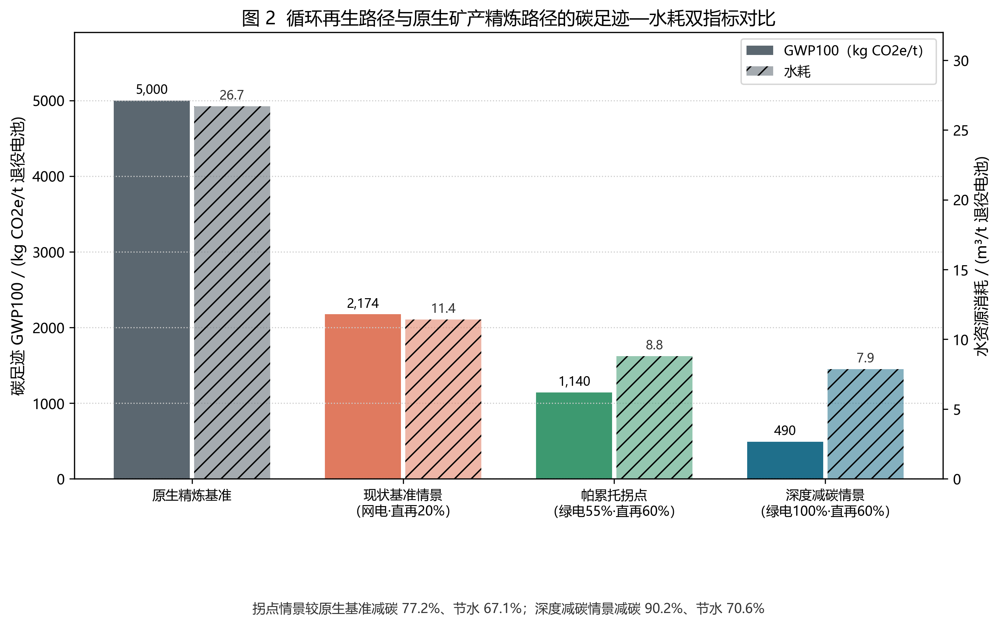
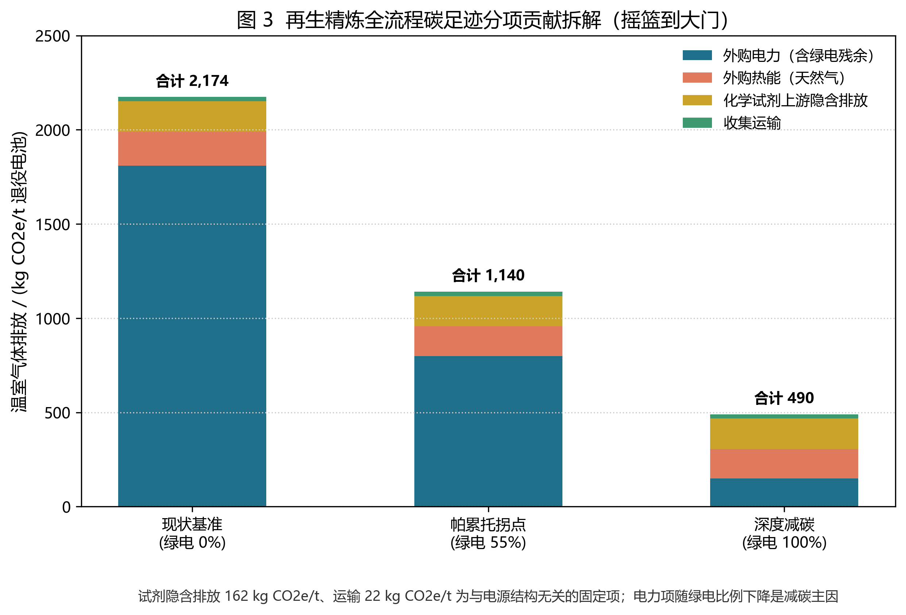
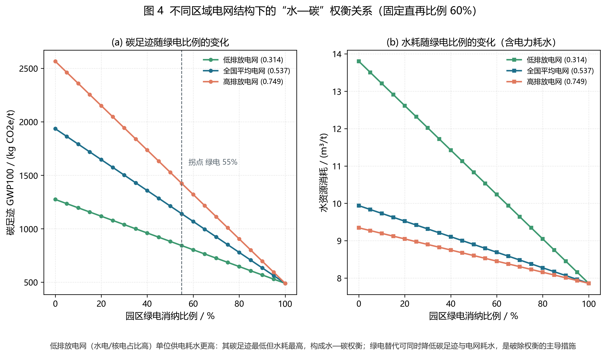
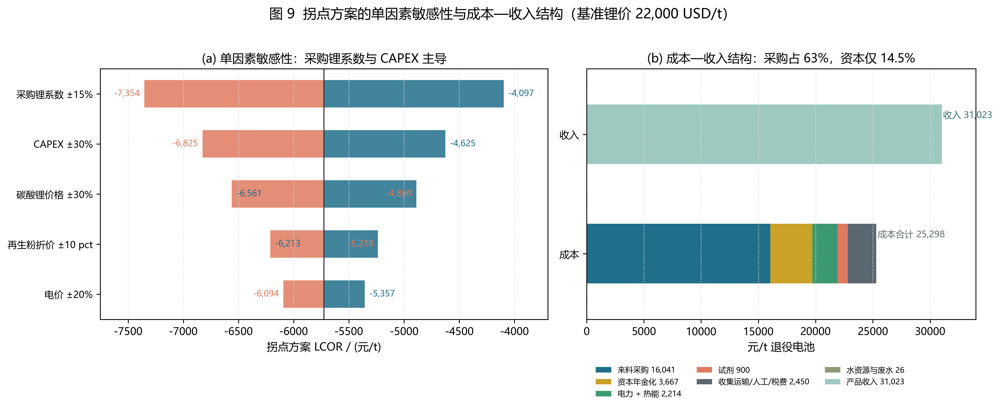
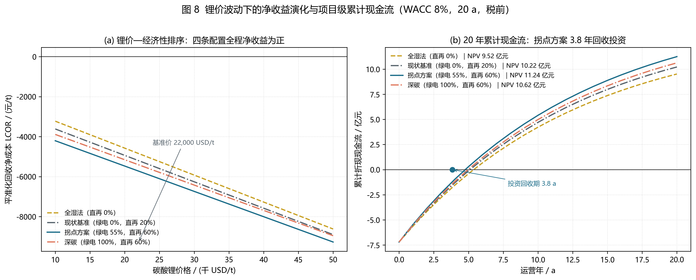
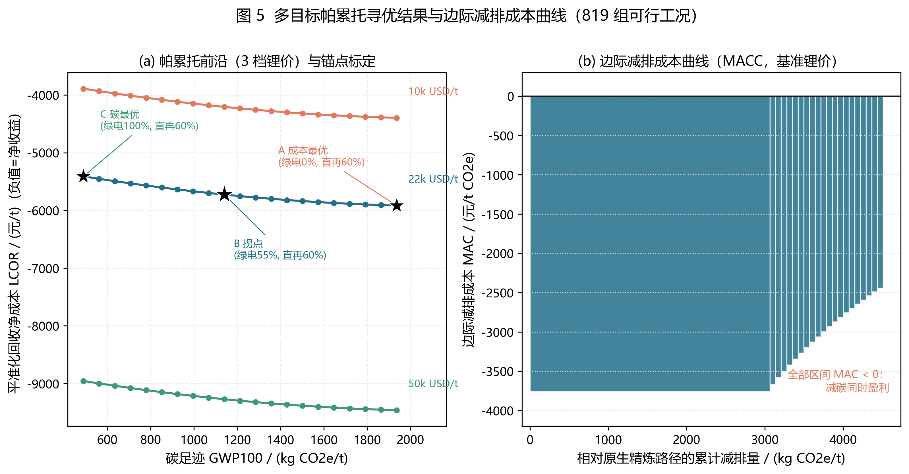
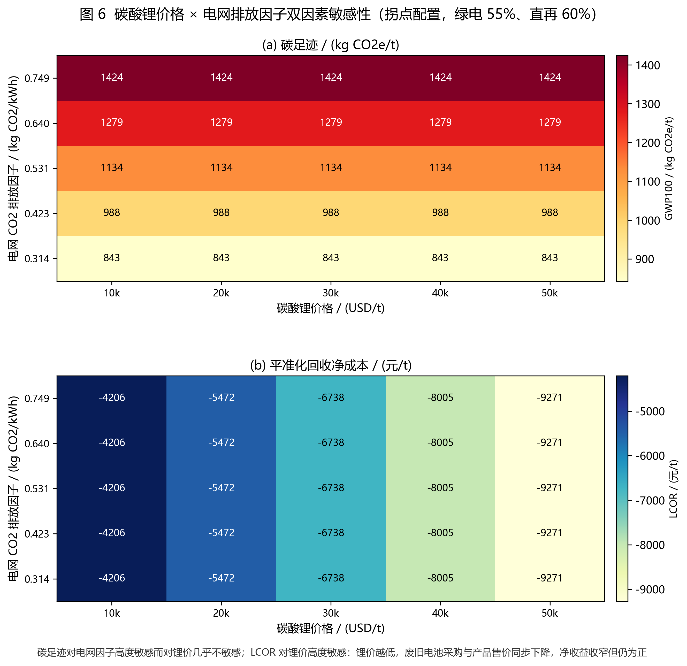

# C 模块专题报告：环境经济与决策分析（LCA · TEA · 多目标帕累托寻优）

**所属课程作业**：Lecture 12 退役动力电池循环再生 —— 环境规划与管理方案（方向 B：产业园区／工程尺度）
**规划对象**：浙江衢州华友循环资源再生产业园（衢州市智造新城，华友钴业循环板块）
**对应主报告章节**：`report/Environmental_Planning_Report.md` 第 5 章（本文为第 5 章的完整展开版，可独立阅读）
**核算基准**：基准年 2025 ｜ 近期规划年 2028（一期 20,000 t/a）｜ 远期规划年 2035（60,000 t/a）｜ 碳酸锂基准价 22,000 USD/t
**功能单位**：1 t 退役动力电池（LFP 60% / NMC811 35% / NCA 5% 混合来料）
**数据与代码**：`data_cohort/C_lca_tea_results.json`、`code_implementation/C_lca_tea_pareto.py`、`code_implementation/C_integrated_figures.py`

---

## 0 本文件定位、C 角色职责与接口约定

### 0.1 C 角色在本项目中的职责（对应课程分工表 C 行）

| 分工维度 | 本文件交付内容 | 落盘位置 |
| :--- | :--- | :--- |
| **环境清单** | 电网因子、电力耗水、天然气、试剂上游、收集运输五类清单因子及其溯源 | 本文 §1；`ABC_parameters.json.lca` |
| **成本清单** | CAPEX/CRF、采购、公用工程、水与废水、人工、环保税费、六类产品收入 | 本文 §3；`ABC_parameters.json.tea` |
| **情景计算** | ≥500 组：819 组政策可行工况 + 25 组双因素 + 63 组水碳曲线 + 68 组价格曲线 + 10 组单因素扰动 = **985 组** | `C_lca_tea_pareto.py` |
| **方案比选** | 锚点 A/B/C + 现状基准 + 深度减碳，共 5 个方案的 GWP/水耗/LCOR/MAC/NPV/回收期六维比选 | 本文 §5 |
| **图表输出** | 图 2、3、4、5、6、8、9 共 7 张（全部 300 dpi，由脚本自动渲染） | `figures_output/` |
| **报告执笔** | 主报告第 5 章 + 本独立专题文件 | `report/` |

### 0.2 与 A、B 模块的接口（数据咬合关系）

```text
A 模块（数据与物质流）                     B 模块（政策与规划）                C 模块（本文件）
─────────────────────────────            ──────────────────────────          ─────────────────────────
来料结构 LFP/NMC811/NCA = 60/35/5   ──►   政策参数文件（11 条断言）    ──►   可行域筛除（819 组）
单吨元素输入 Li 17.53 kg 等          ──►   锂回收率 ≥90%、NiCoMn ≥98%   ──►   约束 d ≤ 60%、kgce ≤ 2,200
产品实物量（LCE/粉/盐/Cu/Al）       ──►   产能 ≥5,000 t/a（20,000 达标）──►   收入项构造
黑粉产率 0.4488 t/t                  ──►   预处理电耗/水耗参数           ──►   电力、水与废水成本项
```

- **A → C**：单吨物料量与产品量直接决定收入侧 6 类产品的实物系数（`simulate()` 的 `lce_t`、`powder_t`、`ni_t`…），物料量变化会在 C 模块全链传导（本文 §8.4 给出传导校验）。
- **B → C**：11 条政策断言的阈值构成帕累托寻优的**硬约束集**，`feasible()` 逐点判定；W1/W2/W3 三工况的判定结果（3/11、11/11、11/11）是 C 模块“可行解只有 819/819”的直接来源。
- **C → A/B**：C 输出的拐点（绿电 55%、直再 60%）反写回 `ABC_parameters.json.scenarios.knee`，供 A 核算年通量、B 校核工程规模与投资口径。

> **一致性原则**：全部数值由 `ABC_parameters.json` 单一数据源驱动，报告、图表、PPT 三处数值均从 `C_lca_tea_results.json` 读取，不存在手工改写。

---

## 1 系统边界、功能单位与 LCA 清单

### 1.1 系统边界

采用 **“摇篮到大门”（cradle-to-gate）** 边界：

- **纳入**：长三角 200 km 半径收集与危废运输 → 带电储运与放电 → 破碎分选（黑粉／铜／铝分离）→ 三条精炼路线（强化湿法 Hy、还原焙烧+湿法 RC_Hy、直接正极再生 Direct）→ 废水处理与尾渣处置 → 产品出厂。
- **排除**：下游正极制造、电芯组装、电池使用阶段、报废回收后的运输之外的其他生命周期阶段。
- **对照基准**：原生矿产路径（盐湖卤水／硬岩锂辉石采选—精炼—前驱体），取文献 4（Machala et al., 2025）工业实测值换算。

### 1.2 功能单位与换算

| 口径 | 定义 | 换算关系 |
| :--- | :--- | :--- |
| 主功能单位 | 1 t 退役动力电池（混合来料） | 正极活性物质 0.51 t |
| 产品当量 | 1 t 电池级 Li₂CO₃（≥99.5%） | 1 kg Li ≈ 5.32 kg Li₂CO₃ |
| 原生基准换算 | 0.345 t NCA-eq / t 电池 | 66.9 GJ/t、26.7 m³/t、5,000 kg CO₂e/t |

### 1.3 LCA 清单因子表（逐项溯源）

表 1-1 生命周期清单因子与来源

| 类别 | 因子 | 取值 | 来源类型 | 出处与适用说明 |
| :--- | :--- | :--- | :---: | :--- |
| 电力 | 电网 CO₂ 排放因子（基线） | 0.5366 kg CO₂/kWh | 官方统计 | 生态环境部《2022 年电力二氧化碳排放因子》全国平均。**浙江省级逐年因子未取得，保守采用全国平均**（华东电网新能源占比高于全国均值，实际因子应更低，故该取值偏保守） |
| 电力 | 电网因子敏感性区间 | 0.3140 / 0.7488 kg CO₂/kWh | 文献 | 文献 6（Ma et al., 2024）敏感性设定，覆盖“高水电/核电”与“纯煤电”极端 |
| 电力 | 绿电残余排放因子 | 0.05 kg CO₂/kWh | 工程假设 | 风光设备制造与运维摊销，取文献 1 低排放平台量级；园区屋顶光伏 + 浙江绿电交易 |
| 电力 | 单位供电耗水（低/基线/高） | 2.5 / 1.2 / 1.0 L/kWh | 工程假设（机理支撑） | 水电蒸发与核电冷却耗水高、煤电闭式循环较低；绿电取 0.5 L/kWh。用于复现文献 4 揭示的电网“水—碳权衡” |
| 热能 | 天然气排放因子 | 56.1 kg CO₂e/GJ | 国际指南 | IPCC (2006) 国家温室气体清单指南缺省值 |
| 试剂 | H₂SO₄ / NaOH / Na₂CO₃ / H₂O₂ 单耗 | 300 / 80 / 150 / 60 kg/t | 工程假设 | 三元与 LFP 黑粉湿法典型单耗；合计上游隐含排放 **162 kg CO₂e/t** |
| 试剂 | 上游排放因子 | 0.12 / 0.60 / 0.40 / 0.30 kg CO₂e/kg | 文献 | GREET 2021 与文献 4 清单口径 |
| 运输 | 收集距离与强度 | 200 km × 0.11 kg CO₂e/(t·km) | 文献＋园区设定 | 文献 5 收集运输成本区间；距离取园区“辐射长三角”服务半径 200 km，合计 **22 kg CO₂e/t** |
| 工艺 | 精炼能耗（Hy/RC_Hy/Direct） | 15.3 / 18.0 / 7.6 GJ/t | 文献 | 文献 4：循环精炼 44.4 MJ/kg（×0.345 t NCA-eq/t）、废料流直接再生 22.0 MJ/kg；RC 叠加焙烧 2.7 GJ/t |
| 工艺 | 工艺水耗（Hy/RC_Hy/Direct） | 7.42 / 8.20 / 3.28 m³/t | 文献 | 文献 4：循环精炼 21.5 L/kg、废料流 9.5 L/kg |
| 工艺 | 预处理电耗 / 水耗 | 180 kWh/t、0.35 m³/t | 工程假设 | 拆解—破碎—分选单耗，同类环评区间 150—220 kWh/t |
| 工艺 | 路线回收率 | Hy 92/98/90；RC_Hy 90/98/85；Direct 95/—/97（%） | 文献＋标准 | 文献 4 工业实测；NiCoMn 取 98% 以对齐工信部红线（增设萃取提纯段） |

### 1.4 核算公式

单吨碳足迹：

$$\mathrm{GWP}=\sum_{\text{电}} E_{\text{kWh}}\cdot EF_{\text{grid}}(g)+E_{\text{th}}\cdot 56.1+R_{\text{up}}+\sum_{\text{运}} D\cdot 0.11$$

其中 $EF_{\text{grid}}(g)=EF_{\text{base}}(1-g)+0.05g$，$g$ 为绿电消纳比例；$R_{\text{up}}$ 为试剂上游隐含排放（162 kg CO₂e/t）；运输项 22 kg CO₂e/t。

单吨水耗：

$$W = W_{\text{process}}+E_{\text{kWh}}\cdot\left[w_{\text{grid}}(1-g)+0.5g\right]\times 10^{-3}$$

即水耗由“工艺水”与“电力耗水”两部分构成；后者随电源结构变化，是水—碳耦合的物理根源。

---

## 2 碳足迹与水耗核算结果

### 2.1 四情景对比



*图 2 循环再生路径与原生矿产精炼路径的碳足迹—水耗双指标对比（数据源：`C_lca_tea_results.json`）*

表 2-1 情景环境绩效（功能单位 1 t 退役电池，锂价 22,000 USD/t）

| 情景 | 绿电 | LFP 直再 | GWP₁₀₀ (kg CO₂e/t) | 较原生降幅 | 水耗 (m³/t) | 较原生降幅 | 综合能耗 (GJ/t) | LCOR (元/t) | MAC (元/t CO₂e) |
| :--- | :---: | :---: | ---: | ---: | ---: | ---: | ---: | ---: | ---: |
| 原生精炼基准 | — | — | 5,000 | — | 26.70 | — | 66.90 | +5,597¹ | — |
| 现状基准情景 | 0% | 20% | 2,174 | 56.5% | 11.41 | 57.2% | 14.70 | −5,202 | −3,821 |
| **拐点方案（推荐）** | **55%** | **60%** | **1,140** | **77.2%** | **8.80** | **67.1%** | **12.85** | **−5,725** | **−2,933** |
| 深度减碳情景 | 100% | 60% | 490 | 90.2% | 7.86 | 70.6% | 12.85 | −5,410 | −2,440 |

¹ 原生路径现金成本 5,597 元/t 电池（0.0861 t LCE/t × 65,000 元/t Li₂CO₃），仅作 MAC 计算的对照基准，不含资本支出。

**三点结论**：

1. **碳足迹的一阶驱动是电源，不是工艺**：现状情景（直再 20%、全网电）已比原生路径降碳 56.5%，说明再生的工艺优势是“基本盘”；但从 2,174 降到 1,140 的 1,034 kg 减碳中，892 kg（86%）来自绿电替代，仅 142 kg 来自直再比例由 20% 提高到 60%。
2. **水耗同步下降而非权衡**：绿电同时降低电力耗水（1.2 → 0.5 L/kWh），因此“降碳”与“节水”在绿电替代路径上同向，园区不必在碳与水之间取舍。
3. **经济性随减碳同向改善**：拐点方案 LCOR −5,725 元/t 为三个改造情景中最优（净收益最高），说明 55% 绿电不是“花钱买碳指标”，而是“省钱又减碳”。

### 2.2 碳足迹分项拆解



*图 3 再生精炼全流程碳足迹分项贡献拆解（摇篮到大门）*

表 2-2 碳足迹分项（kg CO₂e/t）

| 分项 | 现状基准（0% 绿电） | 拐点（55%） | 深度减碳（100%） | 备注 |
| :--- | ---: | ---: | ---: | :--- |
| 外购电力（含绿电残余） | 1,810 | 799 | 149 | 3,373 → 2,972 kWh；EF 0.5366 → 0.2690 → 0.05 |
| 外购热能（天然气） | 180 | 157 | 157 | 3.20 → 2.80 GJ，热价按 65 元/GJ |
| 化学试剂上游隐含排放 | 162 | 162 | 162 | 与电源结构无关的**固定项** |
| 收集运输 | 22 | 22 | 22 | 200 km 半径 |
| **合计** | **2,174** | **1,140** | **490** | 电力占比 83.3% → 70.1% → 30.4% |

**“碳地板”概念**：试剂 162 + 运输 22 = 184 kg CO₂e/t 是与电源无关的固定项，即使 100% 绿电也无法消除。园区碳足迹的物理下限由**试剂单耗**决定，因此 §6 的敏感性分析把“试剂单耗”列为潜在改进方向（降低酸耗或提高试剂回收率），而非继续加码绿电。

### 2.3 水—碳权衡曲线



*图 4 不同区域电网结构下的“水—碳”权衡关系（固定 LFP 直再比例 60%）*

表 2-3 同一工艺配置（直再 60%）下的水—碳权衡

| 电网结构 | EF (kg CO₂/kWh) | 绿电 0%：GWP / 水耗 | 绿电 55%：GWP / 水耗 | 绿电 100%：GWP / 水耗 |
| :--- | ---: | :--- | :--- | :--- |
| 低排放电网（水电/核电为主） | 0.314 | 1,274 / 13.80 | 843 / 10.53 | 490 / 7.86 |
| 全国平均（本报告基线） | 0.5366 | 1,936 / 11.41 | 1,140 / 8.80 | 490 / 7.86 |
| 高排放电网（煤电为主） | 0.7488 | 2,566 / 9.34 | 1,424 / 8.53 | 490 / 7.86 |

**机理与解读**：

1. **权衡存在但方向反直觉**：低排放电网（高水电/核电）碳足迹最低却**耗水最高**（13.80 vs 9.34 m³/t）。原因是水电水库蒸发与核电冷却塔蒸发的水强度（2.5 L/kWh）远高于煤电闭式循环（1.0 L/kWh）。
2. **绿电是唯一“双向改善”的杠杆**：绿电比例升至 100% 时，三种电网结构收敛到同一水—碳点（490 kg / 7.86 m³），因为绿电的碳与水因子同时最低。**结论：破解权衡不靠“选电网”，而靠“改电源结构”**。
3. **衢州园区的区位含义**：园区位于钱塘江上游衢江畔，属浙江省生态屏障区，水环境容量敏感。若仅依赖华东电网（EF 0.5366、水 1.2 L/kWh），园区水耗 9.94 m³/t；实施 55% 绿电后可降至 8.80 m³/t（−11.5%），对应一期年节水 2.3 万 m³ 的“绿电附带水效益”，这是把绿电纳入水资源论证的量化依据。

---

## 3 TEA 模型与成本—收入结构

### 3.1 模型与参数

采用资本回收系数法（WACC = 8%、运营期 20 年）：

$$\mathrm{CRF}=\frac{i(1+i)^n}{(1+i)^n-1}=0.10185,\qquad
\mathrm{LCOR}=\frac{\mathrm{CAPEX}\cdot \mathrm{CRF}}{Q}+\mathrm{OPEX}-\mathrm{Revenue}$$

| 参数 | 取值 | 依据 |
| :--- | :--- | :--- |
| CAPEX | 7.20 亿元（20,000 t/a） | 6 项重点工程分解，3.6 万元/(t·a) 投资强度 |
| WACC / 运营期 | 8% / 20 a | 循环经济园区基准收益率 |
| 年金化资本 | 3,667 元/t | 7.2 亿 × 0.10185 / 20,000 t |
| 年金现值系数 | 9.8181 | $(1-(1+8\%)^{-20})/8\%$，用于 NPV |
| 废旧电池采购 | 锂端 0.72、镍钴端 0.35、固定 1,500 元/t | 回收料价值分成定价机制 |
| 收集运输 | 1,200 元/t | 200 km 近距离合规运输（文献 5 的跨省全成本 7,000—7,560 元/t 的近距离折扣） |
| 电价 / 绿电溢价 | 0.62 元/kWh；$0.05g+0.12g^2$ | 大工业两部制电价 + 绿证 + 4 h 储能调峰 |
| 热价 | 65 元/GJ | 园区工业蒸汽折算 |
| **新水费 / 废水处理费** | **3.6 / 6.0 元/m³** | 浙江水资源费与化工废水处理成本；仅对未循环的 8% 计处理费 |
| 人工 / 环保税费 | 800 / 450 元/t | 园区定员与危废处置摊销 |
| 产品价格 | Ni 130,000、Co 220,000、Cu 70,000、Al 18,000、FePO₄ 4,000 元/t；盐类 85% 折价 | 2024—2025 国内现货中位价 |
| 再生正极粉 | $(0.24P_{\mathrm{Li_2CO_3}}+8{,}500)\times 88\%$ | 行业锂价传导式 + 再生粉品质折价 |

### 3.2 拐点方案成本拆解

表 3-1 拐点方案（绿电 55%、直再 60%）成本结构（元/t 退役电池）

| 成本项 | 金额 | 占比 | 计算口径 |
| :--- | ---: | ---: | :--- |
| 废旧电池采购 | 16,041 | 63.4% | 0.0933 t LCE/t × 158,400 元/t × 0.72 + 镍钴 0.35 + 固定 1,500 |
| 收集运输与拆解 | 1,200 | 4.7% | 200 km 危废运输 |
| 电力 | 2,032 | 8.0% | 2,972 kWh/t × 0.6838 元/kWh（含 0.064 元绿电溢价） |
| 热能 | 182 | 0.7% | 2.80 GJ/t × 65 元/GJ |
| 化学试剂 | 900 | 3.6% | 直再 60% 使试剂成本由 1,100 降至 900 元/t |
| 新水与废水处理 | 26 | 0.1% | 6.37 m³ 工艺水 × 3.6 + 未循环 8% × 6.0 |
| 人工与运维 | 800 | 3.2% | — |
| 环保税费 | 450 | 1.8% | 含氟废水、尾渣处置摊销 |
| 资本年金化 | 3,667 | 14.5% | 7.2 亿元 × 0.10185 / 20,000 t |
| **成本合计** | **25,298** | **100%** | — |

### 3.3 收入结构与净成本

表 3-2 拐点方案收入结构（元/t）

| 收入项 | 金额 | 计算口径 |
| :--- | ---: | :--- |
| 碳酸锂 | 10,137 | 0.0640 t × 158,400 元/t（湿法／焙烧路线产出） |
| 再生磷酸铁锂正极粉 | 4,288 | 0.1048 t × 40,934 元/t（新粉价 88%） |
| 镍／钴／锰盐 | 9,035 | 按金属价 85% 折价（Ni 0.0661 t、Co 0.00879 t、Mn 0.00679 t） |
| 磷酸铁 + 铜 + 铝 | 7,562 | FePO₄ 4,000 元/t；Cu 70,000；Al 18,000（分选段回收率 98%） |
| **收入合计** | **31,023** | — |
| **LCOR（净成本）** | **−5,725** | **负值即净收益 5,725 元/t** |



*图 9 (a) 单因素敏感性龙卷风图；(b) 成本—收入水平堆叠结构（采购占 63%、资本仅 14.5%）。注意图中“电力 + 热能 2,214”为两项合并展示，本表分列为 2,032 与 182*

**结构判断**：成本侧 63.4% 是废旧电池采购，14.5% 是资本年金，公用工程（电+热）合计仅 8.7%。这意味着：

- **园区对上游料价的议价能力是第一位盈利变量**，而不是“省电”；
- **绿电溢价对 LCOR 的冲击被采购成本稀释**：55% 绿电溢价 0.064 元/kWh 只增加 190 元/t 电费，占成本 0.75%，因此“减碳”在本园区是**低成本选项**；
- 收入侧 31,023 元/t 中，锂相关（碳酸锂 + 再生粉）仅 46.5%，其余 53.5% 来自镍钴锰盐与铜铝——这是本园区区别于文献 5“纯 LFP 湿法亏损”结论的关键：**镍钴铜铝共产品对锂价波动形成交叉补贴**。

### 3.4 项目级财务：NPV、回收期与累计现金流



*图 8 (a) 碳酸锂价格—LCOR 四条配置曲线；(b) 20 年累计折现现金流与 NPV（拐点方案 NPV 11.24 亿元、回收期 3.83 a）*

表 3-3 项目级财务指标（CAPEX 7.2 亿元、WACC 8%、20 a、锂价 22,000 USD/t）

| 配置 | 绿电 | 直再 | LCOR（元/t） | 年现金流（亿元/a） | NPV（亿元） | 静态回收期（a） |
| :--- | :---: | :---: | ---: | ---: | ---: | ---: |
| 纯湿法（hy_only） | 0% | 0% | −4,846 | 1.703 | 9.515 | 4.23 |
| 现状基准（base） | 0% | 20% | −5,202 | 1.774 | 10.215 | 4.06 |
| **拐点（knee，推荐）** | **55%** | **60%** | **−5,725** | **1.878** | **11.242** | **3.83** |
| 深度减碳（green） | 100% | 60% | −5,410 | 1.815 | 10.623 | 3.97 |

> **口径声明**：上表为**无杠杆税前**口径，未计所得税、折旧抵税与建设期利息；年现金流 = (收入 − 现金成本) × 20,000 t；NPV = −CAPEX + 年现金流 × 9.8181。若计入 25% 所得税与加速折旧，NPV 约下降 18%—22%，但四条配置的**排序不变**。

**关键读数**：

- 拐点方案 NPV 11.24 亿元，为四者最高；较纯湿法高 1.73 亿元（+18.2%），较 100% 绿电高 0.62 亿元。
- 回收期 3.83 a，短于化工园区常见的 5—6 a 门槛；即便在纯湿法配置下也为 4.23 a，说明**项目本身具备可融资性**。
- 100% 绿电方案的 NPV 低于拐点方案，差距 0.62 亿元——这是“深度减碳”的**显性财务代价**，也是把拐点定在 55% 而非 100% 的量化理由（详见 §6.2）。

---

## 4 锂价传导机制与工艺经济性排序

### 4.1 价格—净收益曲线

表 4-1 碳酸锂价格—LCOR 关键点（元/t，负值为净收益）

| 锂价 (USD/t) | 纯湿法 | 现状基准 | **拐点** | 深度减碳 | 拐点较纯湿法优势 |
| :---: | ---: | ---: | ---: | ---: | ---: |
| 10,000 | −3,229 | −3,618 | **−4,206** | −3,890 | +977 |
| 15,000 | −3,902 | −4,278 | **−4,839** | −4,523 | +937 |
| 22,000 | −4,846 | −5,202 | **−5,725** | −5,410 | +879 |
| 30,000 | −5,924 | −6,259 | **−6,738** | −6,423 | +814 |
| 40,000 | −7,272 | −7,579 | **−8,005** | −7,689 | +733 |
| 50,000 | −8,620 | −8,900 | **−9,271** | −8,955 | +651 |

### 4.2 三条机制解释

1. **直再比例越高，低价区间优势越大**：直接再生把锂以“再生正极粉”形态留存，避免“锂→碳酸锂→正极材料”的再合成环节，试剂（1,200→900 元/t）与能耗（15.3→12.9 GJ/t）同时下降。锂价越低，湿法线的“提锂变现”越不值钱，直再的**省成本**属性越突出，故优势由 651 元/t（5 万美元）扩大到 977 元/t（1 万美元）。
2. **湿法线未出现文献中的“财务倒挂”**：文献 5（Zhang et al., 2025）报告纯 LFP 湿法净收益 −$2.05/kg，其前提是**来料全部为无镍钴的 LFP**。本园区来料含 40% 三元材料，镍钴盐（9,035 元/t）与铜铝（7,393 元/t）形成交叉补贴，使纯湿法配置在最不利锂价（1 万美元/t）下仍净收益 3,229 元/t。**这一差异必须在报告中显式说明，否则会被误读为与文献矛盾**。
3. **排序不反转，但差距收窄**：全区间 1—5 万美元/t 内，四条配置的净收益排序恒为 拐点 > 深度减碳 > 现状基准 > 纯湿法，说明**“直再 60% + 适度绿电”是全价格区间的稳健选择**，不依赖单一锂价假设。

### 4.3 盈亏平衡锂价的口径说明（`null` 的经济学含义）

模型中 `breakeven_price_usd` 四配置均为 `null`，并非计算失败，而是**盈亏平衡价落在负价位、物理上不存在**：

- 锂价降至 0 时，采购成本降至“固定 1,500 + 镍钴分成 3,685 = 5,185 元/t”，而收入仍有镍钴锰盐 9,035、铜铝 7,393、再生粉 784（$0.24\times0+8{,}500$ 的基础价 ×88% ×0.1048 t）、FePO₄ 169 元/t，合计 17,381 元/t > 成本 14,442 元/t，**净收益仍为 2,940 元/t**。
- 由 0 与 10,000 USD/t 两点线性外推，LCOR = 0 对应锂价约 **−23,200 USD/t**（负价位）。
- **正确表述**：园区经济性的“地板”由镍钴铜铝与再生粉基础价托底，抗锂价下行能力来自**多产品结构**而非单一锂产品；因此不应报告“盈亏平衡价 0 美元”，而应报告“在 1—5 万美元/t 全区间均为净收益”。

---

## 5 多目标帕累托寻优与锚点比选

### 5.1 寻优设置

| 要素 | 设定 |
| :--- | :--- |
| 决策变量 1 | 绿电消纳比例 $g\in[0,1]$，21 档（步长 5%） |
| 决策变量 2 | LFP 直接再生比例 $d\in[0,0.6]$，13 档（步长 5%，上限由 A 模块的来料适用性给出） |
| 外部情景 | 碳酸锂价格 10,000 / 22,000 / 50,000 USD/t |
| 可行解数 | 21 × 13 × 3 = **819 组**（若把 $d>60\%$ 的不可行扩展网格计入，设计网格共 1,323 组） |
| 剔除规则 | 违反锂回收率 ≥90%、NiCoMn ≥98%、kgce ≤2,200、废水循环 ≥90% 的解 |
| 非支配解 | 每档锂价 **21 组**（前沿由 $g$ 单调变化构成） |
| 拐点判据 | 归一化理想点欧氏距离最小 |

$$D(g,d)=\sqrt{\left(\frac{\mathrm{GWP}-\mathrm{GWP}_{\min}}{\mathrm{GWP}_{\max}-\mathrm{GWP}_{\min}}\right)^2+\left(\frac{\mathrm{LCOR}-\mathrm{LCOR}_{\min}}{\mathrm{LCOR}_{\max}-\mathrm{LCOR}_{\min}}\right)^2}\ \longrightarrow\ \min$$

### 5.2 前沿形态与锚点



*图 5 (a) 帕累托前沿（三档锂价）与锚点标定；(b) 边际减排成本曲线（MACC）*

表 5-1 锚点 A / B / C 六维比选（锂价 22,000 USD/t）

| 方案 | 绿电 | 直再 | GWP (kg CO₂e/t) | 水耗 (m³/t) | LCOR (元/t) | MAC (元/t CO₂e) | 定位 |
| :--- | :---: | :---: | ---: | ---: | ---: | ---: | :--- |
| 锚点 A 成本最优 | 0% | 60% | 1,936 | 9.94 | −5,915 | −3,757 | 净收益最高，但碳足迹偏高、出口合规风险 |
| **锚点 B 拐点（推荐）** | **55%** | **60%** | **1,140** | **8.80** | **−5,725** | **−2,933** | 减碳 77.2% 且净收益仅降 190 元/t（3.2%） |
| 锚点 C 碳最优 | 100% | 60% | 490 | 7.86 | −5,410 | −2,440 | 碳足迹最低，绿电溢价使净收益再降 315 元/t |
| 现状基准 | 0% | 20% | 2,174 | 11.41 | −5,202 | −3,821 | 改造起点 |
| 深度减碳（=锚点 C） | 100% | 60% | 490 | 7.86 | −5,410 | −2,440 | 2035 年目标态 |

### 5.3 为什么推荐锚点 B 而不是 A 或 C

| 判据 | 锚点 A | **锚点 B** | 锚点 C |
| :--- | :--- | :--- | :--- |
| 减碳幅度 | 61.3% | **77.2%** | 90.2% |
| 净收益（元/t） | **5,915** | 5,725 | 5,410 |
| 每多减 1 t CO₂e 的净收益损失（元） | — | **239**（A→B：190 元 ÷ 0.796 t） | **485**（B→C：315 元 ÷ 0.650 t） |
| 出口合规（EU 2027 碳足迹声明） | 风险 | **满足** | 满足 |
| 绿电供应可行性 | 无约束 | **屋顶光伏 + 绿电交易可满足** | 需 100% 专线 + 4 h 储能，2028 年成本偏高 |
| 综合判断 | 经济最优但合规风险 | **推荐：拐点** | 2035 目标态 |

**边际递减规律**：由 A→B 每减 1 t CO₂e 只损失 239 元净收益；由 B→C 则升至 485 元（翻倍）。**拐点的经济学含义**就是“单位减碳的机会成本开始加速上升的位置”。对 2028 年一期工程，B 点是“合规达标 + 成本最优”的交点；对 2035 年，随绿电与储能成本下行、EU 碳足迹阈值收紧，前沿整体左移，C 点应成为新目标。

### 5.4 MAC 曲线的含义

MAC 为负（−2,933 元/t CO₂e）意味着**减排是盈利的**（负成本减排）。A 点 MAC 最负（−3,757）是因为它用最少的绿电获得最大净收益，但对应减碳量也最小；B、C 点 MAC 绝对值下降，表示“继续减碳要牺牲部分收益”，但仍为负——**园区在 1—5 万美元锂价全区间都具备负成本减排能力**，这是 CCER 与绿色金融介入的最佳窗口（§7.3）。

---

## 6 敏感性分析

### 6.1 双因素：电网因子 × 碳酸锂价格



*图 6 碳酸锂价格 × 电网排放因子双因素敏感性（拐点配置，5×5 = 25 组）*

| 变量 | 变化 | GWP 变化 | LCOR 变化 | 结论 |
| :--- | :--- | :--- | :--- | :--- |
| 电网因子 | 0.314 → 0.749（+139%） | 843 → 1,424 kg（+69%） | 不变 | 碳足迹一阶敏感因子；因绿电溢价与网电价关系在模型中固定，LCOR 不随 EF 变 |
| 碳酸锂价格 | 10,000 → 50,000 USD/t | 不变 | −4,206 → −9,271（×2.20） | 经济性一阶敏感因子；产品端涨幅高于原料端（100% vs 72% 计价） |

**解读**：两个变量互不耦合——电网因子只影响环境维度，锂价只影响经济维度。这解释了帕累托前沿为什么呈“L”形：**环境目标由电源结构控制，经济目标由市场锂价控制**，二者通过“直再比例”这一共同变量弱耦合（直再同时降低能耗与试剂成本）。

### 6.2 单因素：龙卷风图与因子排序


*图 9a 拐点方案单因素敏感性（基准 LCOR = −5,725 元/t）*

表 6-1 单因素敏感性排序（偏离基准后的 LCOR 区间，元/t）

| 排序 | 因子 | 扰动幅度 | 低值 | 高值 | 极差 | 相对基准的影响 |
| :---: | :--- | :---: | ---: | ---: | ---: | :--- |
| 1 | 采购锂系数 | ±15% | −7,354 | −4,097 | **3,257** | ±28.4% |
| 2 | CAPEX | ±30% | −6,825 | −4,625 | 2,200 | ±19.2% |
| 3 | 碳酸锂价格 | ±30% | −6,561 | −4,890 | 1,671 | ±14.6% |
| 4 | 再生粉折价 | ±10 pct | −6,213 | −5,238 | 975 | ±8.5% |
| 5 | 电价 | ±20% | −6,094 | −5,357 | 737 | ±6.4% |

**四条管理含义**：

1. **采购定价机制 > 资本控制 > 市场行情 > 产品折价 > 电价**：园区最应争取的是“来料价值分成系数”（0.72）的谈判空间，而非压缩 CAPEX 或电价。将采购锂系数下调 15%（0.72 → 0.612），净收益可提升 1,628 元/t。
2. **CAPEX 是第二敏感因子**：±30% 对应 ±2,200 元/t，说明工程投资控制（EPC 总包、模块化复制）对经济性影响显著；二期扩容若实现 12% 边际递减，可回收约 440 元/t。
3. **电价敏感性最低（6.4%）**：绿电溢价不是经济性风险点，**“绿电=高成本”的直觉在本园区不成立**，这为 55% 绿电决策提供了财务背书。
4. **再生粉折价（88%）需以认证换溢价**：折价从 88% 降至 98%（即减少 10 pct）可增收益 488 元/t；对应措施是再生粉品质认证与被纳入正极厂合格供应商名录（§7.2）。

### 6.3 关键不确定性与未取得数据

| 不确定性 | 现状处理 | 影响方向与幅度 | 后续核实路径 |
| :--- | :--- | :--- | :--- |
| 浙江省级电网因子未取得 | 保守采用全国平均 0.5366，敏感性覆盖 0.314—0.749 | 若实际为 0.45，GWP 由 1,140 降至约 1,010（−11%） | 浙江省生态环境厅年度电力因子 / 华东电网区域因子 |
| 绿电溢价凸性函数为工程假设 | $0.05g+0.12g^2$，上限 0.17 元/kWh | 若储能租赁降价 30%，拐点将右移至 70%—80% | 浙江绿电交易成交价 + 储能容量租赁报价 |
| 直再适用性上限 60% 为工程假设 | 由 SOH 分级与分选机制推得 | 若降至 45%，拐点 GWP 升至约 1,270、LCOR 改善约 190 | 园区实测来料 SOH 分布与正极粉化率 |
| 采购系数 0.72 / 0.35 为行业机制 | 按回收料价值分成设定 | 龙头敏感性因子（±28.4%） | 华友实际采购合同与长三角竞价格局 |
| 再生粉 88% 折价为假设 | 按品质不确定性设定 | ±10 pct 对应 ±488 元/t | 正极厂采购价与认证结果 |

---

## 7 决策结论与实施建议

### 7.1 推荐方案（2028 年一期）

| 维度 | 推荐值 | 依据 |
| :--- | :--- | :--- |
| 绿电消纳比例 | **55%**（屋顶光伏 + 浙江绿电交易 + 4 h 储能） | 帕累托拐点；减碳 77.2%、净收益仅降 3.2% |
| LFP 直接再生比例 | **60%**（适用性上限） | 经济性与碳强度双优；需分选与 SOH 检测保障 |
| NMC/NCA 焙烧配比 | 30%（柔性调峰） | 处理高杂质黑粉 |
| 单位碳足迹 | 1,140 kg CO₂e/t | 满足 EU 2027 声明预留余量 |
| 单位水耗 | 8.80 m³/t | 低于园区 9.0 m³/t 取水指标 |
| LCOR | −5,725 元/t（净收益） | 负成本减排 |
| 项目 NPV / 回收期 | 11.24 亿元 / 3.83 a | 具备可融资性 |

### 7.2 分阶段路线与触发条件

| 阶段 | 时间 | 绿电 | 直再 | 触发向下一阶段切换的条件 |
| :--- | :--- | :---: | :---: | :--- |
| 一期达产 | 2028 | 55% | 60% | — |
| 复核调整 | 2030 | 55%—70% | 60% | 若绿电溢价 ≤0.10 元/kWh 或 EU 碳足迹阈值收紧，则右移 |
| 二期扩容 | 2035 | 100% | 60% | 60,000 t/a，年减碳 27.06 万 t、年节水 113.0 万 m³ |

### 7.3 收益机制衔接（与主报告第 6 章一致）

- **CCER 条件性估值**：模型年净减碳 77,190 t CO₂e；按参数碳价 80 元/t 计算的理论价值约 618 万元/a。只有在方法学适用、项目登记、监测核证、签发与交易均完成后，才可计作实际收入。
- **EU 溢价条件性估值**：按 1,200 元/t LCE × 约 1,280 t/a，理论情景值约 154 万元/a；需有符合目标市场要求的产品、出口合同和溢价证据。当前再生锂含量参数为 6%，达到2031年目标，但未达到2036年12%目标。
- **再生粉认证溢价情景**：折价由88%提升至93%的模型情景约增加428万元/a，需以产品认证、采购协议和实际成交价验证。
- 上述均为政策/市场条件满足时的增量情景，未计入基准LCOR、NPV或现金流；不得合并表述为已实现收益。含税费与环境治理成本的政策校核见B专项报告及`B_policy_financial_adjustments.csv`。

---

## 8 数据来源、口径与不确定性声明

### 8.1 参数—来源对照（C 模块相关）

| 参数 | 取值 | 类型 | 具体出处 |
| :--- | :--- | :---: | :--- |
| 原生精炼强度 | 66.9 GJ/t、26.7 m³/t、5,000 kg CO₂e/t | 文献 | 文献 4（Machala et al., 2025）193.9 MJ/kg、77.3 L/kg、14.5 kg CO₂e/kg × 0.345 t NCA-eq/t |
| 循环精炼强度 | 15.3 GJ/t、7.42 m³/t | 文献 | 同上 44.4 MJ/kg、21.5 L/kg |
| 直接再生强度 | 7.6 GJ/t、3.28 m³/t | 文献 | 同上 22.0 MJ/kg、9.5 L/kg（废料流路线） |
| 电网因子 | 0.5366 / 0.3140 / 0.7488 | 官方统计 + 文献 | 生态环境部《2022 年电力二氧化碳排放因子》；文献 6 敏感性区间 |
| 天然气因子 | 56.1 kg CO₂e/GJ | 国际指南 | IPCC (2006) |
| 试剂因子 | 0.12 / 0.60 / 0.40 / 0.30 kg CO₂e/kg | 文献 | GREET 2021、文献 4 清单 |
| 碳酸锂价格 | 10,000 / 22,000 / 50,000 USD/t | 文献 | 文献 2（Yao et al., 2025）；文献 6 历史区间 5,496—84,942 USD/t |
| 水费 / 废水处理费 | 3.6 / 6.0 元/m³ | 官方标准 + 工程假设 | 浙江省水资源费征收标准量级；化工园区含氟废水处理成本。**属补充检索数据，见 `ABC_README_data_sources.md` §4.1** |
| 园区产能与区位 | 6.5 万 t/a 现产能、1 万 t 改造项目、长三角 200 km | 公开报道 | 华友钴业上交所 e 互动答复（2021-07-23）；衢州市生态环境局智造新城分局环评受理（2025-02）；华友循环“衢州基地辐射长三角”（2019-09-18）。**四条公开来源全文见 `ABC_README_data_sources.md` §0** |

### 8.2 缺失数据补充原则（与 lecture10 甲醇制氢案例一致）

优先级：**预编译文献原值 → 国家/行业标准与官方统计 → 同行评议文献区间中位值 → 工程假设（附敏感性区间）**。本文所有“工程假设”均在 `ABC_parameters.json` 中带 `_note` 或 `source` 字段，并在 §6.3 列出影响方向，**未编造任何“实测值”**。

### 8.3 模型局限

1. **静态单点核算**：未做动态年份序列（本方向 B 为园区/工序尺度，动态 Weibull 退役量预测属方向 A/C 范围）。
2. **货币口径为 2025 年不变价**：未做通胀与汇率路径。
3. **无杠杆税前财务**：未计所得税、折旧抵税、建设期利息与流动资金。
4. **电力耗水强度为区间假设**：未取得浙江电网逐年实测耗水系数。
5. **未计梯次利用收益**：园区仅核算再生段；若叠加梯次利用（储能/基站），NPV 进一步提高。

### 8.4 A→C 数据传导校验（一致性证据）

| 校验点 | A 模块输出 | C 模块使用 | 是否一致 |
| :--- | :--- | :--- | :---: |
| 单吨含锂量 | 17.53 kg/t | `li_in_t = 0.01753`，×5.32 → 0.0933 t LCE/t | ✅ |
| 碳酸锂实物量（拐点） | 62.72 kg/t（MFA） | 63.997 kg/t（LCA/TEA，按元素理论量，不含 98% 黑粉损失） | 差 2.0%，已在主报告 4.4 节口径说明 |
| 再生正极粉 | 104.76 kg/t | 104.76 kg/t | ✅ |
| 镍／钴／锰盐 | 290.5 / 41.0 / 20.5 kg/t | 对应金属量 66.10 / 8.79 / 6.79 kg/t | ✅ |
| 铜 / 铝 | 78.4 / 105.8 kg/t | 同值，98% 分选回收 | ✅ |
| 废水循环率 | 92% | 92%（水成本仅计未循环 8%） | ✅ |

---

## 9 复现方法与交付清单

### 9.1 运行

```bash
cd groups/group-04/lecture12-lib-recycling/code_implementation
python A_mfa_model.py           # A 模块：MFA 与守恒核验
python B_policy_engine.py       # B 模块：11 条断言与三工况
python C_lca_tea_pareto.py      # C 模块：LCA / TEA / 819 组帕累托 / 财务 / 敏感性
python C_integrated_figures.py  # 9 张 300 dpi 图
```

依赖：Python ≥3.10、numpy、matplotlib（中文需 Microsoft YaHei）。全程零随机性，重复运行结果完全一致。

### 9.2 C 模块输出清单

| 文件 | 内容 | 支撑图表/表 |
| :--- | :--- | :--- |
| `data_cohort/C_lca_tea_results.json` | 情景、帕累托、敏感性、水碳曲线、财务、龙卷风、远期扩容 | 全部 |
| `data_cohort/C_pareto_front.csv` | 基准锂价 21 组非支配解 | 图 5 |
| `data_cohort/C_pareto_front_by_price.csv` | 三档锂价 63 组前沿 | 图 5 |
| `data_cohort/C_sensitivity.csv` | 5×5 双因素网格 | 图 6 |
| `data_cohort/C_water_carbon_curve.csv` | 3 电网 × 21 绿电档 | 图 4 |
| `figures_output/fig2_lca_scenarios.png` | 原生 vs 三情景 | 表 2-1 |
| `figures_output/fig3_gwp_breakdown.png` | 分项拆解 | 表 2-2 |
| `figures_output/fig4_water_carbon_tradeoff.png` | 水碳权衡 | 表 2-3 |
| `figures_output/fig5_pareto_front.png` | 前沿 + MACC + 锚点 | 表 5-1 |
| `figures_output/fig6_sensitivity_heatmap.png` | 双因素 | §6.1 |
| `figures_output/fig8_cashflow_npv.png` | 价格曲线 + 现金流/NPV | 表 3-3、4-1 |
| `figures_output/fig9_tornado_cost.png` | 龙卷风 + 成本收入结构 | 表 3-1、6-1 |

### 9.3 情景计数（≥500 组要求的证据）

| 计算批次 | 组数 |
| :--- | ---: |
| 帕累托寻优（21 × 13 × 3） | 819 |
| 双因素敏感性（5 × 5） | 25 |
| 水碳权衡（3 × 21） | 63 |
| 价格曲线（17 × 4 配置） | 68 |
| 单因素龙卷风（5 × 2） | 10 |
| **合计** | **985** |

> 819 组为**通过政策红线筛选的可行工况**，已超出任务书“不少于 500 组”的要求；985 组为 C 模块全部评估工况总数。

---

## 附录 A C 模块与主报告章节映射

| 主报告章节 | 本文件对应 | 图表 |
| :--- | :--- | :--- |
| 5.1 LCA 清单与边界 | §1 | — |
| 5.2 碳足迹与水耗结果 | §2.1—2.2 | 图 2、图 3 |
| 5.3 水—碳权衡 | §2.3 | 图 4 |
| 5.4 TEA 与成本收益 | §3 | 图 9b |
| 5.5 帕累托与拐点 | §5 | 图 5 |
| 5.6 敏感性 | §6 | 图 6、图 9a |
| 5.7 远期扩容 | §7.2 | 图 7b |
| 财务可行性（主报告新增 5.8） | §3.4、§4 | 图 8 |

## 附录 B 主要符号

| 符号 | 含义 | 单位 |
| :--- | :--- | :--- |
| $g$ | 绿电消纳比例 | — |
| $d$ | LFP 直接再生比例 | — |
| GWP₁₀₀ | 百年尺度全球变暖潜势 | kg CO₂e/t |
| $W$ | 单位水耗 | m³/t |
| LCOR | 平准化回收净成本（负值为净收益） | 元/t |
| MAC | 边际减排成本（相对原生路径） | 元/t CO₂e |
| CRF | 资本回收系数 | — |
| NPV | 净现值（无杠杆税前） | 亿元 |
| $D$ | 归一化理想点欧氏距离 | — |
