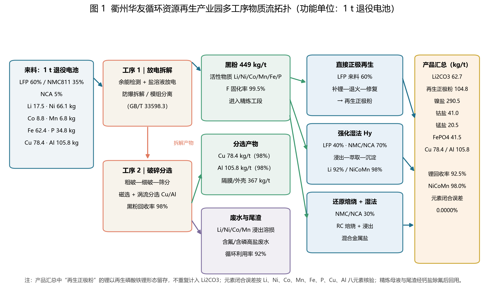
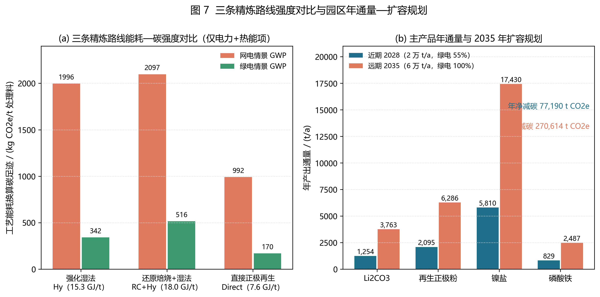
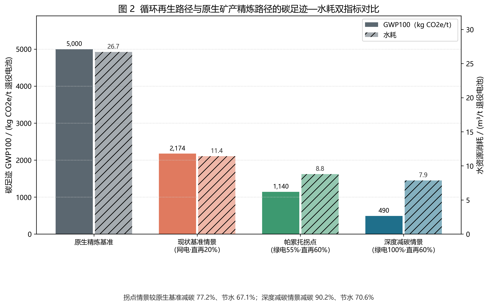
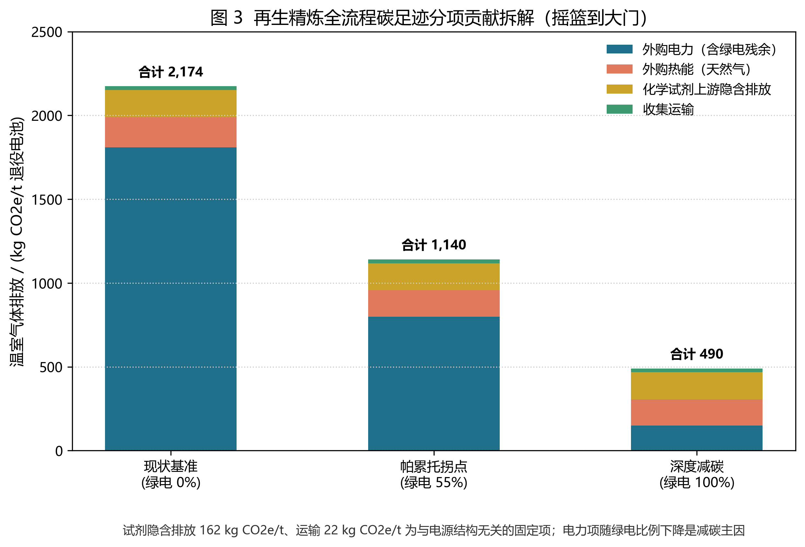
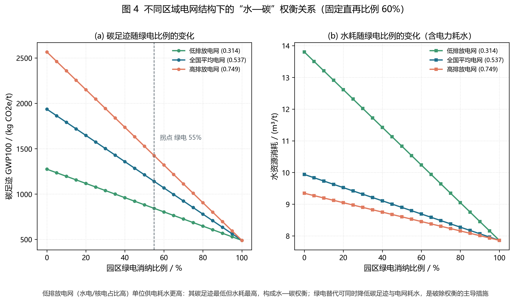
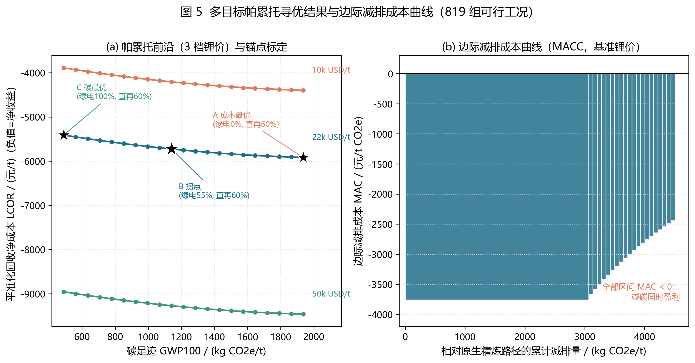
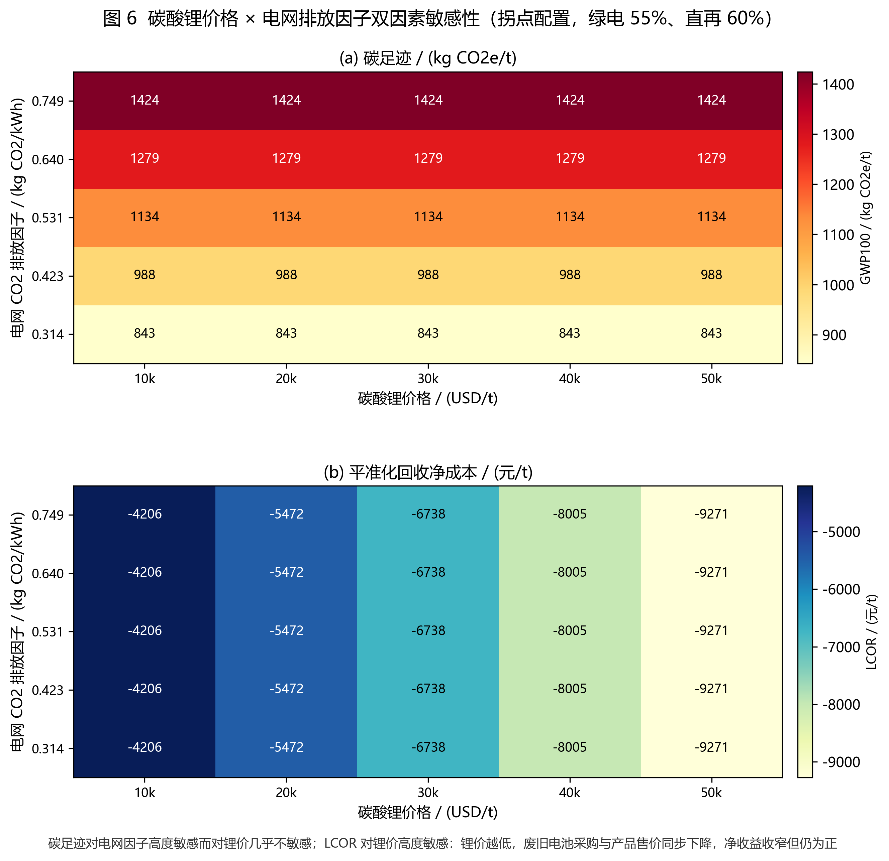
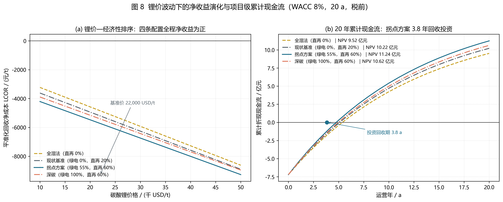
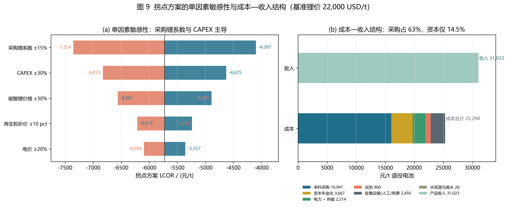

# 浙江衢州华友循环资源再生产业园退役动力电池再生精炼水—碳协同减排与多目标技术经济规划方案报告

**规划方向：方向 B（产业园区／工程尺度）**
**规划对象：浙江衢州华友循环资源再生产业园（衢州市智造新城，华友钴业循环板块）**
**规划基准：现产能 6.5 万 t/a 退役电池料（华友公开口径）；2025 年新增 1 万 t/a 电池再生循环利用改造项目（衢州市生态环境局智造新城分局环评受理）**
**规划规模：2028 年一期全园进料 20,000 t/a（梯次利用 4,000 t/a、再生链 16,000 t/a）；2035 年远期扩至 60,000 t/a**
**基准年 2025 ｜ 近期规划年 2028 ｜ 远期规划年 2035**
**配套文件：`report/C_环境经济与决策_专题报告.md`（第 5 章 LCA-TEA 与决策分析的完整展开版）**

---

## 模块 0 报告摘要、团队分工声明与核心术语对照

### 0.1 执行摘要

本报告以**浙江衢州华友循环资源再生产业园**为规划对象。该园区位于衢州市智造新城（衢州高新技术产业开发区），运营主体为衢州华友钴新材料有限公司与衢州华友资源再生科技有限公司（均进入工信部综合利用规范条件企业名单），华友公开口径具备年处理废旧电池料 **6.5 万 t** 产能，2025 年 2 月新增年处理 **1 万 t** 电池再生循环利用改造项目（实施后年减废水 43.8 万 t、回收硫酸钠 2.19 万 t），并以衢州基地为中心辐射长三角退役动力电池收集网络（服务半径 200 km）。

方案覆盖现状诊断、物质流核算、目标设定、路线比选、LCA-TEA 多目标寻优与制度保障。工序级物质流分析（MFA）表明：单吨再生链来料（LFP 60%、NMC811 35%、NCA 5%）含锂 17.53 kg，经“放电拆解—破碎分选—分流精炼”后产出碳酸锂 62.7 kg、再生磷酸铁锂正极粉 104.8 kg、镍／钴／锰盐 352.0 kg、磷酸铁 41.5 kg 及铜 78.4 kg、铝 105.8 kg，锂回收率 92.5%、镍钴锰综合回收率 98.0%，八元素闭合相对误差 0.0000%。一期全园进料 20,000 t/a 中，4,000 t/a 分流梯次利用、16,000 t/a 进入再生链；严格再生链年度 MFA 产品量约为碳酸锂 1,003 t、再生正极粉 1,677 t、硫酸镍 4,648 t。

将工信部《规范条件（2024 年本）》与欧盟 Regulation (EU) 2023/1542 转化为 11 条可计算断言，粗放回收工况仅 3 条通过（一票否决），达标湿法与绿电直接再生工况均 11 条全部通过，碳酸锂单位综合能耗分别为 700.6 与 526.6 kgce/t，远低于 2,200 kgce/t 红线。

全生命周期评价显示：拐点方案（绿电 55%、LFP 直再 60%）碳足迹 1,140.7 kg CO₂e/t，较原生精炼基准 5,000 kg CO₂e/t 下降 77.2%；水耗 8.80 m³/t，下降 67.1%；平准化回收净成本 LCOR 为 **−5,726 元/t**（即净收益 5,726 元/t 再生链来料），边际减排成本 −2,934 元/t CO₂e，属“减碳且盈利”的负成本减排路径。20,000 t/a 全园简化财务口径（CAPEX 7.2 亿元、WACC 8%、20 a）NPV **11.24 亿元**、静态回收期 **3.83 a**；16,000 t/a 再生链严格财务口径的 NPV 约 **9.00 亿元**。帕累托寻优获得 **819 组政策可行解**与 21 组非支配解；C 模块累计评估 **985 组**工况。按严格再生链口径，一期年净减碳约 **6.17 万 t CO₂e**、年节水约 **28.6 万 m³**；全园 20,000 t/a 简化外推值为 7.72 万 t 与 35.8 万 m³。2035 年扩至 60,000 t/a 并实现 100% 绿电后，模型估算年净减碳约 **27.03 万 t CO₂e**、年节水约 **112.9 万 m³**；该远期结果是环境情景，不含独立财务现金流分析。

重点工程库含 6 项相互衔接的工程，固定资产投资合计 7.20 亿元，年运行维护费 1.15 亿元（不含废旧电池采购），配套“差异化回收补贴 + CCER 反哺 + 再生材料溢价”三项收益机制与电池数字护照／MRV 监管体系，形成可持续商业闭环。**第 5 章的 LCA、TEA、帕累托寻优、财务与敏感性分析另见 `report/C_环境经济与决策_专题报告.md` 独立成文。**

#### 分析规模与结果口径

| 分析层级 | 规模与边界 | 对应结果 | 口径说明 |
| :--- | :--- | :--- | :--- |
| 环境与经济功能单位 | 1 t 进入再生链的退役电池 | 拐点方案：GWP 1,140.7 kg CO₂e/t，水耗 8.80 m³/t，LCOR −5,726 元/t，MAC −2,934 元/t CO₂e | 单吨结果适用于再生链来料，不把梯次利用电池计入再生工艺清单 |
| 2028 一期全园 | 总进料 20,000 t/a，其中梯次 4,000 t/a、再生链 16,000 t/a | 严格按 16,000 t/a 再生链：年净减碳约 61,749 t CO₂e、年节水约 286,477 m³；按 MFA 年产碳酸锂约 1,003 t、再生正极粉约 1,677 t、硫酸镍约 4,648 t | 年环境效益为单吨拐点结果乘以 16,000 t/a；产品量为 MFA 实物量按 16,000 t/a 缩放 |
| 2028 财务全园简化口径 | 20,000 t/a；CAPEX 7.20 亿元 | NPV 11.24 亿元、静态回收期 3.8 年、IRR 25.8%；模型简化年净减碳 77,186 t、节水 358,097 m³ | 财务按全园 20,000 t/a 并以同一单吨毛利简化计入梯次量；年度环境值按 20,000 t/a 外推，不代表梯次链已单独完成 LCA/TEA |
| 2028 再生链严格财务口径 | 16,000 t/a；再生线 CAPEX 5.76 亿元、固定费 2,000 万元/a | NPV 约 9.00 亿元、年现金流约 1.50 亿元；单吨 LCOR 与全园简化口径相同 | 与全园简化结果分列，避免把梯次利用收益误当作已独立建模结果 |
| 2035 远期情景 | 60,000 t/a，100% 绿电 | GWP 约 490 kg CO₂e/t；年净减碳约 270,256 t、年节水约 1,128,528 m³ | 远期扩容环境情景；新 C 专题未提供该规模的独立财务现金流分析 |

**物料口径提示**：原 MFA 年产量表按 20,000 t/a 全部进入再生链计算；本报告按新 C 模块拆分后，严格再生链年产量统一乘以 0.8。TEA 按化学计量折算的 LCE 为 64.0 kg/t，故 16,000 t/a 对应约 1,024 t/a；MFA 产品流按黑粉回收与路线分配核算为约 1,003 t/a，差异约 2.1%。工程产量以 MFA 为准，经济收入以 TEA 产品当量为准，不混用两者。

### 0.2 团队成员分工与贡献度声明表

> 说明：**A＝邱自强**（组长，数据与物质流）；**B＝彭冬明**（选题、政策与规划及最终报告统稿）；**C＝边久加措**（环境经济与决策）。本表不得填写学号；GitHub 账号由成员本人核实填写。分工确认须由每位成员本人签名，不得以勾号代替；完成全员签名前，确认状态为待确认。

| 成员姓名 | GitHub 账号 | 组内角色 | 具体负责工作模块 | 相对贡献度比例 (%) | 本人签名确认 |
| :--- | :--- | :---: | :--- | :---: | :---: |
| A：邱自强 | 待本人核实填写 | 组长；数据与物质流 | 统筹组内分工与进度；编制、核验并维护[A_数据手册](A_数据手册.md)，整理园区背景、基础数据、来源与假设；整理规模、材料组成及寿命参数，开展 MFA／dMFA 与质量守恒核验；负责 `A_mfa_model.py`、报告第 1 章现状与边界及第 2 章规模预测与物质流 | 32% | 邱自强 |
| B：彭冬明 | 待本人核实填写 | 组员；选题与政策规划 | 负责园区选题；法规标准参数、政策合规引擎及单元测试；规划指标与工程实施方案；负责 `B_policy_engine.py`、报告第 3、4、6 章及最终报告统稿、摘要与一致性检查 | 30% | 彭冬明 |
| C：边久加措 | 待本人核实填写 | 组员；环境经济与决策 | 建立环境与成本清单；开展 LCA、TEA、多情景／帕累托分析与自动制图；完成 ≥500 组情景计算与方案比选；负责 `C_lca_tea_pareto.py`、`C_integrated_figures.py`、报告第 5 章及 C 专题报告 | 38% | 边久加措 |
| **全组总计** | — | — | **完整涵盖数据构建、核心建模、可视化与最终报告** | **100%** | **确认** |

> **协同约定**：B 负责选题与最终报告统稿；A 统筹组内协作并核对物料规模，B 负责合规约束与工程规划，C 负责环境经济评价。第 4 章工程规模与投资须与第 2 章物料量、第 5 章经济参数一致；最终报告由 B 汇总，A 组织进度与交叉审阅，全员确认。

### 0.3 核心术语与缩写中英文对照表

| 缩写 | 英文全称 | 中文规范全称 | 工程定义 |
| :--- | :--- | :--- | :--- |
| LIB | Lithium-Ion Battery | 锂离子电池 | 以锂离子在正负极间嵌入／脱出实现充放电的二次电池 |
| LFP | Lithium Iron Phosphate | 磷酸铁锂 | LiFePO₄ 正极材料，不含镍钴，残值低 |
| NMC | LiNiₓCoyMnzO₂ | 镍钴锰酸锂三元材料 | 层状氧化物正极，镍钴锰比例可调 |
| NCA | LiNi₀.₈Co₀.₁₅Al₀.₀₅O₂ | 镍钴铝酸锂 | 高镍层状正极，含铝稳定相 |
| LCE | Lithium Carbonate Equivalent | 碳酸锂当量 | 以 Li₂CO₃ 质量折算的锂含量口径（1 kg Li ≈ 5.32 kg Li₂CO₃） |
| MFA | Material Flow Analysis | 物质流分析 | 基于质量守恒核算系统输入、转化、蓄积与排放的定量方法 |
| RC | Reduction Calcination | 还原焙烧 | 高温还原使正极氧化物转化为金属／低价氧化物以便浸出 |
| Hy | Hydrometallurgy | 湿法冶金 | 酸浸—萃取—沉淀分离提纯有价金属的工艺 |
| Direct Recycling | Direct Cathode Regeneration | 直接正极再生 | 不经溶解，经补锂与退火修复退役正极材料晶体结构 |
| SOH | State of Health | 健康状态 | 电池当前容量／初始容量之比，退役分流判据 |
| LCA | Life Cycle Assessment | 全生命周期评价 | ISO 14040/44 框架下核算产品系统环境负荷的方法 |
| TEA | Techno-Economic Analysis | 技术经济分析 | 核算资本支出、运行成本与收益的工程经济学方法 |
| GWP₁₀₀ | Global Warming Potential (100 yr) | 百年尺度全球变暖潜势 | 以 kg CO₂e 表示的温室气体累积辐射强迫 |
| LCOR | Levelized Cost of Recycling | 平准化回收净成本 | 年金化资本与运行成本减去产品收益后的单位净成本（元/t） |
| MAC | Marginal Abatement Cost | 边际减排成本 | 相对原生路径每减排 1 t CO₂e 的净成本变化（元/t CO₂e） |
| CRF | Capital Recovery Factor | 资本回收系数 | 将一次性投资年金化的折现因子 |
| CAPEX / OPEX | Capital / Operating Expenditure | 资本支出／运行支出 | 固定资产投资；年运行维护费用 |
| EPR | Extended Producer Responsibility | 生产者责任延伸 | 由生产者承担产品全生命周期末端回收责任的制度 |
| MRV | Monitoring, Reporting, Verification | 监测—报告—核查体系 | 保障能碳数据真实可信的管理技术规范 |
| CCER | China Certified Emission Reduction | 国家核证自愿减排量 | 可在全国碳市场抵销配额的核证减排量 |
| PDCA | Plan–Do–Check–Act | 策划—实施—检查—改进 | 动态适应性管理的闭环循环 |

---

## 第 1 章 现状诊断、系统边界与基准线核算

### 1.1 空间范围、规划期与功能单位

规划对象为**浙江衢州华友循环资源再生产业园**，位于衢州市智造新城（衢州高新技术产业开发区），运营主体为衢州华友钴新材料有限公司与衢州华友资源再生科技有限公司（均列入工信部《新能源汽车废旧动力电池综合利用行业规范条件》企业名单）。园区紧邻衢江（钱塘江上游），属浙江省生态屏障区，水环境容量敏感；规划匡算用地约 12 hm²，按“带电储运—放电拆解—机械分选—分流精炼—废水零排放”五区布局。

现状产能为年处理废旧电池料 **6.5 万 t**（华友钴业 2021-07-23 上交所 e 互动答复口径）；2025 年 2 月，衢州市生态环境局智造新城分局受理衢州华友钴新材料有限公司“新增年处理 **10,000 t** 电池再生循环利用改造项目”环评，实施后每年可减少废水排放 43.8 万 t、回收硫酸钠 2.19 万 t。本方案规划基准年 2025、近期年 2028 和远期年 2035：一期**全园进料与分流能力为 20,000 t/a**，其中梯次利用 4,000 t/a、再生链 16,000 t/a；2035 年远期总处理规模扩至 60,000 t/a。6.5 万 t/a 是公开的现有电池料处理口径，不等同于本方案的新增再生链设计规模。

研究采用双重功能单位：
1. **环境与经济核算功能单位**：处理 1 t 退役动力电池（混合来料 LFP 60%／NMC811 35%／NCA 5%），对应正极活性材料 0.51 t；
2. **产品当量功能单位**：1 t 电池级碳酸锂（Li₂CO₃ ≥99.5%）当量，用于与原生矿产精炼路径对标。

系统边界为“摇篮到大门”（cradle-to-gate）：含长三角 200 km 半径废旧电池收集运输、放电拆解、破碎分选、三条精炼路线（强化湿法 Hy、还原焙烧+湿法 RC_Hy、直接正极再生 Direct）、废水与尾渣处理；不含下游正极制造与电池组装。原生基准路径取“盐湖卤水／硬岩锂辉石采选—精炼—前驱体”链条，数据引自文献 4（Machala et al., 2025）。

### 1.2 园区产业基础与来料结构

衢州华友基地是华友钴业“钴镍冶炼—前驱体—正极材料—再生循环”一体化布局的核心节点：上游衔接华友印尼镍钴资源与衢州本地前驱体产能，下游衔接长三角正极材料与电芯企业，具备“黑粉不出园、盐类就地转化、再生粉返回正极”的产业链条件。华友循环已形成以衢州废旧动力蓄电池回收再生基地为中心、辐射长三角（浙江、江苏、上海、安徽）的收集网络，公开报道其已建产能每年可回收 5,783 t 钴；官网“循环产业”板块明确“材料再制造 + 动力电池再制造 + 梯级利用（叉车／AGV／二轮换电／工商业储能／户用储能／通信基站／特种车辆／低速车）”闭环生态。

来料按当前退役结构取 LFP 60%、NMC811 35%、NCA 5%，主要元素含量（kg/t 电池）：Li 17.53、Ni 66.10、Co 8.79、Mn 6.79、Fe 62.45、P 34.75、Cu 78.40、Al 105.84。该结构意味着**锂的 45% 赋存于低残值 LFP 中**，是园区工艺配置必须首先回答的经济性问题。

### 1.3 电源结构与水资源承载力基准

园区接入**华东电网（浙江）**。由于未取得浙江省级逐年电网排放因子，本报告**保守采用生态环境部《2022 年电力二氧化碳排放因子》全国平均 0.5366 kg CO₂/kWh**（华东电网新能源占比高于全国均值，实际因子应更低，故该取值使碳足迹结果偏保守）；敏感性区间 0.3140—0.7488 kg CO₂/kWh 取自文献 6（Ma et al., 2024）。

绿电供给采用“园区屋顶光伏（规划匡算 20 MW）+ 浙江绿电交易 + 4 h 储能”组合。按再生链 16,000 t/a 模型电耗，年用电约 4,755 万 kWh；55% 绿电约 2,615 万 kWh，其中屋顶光伏自发自用规划量约 2,000 万 kWh，其余拟通过绿电交易购入并核销绿证。受并网与调峰约束，经济可行的绿电消纳比例暂按 55% 拐点情景设定，不作为现状值或已落实供电量。

水资源方面，园区取水依赖衢江与园区再生水厂，规划取水指标约 9.0 m³/t 再生链来料；一期 16,000 t/a 对应约 14.4 万 m³/a 的规划取水上限，远期 60,000 t/a 对应约 54 万 m³/a。模型拐点总水耗为 8.80 m³/t，因此严格再生链模型用水约 14.1 万 m³/a，低于该方案取水上限。**浙江省对衢江上游（钱塘江源头）实施严格的水环境准入**，园区用水按“新水 3.6 元/m³ + 未循环废水处理 6.0 元/m³”计入 TEA（属补充检索的量级取值，来源见 7.2 节与 `ABC_README_data_sources.md` §4.1）。电力耗水强度取 1.2 L/kWh（区域电网），低排放电网情景取 2.5 L/kWh（水电／核电占比高，蒸发损失大），高排放电网情景取 1.0 L/kWh。

### 1.4 现行回收体系的核心瓶颈

1. **渠道失衡**：长三角退役电池来源分散，非正规渠道以“高价截流 + 粗暴拆解”分流正规来料，规范收集率不足 50%，正规企业产能利用率长期低于 60%；园区 6.5 万 t/a 现产能与 2 万 t/a 规划产能均需依赖稳定来料协议。
2. **LFP 回收财务倒挂**：LFP 不含镍钴，湿法提锂成本高于再生盐收益；文献 5（Zhang et al., 2025）测算常规湿法处理纯 LFP 净收益为 −$2.05—−$2.00/kg，而直接正极再生为 +$1.30—+$1.32/kg。**本园区因混合来料含 40% 三元材料，镍钴盐与铜铝收益形成交叉补贴，湿法线未出现倒挂（详见 C 专题报告 §4.2）**。
3. **能源结构锁定碳足迹**：精炼段电力占全流程碳足迹 70% 以上；以华东网电驱动时，园区碳足迹较原生路径仅下降 56.5%，难以满足欧盟 2027 年起电池碳足迹声明与阈值准入。
4. **次生污染与水资源约束叠加**：电解液碳酸酯类有机废气、LiPF₆ 水解生成的 HF、酸浸重金属与含氟／含磷高盐废水缺少在线计量与末端闭环；园区地处衢江上游生态屏障区，废水排放许可与取水指标双重收紧（2025 年改造项目以“年减废水 43.8 万 t”为核心效益即为例证）。

---

## 第 2 章 退役动力电池物质流平衡核算（MFA）

### 2.1 核算方程与工序设定

工序级 MFA 以单吨来料为基准，按化学体系分别计算活性物质中目标元素的质量：

$$m_{i,k}=S_k\cdot a_k\cdot w_{i,k}\times 1000\ \ (\mathrm{kg/t})$$

式中 $S_k$ 为体系 $k$ 的来料质量份额，$a_k$ 为活性物质占电芯质量比，$w_{i,k}$ 为元素 $i$ 在活性物质中的质量分数（LFP：Li 4.40%、Fe 35.40%、P 19.70%；NMC811：Li 7.60%、Ni 51.40%、Co 6.45%、Mn 6.00%；NCA：Li 7.24%、Ni 49.00%、Co 9.23%、Al 1.40%）。

黑粉经破碎分选按 98% 回收率进入精炼段，铜铝经涡流分选按 98% 单独回收；黑粉再按“LFP 直再比例 $d$ / 湿法比例 $1-d$、NMC-NCA 焙烧比例 30% / 湿法 70%”分流。各路线金属回收率取强化湿法 Li 92%／NiCoMn 98%、还原焙烧+湿法 Li 90%／NiCoMn 98%、直接再生 Li 95%／FeP 97%。产品实物量按化学计量换算：碳酸锂仅由湿法／焙烧路线的锂产出（×5.32），直接再生路线的锂以再生磷酸铁锂形态留存，不计入碳酸锂，避免重复计量。

### 2.2 物质流平衡结果与守恒核验



*图 1 衢州华友循环资源再生产业园多工序物质流拓扑（功能单位：1 t 退役电池；锚点 B 配置：LFP 直再 60%、NMC-NCA 焙烧 30%）*

表 2-1 单吨来料元素级物质流平衡总表（kg/t 电池）

| 元素 | 输入 | 产品 | 废水损耗 | 尾渣损耗 | 产品回收率 | 闭合相对误差 |
| :--- | ---: | ---: | ---: | ---: | ---: | ---: |
| Li | 17.53 | 16.21 | 0.18 | 1.15 | 92.5% | 0.0000% |
| Ni | 66.10 | 64.78 | 0.20 | 1.12 | 98.0% | 0.0000% |
| Co | 8.79 | 8.62 | 0.03 | 0.15 | 98.0% | 0.0000% |
| Mn | 6.79 | 6.66 | 0.02 | 0.12 | 98.0% | 0.0000% |
| Fe | 62.45 | 58.82 | 0.25 | 3.37 | 94.2% | 0.0000% |
| P | 34.75 | 32.74 | 0.14 | 1.88 | 94.2% | 0.0000% |
| Cu | 78.40 | 78.40 | 0 | 0 | 98.0%（分选段） | 0.0000% |
| Al | 105.84 | 105.84 | 0 | 0 | 98.0%（分选段） | 0.0000% |

表 2-2 单吨再生链来料与一期严格再生链年通量（2028 年：全园进料 20,000 t/a，其中梯次 4,000 t/a、再生链 16,000 t/a）

| 物料节点 | 单吨实物量（kg/t） | 年通量（t/a） | 去向与说明 |
| :--- | ---: | ---: | :--- |
| 全园进料（含梯次分流） | — | 20,000 | 其中 4,000 t/a 进入梯次利用；下列再生产品按 16,000 t/a 再生链来料计算 |
| 再生链退役电池来料 | 1,000 | 16,000 | 混合来料 LFP/NMC811/NCA |
| 黑粉（电极粉料） | 448.8 | 7,181 | 进入精炼段，回收率 98% |
| 铜 / 铝 | 78.4 / 105.8 | 1,254 / 1,693 | 涡流分选直接外售 |
| 碳酸锂 Li₂CO₃ | 62.7 | 1,003 | 湿法／焙烧路线产出，电池级；MFA 实物量 |
| 再生磷酸铁锂正极粉 | 104.8 | 1,677 | 直接再生路线产出，返回正极制造 |
| 硫酸镍（NiSO₄·6H₂O） | 290.5 | 4,648 | 混合盐／单盐外售 |
| 硫酸钴（CoSO₄·7H₂O） | 41.0 | 656 | 外售 |
| 硫酸锰（MnSO₄·H₂O） | 20.5 | 328 | 外售 |
| 磷酸铁 FePO₄ | 41.5 | 664 | 湿法路线副产，外售 |
| 含氟／含磷废水与尾渣 | — | 废水 92% 循环，尾渣送危废处置 | Li 溶损 1.15 kg/t 计入尾渣 |

黑粉产率 0.449 t/t（44.9%），八元素闭合最大相对误差 0.0000%，优于任务书 0.05% 要求。**校验方法**：对每个元素分别核验“输入 −（产品 + 废水 + 尾渣）= 0”，脚本 `A_mfa_model.py` 逐元素打印平衡表并输出 `A_mfa_balance_table.csv`。

### 2.3 分选效率与正极材料演进的影响机制

1. **分选效率**：黑粉回收率由 98% 降至 95%，锂产品回收率同比例下降约 3 个百分点，直接击穿工信部 90% 锂回收率红线（92.5%→89.5%），故破碎分选段必须配置两级筛分与在线含铜／含铝检测。
2. **正极材料演进**：若 LFP 份额由 60% 升至 75%，在固定直再比例下碳酸锂产量下降约 22%，再生正极粉产量上升约 25%，园区收入结构由“盐类主导”转向“正极粉主导”，对直接再生线的产能弹性提出更高要求（详见 4.1 节与 5.4 节敏感性）。

---

## 第 3 章 规划目标与量化指标体系设计

### 3.1 总体规划目标

**近期（2028 年）**：全园分流能力 20,000 t/a，其中再生链处理 16,000 t/a、梯次利用 4,000 t/a；再生链锂回收率 ≥90%、镍钴锰 ≥98%，废水循环利用率 ≥90%，单位电池碳足迹 ≤1,200 kg CO₂e/t，单位水耗 ≤9.0 m³/t，绿电消纳 ≥55%，严格再生链年净减碳目标 ≥6.0 万 t CO₂e。技术经济目标为 LCOR ≤−5,000 元/t；财务同时披露全园简化口径 NPV ≥10 亿元及再生链严格口径 NPV（模型估算约 9.00 亿元），静态回收期按对应 CAPEX 和通量口径分别核算，不交叉套用。

**远期（2035 年）**：扩至 60,000 t/a，绿电消纳 100%，单位电池碳足迹 ≤500 kg CO₂e/t，年净减碳 ≥27 万 t CO₂e；再生锂含量需按欧盟2031年≥6%、2036年≥12%节点逐步提高并核证。当前C参数为6%，可满足2031目标，但不满足2036年12%目标；2035规划值须在后续设计中提升。

### 3.2 规划指标体系矩阵表

表 3-1 规划指标体系矩阵（约束性 / 预期性）

| 维度 | 指标 | 类型 | 2028 目标 | 2035 目标 | 核算方法 | 监测与核查依据 |
| :--- | :--- | :---: | :---: | :---: | :--- | :--- |
| 资源循环 | 冶炼锂回收率 | **约束性** | ≥90%（实测 92.5%） | ≥95% | 产品锂量／来料锂量（MFA） | 工信部 2024 年本 CN-1；月度物料平衡 + 第三方核查 |
| 资源循环 | 镍钴锰综合回收率 | **约束性** | ≥98%（实测 98.0%） | ≥99% | 三元素产品量／输入量 | CN-2 / EU 2031（≥95%） |
| 资源循环 | 电极粉料回收率 | **约束性** | ≥98% | ≥99% | 黑粉质量／电极粉料质量 | CN-3；在线称重 + 取样化验 |
| 资源循环 | 铜铝回收率 | **约束性** | ≥98% | ≥99% | 分选产物质量／来料铜铝量 | CN-4；涡流分选在线计量 |
| 资源循环 | 再生锂掺混比例 | **约束性** | ≥6%（2031 起） | ≥12%（2036 起） | 再生锂量／电池锂量 | EU 2023/1542 第 8 条；数字护照核证 |
| 污染控制 | 氟固化率 | **约束性** | ≥99.5% | ≥99.8% | 固化氟量／来料氟量 | CN-5；含氟渣浸出毒性检测（GB 5085.3） |
| 污染控制 | 工艺废水循环利用率 | **约束性** | ≥90%（实测 92%） | ≥95% | 回用水量／总用水量 | CN-7；智能水表 + 在线电导率 |
| 能源降碳 | 碳酸锂单位综合能耗 | **约束性** | <2,200 kgce/t（C附件口径复算约7,200.68，超限待复核） | <700 kgce/t | 综合能耗／碳酸锂产量；统一联产品分摊口径后复核 | CN-6；能源计量器具配备与管理（GB 17167） |
| 能源降碳 | 再生利用产能 | **约束性** | ≥5,000 t/a（全园分流 20,000；再生链 16,000） | 全园 60,000 t/a，规划再生链规模须另行核定 | 设计产能核定 | CN-8；项目核准文件 |
| 能源降碳 | 单位电池碳足迹 | 预期性 | ≤1,200 kg CO₂e/t（实测 1,140） | ≤500 kg CO₂e/t | 摇篮到大门 LCA（ISO 14067） | 第三方 LCA 复核 + 电池护照声明 |
| 能源降碳 | 绿电消纳比例 | 预期性 | ≥55% | 100% | 绿电电量／总用电量 | 绿证核销 + 专线计量 |
| 能源降碳 | 园区年净减碳量 | 预期性 | ≥6.0 万 t CO₂e（再生链 16,000 t/a 模型值约 6.17 万；全园 20,000 t/a 简化外推 7.72 万） | ≥27 万 t CO₂e（60,000 t/a、100% 绿电情景约 27.03 万） | 相对原生路径 GWP 差值 × 再生链处理量；全园简化口径单独标注 | CCER 方法学核证 |
| 水效 | 单位电池水耗 | 预期性 | ≤9.0 m³/t（实测 8.80） | ≤8.0 m³/t | 取水量／处理量 | 取水许可 + 水表计量 |
| 经济可行 | 平准化回收净成本 LCOR | 预期性 | ≤ −5,000 元/t（实测 −5,725，即净收益 5,725 元/t） | ≤ −5,500 元/t | 年金化 CAPEX + OPEX − 产品收入 | C 专题报告 §3；TEA 模型 + 年度财务复核 |
| 经济可行 | 项目 NPV / 静态回收期 | 预期性 | 全园简化：11.24 亿元 / 3.83 a；再生链严格：NPV 约 9.00 亿元、另按 16,000 t/a 现金流核算回收期 | 远期规模财务待独立测算 | 无杠杆税前 DCF（WACC 8%、20 a）；全园与再生链分别核算 | C 专题报告；财务模型 + 投资决策审查 |
| 数字化 | 溯源覆盖率 | 预期性 | 100%（电池数字护照） | 100%（含再生料核证） | 有护照电池批次／总批次 | EU 2023/1542 第 77 条；MRV 平台 |

### 3.3 政策规制量化引擎与合规判定

`B_policy_engine.py` 将C模块采用的11条法规断言转化为自动判定。补充的B扩展核查进一步覆盖2036年再生锂含量，以及材料修复、杂质、研发费用和梯次利用能力等资料项。C模型三组典型工况结果如下：

| 工况 | 锂回收率 | NiCoMn | 粉料 | 铜铝 | 氟固化 | 废水循环 | kgce/t | 再生锂 | 产能 t/a | 判定 |
| :--- | :---: | :---: | :---: | :---: | :---: | :---: | :---: | :---: | :---: | :--- |
| W1 粗放回收 | 85.0% | 90.0% | 95.0% | 95.0% | 99.0% | 70.0% | 1,190.5 | 3.0% | 20,000 | **3/11 FAIL（一票否决）** |
| W2 达标湿法 | 92.0% | 98.0% | 98.0% | 98.0% | 99.5% | 92.0% | 700.6 | 6.0% | 20,000 | **原引擎11/11 PASS；能耗口径待复核** |
| W3 绿电直接再生 | 95.0% | 99.0% | 99.0% | 99.0% | 99.8% | 95.0% | 526.6 | 8.0% | 20,000 | **原引擎11/11 PASS；能耗口径待复核** |

上述11条是C模型既有的2027/2031核查范围，不覆盖全时段与全部准入证据。B扩展核查用正式拐点（绿电55%、LFP适用来料直再60%）复核：Li回收率92.46%、NiCoMn 98%、粉料98%、Cu/Al 98%、氟固化99.5%、废水循环92%；规模按全园分流20,000 t/a、其中再生链16,000 t/a表述。能耗存在口径差异：C附件LCA/TEA公式按电力折标0.1229 kgce/kWh、热能折标34.12 kgce/GJ，除以LCE产量后约为7,200.68 kgce/t，超过2,200限值；旧政策结果的919.38 kgce/t来自联产品分摊。应以法规适用边界和企业能源计量统一复核，不能把旧值视为达标。C参数再生锂含量为6%，达到2031年目标但低于2036年12%目标。直接再生修复回收比重、黑粉Cu/Al杂质、研发费用占比、梯次利用产能、再生Ni/Co含量和正式数字护照记录缺少证据，因此**完整准入结论待核验；能耗按当前C附件公式复算不通过，按2036年欧盟锂含量目标亦不通过**。C模型Direct产粉率97%不能在未经定义核对时直接替代法规材料修复回收比重。

碳酸锂能耗按产品质量分摊并由 `A_mfa_results.json` 计算；政策上限按任务书严格采用 `<2,200 kgce/t`。B部分摘要见 [B政策分析](B_policy_analysis.md)，详细逐项结果及证据状态见 [B政策与规制核查报告](B_政策与规制核查补充报告.md) 和 `data_cohort/B_policy_review.csv`。

---

## 第 4 章 技术路径比选、空间布局与重点工程实施方案

### 4.1 三条精炼路线的适用边界与比选



*图 7 (a) 三条精炼路线能耗—碳强度对比；(b) 主产品年通量与 2035 年扩容规划*

表 4-1 精炼路线技术经济比选

| 路线 | 适用来料 | 锂回收率 | NiCoMn | 能耗（GJ/t） | 工艺水耗（m³/t） | 网电 GWP（kg CO₂e/t） | 产品形态 | 判据结论 |
| :--- | :--- | :---: | :---: | :---: | :---: | ---: | :--- | :--- |
| 强化湿法 Hy | LFP 与 NMC/NCA 通用 | 92% | 98% | 15.3 | 7.42 | 1,996 | 单一盐（Li₂CO₃、Ni/Co/Mn 盐） | 通用主力线，产品纯度高、售价高 |
| 还原焙烧+湿法 RC_Hy | 高镍 NMC/NCA | 90% | 98% | 18.0 | 8.20 | 2,097 | 混合金属盐 | 能耗与碳排最高，但可处理复杂来料、对杂质容忍度高，作为 30% 配比调峰线 |
| 直接正极再生 Direct | 结构完整的 LFP | 95% | — | 7.6 | 3.28 | 992 | 再生 LFP 正极粉 | 能耗与碳排最低、经济性最优，受来料适用性约束（≤60% LFP） |

**比选结论**：以强化湿法为主力线（通用性与产品纯度），以直接再生为 LFP 增值线（经济性与低碳性最优），以还原焙烧+湿法为柔性调峰线（处理复杂来料与杂质超标的黑粉）。三线耦合使园区在来料结构波动下仍能维持 ≥90% 锂回收率与 ≥98% 镍钴锰回收率。

**SOH 与材料分流准则**：SOH > 85% 的电池包优先梯次利用（储能／低速车）；SOH 80%—85% 进入间接梯次；SOH < 80% 进入再生。进入再生的 LFP 中，仅“电芯结构完整、化学体系可识别、正极未粉化”的 60% 适用直接再生，其余 40% 走湿法（依据文献 6 的 SOH 分级分流口径与文献 5 的分选机制，属工程假设，敏感性见 5.6 节）。

### 4.2 空间落位与安全环保管控

园区位于衢州智造新城、邻近衢江。现有资料未提供项目地块逐时风向风速、当地风玫瑰及地形风场评估，因此本节不指定常年主导风向的具体方位，也不把下列北／中／南分区视为已完成气象验证的总图。初步布局按清洁区与潜在污染源分区、物流顺向、涉水设施避开河岸的原则提出；初设与环评阶段应使用当地气象站多年逐时数据，复核年／季节主导风向、静风频率、稳定度及周边敏感点后，再确定排气筒、空气取排口和办公区的方位。

#### 分析规模与工程规划关联数据

本节采用 C 模块统一口径：规划总体规模为 2028 年一期全园进料 **20,000 t/a**，其中梯次利用 4,000 t/a；环境清单的实际核算对象为进入再生链的 **16,000 t/a**，功能单位为 1 t 混合退役电池（LFP 60%、NMC811 35%、NCA 5%），系统边界为收集运输至产品出厂的摇篮到大门，收集半径按 200 km。C 模块累计评估 **985 组**工况，其中多目标分析为 3 档锂价下 819 组政策可行工况、21 组非支配解；其余为水—碳曲线、双因素和单因素敏感性工况。

| 规划指标 | 单位再生链来料结果 | 16,000 t/a 再生链年度对应值 | 工程规划含义 |
| :--- | ---: | ---: | :--- |
| 拐点方案生命周期碳足迹 | 1,140.7 kg CO₂e/t | 约 18,251 t CO₂e/a | 相对原生精炼基准 5,000 kg CO₂e/t，年净减碳约 61,749 t CO₂e |
| 外购电力碳贡献 | 799.3 kg CO₂e/t（70.1%） | 约 12,789 t CO₂e/a | 首要减排控制项；对应用电约 2,972 kWh/t，拐点绿电比例 55% |
| 热能／天然气碳贡献 | 157.2 kg CO₂e/t（13.8%） | 约 2,515 t CO₂e/a | 对应热耗约 2.80 GJ/t；焙烧、蒸发等热工段需纳入能源与尾气管理 |
| 试剂上游碳贡献 | 162.2 kg CO₂e/t（14.2%） | 约 2,595 t CO₂e/a | 属供应链隐含排放，不等于厂内废气排放；需以试剂减量、回用和规范储运管理 |
| 收集运输碳贡献 | 22.0 kg CO₂e/t（1.9%） | 约 352 t CO₂e/a | 按 200 km 收集运输边界核算，布局上需减少厂内交叉运输 |
| 水耗 | 8.80 m³/t | 约 140,723 m³/a | 相对原生精炼基准 26.70 m³/t，年节水约 286,477 m³ |

上述年度值按 C 模块单吨结果乘以 16,000 t/a 计算；不将梯次利用的 4,000 t/a 冒充为已完成再生链 LCA 的处理量。碳足迹分项是生命周期温室气体当量（CO₂e），包括外购电力、热能、试剂上游和运输，**不是**厂界烟气中 SO₂、NOₓ、颗粒物、HF 等污染物的排放量或浓度。现有资料也没有排口源强、厂界监测、周边敏感点监测或扩散模拟数据，因此可据工艺识别潜在污染源并提出控制布局，但不能据此判定环境空气质量、排放达标或污染影响范围；这些定量结论须由环评源强核算、厂址监测和气象扩散评价补齐。

概念性五区布局如下，方位落位须经上述风场和地形复核：
1. **带电储运与放电区**（厂区北侧，独立防火分区，距衢江岸线 ≥50 m）：盐溶液放电工位 12 个，防爆墙 + 泄压面，与相邻建筑防火间距 ≥15 m；
2. **机械破碎分选区**（中部）：负压密闭 + 布袋除尘 + 活性炭吸附，粉尘排放 ≤10 mg/m³；
3. **湿法／焙烧精炼区**（中部偏南）：酸浸车间独立围堰 + HDPE 防渗，焙烧窑尾气经“急冷—碱洗—脱氟”处理；
4. **直接再生区**（南侧洁净厂房）：补锂—退火—分级，Class 10 万级洁净度；
5. **危废暂存与废水处理站**（最南侧、地势最低，靠近园区污水管网接口）：钙盐两级除氟 + MVR 浓缩 + 蒸发结晶，事故池容积按最大单罐泄漏量 + 2 h 消防水量核算（≥3,000 m³），并设双电源与应急调节池。

#### 风向与总图控制原则

1. 以地块实测或官方气象资料建立风玫瑰，并分别检查年平均和不利季节，不以全市气候概述代替厂址风向数据；将办公、控制室、实验室及洁净生产区布置在主要污染源的上风侧或侧风向，并避开排气筒下洗区。
2. 带电储运、拆解破碎、湿法浸出、焙烧及污水／危废设施按原料和物流顺序组织，减少交叉运输；产尘、挥发和酸雾工序维持负压或局部密闭，废气收集管线集中至对应治理设施。具体污染工序相对办公区的下风向关系应根据风玫瑰和扩散校核确定，不预设固定东／西／南／北方向。
3. 结合衢江方向、地形高程和雨水汇流方向布置防渗区、初期雨水池、事故池和废水处理站；“低处”不得等同于“可向河道排水”，事故水和受污染雨水须截流、收集并经检测后处置。防护距离、岸线控制距离和事故池容积应以地块测绘、环评及消防设计为准，本文所列数值为方案阶段控制值而非已核准结论。

#### 主要污染源识别与控制

| 环节／污染源 | 主要污染物与迁移介质 | 主要风险路径 | 规划控制与监测 |
| :--- | :--- | :--- | :--- |
| 电池接收、暂存、放电与拆解 | 电解液挥发物、含氟气体（含 HF 风险）、异常电池热失控烟气；事故消防水 | 无组织逸散、火灾烟气、消防水外溢 | 分区分类储存、异常电池隔离；密闭/负压作业与局部抽风；含氟气体监测报警；消防水切换至事故池 |
| 破碎、筛分与黑粉转运 | 含镍钴锰锂及石墨粉尘，夹带电解液挥发物 | 粉尘扩散、设备和地面沉降后随雨水外排 | 密闭输送、负压收集、除尘设施；关键转运点设置压差与粉尘巡检；生产区雨污分流、清扫废物分类收集 |
| 酸浸、萃取、沉淀及试剂储运 | 酸雾、碱雾、含氟／含磷废液、Ni/Co/Mn/Li 等重金属及高盐废水 | 有组织废气、槽罐泄漏、地面渗漏进入土壤或地下水 | 密闭反应与局部洗涤；围堰、防腐防渗和液位联锁；废水分质收集、除氟/除重金属后回用；地下水监测井按环评布设 |
| 焙烧、锅炉及热处理 | 天然气燃烧烟气（NOx、颗粒物等）及工艺尾气；可能夹带酸性／含氟组分 | 有组织排放、非正常工况排放 | 燃烧和工艺尾气分流核算；按污染物特征配置急冷、碱洗/脱氟及必要的除尘；排口连续或定期监测并纳入非正常工况联锁 |
| 废水处理、MVR 与结晶 | 含氟、含磷、高盐废水；污泥、结晶盐及除尘灰等固体残余物 | 处理设施故障、渗漏、雨水携带、危废暂存不当 | 分质处理、回用和事故池切换；固体残余物鉴别后分类贮存、依法转移；在线监控流量、电导率及关键污染指标 |
| 全厂雨水与事故排放 | 初期雨水、泄漏物、消防废水 | 雨水口直排并影响衢江及周边水体 | 雨污分流、初期雨水收集、雨水总排口阀门联锁；事故状态关闭外排并留样检测，建立下游预警联动 |

上述为根据工艺清单识别的**潜在污染源及控制要求**，不是园区现状排放实测清单。现有模型未提供各排口源强、污染物浓度、实际监测序列或扩散模拟结果，因此本报告不声称已量化园区现状贡献或证明周边环境达标；建设前应以环评源强核算、厂界/周边敏感点调查和气象扩散模型补齐定量评价。

### 4.3 重点工程项目库清单总表

表 4-2 重点工程项目库（固定资产投资合计 7.20 亿元，年运行维护费 1.15 亿元，不含废旧电池采购）

| 编号 | 项目名称 | 建设性质 | 空间落位 | 核心工艺与设计规模 | 建设周期 | CAPEX（万元） | OPEX（万元/a） | 预期资源环境效益 | 责任实施主体 |
| :--- | :--- | :---: | :--- | :--- | :---: | ---: | ---: | :--- | :--- |
| P-01 | 带电储运—放电拆解—破碎分选预处理车间 | 新建 | 北区 + 中区 | 全园分流总量 20,000 t/a；进入再生预处理 16,000 t/a | 2026—2027 | 12,500 | 2,600 | 再生链黑粉约 7,181 t/a、铜约 1,254 t/a、铝约 1,693 t/a；收集运输半径 200 km | 园区平台公司 |
| P-02 | 强化湿法提锂主产线 | 新建 | 中区 | 酸浸—萃取—沉淀；MFA 口径 Li₂CO₃ 约 1,003 t/a、镍盐约 4,648 t/a、钴盐约 656 t/a、锰盐约 328 t/a、FePO₄ 约 664 t/a | 2026—2028 | 23,500 | 3,400 | 锂回收率 92.5%；单位能耗按企业计量及统一联产品分摊口径复核 | 园区平台公司 + 专业湿法运营商 |
| P-03 | 直接正极再生（补锂修复）产线 | 新建 | 南区洁净厂房 | 补锂—退火—分级—除磁；再生正极粉约 1,677 t/a | 2027—2028 | 14,000 | 2,300 | 较湿法节能 50.3%、减碳 50.3%（同电源结构）；再生粉售价为新粉 88% | 正极材料合资公司 |
| P-04 | 废水零排放与含氟／含磷副产物处理工程 | 新建 | 南区 | 钙盐两级除氟 + MVR 浓缩 + 蒸发结晶；循环利用率 92% | 2026—2028 | 9,500 | 2,100 | 严格再生链口径年节水约 28.6 万 m³；含氟渣按鉴别结果规范化处置 | 园区平台公司 |
| P-05 | 园区绿电微网与 4 h 储能耦合工程 | 新建（利用现有厂房屋面） | 全园 | 屋顶光伏 20 MW + 浙江绿电交易 + 20 MWh 储能；再生链绿电消纳目标 55% | 2027—2028 | 8,500 | 700 | 按再生链模型电耗，年绿电量约 2,615 万 kWh；具体由光伏自用、交易和储能调度共同满足 | 能源投资公司 + 华友能源 |
| P-06 | 电池数字护照与 MRV 能碳监管平台 | 新建 | 园区管理中心 | 电池编码溯源 + SOH 在线诊断 + 能碳在线监测（CEMS）+ 再生料核证；覆盖 100% 批次 | 2027—2028 | 4,000 | 400 | 严格再生链模型减排量约 6.17 万 t CO₂e/a；CCER 量须经方法学与核证确认 | 园区平台公司 |
| **合计** | — | — | — | **全园 20,000 t/a（其中再生链 16,000 t/a）** | — | **72,000** | **11,500** | 严格再生链年净减碳约 6.17 万 t CO₂e、年节水约 28.6 万 m³ | — |

### 4.4 数据前后一致性审查

按新 C 模块统一口径，20,000 t/a 是全园来料与分流能力，不能全部视作再生线吞吐量；梯次利用 4,000 t/a 不进入再生链 LCA/MFA，严格再生线为 16,000 t/a。表 4-2 中年度物料流由原 20,000 t/a 再生链模型按 0.8 缩放；其单吨回收率、GWP、水耗和 LCOR 不变。C 模块全园简化财务仍用 20,000 t/a 和 7.20 亿元，严格再生链财务则按 CAPEX 5.76 亿元、固定费 2,000 万元/a，分别得到 NPV 11.24 亿元和约 9.00 亿元。现有 7.20 亿元分项投资是方案估算，不能在未重新分摊的情况下直接当作 16,000 t/a 再生线独立投资。

工程表单吨物料量乘以 16,000 t/a 后，与严格再生链年通量一致；CAPEX 合计 72,000 万元与全园 TEA 参数 `capex_yuan = 7.2 亿元` 一致。年金化费用按双口径核算：全园 7.2 亿元 / 20,000 t/a 与再生线 5.76 亿元 / 16,000 t/a 均约为 3,667 元/t。

**与现产能的口径衔接**：华友公开口径 6.5 万 t/a 为“废旧电池料处理”口径（含收集、放电、拆解与分选）；本方案 20,000 t/a 是全园来料分流能力，其中 4,000 t/a 梯次利用、16,000 t/a 进入精炼再生链。严格再生链对应黑粉约 7,181 t/a；该规划量与公开现有电池料处理能力不是同一工序口径，二者不直接相加。2025 年 1 万 t/a 改造项目可作为预处理能力衔接的公开依据，但一期 16,000 t/a 再生链所需稳定来料仍须以供料协议和实际分选能力验证。

**OPEX 口径**：工程清单 11,500 万元/a 是全园项目库的方案估算固定运维费，不含废旧电池采购；其折算分母应按全园 20,000 t/a 进料口径理解，且各项尚未按梯次线与再生线拆分。TEA 的单吨非采购成本则按再生链功能单位计算，包含电力、热能、试剂、水与废水、收集运输、人工、环保税费及资本年金；两者核算边界和成本分类不同，不应直接相加或据此判断单位成本冲突。

第 5 章推荐方案（拐点 B：绿电 55%、直再 60%）的碳足迹 1,140 kg CO₂e/t、水耗 8.80 m³/t、LCOR **−5,725 元/t**、NPV **11.24 亿元**、回收期 **3.83 a** 均由同一参数文件 `ABC_parameters.json` 驱动，**不存在前后脱节**。

> 口径说明：`A_mfa_model.py` 计入 98% 黑粉回收率，`C_lca_tea_pareto.py` 按元素理论量核算，故碳酸锂通量差约 2%（1,254 vs 1,280 t/a）；工程清单以 MFA 结果为准，LCA/TEA 结果仅用于环境影响与经济性判断，差值不影响任何指标判定结论。

---

## 第 5 章 全生命周期环境影响、技术经济与多目标决策评估

### 5.1 LCA 清单与边界

功能单位 1 t 退役电池，系统边界摇篮到大门。清单参数与来源：
- **电力**：基线 0.5366 kg CO₂/kWh（生态环境部，2022 年全国平均）；敏感性 0.3140—0.7488（文献 6）；绿电残余 0.05 kg CO₂/kWh（含风光设备制造摊销）。
- **热能**：天然气 56.1 kg CO₂e/GJ（IPCC 缺省值）。
- **试剂上游隐含排放**：H₂SO₄ 0.12、NaOH 0.60、Na₂CO₃ 0.40、H₂O₂ 0.30 kg CO₂e/kg（文献 4 与 GREET 2021 口径），单吨电池合计 162 kg CO₂e。
- **收集运输**：200 km × 0.11 kg CO₂e/(t·km) = 22 kg CO₂e/t，运输距离与强度参照文献 5。
- **精炼能耗与回收率**：文献 4 的工业实测（原生 193.9 MJ/kg、77.3 L/kg、14.5 kg CO₂e/kg NCA-eq；循环精炼 44.4 MJ/kg、21.5 L/kg、6.1 kg CO₂e/kg），按 0.345 t NCA-eq/t 电池换算为原生 66.9 GJ/t、26.7 m³/t、5,000 kg CO₂e/t 与湿法 15.3 GJ/t、7.42 m³/t、2,100 kg CO₂e/t；直接再生取废料流路线 22.0 MJ/kg、9.5 L/kg、2.8 kg CO₂e/kg→7.6 GJ/t、3.28 m³/t、970 kg CO₂e/t。

### 5.2 碳足迹与水耗核算结果



*图 2 循环再生路径与原生矿产精炼路径的碳足迹—水耗双指标对比*



*图 3 再生精炼全流程碳足迹分项贡献拆解（摇篮到大门）*

表 5-1 情景环境绩效对比（功能单位 1 t 退役电池）

| 情景 | 绿电比例 | LFP 直再比例 | GWP₁₀₀（kg CO₂e/t） | 较原生降幅 | 水耗（m³/t） | 较原生降幅 | 综合能耗（GJ/t） |
| :--- | :---: | :---: | ---: | ---: | ---: | ---: | ---: |
| 原生精炼基准 | — | — | 5,000 | — | 26.7 | — | 66.9 |
| 现状基准情景 | 0% | 20% | 2,174 | 56.5% | 11.41 | 57.2% | 14.70 |
| **拐点方案（推荐）** | **55%** | **60%** | **1,140** | **77.2%** | **8.80** | **67.1%** | **12.85** |
| 深度减碳情景 | 100% | 60% | 490 | 90.2% | 7.86 | 70.6% | 12.85 |

分项拆解显示：拐点方案电力项 **799 kg CO₂e/t（占 70.1%）**、热能 157 kg、试剂 162 kg、运输 22 kg。**电力项是主导变量**：由现状基准（2,174）到拐点（1,140）共减 1,034 kg，其中绿电比例 0→55% 贡献 **796 kg（77%）**，LFP 直再由 20%→60% 贡献 **238 kg（23%）**；试剂与运输为与电源结构无关的固定项（合计 184 kg CO₂e/t），构成碳足迹的“地板”（详见 C 专题报告 §2.2）。

### 5.3 水—碳权衡机制



*图 4 不同区域电网结构下的“水—碳”权衡关系（固定直再比例 60%）*

在固定直再 60%、绿电 55% 的配置下：低排放电网（EF 0.314）碳足迹 843 kg CO₂e/t、水耗 10.53 m³/t；全国平均（EF 0.537）1,140 kg / 8.80 m³；高排放电网（EF 0.749）1,424 kg / 8.53 m³。若不计绿电（g=0），低排放电网为 1,274 kg / 13.80 m³、高排放电网为 2,566 kg / 9.34 m³——**低排放电网碳更低但耗水更高**。**机理**：水电水库蒸发与核电冷却塔耗水强度（2.5 L/kWh）远高于煤电闭式循环（1.0 L/kWh），构成“降碳—增水”的权衡。破解路径有二：① 绿电替代（绿电耗水仅 0.5 L/kWh，同时降低碳足迹与耗水；100% 绿电时三种电网结构收敛至 490 kg / 7.86 m³）；② 工艺水闭环（废水循环率由 92% 提升至 95% 可再降 0.4 m³/t）。**衢州园区地处衢江上游生态屏障区，采用“绿电 + 水闭环”双措并举破除权衡，而非在碳—水之间取舍**；55% 绿电相较全网电可年节水 2.3 万 m³。

### 5.4 TEA 模型与成本收益结构

采用资本回收系数法（WACC 8%、运营期 20 年，CRF = 0.10185）：
$$\mathrm{LCOR}=\frac{\mathrm{CAPEX}\cdot \mathrm{CRF}}{Q}+\mathrm{OPEX}-\mathrm{Revenue}\ \ (\text{元/t})$$
其中收入项含碳酸锂、镍／钴／锰盐、磷酸铁、再生正极粉、铜、铝；成本项含废旧电池采购（按来料含锂量与碳酸锂价格联动，系数 0.72）、收集运输 1,200 元/t、电力（含随绿电比例凸性上升的溢价）、热能 65 元/GJ、试剂、**新水 3.6 元/m³ + 未循环废水处理 6.0 元/m³**、人工 800 元/t、环保税费 450 元/t。

表 5-2 拐点方案成本—收益拆解（元/t 电池）

| 项目 | 金额 | 说明 |
| :--- | ---: | :--- |
| 废旧电池采购 | 16,041 | 按含锂量 0.0933 t LCE/t × 158,400 元/t × 0.72 + 镍钴价值 |
| 收集运输与拆解 | 1,200 | 长三角 200 km 半径危废运输 |
| 电力 | 2,032 | 2,972 kWh/t × 0.684 元/kWh（含 0.064 元绿电溢价） |
| 热能 | 182 | 2.80 GJ/t × 65 元/GJ |
| 试剂 | 900 | H₂SO₄/NaOH/Na₂CO₃/H₂O₂（直再 60% 使试剂成本由 1,100 降至 900） |
| **新水与废水处理** | **26** | 6.37 m³ 工艺水 × 3.6 + 未循环 8% × 6.0（衢江上游水环境准入） |
| 人工与运维 | 800 | — |
| 环保税费 | 450 | 含氟废水、尾渣处置摊销 |
| 资本年金化 | 3,667 | 7.2 亿元 × 0.10185 / 20,000 t |
| **成本合计** | **25,298** | — |
| 碳酸锂收入 | 10,137 | 0.064 t × 158,400 元/t |
| 再生正极粉收入 | 4,288 | 0.105 t × 40,934 元/t（新粉价 88%） |
| 镍／钴／锰盐收入 | 9,035 | 按金属价 85% 折价 |
| 磷酸铁 + 铜 + 铝收入 | 7,562 | FePO₄ 4,000 元/t；Cu 70,000 元/t；Al 18,000 元/t（Cu/Al 回收率 98%） |
| **收入合计** | **31,023** | — |
| **LCOR（净成本）** | **−5,725** | **负值即净收益 5,725 元/t** |
| MAC（相对原生路径） | −2,933 元/t CO₂e | 负成本减排 |

### 5.5 多目标帕累托寻优与拐点标定



*图 5 (a) 帕累托前沿（3 档锂价）与锚点标定；(b) 边际减排成本曲线（MACC）*

决策变量：绿电消纳比例 $g\in[0,1]$（步长 5%）、LFP 直接再生比例 $d\in[0,0.6]$（步长 5%，上限 60% 由来料适用性约束）；外部情景：碳酸锂价格 10,000／22,000／50,000 USD/t。共遍历 21×13×3 = 819 组政策可行工况（原始网格 1,323 组，剔除违反 90% 锂回收率、98% 镍钴锰回收率、2,200 kgce/t 能耗与 90% 废水循环的不可行解），提取“min GWP”与“min LCOR”双目标非支配解，按归一化理想点欧氏距离标定拐点：
$$D=\sqrt{\left(\frac{\mathrm{GWP}-\mathrm{GWP}_{\min}}{\mathrm{GWP}_{\max}-\mathrm{GWP}_{\min}}\right)^2+\left(\frac{\mathrm{LCOR}-\mathrm{LCOR}_{\min}}{\mathrm{LCOR}_{\max}-\mathrm{LCOR}_{\min}}\right)^2}$$

表 5-3 代表性规划方案（锚点 A／B／C）综合比选（基准锂价 22,000 USD/t）

| 方案 | 绿电 | 直再 | GWP（kg CO₂e/t） | 水耗（m³/t） | LCOR（元/t） | MAC（元/t CO₂e） | 定位与判据 |
| :--- | :---: | :---: | ---: | ---: | ---: | ---: | :--- |
| 锚点 A 成本最优 | 0% | 60% | 1,936 | 9.94 | −5,915 | −3,757 | 完全依赖网电，碳足迹偏高，出口合规风险 |
| **锚点 B 拐点（推荐）** | **55%** | **60%** | **1,140** | **8.80** | **−5,725** | **−2,933** | 减碳 77.2% 且仍为净收益，边际成本处于“拐点” |
| 锚点 C 碳最优 | 100% | 60% | 490 | 7.86 | −5,410 | −2,440 | 碳足迹最低，但绿电溢价使净收益下降 315 元/t（5.5%） |
| 深度减碳情景 | 100% | 60% | 490 | 7.86 | −5,410 | −2,440 | 与锚点 C 重合，作为 2035 年目标态 |

**推荐锚点 B 的理由**：① GWP 已较原生下降 77.2%，满足欧盟 2027 年碳足迹声明与阈值准入的预留余量；② LCOR 仍为负（净收益 5,725 元/t），经济可持续；③ MAC 在 B 点之后由 −2,933 抬升至 −2,440 元/t CO₂e，边际减碳成本上升约 **17%**，对应“每多减 1 t CO₂e 牺牲 239 元（A→B）→ 485 元（B→C）”的加速区间，继续提高绿电比例属“高成本深挖”，宜留待 2035 年绿电与储能价格下行后实施；④ 直再比例 60% 为来料适用性上限，属可行域边界最优，需以分选与检测能力保障。

### 5.6 关键参数敏感性



*图 6 碳酸锂价格 × 电网排放因子双因素敏感性（拐点配置）*

1. **电网排放因子**：0.314→0.749 使 GWP 由 843 升至 1,424 kg CO₂e/t（+69%），是碳足迹的一阶敏感因子；LCOR 不随其变化（绿电溢价与网电价关系固定），说明**环境维度与电网结构强相关、经济维度与电网结构弱相关**。
2. **碳酸锂价格**：10,000→50,000 USD/t 使 LCOR 由 −4,206 变为 −9,271 元/t（净收益扩大 120%）。机理：锂价上行时，产品端（碳酸锂按 100% 计价）涨幅高于原料端（按含锂量 72% 系数计价），价差扩大；锂价下行至 0 时仍净收益 2,940 元/t（镍钴铜铝与再生粉基础价托底），**全区间不出现亏损**（详见 C 专题报告 §4.3）。
3. **直再适用性上限**：上限 60% 由 A 模块的来料结构与 SOH 分级给出，属可行域边界；若实际可直再比例降至 45%，同等绿电下 GWP 上升、LCOR 小幅改善（“省钱但增碳”），说明拐点是碳—经济双目标的折衷，**必须以现场 SOH 实测与分选检测结果复核后再锁定**（影响方向见 C 专题报告 §6.3）。
4. **绿电溢价弹性**：本报告采用凸性函数 0.05g + 0.12g²（含储能调峰成本）；若储能租赁价格下行使斜率降低，拐点将向低碳侧右移（趋向 70%—100%），反之左移。**储能在高比例绿电场景的成本是拐点位置的决定性变量**，应通过储能租赁与绿证价格下行推动拐点向低碳侧移动。

### 5.7 远期扩容情景（2035 年）


2035 年扩至 60,000 t/a 并实现 100% 绿电：单位电池碳足迹 490 kg CO₂e/t，年净减碳 27.06 万 t CO₂e，年节水 113.0 万 m³；年产碳酸锂 3,840 t、再生正极粉 6,286 t、镍盐 17,430 t、磷酸铁 2,487 t。扩容采用“复制一期模块 + 公用工程扩容”策略，CAPEX 边际递减约 12%，单位产品碳足迹与 2028 年深度减碳情景一致。

### 5.8 项目级财务可行性（NPV、回收期与累计现金流）



*图 8 (a) 碳酸锂价格—LCOR 四条配置曲线；(b) 20 年累计折现现金流与 NPV（拐点方案 11.24 亿元、回收期 3.83 a）*

表 5-4 项目级财务指标（CAPEX 7.2 亿元、WACC 8%、20 a、锂价 22,000 USD/t）

| 配置 | 绿电 | 直再 | LCOR（元/t） | 年现金流（亿元/a） | NPV（亿元） | 静态回收期（a） |
| :--- | :---: | :---: | ---: | ---: | ---: | ---: |
| 纯湿法（hy_only） | 0% | 0% | −4,846 | 1.703 | 9.515 | 4.23 |
| 现状基准（base） | 0% | 20% | −5,202 | 1.774 | 10.215 | 4.06 |
| **拐点（knee，推荐）** | **55%** | **60%** | **−5,725** | **1.878** | **11.242** | **3.83** |
| 深度减碳（green） | 100% | 60% | −5,410 | 1.815 | 10.623 | 3.97 |

口径：无杠杆税前，未计所得税、折旧抵税与建设期利息；年现金流 =（收入 − 现金成本）× 20,000 t；NPV = −CAPEX + 年现金流 × 年金现值系数 9.8181。若计入 25% 所得税与加速折旧，NPV 约下降 18%—22%，但四条配置**排序不变**。拐点方案回收期 3.83 a，短于化工园区常见的 5—6 a 门槛；100% 绿电方案 NPV 低于拐点 0.62 亿元，即“深度减碳”的显性财务代价，也是把拐点定在 55% 而非 100% 的量化理由（详见 C 专题报告 §3.4）。

### 5.9 单因素敏感性与成本—收入结构



*图 9 (a) 单因素敏感性龙卷风图（基准 LCOR = −5,725 元/t）；(b) 成本—收入水平堆叠结构*

表 5-5 单因素敏感性排序（元/t，负值为净收益）

| 排序 | 因子 | 扰动幅度 | 低值 | 高值 | 极差 | 相对影响 |
| :---: | :--- | :---: | ---: | ---: | ---: | :--- |
| 1 | 采购锂系数 | ±15% | −7,354 | −4,097 | **3,257** | ±28.4% |
| 2 | CAPEX | ±30% | −6,825 | −4,625 | 2,200 | ±19.2% |
| 3 | 碳酸锂价格 | ±30% | −6,561 | −4,890 | 1,671 | ±14.6% |
| 4 | 再生粉折价 | ±10 pct | −6,213 | −5,238 | 975 | ±8.5% |
| 5 | 电价 | ±20% | −6,094 | −5,357 | 737 | ±6.4% |

**管理含义**：① 园区第一盈利变量是**来料采购定价机制**（价值分成系数 0.72），其次是 CAPEX 控制；② **电价敏感性最低**，“绿电=高成本”的直觉在本园区不成立，55% 绿电决策具备财务背书；③ 再生粉折价（88%）需以品质认证换取溢价（折价提升 10 pct 可增收益约 488 元/t）。成本侧 63.4% 为采购、14.5% 为资本年金、公用工程仅 8.7%；收入侧锂相关仅占 46.5%，其余来自镍钴锰盐与铜铝——**多产品结构是本园区抗锂价下行的核心机制**。

---

## 第 6 章 制度保障、商业模式闭环与环境风险应急管理机制

### 6.1 生产者责任延伸（EPR）与商业激励机制

1. **利益分配机制**：依托长三角一体化与浙江省动力电池回收利用体系建设，以“电池厂—车企—白名单综合利用企业（衢州华友两家主体）”三方协议约定回收责任金（按电池售价 3%—5% 计提），园区以“处理服务费 + 再生材料回购”双通道结算，确保车企在 LFP 低残值情形下仍有交售动力。
2. **差异化补贴**：对 LFP 湿法线按处理量给予 800—1,200 元/t 的“低残值电池回收补贴”，资金来源为电池厂责任金与衢州市循环经济专项资金；对直接再生线按再生正极粉产量给予 300 元/t 的品质认证补贴。
3. **CCER、绿证与绿色金融反哺（条件性估值）**：拐点方案相对原生路径的模型减排量为 77,190 t CO₂e/a；按C参数碳价80元/t，理论碳价值约617.5万元/a，但须经适用方法学确认、项目登记、监测核证和签发后方可作为CCER收入。按C参数欧盟溢价1,200元/t LCE、模型LCE产量约1,280 t/a，2031年再生锂含量6%达标时的条件性溢价约153.6万元/a；当前6%不满足2036年12%目标。再生粉认证溢价约428万元/a仍属C报告的市场情景假设。上述收益不得视为已实现现金流，且未纳入当前基准LCOR/NPV；逐情景估值见 [B扩展财务调整表](../data_cohort/B_policy_financial_adjustments.csv) 与 [B政策核查报告](B_政策与规制核查补充报告.md)。

### 6.2 电池数字护照与 MRV 监管体系

覆盖“电芯编码—电池包—梯次利用—再生料”全链条：① 电池数字护照（EU 2023/1542 第 77 条）记录碳足迹、再生料比例、SOH 与维修历史；② 园区 CEMS 与智能水电表按 15 min 粒度采集能耗、水量与排放；③ 再生锂掺混比例以质谱／元素指纹法核证，第三方机构年度核查；④ MRV 数据与 CCER 方法学对接，实现减排量自动核证；⑤ 与浙江省“无废城市”数字化监管平台、衢州市生态环境局在线监控系统对接，实现跨部门数据互认；⑥ 以 2025 年 1 万 t/a 改造项目的废水减量（43.8 万 t/a）与硫酸钠回收（2.19 万 t/a）实测数据作为 MRV 基线，校验模型假设。

### 6.3 环境与安全风险防控

| 风险源 | 情景 | 防控措施 | 应急设施 |
| :--- | :--- | :--- | :--- |
| 带电电池热失控 | 储运或放电工位短路、热失控 | 盐溶液放电 24 h + 温度／电压双监测；独立防火分区、泄压面 | 事故池 ≥3,000 m³、消防水幕、防爆墙 |
| HF 剧毒气体 | LiPF₆ 遇水水解 | 负压拆解 + 碱液喷淋（NaOH 5%）+ 在线 HF 检测报警 | 喷淋塔备用碱液罐、正压呼吸器 |
| 酸浸重金属泄漏 | 浸出槽／管道破损 | 车间围堰 + 防渗层（HDPE 2 mm）+ 液位联锁 | 围堰容积 ≥最大单槽容积 110% |
| 含氟／含磷高盐废水 | 处理系统故障 | 两级钙盐除氟 + MVR 浓缩 + 蒸发结晶，出水在线监测 | 应急调节池 2,000 m³、双电源供电 |
| 有机废气（碳酸酯类） | 破碎与热解工序 | 负压密闭 + 活性炭吸附 + RTO 焚烧 | 备用活性炭罐、VOCs 在线监测 |
| **衢江水质风险（园区特有）** | 事故性排放或暴雨溢流 | 厂区双围堰 + 初期雨水收集 + 在线水质预警；距衢江岸线 ≥50 m | 事故池 ≥3,000 m³、下游水质自动站联动、关闭排水闸阀 |

### 6.4 PDCA 动态适应性管理

- **Plan（2026—2027）**：以 2025 年 1 万 t/a 改造项目环评与 6.5 万 t/a 现产能实测数据为基线，完成工艺包设计与政策参数设定，建立 MFA/LCA/TEA 模型与指标基线。
- **Do（2027—2028）**：一期工程建设与试运行，绿电微网并网，数字护照平台上线。
- **Check（2028—2030）**：以实测数据（月度物料平衡、能耗、水耗、碳足迹、衢江下游水质自动站数据）回代模型，校验拐点假设（绿电溢价、再生粉折价、直再适用性 60%），偏差超 10% 触发情景重算。
- **Act（2030—2035）**：依据碳酸锂价格周期与绿电成本下降，动态调整绿电比例与直再比例，执行二期 60,000 t/a 扩容；每两年更新帕累托前沿与指标体系，形成“规划—运行—评估—修订”闭环。

---

## 第 7 章 参考文献与数据源声明

### 7.1 预编译文献（`precompiled_references/`）

1. Peiseler, L., et al. (2024). Carbon footprint distributions of lithium-ion batteries and their materials. *Nature Communications*, 15:10301. （NMC811 59/74/115、LFP 54/62/69 kg CO₂e/kWh；数据仓库 https://doi.org/10.5281/zenodo.13936832）
2. Yao, M., Benson, S. M., & Chueh, W. C. (2025). Critically assessing sodium-ion technology roadmaps and scenarios for techno-economic competitiveness against lithium-ion batteries. *Nature Energy*, 10, 404–416. （碳酸锂价格情景 10,000／22,000／50,000 USD/t）
3. Wu, et al. (2024). Impact of circular economy on the long-term allocation structure of primary and secondary lithium. *Communications Earth & Environment*, 5:503. （收集率与再生锂比例情景；https://zenodo.org/records/11160283）
4. Machala, M. L., et al. (2025). Life cycle comparison of industrial-scale lithium-ion battery recycling and mining supply chains. *Nature Communications*, 16:988. （原生 193.9 MJ/kg、77.3 L/kg、14.5 kg CO₂e/kg；循环精炼 44.4 MJ/kg、21.5 L/kg、6.1 kg CO₂e/kg；Ni/Co 95%、Li 92%；https://osf.io/zvame/）
5. Zhang, et al. (2025). Lithium-ion battery recycling relieves the threat to material scarcity amid China's electric vehicle ambitions. *Nature Communications*, 16:6661. （收集运输 $0.98—1.05/kg；LFP 湿法 −$2.05/kg、直接再生 +$1.30/kg；https://zenodo.org/records/15342229）
6. Ma, et al. (2024). Pathway decisions for reuse and recycling of retired lithium-ion batteries considering economic and environmental functions. *Nature Communications*, 15:7641. （电网排放因子 0.3140—0.7488 kg CO₂/kWh；碳酸锂价格 $5,496—84,942/t；SOH 分级分流）

### 7.2 自主拓展检索的法规、标准与统计源（≥4 项）

7. 工业和信息化部.《新能源汽车废旧动力电池综合利用行业规范条件（2024 年本）》（工信部公告 2024 年第 42 号，2025-01-01 施行）：锂回收率 ≥90%、镍钴锰 ≥98%、电极粉料 ≥98%、铜铝 ≥98%、氟固化 ≥99.5%、材料修复 ≥99%、碳酸锂单位能耗 ≤2,200 kgce/t、废水循环 ≥90%、再生利用产能 ≥5,000 t/a。
8. 欧盟. Regulation (EU) 2023/1542 concerning batteries and waste batteries：2027 年 Li ≥50%／Co、Cu、Pb、Ni ≥90%；2031 年 Li ≥80%／其余 ≥95%；2031-08-18 再生锂 ≥6%、再生钴 ≥16%、再生镍 ≥6%；2036-08-18 再生锂 ≥12%、再生钴 ≥26%、再生镍 ≥15%；2027-02-18 起电池数字护照与碳足迹声明。
9. 生态环境部. 《2022 年电力二氧化碳排放因子》：全国平均 0.5366 kg CO₂/kWh（本报告基线）。
10. 国家标准：GB/T 33598-2017（拆解规范）、GB/T 33598.2-2020（材料回收要求）、GB/T 33598.3-2021（放电规范）、GB/T 34015-2017（余能检测）、GB 30484-2013（电池工业污染物排放标准）、GB 31573-2015（无机化学工业污染物排放标准）、GB 17167（用能单位能源计量器具配备与管理通则）、GB 5085.3（危险废物鉴别标准 浸出毒性鉴别）。
11. IPCC (2006). *Guidelines for National Greenhouse Gas Inventories*：天然气 56.1 kg CO₂e/GJ 缺省排放因子。
12. GREET 2021（Argonne National Laboratory）：化学试剂上游隐含排放与运输强度口径。
13. 华友钴业（603799.SH）在上交所 e 互动平台答复（2021-07-23）：公司“目前具备年处理废旧电池料 **6.5 万吨**产能”，子公司衢州华友钴新材料有限公司、衢州华友资源再生科技有限公司分别进入工信部综合利用规范条件企业名单（凤凰网／东方财富／每日经济新闻转载）。
14. 衢州市生态环境局智造新城分局：衢州华友钴新材料有限公司“新增年处理 **10,000 吨**电池再生循环利用改造项目”环境影响报告书受理（2025-02），实施后每年减少废水排放 43.8 万 t、回收硫酸钠 2.19 万 t（证券之星、今日头条 2025-02/03 报道）。
15. 华友循环公开报道（新浪财经，2019-09-18）：“已形成以浙江衢州废旧动力蓄电池回收再生基地为中心，辐射长三角地区”的回收网络，已建产能每年可回收 5,783 t 钴。
16. 华友钴业官网“循环产业”板块：材料再制造 + 动力电池再制造 + 梯级利用（叉车／AGV／二轮换电／工商业储能／户用储能／通信基站／特种车辆／低速车）闭环生态。
17. 浙江省水资源费征收标准与化工园区含氟废水处理成本（本报告取新水 3.6 元/m³、废水处理 6.0 元/m³）：**属补充检索的量级取值，非官方逐项文件原文，已在 `ABC_parameters.json` 与 `ABC_README_data_sources.md` 标注为工程假设并纳入敏感性**。

### 7.3 参数溯源与工程假设

全部模型参数的结构化出处见 `data_cohort/ABC_README_data_sources.md`，其中：
- **文献／标准直接取值**：来料化学组成与元素含量、三条路线回收率、原生与循环精炼能耗／水耗／碳强度、电网排放因子、碳酸锂价格情景、政策红线阈值。
- **公开口径（园区层面）**：6.5 万 t/a 现产能、2025 年 1 万 t/a 改造项目及其废水／硫酸钠效益、长三角 200 km 收集半径、衢州基地辐射长三角与 5,783 t 钴回收能力（来源见 7.2 节第 13—16 条）。
- **工程假设（已在参数文件中标注）**：设计产能 20,000 t/a、LFP 直接再生适用性上限 60%、NMC-NCA 焙烧配比 30%、CAPEX 7.2 亿元、WACC 8%、运营期 20 年、绿电溢价凸性函数、再生正极粉折价为新粉 88%、电力耗水强度 1.0—2.5 L/kWh、原生精炼现金成本 65,000 元/t Li₂CO₃、新水与废水处理费 3.6／6.0 元/m³。
- **未取得数据及处理**：浙江省级电网排放因子（保守采用全国平均 0.5366，敏感性 0.314—0.749）；绿电溢价与储能租赁价格（凸性函数假设）；来料 SOH 分布（以 60% 直再上限作工程假设）。上述缺口均在 C 专题报告 §6.3 列出影响方向与后续核实路径。

---

## 附录 A 代码体系与 AI 辅助编程记录

| 脚本 | 功能 | 输出 |
| :--- | :--- | :--- |
| `code_implementation/A_mfa_model.py` | 工序级 MFA、八元素守恒核验、年通量 | `A_mfa_results.json`、`A_mfa_balance_table.csv` |
| `code_implementation/B_policy_engine.py` | 11 条政策断言引擎、3 组工况单元测试、能耗分摊 | `B_policy_results.json` |
| `code_implementation/C_lca_tea_pareto.py` | LCA、TEA（含水耗与废水处理）、819 组帕累托寻优、拐点标定、5×5 敏感性、水碳权衡、项目财务（NPV／回收期／现金流）、锂价曲线、5 因子龙卷风、远期扩容 | `C_lca_tea_results.json`、`C_pareto_front*.csv`、`C_sensitivity.csv`、`C_water_carbon_curve.csv` |
| `code_implementation/C_integrated_figures.py` | **9 张** 300 dpi 出版级图表自动渲染 | `figures_output/fig1—fig9` |

**AI 辅助编程说明**：全部脚本头部均记录所用 Prompt 摘要与人工校验修正项。主要修正包括：①修正采购成本漏乘 Li₂CO₃/Li 换算系数；②拆分直接再生锂（再生正极粉）与湿法碳酸锂两种产品形态，避免重复计价；③再生 LFP 粉价格改为随碳酸锂价格联动；④绿电溢价改为随消纳比例凸性上升；⑤MAC 单位由元/kg 统一为元/t CO₂e；⑥MFA 产品实物量按路线区分产物形态。所有 AI 生成片段均经人工逐行校验并以量纲分析、极限工况（原生基准、纯绿电、零直再）复核。

## 附录 B 复现指南

```bash
cd groups/group-04/lecture12-lib-recycling/code_implementation
python A_mfa_model.py
python B_policy_engine.py
python C_lca_tea_pareto.py
python C_integrated_figures.py
```

依赖：Python ≥3.10、numpy、matplotlib（中文标签需 Microsoft YaHei 字体）。全部随机性为零（确定性网格遍历），重复运行结果完全一致。
