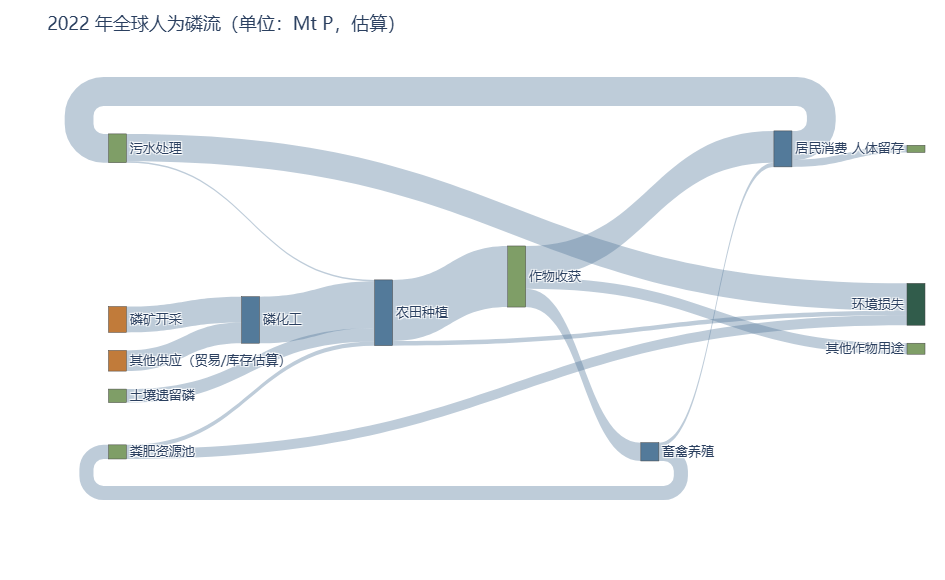
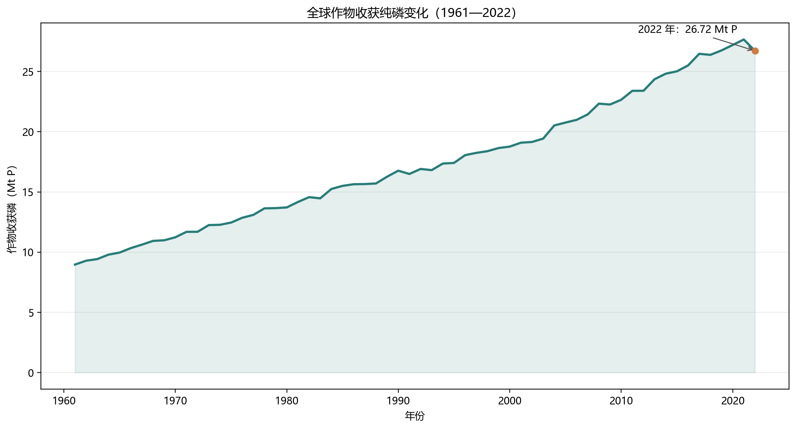
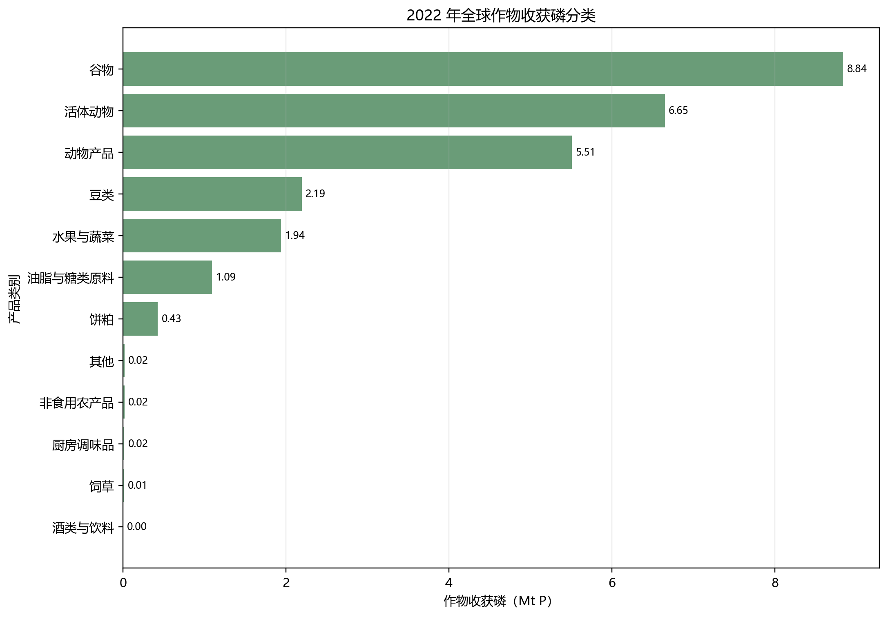
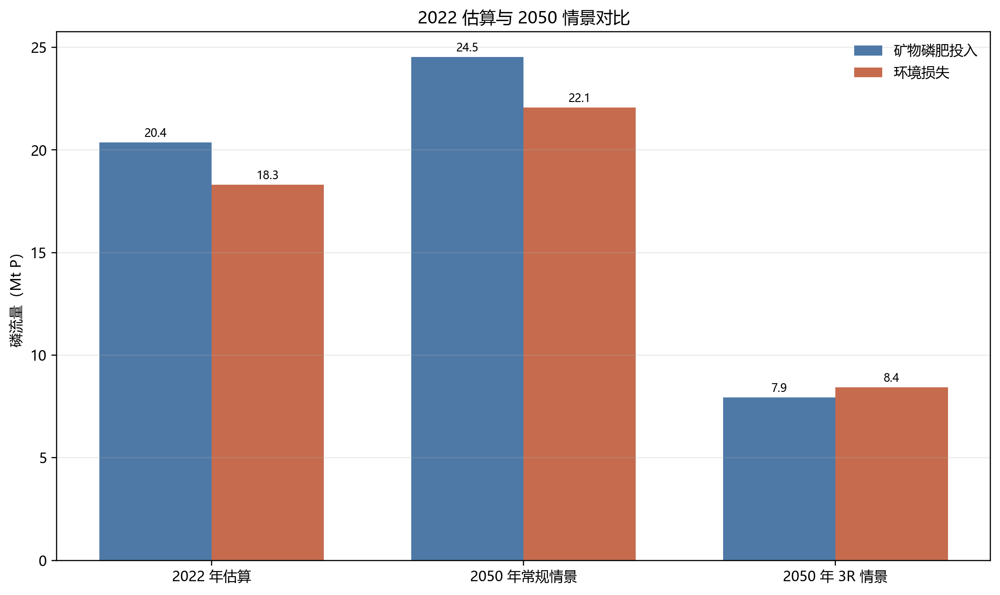
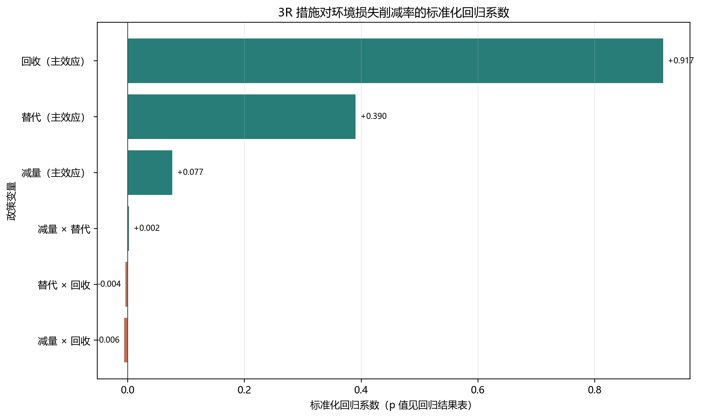

# 第十五讲磷循环物质流分析结果

## 主要结果

- 2022 年全球作物收获纯磷：26.716 Mt P，取自工作簿中的 `World` 汇总行。
- 2022 年矿物磷肥纯磷量：20.362 Mt P；依据 2021 年各国人均施用量和世界人口估算。
- 2050 年常规情景化肥磷需求：24.533 Mt P，采用联合国人口中位情景并假设人均施用量不变。
- 2050 年 3R 情景环境损失较常规情景降低：61.74%。
- 最大物质流相对误差：2.173e-16；全部检查均满足阈值 0.0001。

## 数据口径与结果解释

化肥施用源数据截至 2021 年。磷矿工作簿末尾年份列不完整，因此采用最近完整年份（2021 年）并按人口比例估算 2022 年供应。作物磷采用论文预先核算的纯磷表；含磷系数表仅用于类别说明和数据溯源，不再重复乘入纯磷值。

现有资料没有完整的全球五子系统年度流量矩阵、作物食用/饲料比例、粪肥及污水基准回收率或实测田间损失系数。因此桑基图和情景结果是透明的课堂核算模型，不代表对论文全部图件的精确复现。参数假设见 `model_assumptions.csv`。回归使用确定性的 343 组情景网格，其显著性和拟合优度描述模型响应面，不构成基于实测样本的因果推断。

[打开交互式桑基图](sankey_2022_estimate.html)

## 法典衔接

《中华人民共和国生态环境法典》已于 2026 年 8 月 15 日施行。法典将污染防治、生态保护、绿色低碳发展与法律责任纳入统一制度框架，为本次磷流分析提供了从源头减量、农业面源风险控制到粪肥和污水磷循环利用的规划视角。报告中的 20% 减肥、75% 粪肥利用率、60% 污水磷回收率及 61.74% 环境损失降幅均为课堂模型设定或估算，不是法典规定的目标，也不能据此认定法典实施效果。规划落地仍需区域物质流台账、土壤与水质监测及依法开展的评估；守恒通过仅证明模型账本自洽。详见 `规划建议与复现报告.md` 第六节及[中国人大网法典全文和施行公告](http://www.npc.gov.cn/npc/c2/kgfb/202608/t20260815_456628.html)。

## 结果文件

- `lecture15_results.xlsx`：各项分析结果汇总表。
- `sankey_2022_estimate.html`：中文交互式桑基图。
- `mass_balance_checks.csv`：子系统及全系统守恒核验。
- `cross_sensitivity_samples.csv`、`cross_sensitivity_regression.csv`：情景网格和标准化交互回归结果。

### 历史趋势与作物分类

### 2050 情景对比

### 3R 敏感性回归

