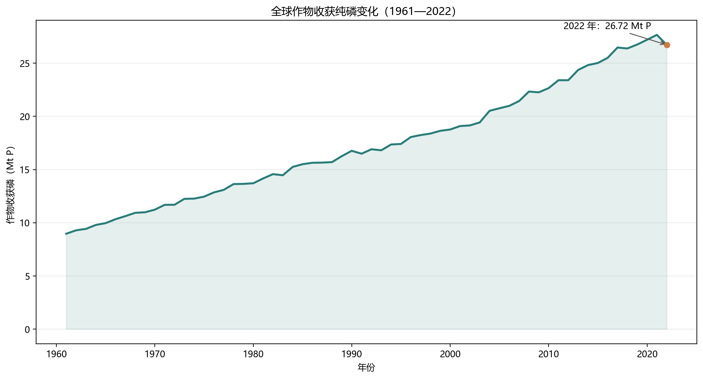
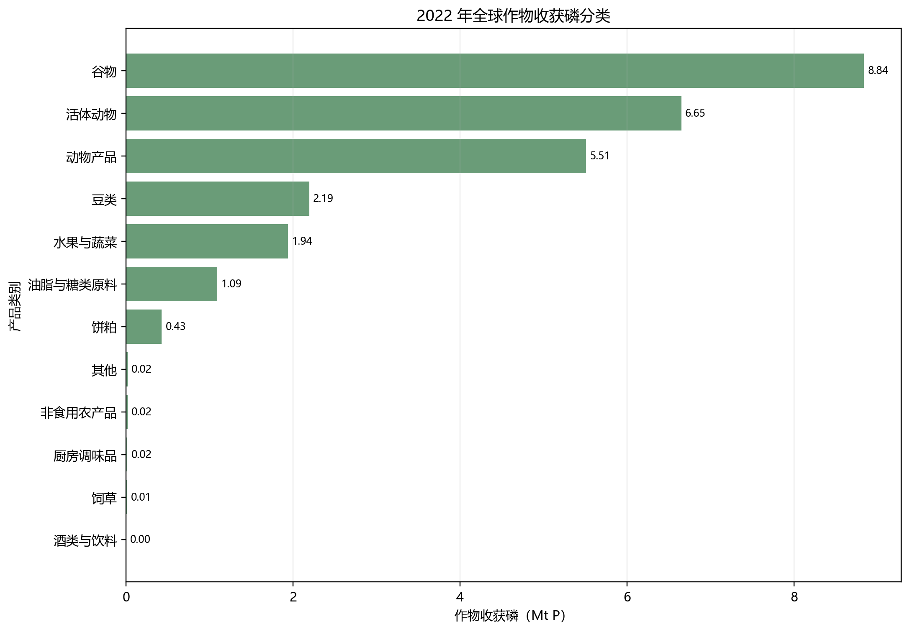
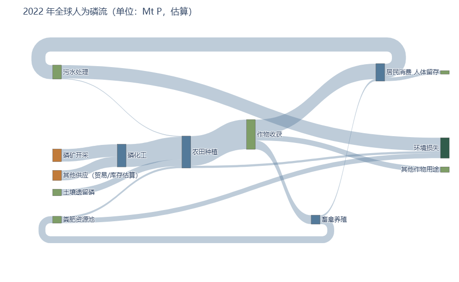
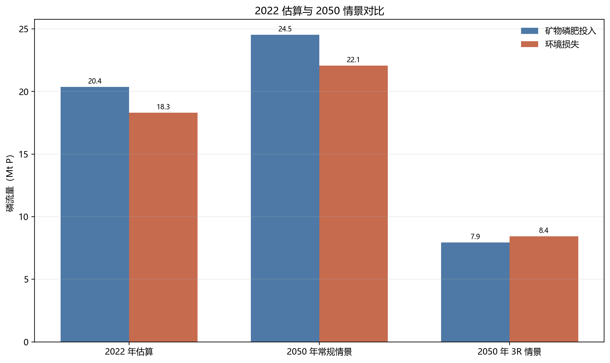
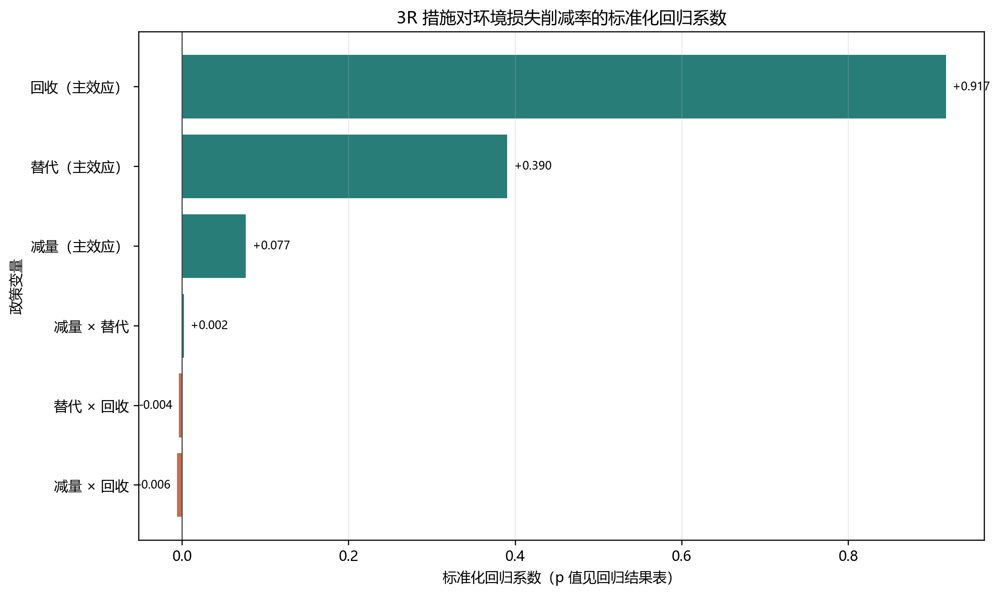

# 全球人为磷循环物质流分析与规划建议

## 一、研究目标与数据处理

本实训依照第十五讲任务书，尝试把全球作物生产、矿物磷肥、畜禽养殖、居民消费及废弃物回收纳入同一套磷流账本，并比较 2050 年常规发展与“减量、替代、回收”（3R）管理情景。分析使用课程提供的论文补充数据，而非外部拼接数据。作物部分读取 1961—2022 年国家级农产品纯磷核算工作簿，提取其中的 `World` 汇总行。该行已经是产品纯磷量，因而不再乘含磷系数；如果再乘一次，单位和数量都会错误。含磷率字典用于核对产品类别编码和数据来源。提取时将年份列统一为整数，并按作物类别汇总，避免把国家、洲和世界级汇总重复相加。

化肥部分读取 FAOSTAT 的 Nutrient phosphate P2O5 use data，筛选 `Agricultural Use`、单位为吨的国家记录，并按 M49 国家代码排除区域汇总。P2O5 按磷的质量分数 0.4364 折算为纯磷。提供的施用数据止于 2021 年，因此 2022 和 2050 的肥料需求并非源表观测值：2022 采用 2021 年人均使用水平乘联合国 2022 年人口估算；2050 采用联合国人口中位情景并保持人均使用量不变。磷矿产量工作簿末尾虽有 2022 数值列，但该列没有年份表头且仅含美国一条记录，不能代表全球产量。程序据此选用最新完整年份，按人口比例估算后续供应，并将矿业与化肥需求之间的差额标记为其他供应估计。

## 二、历史作物纯磷与 ACS 核算

作物纯磷历史序列和类别拆分保存在 `global_harvest_p_1961_2022.csv`、`global_crop_categories_1961_2022.csv`。2022 年论文工作簿的世界汇总为 26.716 Mt P。脚本将 ACS 的作物收获量作为源数据锚点，并封装 `ACSPModel`，计算作物吸收估计、残体磷、田间损失和土壤存量变化。作物收获指数设为 0.80，田间损失基准比例设为 10%；二者是为了演示模型闭合而设定的参数，不是补充材料中的全球实测系数。残体在 ACS 内部回田，不作为新增的外部磷源重复计入。

因此，ACS 输出回答的是“在所列参数下账本如何闭合”，不能据此声称观测到了全球实际吸收或流失。任务书中要求的 2022 年流向数值已由脚本输出，但其解释应以 `model_assumptions.csv` 的口径为准。若后续能取得国家级作物用途比例、土壤磷盈余、径流/淋溶监测值及秸秆利用数据，应优先替换这些演示参数，而不是继续调参使结果贴合论文目标值。

## 三、全系统流量与守恒检查

当前 2022 核算中，矿物化肥纯磷估算为 20.362 Mt P；模型的总环境损失估算为 18.315 Mt P。桑基图展示矿业与其他供应进入化学工业，再流向农田、养殖、居民、粪肥及污水处理的关系。由于源数据没有提供完整的全球五子系统年度流量矩阵，食用与饲料比例、畜禽磷利用率、粪肥基准利用率、居民污水比例和鸟粪石回收基准均在脚本中显式列出。图中因此使用“估算”口径，不能被理解为论文原图数据的逐项复刻。

[打开交互式桑基图](sankey_2022_estimate.html)

程序对化学工业、农田、畜禽养殖、粪肥处理、居民、污水处理和全系统分别计算输入、输出与相对误差。三个年份/情景合计 21 项检查均通过，最大相对误差为 2.17×10^-16，小于 10^-4 阈值。该结果证明的是账本中各项输入输出按定义守恒，不证明参数本身与真实全球流量一致。守恒检验和经验验证是两种不同的质量控制，不能相互替代。

## 四、2050 BAU 与 3R 情景

BAU 采用联合国人口中位预测，保持单位人口肥料需求与 2021 年相同；作物收获纯磷按 2022 年人均水平外推。由此得到 2050 BAU 化肥纯磷需求估算 24.533 Mt P。3R 情景设置化肥减施 20%、粪肥利用率由模型基准 30% 提高到 75%、污水鸟粪石回收率由模型基准 5% 提高到 60%。在本模型中，新增回收磷优先替代矿物化肥，减施与粪肥还田同时降低假设田间损失率。3R 下矿物化肥输入为 7.938 Mt P，作物 PUE 估算为 98.42%，综合环境损失为 8.442 Mt P，较 BAU 减少 61.74%。这些数值是参数驱动的情景结果，不能直接与论文中具体措施的 NPR、CFR 或国家达标数比较；特别是本模型的简化 PUE 定义与论文系统边界可能不同。

## 五、交叉敏感性与解释

回归使用 Reduce、Replace、Recycle 的 7×7×7 均匀参数网格，共 343 个模型样本。变量先均值中心化，再生成两两交互项，最后对解释变量和环境损失削减率做 Z-score 标准化并进行 OLS 回归。模型内 R² 为 0.999987。Reduce×Replace 的标准化交互系数为 0.001887，p=8.89×10^-20；Replace×Recycle 为 -0.003944，p=2.85×10^-60；Reduce×Recycle 为 -0.005916，p=1.58×10^-98。按任务书符号规则，前者判为协同增强，后两者判为拮抗削弱。

上述极小 p 值来自人为构造、规则密集的模拟网格，不能理解为基于 343 个独立观测获得的政策显著性。R² 也主要反映公式能够拟合其自身生成的数据。它们适合演示中心化、交互项和标准化回归流程，不足以推断现实中的因果关系。报告和图表均保留了原始情景样本，供教师检查模型设定及系数来源。

## 六、与《生态环境法典》衔接的分析

《中华人民共和国生态环境法典》于 2026 年 3 月 12 日通过，自 2026 年 8 月 15 日起施行。法典以总则统领污染防治、生态保护、绿色低碳发展和法律责任等制度，将污染控制与生态保护、发展方式转型放入同一规范框架。对第十五讲而言，它提供的是解释磷循环分析的现行法治背景，而不是本模型参数或结果的来源；法典也不能被解读为对磷肥减施比例、粪肥利用率或鸟粪石回收率设定了本报告中的具体数值目标。

结合本次图件，全球作物收获纯磷由 1961 年约 9 Mt P 增至 2022 年 26.72 Mt P，反映了长期增长的资源需求；2022 年类别图中谷物约 8.84 Mt P，活体动物约 6.65 Mt P、动物产品约 5.51 Mt P，提示治理边界不能只落在种植端，还应覆盖饲料、养殖和消费后的回收链。情景对比图显示，矿物磷肥投入由 2022 年估算的 20.4 Mt P 增至 2050 年 BAU 的 24.5 Mt P，而 3R 情景估算为 7.9 Mt P；环境损失则由 BAU 的 22.1 Mt P 降至 3R 的 8.4 Mt P。回归图中回收的主效应系数最大（约 +0.917），替代为 +0.390，减量为 +0.077；交互项约在 -0.006 至 +0.002 之间，明显小于主效应。以上仅表示本模型设定下的敏感性排序和情景差异，不是现实中各措施的法定优先顺序或独立因果效应。

**从末端治理转向源头预防和全过程管控。** 历史序列显示全球作物收获纯磷持续增长，2022 年估算矿物磷肥投入为 20.362 Mt P；模型同时显示环境损失是重要的系统输出。法典的污染防治制度与农业面源污染治理要求，提示规划不能只在水体末端增加治理设施，而要把投入强度、施肥时序、土壤磷盈余、坡面径流和流域受纳能力联系起来。因而，Reduce 应落实为基于土壤检测、作物需求和流域风险的精准施肥、养分预算及重点地块管理，而不是把模型采用的 20% 统一减施情景当作法定比例。

**把资源循环利用与风险防控同时纳入 3R。** 法典将绿色低碳发展纳入整体制度框架，支持以循环利用降低原生资源依赖。Replace 和 Recycle 因此不应只按“回收吨数”评价：粪肥还田、污水磷回收和再生产品利用，应同时核算有效养分替代量、收集处理与运输成本、产品质量、污染物风险、土壤累积以及最终去向。养殖集中区与种植需求区错配时，应通过区域设施和运输网络提高可利用率；但对高磷土壤或水环境敏感区，要防止过量还田及污染转移。模型中的 75% 粪肥利用率、60% 污水磷回收率是情景设定，不是法典规定的工程考核值。

**以生态系统和流域尺度检验环境结果。** 法典同时强调污染防治与生态保护，磷管理因而应从单一设施或行政区扩展到“源—迁移路径—受纳水体”的空间关系。当前模型没有完整的流域、土壤存量和径流监测数据，18.315 Mt P 的环境损失估算不能直接定位具体污染热点。后续应将子流域、土壤磷状态、降雨侵蚀、排水网络和水质监测接入空间化物质流模型，分辨农业面源输入与其他来源，并优先识别高风险区域，形成跨区域的粪污转运、施肥约束和水体保护协同方案。

**形成“规划评估—监测核算—责任落实”的证据闭环。** 法典所体现的系统治理和责任约束，要求管理措施能够被评估和追溯。规划环评或相关建设项目环境影响评价可用于比较处理设施布局、运输方案和受纳环境影响；实施阶段则需建立统一的磷流台账，记录数据年份、单位、统计边界、缺失值处理和回收产品去向，并以土壤及水体监测校验模型。对违法排放、违规处置等责任认定，应依据适用法律、实际行为和监测证据，不能仅凭本次情景模型的估算值作出判断。守恒误差接近零只说明账本计算自洽，不等于污染风险已经降低或法律合规已经得到证明。

据此，本次结果可作为政策筛查和方案比较的课堂工具：历史趋势提示源头减量的必要性，3R 情景展示了循环措施可能改变系统流向的方向，交互回归可用于演示组合政策的敏感性；但 61.74% 的损失降幅及回归显著性都属于给定假设下的模型输出，不是法典实施成效或现实因果效应。法典衔接的关键，是把这些模型信号转化为可监测、可复核、分区分类的规划问题，再用真实的区域数据和法定程序验证措施效果。

## 七、规划启示与后续工作

第一，磷肥减量应以土壤有效磷和作物需求为依据，建立“地块—作物—季节”养分预算，而不宜把统一减施比例机械套用于所有地区。高磷积累地块可优先控制矿物磷投入并监测产量响应；缺磷或高侵蚀地区则需同步考虑作物供磷与水土流失风险。下一步应把土壤遗留磷存量、土地利用和流域径流数据接入模型，避免只按人口比例外推投入。

第二，粪肥替代化肥需要从“产生量”进一步走到“可收集、可处理、可运输、可施用”的有效养分量。规划上应将养殖密集区、种植需求区、处理设施和运输半径放在同一空间底图中，优先建设区域性储存、堆肥和精准施肥能力。75% 利用率在本次模型中是目标设定，不是已实现水平；实际政策还须设置氮磷配比、病原控制、重金属监测和施用时序要求，防止把一种污染压力转移为另一种风险。

第三，污水磷回收应把回收率目标与处理规模、进水磷浓度、产品质量和下游市场连接起来。鸟粪石回收可在适宜的污水处理厂开展技术经济评估，优先验证产品稳定性、污染物限值、农用需求和全生命周期能耗。60% 回收率是任务书要求的情景参数，不能直接作为所有城市的工程承诺。回收量还需避免与污泥、再生水或其他回收路径重复记账。

第四，区域协同规划应采用可追溯的物质流台账，分别记录矿物投入、农产品磷、饲料转移、畜禽粪污、污水和水体损失，并公布数据年份、单位、边界及缺失值处理。对跨区域输入依赖高、粪污集中而耕地需求不足的地区，可通过有约束的运输与处理网络协调；对流域水体敏感区，则应将农业面源监测和季节性施肥管理纳入刚性约束。只有在国家与流域尺度数据接齐后，才能识别本模型尚未表达的空间错配。

总体而言，本次复现完成了历史序列读取、ACS 类实现、全系统守恒账本、桑基图、2050 情景以及中心化交互回归的可运行流程；核心价值在于形成可重跑、可审计的分析框架。当前结果提供的是课堂演示级估算。要提升到论文级复现，后续需补齐完整农业及贸易流、国家级养殖与消费参数、土地和土壤存量、损失系数及原文情景算法，并用独立来源核验关键指标。

## 参考依据

- 全国人民代表大会：《中华人民共和国生态环境法典》（2026 年 3 月 12 日通过，2026 年 8 月 15 日起施行），[中国人大网全文及施行公告](http://www.npc.gov.cn/npc/c2/kgfb/202608/t20260815_456628.html)。
- Liu et al. (2026), *Future strategies for phosphorus sustainability amid worsening global cycle imbalances*, PNAS, 123(13): e2512673123；课程任务书及本次模型输出，见本目录相关说明和 `results/` 数据文件。