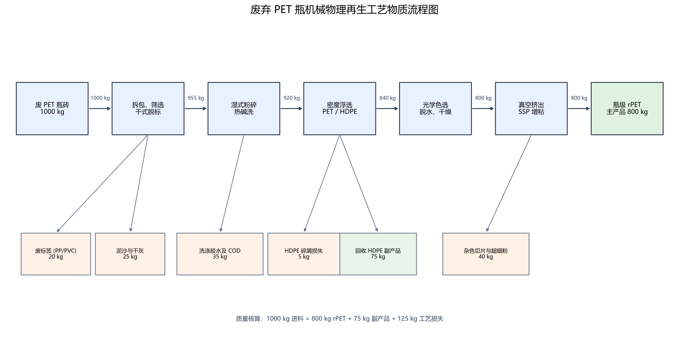

# 案例一：城市废旧 PET 塑料机械物理再生系统（MFA-LCA-TEA 联合训练）

## 1. 案例定位与教学目标

* **教学定位**：作为《环境规划与管理》第九讲的**入门基础案例**，本案例呈现典型的**单向线性物质流动**系统，无复杂的化学反应与内循环回路。
* **教学目标**：
  1. 掌握如何基于**质量守恒定律**构建工业级固废分选再生的物质流分析（MFA）模型；
  2. 掌握如何将 MFA 计算得到的**产率与消耗系数**，转化为生命周期评价（LCA）的**基准基础**；
  3. 掌握如何将 MFA 的物料、水、电、蒸汽消耗转化为技术经济分析（TEA）的**变动运营成本（OPEX）**，并结合设备选型折算**资本投资（CAPEX）**与**平准化生产成本（LCOP）**；
  4. 整体感受“前端杂质率变化 $\rightarrow$ 分选收率变化 $\rightarrow$ LCA 碳足迹与 TEA 生产成本双重恶化”的参数联动完整链条。

---

## 2. 目录结构说明

```text
lecture9-20261022-classroom_case1/
├── README.md                      # 本说明文件
├── case_files/                    # 案例详细讲义与教学文档
│   ├── case1_documentation.md     # 案例一完整讲义（含导览速查、MFA/LCA/TEA模型、PR提交指南）
│   └── data_cohort/               # 基础数据集（供教学推演与后续代码使用）
│       ├── mfa_mass_balance.csv   # MFA 物质输入输出及工段平衡数据
│       ├── lci_emission_factors.csv # LCA 生命周期清单与背景碳排放因子
│       └── tea_cost_parameters.csv # TEA 投资、公用工程单价与财务指标
└── code_implementation/           # （预留）教师后续随堂与课后 Python/Excel 仿真代码发布区
```

> 💡 **全班 Git 协作与排错救急手册**：遇到网络克隆慢、分支隔离与创建、拉取最新 main 防覆盖、代码误改 stash/reset 救急或 PR 提交问题，请查阅大仓公共指南：[starter_materials/troubleshooting.md](../troubleshooting.md)。

---

## 3. 核心计算基准速查（Baseline Benchmark）

> ⚠️ **【注】**：以下为基准情景（常规工业电网）的教学示范基准数据；随堂与课后作业请计算“100% 绿电驱动”的全新优化情景（参见讲义第六部分）。

* **处理规模**：年处理 20,000 t 废 PET 瓶砖（年产 16,000 t 瓶级 rPET 颗粒）。
* **功能单位**：生产 1 t（1000 kg）瓶级 recycled PET (rPET) 颗粒。
* **MFA 关键指标**：综合产品收率 $Y = 80.0\%$，单吨产品需原料 1.25 t。
* **LCA 关键指标**：净全生命周期碳足迹 636.0 kg CO₂e/t（较原生 PET 减碳 71.7%）。
* **TEA 关键指标**：总投资 2,800 万元，平准化生产成本 $\text{LCOP} = 6,153.4\text{ 元/t}$，投资回收期 2.6 年。

---

## 4. 随堂 Python 环境准备与推荐第三方包 (Environment Setup)

为照顾不同编程基础的同学，本次实践任务推荐以下环境依赖（根据作业需要选择即可）：

### 4.0 采用conda创建专属python虚拟环境
```bash
conda create -n mfa_lca_tea python=3.10 -y
conda activate mfa_lca_tea
```

### 4.1 基础计算与数据处理（必装包）
适用于完成 MFA 物质平衡、LCA 碳足迹计算与 TEA 经济平准化成本核算：
```bash
pip install pandas numpy matplotlib
```

### 4.2 工艺流程图绘制推荐选型（三选一）：
* **选项 A（零基础/新手最推荐 · 纯 Python 零系统底层依赖）**：
  使用 `schemdraw` 绘制方框工艺流程图（BFD），不会因缺少系统底层软件而报错：
  ```bash
  pip install schemdraw
  ```
* **选项 B（进阶 · 交互式物质流桑基图）**：
  使用 `plotly` 绘制与物质质量流量成比例的高清 MFA 桑基图：
  ```bash
  pip install plotly kaleido
  ```
* **选项 C（工业标准有向图 · 需特别注意避坑）**：
  使用 `graphviz` 绘制有向图。⚠️ **特别提醒**：`pip install graphviz` 仅安装了 Python 接口，电脑本地还必须预先安装系统级 Graphviz 软件（如 Windows 的 `graphviz-install.exe` 或 Mac 的 `brew install graphviz`）并配置系统 PATH，否则代码运行时会报错 `ExecutableNotFound: failed to execute dot`。新手建议优先选用选项 A 或 B。

---

## 5. 工艺流程图与成果展示 (Process Flow Diagram Preview)

* **图表类型**：工序方框工艺流程图（Block Flow Diagram, BFD）。
* **设计说明**：流程图按物料处理顺序从左向右展示废 PET 瓶砖输入、拆包筛选与脱标、热碱洗、密度浮选、光学色选与干燥、真空挤出及 SSP 增粘。主流程箭头标注各工段后的物料质量；支线从对应工序引出标签与泥沙、洗涤废液、HDPE 碎屑损失、回收 HDPE 副产品及杂色片/超细粉。图中质量核算为 1,000 kg 进料 = 800 kg rPET + 75 kg HDPE 副产品 + 125 kg 工艺损失，体现质量守恒。脚本从 MFA 数据表读取流量并执行平衡检查。
* **流程图成果预览**：

  

## 6. 环境规划与决策反思 (Planning & Decision Insights)

本案例显示，绿电与源头分选质量需要协同规划。按给定清单，电力排放因子由 0.55 降至 0.03 kg CO₂e/kWh 后，净碳足迹由基准 636.0 降至 194.0 kg CO₂e/t，相对原生 PET（2,250 kg CO₂e/t）减排约 91.4%；对应绿电溢价使 LCOP 增加 42.5 元/t（约 0.69%）。因此，工厂可通过长期绿电采购降低增量成本，并与品牌客户签订有环境属性核证的绿色 rPET 供应协议；产品溢价应以核实的增量成本与客户认可的减排价值为依据，避免只凭“绿色”标签定价。

收率从 80% 降至 70% 时，单位产品所需瓶砖由 1.25 t 增至约 1.43 t。基于现有数据，原料成本估算增加 750 元/t 产品，HDPE 副产品收入增加约 60.3 元/t，绿电情景 LCOP 估算升至 6,885.6 元/t。现有 LCA 数据中，额外运输排放约增加 21.4 kg CO₂e/t，同时按同比例增加的 HDPE 避免负荷信用约增加 21.4 kg CO₂e/t，二者在该简化估算中抵消；这不代表收率对真实碳足迹没有影响。数据没有给出收率变化时的能源、水、药剂及废物处置变化，因此模型暂按这些负荷不变。规划上应优先提升分类和瓶砖纯度、持续监测分选收率，并补充低收率情景下的工艺能耗、废水与废物数据，再评估真实环境及成本风险。

## 7. 核心计算结果摘要 (Key Findings Summary)

> 🤖 **专属指标表提示**：提交 PR 后，课程助教机器人将根据您修改的文件目录（如 `case1-pet-recycling` 或 `case2-green-methanol`），自动在下方评论区贴出**本讲专属考核指标对照表**，请稍候在评论区对照自查！

* **本次采用的 Python 工具包**：`pandas`（读取与处理 CSV 数据）、`matplotlib`（绘制流程图）。
* **核心脚本主入口**：[case1_analysis.py](./code_implementation/case1_analysis.py)（运行后生成计算结果文本和流程图）。
* **核心结果**：
  * MFA：1,000 kg 瓶砖进料得到 800 kg rPET、75 kg HDPE 副产品及 125 kg 工艺损失，主产品收率为 80%。
  * 100% 绿电情景：净碳足迹 194.0 kg CO₂e/t，相对原生 PET 减排 91.4%；LCOP 为 6,195.9 元/t，较基准增加 42.5 元/t（0.69%）。
  * 收率降至 70% 的简化敏感性估算：LCOP 为 6,885.6 元/t。按现有清单，增加的运输排放与 HDPE 避免负荷信用变化相抵，GWP 估算为 194.0 kg CO₂e/t；该结果不包含未提供数据支持的公用工程及废弃物处理变化。
