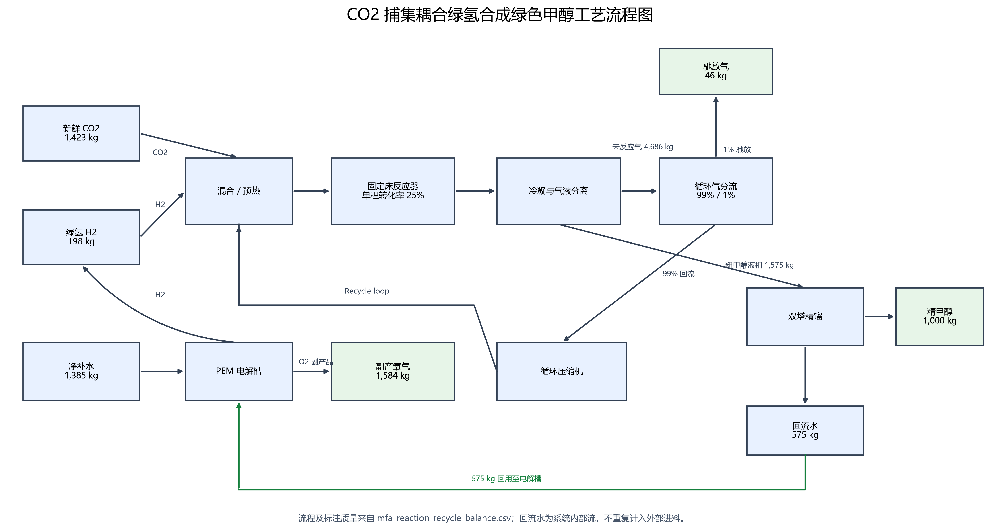
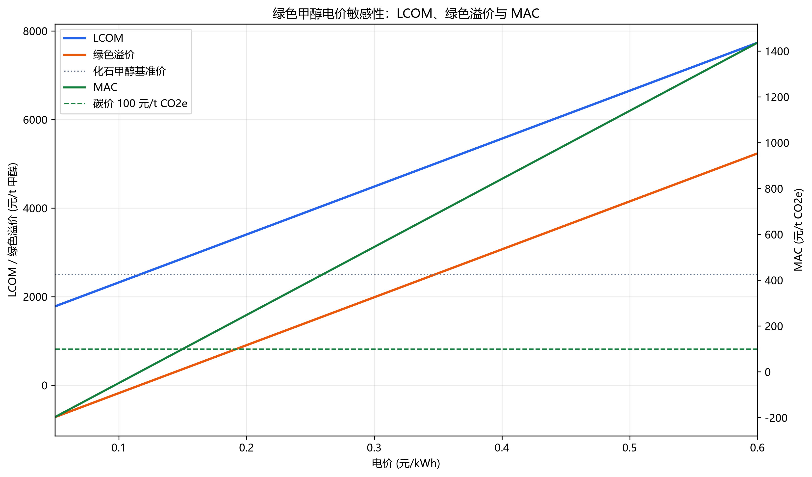

# 案例二代码运行与数据核验报告

## 1. 文件与运行方法

本目录包含分析脚本、结果文本及两张图：

| 文件 | 用途 |
| --- | --- |
| `case2_analysis.py` | 读取 CSV，求解循环回路，执行 LCA/TEA 分析并生成图表 |
| `case2_analysis_results.txt` | 保存运行数值与守恒核验结果 |
| `case2_economic_sensitivity.png` | 电价对 LCOM、绿色溢价和 MAC 的敏感性图 |
| `case2_process_flow.png` | 甲醇合成、气体循环和水回用工艺流程图 |

流程图预览：



经济敏感性图：



依赖：`pandas`、`numpy`、`scipy`、`matplotlib`。

在仓库根目录运行：

```powershell
& "E:\tools\Anaconda\python.exe" "groups\group-04\lecture9-20261022-classroom_case2\code_implementation\case2_analysis.py"
```

如已配置 Python，可将解释器改为 `python`。脚本会从案例目录读取：

- `case_files\data_cohort\mfa_reaction_recycle_balance.csv`
- `case_files\data_cohort\lca_grid_scenarios_lci.csv`
- `case_files\data_cohort\tea_lcom_sensitivity_data.csv`

图表为 PNG，当前输出分辨率约 301 dpi（不低于 300 dpi）。

## 2. 实施内容与结果

### 任务一：循环回路及物质守恒

脚本用 `scipy.optimize.fsolve` 求解简化稳态循环方程：

```text
R = 0.99 × (1 - 0.25) × (F + R)
```

其中 `F` 是数据表的新鲜 CO2 与 H2 质量流量之和，`R` 为循环气质量流量。运行结果：

| 指标 | 计算/表列结果 |
| --- | ---: |
| 单程转化率（模型输入） | 25.00% |
| 求解循环气 / 新鲜 CO2+H2 质量比 | 2.8835 |
| 表列循环气 / 新鲜 CO2+H2 质量比 | 2.8624 |
| 简化模型整体气体转化率代理值 | 97.0874% |
| 表列产品碳 / 新鲜 CO2 碳（碳利用率估算） | 96.7237% |
| 分离气循环 / 驰放比例（按表列质量） | 99.0184% / 0.9816% |

模型求解残差约为 `9.1e-13 kg`。简化气体转化率代理值不是碳利用率；两者分开报告，避免将不同指标混为一谈。

以新鲜 CO2、H2、净脱盐水为外部输入，以副产氧气、驰放气、精甲醇为外部输出；精馏水作为系统内回用流，不重复计入边界。按 CSV 所列物种组成计算的元素差异如下。

元素换算仅使用 CSV 明列的 CO2、H2、甲醇、水和 O2 质量分数；未将 `other_inerts` 计入 C/H/O，也无法计入未单独列出的 CO 等组分。因此这些核算用于定位数据差异，不替代完整组分清单下的严格元素衡算。

| 元素 | 输入 (kg) | 输出 (kg) | 相对差异 | 0.01% 容差 |
| --- | ---: | ---: | ---: | --- |
| C | 387.315 | 384.119 | 0.8252% | 未通过 |
| H | 352.029 | 135.217 | 61.5893% | 未通过 |
| O | 2,265.233 | 2,109.606 | 6.8702% | 未通过 |

**结论：元素守恒任务目前不能判定通过。** 差异明显超过 0.01%，尤其氢元素差距很大。脚本会打印真实差值并标记 `FAIL`，没有用人为补项将结果伪装成平衡。

## 3. 可确认并已修正的数据描述

仅修正了能由同一 CSV 其他数值直接确认的文字错误，未改动无法可靠反推的数值：

1. `Recycle_Gas_Loop` 的描述原写“循环比 3.8:1”，但表列循环气为 4,640 kg，鲜 CO2+H2 合计为 1,621 kg，直接比值为 `2.8624:1`；且按 25% 单程转化率及 99% 回流建立的简化模型给出 `2.8835:1`。已将 CSV 描述改为仅陈述表列循环质量，避免把未能复现的 3.8:1 当作实测数据。
2. `Purge_Gas` 的描述原写“4%分流”，但表列值为 `46 / 4,686 = 0.9816%`，与约 1% 驰放一致。已将其文字改为“约占分离器气相的 1.0%”。
3. LCA 数据中循环压缩的说明重复了未能从 MFA 数据复现的“循环比 3.8:1”。已改为只描述循环压缩用途，不再在数据注释中宣称该比值。

上述修正仅涉及描述字段，原始数值流量与组分均保留。

## 4. 尚未解决的数据差距

以下内容现有数据不足以唯一判断应该修改哪一个数值，因此保留原值并记录差距：

1. **循环比目标不一致**：讲义称循环比 3.8:1；CSV 流量对应 2.8624:1；指定的 25% 单程转化与 99% 回流简化模型求得 2.8835:1。混合气质量流量本身闭合（6,261 kg = 1,423 + 198 + 4,640 kg），但该闭合不能同时证明 3.8:1 成立。
2. **96% 碳利用率不能从表列组分精确复现**：按 CO2 进料与甲醇产品中的碳质量计算约为 96.7237%；这不是 96.0%。驰放气质量及组分也无法同时给出讲义所述 4.0% 碳损失。
3. **C/H/O 元素守恒不达标**：三种元素相对差异均超过 0.01%。组分表没有足够信息判定缺失质量来自哪股物流、未列出的含碳/含氢组分、含水口径，还是其他测量/舍入问题；因此不能安全地调整数值使其闭合。
4. **水与电解副产物口径需要确认**：CSV 同时列净补水 1,385 kg、总电解水 1,960 kg 和内部回流水 575 kg；内部水回用在系统边界上不能重复当作新鲜输入。电解槽的水、氢、氧表列数值也无法独立实现精确元素闭合，建议由数据提供者确认流股边界和物质组成。

建议向课程数据提供方确认：循环比的定义基准、总碳利用率的计算边界、CO/惰性组分及水流的实际组成与边界、以及电解槽水/H2/O2流量。收到更正数据后，再重新核算元素守恒。

## 5. 任务二：LCA 与 TEA

脚本从 LCA CSV 读取情景总值，并按 TEA 表中的成本数据计算 MAC 和碳价补偿阈值：

| 指标 | 结果 |
| --- | ---: |
| 100% 绿电净 GWP | -1,044.12 kg CO2e/t 甲醇 |
| 区域电网净 GWP | 4,531.26 kg CO2e/t 甲醇 |
| 煤制甲醇基准 | 2,600.00 kg CO2e/t |
| 绿电情景相对煤制甲醇减排 | 3.64412 t CO2e/t 甲醇 |
| 0.15 元/kWh 时 LCOM / MAC | 2,862.27 元/t / 99.41 元/t CO2e |
| 0.35 元/kWh 时 LCOM / MAC | 5,027.47 元/t / 693.57 元/t CO2e |
| 碳价 100 元/t CO2e 时平衡电价上限 | 约 0.15020 元/kWh |

电价阈值按以下关系计算，假设绿电情景减排量、化石甲醇基准价及非电成本固定：

```text
LCOM = 电价 × 10,826 kWh/t + 1,238.37 元/t
LCOM ≤ 2,500 元/t + 100 元/tCO2e × 3.64412 tCO2e/t
```

该“商业自平衡”指甲醇销售收入加碳减排价值覆盖 LCOM，不包含补贴、融资、税费、碳信用资格/额外性及价格波动。

## 6. 核验记录

- `python -m py_compile case2_analysis.py`：通过。
- 脚本完整运行：通过并生成结果文本及两张图。
- 关键数值断言：循环方程求解、LCA 基准值、碳价电价阈值及两张图分辨率均通过。
- 元素守恒验收：**未通过**，原因为输入数据自身存在上述差距；详见结果文件与本报告第 4 节。
