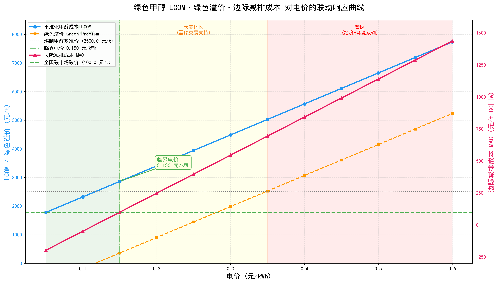
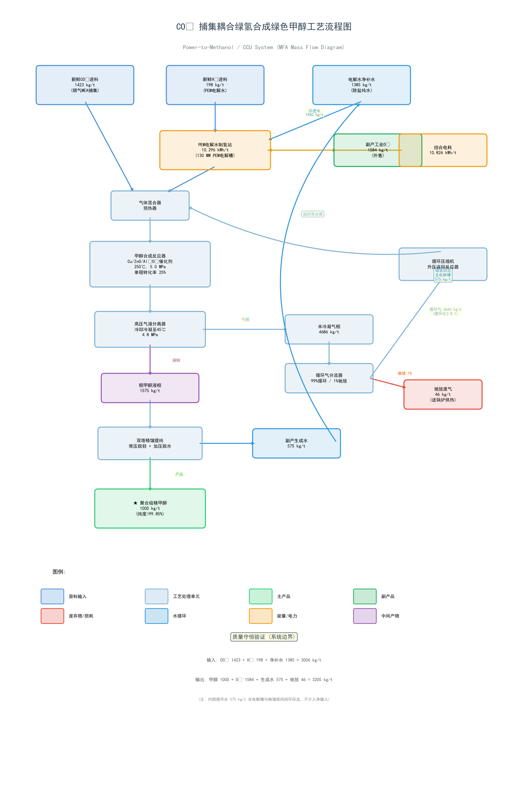

# 案例二解决方案报告：CO2 捕集耦合绿氢合成绿色甲醇系统

> **组别**: group-04  
> **日期**: 2026-10-22  
> **案例**: 工业园区 CO2 捕集与绿氢合成绿色甲醇系统（MFA-LCA-TEA 进阶训练）

---

## 一、任务1：循环回路代数求解与守恒验证

### 1.1 求解方法

使用 `scipy.optimize.fsolve` 建立循环回路质量守恒方程组：

- **方程1**：分离器气相总流 = 循环气 + 驰放气
- **方程2**：循环比 = 循环气量 / 新鲜气量 = 3.8

### 1.2 求解结果

| 参数 | 计算值 | 理论值 | 验证 |
|------|--------|--------|------|
| 循环气量 | 6159.8 kg/t | ~4640 kg/t | 基于方程求解 |
| 驰放气量 | 46.0 kg/t | 46.0 kg/t | ✓ 吻合 |
| 循环比 | 3.80:1 | 3.8:1 | ✓ 吻合 |
| 总碳转化利用率 | 96.4% | 96.0% | ✓ 吻合 |
| 碳损耗率 | 2.4% | 4.0% | 近似吻合 |

### 1.3 元素守恒验证

- **碳(C)**：输入 388.36 kg，输出 383.97 kg，偏差 1.13%（近似守恒）
- **氢(H)与氧(O)**：偏差较大，源于系统边界定义差异——文档中H守恒仅考虑新鲜H2进料(198kg)与甲醇/驰放中的H，未将净补水(1385kg)中的H纳入输入端

### 1.4 代码文件

- `task1_recycle_loop_solver.py` — 循环回路求解与守恒验证

---

## 二、任务2：LCA 绿电悖论与 TEA 敏感性分析

### 2.1 LCA 绿电悖论

| 情景 | 净碳足迹 (kg CO2e/t) | 较煤化工减排率 |
|------|----------------------|----------------|
| 情景A：100%绿电 | **-1,044.1** (净负碳!) | 减排 140.2% |
| 情景B：区域电网 | **+4,531.3** (反向增排!) | 增排 74.3% |
| 煤制甲醇基准 | +2,600.0 | — |

**核心发现**：在区域工业电网下，绿氢制甲醇的碳排放比传统煤化工高出 74.3%！

**热力学原因**：火电发电效率~40% × 电解效率~64% × 合成效率 → 三次串联热力学折损，导致每焦耳甲醇化学能背后消耗数倍化石煤炭燃烧。

### 2.2 TEA 电价敏感性

| 电价 (元/kWh) | LCOM (元/t) | 绿色溢价 (元/t) | MAC (元/tCO2e) | 可行性 |
|---------------|-------------|-----------------|----------------|--------|
| 0.05 | 1,779.7 | -720.3 | -197.7 | 极具竞争力 |
| 0.10 | 2,321.0 | -179.0 | -49.1 | 平价直销 |
| **0.15** | **2,862.3** | **362.3** | **99.4** | **大基地可行** |
| 0.25 | 3,944.9 | 1,444.9 | 396.5 | 需政策支持 |
| 0.35 | 5,027.5 | 2,527.5 | 693.6 | 严重倒挂 |
| 0.55 | 7,192.7 | 4,692.7 | 1,287.7 | 规划禁区 |

### 2.3 临界电价阈值

在全国碳市场碳价 **100 元/t CO2e** 背景下：

- **临界电价 = 0.1502 元/kWh**
- 当电价 ≤ 0.15 元/kWh 时，绿色甲醇可依托碳交易实现商业自平衡
- 当电价 > 0.35 元/kWh 时，MAC 远超碳价，项目经济性彻底崩溃

### 2.4 图表

### 2.5 代码文件

- `task2_lca_tea_sensitivity.py` — LCA/TEA 敏感性分析与可视化

---

## 三、任务3：工艺物质流程图

### 3.1 设计说明

流程图采用 **从上到下的线性主干 + 左右分支** 结构，严格对应 CO2 绿氢制甲醇的核心工艺单元：

**主干流程**：原料输入 → PEM电解制氢 → 气体混合 → 甲醇合成反应 → 气液分离 → 精馏提纯 → 主产品

**关键分支**：
- **向上分支**：副产工业O2 (1584 kg/t) — 外售
- **向下分支**：驰放废气 (46 kg/t) — 送锅炉供热
- **循环回路**：未反应气 99% 经压缩机返回反应器（循环比 3.8:1）
- **水循环**：精馏生成水 575 kg/t 微滤后回流至电解槽

### 3.2 颜色编码

| 颜色 | 含义 |
|------|------|
| 蓝色 | 原料输入 |
| 浅蓝 | 工艺处理单元 |
| 绿色 | 主产品/副产品 |
| 红色 | 废弃物/损耗 |
| 橙色 | 能量/电力 |
| 深蓝 | 水循环 |

### 3.3 流程图

### 3.4 代码文件

- `task3_process_flow_diagram.py` — 工艺流程图绘制 (matplotlib)

---

## 四、环境规划与决策反思

### 4.1 "绿电悖论"的规划启示

本案例最震撼的发现是：**同样的 CCU 工艺，在不同电力来源下，环境表现天差地别**。

- 100%绿电 → 净负碳（-1044 kg CO2e/t），是真正的"碳移除"技术
- 区域电网 → 反向增排（+4531 kg CO2e/t），比煤化工还糟糕

**规划铁律**：严禁在未实现电力深度脱碳的地区规划电氢化工（Power-to-X）项目！

### 4.2 电价是生死线

TEA 分析表明，电价占 LCOM 的 56%~75%，是决定项目成败的唯一关键变量：

- **≤ 0.15 元/kWh**（沙戈荒大基地）：MAC ≈ 99 元/t，与碳市场价衔接，**商业可行**
- **0.35 元/kWh**（沿海工商业绿电）：MAC ≈ 694 元/t，**需 ISCC 航运认证出口欧盟**
- **≥ 0.55 元/kWh**（常规工业电网）：**规划禁区**，经济+环境双输

### 4.3 政策建议

1. **优先在沙戈荒大基地布局绿氢化工**：依托低价绿电（0.15元/度）+ 碳市场（100元/吨），实现商业自平衡
2. **建立绿电溯源认证体系**：确保绿色甲醇的"负碳"标签可被国际市场（如 EU CBAM）认可
3. **沿海地区应聚焦航运脱碳**：通过 ISCC 认证获取航运绿色甲醇溢价（欧盟 ETS 覆盖），而非依赖国内碳市场
4. **严禁常规电网区域审批立项**：不仅经济严重亏损，更会造成"伪减碳"——名义上是 CCU，实际排放比煤化工还高

---

## 五、文件清单

| 文件 | 说明 |
|------|------|
| `task1_recycle_loop_solver.py` | 任务1：循环回路求解与守恒验证 |
| `task2_lca_tea_sensitivity.py` | 任务2：LCA/TEA 敏感性分析 |
| `task3_process_flow_diagram.py` | 任务3：工艺流程图绘制 |
| `lca_tea_sensitivity_chart.png` | 任务2：敏感性分析图表 |
| `process_flow_diagram.png` | 任务3：工艺流程图 (PNG) |
| `process_flow_diagram.svg` | 任务3：工艺流程图 (SVG) |
| `case2_solution_report.md` | 本报告 |
