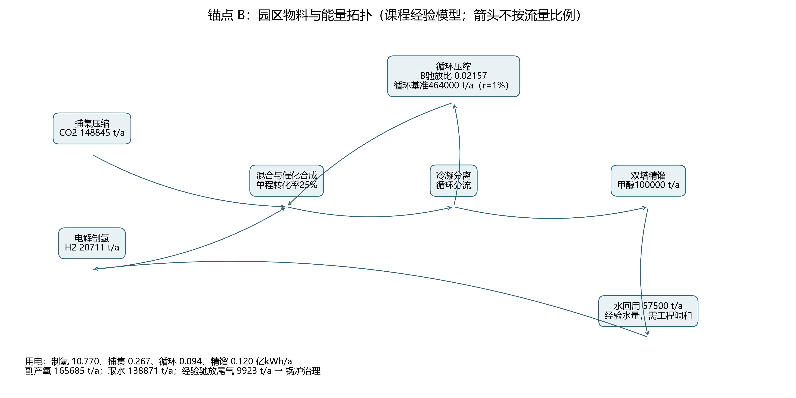
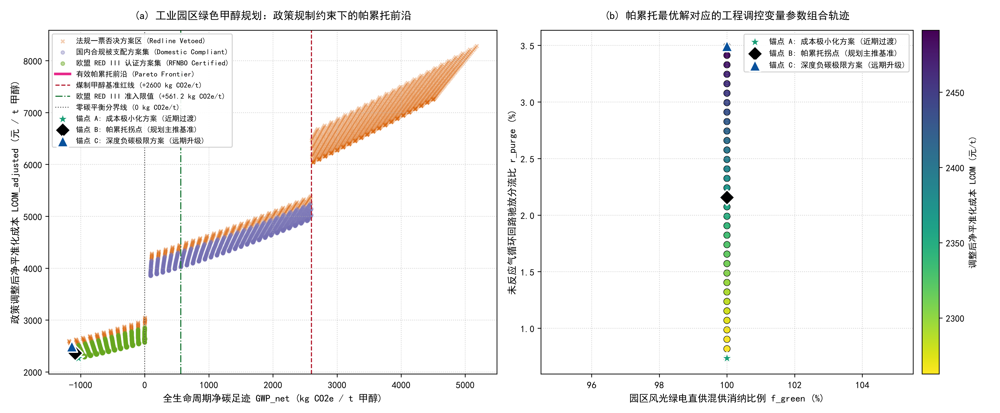

# 工业园区10万吨/年绿色甲醇环境规划与管理方案报告

第5组｜2026年秋季《环境规划与管理》课程｜第十讲案例2

## 报告摘要

本方案针对煤化工园区的工业二氧化碳资源化需求，以年产10万吨甲醇为规划规模，开展物质流、能源流、生命周期评价和技术经济联合分析。基于课程给定的电价、排放因子、储能年金和政策情景，对60档绿电比例及50档驰放比例组合进行3000组搜索，排除否决方案后获得34个非支配解。采用前沿目标范围归一化的理想点距离最小准则，确定锚点B的绿电比例为100.00%，驰放比例为2.157%，课程经验碳利用率为91.78%。推荐方案净碳足迹为-1085.17 kg CO2e/t，基础成本为3945.88元/t，政策调整后成本为2362.51元/t，边际减排成本为-37.31元/t CO2e。五项重点工程等效投资合计14.8765亿元，未扣收益运行支出为27620.55万元/年。方案以清洁电力长协、氧气消纳及有条件的绿色溢价构成收入保障，并设置分项计量、异常联锁及年度复核机制。独立化学计量核验发现教学数据不能同时满足标称循环比、碳利用率及全部物流组分约束，故将守恒模型与经验规划模型分别披露。负值碳足迹仅代表课程边界下的信用核算结果，不等同于永久碳移除或实际国际认证。

## 核心术语与缩写中英文对照表

| 英文缩写          | 英文全称                                 | 中文规范全称                 | 核心学科与工程定义                                                                            |
| :---------------- | :--------------------------------------- | :--------------------------- | :-------------------------------------------------------------------------------------------- |
| **MFA**     | Material Flow Analysis                   | 物质流分析                   | 基于质量守恒定律研究系统内物质输入、转化、蓄积与排放的定量工程方法                            |
| **EFA**     | Energy Flow Analysis                     | 能量流分析                   | 基于热力学第一与第二定律分析系统能量梯级利用与损耗的工程核算方法                              |
| **LCA**     | Life Cycle Assessment                    | 全生命周期评价               | 评估产品从原料获取、制造到处置全过程环境负荷的标准国际方法（ISO 14040）                       |
| **TEA**     | Techno-Economic Analysis                 | 技术经济分析                 | 评估工艺工程资本支出、运行成本与财务可行性的工程经济学方法                                    |
| **GWP**     | Global Warming Potential                 | 全球变暖潜势                 | 在 100 年时间尺度内相对于二氧化碳温室效应的相对累积辐射强迫指标（$\text{kg CO}_2\text{e}$） |
| **LCOM**    | Levelized Cost of Methanol               | 平准化甲醇成本               | 全生命周期内将投资与运营总现值平摊至单位产品所形成的保本折现成本（$\text{元/t}$）           |
| **LCOH**    | Levelized Cost of Hydrogen               | 平准化氢气成本               | 全生命周期内单位质量绿氢产出的平准化折现成本（$\text{元/kg}$）                              |
| **MAC**     | Marginal Abatement Cost                  | 边际减排成本                 | 相对于化石基准技术，每额外避免或减排一吨二氧化碳当量所需增加的边际货币投入                    |
| **PEM**     | Proton Exchange Membrane                 | 质子交换膜电解水制氢         | 利用固体聚合物电解质进行纯水电解的技术，具备高电流密度与快速负载响应特性                      |
| **ALK**     | Alkaline Electrolyzer                    | 碱性液体电解水制氢           | 利用氢氧化钾水溶液为电解质的成熟低成本规模化制氢技术                                          |
| **CCUS**    | Carbon Capture, Utilization, and Storage | 二氧化碳捕集利用与封存       | 将工业点源排放的二氧化碳分离提纯并转化为高附加值产品或永久封存的工程体系                      |
| **PtM**     | Power-to-Methanol                        | 绿电催化合成甲醇             | 利用清洁可再生电力制氢并与二氧化碳催化加氢合成化工级甲醇的系统工程                            |
| **CAPEX**   | Capital Expenditure                      | 固定资产资本支出             | 项目前期规划、设备购置、建筑安装与工程调试所必需的初始资本投入总和                            |
| **OPEX**    | Operating Expenditure                    | 运行维护支出                 | 系统建成投产后，原料外购、电力公用工程、耗材更换及日常运维所消耗的年度运营费用                |
| **RED III** | Renewable Energy Directive III           | 欧盟《可再生能源指令》第三版 | 欧盟关于促进可再生能源利用的法定指令（Directive (EU) 2023/2413）                              |
| **RFNBO**   | Renewable Fuels of Non-Biological Origin | 非生物源可再生燃料           | 依据欧盟法规由非生物质清洁可再生能源制备的合成燃料                                            |
| **ETS**     | Emissions Trading System                 | 碳排放权交易体系             | 基于总量控制与配额有偿/免费分配的市场化温室气体减排管理制度                                   |
| **CCER**    | China Certified Emission Reduction       | 国家核证自愿减排量           | 经国家主管部门备案认证并允许在全国碳市场抵销配额的自愿减排项目核证减排量                      |
| **MRV**     | Monitoring, Reporting, and Verification  | 可测量、可报告、可核查体系   | 确保能源消费、生产活动与温室气体排放数据具备真实性与可信度的质量管理技术规范                  |
| **PDCA**    | Plan-Do-Check-Act                        | 策划-实施-检查-改进动态循环  | 强调持续改进、动态反馈与全过程闭环的现代环境系统适应性管理体系                                |
| **CRF** | Capital Recovery Factor | 资本回收系数 | 将初始投资折算为等额年度资本支出的系数 |
| **MEA** | Monoethanolamine | 单乙醇胺 | 课程烟气CO₂吸收工艺采用的吸收剂 |
| **CEMS** | Continuous Emission Monitoring System | 连续排放监测系统 | 对烟气流量与污染物浓度进行连续监测 |

## 第 1 章 园区现状诊断与碳源-新能源基准线核算

### 1.1 园区产业结构与物质-能量代谢分析（MFA/EFA）

园区以煤化工及配套热电为背景，拟以烟气捕集、清洁电力电解、催化加氢及精馏构成示范系统。

### 1.2 工业点源CO₂排放清单与烟气特征解析

材料没有提供全园区煤耗、电耗、烟气流量、污染物实测浓度、土地及水权清单，因此不能将规划需求写成已落实的资源供应。项目前置调查须取得烟气连续流量、CO2浓度、温度及硫氧化物、氮氧化物、颗粒物监测结果，并核定胺吸收前脱硫、除尘、骤冷能力。若烟气CO2质量分数为y、捕集率为q，则年烟气需求为年捕集需求/(yq)，尚无依据赋予y和q实测值。

### 1.3 绿电资源禀赋与公用工程承载力评估

开篇讨论情景使用煤电0.75、光伏0.04 kg/kWh，电价分别0.32和0.20元/kWh；优化情景使用网电0.550、绿电0.035 kg/kWh及0.42、0.18元/kWh，二者不能混用。开篇临界比例由10826×(0.75−0.71x)−1423≤2600求得x≥53.2950%。光伏1200小时与装置8000小时对应15%利用水平，原投资不变时年金单位成本升至6.667倍。连续固定床反应器不能由无储能光伏直接稳定支撑；频繁启停还增加电解设备的动态运行负担，材料不足以定量推算寿命。

### 1.4 园区现行碳管理问题与减污降碳协同瓶颈

主要问题为清洁供电与连续负荷匹配、循环驰放的资源损失、胺液和尾气二次污染，以及生产碳账和政策收益边界的一致性。本方案通过电源结构优化、循环调控、水回用和分项计量协同管理。

## 第 2 章 多情景预测与系统规模匹配核算

### 2.1 规划期园区碳排放趋势与多情景设定

依据课程任务与工程背景资料[1—2]，设置纯网电、混合电源及全绿电三类情景，统一在3000组网格内比较。

### 2.2 碳捕集—绿氢—甲醇系统物料与能量衡算

锚点B年捕集CO2为148844.92吨，氢气20710.68吨，经验副产水57500吨，氧气165685.42吨，总电量11.25032亿kWh，政策取水量138870.86吨/年。基础经验口径r=0.01时，分别为142300吨、19800吨、57500吨、158400吨、10.826亿kWh；净脱盐水138500吨/年与含冷却用水139300吨/年是不同边界。

表2-1 单吨定额与10万吨/年工程通量

| 物料节点名称 | 单吨甲醇实物定额 | 10万吨/年工程规划通量 | 物质状态与物理参数 | 来源与去向说明 |
|---|---|---|---|---|
| 新鲜CO₂ | 1488.449 kg/t | 148844.924 t/a | 气体 | 捕集压缩至合成段 |
| 新鲜H₂ | 207.107 kg/t | 20710.678 t/a | 气体 | 电解制氢至合成段 |
| 净除盐水（基准定额） | 1385.000 kg/t | 138500.000 t/a | 液体 | 课程政策基础值，非B独立水衡算 |
| 综合取水（B政策口径） | 1388.709 kg/t | 138870.861 t/a | 含经验冷却耗水 | 见本节模型口径 |
| 精馏副产水回用 | 575.000 kg/t | 57500.000 t/a | 液体 | 回流制氢进水池 |
| 未反应气内循环（课程基准） | 4640.000 kg/t | 464000.000 t/a | 气体 | r=1%基准，仅作基准参照 |
| 驰放气（B经验式） | 99.229 kg/t | 9922.857 t/a | 气体 | 送锅炉治理 |
| 精甲醇 | 1000.000 kg/t | 100000.000 t/a | 液体 | 双塔精馏产品 |
| 副产氧气 | 1656.854 kg/t | 165685.425 t/a | 气体 | 外售 |
| 综合电耗 | 11250.321 kWh/t | 11.25032 亿kWh/a | 制氢、捕集、循环压缩、精馏合计 | 见本节模型口径 |

*图1 10万吨/年甲醇系统物质与能量流向拓扑图。图中B经验通量与循环基准参照分别标识。*

独立核验采用CO2+3H2→CH₃OH+H2O及净逆水煤气反应CO2+H2→CO+H2O，单吨甲醇a=1000/32.042 kmol，净副产CO为1.124 kmol；未反应CO2=(a+1.124)(1−X)/X，补料=反应耗量+r×未反应量。氢气采用同单程消耗率假设，CO稳态循环量为1.124(1−r)/r。所有出口物种独立求得后才计算元素误差。上述假设下基准求解碳利用率93.7123%，循环质量7910.311 kg/t，质量循环比4.7584，摩尔循环比3.7336；三元素最大相对误差2.134e-16。这与经验数据不等同，差异来自净副反应和气体循环假设。

### 2.3 绿电波动性约束下的柔性容量与储氢缓冲配置

按8000小时折算，B制氢电力平均需求134.619 MW，比130 MW课堂基准高4.619 MW。因此130 MW在8000小时条件下不能满足B产量；若维持130 MW，至少需年等效满负荷运行8284.27小时。本课程方案将此列为容量匹配差异，建议扩容至不低于上述平均需求并保留调节余量；扩容投资未单独计入经验成本。提出4小时氢缓冲作为设计假设，对应10.355吨氢，不作为已完成的设备选型。若全部清洁电量仅由1200小时光伏供应，需要937.53 MW光伏等效装机，仍需时序储能或互补电源，年电量平衡不能证明逐时可靠性。

## 第 3 章 规划目标与指标体系设计

### 3.1 规划总目标与分期节点

近期为2027—2028年示范建设阶段，远期为2029—2035年扩展阶段。以下保留课程模板已给目标；模板空白项由本方案提出。B为课堂经验模型推荐点，不将目标值写成已达到的实测结果。

### 3.2 规划指标矩阵（约束性指标与预期性指标）

表3-1 规划指标矩阵（依据课程报告模板[5]）

| 目标维度 | 指标名称 | 单位 | 现状基准值（2026） | 近期目标值（2028） | 远期目标值（2035） | 指标属性 | 核算依据与B对照 |
|---|---|---|---|---|---|---|---|
| 环境与降碳 | CO2捕集量 | 万吨/年 | 0 | ≥14.23 | ≥70.00 | 约束性 | 质量流量计；B=14.8845，远期需扩产 |
| 环境与降碳 | 捕集脱除率 | % | 未给 | ≥90 | ≥93 | 约束性 | 进出口气量浓度；现有数据未核算 |
| 环境与降碳 | GWP | kg CO2e/t | 2600 | ≤561.2（拟定） | ≤0（拟定） | 约束性 | LCA；B=-1085.17 |
| 环境与降碳 | RED III RFNBO认证达标率 | % | 0 | 100 | 100 | 约束性 | 第三方核查；模型标签符合，未表示实际获证 |
| 能源与资源 | 绿电比例 | % | 0 | ≥80（拟定） | ≥95 | 约束性 | 电量计量；B=100.00 |
| 能源与资源 | 制氢直流电耗 | kWh/Nm³ | 未给 | ≤4.30 | ≤4.05 | 预期性 | 整流柜输出/标况产氢量；52kWh/kg为系统口径，不直接判断直流达标 |
| 能源与资源 | 新鲜水取水 | t/t | 1.650 | ≤1.390 | ≤1.350 | 约束性 | 全厂水表；B=1.388709，近期满足、远期不满足 |
| 能源与资源 | 副产水回用率 | % | 0 | 100 | 100 | 约束性 | 回水流量/产水量；模型假设全部回用 |
| 污染协同控制 | MEA逃逸 | mg/Nm³ | 未给 | ≤2.0 | ≤1.0 | 约束性 | 吸收塔顶监测；列为治理目标，不推算虚构浓度 |
| 污染协同控制 | 尾气NOx | mg/Nm³ | 未给 | ≤30 | ≤20 | 约束性 | 锅炉烟气监测；治理费不等于排放浓度 |
| 污染协同控制 | 总碳利用率 | % | 78 | ≥90（拟定） | ≥96 | 约束性 | 产品碳/输入碳；B=91.7787，近期满足、远期不满足 |

远期70万吨捕集目标高于本期10万吨甲醇工程的原料需求，应作为后续扩建目标。原取水函数下限为1.385 t/t，单纯改变驰放比无法实现1.350 t/t；按B还需额外节水3870.86吨/年。经验碳效率达到96%需r≤1%，近期取水≤1.390需r≥1.6%，现有两变量模型不能同时达到这两个目标。远期提出尾气回收、节水改造及清洁供能扩建方向，不在本期数值中提前记入其效果。

## 第 4 章 空间落位布局与重点工程实施方案

### 4.1 园区“源-网-荷-储-化”空间管控与红线

捕集装置靠近烟气源，电解及缓冲设施布置在能源岛，合成、精馏布置在化工生产区并通过专用管廊连接。避让生态保护红线、居民敏感点及洪涝风险地段；按课堂要求预留涉氢隔离带≥150 m作为初步布局控制，不将该距离视为所有装置通用的法定间距。最终布置仍需场址测绘及专项论证。

### 4.2 核心单元工艺比选与工程设计

捕集采用课程胺吸收与多级压缩方案；制氢按PEM耗电模型核算，ALK/PEM混联作为柔性配置备选，不预先计入节能收益。合成采用固定床催化与循环分离，精馏采用双塔提纯及副产水回用。涉及氢、氧和甲醇的设备分区配置，末端驰放气送锅炉并配置治理。

### 4.3 园区重点工程项目库清单表（基于锚点B）

表4-1 重点工程清单（投资为按年金反算的等效资本口径）

| 编号 | 工程类别 | 工程名称 | 性质 | 空间落位 | 核心工艺与规模 | 建设周期 | 等效CAPEX亿元 | OPEX万元/年 | 预期效益 | 责任主体 |
|---|---|---|---|---|---|---|---|---|---|---|
| 工程-01 | 碳源捕集与精制 | 碳源捕集与精制工程 | 新建 | 烟气源邻近区 | 吸收及压缩；CO₂ 148845 t/a | 2027—2028 | 1.10000 | 4350.08 | 回收碳源 | 热电企业 |
| 工程-02 | 绿氢制备与缓冲 | 绿氢制备与缓冲工程 | 新建 | 能源岛 | 电解及氢缓冲；H₂ 20711 t/a；功率需求134.62 MW | 2027—2028 | 11.22634 | 19385.19 | 供应氢与副产氧 | 能源公司 |
| 工程-03 | 甲醇催化合成 | 甲醇催化合成工程 | 新建 | 化工生产区 | 催化合成10万吨/年；r=2.1571% | 2027—2029 | 1.20000 | 169.27 | 形成甲醇产品 | 化工项目公司 |
| 工程-04 | 精馏提纯与节水 | 精馏提纯与节水工程 | 新建 | 水处理邻近区 | 双塔精馏；回水57500 t/a | 2028—2029 | 0.65000 | 866.00 | 回收副产水 | 水务公司 |
| 工程-05 | 管廊输配与MRV | 管廊输配与MRV工程 | 新建 | 公用管廊 | 管廊、仪表、供水与电气接入 | 2027—2028 | 0.70012 | 2850.00 | 完善能碳计量 | 园区平台公司 |
| 合计 | — | 10万吨/年绿色甲醇示范项目 | — | 园区 | 设计产能10万吨/年 | 2027—2029 | 14.87646 | 27620.55 | 年度避免排放368517.17 t CO₂e | 园区政企协同 |

按8%、20年资本回收条件反算的等效投资合计14.87646亿元，运行支出合计27620.55万元/年。工程02含储能年金还原投资，工程03含压缩机增量，工程05承接基础年金835.2元/t的舍入调和差额。8.20亿元是基础资产口径，14.87646亿元是包含经验储能年金的等效投资口径；仓库PR参考的9.15亿元无法由同一费用式直接得到，本报告不据此改动模型参数。这些分项是课程模型成本分配，不是设备报价。工程分项OPEX按各工段电耗分摊电费，捕集费归01，水费65元/t归04，固定运维285元/t归05。收益与政策调整在第5章单列，避免重复抵扣。建设期按模板分配：捕集和制氢2027—2028年，合成2027—2029年，精馏节水2028—2029年，公用工程2027—2028年。2028年形成近期示范能力，2029年完成后续联动完善；此进度为课程规划安排。

## 第 5 章 全生命周期环境影响（LCA）、技术经济（TEA）与帕累托多目标决策评估

### 5.1 全生命周期环境影响评估与电力结构分析

课程评价包含上游电力及基础设施，属于原料获取至厂门的简化边界，而非严格门到门。GWP=电耗×混合排放因子+95+1200(r−0.01)−新鲜CO2−氧气信用。纯网电r=0.01时为4531.3 kg/t；全绿电为−1044.09 kg/t。在网电高碳排放因子驱动下，制氢上游间接碳排放增量超过催化加氢直接固定碳汇，导致系统净温室气体排放强度呈现正增长。电解电耗占比高，是间接排放的主要来源。

该信用方法将全部捕集进料作抵扣，未完整反映驰放燃烧和产品最终燃烧，也依赖氧气确实替代外部生产。不得把负值直接解释为永久封存。吸收剂逸散、废液及冷却水转移负担亦应单独监控；本模型没有足够数据计算毒性等其他影响类别。

### 5.2 技术经济分析与平准化成本核算

折现率8%、寿命20年，CRF=0.10185221。基础成本=电费+资本年金+捕集费+水费及运维−氧气销售。B资本年金为1515.2000元/t，毛运行费2762.0545元/t，氧气销售抵扣331.3708元/t。依据政策条文卡片[3]，政策四项依次为国际溢价-1200.0000、碳收益-442.2206、取水调节6.9435和次生治理51.9071元/t。扣除全部收益后的净运行费847.3137元/t与年金之和精确等于净LCOM。

### 5.3 帕累托多目标决策与三锚点比选

表5-1 三锚点综合比选

| 锚点 | 绿电比例/驰放比例 | 碳利用率% | GWP kg CO₂e/t | 基础LCOM元/t | 净LCOM元/t | MAC元/t CO₂e | 课堂合规状态 | 规划定位与采纳建议 |
|---|---|---|---|---|---|---|---|---|
| A：成本极小 | (100.0000%, 0.7347%) | 96.9678 | -1034.6046 | 3866.3515 | 2262.7702 | -65.2698 | RED_III_RFNBO_Certified | 财务成本对照 |
| B：折中主推 | (100.0000%, 2.1571%) | 91.7787 | -1085.1717 | 3945.8837 | 2362.5137 | -37.3080 | RED_III_RFNBO_Certified | 课程规划基准 |
| C：最低GWP | (100.0000%, 3.4959%) | 86.8949 | -1137.5250 | 4056.1019 | 2491.2098 | -2.3519 | RED_III_RFNBO_Certified | 减排极限对照 |

*图2 政策约束下的目标空间帕累托前沿与工程决策变量双子图。*

筛选规则为存在另一方案两目标均不大且至少一项严格较小时删除本方案；先剔除政策否决解。用前沿自身的最小最大值归一化成本和排放，再最小化到(0,0)的欧氏距离。基于目标空间双向极小化距离，标定边际减排成本与平准化综合成本折衷最优的帕累托拐点；实际寻优目标为成本与GWP，MAC为派生评价量。本次A、B、C分别代表最低成本、归一化距离最小和最低碳足迹方案。推荐B只在既定权重、价格与网格下成立，不代表连续空间全局精确解。

电价统一增加0.01元/kWh，B成本上升112.503元/t，MAC增加30.529元/t CO2e。取消国际溢价，成本增加1200元/t；取消碳收益，成本增加442.221元/t。两项收益未落实前应采用相应保守情景评估偿债能力。

## 第 6 章 制度保障、商业模式与智慧环境管理机制

### 6.1 商业闭环与绿色投融资机制

建议资本金30%、绿色贷款70%作为融资测算假设，分别对应4.4629和10.4135亿元；不假设财政资金已获批。电力长协需约定供电量、时序及属性凭证，甲醇采购协议需约定质量和溢价兑现条件，氧气销售协议需匹配实际消纳量。CCER与配额收益不得在同一减排量上重复计算，课堂成本收益不构成登记资格承诺。

### 6.2 数字化监测、报告与核查体系

MRV系统覆盖绿电及网电电表、CO2和氢气流量计、甲醇及氧气出厂计量、循环与驰放分流计量、取水及回水计量。生产部门每日形成平衡表，环保部门每月汇总碳与水台账，财务部门核对收益兑现，第三方按年核验计量及属性凭证。数据留痕并记录缺失数据替代方法，严禁用差额自动消除实测异常。

### 6.3 环境风险防控与PDCA动态管理

涉氢区域配置泄漏报警、通风与紧急切断联锁；CO2管廊设置泄漏监测及疏散路径；胺液及废液实行分区收集、防渗和合规处置。课堂初步控制预留不小于1500 m³应急池，正式容量由消防水及事故液量计算确定。装置防爆等级须按危险区域划分和设备适用性审查，不能以统一等级替代设计。按PDCA每月检查异常、每年复核电力与碳数据、每三年修编规划；若绿电、取水或驰放指标偏离，先调整负荷与供电合同，再复算方案经济性。

## 附录：核算假设与数据差异

1. 1423 kg CO2与1000 kg甲醇按分子量计算碳利用率为96.5221%，并非严格96%。原数据S08组分合计超过100%；循环气质量、摩尔数和组分也不能同时闭合。不得利用输入减其他输出定义未知元素流，再声称独立守恒通过。
2. 政策三组总成本按公式分别为1262.473、4066.701667、8699.325元/t，材料表格1262.51、4089.47、8706.36存在合计差异；本版断言验证公式值。水资源空冷分支在指定r≥0.004网格内不会触发，另用r=0.001验证。
3. 课程清洁生产规则按r>0.035否决，但经验碳效率在边界附近已低于88%；本版严格执行卡片的r阈值，不能宣称同时满足88%效率红线。较高驰放增加捕集原料信用，导致模型偏向更低净碳足迹，这是信用边界造成的偏差。
4. 经验规划模型保留课程的碳效率、能耗及成本函数；独立MFA采用明确的理想化组分假设。两者尚未构成严格化学计量耦合的工程设计模型，因此图1中经验回用水与尾气只用于课堂规模估算。本报告采用课程经验模型进行规划比较，独立守恒模型用于数据核验，二者不混作同一闭合流程。
5. 数值检查覆盖3000组搜索、全部前沿非支配性、三组政策总成本、关键阈值、独立元素守恒及投资运行费闭合。全部原始工况、前沿、锚点及验证结果存于figures_output。图表为300 DPI PNG，工艺图另附SVG。

## 参考文献

1. 《环境规划与管理》课程组. 第十讲随堂训练手册：lecture10_task_manual.md. 2026.
2. 《环境规划与管理》课程组. 工业园区CO₂捕集与绿氢合成绿色甲醇系统：工程背景与理论核算手册. 2026.
3. 《环境规划与管理》课程组. 政策法规与标准条文卡片包：policy_clauses_pack.md. 2026.
4. 《环境规划与管理》课程组. MFA工程物料平衡、LCA电力情景与TEA敏感性数据集（data_cohort内三份CSV）. 2026.
5. 《环境规划与管理》课程组. 环境规划报告编制模板与评分量表. 2026.
6. 《环境规划与管理》课程组. 四项任务Python脚手架及第十讲PR考核核验表. 2026.

以上为本报告实际采用的课程资料。法规名称及数值按课程情景使用。
