# 广州市退役动力电池二次锂资源供应与回收网络优化规划（2026—2040年）

方向A｜资料检索截点：2026年11月4日

## 模块0 执行摘要与术语

本规划以广州市及其十一个行政区为研究范围，以二〇二五年为基准年，研究二〇二六至二〇四〇年退役动力电池二次锂供应和回收网络配置。以产出含一千克锂元素的合格再生产品为功能单位，建立车辆退出与电池更换双队列模型，保留投入年份的材料组成，并核算正规收集、预处理、提锂与残余物流。历史车辆保有量采用广州公开统计，缺失队列、未来普及速度、空间分配及工程参数采用有依据的情景假设。政策筛选和双目标搜索覆盖2346组工况，在同一价格条件下优化规划期折现净成本与累计再生锂，并评价累计净碳减排。综合方案B取收集率79%、冶炼锂回收率93.0%，累计提供再生锂2.55万吨，系统扩展净减排837.79万吨二氧化碳当量。二〇三〇年处理电池8.85万吨，产出锂1,176吨，一期名义能力12.5万吨，配置投资10.70亿元。规划采用前期委托、后期分期配置方式；全期折现净成本13.41亿元，平准化净成本107.71元每千克锂，每吨净减排对应折现净成本327.86元。按生产者责任延伸合同补足净成本，需要平均服务费1,358元每吨电池。实施以原料交付、产品销售、能耗性能及融资协议为建设条件，通过分质接收、废水回用、热失控隔离和全过程计量落实环境安全管理，并按年度更新交付数据和扩建计划。

### 团队成员分工与贡献度声明

表1 团队成员分工与贡献度声明

| 成员姓名 | GitHub绑定邮箱（仓库登记） | 组内角色 | 具体负责工作模块 | 相对贡献度比例 | 签名确认 |
| --- | --- | --- | --- | --- | --- |
| 张晓璐 | 1820433574@qq.com | 数据资料整理 | 广州市新能源汽车及人口统计资料收集、相关政策与文献资料检索、数据来源与基础资料整理 | 50% | 待本人确认 |
| 明子骅 | helloxmtx@gmail.com | 组长与研究统筹 | 研究边界与假设设定，动态物质流及政策约束模型组织，生命周期与技术经济核算，多目标方案比较，空间布局与工程清单编制，报告整合及结果核查 | 50% | 待本人确认 |
| 合计 | — | — | 覆盖数据、模型、工程方案与报告 | 100% | 待全员确认 |

研究使用AI辅助进行资料整理、代码编写、图表生成与文本修订。数据来源、参数假设和模型计算过程随项目提供，成员按上述分工进行核查与确认。

表2 核心术语与计量定义

| 缩写/符号 | 英文全称 | 中文及本报告定义 |
| --- | --- | --- |
| Li | Lithium | 锂元素质量；计量单位kg Li、t Li |
| LIB | Lithium-ion Battery | 锂离子电池 |
| BEV / PHEV | Battery Electric Vehicle / Plug-in Hybrid Electric Vehicle | 纯电动汽车/插电式混合动力汽车 |
| LFP | Lithium Iron Phosphate | 磷酸铁锂 |
| NMC / NCA | Lithium Nickel Manganese Cobalt Oxide / Lithium Nickel Cobalt Aluminium Oxide | 镍锰钴/镍钴铝体系，分型采用数据集标签 |
| LCE | Lithium Carbonate Equivalent | 碳酸锂当量；1 kg Li=5.32277 kg LCE |
| dMFA | Dynamic Material Flow Analysis | 动态物质流分析 |
| LCA / TEA | Life Cycle Assessment / Techno-economic Analysis | 生命周期评价/技术经济分析 |
| GWP | Global Warming Potential | 100年尺度全球变暖潜势 |
| CAPEX / OPEX | Capital Expenditure / Operating Expenditure | 固定资产投资/运行支出 |
| NPV / LCOR | Net Present Value / Levelized Cost of Recycling | 净现值/平准化回收净成本 |
| CRF / MAC | Capital Recovery Factor / Marginal Abatement Cost | 资本回收系数/边际减排成本 |
| SOH | State of Health | 电池健康状态，不直接等于元素含量 |
| EPR / MRV | Extended Producer Responsibility / Measurement, Reporting and Verification | 生产者责任延伸/监测报告核查 |
| ETS / CCER | Emissions Trading System / China Certified Emission Reduction | 碳排放权交易/国家核证自愿减排量 |
| PDCA | Plan–Do–Check–Act | 策划、实施、检查、改进 |

## 第1章 现状诊断、边界与基准

### 1.1 规划边界与比较口径

空间边界为广州市，物流分析细化到11区；市外协作再生处理可作为采购能力，运输和处理负荷均计入。规划期2026—2040年，2030年与2040年为考核节点。基准功能单位为**产出含1 kg锂元素的合格再生产品**，主线产品为电池级碳酸锂。本文不将1 kg金属锂实物作为产物，锂元素含量通过产品质量与化学计量换算。

生命周期边界从废旧动力电池正规收集开始，覆盖运输、放电拆解、分选、湿法再生、精制、供能供水、试剂上游和治理费用；历史电池制造与车辆使用采用截断法，不分配到回收系统。再生产品替代相同材料的原生生产，采用系统扩展扣除副产物信用。毛负荷与信用分别列示；生产设备建造、建筑材料和闭厂拆除的环境清单未计入，因此碳结果是上述运营供应链边界的估算。固定资产投资和期末剩余价值计入财务。

优化目标使用区域总量：最小化规划期折现净成本，最大化累计实际再生锂；碳排放与净减排作为方案环境评价指标，另开展成本—净减排辅助分析；每kg Li指标用于评价效率。不同外生价格分别寻优，原料供应预测保持一致。未来存量和寿命变化用于压力测试，不被优化器选择为决策变量。全部货币按不变价情景计算，价格以文献历史参数为基准、未统一物价平减；采用8%实际折现率并检验成本倍率。三种LCE价格为7.040、15.488、35.200万元/t，来自Yao等价格区间及固定汇率7.04的换算，不称为当前市场报价。[2]

### 1.2 广州数据基础

表3 广州新能源汽车年末存量

| 年份 | 年末新能源汽车（万辆） | 数据性质 |
| --- | --- | --- |
| 2019 | 22.2 | 交通年报公开观测 |
| 2020 | 26.9 | 交通年报公开观测 |
| 2021 | 38.2 | 交通年报公开观测 |
| 2022 | 56.3 | 交通年报公开观测 |
| 2023 | 84.3 | 交通年报公开观测 |
| 2024 | 113.8 | 交通年报公开观测 |
| 2025 | 151.6 | 交通年报公开观测 |

车辆年末存量作为校准目标，上牌量只作交叉核验。模型区分新投放、更换电池和车辆退出。2018年两种存量口径保留在原始台账，不取平均；2022年及2025年公布增量与存量差的0.1万辆差异保留，不据此修改原始观测。缺失早期存量采用指数重建，未来存量采用逻辑增长情景。[9]

2022年官方回收网点清单301条记录，经名称与地址精确去重形成235组候选。该清单用于网点更新和接入工作，不将其直接视为235家仍在经营的独立设施。区级退役量按2024年常住人口比例分配，属于规划代理；11区人口数据来自广州统计年鉴。[10]

已有产业基础包括白云区钟落潭镇良田北路888号再生项目，以及花都区赤坭镇综合利用及拆解项目。前者环评批准的两期进料包括整电池、电芯、极片及黑粉，后者规划含电池拆解、储能制造和报废汽车等多种业务。不同进料与业务不能直接相加为可接收广州整包的剩余能力。[15–17]

### 1.3 主要规划问题

一是正规收集覆盖不足会使合格工艺无法获得足够原料；二是LFP份额上升降低镍钴收入，使低残值电池需要稳定的EPR回收服务费；三是处理设施投资必须与逐年退役量衔接；四是低碳电源的水资源影响和产品销售质量会改变环境收益与现金流。规划优先完善收集与交付合同，再决定新增能力。

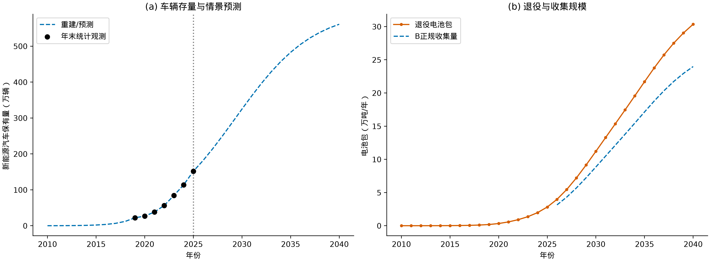

图1 广州车辆存量、退役电池与B正规收集量。统计观测与重建预测分别表达。

## 第2章 退役预测与元素平衡

### 2.1 双队列模型

车辆和电池分别记录投放年份。公式（1）定义生存函数 S(a)=exp[−(a/η)^β]，年龄为a时，公式（2）定义条件退出率 h(a)=1−S(a)/S(a−1)。当年电池退出数按公式（3）N×[h_vehicle+(1−h_vehicle)h_battery] 计算，车辆仍存续但电池退出时形成更换需求，避免重复计入车辆报废。年末目标车辆存量减去存续车辆得到重建新投放量。电池更换使用当年材料结构，仍在使用的旧电池保留投入时材料结构。

电池寿命来自Wu等公开S0曲线，回译参数LFP η=7.50年、β=4.10，三元η=5.20年、β=3.00；这是文献曲线参数，不是广州寿命样本拟合。[3] 车辆寿命η=14.5年、β=2.07采用Zhang等公开代码参数。[5] 早期2010年车辆1000辆为重建初值，至2019年观测指数连接；未来采用S_y=K/[1+(K/S_2025−1)exp(−r(y−2025))]，K=600万辆、r=0.25/年。K=400万、800万和电池寿命±20%分别检验。净迁移设为零，统计范围内新投放由存量反推。

车型采用BEV乘用、PHEV乘用和高容量商用三个代理，权重72.2%、22.8%、5%；总BEV占比依据广州2023年中公开比值约77.2%，商用份额为设计假设。电池容量由Zhang公开矩阵读取。LFP份额从2021年的48%线性增至2040年的75%，其余材料按原比例调整；2021年前采用2021结构代理。电芯比能量LFP 0.16 kWh/kg、其他体系0.25 kWh/kg，电芯占电池包质量75%，后者为工程假设。[1,5]

元素强度为kg元素/kWh，乘各队列装机量得到元素投入、退役和存量。年度守恒为“期初在用量+当年投入=当年退出+期末在用量”。2030年退役量11.21万吨，退役锂1,633t；2040年分别为30.35万吨和3,875t。

### 2.2 正规收集、回收率与产品量

公式（4）：区域实际产出锂 = 退役锂×正规收集率×预处理捕集率×冶炼回收率。B中预处理捕集率98%、冶炼回收率93.0%，因此从入厂废料到产品的综合锂收率91.14%，从全市退役锂到产品为72.001%。三个比例使用不同分母。未正规收集部分不自动算为环境排放，预处理和冶炼损失计入待治理残余物流。

过程残余量独立按“进料×(1−捕集率)+捕集进料×(1−工序回收率)”计算；守恒检查再比较输入与各去向之和。主线无外加锂；材料修复探索情景的补锂另列，不计为退役电池提供的二次锂。
表4 B方案元素质量平衡

| 年 | 元素 | 区域退役t | 未正规收集t | 再生产品t | 工艺残余t | 误差% |
| --- | --- | --- | --- | --- | --- | --- |
| 2030 | Li | 1,633.12 | 342.95 | 1,175.85 | 114.31 | 6.09e-15 |
| 2030 | Ni | 4,531.53 | 951.62 | 3,438.14 | 141.76 | 2.20e-14 |
| 2030 | Co | 1,537.95 | 322.97 | 1,166.86 | 48.11 | 1.25e-14 |
| 2030 | Mn | 1,470.29 | 308.76 | 1,115.53 | 46.00 | 1.01e-14 |
| 2040 | Li | 3,874.85 | 813.72 | 2,789.92 | 271.22 | 5.87e-15 |
| 2040 | Ni | 6,909.56 | 1,451.01 | 5,242.39 | 216.16 | 4.94e-15 |
| 2040 | Co | 2,345.02 | 492.45 | 1,779.21 | 73.36 | 1.15e-14 |
| 2040 | Mn | 2,241.86 | 470.79 | 1,700.93 | 70.13 | 9.51e-15 |

全年度Li、Ni、Co、Mn最大存量平衡误差7.96e-13%，ABC过程最大误差3.24e-14%，均小于0.05%。逐年逐元素原始检验表保存在`stock_flow_balance.csv`和`process_balance.csv`。铜、铝、氟工艺收率用于副产物和政策计算，本研究主要守恒结论限定为上述四元素。

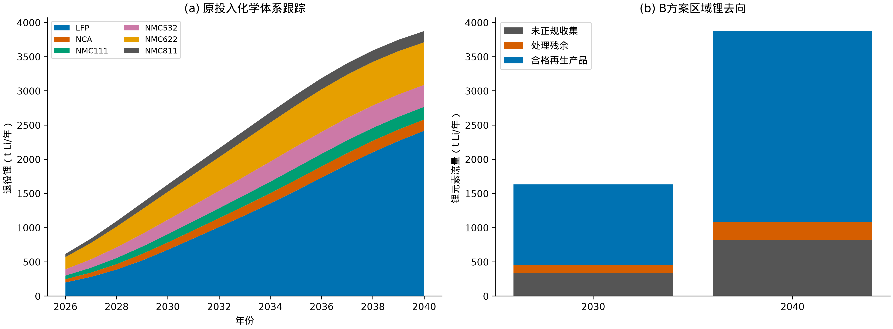

图2 分化学体系退役锂与B方案区域锂流向。

## 第3章 规划指标与政策规制

### 3.1 国内规范、课程目标及实际适用范围

工信部2024年规范条件属于引导性行业规范，不具有行政审批前置性和强制性；本课程把其关键技术值作为候选方案硬约束。2026年第73号令关于备案、环评、环保安全设施和排污许可/登记的义务另列为实施条件。[11,12] 2026年第20号公告废止梯次利用相关条款并取消对应企业公告管理，已公告再生利用企业名单继续有效。[13] 本方案不建设面向电动自行车的废旧动力电池再利用业务。

逐条核验2024年原文第三部分（三）3后，锂、镍钴锰、粉料、杂质、材料修复率、能耗和废水循环率均有明确阈值。任务书要求的铜铝98%、氟固化99.5%作为课程附加设计目标保留，未错误标作该条原文阈值。
表5 规划指标与监测矩阵

| 指标 | 性质/分母 | 2030目标 | 2040目标 | 监测或判定 |
| --- | --- | --- | --- | --- |
| 正规收集率 | 预期性，正规收集/区域退役 | 79% | 79%，通过合同复核后提高 | 溯源重量/年度dMFA校准 |
| 冶炼锂回收率 | 规划硬约束，冶炼产品Li/冶炼进料Li | ≥90%，B为93.0% | ≥90%，B为93.0% | 批次取样与元素化验 |
| Ni/Co/Mn回收率 | 规划硬约束，冶炼阶段 | ≥98% | ≥98% | 元素质量台账 |
| 电极粉料回收率 | 规划硬约束，预处理 | ≥98% | ≥98% | 分选投入产出计量 |
| 粉料Al/Cu杂质 | 规划硬约束 | 各<1.5%，设计1% | 相同 | 粉料成分分析 |
| 材料修复率 | 备选路线硬约束 | ≥99%才准入 | 相同 | 材料质量与产品性能测试 |
| 碳酸锂综合能耗 | 规划硬约束 | <2200 kgce/t LCE | 相同 | 生产计量；与生命周期能耗分开 |
| 废水循环率 | 规划硬约束/设计 | ≥90%/设计95% | 相同 | 回用量/循环工艺用水量 |
| 铜铝回收、氟固化 | 课程附加约束 | 98%、99.5% | 相同 | 金属与含氟物流台账 |
| 供电条件 | 统一外生条件 | 电网平均供电 | 统一采用电网因子 | 按年度供电数据更新 |
| 碳减排、锂供应 | 预期性、模型值 | 38.81万t CO₂e；1,176t Li | 90.94万t CO₂e；2,790t Li | 以年度实绩替换预测 |
| 来源及产品可追溯 | 实施约束 | 全部接入 | 全部接入 | 交接、编码、检验、去向记录 |

### 3.2 欧盟规则与国内政策经济模块

欧盟采用截至2026年8月13日的合并文本核验：附件XII的锂材料回收目标为2027年底50%、2031年底80%；第8条再生锂含量为2031年8月18日起6%、2036年8月18日起12%。回收率、整电池回收效率、产品再生含量是不同指标。广州年度二次锂/新电池锂需求比仅能说明区域供给潜力，不能替代逐型号、逐生产厂的新电池再生含量证明。[14]

第77条电池护照从2027年2月18日起适用于相应轻型交通工具电池、容量超过2 kWh的工业电池和电动车电池。碳足迹声明、等级和最高阈值的实施条件分别按第7条处理，不把护照日期当作所有碳要求的统一生效日。未取得适用的完整出口证据时，代码返回UNKNOWN，不确认出口溢价。

环境税与水资源税模块分别按污染当量和直接取水核算；市政购水不再重复征直接取水税。主线安排50元/t电池包环境税费预算，表示待按实测当量结算的设计准备金；废水废气治理成本另计。广东大气、水污染物税额采用1.8、2.8元/污染当量。[20] 基准不确认CCER收入、出口溢价或财政补贴。EPR服务费是向责任企业提出的合同结算标准，不能写为现行法定收费。

### 3.3 政策引擎与测试

代码对工艺类型、严格不等号、边界等号、阶段生效日期、非有限数和缺失数据分别判断。至少包含粗放不达标、常规湿法、先进修复三个工况，并检验90%锂回收率的边界、2200能耗等号否决和EU日期前后变化。完整结果见`tests.csv`。

本轮累计通过816项政策、寿命差分、守恒、非支配关系、现金流与工程账目检查。2346组工况中1656组通过量化筛选；通过数不表示已取得项目许可。

## 第4章 回收网络与重点工程

### 4.1 技术路径及建设策略

主路线为分类接收、绝缘与放电、低温受控拆解、机械分选、分质湿法浸出、除杂和碳酸锂精制。LFP与三元分别建批次台账，铜铝先行分离；不同体系的药剂与产品不在现场混同计价。主模型采用文献清单作统一基础，回收率提高带来的能源与精制费用用凸函数增量表示：a=((η−0.90)/0.08)²，能源增量80%a、精制服务增量800a元/t、电气及精制投资增量50%a。它们是为检验收益递减设置的工程假设，可用设备报价和中试数据替换。

火法路线适合部分混杂原料，但需要额外热耗和后续锂富集/浸出，不能只核算合金镍钴而漏掉锂。直接正极修复适用于可追溯、可分选、成分一致的材料，必须证明材料回收率及电化学性能；本文做探索性成本比较，不把未知合格率作为确定的工业产能。梯次利用需要剩余寿命、质量与应用安全验证；主方案不预收其收入，并用20%分流、延后5年的情景评估资源时间影响。[4–6]

2026—2027优先签约处理能力，2028、2032、2036分期配置自有/合资能力，每期按本期最大需求÷85%向上取整到5000t/a模块。提前一期开展选址、设计和采购，投运条件不满足时使用委托处理补足，已在延期情景中计入费用。

### 4.2 空间分配与设施基础

枚举7个外围候选区的1—4集散单元组合，对11区来源流量做容量约束线性分配，以人口加权运输距离最小为准则。多单元中任一单元承担比例不超过50%。单元数作为规划结构选择：三单元相对两单元明显缩短首程，增加第四单元的距离收益较小，因此以三单元作为建设组织基准，站点固定成本将在分区实施方案中细化。本次采用3单元方案：白云区、番禺区、增城区，首程加权距离19.60km，最大分配距离49.86km。区内最小距离设10km，跨区距离为球面直线距离×1.3；处理段暂取100km，按0.8元/t·km和0.15174798 kg CO₂e/t·km核算。后者是Ma变量的移用口径，需运输服务商实际里程替换。

这些集散单元是物流分区，不等于在区中心点建厂。白云钟落潭项目作为再生协作优先对象；花都赤坭项目作为拆解与原料协作候选，分别核查可接收原料种类、剩余能力及手续。新增再生基地仅进入工业用途、具备污水及供能接入条件的地块筛选。避免在生态保护红线、饮用水水源保护区和居民敏感点附近直接布置未经论证的湿法设施。[15–19]

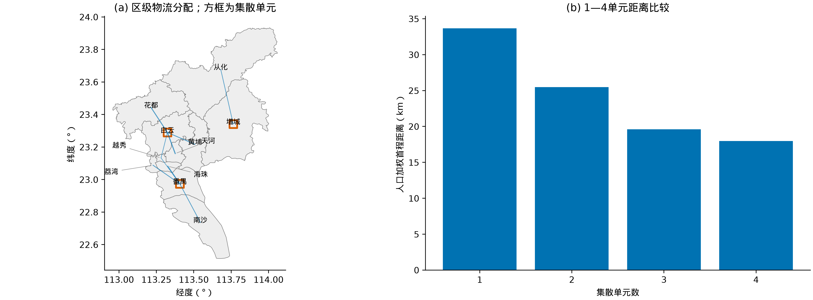

图3 区级回收物流配置与不同集散单元数的距离比较。
表6 集散单元能力及用地贮存估算

| 集散单元 | 分配比例 | 2030流量t/a | 名义物流能力t/a | 7日最大库存t | 贮存面积m² | 用地筛选m² |
| --- | --- | --- | --- | --- | --- | --- |
| 番禺区 | 37.7% | 33,357 | 47,091 | 1,099 | 3,296 | 70,637 |
| 白云区 | 50.0% | 44,271 | 62,500 | 1,458 | 4,375 | 93,750 |
| 增城区 | 12.3% | 10,915 | 15,409 | 360 | 1,079 | 23,113 |

用地按1.5m²/(t/a)预留，库存按300运行日、7日周转及3m²/t堆存面积估算，合计筛选用地18.75公顷。各单元能力是系统能力的分配，不与集中再生能力重复相加。地块边界100m敏感点排查带仅为规划筛选假设；建筑之间的防火间距、爆炸危险区、通道和卫生防护距离按实际建筑类别、危险物质与环评计算确定，不称100m为统一法定距离。带电接收区、隔离区、放电拆解区、化学处理区、成品区和残余物暂存区实行分区，清污、人流与物流分开，事故水可切断外排。

### 4.3 重点工程项目库

表中为2030对应的一期能力，投资包括收集、主线、公辅、环保和数字平台；资本分配比例15%、45%、20%、15%、5%为规划概算分解。运行费按对应清单类别分配，固定运维按同一比例分摊。全期投资另列，资源与减排效益只在P02确认一次。
表7 重点工程项目库

| 编号/项目 | 建设性质/空间落位 | 设计规模 | 一期CAPEX亿元 | 全期CAPEX亿元 | 2030 OPEX亿元/年 | 效益/责任主体 |
| --- | --- | --- | --- | --- | --- | --- |
| P01 收集与放电预处理网络 | 分期配置；白云区、番禺区、增城区区级集散单元 | 125,000 tpack/a | 1.61 | 3.66 | 1.867 | 配套主线；车企及回收运营商 |
| P02 分质湿法提锂及产品精制 | 分期配置；白云钟落潭产业基础协作/依法选定的新增基地 | 125,000 tpack/a | 4.82 | 10.98 | 19.352 | Li 1,176t/a；减排38.81万t/a；再生项目公司 |
| P03 废水回用与残渣治理 | 分期配置；与P02配套 | 333 m3/d | 2.14 | 4.88 | 0.758 | 回用水168.23万m³/a；项目公司及环保运维单位 |
| P04 供电及热能系统 | 分期配置；与P02配套 | 53,398,438 kWh/a | 1.61 | 3.66 | 0.431 | 配套主线；项目公司及能源供应商 |
| P05 溯源检测与研发平台 | 分期配置；市级平台及处理企业 | 125,000 tpack/a | 0.54 | 1.22 | 0.700 | 配套主线；车企与项目公司，工信部门监管 |

合计：一期投资10.70亿元，全期投资24.40亿元；2030年OPEX为23.11亿元。上述投资、运行费及效益与模型逐项相等，机器核验差额分别为0.0元、-0.0元。工程周期为2026—2027完成合同及前置工作，2028投运一期，2032和2036按条件扩容。

### 4.4 工程可行性及实施方式选择

本地环评项目两期混合进料合计与总投资推得约6,778元/(t/a)的投资强度。本研究取8000元/(t/a)，并对高回收率追加精制投资，属于基于本地工程量级的估算。[15] 一期设计电力负荷约7.42MW、热负荷8.05MW，废水设计处理量333m³/d，均须落实接入和处理设施。

公开节能审查的混合进料设计能耗为395kgce/t进料，本模型2030为109kgce/t电池包。两者工艺、进料和设备边界不同，但差异说明新建方案必须以供应商完整能量平衡和连续运行测试确认节能设计，不能用小规模清单直接保证工业达标。[16] 建设合同采用单位LCE能耗性能保证；达不到要求则不启用该条产线，采购合规处理服务。热耗8MJ/kg电芯压力测试已纳入政策否决检查。

表8 固定B的实施方式比较

| 实施方式 | 额外受托能力服务费元/t | 折现净成本亿元 | 自有CAPEX亿元 | 累计锂万t |
| --- | --- | --- | --- | --- |
| 分期配置 | 1,800 | 13.41 | 24.40 | 2.55 |
| 全期委托_低报价 | 900 | 6.91 | 0.00 | 2.55 |
| 全期委托_基准报价 | 1,800 | 15.90 | 0.00 | 2.55 |
| 全期委托_高报价 | 2,700 | 24.89 | 0.00 | 2.55 |

委托报价指在相同原料采购、变动处理成本和产品收入之外支付的能力服务费，避免与全包处理报价混用。在相同处理性能和运输假设下，固定B的全期委托与分期配置约在1,550元/t额外服务费处成本相当。低于该价格且能覆盖逐年需求的有效合同应优先委托；否则按分期方案开展新建/合资比选。这一决策规则使规划不依赖预先选定“必须新建”。

## 第5章 LCA—TEA与ABC决策

### 5.1 环境清单和基准对照

电力采用生态环境部2024年全国发电生命周期因子0.5777加不含线损输配0.0046，合计0.5823 kg CO₂e/kWh作为统一边界代理；水电采购情景采用0.0141加不含线损输配0.0046，合计0.0187。未来因子固定用于规划比较，电网0.45—0.75另做压力测试；广州供电的生命周期清单采用该全国统一代理。[18] 试剂上游因子来自Ma原始代码；能源与水耗补充采用Zhang公开包内EverBatt/GREET工作表，位置保存在`parameter_evidence.csv`。[5,6]

原生碳基准从Peiseler源数据按产量加权：盐湖为智利与阿根廷样本、锂辉石为澳大利亚样本。水耗及能耗采用Kelly等表6：盐湖15.5—32.8 L/kg LCE与30—36 MJ/kg LCE，锂辉石77 L/kg LCE与218 MJ/kg LCE。水指标为淡水消耗，不把高盐卤水蒸发量等同于淡水取水。2026年补充研究亦说明水约束需结合矿区位置与气候条件，不能仅据全球平均量推断当地生态影响。[1,7,8]

循环工艺水设计20m³/t电池包，按多个浸出/洗涤循环各约5m³/t的量级设置；95%回用，新水为1m³/t。新水20%按蒸发及产品带出计作消耗、80%按处理后排放计算，两者合计等于新水。所有数值为设计假设，测试10、20、40及文献代码直读375m³/t的循环量，设计依据与检验范围记录于假设台账。原生和再生蓝水消耗均计入上游；直接新水、排水和循环量另列。

回收生命周期能量包括电力一次能源换算、天然气上游与燃烧、酸/过氧化氢/碳酸钠上游及运输能耗（2MJ/t·km设计代理）。材料建造和部分辅助投入能量未计入，与工信部生产单位产品综合能耗分开报告。原生水耗和能耗只作不同技术供应路径的基准范围比较，不用于替换真实供应商产品声明。

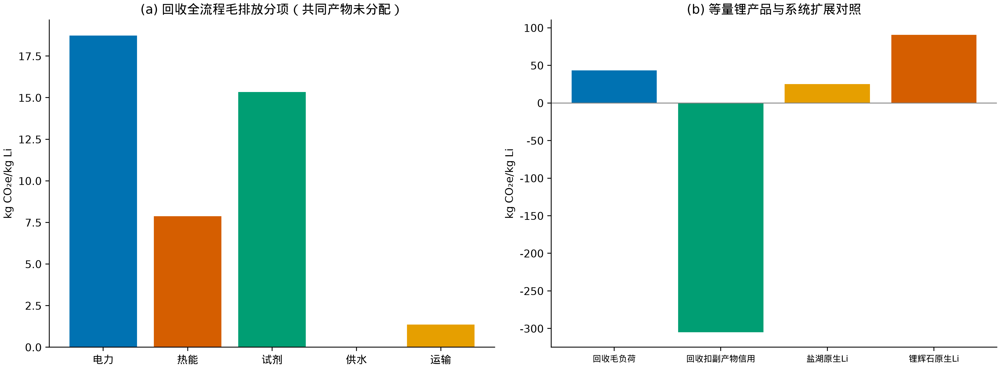

图4 2030年B的毛碳排放分项、副产物替代信用和原生锂基准。
表9 2030年B环境清单及基准

| 2030指标 | 数值 | 边界说明 |
| --- | --- | --- |
| 回收毛碳足迹 | 43.31 kg CO₂e/kg Li | 全部共同处理负荷暂归Li |
| 非锂副产物替代信用 | 348.39 kg CO₂e/kg Li | 与锂替代信用分开 |
| 盐湖原生碳基准 | 25.02 kg CO₂e/kg Li | Peiseler样本产量加权 |
| 锂辉石原生碳基准 | 90.58 kg CO₂e/kg Li | Peiseler样本产量加权 |
| 回收生命周期能量估算 | 538.52 MJ/kg Li | 未分配共同产物的毛负荷 |
| 回收蓝水消耗情景 | 166.83 L/kg Li | 新水消耗及上游 |
| 现场新水 | 8.85 万m³/a | 与上游水耗分开 |
| 现场处理排水 | 7.08 万m³/a | 占新水80%的情景 |
| 工艺能耗 | 1,547.85 kgce/t LCE | 厂内最终能量保守全部归LCE |

副产物信用在净减排中占较大比例，因此对材料实际替代比例50%、80%、100%开展独立测试。再生金属盐必须满足销售质量和实际替代条件才可确认对应信用；不能把负净足迹解释为现场吸收二氧化碳。不同LFP/三元比例变化时，副产物结构同步改变。

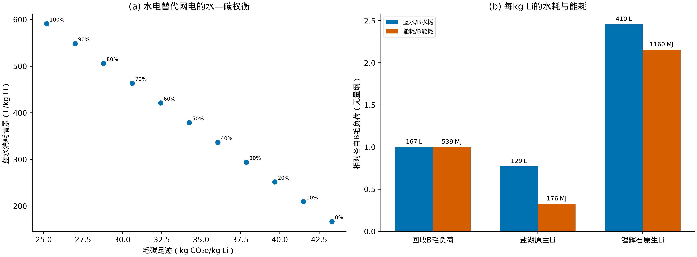

图5 水电替代的水—碳权衡，以及每kg Li水耗、能耗的原生对照。

图5的水电替代扫描为独立供电敏感性分析，保持B的收集率、冶炼回收率与处理规模不变，仅观察供电结构对水、碳指标的影响。主方案ABC全部使用电网平均供电。水电占比上升降低碳排放，同时增加水库蒸发分摊的上游耗水；本地废水回用与上游水耗分别计量。

### 5.2 现金流与成本收益

净成本包括固定资产投资、采购、收集运输、拆解、试剂、能源、水、人工、治理、研发、税费预算、固定运维及周转资金，扣除产品销售和期末资产剩余价值。铜铝原文美元单价按7.04转换，镍钴锰按元素质量销售价格核算，避免盐质量和金属价格混用。销售兑现率基准85%，涵盖质量折价、损耗及回款折扣，不降低质量守恒中的物理产出。研发费按销售收入3%计提。基础工资和药剂价格使用Ma历史清单，运营费用±20%及销售兑现60%—100%测试覆盖报价变化。

公式（5）：NPV_cost = Σ[当年投资 + 周转资金增量 + OPEX − 产品销售 − 期末残值 − 期末周转资金回收]/(1+8%)^(年−2025)。设备寿命20年，2040年按剩余寿命比例计资产终值。终值兑现率0%、50%、100%另作敏感性检验，以反映期末资产不能按账面价值处置的情况。固定运维为累计资产2.5%/年，周转资金为60日OPEX。资本年金可按CRF=r(1+r)^n/[(1+r)^n−1]辅助展示，但不与已计入的投资现金流重复相加。公式（6）：LCOR=折现净成本/折现再生锂kg；MAC=折现净成本/折现净减排t。MAC表示本回收项目每实现1吨净减排所对应的折现净成本。

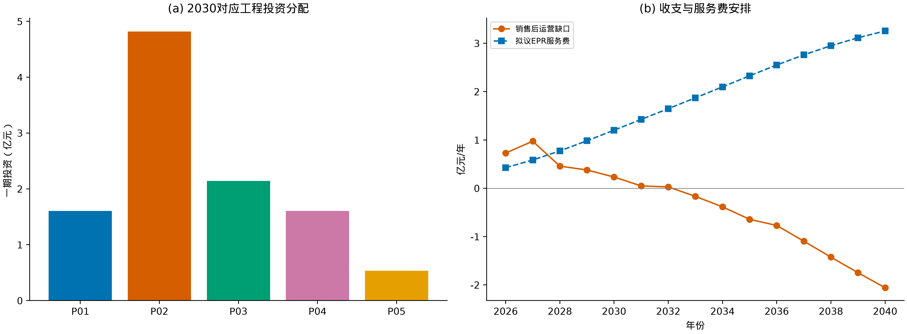

图6 工程资本构成、销售后运营缺口与拟议EPR服务费。

### 5.3 双目标前沿与ABC

主方案统一采用电网平均供电，价格、退役来源、供电因子和核算边界在同一组比较中保持一致。决策变量为正规收集率与冶炼锂回收率，配套产能随进料量调整。收集率50%—95%，步长1个百分点；冶炼回收率90%—98%，步长0.5个百分点。每种外生锂价计算46×17=782组，三种价格合计2346组。先剔除任一年违反政策阈值的方案，再以“一个方案两个目标均不差且至少一项更优”判定支配关系。帕累托集合由上述离散工程情景中的全部非支配方案组成。

A取净成本最低；C取累计再生锂最多，若并列则按理想点距离、净成本顺序确定。B对**同一价格下帕累托集合自身的最大最小值**归一化：公式（7）：成本z_C=(C−C_min)/(C_max−C_min)，锂z_L=(L_max−L)/(L_max−L_min)，最小化d=√(z_C²+z_L²)。零范围目标贡献设为零。两个目标归一化后等权；该权重为本规划的方案选择规则，B为归一化理想点距离最小的综合折衷方案。
表10 ABC技术经济与环境效益比选

| 指标 | A资金最少 | B综合最优 | C锂量最大 |
| --- | --- | --- | --- |
| 情景ID | S0786 | S1282 | S1559 |
| 正规收集率 | 50% | 79% | 95% |
| 统一供电条件 | 电网平均供电 | 电网平均供电 | 电网平均供电 |
| 冶炼锂回收率 | 91.5% | 93.0% | 95.5% |
| 累计锂（万t Li） | 1.59 | 2.55 | 3.15 |
| 累计毛碳排放（万t CO₂e） | 69.80 | 115.71 | 159.69 |
| 毛碳足迹（kg CO₂e/kg Li） | 43.88 | 45.30 | 50.63 |
| 累计净减排（万t CO₂e） | 533.03 | 837.79 | 988.99 |
| 折现净成本（亿元） | 2.94 | 13.41 | 34.41 |
| 全期CAPEX（亿元） | 14.65 | 24.40 | 33.63 |
| 2028初次建设投资（亿元） | 6.51 | 10.70 | 14.84 |
| 未获服务费时峰值资金（亿元） | 13.46 | 32.42 | 71.51 |
| LCOR（元/kg Li） | 37.87 | 107.71 | 223.89 |
| MAC（元/t CO₂e） | 112.83 | 327.86 | 712.64 |
| 盈亏平衡EPR（元/t电池包） | 470 | 1,358 | 2,898 |
| 归一化距离 | 1.0000 | 0.5078 | 1.0000 |

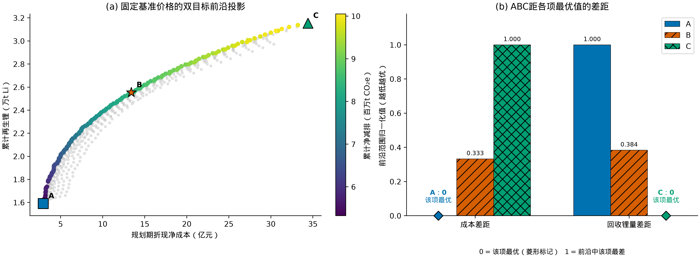

图7 基准价格下的双目标非支配集合及ABC距各项最优值的差距。菱形标注零差距，0表示该项最优，1表示前沿中该项最差。

B相对A增加累计锂0.96万吨、净减排304.76万吨，需增加折现净成本10.47亿元。C进一步提高收集强度和工艺收率，但资金需求上升。候选中的96%和98%冶炼回收率在凸能耗假设下可能触发远期能耗限值，因此C的94%是**可行集合中锂总量最多**，不是把98%工艺直接排除在技术可能性之外。

### 5.4 敏感性与稳健实施

表11 固定B关键压力测试

| 变化因素 | 取值 | 固定B净成本亿元 | 盈亏平衡EPR元/t | 量化状态 |
| --- | --- | --- | --- | --- |
| price | 70,400.0000 | 11.54 | 1,168 | PASS |
| price | 154,880.0000 | 13.41 | 1,358 | PASS |
| price | 352,000.0000 | 17.77 | 1,799 | PASS |
| commissioning_delay_years | 0.0000 | 13.41 | 1,358 | PASS |
| commissioning_delay_years | 2.0000 | 12.27 | 1,242 | PASS |
| terminal_asset_realization | 0.0000 | 17.40 | 1,761 | PASS |
| terminal_asset_realization | 0.5000 | 15.40 | 1,559 | PASS |
| terminal_asset_realization | 1.0000 | 13.41 | 1,358 | PASS |
| product_sales_realization | 0.6000 | 82.03 | 8,306 | PASS |
| product_sales_realization | 0.8500 | 13.41 | 1,358 | PASS |
| product_sales_realization | 1.0000 | -27.76 | 0 | PASS |
| process_heat_MJ_kgcell | 0.0000 | 12.07 | 1,222 | PASS |
| process_heat_MJ_kgcell | 2.0000 | 13.27 | 1,344 | PASS |
| process_heat_MJ_kgcell | 8.0000 | 16.87 | 1,708 | FAIL |

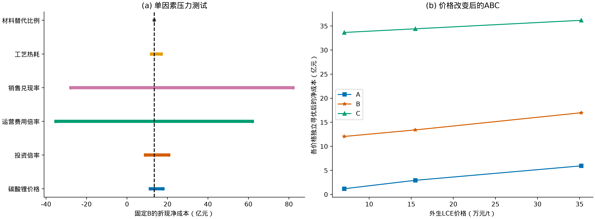

图8 固定B压力测试与不同外生价格分别寻优的ABC。

原料采购价格随锂价联动，而部分副产物售价固定，因此高锂价不一定提高回收企业净收益；报告不预设单调改善。销售兑现、采购结算和运营报价比微小的运输距离差异更需要合同控制。固定B的压力测试与在新价格下重新寻优分别呈现。

未来普及上限及寿命范围是独立设计情景，不是统计置信区间；开工前使用实际交付合同和最新退役记录更新。若连续四个季度原料交付低于一期计划70%，推迟下一期模块；若预计两年内负荷超过现有名义能力85%，启动新增或委托能力采购。阈值为本规划运营规则。

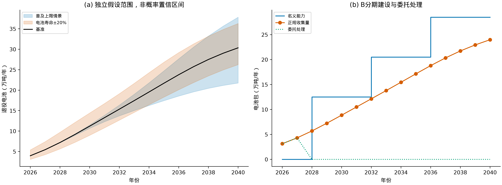

图9 预测情景范围与推荐方案的分期能力、处理量和委托量。

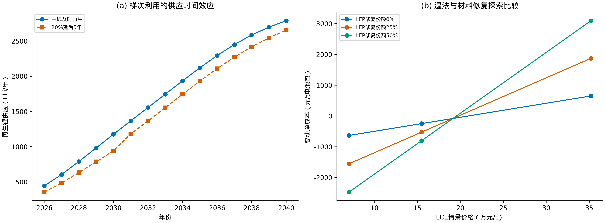

图10 梯次利用造成的再生锂延迟及不同材料修复份额的探索比较。

20%材料延后5年的情景，在2040年仍有2,564t锂对应的未来再生供应处于延迟存量中，未计入本规划期已回收量。探索性修复模型采用Ma的SOH—补锂代理，不代表对退役材料锂占位的实测；需材料分析与电化学验证后才能替换湿法主线。

## 第6章 商业闭合、环境风险与动态管理

### 6.1 责任分配与融资

车企、电池企业履行回收责任并组织交付；运营方按分质重量、化学组成和质量检验结算原料；再生企业按合格产品销售回款。EPR服务费覆盖正规收集、安全治理和资本回收的净缺口，拟由车企/电池企业联合签订长期服务合同，价格每年按锂价、实际产品收入和核实成本调整。

B基准平均服务费为1,358元/t电池包，使规划期折现净成本为零；该计算包括终值，不等于每年现金收支平衡。取得该服务费后仍需峰值资本及周转资金18.32亿元，拟按40%资本金、60%信贷安排，即7.33和10.99亿元。融资比例为设计方案，贷款年利率、偿还期和偿债覆盖率须按融资条款另算；当前现金流为不含债务本息的项目现金流，避免把折现率再当作利息重复扣除。CCER及出口溢价作为获准后补充收入，不作为基础偿付来源。

开工应具备四项可核查条件：至少覆盖计划处理量70%的原料交付协议；主要产品质量规格与收购协议；EPR服务费及峰值融资额度协议；满足能耗、水量及污染控制指标的设备性能保证。若低报价合规委托可覆盖需求，按第4.4节切换采购方式。尚未签约的需求只用于远期能力预留。

### 6.2 编码、数字记录与MRV

建立“车辆/电池编码—交接重量—材料体系—检测结果—处理批次—产品去向”记录链，按第73号令相应时限报告入出库及回收网点变更。国内数字身份证与欧盟电池护照分别适配，不以一个内部二维码替代所有法定数据。数据权限区分公众信息、企业工艺信息和监管信息。[12,14]

关键计量点包括进厂地磅、分选粉料秤、产品与残余物流秤、电能表、燃气/蒸汽流量计、新水和回用水表；按批次抽检锂、镍钴锰和杂质。月度核对采购与产品量，季度复核能耗与水耗，年度更新区域存量和退役模型。发现账目偏差时核查计量、含水率和物料库存，不以调整回收率参数掩盖差异。

### 6.3 环境与安全设计

带电电池接收前核查破损、鼓胀、温度和绝缘，异常电池隔离贮存，设置温度/烟感监测与可达的消防通道。放电、拆解和破碎在适用工艺条件下设置防短路、防爆、通风与联锁。电解液中的六氟磷酸锂（LiPF₆）遇水可能产生氟化氢（HF），因此含有机挥发物和含氟气体分别收集，配置负压收集、相应处理与碱液喷淋；含氟废水采用钙盐沉淀及后续固液分离，酸浸废水按金属和盐分特征分质处理。含氟/磷残渣先鉴别并按类别合规转移，不默认全部废电池均为危险废物。[19]

消防、泄漏和初期雨水进入事故收集系统，正常雨水排口具备切断条件。事故池用V=消防水量+最大泄漏量+事故期间雨水量−可用围堰容积核算。示例取消防25L/s、2h，最大泄漏100m³，30mm降雨，汇水面积取筛选地块20%，径流系数0.9，可用围堰30m³。以下为明确设计情景；消防流量和持续时间须按建筑与物料条件完成专项设计后替换。
表12 事故池设计工况与预留规模

| 单元 | 消防水m³ | 泄漏m³ | 雨水m³ | 计算池容m³ | 预留池容m³ |
| --- | --- | --- | --- | --- | --- |
| 番禺区 | 180 | 100 | 381.4 | 631.4 | 650 |
| 白云区 | 180 | 100 | 506.2 | 756.2 | 800 |
| 增城区 | 180 | 100 | 124.8 | 374.8 | 400 |

PDCA管理按年度实施：计划阶段更新退役量和交付合同；实施阶段分期投运并保留受托后备能力；检查阶段比较元素流、能耗、排放、产品价格及资金；改进阶段调整收集合同、设备运行和扩建节奏。发生热失控、含氟废水异常或能耗超限，先停用相关单元并启动备用处理路径，再完成原因分析和复验。

## 第7章 参考文献、参数与复现说明

### 7.1 学术文献

[1] Peiseler Leopold, Schenker Vanessa, Schatzmann Karin, Pfister Stephan, Wood Vanessa, Schmidt Tobias. Carbon footprint distributions of lithium-ion batteries and their materials. *Nature Communications*, 2024, 15: 10301. [DOI](https://doi.org/10.1038/s41467-024-54634-y).

[2] Yao Adrian, Benson Sally M., Chueh William C.. Critically assessing sodium-ion technology roadmaps and scenarios for techno-economic competitiveness against lithium-ion batteries. *Nature Energy*, 2025, 10: 404-416. [DOI](https://doi.org/10.1038/s41560-024-01701-9).

[3] Wu Yufeng, Yuan Qingbin, Yang Ming, Zhai Mengyu, Hu Guangwen, Gu Yifan. Impact of circular economy on the long-term allocation structure of primary and secondary lithium. *Communications Earth &amp; Environment*, 2024, 5: 503. [DOI](https://doi.org/10.1038/s43247-024-01667-2).

[4] Machala Michael L., Chen Xi, Bunke Samantha P., Forbes Gregory, Yegizbay Akarys, de Chalendar Jacques A., Azevedo Inês L., Benson Sally, Tarpeh William A.. Life cycle comparison of industrial-scale lithium-ion battery recycling and mining supply chains. *Nature Communications*, 2025, 16: 988. [DOI](https://doi.org/10.1038/s41467-025-56063-x).

[5] Zhang Bin, Xin Qingyao, Chen Siyuan, Wang Bo, Li Hao, Wang Zhaohua, Bansal Prateek. Lithium-ion battery recycling relieves the threat to material scarcity amid China’s electric vehicle ambitions. *Nature Communications*, 2025, 16: 6661. [DOI](https://doi.org/10.1038/s41467-025-61481-y).

[6] Ma Ruifei, Tao Shengyu, Sun Xin, Ren Yifang, Sun Chongbo, Ji Guanjun, Xu Jiahe, Wang Xuecen, Zhang Xuan, Wu Qiuwei, Zhou Guangmin. Pathway decisions for reuse and recycling of retired lithium-ion batteries considering economic and environmental functions. *Nature Communications*, 2024, 15: 7641. [DOI](https://doi.org/10.1038/s41467-024-52030-0).

[7] Kelly Jarod C., Wang Michael, Dai Qiang, Winjobi Olumide. Energy, greenhouse gas, and water life cycle analysis of lithium carbonate and lithium hydroxide monohydrate from brine and ore resources and their use in lithium ion battery cathodes and lithium ion batteries. *Resources, Conservation and Recycling*, 2021, 174: 105762. [DOI](https://doi.org/10.1016/j.resconrec.2021.105762).

[8] Trost Jenna N., Nassar Nedal T., Dunn Jennifer B.. Future water constraints on United States lithium mining under climate change. *Communications Earth &amp; Environment*, 2026, 7: 685. [DOI](https://doi.org/10.1038/s43247-026-03643-4).

[9] [广州市规划和自然资源局，《2025年广州市交通发展年度报告》及2020—2024年报告](https://ghzyj.gz.gov.cn/attachment/8/8028/8028118/10830253.pdf)。定位：2025报告物理17页图1.7、32页；逐年位置见vehicle_observations.csv。

[10] [广州市统计局，《广州统计年鉴2025》表2-2](https://tjj.gz.gov.cn/datav/admin/home/www_nj/2025/pdfs/2-2%20%20%E5%90%84%E5%8C%BA%E5%B9%B4%E6%9C%AB%E4%BA%BA%E5%8F%A3%E6%95%B0%20%282015-2024%E5%B9%B4%29.pdf)。定位：各区年末人口数（2015—2024年）；本地raw/GZ_POP2025.pdf。

[11] [工业和信息化部，2024年第42号公告及《规范条件（2024年本）》](https://www.miit.gov.cn/zwgk/zcwj/wjfb/gg/art/2024/art_2ca9a4ed31de469d9da26ca70c83a868.html)。定位：附件物理1—2、6—7页；本地raw_current/MIIT2024.pdf，湖北省经信厅公开转载原件。

[12] [工业和信息化部等六部门，第73号令](https://www.miit.gov.cn/gyhxxhb/jgsj/cyzcyfgs/bmgz/jdcjxl/art/2026/art_392462fdc40c415ea4a4129cac3028c2.html)。定位：2026-04-01施行；第14—24、50条。

[13] [工业和信息化部，2026年第20号公告](https://wap.miit.gov.cn/jgsj/jns/zhlyh/art/2026/art_68252019ef6648f886b2c070ef8ced02.html)。定位：2026-07-30；第一至第三项。

[14] [European Union, Regulation (EU) 2023/1542，2026-08-13合并文本](https://eur-lex.europa.eu/eli/reg/2023/1542/2026-08-13/eng/)。定位：第7、8、77条，附件XII；检索可读条款，直接原件下载遇反爬，未伪造本地PDF。

[15] [广州市生态环境局，穗环管影〔2024〕8号](https://sthjj.gz.gov.cn/gkmlpt/content/9/9802/post_9802113.html)。定位：第一条投资与分期进料；第二条污染控制。

[16] [广州市发展改革委，广州报废动力电池材料再生利用项目节能审查](https://fgw.gz.gov.cn/tzgg/xmgg/content/post_9843213.html)。定位：2024-08-29；第二、三条。

[17] [花都区发展改革局，新能源循环经济产业园广州总部项目说明](https://www.huadu.gov.cn/xxgk/zdxm/content/post_10213799.html)。定位：2025-04-14；规划6万吨电池综合利用及拆解，不等同已投产湿法能力。

[18] [生态环境部等，《2024年全国电力碳足迹因子》](https://www.mee.gov.cn/xxgk2018/xxgk/xxgk01/202510/W020251024569470952545.pdf)。定位：2025年第19号公告附件表1—3；2026-11-04检索核验。

[19] [生态环境部，HJ 1186—2021《废锂离子动力蓄电池处理污染控制技术规范（试行）》](https://www.mee.gov.cn/ywgz/fgbz/bz/bzwb/gthw/qtxgbz/202108/t20210820_858544.shtml)。定位：2022-01-01实施；本地raw/HJ1186.pdf。

[20] [广东省环境保护税适用税额决定及水资源税实施办法](https://guangdong.chinatax.gov.cn/gdsw/ssfggds/2017-12/19/content_a8b82adb0fd341d99cc89d18c77def32.shtml)。定位：本地raw/GD_ENV_TAX.html、GD_WATER_TAX.html；标准税额场景。

[21] [Kassis等，Scientific Agent Skills: A Library of Procedural Knowledge for Research Agents](https://doi.org/10.48550/arXiv.2609.00065)。定位：2026，arXiv；引用核验与图表检查的软件工作流来源，不作为电池参数来源。

### 7.2 六篇课程文献的使用位置

表13 六篇课程文献的实际使用位置

| 课程文献 | 本研究实际使用 | 参数定位 |
| --- | --- | --- |
| Peiseler2024 | 原生Li碳基准、电芯比能量 | Source Data.xlsx / Figure1 B3:I18；正文Methods |
| Yao2025 | 低/基/高锂价敏感性 | 正文价格区间，不移植钠电成本输出 |
| Wu2024 | 寿命曲线、Cu/Al/F电芯组成 | Initial data/life_curve.xlsx S0；组成表Spent battery feed列 |
| Machala2025 | 工业回收边界、水—碳权衡、混合产品解释 | 正文Fig3、Fig5及Methods；不把NCA-eq系数直接当Li系数 |
| Zhang2025 | 分化学体系金属强度、容量、车辆寿命与EverBatt | 7-Parameter input数组；Car_BEV_example.m；6-Cost/EverBatt 2023.xlsm |
| Ma2024 | 试剂、处理成本、产品销售和路径探索 | LFPBasicData.m、LFPRecycle.m、NMCRecycle.m；历史美元统一转换 |

### 7.3 假设台账与复现

原始观测、文献迁移参数和设计假设分别保存。`parameter_evidence.csv`给出100项原始数组/单元格位置；`assumptions_register.csv`给出关键假设、依据与检验范围；`planning_assumptions.json`及`plan_parameters.json`为程序输入。`current_source_manifest.json`记录新增来源URL、下载状态、文件路径和哈希，`references.bib`由Crossref元数据生成；课程PDF与原始研究归档完整保留。

所有图表由Python生成320DPI PNG及矢量PDF，每幅在正文中引用。`run_all.py`按提取、模型、实施方式核算、测试、绘图、报告、交付检查顺序运行；无需联网即可重现数值。重新检索使用独立`refresh_sources.py`，不影响离线复现。报告模板读取同源模型结果表生成。

项目级许可、设备报价及合同签署属于规划实施阶段的交付条件，验收时应重点检查其是否已转化为明确的责任、数量、费用和触发规则。

### 7.4 环境—经济辅助比较

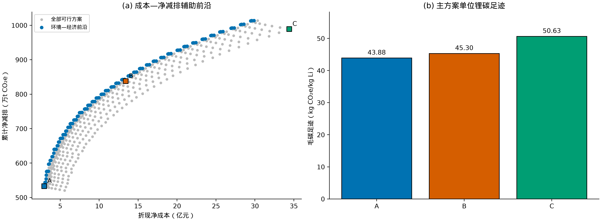

图11 成本—净减排辅助前沿与ABC单位锂碳足迹。
主方案ABC按成本与锂量确定。环境—经济辅助前沿采用同一价格、供电和可行工况，最小化成本、最大化净减排，满足课程的环境经济比较要求。图中同时标注主方案ABC，检验其环境表现。毛碳足迹为累计毛排放除以累计再生锂量；净减排另计原生材料替代效益。
