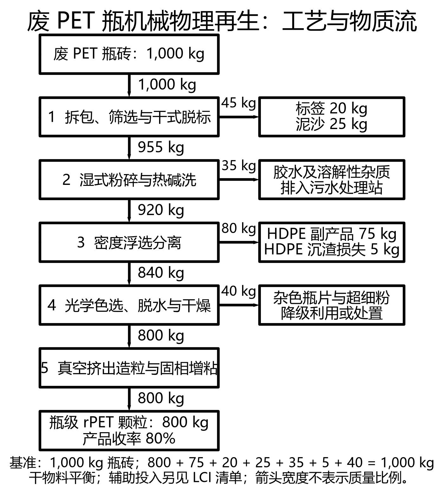

# 第九讲案例一：PET 再生系统 MFA–LCA–TEA 联动分析

作者：明子骅｜第 5 组｜分支：dev-group-05-mzh｜日期：2026-10-22

## 1. 研究目标与计算边界

评价废 PET 瓶机械再生工厂将常规电网电力全部替换为风光绿电后的环境与经济表现，并分析原料纯度下降的影响。功能单位为生产 1 t 瓶级 rPET 颗粒。依照课程边界计入瓶砖运输、生产公用工程、药剂、水与污水处理，并以避免负荷法抵扣 HDPE 副产品替代信用。废瓶上游首次生产不另行计入。本作业采用课程示范清单，不代表经核证的产品碳足迹。

输入数据来自同任务包 `case_files/data_cohort/` 下三个 CSV 与 `case1_documentation.md`。计算脚本读取 CSV；成本以课程给定的 6,153.4 元/t 为锚点进行增量分析。绿电情景仅改变电价与电力排放因子，保持收率和其他消耗不变。

## 2. MFA：质量守恒与基准流

以 1,000 kg 废瓶砖为基准，质量平衡如下。

| 输出物 | 质量 / kg | 去向 |
|---|---:|---|
| rPET 主产品 | 800 | 外售 |
| HDPE 副产品 | 75 | 回收外售 |
| 标签 PP/PVC | 20 | 焚烧处置 |
| 泥沙 | 25 | 填埋或骨料利用 |
| 胶粘剂和溶解性残渣 | 35 | 污水处理 |
| HDPE 夹带损失 | 5 | 沉渣处置 |
| 杂色瓶片与细粉 | 40 | 降级利用或处置 |
| **合计** | **1,000** | **与输入相等** |

收率 Y = 800 / 1,000 = 80%；每吨 rPET 需要瓶砖 1 / 0.8 = 1.25 t，伴生 HDPE 为 75 / 800 = 0.09375 t。年处理瓶砖 20,000 t，对应 rPET 年产量 16,000 t。水和蒸汽属于辅助物流，此表是课程规定的废瓶组分质量平衡，不是全厂含水总质量平衡。

## 3. LCA：100% 绿电情景

| 清单项目 | 活动水平 / t rPET | 常规排放 / kg CO₂e | 绿电排放 / kg CO₂e |
|---|---|---:|---:|
| 瓶砖运输 | 1,250 kg，使用 CSV 有效因子 0.12 kg CO₂e/kg | 150.00 | 150.00 |
| 电力 | 850 kWh；因子由 0.55 降至 0.03 kg CO₂e/kWh | 467.50 | 25.50 |
| 蒸汽 | 2 GJ × 65 kg CO₂e/GJ | 130.00 | 130.00 |
| NaOH | 15 kg × 2.10 kg CO₂e/kg | 31.50 | 31.50 |
| 新鲜水 | 2.5 m³ × 0.38 kg CO₂e/m³ | 0.95 | 0.95 |
| 污水处理 | 2.2 m³ × 2.75 kg CO₂e/m³ | 6.05 | 6.05 |
| HDPE 避免负荷信用 | −93.75 kg × 1.60 kg CO₂e/kg | −150.00 | −150.00 |
| **净合计** | | **636.00** | **194.00** |

GWP_green = 636 + 850 × (0.03 − 0.55) = **194.0 kg CO₂e/t**。

相对原生 PET 减排率 = (2,250 − 194) / 2,250 × 100% = **91.38%**。

相对常规再生工艺，每吨额外减少 442.0 kg CO₂e，降幅 69.50%；年产量不变时额外减排 7,072 t CO₂e。绿电仍有生命周期排放，不能将其因子设为零。替代后蒸汽和运输成为主要正排放项，后续优化可关注热源及运输。

## 4. TEA：成本、利润与绿色溢价

常规吨产品电费 = 850 × 0.65 = 552.5 元；绿电电费 = 850 × 0.70 = 595.0 元。

ΔLCOP = 850 × 0.05 = **42.5 元/t**。

LCOP_green = 6,153.4 + 42.5 = **6,195.9 元/t**。

成本增幅 = 42.5 / 6,153.4 × 100% = **0.6907%**。

| 指标 | 常规电网、80% 收率 | 绿电、80% 收率 |
|---|---:|---:|
| 售价 / 元·t⁻¹ | 7,600.0 | 7,600.0 |
| LCOP / 元·t⁻¹ | 6,153.4 | 6,195.9 |
| 吨产品税前成本口径利润 / 元·t⁻¹ | 1,446.6 | 1,404.1 |
| 年利润 / 万元 | 2,314.56 | 2,246.56 |

售价不变时年利润减少 68.0 万元，但仍保持正利润。这里的利润依照课程“售价减 LCOP”口径，含课程分摊费用，不等同于严格财务报表中的 EBITDA 或经营现金流。

定价建议：每吨加价至少 42.5 元可覆盖直接增加的电费；若报价取 7,650 元/t，即溢价 50 元/t，可保留约 7.5 元/t 的缓冲，但认证和交易等新增费用仍需另行核算。这一报价仅比原售价高 0.66%，不是市场接受度的实证结论。可向下游提供“每吨额外减排 0.442 t CO₂e”的可追溯数据，用长期采购合同分摊绿色电力成本；须核实直供电或绿证归属、防止重复声明，并以客户实际采购意愿决定最终溢价。电费增量除以新增减排量约为 96.15 元/t CO₂e，仅表示本情景的增量减排成本。

## 5. 收率从 80% 降至 70% 的敏感度分析

### 5.1 假设与质量平衡

讲义未提供杂质增加后的完整组分及逐工段能耗数据，以下为明确假设下的条件分析：

- 固定年进料为 20,000 t，设备投资、人工等年固定费用不变，年产品量由 16,000 降为 14,000 t。
- 每批 1,000 kg 瓶砖中，100 kg PET 被额外惰性杂质替代，其他既有分流和 HDPE 回收量保持不变；产品从 800 降为 700 kg，新增惰性残渣 100 kg。因此 700 + 75 + 125 + 100 = 1,000 kg，质量守恒。
- 缺少逐工段数据，假设原有每吨进料的能耗、药剂、水、运输和副产品量不变；即原有每吨产品清单与成本全部按 k = 0.8 / 0.7 = 8/7 折算。固定年费用在产量下降后也按同一比例分摊。
- 新增残渣按课程固废处置费 250 元/t 估算，增加 0.1 / 0.7 × 250 = 35.7143 元/t 产品。该费率是代理假设；新增惰性残渣的处理碳排放因子未给出，LCA 中暂未计入，并非认定其处理零排放。结果不能用于预测有机杂质或 PET 燃烧造成的额外排放。

### 5.2 计算结果

| 指标 | 80% 常规电网 | 80% 绿电 | 70% 常规电网 | 70% 绿电 |
|---|---:|---:|---:|---:|
| 吨产品瓶砖需求 / t | 1.2500 | 1.2500 | 1.4286 | 1.4286 |
| 年产品产量 / t | 16,000 | 16,000 | 14,000 | 14,000 |
| 净 GWP / kg CO₂e·t⁻¹ | 636.00 | 194.00 | 726.86 | 221.71 |
| LCOP / 元·t⁻¹ | 6,153.40 | 6,195.90 | 7,068.17 | 7,116.74 |
| 售价减 LCOP / 元·t⁻¹ | 1,446.60 | 1,404.10 | 531.83 | 483.26 |

例如，70% 绿电情景：GWP = 194 × 8/7 = 221.7143 kg CO₂e/t；LCOP = 6,195.9 × 8/7 + 35.7143 = 7,116.7429 元/t。吨产品原料费用从 5,250 上升至 6,000 元，增加 750 元，是主要成本压力。

相对 80% 绿电情景，净碳足迹升高 14.29%，成本升高 14.86%；年利润约从 2,246.56 万元下降至 676.56 万元，下降约 69.89%。70% 收率下绿电相对原生 PET 减排率约为 90.15%，但盈利空间明显收窄。

若只考虑原料需求上升、其他吨产品消耗和分摊费用暂不变，则成本至少出现约 750 元/t 的原料项压力；实际结果取决于设备各工段负荷、杂质种类、处理路径和 HDPE 纯度，不能机械地把所有项目同比放大作为实测结果。上表提供统一、可复算的情景，不是唯一可能结果。

源头分类改善可同时减少无效运输、前处理负荷及处置量，并提高有效产出和固定成本利用率。建议按杂质率制定原料验收及分级收购规则，追踪收率、HDPE 回收率与单位进料电耗；改善分类的经济价值应与绿电采购同步评估。

## 6. 流程图

绘图采用 Python 第三方库 schemdraw，输出 300 dpi PNG 和矢量 SVG。主流程及分流的全部干物料质量均已标注；箭头宽度不代表质量比例。



## 7. 数据口径差异与处理原则

1. **运输单位冲突**：讲义写 125 t·km × 0.12 kg CO₂e/(t·km)，数学结果应为 15，而表内为 150；CSV 则使用 1,250 kg × 0.12 kg CO₂e/kg = 150。本报告按 CSV 和课程基准保留 150，并将其称为有效运输因子。如按讲义 t·km 公式修正，常规和绿电净足迹分别为 501 与 59 kg CO₂e/t；缺少进一步说明，不能把两种口径混用。
2. **成本口径**：讲义展示的各成本分项合计确为 6,153.4 元/t。但 CSV 单独列出的水与烧碱单价只能重建 2.5×4.5 + 0.015×3,200 = 59.25 元/t，不能直接重建讲义合并费用 115 元/t；后者是否含污水等其他费用未明确。故采用给定总成本做绿电增量分析，未擅自补造费用。
3. **近似与四舍五入**：精确 HDPE 收入为 0.09375×4,500 = 421.875 元/t，讲义展示值为 422.1。模板中“约39元”和“91.5%”与给定电耗及因子不完全一致，本报告采用可复算的 42.5 元/t 和 91.38%。
4. **财务假设不一致**：讲义 WACC 为 10%，CSV 为 8%；年工时分别为 7,920 与 7,200；投资分项也不同。本次只计算电费引起的成本增量，不据此重新推导资本年金或动态回收期。课程给定动态回收期 2.6 年仅作参考，未作为本报告独立验证结果。
5. **流向定位**：CSV 将细粉损失标在 SSP_Extrusion，讲义工艺将其放在光学色选段。绘图采用讲义流程位置，保留 CSV 质量数值，总体守恒不受影响。

## 8. 复现与交付清单

在本目录执行：

```powershell
python -m pip install -r requirements.txt
python calculate_case1.py
python plot_mfa_process.py
```

`calculate_case1.py` 仅使用 Python 标准库，读取原始 CSV，验证质量守恒及基准结果，输出 `calculation_results.json` 与 `scenario_comparison.csv`。`plot_mfa_process.py` 输出 PNG/SVG。原始教师材料保持不变。

- [x] MFA 输入输出守恒，收率 80%。
- [x] 绿电清单、碳足迹及原生 PET 减排率。
- [x] 成本增量、增幅、利润与绿色溢价建议。
- [x] 70% 收率情景的假设、质量守恒和联动分析。
- [x] Python 绘图源码及高清 PNG、SVG。
- [x] 无学号；成果仅位于本组任务目录。
- [ ] Git 提交、推送及 PR：按要求暂不执行。
