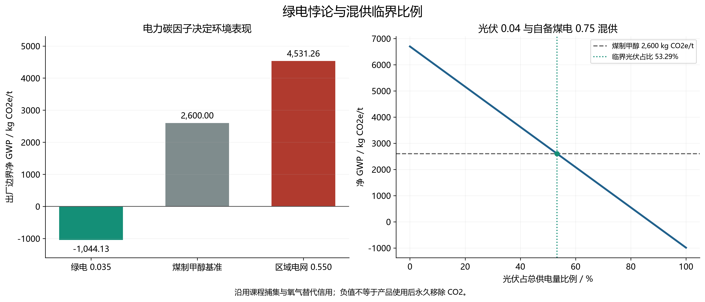
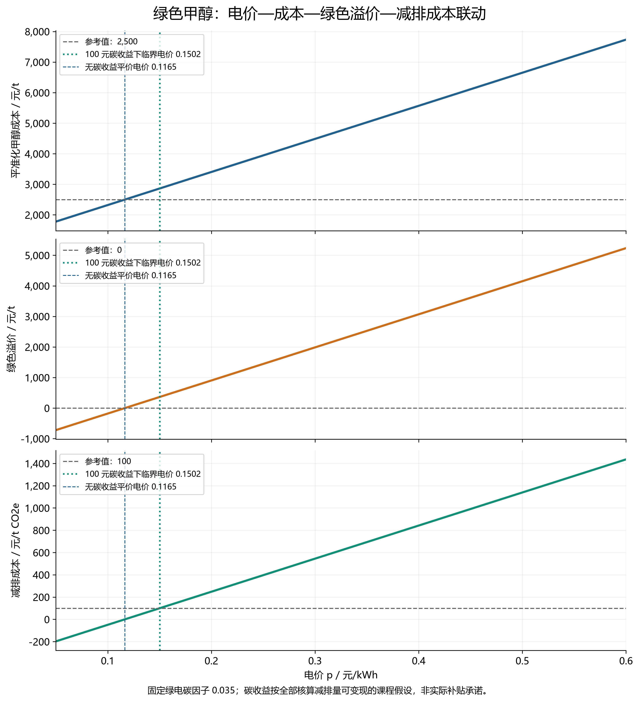
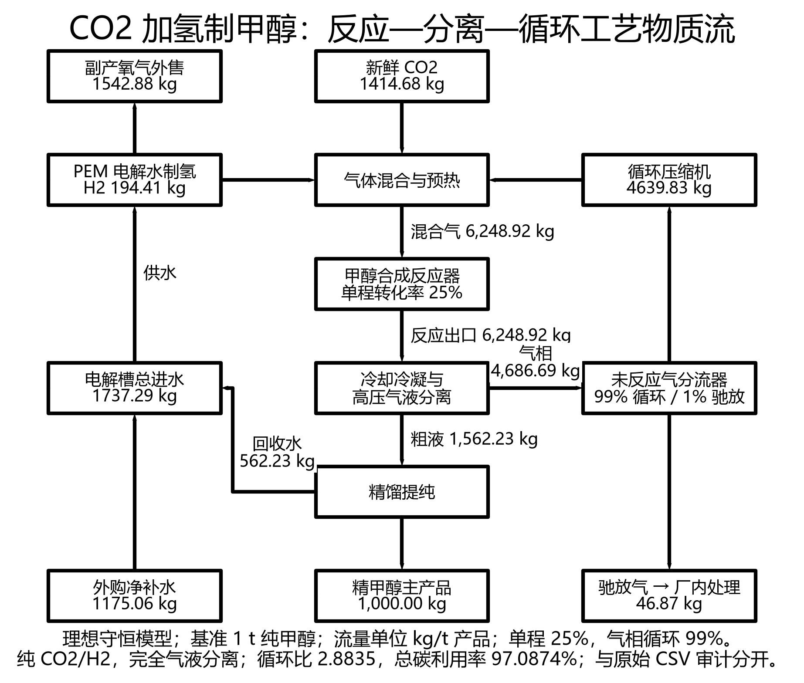

# 第九讲案例二：CO₂ 捕集与绿氢合成甲醇系统

明子骅 · 第 5 组 · 2026-10-22 · dev-group-05-mzh

## 1. 结论与核算范围

本作业完成反应焓补全、原始物料数据审计、反应—分离—循环代数求解及 C/H/O 元素守恒验证，并完成双电力情景的 LCA、电价敏感度、成本与减排成本（MAC）曲线、临界电价和园区规划讨论。

功能单位为 1 t 甲醇。计算分为两个明确口径：

- **MFA 模型**：由于课程 CSV 的组成和循环参数不能同时守恒，先保留原始文件并报告差异，再建立纯组分、理想分离的守恒模型。该模型用于解释反应与循环，不是对原数据的无条件验证。
- **LCA/TEA 教学情景**：沿用课程给定的工程消耗 10,826 kWh/t、CO₂ 捕集信用 1,423 kg/t、氧气 1,584 kg/t 和非电成本 1,238.37 元/t，便于对照考核。未将理想 MFA 新流量悄然替换进工程清单；两部分不是同一套已标定的流程模拟结果。

| 核心结果 | 本作业计算值 |
|---|---:|
| CO 加氢合成甲醇反应焓 | −90.7 kJ/mol |
| 理想模型循环气 / 新鲜合成气质量比 | 2.88350 |
| 理想模型总碳利用率 | 97.08738% |
| 最大元素相对误差 | 约 2.95×10⁻¹⁴%，小于 0.01% |
| 课程绿电情景净 GWP | −1,044.13 kg CO₂e/t |
| 课程区域电网情景净 GWP | +4,531.26 kg CO₂e/t |
| 电价 0.15 / 0.35 元/kWh 时 LCOM | 2,862.27 / 5,027.47 元/t |
| 对应 MAC | 99.41 / 693.57 元/t CO₂e |
| 碳收益按 100 元/t CO₂e 计的临界电价 | 0.150198 元/kWh |
| 光伏与自备煤电混供的临界光伏电量占比 | 约 53.30% |

## 2. 反应焓补全：盖斯定律

课程给定相同物态口径下：

1. CO₂ + 3H₂ → CH₃OH + H₂O，ΔH₁ = −49.5 kJ/mol。
2. CO₂ + H₂ → CO + H₂O，ΔH₂ = +41.2 kJ/mol。

将反应 2 反向，与反应 1 相加，消去 CO₂、H₂O 和一份 H₂：

**CO + 2H₂ → CH₃OH，ΔH₃ = ΔH₁ − ΔH₂ = −49.5 − 41.2 = −90.7 kJ/mol。**

负号表示每生成 1 mol 甲醇放热 90.7 kJ。该值继承前两个反应的物态与标准态；不能在不加汽化/冷凝焓修正时混用气态和液态甲醇。第 5 组讲义副本中的 `??` 已据此改正，教师原文件未修改。

## 3. 原始数据审计：总质量相等不等于元素守恒

数据来自 `../case_files/data_cohort/mfa_reaction_recycle_balance.csv`。审计结果保存于 `raw_data_audit.csv` 和 `raw_known_species_elements.csv`。

### 3.1 可通过的总质量关系

- 混合器：1,423 + 198 + 4,640 = 6,261 kg。
- 气液分离器：6,261 = 4,686 + 1,575 kg。
- 分流器：4,686 = 4,640 + 46 kg。
- 合成系统：1,423 + 198 = 1,000 + 575 + 46 = 1,621 kg。

### 3.2 无法同时满足的条件

| 检查项 | 原始数值及结果 | 解释 |
|---|---|---|
| 循环比 | 4,640 / (1,423 + 198) = 2.86243 | 按题目定义并非 3.8；若只除以 CO₂ 又是 3.26072，仍不等于 3.8 |
| 气体分流 | 4,640 / 4,686 = 99.01835%；46 / 4,686 = 0.98165% | 与 99/1 大体一致，差异可由流量取整解释；不能写成 96/4 的气体分流 |
| 电解槽 | 进水 1,960，H₂ + O₂ 输出仅 198 + 1,584 = 1,782 kg | 缺失 178 kg 水或其他出流；全厂外部质量账也缺 178 kg |
| 组成合计 | S09 粗液组成合计 100.31% | 原始组成不能直接作为严格质量分数 |
| 单程与总转化 | 25% 单程、99% 循环的理想反应模型给出 97.08738% | 无额外损失机制时不能同时规定总体严格为 96% |
| 纯物流近似碳利用率 | (1,000/32.042)/(1,423/44.009) ≈ 96.53% | 原始质量数值本身不能精确给出 96%；考虑 CSV 纯度后为约 96.62% |

使用 CSV 所列 CO₂、H₂、甲醇、水和 O₂ 的组成计算合成系统元素账，得到：

| 元素 | 输入 / kg | 输出 / kg | 输入减输出 / kg | 相对误差 |
|---|---:|---:|---:|---:|
| C | 387.590486 | 384.085169 | +3.505317 | 0.90439% |
| H | 198.141659 | 200.226316 | −2.084657 | 1.05210% |
| O | 1,033.844855 | 1,035.630515 | −1.785660 | 0.17272% |

这些结果均超过 0.01%。CSV 的 `other_inerts` 未给出化学组成，因此上表严格说是**已列明组分的元素账**，不能声称覆盖未知杂质中的全部 C/H/O。表内也没有独立的 CO 组成列，无法唯一反演三个反应的反应进度。原始数据应视为教学近似，不能伪造“严格守恒通过”。

## 4. 自洽反应—循环模型与求解

### 4.1 假设

稳态、纯 CO₂ 和 H₂ 进料，H₂:CO₂ 摩尔比 3:1；净反应为 CO₂ + 3H₂ → CH₃OH + H₂O。冷凝与精馏完全分离甲醇、水，未反应气仅含 CO₂、H₂，分流后 99% 循环、1% 驰放，单程 CO₂ 转化率 25%。不引入无法由数据确定的 RWGS 选择性、惰气浓度或动力学参数。

两个 CO 路径相加等价于主反应，但缺少选择性数据时，不能独立辨识其各自反应进度。这里采用净主反应模型，CO 不净积累；这是一套用于守恒演示的理想模型，不能用于预测催化剂选择性或真实惰气富集。

统一使用原子量 C = 12.011、H = 1.008、O = 15.999，分子量由原子量求和生成，避免手工取整造成伪误差。由此 M(CO₂)=44.009、M(H₂)=2.016、M(CH₃OH)=32.042、M(H₂O)=18.015 kg/kmol。

### 4.2 方程与解析关系

令 A 为反应器入口 CO₂、F 为新鲜 CO₂、R 为循环 CO₂、P 为驰放 CO₂、ξ 为净反应进度，均以 kmol/t 产品计。令 X=0.25、r=0.99：

```text
A − F − R = 0
R − r(1−X)A = 0
P − (1−r)(1−X)A = 0
ξ − XA = 0
ξ = 1000 / M(CH3OH)
```

脚本利用带部分主元选择的高斯消元解此联立线性方程组。题目允许使用联立代数方程，无需为线性问题人为添加非线性。H₂ 流量由 3:1 摩尔比得到，甲醇与生成水均为 ξ，随后联立电解水反应 H₂O → H₂ + 0.5O₂，构造全厂水和氧气账。

总体碳利用率：

```text
η = ξ/F = X / [1 − r(1−X)]
  = 0.25 / (1 − 0.99×0.75) = 97.08738%

循环比 R/F = r(1−X) / [1 − r(1−X)] = 2.88350
```

因新鲜气与循环气组成相同，此摩尔循环比也等于两股总气体质量比。循环比例 99% 是分流器气体回流比例，不是全系统碳利用率；循环比 2.8835 也不同于反应器入口/新鲜气比 3.8835。

若坚持总体利用率恰为 96%，在 X=25% 不变时，需调整 r=[1−X/0.96]/(1−X)=**98.61111%**，对应驰放 1.38889%。若保留 r=99%，则必须另行给出副反应、产品损失或其他碳损耗机制，不能同时强制所有近似参数。

### 4.3 自洽模型主要物流

| 流股 | kg/t 甲醇 |
|---|---:|
| 新鲜 CO₂ | 1,414.682916 |
| 新鲜 H₂（厂内电解制备） | 194.414831 |
| 新鲜合成气合计 | 1,609.097747 |
| 循环气 | 4,639.825541 |
| 反应器混合进料及总出口 | 6,248.923288 |
| 分离器未反应气 | 4,686.692466 |
| 驰放气 | 46.866925 |
| 粗甲醇与水液相 | 1,562.230822 |
| 纯甲醇 | 1,000.000000 |
| 回收生成水 | 562.230822 |
| 电解槽总用水 | 1,737.293240 |
| 外购净补水 | 1,175.062418 |
| 电解副产 O₂ | 1,542.878410 |

电解槽总进水 = 外购净补水 + 回收生成水。核算全厂外部输入时只计 CO₂ 与净补水，不能把厂内 H₂、循环气、回收水重复计入。

### 4.4 C/H/O 守恒结果

| 边界 | 元素 | 输入 / kg | 输出 / kg |
|---|---|---:|---:|
| 合成系统 | C | 386.097310 | 386.097310 |
| 合成系统 | H | 194.414831 | 194.414831 |
| 合成系统 | O | 1,028.585606 | 1,028.585606 |
| 全厂外部边界 | C | 386.097310 | 386.097310 |
| 全厂外部边界 | H | 131.497410 | 131.497410 |
| 全厂外部边界 | O | 2,072.150615 | 2,072.150615 |

混合器、反应器、分离器、分流器、精馏、电解槽、合成系统及全厂外部边界共 24 项元素检查全部通过。最大相对误差约 2.95×10⁻¹⁴%，方程最大残差在本次运行中为 0 kmol；脚本要求误差小于 0.01%。完整结果见 `balanced_element_checks.csv`，流股组成见 `balanced_streams.csv`。

## 5. LCA：绿电悖论与核算边界

### 5.1 重建课程清单

工程总电耗 E = 10,296 + 255 + 155 + 120 = **10,826 kWh/t**，其中 PEM 占 95.1044%。按课程规则：

```text
GWP(EF) = 10826×EF + 15 + 80 − 1423 − 1584×0.06
        = 10826×EF − 1423.04       [kg CO2e/t]
```

原始 LCI 两项信用均同时采用负流量与负因子，若直接相乘会错误地变成正排放。脚本对“避免负荷”条目使用一次负号 `−abs(流量×因子)`，在代码中明确注明，其他项正常相乘；合计行和基准行不重复求和。

| 清单项 | 绿电 0.035 / kg CO₂e | 网电 0.550 / kg CO₂e |
|---|---:|---:|
| PEM 电解 | 360.36 | 5,662.80 |
| CO₂ 捕集与压缩 | 8.925 | 140.25 |
| 循环压缩 | 5.425 | 85.25 |
| 精馏及冷却 | 4.20 | 66.00 |
| 直接逸散等 | 15.00 | 15.00 |
| 基础设施与催化剂 | 80.00 | 80.00 |
| CO₂ 捕集信用 | −1,423.00 | −1,423.00 |
| O₂ 替代信用 | −95.04 | −95.04 |
| **净合计** | **−1,044.13** | **+4,531.26** |

逐项未取整合计得到 −1,044.13，课程 CSV 的绿电合计为 −1,044.12，相差 0.01 kg，来自中间值取整口径。本报告使用未取整结果计算后续 MAC。

相对煤制甲醇 2,600 kg CO₂e/t：绿电减排率为 **140.1588%**，网电增排率为 **74.2792%**。绿电每吨甲醇的课程核算减排量为 3.64413 t CO₂e。制氢依赖大量电力，若电力背景高碳，间接排放可超过煤制甲醇，说明“电解制氢”本身不自动等于低碳。

达到煤制甲醇排放水平的电力因子上限为 (2,600+1,423.04)/10,826 = **0.371609 kg CO₂e/kWh**；课程核算 GWP 恰为零对应 **0.131447 kg CO₂e/kWh**。低于前者才优于基准，低于后者才在该出厂信用口径下为负值。

### 5.2 对负排放的解释

本报告复现课程对捕集 CO₂ 的负信用约定，但化石点源 CO₂ 转为甲醇不等于永久移除大气 CO₂。若甲醇后续作燃料燃烧，碳会重新释放，必须扩展至使用和终端处置边界后重算；还需避免捕集源与甲醇产品重复计取减排信用。原料捕集信用 1,423 kg 也大于实际进入甲醇的碳当量，驰放碳的后续排放需有完整清单才能进一步校准。故不将本作业的负 GWP 宣称为全生命周期永久碳封存。



## 6. TEA：电价、成本、溢价与 MAC

### 6.1 平准化成本

采用工程规模 100,000 t/年、CAPEX 8.20 亿元、20 年运营期、折现率 8%。资本回收系数 CRF = i(1+i)^n/[(1+i)^n−1] ≈ 0.101852，资本年金摊销约 835.19 元/t。课程将资本摊销、CO₂ 采购/捕集、纯水催化剂、固定运维和氧气销售抵扣合计为 **1,238.37 元/t**；各展示分项相加的数分差异来自取整。

```text
LCOM(p) = 10826p + 1238.37
GreenPremium(p) = LCOM(p) − 2500
MAC(p) = [LCOM(p) − 2500] / 3.64413   [元/t CO2e]
```

这里分母为固定绿电环境情景下的核算减排量，考察的是电价单独变化；电价不决定电力碳因子，不能把 0.55 元/kWh 自动解释为网电，也不能将仍采用绿电分母的 MAC 称为高碳网电的减排成本。当改为网电且净增排时，应先判断不存在正的减排量，不能继续套用“有效减排项目”解释。

| 电价 / 元·kWh⁻¹ | LCOM / 元·t⁻¹ | 绿色溢价 / 元·t⁻¹ | MAC / 元·(t CO₂e)⁻¹ |
|---|---:|---:|---:|
| 0.05 | 1,779.67 | −720.33 | −197.67 |
| 0.10 | 2,320.97 | −179.03 | −49.13 |
| 0.15 | 2,862.27 | +362.27 | 99.41 |
| 0.20 | 3,403.57 | +903.57 | 247.95 |
| 0.35 | 5,027.47 | +2,527.47 | 693.57 |
| 0.60 | 7,733.97 | +5,233.97 | 1,436.27 |

每增加 0.01 元/kWh，LCOM 增加 **108.26 元/t**，MAC 增加约 **29.71 元/t CO₂e**。电价从 0.35 降至 0.15 时，成本下降 2,165.20 元/t。全部电费占 LCOM 的比例在 0.35 元时约 75.37%，在 0.15 元时约 56.74%，因此“电费占比超过 65%”并不适用于全部价格情景。完整 0.05–0.60、步长 0.005 的 111 个点见 `sensitivity_results.csv`，另有 12 个原表点的重建对照。



### 6.2 最高临界电价

把题目给定的“约 100 元/t CO₂e”视为**教学碳价情景**，不当作实时市场报价。进一步假设全部核算减排量都能按此价格转化为项目收入，且暂不计核证、交易等费用：

```text
收入上限 = 2500 + 100×3.64413 = 2864.413 元/t 甲醇
10826p + 1238.37 ≤ 2864.413
p ≤ 0.150197949 元/kWh
```

因此临界值约 **0.1502 元/kWh**。在 p=0.15 时，每吨余额约 2.143 元，缓冲很小，实际新增成本或减排信用不可兑现都可能使其转亏。不计任何碳收益时，临界电价为 (2,500−1,238.37)/10,826 = **0.116537 元/kWh**。

碳市场存在并不意味着产品核算减排量可以自动出售。具体收益取决于合规机制、方法学、额外性、权属和核证成本；本报告给出条件阈值，不据此认定项目必然享有补贴或碳交易收入。

## 7. 园区规划与随堂讨论

### 7.1 为什么屋顶光伏不能独立支撑连续工厂？

按题设将年有效满发 1,200 小时与设计运行 8,000 小时比较，等效产量利用率只有 15%。若不增加储能、储氢或其他电源、年产量随之降至 15,000 t，则固定资本年金按吨摊销从约 835.19 升至 5,567.92 元/t，为原先 **6.67 倍**，人工、检修等固定年支出也会被更少产量分摊。

这一比例是题设下的简化年能量情景：光伏年等效利用小时并不代表每天固定输出，也不能替代逐时调度模型。真实系统需解决昼夜和天气波动、反应器温压稳定、PEM 频繁负荷变化、电解槽与合成段的解耦、压缩储氢及安全容量等问题。不能仅因低光伏度电价就忽略储能储氢投资及利用率下降。

设计年电量为 10,826×100,000 = **10.826 亿 kWh**；若全由年 1,200 小时光伏提供，单看年能量就需要约 **902.17 MW** 光伏，仍未解决时间匹配。130 MW PEM 运行 8,000 小时的 10.40 亿 kWh 与制氢分项 10.296 亿 kWh 接近，但不包含全厂所有辅助用电。

### 7.2 光伏混供至少需要多少？

令 x 为光伏占项目实际总用电量的比例，光伏因子 0.04，自备煤电因子 0.75 kg CO₂e/kWh：

```text
EF(x) = 0.04x + 0.75(1−x) = 0.75−0.71x
GWP(x) = 10826(0.75−0.71x) − 1423.04
要求 GWP(x) ≤ 2600
x ≥ [0.75 − (2600+1423.04)/10826] / 0.71
  = 0.532944945
```

完整清单口径为 **53.29449%**。按讲义简化常数 −1,423 计算为 **53.29501%**，均约 **53.30%**；严格低于煤制甲醇排放应超过临界占比。

此 x 是电量占比，不是光伏装机占比。临界情况下，按年能量粗估所需光伏约 480.80 MW；仍应按逐时可用电量、弃电、储能及电力属性核算，不能只看铭牌装机。

在这一混供组合下，平均电价为 p(x)=0.20x+0.32(1−x)=0.32−0.12x。即使达到临界光伏比例，p≈0.25605 元/kWh，LCOM 仍约 4,010.33 元/t；此时减排量接近零，碳收益不能弥补成本。即使 x=100%，p=0.20 元/kWh 时成本仍高于 2,500 元基准。达到环境门槛不等于达到经济门槛，需要分别判断。

### 7.3 规划建议

优先比较能够稳定取得低碳电力、合理利用小时、CO₂ 来源和水资源条件的候选园区。低电价应与输配电、储能储氢、压缩运输、设备负荷及融资成本一同进入方案，而不是直接把最低弃电报价当作全天稳定采购价。

对高碳自备电占比较大的园区，应先核算电力属性与减排门槛，避免以制氢工艺名称替代实际环境绩效。对高成本低碳电方案，可评估有约束力的下游绿色产品长协及合理溢价，但不预设任何出口认证或市场都会自动带来高溢价。碳收益仅在权属、方法学和交易资格落实后进入投资现金流。

## 8. 流程图

下图来自自洽 MFA 模型，完整展示电解、混合、反应、冷凝分离、精馏、99% 循环压缩、1% 驰放、氧气外售与水回用。所有数值为模型输出，箭头宽度不表示流量比例。图中的纯甲醇为理想求解基准，课程高纯商品近似另见原始数据审计。



## 9. 文件与复现

在 `code_implementation` 目录执行：

```powershell
python -m pip install -r requirements.txt
python calculate_case2.py
python plot_case2.py
```

第一步计算仅需标准库；绘图使用 Matplotlib 与 schemdraw，不需要 Graphviz 系统程序。

| 文件 | 内容 |
|---|---|
| `calculate_case2.py` | 读取三个 CSV、原始审计、联立代数求解、24 项元素检查、LCA/TEA 与临界值 |
| `plot_case2.py` | 从计算结果生成三组 300 dpi PNG 和 SVG |
| `calculation_results.json` | 所有主要指标与审计信息 |
| `raw_data_audit.csv` | 原始质量、循环参数及组成合计检查 |
| `raw_known_species_elements.csv` | 原始已列组分的元素不平衡 |
| `balanced_streams.csv` | 自洽模型各流股质量及组分摩尔数 |
| `balanced_element_checks.csv` | 各单元与全厂的 C/H/O 输入输出与误差 |
| `lca_contributions.csv` | 两电力情景逐项清单 |
| `sensitivity_results.csv` | 111 个电价点的 LCOM、溢价与 MAC |
| `tea_source_reproduction.csv` | 原表 12 个电价点的成本与 MAC 复算对照 |

结果表中保存未取整数，报告表格适度四舍五入。教师原始 CSV 未修改，所有模型修正均输出为新文件。

## 10. 交付自查

- [x] 组内讲义反应焓 `??` 已补为 −90.7 kJ/mol，并给出推导。
- [x] 编写质量守恒联立方程，求解循环比与总体碳利用率。
- [x] 原始不一致项显式报告，没有强迫 96% 或 3.8 与其他约束同时成立。
- [x] 自洽模型 C/H/O 元素守恒误差均小于 0.01%，程序打印并输出检查表。
- [x] 双电力情景、0.05–0.60 元/kWh 敏感度曲线和临界电价。
- [x] 连续运行讨论、光伏最低占比及环境经济联合规划分析。
- [x] 含循环回路及水回用的流程图源码和 300 dpi PNG、SVG。
- [x] 成果位于第 5 组案例二任务目录，无学号信息。
- [ ] Git 提交、推送与 PR：本次暂不执行。
