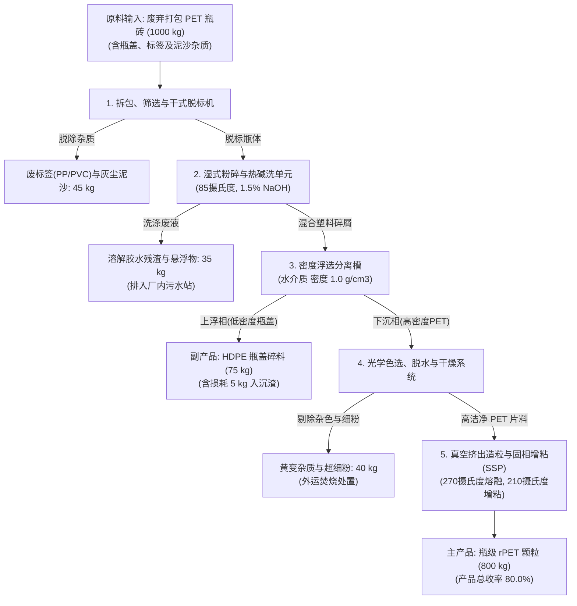
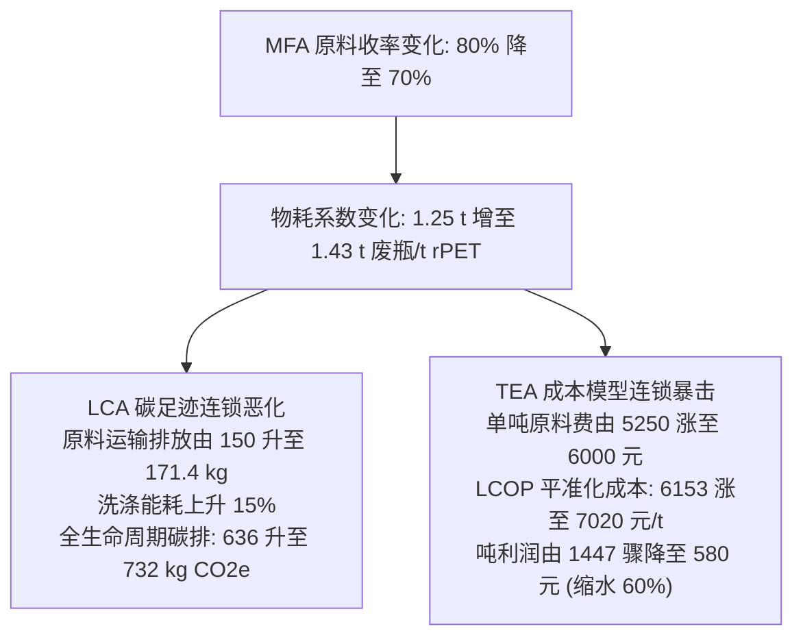

# 案例一讲义：废弃 PET 塑料瓶机械物理再生系统（MFA-LCA-TEA 联合训练）

> **【课程导览与核心指标速查】**
> * **系统定位**：城市与工业固废机械物理循环再生体系（单向线性流动，无复杂化学反应回路）。
> * **功能单位**：生产 $1\text{ t}$（$1000\text{ kg}$）瓶级 rPET 再生颗粒（Cradle-to-Gate 门到门）。
> * **MFA 关键指标**：综合产品收率 $Y = 80.0\%$（即每生产 $1\text{ t}$ rPET 颗粒消耗 $1.25\text{ t}$ 废瓶砖）。
> * **LCA 关键指标**：净碳足迹 $636.0\text{ kg CO}_2\text{e/t}$（较原生 PET 基准的 $2,250\text{ kg}$ 减排达 $71.7\%$）。
> * **TEA 关键指标**：平准化生产成本 $\text{LCOP} = 6,153.4\text{ 元/t}$，年毛利润约 $2,315\text{ 万元}$，投资回收期 $2.6\text{ 年}$。
> * **教学重点**：掌握单向线性物质流核算、将产率折算为 LCA 基准流、将公用工程物耗转化为 TEA 变动成本并推导参数联动敏感度。

---

## 一、 工程背景与工艺流程简述

聚对苯二甲酸乙二醇酯（PET）是全球消费量最大的塑料包装材料之一。传统废弃塑料处理以焚烧发电或填埋为主，不仅造成严重的资源浪费，还会释放大量化石源温室气体。随着我国“双碳”战略推进与全球消费品巨头 ESG 承诺的落实，**机械物理法回收制备食品级/纤维级再生 PET 颗粒（Bottle-grade rPET Pellets）**成为塑料循环经济的核心路径。

### 工艺流程拓扑与控制边界


---

## 二、 模块一：MFA 物质平衡推演（系统控制体）

### 1. 原料初始成分假定（基于行业混杂瓶砖调研）
以单批次处理 **$1,000\text{ kg}$ 废 PET 瓶砖** 作为计算基准控制体：
* **清澈无色 PET 瓶体**：$840.0\text{ kg} \ (84.0\%)$
* **HDPE 瓶盖**：$80.0\text{ kg} \ (8.0\%)$
* **PP/PVC 热缩标签膜**：$20.0\text{ kg} \ (2.0\%)$
* **泥沙污垢、外表面尘土**：$25.0\text{ kg} \ (2.5\%)$
* **胶粘剂（EVA/热熔胶）及饮料残渣糖分**：$35.0\text{ kg} \ (3.5\%)$

### 2. 过程转移系数（Transfer Coefficients, $k_i$）与流向分解
1. **脱标工段**：标签分离效率 $k_{\text{label}} = 100\%$（脱除 $20\text{ kg}$ 标签），干式滚筒除尘剔除表面泥沙 $25\text{ kg}$。
2. **热碱洗与漂洗工段**：强碱洗涤使胶粘剂及残留饮料残渣彻底乳化溶解，向废水转移系数 $k_{\text{wash}} = 100\%$（排放 $35\text{ kg}$ COD 杂质）。
3. **密度分选工段**：
   * 瓶盖聚烯烃（HDPE，密度 $\sim 0.95\text{ g/cm}^3$）浮于水面，回收率 $93.75\%$（回收 $75\text{ kg}$），夹带损失 $6.25\%$（$5\text{ kg}$ 随沉渣排出）；
   * PET 瓶片（密度 $\sim 1.38\text{ g/cm}^3$）下沉于槽底，回收率 $100\%$（进入后序光学色选）。
4. **光学色选与干燥工段**：剔除微量老化黄变瓶片及破损细粉，损失率 $k_{\text{optical}} = 4.76\%$（剔除 $40\text{ kg}$）。
5. **熔融挤出与 SSP 固相聚合**：真空脱挥发份后造粒，洁净 PET 切片收率 $100\%$（获得瓶级增粘切片 $800.0\text{ kg}$，特性粘度 IV 提升至 $0.80\text{ dL/g}$）。

### 3. MFA 物质平衡核算表
$$\sum \text{Mass}_{\text{Input}} = \sum \text{Mass}_{\text{Output}} = 1000.0\text{ kg}$$

| 类别 | 物质/组分名称 | 质量 (kg) | 质量分数 (%) | 去向/处理方式 |
| :--- | :--- | :---: | :---: | :--- |
| **输入** | **废旧 PET 瓶砖（原料）** | **1000.0** | **100.0%** | **系统总进料** |
| 输出 | 废标签膜 (PP/PVC) | 20.0 | 2.0% | 外运生活垃圾焚烧发电厂 |
| 输出 | 泥沙与干灰渣 | 25.0 | 2.5% | 填埋/建材骨料利用 |
| 输出 | 洗涤胶水与溶解性 COD 杂质 | 35.0 | 3.5% | 厂区生化污水处理站 |
| 输出 | HDPE 碎屑夹带损失 | 5.0 | 0.5% | 沉渣脱水后外运焚烧 |
| 输出 | 杂色黄变切片与超细粉 | 40.0 | 4.0% | 降级造粒或焚烧处置 |
| 输出 | **副产品：回收 HDPE 颗粒** | **75.0** | **7.5%** | **外售作塑料托盘/管道原料** |
| 输出 | **主产品：瓶级 rPET 颗粒** | **800.0** | **80.0%** | **目标产品（达到食品接触级）** |

* **关键指标推导**：
  * **主产品总收率**：$Y = \frac{800}{1000} = \mathbf{80.0\%}$
  * **吨产品物耗系数**：生产 $1\text{ t}$ rPET 颗粒需消耗废瓶砖 $\frac{1}{0.80} = \mathbf{1.25\text{ t 瓶砖}}$。

---

## 三、 模块二：LCA 生命周期碳足迹评价（门到门 / Cradle-to-Gate）

### 1. 目标与范围界定
* **功能单位**：生产 $1\text{ t}$（$1000\text{ kg}$）瓶级再生 PET 颗粒。
* **系统边界**：收集打包瓶砖运输至工厂 $\to$ 预处理清洗 $\to$ 熔融挤出增粘造粒 $\to$ 出厂包装（Cradle-to-Gate）；副产品 HDPE 采用“避免负荷法（Avoided Burden）”给予环境信用。
* **基准对比品**：中国石化行业原生 PET（Virgin PET）颗粒（全生命周期碳足迹基准值：**$2,250.0\text{ kg CO}_2\text{e/t}$**）。

### 2. 生命周期清单（LCI）与特征化核算表（IPCC 2021 GWP100）

| 过程分项 | 活动水平（单吨 rPET 消耗量）| 背景排放因子 | 来源说明 | 碳足迹贡献 ($\text{kg CO}_2\text{e}$) | 贡献占比 |
| :--- | :--- | :--- | :--- | :---: | :---: |
| 原料瓶砖运输 | $1.25\text{ t} \times 100\text{ km} = 125\text{ t}\cdot\text{km}$ | $0.12\text{ kg CO}_2\text{e/(t}\cdot\text{km)}$ | 重型柴油货车运输 | $150.0$ | $23.6\%$ |
| 生产电力消耗 | $850.0\text{ kWh}$ | $0.55\text{ kg CO}_2\text{e/kWh}$ | 华中区域电网基准 | $467.5$ | $73.5\%$ |
| 热洗蒸汽能耗 | $2.0\text{ GJ}$（中压饱和蒸汽） | $65.0\text{ kg CO}_2\text{e/GJ}$ | 工业燃气锅炉供汽 | $130.0$ | $20.4\%$ |
| 氢氧化钠药剂 | $15.0\text{ kg}$（片碱折百） | $2.10\text{ kg CO}_2\text{e/kg}$ | 离子膜烧碱生产 | $31.5$ | $5.0\%$ |
| 新鲜水消耗 | $2.5\text{ m}^3$ | $0.38\text{ kg CO}_2\text{e/m}^3$ | 自来水制备供应 | $0.95$ | $0.1\%$ |
| 污水处理负荷 | $2.2\text{ m}^3$（生化好氧曝气） | $2.75\text{ kg CO}_2\text{e/m}^3$ | 工业污水站处理 | $6.05$ | $1.0\%$ |
| 副产 HDPE 替代信用 | $-93.75\text{ kg}$（避免原生料生产）| $1.60\text{ kg CO}_2\text{e/kg}$ | 原生高密度聚乙烯扣减 | **$-150.0$** | **$-23.6\%$** |
| **净生命周期碳足迹** | — | — | **总计** | **$636.0\text{ kg CO}_2\text{e/t}$** | **$100.0\%$** |

* **环境减排效益评估**：
  $$\text{相对减排率} = \frac{2,250.0 - 636.0}{2,250.0} \times 100\% = \mathbf{71.7\%}$$
  *每生产 1 吨再生 PET 颗粒，可净减排二氧化碳当量 **$1,614.0\text{ kg CO}_2\text{e}$**！*

---

## 四、 模块三：TEA 技术经济分析（现金流与成本模型）

### 1. 工程项目基础参数假设
* **建设规模**：年处理 $20,000\text{ t}$ 废瓶砖，年产 $16,000\text{ t}$ 食品级 rPET 颗粒；
* **生产工时**：年运行 $330\text{ 天}$（$7,920\text{ 小时}$）；
* **经济计算期**：建设期 1 年，运营期 10 年；基准收益率（WACC）：$10.0\%$。

### 2. CAPEX（固定资产投资，总计 2800 万元）
* 厂房建设与基础土建：$750\text{ 万元}$；
* 拆包、粉碎、多级热碱洗与比重浮选分离生产线：$850\text{ 万元}$；
* 光学校色与双通道材质分选机：$320\text{ 万元}$；
* 双螺杆真空排气挤出造粒机组与固相增粘（SSP）反应罐：$680\text{ 万元}$；
* 废水预处理沉淀曝气系统及变配电工程：$200\text{ 万元}$；
* **年折旧额**：$(2,800 \times 95\%) / 10 = 266.0\text{ 万元/年}$，折合吨产品折旧费 $166.3\text{ 元/t rPET}$。

### 3. OPEX 与平准化生产成本（LCOP）核算表
$$\text{LCOP} = \frac{\sum \text{Annualized CAPEX} + \text{Annual OPEX} - \text{Byproduct Revenue}}{\text{Annual Output}}$$

| 成本构成分项 | 吨产品消耗指标 | 单价及费率 | 单吨成本 (元/t rPET) | 占总支出比例 |
| :--- | :--- | :--- | :---: | :---: |
| **原料废瓶砖费用** | $1.25\text{ t 瓶砖}$ | $4,200\text{ 元/t}$ | $5,250.0$ | $79.8\%$ |
| 电力动力费用 | $850\text{ kWh}$ | $0.65\text{ 元/kWh}$ | $552.5$ | $8.4\%$ |
| 天然气蒸汽热力 | $2.0\text{ GJ}$ | $85.0\text{ 元/GJ}$ | $170.0$ | $2.6\%$ |
| 新鲜水与烧碱药剂 | $2.5\text{ t 水} + 15\text{ kg 碱}$ | 综合定额 | $115.0$ | $1.7\%$ |
| 焚烧杂质固废处置费 | $0.081\text{ t 固废}$ | $250.0\text{ 元/t}$ | $20.3$ | $0.3\%$ |
| 人工编制成本 | 35 人编制（人均 10 万/年）| 350 万/年 | $218.8$ | $3.3\%$ |
| 设备维护保修费 | 按 CAPEX 的 $3.0\%$ 计提 | 84 万/年 | $52.5$ | $0.8\%$ |
| 管理、保险及折旧化成本| 直线折旧 + 摊销 | 综合计提 | $196.4$ | $3.0\%$ |
| **副产物外售收入抵扣** | $0.0938\text{ t HDPE}$ | $4,500\text{ 元/t}$ | **$-422.1$** | **$-6.4\%$** |
| **平准化生产成本 (LCOP)** | — | — | **$6,153.4\text{ 元/t}$** | **$100.0\%$** |

### 4. 经济可行性评价指标
* **产品市场价格**：食品级 rPET 颗粒市场售价约为 $7,600\text{ 元/t}$（原生 PET 切片售价约 $6,800\text{ 元/t}$）；
* **吨产品税前毛利**：$7,600.0 - 6,153.4 = 1,446.6\text{ 元/t}$；
* **企业年毛利润**：$1,446.6\text{ 元/t} \times 16,000\text{ t} \approx 2,314.5\text{ 万元/年}$；
* **静态投资回收期**：$\frac{2,800\text{ 万元}}{2,314.5 \times (1-25\%) + 266} \approx 1.4\text{ 年}$（动态贴现回收期约 $2.6\text{ 年}$），具有极强的商业落地吸引力。

---

## 五、 模块四：三工具跨维协同联动机制（链式推演）



* **教学提炼**：
  在环境规划中，前端固废源头分类纯度（MFA 的输入质量），同时决定了末端环境足迹（LCA）与回收企业的生存能力（TEA）。不建立在物质平衡基础上的绿色规划只能是纸上谈兵。

---

## 六、 实践任务与 GitHub PR 提交指南（Task & Pull Request Submission）

> **【课程大仓协同说明】**  
> 本案例对应的随堂实操与课后作业需提交至课程官方实践大仓：  
> 🔗 [whu-course-cohort/LCA_Practice_Coursework-2026fall](https://github.com/whu-course-EnvironPlanManag/LCA_Practice_Coursework-2026fall)  
> 每位同学需基于本组工作空间以独立分支形式完成提交，并遵照 PR 规范发起合并请求（Pull Request）。  
> 📖 **Git 协作避坑与排错救急**：遇到网络克隆、分支隔离、拉取 main 防覆盖或 PR 撤销等问题，详见大仓公共手册：[starter_materials/troubleshooting.md](../../troubleshooting.md)

---

### 1. 核心作业任务内容

#### 任务 1：MFA-LCA-TEA 跨维联动与绿电溢价核算（手算或脚本验证）
假定某国际大型饮料品牌要求工厂供应“100% 绿色风光电力生产”的食品级 rPET 颗粒，工厂若将原电网购电全部转为分布式风光绿电直供：
* **边界参数变更**：绿电购电单价在原工业电价基础上增加绿色溢价 $0.05\text{ 元/kWh}$（即由 $0.65\text{ 元/kWh}$ 上升至 $0.70\text{ 元/kWh}$）；电网碳排放因子由华中区域电网的 $0.55\text{ kg CO}_2\text{e/kWh}$ 骤降为绿色电力的 $0.03\text{ kg CO}_2\text{e/kWh}$。
* **请完成以下推导与计算**：
  1. **LCA 净碳足迹再核算**：计算绿电驱动下吨产品全生命周期净碳足迹 $\text{GWP}_{\text{green}}$，并计算相较于石化原生 PET 基准（$2,250\text{ kg CO}_2\text{e/t}$）的减碳幅度（要求写出清单调整与计算过程）；
  2. **TEA 平准化成本变化**：计算吨产品平准化生产成本 $\text{LCOP}_{\text{green}}$ 的增加额与增幅比例，并为该工厂提出“绿色低碳溢价”定价与营销策略建议；
  3. **源头敏感度反思**：若城市垃圾分类不完善导致进入工厂的瓶砖杂质率上升（总产品收率由 $80\%$ 降至 $70\%$），请根据讲义模块五分析该波动对 LCA 碳足迹和 TEA 成本带来的连锁恶化效应。

#### 任务 2：调用 Python 第三方包自主绘制“工艺物质流程图”
依据讲义【一、工程背景与工艺流程简述】中展示的“PET 瓶回收物理再生工艺拓扑与物质流控制边界”，每位同学需编写 Python 绘图代码，生成规范的高清工艺物质流程图（支持输出 `.png` 或 `.svg`）：
* **推荐 Python 绘图第三方库（自主选型其一或对比实现）**：
  1. **`graphviz`（推荐用于工业方框工艺流程图 / Block Flow Diagram, BFD）**：
     * **库名**：`graphviz`（Python 绑定库）
     * **安装命令**：`pip install graphviz`（或 Conda: `conda install -c conda-forge python-graphviz`）
     * **核心功能**：基于 DOT 语言标准生成有向图，擅长绘制单元操作方框、主干物料流与分流废弃物/副产物分支，支持节点端口、形状与排版美化。
  2. **`plotly`（`plotly.graph_objects.Sankey`）（推荐用于物质流分析 MFA 桑基图）**：
     * **库名**：`plotly`、`kaleido`（用于导出静态高清图片）
     * **安装命令**：`pip install plotly kaleido`
     * **核心功能**：直接依据 `mfa_mass_balance.csv` 的质量通量数据绘制流线宽度与物料通量严格成正比的 MFA 桑基图，直观展现 1000 kg 瓶砖拆解为 800 kg rPET、75 kg HDPE 瓶盖与各工段杂质损失。
  3. **`schemdraw`（`schemdraw.flow`）（推荐用于轻量级工程流程图）**：
     * **库名**：`schemdraw`
     * **安装命令**：`pip install schemdraw`
     * **核心功能**：纯 Python 实现，零底层 C 语言依赖，基于 Matplotlib 渲染，支持工程方框、流程箭头、流向文本与条件分支，语法优雅。
  4. **`floweaver`（国际产业生态学专业 MFA 库）**：
     * **库名**：`floweaver`
     * **安装命令**：`conda install -c conda-forge floweaver` 或 `pip install floweaver`
     * **核心功能**：专门用于物质流分析（MFA）与工业代谢分析，可直接接收 Pandas DataFrame 多维流向数据集生成多工段桑基图。
* **交付产物**：将你的 Python 绘图脚本（如 `plot_mfa_process.py` 或 `.ipynb`）与生成的高清图表（如 `process_flow_diagram.png`）存入本组专属提交目录。

---

### 2. Git 分支创建与 PR 提交全流程

#### 第一步：拉取大仓最新代码并创建个人专属分支
进入本地大仓目录，严格遵循 **`dev-group-XX-name`** 命名规范（杜绝学号，保护个人隐私）：
```bash
# 进入课程大仓目录
cd LCA_Practice_Coursework-2026fall

# 切换并同步主分支最新状态
git checkout main
git pull origin main

# 以第 1 组同学唐思奇（示范）为例，创建并切换到个人专属分支 (格式: dev-group-XX-姓名拼音)
git checkout -b dev-tangsiqi-test

# 核心关键：立即将分支发布到 GitHub 远端并建立追踪绑定 (让 GitHub 网页端立即可见你的分支)
git push -u origin dev-tangsiqi-test
```

#### 第二步：在小组工作空间建立任务专属目录并放置作业成果
```bash
# 进入本组专属工作区 (以第 1 组为例)
cd groups/group-01/

# 创建本案例作业文件夹
mkdir -p case1_pet_recycling

# 将你的作业文件放置在此目录下：
# groups/group-01/case1_pet_recycling/
# ├── case1_solution_report.md       # 联动计算过程与决策思考报告 (或 .ipynb)
# ├── plot_mfa_process.py            # Python 绘制工艺流程图源码
# └── process_flow_diagram.png       # Python 脚本生成的流程图图片
```

#### 第三步：提交变更并推送到 GitHub 远端
```bash
# 铁律：只添加自己小组目录下的文件，切勿 git add . 整个大仓！
git add groups/group-01/case1_pet_recycling/

# 提交并附带语义化提交信息 (杜绝学号)
git commit -m "feat(group-01): 完成第九讲案例一 PET 再生 MFA-LCA-TEA 作业与流程图"

# 推送到 GitHub 远端个人分支 (由于第 1 步已绑定 -u，此处可直接极简 git push)
git push
```

#### 第四步：在 GitHub 发起 Pull Request (PR) 并应用模板
1. 访问 GitHub 仓库主页，点击 **"Compare & pull request"**；
2. **分支比对**：`base: main` $\leftarrow$ `compare: dev-tangsiqi-test`；
3. **PR 标题通用标准格式**：  
   `[日期 第几讲 PR]: student_name - task_name (group-XX)`  
   *示范：`[2026-10-22 第九讲 PR]: tangsiqi - case1-pet-recycling (group-01)`*  
   *(注：提交后后台助教机器人会自动从正文或分支解析信息并规范重命名标题，打上讲次与组别标签)*
4. **PR 正文（全自动预填）**：大仓已配置官方模版，发起 PR 时对话框会自动预填通用考核底稿；提交后助教机器人会在讨论区自动推送本讲 Case 1 专属指标对照单，请对照自查。

---

## 七、 参考文献与学术数据源对照
1. **Brunner, P. H., & Rechberger, H.** (2016). *Handbook of Material Flow Analysis: For Environmental, Resource, and Waste Engineers (2nd Edition)*. CRC Press.
2. **Plastics Europe**. (2022). *The Circular Economy for Plastics: A European Overview*. Plastics Europe Market Research.
3. **Ecoinvent Centre**. (2023). *Ecoinvent Life Cycle Inventory Database v3.9*. Process: `Polyethylene terephthalate production, granulate, recycled`.
4. **Shen, L., Worrell, E., & Patel, M. K.** (2010). Environmental impact assessment of man-made cellulose fibres and comparison with other fibres and plastic (PET). *Resources, Conservation and Recycling*, 55(2), 260-274.
