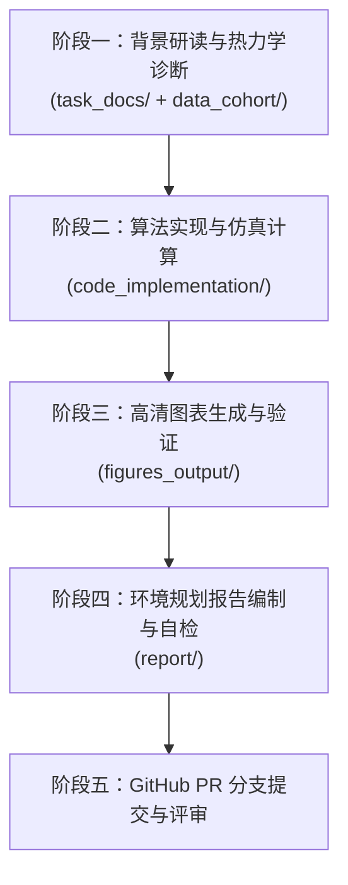

# 工业园区绿色甲醇系统环境规划与管理方案报告实训


> **《环境规划与管理》课程 · 第十讲随堂实训**
> **教学定位**：从微观过程系统建模向宏观园区环境规划方案报告编撰跃迁。指导学生基于工业园区 10 万吨/年二氧化碳捕集耦合绿氢合成绿色甲醇工程案例，完成“物料能量平衡计算—政策法规算法化量化—多目标帕累托前沿寻优—工艺拓扑图绘制—方案报告完整撰写”的系统化训练。


## 一、 随堂训练目标与学习闭环

本实训任务要求每位学生（或小组）在随堂 3 课时内，综合运用环境系统工程建模、生命周期评价（LCA）、技术经济分析（TEA）以及政策量化工具，完成以下学习闭环：

1. **热力学与反应物料平衡求解**：解耦反应器单程转化率（$25.0\%$）与系统总体碳转化率（$96.0\%$），实现从单吨功能单位向 10 万吨/年工业园区级工程通量的放大推导与 C/H/O 元素守恒校验；
2. **政策规制量化引擎构建（Vibe Coding）**：研读欧盟 RED III、中国碳市场（ETS/CCER）、工业取水定额累进水资源税及次生大气污染物排放标准，运用自然语言编写 Prompt 生成政策量化引擎，实现政策红线对平准化甲醇成本（LCOM）与边际减排成本（MAC）的联动修正；
3. **帕累托多目标决策寻优**：以清洁绿电消纳比例 $f_{\text{green}}$ 与循环驰放分流比 $r_{\text{purge}}$ 为决策调控变量，求解“经济成本最小化—环境负荷最小化”的非支配解集，基于乌托邦理想点归一化欧氏距离最小化准则标定帕累托拐点（Knee Point，锚点 B）；
4. **出版级工艺拓扑图与决策图绘制**：自动生成 10 万吨/年系统物料能量流动拓扑图与帕累托前沿决策图；
5. **编制完整规范的环境规划与管理方案报告**：基于帕累托拐点工程参数，遵循“现状诊断—多情景预测—目标指标—空间工程—多维评估—制度保障”六步逻辑，填报完成规范的工程方案报告。


## 二、 仓储目录解耦架构说明

本任务大仓遵循高内聚、低耦合的系统工程组织规范，划分为以下五个功能模块：

```text
green_methanol-Full_EPM_Report-TaskVersion/
├── task_docs/                         # 【任务指导与背景文献目录】
│   ├── lecture10_task_manual.md       # 第十讲随堂训练手册（含 15 分钟开篇辩论、四大编程任务指南与提交规范）
│   └── background_engineering_docs.md # 案例工程技术白皮书（反应热力学、LCA 清单方程、TEA 成本拆解与参数基准）
├── data_cohort/                       # 【数据底座目录（只读输入）】
│   ├── policy_clauses_pack.md         # 四大政策法规与技术标准定量条文卡片（Vibe Coding 核心输入）
│   ├── mfa_reaction_recycle_balance.csv # 反应分离循环流实测工程物料平衡数据集
│   ├── lca_grid_scenarios_lci.csv     # 绿电 vs. 网电生命周期清单分析（LCI）背景数据库
│   └── tea_lcom_sensitivity_data.csv  # 基础平准化成本对绿电价格的单因素敏感性数据
├── code_implementation/               # 【计算仿真与执行代码目录】
│   ├── task1_mfa_recycle_solver.py    # 任务 1：MFA 循环流非线性收敛求解与守恒校验代码脚手架
│   ├── task2_policy_vibe_engine.py    # 任务 2：Vibe Coding 政策量化规制引擎与单元测试验证
│   ├── task3_pareto_frontier_decision.py # 任务 3：MFA-LCA-TEA-Policy 多目标寻优与帕累托拐点自动识别
│   └── task4_process_sankey_flow.py   # 任务 4：10 万吨/年园区工艺物料能量拓扑图自动化渲染
├── figures_output/                    # 【可视化成果导出目录（代码输出）】
│   ├── README.md                      # 输出图表说明文件与规范
│   ├── fig1_mfa_process_flow.png      # 由 task4 生成的物料能量流向拓扑图（嵌入报告第 2 章）
│   └── fig2_pareto_decision_frontier.png # 由 task3 生成的帕累托最优决策图（嵌入报告第 5 章）
├── report/                            # 【报告撰写与考核目录（核心交付物）】
│   ├── Environmental_Planning_Report.md # 《工业园区环境规划与管理方案报告》编制模板（含待填写 TODO 模块）
│   └── report_writing_rubric.md       # 五维度考核评分细则表（Rubric）与提交前自检清单
└── README.md                          # 本说明文件（实训指引）
```


## 三、 随堂实训执行流程



### 步骤 1：阅读任务手册与理论白皮书

* 研读 [`task_docs/lecture10_task_manual.md`](file:///c:/Users/SIQI/Desktop/本科授课/Lecture_notes/环境规划与管理-第十讲20261027/green_methanol-Full_EPM_Report-TaskVersion/task_docs/lecture10_task_manual.md) 了解编程实训任务；
* 查阅 [`task_docs/background_engineering_docs.md`](file:///c:/Users/SIQI/Desktop/本科授课/Lecture_notes/环境规划与管理-第十讲20261027/green_methanol-Full_EPM_Report-TaskVersion/task_docs/background_engineering_docs.md) 确认化学反应方程、LCA 边界与 TEA 经济学参数。

### 步骤 2：环境配置与代码运行

确保 Python 3.10+ 环境并安装必需科学计算依赖：

```bash
pip install numpy scipy pandas matplotlib
```

进入 `code_implementation/` 目录完成四个编程任务：

```bash
cd code_implementation

# 任务 1：完成物料平衡求解与碳氢氧守恒校验
python task1_mfa_recycle_solver.py

# 任务 2：依据 policy_clauses_pack.md 完善 Prompt 并执行政策引擎单元测试
python task2_policy_vibe_engine.py

# 任务 3：执行 3,000 组工况网格搜索与帕累托拐点提取，输出 fig2
python task3_pareto_frontier_decision.py

# 任务 4：基于拐点通量绘制系统物料与能量流动拓扑图，输出 fig1
python task4_process_sankey_flow.py
```

### 步骤 3：核验输出图表

检查 [`figures_output/`](file:///c:/Users/SIQI/Desktop/本科授课/Lecture_notes/环境规划与管理-第十讲20261027/green_methanol-Full_EPM_Report-TaskVersion/figures_output/) 目录下是否已成功生成 300 DPI 高清图表：

* `fig1_mfa_process_flow.png`：系统全流程物料与能量流向拓扑图；
* `fig2_pareto_decision_frontier.png`：考虑政策规制修正的多目标帕累托前沿决策图。

### 步骤 4：撰写环境规划与管理方案报告

打开 [`report/Environmental_Planning_Report.md`](file:///c:/Users/SIQI/Desktop/本科授课/Lecture_notes/环境规划与管理-第十讲20261027/green_methanol-Full_EPM_Report-TaskVersion/report/Environmental_Planning_Report.md)：

* 根据代码运行得到的物料平衡与帕累托优化结果，依次完成第 1 至第 6 章中带有 `<!-- TODO: 学生在此处撰写... -->` 的分析论述；
* 重点填写第 4 章《重点工程项目库清单总表》（工程-01至05的投资与建设指标）与第 5 章《三大决策锚点技术经济与碳减排综合比选表》；
* 对照 [`report/report_writing_rubric.md`](file:///c:/Users/SIQI/Desktop/本科授课/Lecture_notes/环境规划与管理-第十讲20261027/green_methanol-Full_EPM_Report-TaskVersion/report/report_writing_rubric.md) 进行逐项自检。

### 步骤 5：Git 规范化提交 Pull Request

```bash
# 切换个人/小组分支 (严禁包含学号，统一使用姓名拼音)
git checkout -b dev-zhangsan-case2

# 暂存成果文件
git add code_implementation/ figures_output/ report/

# 规范化 Commit 提交
git commit -m "feat(group-01): complete green methanol pareto optimization and epm report"

# 推送至个人远端
git push -u origin dev-zhangsan-case2
```

在代码仓库网页端发起 Pull Request 时，直接使用默认模板创建即可，**无需人工选择模板**。后台助教机器人将自动识别第十讲任务并在评论区贴出专属考核核验表，学生可在评论区核查并等待助教与教师评审。


## 四、 科学表述与学术诚信严正红线

1. **严格使用科学客观陈述，杜绝任何修辞性比喻**：
   * 严禁出现“两张皮”、“领头羊”、“双刃剑”、“甜点”、“排头兵”、“压舱石”等非学术词汇；
   * 涉及碳排放上升时，必须准确表述为“在网电高碳排放因子驱动下，制氢上游间接碳排放增量超过催化加氢直接固定碳汇，导致系统净温室气体排放强度呈现正增长”；
   * 涉及成本拐点时，必须准确表述为“基于目标空间双向极小化距离，标定边际减排成本与平准化综合成本折衷最优的帕累托拐点（Knee Point）”。
2. **严禁编造数据与虚假拟合**：
   * 报告中所引用的通量、电耗、减排量、投资额与单位成本，必须完全源于代码计算输出，保持全篇数据高度自洽。
