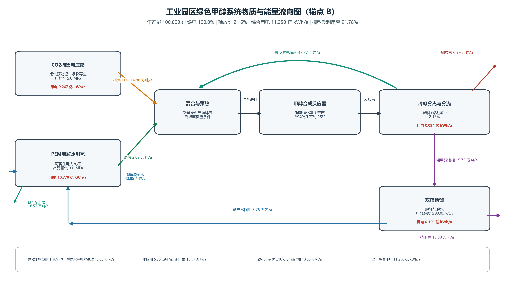
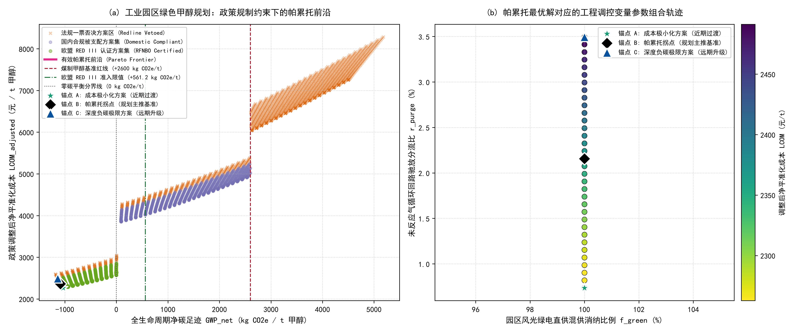

# 工业园区 10 万吨/年二氧化碳捕集耦合绿氢合成绿色甲醇项目环境规划与管理方案报告

## 报告摘要

本规划针对现代煤化工园区建设年产 10 万吨绿色甲醇示范项目，构建烟气二氧化碳捕集、可再生电力制氢、催化合成、精馏及副产物回用系统。基准物料清单为每吨甲醇消耗二氧化碳 1.423 吨、氢气 0.198 吨，产生可回用水 0.575 吨；规划模型以系统总碳利用率 96.0%作为标定基准。需要指出，按所给 1.423 吨二氧化碳与 1.000 吨甲醇流量直接计算，碳质量比为 96.5%，与 96.0%标定值存在约 0.5 个百分点差异；下文将原始物料账和优化模型参数分别列示，不将二者视为完全一致。

三千组工况网格搜索剔除否决方案后识别出 34 个非支配解。基于目标空间双向极小化距离，标定边际减排成本与平准化综合成本折衷最优的帕累托拐点（Knee Point），即锚点 B。该点对应绿电比例 100%、驰放比约 2.16%、模型碳利用率 91.78%、净全球变暖潜势 -1,085.2 kg CO₂e/t、调整后平准化甲醇成本 2,362.5 元/t、边际减排成本 -37.3 元/t CO₂e。模型给出的原料与能耗随驰放比变化，锚点 B年捕集二氧化碳约 14.88 万吨、年需氢气约 2.07 万吨、年综合用电约 11.25 亿 kWh。按模型年金折算，工程总投资约 14.88 亿元，年度净运行费用约 2.43 亿元（已扣除副产氧销售收益，不含政策补贴与碳收益）。项目应以可再生电力来源核验、连续生产储氢缓冲、取水总量控制、尾气治理和在线能碳核算为主要实施条件。

## 核心术语与缩写中英文对照表

在报告正文与图表中，首次出现的专业缩写必须严格参照下表规范标注中英文全称：

| 英文缩写          | 英文全称                                 | 中文规范全称                 | 核心学科与工程定义                                                                            |
| :---------------- | :--------------------------------------- | :--------------------------- | :-------------------------------------------------------------------------------------------- |
| **MFA**     | Material Flow Analysis                   | 物质流分析                   | 基于质量守恒定律研究系统内物质输入、转化、蓄积与排放的定量工程方法                            |
| **EFA**     | Energy Flow Analysis                     | 能量流分析                   | 基于热力学第一与第二定律分析系统能量梯级利用与损耗的工程核算方法                              |
| **LCA**     | Life Cycle Assessment                    | 全生命周期评价               | 评估产品从原料获取、制造到处置全过程环境负荷的标准国际方法（ISO 14040）                       |
| **TEA**     | Techno-Economic Analysis                 | 技术经济分析                 | 评估工艺工程资本支出、运行成本与财务可行性的工程经济学方法                                    |
| **GWP**     | Global Warming Potential                 | 全球变暖潜势                 | 在 100 年时间尺度内相对于二氧化碳温室效应的相对累积辐射强迫指标（$\text{kg CO}_2\text{e}$） |
| **LCOM**    | Levelized Cost of Methanol               | 平准化甲醇成本               | 全生命周期内将投资与运营总现值平摊至单位产品所形成的保本折现成本（$\text{元/t}$）           |
| **LCOH**    | Levelized Cost of Hydrogen               | 平准化氢气成本               | 全生命周期内单位质量绿氢产出的平准化折现成本（$\text{元/kg}$）                              |
| **MAC**     | Marginal Abatement Cost                  | 边际减排成本                 | 相对于化石基准技术，每额外避免或减排一吨二氧化碳当量所需增加的边际货币投入                    |
| **PEM**     | Proton Exchange Membrane                 | 质子交换膜电解水制氢         | 利用固体聚合物电解质进行纯水电解的技术，具备高电流密度与快速负载响应特性                      |
| **ALK**     | Alkaline Electrolyzer                    | 碱性液体电解水制氢           | 利用氢氧化钾水溶液为电解质的成熟低成本规模化制氢技术                                          |
| **CCUS**    | Carbon Capture, Utilization, and Storage | 二氧化碳捕集利用与封存       | 将工业点源排放的二氧化碳分离提纯并转化为高附加值产品或永久封存的工程体系                      |
| **PtM**     | Power-to-Methanol                        | 绿电催化合成甲醇             | 利用清洁可再生电力制氢并与二氧化碳催化加氢合成化工级甲醇的系统工程                            |
| **CAPEX**   | Capital Expenditure                      | 固定资产资本支出             | 项目前期规划、设备购置、建筑安装与工程调试所必需的初始资本投入总和                            |
| **OPEX**    | Operating Expenditure                    | 运行维护支出                 | 系统建成投产后，原料外购、电力公用工程、耗材更换及日常运维所消耗的年度运营费用                |
| **RED III** | Renewable Energy Directive III           | 欧盟《可再生能源指令》第三版 | 欧盟关于促进可再生能源利用的法定指令（Directive (EU) 2023/2413）                              |
| **RFNBO**   | Renewable Fuels of Non-Biological Origin | 非生物源可再生燃料           | 依据欧盟法规由非生物质清洁可再生能源制备的合成燃料                                            |
| **ETS**     | Emissions Trading System                 | 碳排放权交易体系             | 基于总量控制与配额有偿/免费分配的市场化温室气体减排管理制度                                   |
| **CCER**    | China Certified Emission Reduction       | 国家核证自愿减排量           | 经国家主管部门备案认证并允许在全国碳市场抵销配额的自愿减排项目核证减排量                      |
| **MRV**     | Monitoring, Reporting, and Verification  | 可测量、可报告、可核查体系   | 确保能源消费、生产活动与温室气体排放数据具备真实性与可信度的质量管理技术规范                  |
| **PDCA**    | Plan-Do-Check-Act                        | 策划-实施-检查-改进动态循环  | 强调持续改进、动态反馈与全过程闭环的现代环境系统适应性管理体系                                |

## 第 1 章 园区现状诊断与碳源-新能源基准线核算

### 1.1 园区产业结构与物质-能量代谢分析（MFA/EFA）

园区以煤化工、热电联产及公用工程为主导，既是二氧化碳点源集中区，也是绿色甲醇生产所需的蒸汽、供水和管网基础设施承载区。规划案例将煤制甲醇生命周期排放基准取为 2,600 kg CO₂e/t；拟建项目采用 100,000 t/a 甲醇产能、8,000 h/a设计运行时间，对应产品平均负荷 12.5 t/h。现有余热资源可在工艺核算确认后用于捕集再生或精馏热负荷，未提供的园区煤耗、电量及余热温度数据不作数值外推，须在可研阶段由能源审计补充。

### 1.2 工业点源 $\text{CO}_2$ 排放清单与烟气特征解析

规划碳源为热电厂锅炉烟气，经预处理、胺液吸收解吸、脱水及多级压缩后供合成系统使用。设计捕集规模按锚点 B模型值约 148,845 t/a（约 14.88 万吨/年）配置；背景物料表基准值为 142,300 t/a。烟气流量、二氧化碳体积分数、温度、二氧化硫、氮氧化物及颗粒物实测值未列入本案例数据集，因此工程设计不得以假设值代替监测结果。初步设计应开展源强监测并据此设计脱硫、除尘、冷却洗涤及吸收剂净化，设置吸收塔进出口连续监测和胺液降解产物管理。

### 1.3 绿电资源禀赋与公用工程承载力评估

案例设定园区自备煤电供电价为 0.32 元/kWh、排放因子为 0.75 kg CO₂e/kWh；配套屋顶光伏供电价为 0.20 元/kWh、排放因子为 0.04 kg CO₂e/kWh，年有效利用小时数为 1,200 h。光伏出力具有日内和季节波动，不能单独满足固定床合成装置连续运行要求。基准新鲜脱盐水补水为 1.385 t/t 产品，优化模型另以驰放比函数核算包括循环冷却损失在内的综合取水，锚点 B 为约 1.389 t/t，低于 1.400 t/t控制值。项目取水许可、地下水与地表水可用量以及生态流量需以水资源论证为准；本案例未提供区域总量数据。

### 1.4 园区现行碳管理痛点与减污降碳协同瓶颈

园区主要环境管理约束包括煤制甲醇高生命周期排放基准、间歇性新能源与连续化工负荷之间的时序差异、胺吸收剂挥发和降解产物、驰放尾气锅炉燃烧产生的氮氧化物，以及缺水地区新增取水许可。电解制氢具有较高电力需求，若以高碳电力供电，生命周期排放可能高于煤制甲醇基准。项目实施应以电力来源可追溯、捕集与产品碳流量可核算、尾气污染物达标及水资源总量受控为准入条件。

## 第 2 章 多情景预测与系统规模匹配核算

### 2.1 规划期园区碳排放趋势与多情景设定

设置三种规划情景：基准延续情景（BAU）按煤制甲醇排放基准 2,600 kg CO₂e/t核算；节能改造情景以现有煤电供电为主，采用 0.75 kg CO₂e/kWh；CCU-PtM情景按 10,826 kWh/t基准电耗、绿电与网电混供及原料碳固定信用核算。基于任务手册给定的光伏与煤电排放因子，混合电力因子为 EF(x)=0.75-0.71x，净 GWP(x)=10,826×EF(x)-1,423。使该结果低于 2,600 kg CO₂e/t的临界绿电比例由公式计算为约 53.30%；任务手册所列 53.37%为近似值。锚点 B 模型采用 100%绿电并得到 -1,085.2 kg CO₂e/t。该对比只覆盖本案例给定的电力、捕集信用、基础设施及副产氧核算边界，不代表已完成项目级第三方生命周期核查。

### 2.2 碳捕集-绿氢-甲醇（CCU-PtM）系统耦合与物料/能量衡算

*图 1 工业园区绿色甲醇系统工艺物质流（MFA）与能量流（EFA）图。工程通量按任务 3锚点 B计算。*

| 物料节点名称                           |   单吨甲醇实物定额   |  10 万吨/年工程规划通量  | 物质状态与物理参数                                         | 来源与去向说明                                  |
| :------------------------------------- | :-------------------: | :----------------------: | :--------------------------------------------------------- | :---------------------------------------------- |
| **新鲜捕集高纯 $\text{CO}_2$** | $1,488\text{ kg}$ | $\approx 14.88\text{ 万吨/年}$ | 气体，常温，压力 $5.0\text{ MPa}$，纯度 $\ge 99.8\%$ | 锚点 B模型值；原始数据基准为 $1,423\text{ kg/t}$ |
| **电解水新鲜绿氢**               | $207\text{ kg}$ | $\approx 2.07\text{ 万吨/年}$ | 气体，常温，压力 $3.0\text{ MPa}$，纯度 $\ge 99.999\%$ | 锚点 B模型值；配置规模须按年负荷复核 |
| **外购净除盐纯水**               | $1,385\text{ kg}$ | $13.85\text{ 万吨/年}$ | 液体，常温，常压                                           | 原始基准实物定额；满足园区取水定额约束 |
| **精馏冷凝副产水回用**           | $575\text{ kg}$ | $5.75\text{ 万吨/年}$ | 液体，加压精馏塔釜排液，经微滤脱醇                         | 闭环回流至电解水进水池 |
| **未反应气内循环流**             | $4,587\text{ kg}$ | $\approx 45.87\text{ 万吨/年}$ | 气体，温度 $45\text{ ℃}$，压力 $4.8\text{ MPa}$ | 锚点 B估算值，循环压缩机按模型负荷设计 |
| **系统驰放废气**                 | $99\text{ kg}$ | $\approx 0.99\text{ 万吨/年}$ | 气体，低位热值需运行数据确认 | 驰放比按锚点 B约 $2.16\%$，送锅炉前须核验燃烧与排放条件 |
| **主产品聚合级精甲醇**           | $1,000.0\text{ kg}$ | $10.00\text{ 万吨/年}$ | 液体，纯度 $\ge 99.85\text{ wt\%}$                       | 经双塔精馏提纯后外销                            |
| **副产工业高纯纯氧**             | $1,657\text{ kg}$ | $\approx 16.57\text{ 万吨/年}$ | 气体，纯度 $\ge 99.9\%$ | 按锚点 B模型氢气需求比例估算，外售量需计量核实 |
| **全厂年总综合电耗**             | $\approx 11,249\text{ kWh}$ | $\approx 11.25\text{ 亿 kWh/年}$ | 电力来源与能耗分项按 MRV计量 | 锚点 B模型估值；基准清单为 $10.826\text{ 亿 kWh/a}$ |

### 2.3 绿电波动性约束下的柔性容量寻优与储氢/网电缓冲配置

光伏年利用小时数为 1,200 h，若无储能且仅依靠光伏，无法保证合成反应器 8,000 h/a连续运行。按任务手册给定的 15%利用率，电解槽年产能力相同条件下的单位产品固定资产摊销将约为原设计的 6.67倍，且频繁启停会增加电解槽与下游装置的运行维护负担。规划上采用可再生电力与稳定电网协同供电，并配置电池侧短时平衡和氢气缓冲储量；电解槽配置应依据锚点 B约 11.25亿 kWh/a总负荷重新核定，不能直接沿用 130 MW标称值。以 8,000 h/a估算，平均综合负荷约 141 MW。氢储罐容积需由光伏逐时出力、合成装置最低稳定负荷、储氢工作压力及安全间距联合计算；案例缺少逐时功率曲线和储罐设计压力，故不虚构储量数字。初步方案采用 ALK承担稳定基荷、PEM跟踪可再生电力波动，并由电网保障连续供电。

## 第 3 章 规划目标与指标体系设计

### 3.1 规划总目标与分期节点

近期（2027—2028年）建设首期 10 万吨/年示范线，完成点源捕集、制氢、甲醇合成、精馏回用及能碳计量设施，逐步达到 8,000 h/a稳定运行。远期（2029—2035年）在水资源许可、绿电供给、产品认证和项目运行绩效满足条件后，扩展碳源接入及可再生电力供给能力，目标捕集规模不低于 70 万吨/年。远期规模不等同于单线产能扩建承诺，须通过逐期环评、节能审查和水资源论证。

### 3.2 规划指标矩阵（约束性指标 vs. 预期性指标）

| 目标维度               | 指标名称                                       |              单位              | 现状基准值 (2026年) | 近期目标值 (2028年) | 远期目标值 (2035年) | 指标属性 | 核算依据与标准方法                     |
| :--------------------- | :--------------------------------------------- | :----------------------------: | :-----------------: | :-----------------: | :-----------------: | :------: | :------------------------------------- |
| **环境与降碳**   | 烟气 $\text{CO}_2$ 年捕集量                  |            万吨/年            |         0.0         |    $\ge 14.88$    |    $\ge 70.00$    |  约束性  | 质量流量计在线累积值                   |
|                        | 吸收塔 $\text{CO}_2$ 捕集脱除率              |               %               |         —         |   $\ge 90.0\%$   |   $\ge 93.0\%$   |  约束性  | 烟气 CEMS 进出口差额法                 |
|                        | 全生命周期净碳足迹 $\text{GWP}_{\text{net}}$ |  $\text{kg CO}_2\text{e/t}$  |     $+2600.0$     | $\le -1000$（锚点 B模型值 $-1085.2$） | $\le -1200$ |  约束性  | ISO 14040/14044 摇篮到大门 LCA 模型    |
|                        | 欧盟 RED III RFNBO 认证达标率                  |               %               |        0.0%        |     $100.0\%$     |     $100.0\%$     |  约束性  | ISCC EU 第三方核查认证报告             |
| **能源与资源**   | 清洁绿电消纳比例 $f_{\text{green}}$          |               %               |        0.0%        | $\ge 80.0\%$（锚点 B为 $100\%$） |   $\ge 95.0\%$   |  约束性  | 智能电网双向计量电表在线核算           |
|                        | 电解水制氢综合直流电耗                         | $\text{kWh/Nm}^3\text{ H}_2$ |         —         |    $\le 4.30$    |    $\le 4.05$    |  预期性  | 制氢整流柜输出与产氢体积流量对标       |
|                        | 单位甲醇产品新鲜水取水定额                     |     $\text{t 水/t 甲醇}$     |      $1.650$      |    $\le 1.390$    |    $\le 1.350$    |  约束性  | 园区引水表 / 工业取水定额国家标准      |
|                        | 精馏副产生成水回用率                           |               %               |        0.0%        |     $100.0\%$     |     $100.0\%$     |  约束性  | 回水流量计与粗甲醇产水量平衡核算       |
| **污染协同控制** | MEA 有机胺逃逸浓度控制限值                     |       $\text{mg/Nm}^3$       |         —         |     $\le 2.0$     |     $\le 1.0$     |  约束性  | GB 31571 吸收塔顶气相色谱在线监测      |
|                        | 驰放尾气燃烧 $\text{NO}_x$ 排放浓度          |       $\text{mg/Nm}^3$       |         —         |    $\le 30.0$    |    $\le 20.0$    |  约束性  | 锅炉烟囱 CEMS 超低排放监测限值         |
|                        | 全系统总碳转化利用率 $\eta_{\text{carbon}}$  |               %               |     $78.0\%$     | $\ge 91.0\%$（锚点 B模型值 $91.78\%$） |   $\ge 96.0\%$   |  约束性  | 输入二氧化碳与精甲醇产品碳平衡闭环核算 |

## 第 4 章 空间落位布局与重点工程实施方案

### 4.1 园区“源-网-荷-储-化”空间管控与红线

总图布置按碳源、能源转换、化工生产、公用管廊和环境监管分区。捕集岛布置于热电厂烟气接口附近；电解制氢与储氢设施设置于新能源转化专区，采用独立防护分区并与人员密集区、明火设施保持经风险评价确定的安全距离；合成与精馏单元布置在化工核心区；二氧化碳、氢气及蒸汽管线沿专用管廊敷设，减少道路危化品运输。规划控制条件为涉氢设施与敏感目标防护距离不小于 150 m，最终距离须由安全评价、消防设计和适用规范确定。建设用地应避让生态保护红线、饮用水水源保护区、洪泛区及地质灾害高风险区；厂区设置分区防渗、雨污分流及事故水收集系统。

### 4.2 核心单元工艺比选与工程设计

捕集工段采用烟气预处理、胺液吸收/再生和多级压缩的流程框架；吸收剂类型与再生热耗应经中试或供应商性能保证确定，避免将未验证的相变胺性能作为确定性设计数据。制氢侧以碱性电解槽承担稳定基荷、质子交换膜电解槽跟踪可再生电力变化，并通过电网与储氢缓冲降低合成单元的负荷波动。合成反应为 CO₂+3H₂⇌CH₃OH+H₂O，放热反应热可经余热回收产生蒸汽，供捕集再生或精馏再沸器使用；热量品位、流量及全年可用率需在详细设计中完成热集成计算。锚点 B平均电力需求约 141 MW，故 130 MW参考配置须按逐时负荷复核并扩容或以外部供电补足。

### 4.3 园区重点工程项目库清单表（基于帕累托拐点锚点 B）

| 工程编号          | 工程模块名称             | 项目名称                                              |  建设性质  | 空间落位（园区功能区）       | 核心工艺与设计规模（基于帕累托拐点锚点 B）                                                                     |       建设周期       | 估算 CAPEX (亿元) | 年运行维护 OPEX (万元/年) | 预期生态环境与资源化效益                                                                    | 责任实施主体                   |
| :---------------- | :----------------------- | :---------------------------------------------------- | :---------: | :--------------------------- | :------------------------------------------------------------------------------------------------------------- | :------------------: | :---------------: | :-----------------------: | :------------------------------------------------------------------------------------------ | :----------------------------- |
| **工程-01** | **碳源捕集与精制** | 热电厂烟气化学吸收碳捕集与三级压缩工程 | 新建 | 热电厂区北侧预留用地 | 烟气预处理、吸收再生及压缩；锚点 B模型需求约 $14.88\text{ 万吨/年}$ | 2027–2028 | 1.10 | 3,870 | 捕集需求须由源强监测和全厂碳平衡复核；吸收剂排放实施在线监测 | 园区热电企业 |
| **工程-02** | **绿氢制备与缓冲** | ALK/PEM制氢站及中压储氢与调峰工程 | 新建 | 新能源转化专区（独立防护区） | 锚点 B氢气约 $2.07\text{ 万吨/年}$，平均综合负荷约 141 MW；含可再生电力波动缓冲追加投资 | 2027–2028 | 11.23 | 16,934（扣氧气销售收益） | 年综合用电约 $11.25\text{ 亿 kWh}$；副产氧约 $16.57\text{ 万吨/年}$ | 绿氢运营投资主体 |
| **工程-03** | **甲醇催化合成** | 10 万吨/年二氧化碳加氢制甲醇与余热回用工程 | 新建 | 精细化工核心区 | 固定床铜基催化剂反应器、气液分离及循环分流；驰放比按锚点 B约 $2.16\%$ | 2027–2029 | 1.20 | — | 年产精甲醇 10 万吨；反应余热回收利用 | 园区化工企业 |
| **工程-04** | **精馏提纯与节水** | 双塔精馏提纯与副产水闭环循环工程 | 新建 | 精细化工核心区 | 常压脱轻、加压脱水及水回用微滤；年产聚合级精甲醇 $10.00\text{ 万吨}$ | 2028–2029 | 0.65 | 650 | 回用水约 $5.75\text{ 万吨/年}$；净除盐水补水基准约 $13.85\text{ 万吨/年}$ | 园区水务环保投资公司 |
| **工程-05** | **管廊输配与MRV** | 跨厂区专用管网与能碳数字化监测平台 | 新建/改扩建 | 园区公用管廊及监管中心 | 氢气、二氧化碳和蒸汽专线；设置电表、质量流量计、排放监测与数据存证 | 2027–2028 | 0.70 | 2,850 | 支撑物质能量核算、污染源监测及可测量、可报告、可核查管理 | 园区管委会平台公司 |
| **合计** | — | **工业园区 10 万吨/年绿色甲醇示范项目工程总表** | — | — | **锚点 B参数；CAPEX包含基准工程 8.20 亿元及模型储能年金折算增量约 6.68 亿元** | **2027–2029** | **14.88** | **约 24,304 万元/年（按表列分项合计，已扣氧气销售收益）** | **锚点 B模型净碳足迹约 $-1,085.2\text{ kg CO}_2\text{e/t}$** | **园区政企协同推进专班** |

## 第 5 章 全生命周期环境影响（LCA）、技术经济（TEA）与帕累托多目标决策评估

### 5.1 全生命周期环境影响评估（LCA）与电力结构影响

系统边界为每吨聚合级甲醇的摇篮到大门核算。基准清单包含总电耗 10,826 kWh/t、基础设施与逸散排放 95 kg CO₂e/t、捕集二氧化碳信用 -1,423 kg CO₂e/t及副产氧信用 -95 kg CO₂e/t。100%低碳电力情景采用 0.035 kg CO₂e/kWh，得到净 GWP约 -1,044.1 kg CO₂e/t；区域高碳电网情景采用 0.550 kg CO₂e/kWh，得到约 +4,531.3 kg CO₂e/t，较煤制甲醇基准高约 74.3%。电力排放分别为约 378.9与 5,954.3 kg CO₂e/t。在网电高碳排放因子驱动下，制氢上游间接碳排放增量超过催化加氢直接固定碳汇，导致系统净温室气体排放强度呈现正增长。规划准入应要求绿电可追溯，并以生命周期核算结果证明低于比较基准。

此核算采用输入 CO₂固定信用的案例方法，未对甲醇终端燃烧的碳释放、捕集源反事实排放及替代产品市场效应进行扩展系统分析，结论应限定在案例边界内。水资源方面，基础净脱盐水补水为 1.385 t/t，另需按模型计入循环冷却取水；取水许可、回用水水质和浓盐水去向应纳入水资源论证。胺液逸散、降解副产物及尾气燃烧 NOx属次生污染源，应通过密闭收集、洗涤、脱硝和连续监测管理。

### 5.2 技术经济分析（TEA）与平准化甲醇成本核算

经济模型采用加权平均资本成本（WACC）8.0%、运营期 20 年，资本回收系数（CRF）为 0.10185。案例基准固定资产投资为 8.20 亿元，折算年金 835.2 元/t；锚点 B增加的可再生电力缓冲年金为 680 元/t，对应新增资本约 6.68 亿元，故工程总投资与锚点 B模型年金对应为约 14.88 亿元。模型锚点 B基础 LCOM为 3,945.9 元/t，政策调整后为 2,362.5 元/t；政策成本由 RED III资格补贴、碳收益、取水税与污染治理费用构成，实施期应仅将经批准或已签约收益计入融资现金流。

电价敏感性数据表明，电价由 0.15 元/kWh升至 0.35 元/kWh时，LCOM由 2,862.27升至 5,027.47 元/t，MAC由 99.41升至 693.57 元/t CO₂e。0.05 元/kWh情景的 LCOM为 1,779.67 元/t，模型 MAC为 -197.67 元/t CO₂e，表示成本低于煤制甲醇价格基准。此敏感性表为基准成本模型，不等同于锚点 B含政策修正结果。项目投资决策应开展电价、绿电利用小时、储能投资、碳价、氧气销售价格及资本成本的联合情景分析。

### 5.3 政策规制约束下的帕累托多目标决策与三大锚点深度比选

*图 2 政策约束下的多目标帕累托前沿及锚点 B标定结果。*

| 帕累托决策锚点名称                                         | 调控参数组合 $(f_{\text{green}}, r_{\text{purge}})$ | 系统总碳利用率 $\eta_{\text{carbon}}$ | 净碳足迹 $\text{GWP}_{\text{net}}$ ($\text{kg/t}$) | 基础成本 $\text{LCOM}_{\text{base}}$ ($\text{元/t}$) | 调整后净成本 $\text{LCOM}_{\text{adj}}$ ($\text{元/t}$) | 边际减排成本 $\text{MAC}$ ($\text{元/t CO}_2\text{e}$) | 法规合规状态判定 | 规划定位与采纳建议             |
| :--------------------------------------------------------- | :---------------------------------------------------: | :-------------------------------------: | :----------------------------------------------------: | :------------------------------------------------------: | :---------------------------------------------------------: | :--------------------------------------------------------: | :--------------: | :----------------------------- |
| **锚点 A：成本极小化方案** | $(100.0\%, 0.73\%)$ | $96.97\%$ | $-1,034.6$ | $3,866.4$ | $2,262.8$ | $-65.3$ | RED_III_RFNBO_Certified | 近期成本优先方案；优先用于财务稳健情景 |
| **锚点 B：帕累托拐点** | $(100.0\%, 2.16\%)$ | $91.78\%$ | $-1,085.2$ | $3,945.9$ | $2,362.5$ | $-37.3$ | RED_III_RFNBO_Certified | 推荐的规划基准，成本与环境目标折中 |
| **锚点 C：深度脱碳方案** | $(100.0\%, 3.50\%)$ | $86.89\%$ | $-1,137.5$ | $4,056.1$ | $2,491.2$ | $-2.4$ | RED_III_RFNBO_Certified | 数学前沿极值；受清洁生产阈值不一致影响，暂不作为实施方案 |

任务 3以绿电比例 60 档、驰放比 50 档遍历 3,000 个组合，先剔除环境准入否决方案，再按 GWP与政策调整后 LCOM两目标进行非支配筛选，得到 34 个解。基于目标空间双向极小化距离，标定边际减排成本与平准化综合成本折衷最优的帕累托拐点（Knee Point）。在实现中，GWP与政策调整后 LCOM分别归一化后，以到乌托邦理想点 (0,0)的欧氏距离最小值确定锚点 B。锚点 A的政策调整后 LCOM最低；锚点 C的模型 GWP最低，但成本高于 B。模型驰放比函数在 3.50%时给出碳利用率 86.89%，低于政策卡片所称的 88%清洁生产基准；由于卡片以严格条件 r_purge > 3.5%作为否决条件，当前脚本仍将等于 3.5%的极值标记为合规。该阈值定义与模型结果不一致，故锚点 C仅作数学边界对比，不作为可执行方案，工程准入应直接满足碳利用率不低于 88%。锚点 B作为当前规划的推荐设计点；项目实施前应采用实测流量和经审定的生命周期边界更新模型。

数据核验发现政策条文卡片列出的三个总 LCOM期望值无法由同卡片给出的成本公式复算。按条文公式得到的三个用例调整成本分别为 1,262.47、4,066.70和 8,699.33 元/t；代码单元测试采用公式结果，并逐项核验补贴、碳市场费用及合规状态。工程设计文件应将驰放比与碳利用率双重设为控制指标，避免因政策条文的严格大于阈值与模型碳利用率不一致而保留不符合清洁生产要求的工况。

## 第 6 章 制度保障、商业模式与智慧环境管理机制

### 6.1 商业闭环与绿色投融资机制

项目资本金、绿色信贷和经审核的绿色低碳专项资金可共同承担建设投资，资金比例应以融资方案和授信审查结果确定。锚点 B符合案例设定的 RED III数值阈值时，模型计入 1,200 元/t潜在溢价；该收益须以满足欧盟法规、可再生电力额外性与第三方认证为前提，不能视为已签约收入。项目相对煤制甲醇的减排量可按适用方法学核算并申请 CCER，须经审定、核查和登记后确认收益。副产氧销售收入应以产品质量、周边市场需求和购销合同为依据；本规划成本模型已扣除单位产品氧气收益，不应重复计入。资金闭环按年度核对绿色产品销售、碳收益、氧气销售和债务本息。

### 6.2 数字化监测、报告与核查（MRV）体系

建设能碳 MRV系统，接入绿电双向计量、制氢直流侧电表、二氧化碳及氢气质量流量计、产品计量、取水与回用水表、锅炉烟气连续监测和设备运行记录。平台以统一时间戳关联能源、物料和排放活动数据，保存校准、维修、数据修订与审批日志；按月完成碳平衡和异常值复核，按年度形成温室气体清单及产品碳足迹报告。区块链仅作为防篡改存证手段，不能替代仪表校准、数据质量控制或第三方核查。

### 6.3 环境风险防控与适应性管理（PDCA）机制

涉氢设施设置可燃气体探测、强制通风、紧急切断（ESD）、防爆电气和分区联锁；防爆等级与防护距离由专项安全设计确定。二氧化碳管道设置压力、流量异常监控及沿线泄漏报警，重点检查低洼空间窒息风险。胺液储罐及再生区采取防渗、围堰和分质收集措施，事故池有效容积不低于 1,500 m³并依据最大可信事故水量校核；废吸收液及含醇废水按鉴别结果分类处置。管理周期采用策划（P）、实施（D）、检查（C）、改进（A）闭环，至少每三年复核一次绿电比例、GWP、取水、污染物和安全边界；发生标准更新、事故或连续超标时及时启动专项修编。

## 参考文献

1. 中华人民共和国生态环境部. 《碳排放权交易管理暂行条例》 (国务院令第 775 号), 2024.
2. 国家发展和改革委员会等部门. 《高耗能行业重点领域能效标杆水平和基准水平 (2023年版)》 (发改运行〔2023〕723号).
3. 中华人民共和国国家标准. 《大气污染物综合排放标准》 (GB 16297-1996); 《石油化学工业污染物排放标准》 (GB 31571-2015).
4. 中华人民共和国国家标准. 《石油化工企业设计防火标准》 (GB 50160-2008, 2018年版).
5. 财政部, 税务总局, 水利部. 《水资源税改革试点实施办法》 (财税〔2016〕55号).
6. European Parliament and Council of the European Union. Directive (EU) 2023/2413 of 18 October 2023 amending Directive (EU) 2018/2001 (RED III).
7. International Organization for Standardization. ISO 14040:2006 & ISO 14044:2006. *Environmental Management — Life Cycle Assessment*.
8. **Pérez-Fortes, M., Schöneberger, J. C., Boulamanti, A., & Tzimas, E.** (2016). Methanol synthesis using captured CO2 as raw material: Techno-economic and environmental assessment. *Applied Energy*, 161, 718-732.
9. **Dieterich, V., et al.** (2020). Power-to-liquid via synthesis of green methanol to reduce greenhouse gas emissions: A review. *Energy & Environmental Science*, 13(10), 3207-3252.
