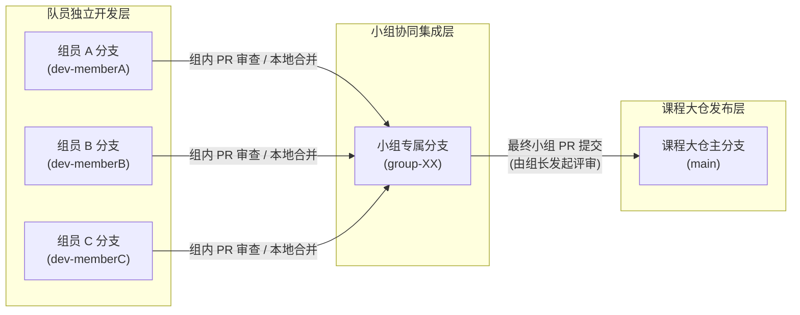

# 《环境规划与管理》第十二讲：退役动力锂离子电池锂资源回收环境规划与管理综合实训任务书

> **【课程与实训基本信息】**
>
> * **课程名称**：《环境规划与管理》
> * **授课学期**：2026 年秋季学期
> * **授课单元**：第十二讲（废弃电动汽车动力电池锂资源循环利用环境规划与管理综合实训）
> * **教学形式**：开放式自主探究实训（提供议题界定、预编译文献底座、技术规范与评价量规；由学生独立完成文献与数据拓展检索、数学建模与代码编写、结果可视化及完整环境规划方案报告撰写）
> * **课程协同大仓**：[whu-course-cohort/LCA_Practice_Coursework-2026fall](https://github.com/whu-course-EnvironPlanManag/LCA_Practice_Coursework-2026fall)

## 一、 实训背景与核心能力培养目标

### 1.1 工程与规划背景

随着电动汽车（Electric Vehicles, EVs）与电化学储能系统（Battery Energy Storage Systems, BESSs）的规模化部署，动力锂离子电池（Lithium-Ion Batteries, LIBs）对锂（Li）、镍（Ni）、钴（Co）、锰（Mn）等关键矿产资源的需求持续增长。原生锂矿资源（盐湖卤水锂与硬岩锂辉石）在空间分布上高度集中，且原生采选与精炼过程伴随较高的温室气体排放与水资源消耗。与此同时，早期装机的车用动力电池逐步进入退役期，废旧动力电池规范化收集、梯次利用（Echelon Utilization）与再生提锂（Material Recovery / Recycling）成为缓解关键矿产供需缺口、降低全生命周期环境负荷的重要途径。

在实际环境规划与管理中，退役动力电池锂资源回收面临多重系统性矛盾：

1. **收集率与渠道失衡**：正规回收渠道收集率受非正规市场竞争制约，实际规范收集比例偏低；
2. **正极材料演进与经济性分化**：磷酸铁锂（$\text{LiFePO}_4$, LFP）电池市场占比显著上升，但其不含镍、钴等高价金属，在传统湿法冶金（Hydrometallurgy）或火法冶金（Pyrometallurgy）路径下易出现回收成本高于再生材料收益的财务亏损；三元锂电池（$\text{LiNi}_x\text{Co}_y\text{Mn}_z\text{O}_2$, NMC 及 $\text{LiNi}_{0.8}\text{Co}_{0.15}\text{Al}_{0.05}\text{O}_2$, NCA）虽具备较高金属回收价值，但受前驱体价格波动与工艺能耗制约显著；
3. **能源结构与水-碳耦合约束**：再生精炼环节电力消耗占全流程碳足迹的 $70\%$ 以上，在不同电源结构的区域电网下呈现出碳排放强度与水资源消耗的显著权衡关系（Water-$\text{CO}_2$ Tradeoff）；
4. **国内外法规标准刚性约束**：中国工业和信息化部《新能源汽车废旧动力电池综合利用行业规范条件（2024年本）》与欧盟《电池与废电池法规》（Regulation (EU) 2023/1542）对锂回收率、再生锂掺混比例、单位产品综合能耗及全生命周期碳足迹提出了明确的定量准入限值。

### 1.2 核心能力培养目标与组织形式

本实训不提供预设清洗完毕的数据表格、代码脚手架或填空式报告模板，要求学生从零开始完成一项完整的环境规划与管理研究闭环。

**组织形式与团队分工原则**：

1. **以小组为单位协同开展**：本次作业以课程小组为基本工作单元，最终的代码、数据集、图表与《环境规划与管理方案报告》均以小组为单位统一提交；
2. **组长统筹自主分工，全员实质参与**：由组长主导组内任务拆解与责任划分，确保每位队员均承担实质性的计算建模、脚本编写、数据检索或报告章节执笔任务，杜绝分工虚化或搭便车现象；
3. **成果报告强制贡献声明**：最终报告开篇必须设立《团队成员分工与贡献度声明表》，逐一列明每位队员负责的具体任务模块与相对贡献度比例，作为个人实训成绩评定的重要依据。

**重点考核以下四项核心能力**：

1. **多源文献解析与数据工程构建能力**：基于课程提供的预编译文献库（`precompiled_references/`）及其公开科学数据库（Zenodo / OSF / GitHub），结合自主检索的国内外政策法规、统计年鉴与行业标准，建立结构化、可溯源的输入数据集；
2. **物质代谢与多过程系统建模能力**：运用动态物质流分析（dMFA）或工序级物质流分析（MFA）、全生命周期评价（LCA）与过程技术经济分析（TEA），编写计算程序完成质量守恒校验、环境影响核算与成本收益拆解；
3. **政策规制算法化与多目标寻优决策能力**：将国内外法定回收率红线、再生材料掺混比例、能耗限额及环保税费转化为量化约束算子，开展多情景仿真或帕累托（Pareto）多目标寻优，科学标定规划推荐方案；
4. **规范化环境规划报告独立编撰能力**：遵循环境规划与管理学科逻辑闭环，以客观、严谨、无修辞渲染的科学陈述语言，独立设计报告章节与工程清单表格，完成一份数据前后咬合、图文规范的完整规划方案报告。

## 二、 预编译文献库导读与自主拓展检索要求

### 2.1 预编译核心文献库（`precompiled_references/`）解析

课程已在 `precompiled_references/` 目录下提供 6 篇发表于 2024—2025 年的高水平学术论文。各篇文献的方法学框架、核心参数与内置开源数据地址如下表所示，学生须深入研读并提取所需建模基准数据：

| 文献序号         | 论文标题与发表期刊                                                                                                                                                                                     | 核心模型与方法学                                                                                                                                                                  | 关键参数与开源数据/代码仓库地址                                                                                                                                                                                                                                                                                                                                                                                                                                                                                                                                                                                                                                                                                                                                                |
| :--------------- | :----------------------------------------------------------------------------------------------------------------------------------------------------------------------------------------------------- | :-------------------------------------------------------------------------------------------------------------------------------------------------------------------------------- | :----------------------------------------------------------------------------------------------------------------------------------------------------------------------------------------------------------------------------------------------------------------------------------------------------------------------------------------------------------------------------------------------------------------------------------------------------------------------------------------------------------------------------------------------------------------------------------------------------------------------------------------------------------------------------------------------------------------------------------------------------------------------------- |
| **文献 1** | Peiseler et al. (2024) *Carbon footprint distributions of lithium-ion batteries and their materials*（*Nature Communications*, 15:10301）                                                         | 基于矿山级成本数据推导美元排放强度（DEI），结合 Brightway2 开展蒙特卡洛模拟（$n=11,308$）                                                                                       | • 全球碳酸锂当量（LCE）供应曲线：南美盐湖卤水提锂（低排放平台）与澳大利亚硬岩锂辉石提锂（高排放平台，约为卤水锂中位值的 3 倍）碳足迹分布；• 电池级碳足迹第 5%、50%、95% 分位数：NMC811 为 $59, 74, 115\text{ kg CO}_2\text{e/kWh}$，LFP 为 $54, 62, 69\text{ kg CO}_2\text{e/kWh}$（比能量转换系数：NMC $0.25\text{ kWh/kg}$，LFP $0.16\text{ kWh/kg}$）；• **开源仓库**：`https://doi.org/10.5281/zenodo.13936832`                                                                                                                                                                                                                                                                                                                                         |
| **文献 2** | Yao, Benson & Chueh (2025) *Critically assessing sodium-ion technology roadmaps and scenarios for techno-economic competitiveness against lithium-ion batteries*（*Nature Energy*, 10, 404–416） | 耦合矿产价格底线的修正赖特学习曲线（Modified Wright's Law）与基于摩尔定律的材料强度演进模型（BatPaC v5.1）                                                                        | • 电池组件成本拆解方程与矿产价格底线（Price Floor）计算方法；• 碳酸锂当量（LCE）价格波动区间（低价情景 $\$10,000\text{/t}$、基准情景 $\$22,000\text{/t}$、高价情景 $\$50,000\text{/t}$）对 LFP 与 NMC 电芯成本（$\$45\text{--}\$51\text{/kWh}$）及替代技术竞争力的敏感性参数。                                                                                                                                                                                                                                                                                                                                                                                                                                                                                       |
| **文献 3** | Wu et al. (2024) *Impact of circular economy on the long-term allocation structure of primary and secondary lithium*（*Communications Earth & Environment*, 5:503）                               | 存量驱动（EV，双参数 Weibull 寿命分布）与流量驱动（BESS，基于 SSP1-RCP1.9 可再生能源装机）耦合的动态物质流模型（2023–2050）                                                      | • 6 类正极材料（LFP, NCA, NMC111, NMC523, NMC622, NMC811）的全球与区域在用锂存量、报废锂流量及 6–8 年退役滞后期参数；• 6 类循环经济政策情景（收集率 $50\% \rightarrow 70\%$、锂回收率 $6\% \rightarrow 36\%$、强制再生锂比例 $1\% \rightarrow 17\%$、能量密度提升至 $435\text{ Wh/kg}$）对削减原生锂消耗（最高削减 $53.48\%$）的定量效应；• **开源仓库**：`https://zenodo.org/records/11160283`                                                                                                                                                                                                                                                                                                                                                          |
| **文献 4** | Machala et al. (2025) *Life cycle comparison of industrial-scale lithium-ion battery recycling and mining supply chains*（*Nature Communications*, 16:988）                                       | 基于工业级实测数据（Redwood Materials）与 GREET 2021 的摇篮到大门（Cradle-to-Gate）及大门到大门（Gate-to-Gate）LCA 对比                                                           | • 功能单位：$1\text{ kg}$ NCA 当量（$\text{LiNi}_{0.80}\text{Co}_{0.15}\text{Al}_{0.05}\text{O}_2$）或 LCO 当量正极材料盐；• 传统矿产精炼基准能耗 $193.9\text{ MJ/kg}$、水耗 $77.3\text{ L/kg}$、碳排放 $14.5\text{ kg CO}_2\text{e/kg}$；• 工业循环精炼（还原焙烧 RC + 机械处理 Me + 湿法冶金 Hy）处理退役电池能耗 $44.4\text{ MJ/kg}$（降幅 $77.1\%$）、碳排放 $6.1\text{ kg CO}_2\text{e/kg}$（降幅 $57.7\%$）、水耗 $21.5\text{ L/kg}$（降幅 $72.2\%$）；多工序金属回收率 Ni/Co $95\%$、Li $92\%$；• 产出混合金属硫酸盐 $\text{(Ni,Co)SO}_4$ 相比分离单一盐可额外降低能耗 $72.3\%$、减排 $41.4\%$；揭示不同电网区域水耗与碳排放的权衡曲线；• **开源仓库**：`https://osf.io/zvame/?view_only=8fd188cde196485bbe625b217819242a` |
| **文献 5** | Zhang et al. (2025) *Lithium-ion battery recycling relieves the threat to material scarcity amid China’s electric vehicle ambitions*（*Nature Communications*, 16:6661）                         | 中国碳中和目标（CN60）下 GCAM + Bass 扩散模型 + 嵌套 dMFA + 动态电力 LCA + ArcGIS 空间选址-配置优化 + EverBatt 过程成本模型（2020–2060）                                         | • 电池退役三级分流机制：SOH $>85\%$ 直接梯次利用（低速车 LSV），SOH $80\%\text{--}85\%$ 间接梯次利用（储能系统 ESS），SOH $<80\%$ 进入再生回收；• 9 大情景（RS, CC-LFP, CC-NMC, CC-NCA, SL-HIGH, RP-PYR, RP-DIR, MRR-PRO, OPT）下中国 2060 年退役电池量（$46\text{ Mt}$）与锂/钴/镍/锰供需缺口（实现供需平衡需收集率达 $84\%\text{--}90\%$）；• 单位质量电池收集运输成本 $\$0.98\text{--}\$1.05\text{/kg}$；常规湿法回收 LFP 亏损（$-\$2.05\text{ 至 }-\$2.00\text{/kg}$），而直接正极再生（Direct Recycling）下 LFP 净收益达 $+\$1.30\text{--}\$1.32\text{/kg}$，NMC/NCA 净收益达 $+\$4.01\text{--}\$4.37\text{/kg}$；• **开源仓库**：`https://zenodo.org/records/15342229`                                                                     |
| **文献 6** | Ma et al. (2024) *Pathway decisions for reuse and recycling of retired lithium-ion batteries considering economic and environmental functions*（*Nature Communications*, 15:7641）                | 考虑退役初始 SOH（$70\%, 80\%, 90\%$）与终止 SOH（$40\%\text{--}90\%$）的梯次利用（ESS, CBS, LSV）与末端回收（湿法、火法、直接再生）摇篮到坟墓（Cradle-to-Grave）LCA-TEA 模型 | • 梯次利用容量非线性配置方程、退化曲线指标与日运营收益折现模型；• 碳酸锂价格大幅波动（$\$5,496\text{--}\$84,942\text{/t}$）对末端回收工艺经济性排序的反转机制（碳酸锂作为直接再生的输入原料，但作为湿法/火法的输出产物）；• 电网碳排放因子（$0.3140\text{--}0.7488\text{ kg CO}_2\text{e/kWh}$）对全生命周期度电碳足迹的敏感性；• **开源仓库**：`https://github.com/RuifeiMa/Reuse-and-recycling-pathway-of-retired-batteries`                                                                                                                                                                                                                                                                                                                                 |

### 2.2 强制性自主拓展检索要求

除上述 6 篇预编译文献外，学生须针对所选规划区域与技术路线，自主检索并引用**不少于 4 项**国内外最新法规标准、统计数据源或补充学术文献。以下核心法规与标准条文须纳入政策规制建模与报告指标体系设计：

1. **中国工业和信息化部《新能源汽车废旧动力电池综合利用行业规范条件（2024年本）》**（工信部公告 2024 年第 42 号，2025 年 1 月 1 日起施行）：
   * **再生利用回收率底线**：破碎分离后的电极粉料回收率不低于 $98\%$，杂质铝含量低于 $1.5\%$，杂质铜含量低于 $1.5\%$；铜、铝回收率应不低于 $98\%$；冶炼过程**锂回收率应不低于 $90\%$**，镍、钴、锰回收率应不低于 $98\%$，稀土等其他主要有价金属综合回收率不低于 $97\%$，氟固化率不低于 $99.5\%$；采用材料修复工艺的，回收利用的材料质量之和占原动力电池所含目标材料质量之和的比重应不低于 $99\%$；
   * **能耗与水效红线**：碳酸锂生产单位产品综合能耗低于 $2,200\text{ kgce/t}$（千克标准煤/吨）；工艺废水循环利用率应达 $90\%$ 以上；
   * **产能与研发准入门槛**：梯次利用企业年综合利用能力不低于 $1,000\text{ t/a}$，再生利用企业年综合利用能力不低于 $5,000\text{ t/a}$；每年用于研发及工艺改进的费用不低于废旧动力电池综合利用业务收入的 $3\%$。
2. **欧盟《电池与废电池法规》（Regulation (EU) 2023/1542）**：
   * **废旧电池材料回收率目标（Material Recovery Targets）**：到 2027 年 12 月 31 日，锂回收率 $\ge 50\%$，钴、铜、铅、镍回收率 $\ge 90\%$；到 2031 年 12 月 31 日，**锂回收率 $\ge 80\%$**，钴、铜、铅、镍回收率 $\ge 95\%$；
   * **新电池强制再生原料最低掺混比例（Mandatory Minimum Recycled Content）**：自 2031 年 8 月 18 日起，新电池中**再生锂比例 $\ge 6\%$**、再生钴 $\ge 16\%$、再生镍 $\ge 6\%$、再生铅 $\ge 85\%$；自 2036 年 8 月 18 日起，**再生锂比例 $\ge 12\%$**、再生钴 $\ge 26\%$、再生镍 $\ge 15\%$、再生铅 $\ge 85\%$；
   * **碳足迹准入与电池数字护照**：自 2027 年 2 月 18 日起，容量 $>2\text{ kWh}$ 的电动汽车电池与工业电池须配置电池数字护照（Digital Battery Passport），并执行全生命周期碳足迹强制声明与最高碳阈值准入规制。
3. **中国车用动力电池回收利用国家标准与环保排放标准体系**：
   * 拆解与再生利用标准：`GB/T 33598-2017`《车用动力电池回收利用 拆解规范》、`GB/T 33598.2-2020`《车用动力电池回收利用 再生利用 第2部分：材料回收要求》、`GB/T 33598.3-2021`《车用动力电池回收利用 再生利用 第3部分：放电规范》；
   * 余能检测与梯次利用标准：`GB/T 34015-2017`《车用动力电池回收利用 余能检测》、`GB/T 34015.3-2021`《车用动力电池回收利用 梯次利用 第3部分：梯次利用要求》、`GB/T 34015.5-2025`《车用动力电池回收利用 梯次利用 第5部分：可梯次利用设计指南》；
   * 污染控制标准：`GB 30484-2013`《电池工业污染物排放标准》、`GB 31573-2015`《无机化学工业污染物排放标准》及项目所在地省级水污染物与大气污染物排放限值。

## 三、 规划选题切入方向

从以下三个规划尺度方向中**任选其一**，或结合具体案例区域进行多尺度耦合，开展全流程环境规划与管理方案设计：

### 方向 A：区域/省域尺度——退役动力电池时空演变预测、二次锂资源供应潜力与回收网络空间选址规划

* **核心科学问题**：在区域电动汽车持续普及与正极材料结构演进（LFP 与高镍 NMC 并存）背景下，如何准确预测规划期内（如 2026–2040 年或 2026–2050 年）退役动力电池及蕴含锂资源的产生量？如何协同考虑正规收集率、区域电网碳强度与运输半径，优化布局“收集点—梯次利用中心—再生精炼基地”空间网络？
* **核心文献支撑**：文献 3（Wu et al., 2024）、文献 5（Zhang et al., 2025）、文献 1（Peiseler et al., 2024）。
* **空间对象示例**：全国尺度、重点省份（如广东省、湖北省、河南省、四川省等）或重点城市群（长三角、粤港澳大湾区、京津冀等）。

### 方向 B：产业园区/工程尺度——废旧动力电池再生精炼工艺耦合、水-碳协同减排与多目标技术经济规划

* **核心科学问题**：针对特定设计产能（如年处理 $2\text{ 万吨}\text{--}10\text{ 万吨}$ 废旧动力电池或生产车间废料）的循环经济产业园，如何在火法冶金（含还原焙烧 RC）、湿法冶金（Hy）与直接正极再生（Direct Recycling）工艺之间进行产线配置？如何量化精炼产物形态（混合金属盐 vs. 单一离散盐）、浸出剂/沉淀剂消耗（如 $\text{H}_2\text{SO}_4, \text{H}_2\text{O}_2, \text{NaOH}, \text{Na}_2\text{CO}_3$）与园区绿电/网电配比对净碳足迹、水资源消耗及平准化回收成本的影响？
* **核心文献支撑**：文献 4（Machala et al., 2025）、文献 1（Peiseler et al., 2024）、文献 6（Ma et al., 2024）。
* **空间对象示例**：国家级或省级资源循环利用基地、新能源电池材料化工园区。

### 方向 C：全生命周期路径尺度——基于退役电池健康状态（SOH）分级的“梯次利用—再生提锂”协同优化与政策激励规划

* **核心科学问题**：退役 LFP 与 NMC 动力电池具有不同的初始健康状态（SOH $70\%\text{--}90\%$）与容量衰减特征，在面对不同梯次利用场景（工商业储能 ESS、通信基站 CBS、低速车 LSV）及剧烈波动的碳酸锂市场价格（如 $\$10,000\text{--}\$50,000\text{/t}$）时，如何确定最优的“梯次利用终止 SOH 阈值”与“末端再生工艺组合”？当 LFP 湿法提锂面临财务亏损时，需设计何种碳配额（CCER）、再生材料溢价或生产者责任延伸（EPR）补贴机制以实现商业闭环？
* **核心文献支撑**：文献 6（Ma et al., 2024）、文献 2（Yao et al., 2025）、文献 5（Zhang et al., 2025）。
* **空间对象示例**：城市级/区域级车网互动与退役电池梯次储能示范区、动力电池全生命周期运营管理平台。

## 四、 核心定量建模与代码实现要求（`code_implementation/`）

各小组须使用 Python（推荐 Python 3.10+，使用 `numpy`, `scipy`, `pandas`, `matplotlib`, `seaborn` 等科学计算库）独立编写代码，完成从数据处理、模型求解到图表生成的全过程。所有脚本保存在 `code_implementation/` 目录下，**不限定具体的脚本文件数量与固定文件名**（可按小组分工与模块化设计自主命名，如 `01_mfa_model.py`、`02_policy_engine.py` 等，并在根目录 `README.md` 中说明运行顺序），但代码体系必须完整实现以下四个核心功能模块：

### 功能模块 1：退役动力电池与锂资源物质流分析（MFA / dMFA）与守恒核验

* **建模与计算要求**：
  1. **区域/时间序列视角（对应方向 A/C）**：建立基于双参数 Weibull 寿命分布函数 $G(t|\eta, \beta) = \frac{\beta}{\eta}\left(\frac{t}{\eta}\right)^{\beta-1}\exp\left[-\left(\frac{t}{\eta}\right)^\beta\right]$ 的动力电池退役量动态预测模型，耦合不同正极化学体系（LFP、NMC 各型号、NCA）的比能量与单位容量含锂质量系数，核算规划期内在用锂存量（In-use Stock）、报废锂总流量（Scrap Flow）、正规收集量与二次锂实际供应量（Secondary Lithium Supply）；
  2. **园区/工序视角（对应方向 B/C）**：建立“放电拆解—机械破碎分选（铜箔、铝箔、隔膜、黑粉分离）—火法还原焙烧/湿法浸出沉淀/直接正极补锂再生”多工序物质流平衡方程组，计算各工序锂（Li）及伴生镍（Ni）、钴（Co）、锰（Mn）、铁磷（$\text{FePO}_4$）的质量输入、主产物产出与尾渣/废水损耗；
  3. **严格质量守恒核验**：脚本运行后须在终端打印完整的元素级（至少包含 Li 元素，鼓励同时核算 Ni、Co、C、F 或 P）输入-输出质量平衡表，**系统输入与输出（含产品、副产物与环境排放/尾渣损耗）的质量守恒相对误差必须小于 $0.05\%$**。

### 功能模块 2：国内外政策法规红线与经济规制量化引擎构建

* **建模与计算要求**：
  1. 依据第二部分列明的国内外核心法规标准（工信部《2024年本》行业规范条件、欧盟 Regulation (EU) 2023/1542、国内碳排放权交易 ETS/CCER 机制、工业水资源税与环保税标准），整理并建立结构化政策参数文件（保存于 `data_cohort/`）；
  2. 编写政策规制评估函数，对任一给定工程或区域规划工况进行自动化合规判定与财务修正：
     * **准入红线一票否决判定**：检验冶炼锂回收率是否达到 $\ge 90\%$（或材料修复率 $\ge 99\%$）、碳酸锂单位综合能耗是否低于 $2,200\text{ kgce/t}$、工艺废水循环利用率是否达到 $\ge 90\%$、新电池再生锂掺混比例是否满足阶段性目标（$6\% / 12\%$）；
     * **环境税费与绿色激励核算**：量化再生提锂相对于原生矿产提锂的碳减排信用抵扣收益（或超基准排放惩罚）、满足欧盟电池法案再生含量与碳足迹阈值的出口合规溢价、以及次生污染物（含氟废水、酸雾、有机废气、浸出渣）治理成本摊销；
  3. 编写不少于 3 组典型对比工况（如：不达标粗放回收工况、常规达标湿法工况、绿电驱动先进直接再生/混合盐精炼工况）的单元测试，验证政策引擎判定的准确性。使用 AI 辅助编程工具生成部分代码，须在脚本头部注释中记录所使用的提示词（Prompt）及是否经过人工校验修正。

### 功能模块 3：LCA-TEA 耦合仿真与多目标寻优/敏感性决策分析

* **建模与计算要求**：
  1. **全生命周期环境影响（LCA）核算**：明确系统边界与功能单位（如 $1\text{ t}$ 电池级 $\text{Li}_2\text{CO}_3$ 当量、$1\text{ t}$ 正极活性材料或 $1\text{ kWh}$ 电池全寿命周期交付电量等），核算收集运输、拆解预处理、精炼再生（含电力、热能与化学试剂上游隐含排放）全过程的净温室气体排放（$\text{GWP}_{100}$，$\text{kg CO}_2\text{e}$）与水资源消耗（$\text{L H}_2\text{O}$），并与原生矿产（盐湖卤水提锂 / 澳大利亚锂辉石提锂）供应链基准进行定量对比；
  2. **技术经济分析（TEA）核算**：计入固定资产投资（CAPEX，按设定折现率 WACC 与运营年限计算资本回收系数 CRF 进行年金化摊销）、废旧电池采购成本（与碳酸锂市场价格及电池 SOH 联动）、收集与危废运输成本、公用工程（电力、蒸汽、新水）与化学试剂成本、人工与运维成本（OPEX），以及再生锂盐、镍钴锰盐/磷酸铁、铜铝箔外售收入与梯次利用运营收益，计算单位功能单位的平准化回收净成本（Levelized Cost of Recycling, LCOR）或单位电池净收益，推导相对于原生矿产路径的边际减排成本（Marginal Abatement Cost, MAC）；
  3. **多目标帕累托寻优或多维敏感性仿真**：
     * 设定至少 2 个关键调控决策变量或外部情景参数（例如：正规收集率、园区绿电消纳比例、不同回收工艺路线产能配比、梯次利用终止 SOH 阈值、碳酸锂市场价格波动区间）；
     * 遍历计算不少于 500 组参数组合工况，剔除违反政策准入红线的非可行解，提取“环境负荷最小化（如 $\min \text{GWP}$ 或 $\max \Delta\text{GWP}$）”与“经济效益最优化（如 $\min \text{LCOR}$ 或 $\max \text{NPV}$）”的**帕累托最优前沿（Pareto Frontier）**，运用归一化理想点欧氏距离最小化准则标定综合折衷最优的帕累托拐点（Knee Point）及两端的极端锚点方案。

### 功能模块 4：任务驱动的科学可视化图表生成（`figures_output/`）

* **开放式制图与输出规范**：
  1. **图表数量与文件名**：不同规划方向（方向 A、B、C）及不同研究深度所需的图表数量与表现形式存在差异。各小组须根据自身论证逻辑自主决定生成的图表数量与具体内容，但必须遵循“图随文设、以图证论”的原则——报告中的每一项核心定量结论（物质流演变、环境影响拆解、成本收益结构、参数敏感性、多目标寻优前沿、空间选址或工程配置）均须有对应的可视化图表支撑，同时严禁堆砌与正文论述无关的冗余凑数图表；
  2. **可视化功能维度覆盖要求**：代码生成的图表体系应完整覆盖所选方向的以下核心科学信息：
     * **物质代谢与规模演变维度**：如区域在用锂存量与退役锂流量时序演化图、分车型/分正极材料退役结构图、园区多工序物质与能量流动桑基图或空间回收网络布局图；
     * **环境影响与多介质权衡维度**：如再生路径与原生矿产路径的全生命周期碳足迹/水耗分项贡献拆解图、不同电网结构下的水耗-碳排放权衡曲线；
     * **经济性、政策约束与多目标决策维度**：如单位电池回收成本与收益拆解图、关键不确定性参数（碳酸锂价格、收集率、SOH 阈值等）单因素/双因素敏感性热力图或相图、耦合政策准入红线的多目标帕累托最优前沿与拐点标定图；
  3. **出版级技术标准**：所有图表必须由 `code_implementation/` 中的脚本自动渲染并保存至 `figures_output/` 目录（严禁使用 Excel 手工截图或外部软件手绘），图像分辨率 **$\ge 300\text{ DPI}$**，坐标轴物理量名称、量纲单位、图例说明齐全，字号清晰，无文字重叠或截断。

## 五、 《环境规划与管理方案报告》编制规范

本讲作业**不提供报告模板**。学生须在 `report/` 目录下自行创建并撰写完整的《环境规划与管理方案报告》（文件统一命名为 `report/Environmental_Planning_Report.md`）。

学生可根据所选方向（方向 A、B 或 C）自主设计报告的具体标题与二级/三级小节名称，但**报告整体架构必须完整涵盖以下七大逻辑模块与必含核心要素**：

### 模块 0：报告摘要、团队分工声明与核心术语缩写对照表

* **必含要素**：
  1. **执行摘要（400–600 字）**：简明陈述规划对象与时空边界、退役电池与锂资源物质流核算核心数据、LCA-TEA 多目标寻优或情景分析得出的主推方案参数（锂回收率、净碳减排量、平准化成本/净收益、边际减排成本）、重点工程项目投资规模及核心制度保障措施；
  2. **团队成员分工与贡献度声明表（强制必填，严禁包含学号）**：本次作业以小组形式交付，报告正文前必须包含下表，由组长牵头客观填报，全员确认签字，杜绝虚假挂名。**出于个人隐私与数据安全保护要求，报告、代码及 Git 记录中严禁填写任何学号信息**，统一采用姓名或 GitHub 账号标识：| 成员姓名           | GitHub 账号  | 组内角色 | 具体负责工作模块（如数据采集、模型构建、特定脚本开发、报告章节执笔） | 相对贡献度比例 (%) |       签名确认       |
     | :----------------- | :----------- | :------: | :------------------------------------------------------------------- | :----------------: | :------------------: |
     | （示例）张三       | zhangsan-git |   组长   | 选题统筹、动态物质流模型脚本开发、第 1、2 章报告执笔、分支集成合并   |        25%        |         张三         |
     | （示例）李四       | lisi-git     |   组员   | 法规标准参数梳理、政策合规引擎脚本开发与单元测试、第 3 章执笔        |        25%        |         李四         |
     | （示例）王五       | wangwu-git   |   组员   | LCA/TEA 清单核算、多目标寻优与敏感性仿真脚本开发、第 5 章执笔        |        25%        |         王五         |
     | （示例）赵六       | zhaoliu-git  |   组员   | 系列高清图表渲染脚本开发、第 4 章重点工程库设计、第 6 章执笔         |        25%        |         赵六         |
     | **全组总计** | —           |    —    | **完整涵盖数据构建、核心建模与可视化代码、报告全部模块**       |   **100%**   | **全员已核对** |
  3. **中英文术语与缩写对照表**：以规范 Markdown 表格列出报告使用的所有专业缩写（如 LIB、LFP、NMC、NCA、LCE、dMFA、LCA、TEA、GWP、SOH、RUL、EPR、RC、CRF、MAC 等）的英文全称、中文规范名称及工程定义。

### 模块 1：现状诊断、系统边界与基准线核算（对应第 1 章）

* **必含要素**：
  1. 明确规划研究的空间范围（全国/省域/城市群或特定循环经济产业园区）、规划期分期节点（基准年、近期规划年、远期规划年）及 LCA/TEA 核算的功能单位；
  2. 梳理目标区域新能源汽车保有量/装机结构现状，或目标园区上下游产业基础、配套电源结构（绿电禀赋与区域电网排放因子）、水资源与环境容量承载力基准；
  3. 识别现行废旧动力电池管理体系的核心瓶颈（如非正规渠道分流、LFP 回收利润倒挂、浸出试剂与高碳电力导致的次生环境负荷、含氟/含磷废水与重金属尾渣处置压力）。

### 模块 2：退役动力电池规模预测与锂资源物质流平衡核算（对应第 2 章）

* **必含要素**：
  1. 完整呈现功能模块 1 代码求解得到的退役电池产生量预测或园区多工序物料衡算过程与数学公式；
  2. **嵌入物质流与存量-流量演变相关图表（来自 `figures_output/`）**，并配置对应的**结构化物质流平衡数据总表**，列明各输入输出节点的物质名称、实物通量、元素含量（Li、Ni、Co、Mn、Cu、Al 等）、去向及守恒校验误差；
  3. 分析不同正极材料演进趋势或预处理分选效率对二次锂资源有效供给率的影响机制。

### 模块 3：规划目标与量化指标体系设计（对应第 3 章）

* **必含要素**：
  1. 明确近期与远期总体规划目标；
  2. 构建包含**资源循环利用维度**、**能源与降碳维度**、**污染协同控制与水效维度**的《规划指标体系矩阵表》，严格区分**约束性指标**与**预期性指标**；
  3. 指标取值必须严格对齐国家与国际最新标准（如冶炼锂回收率 $\ge 90\%$、镍钴锰回收率 $\ge 98\%$、电极粉料回收率 $\ge 98\%$、氟固化率 $\ge 99.5\%$、碳酸锂综合能耗 $< 2,200\text{ kgce/t}$、工艺废水循环利用率 $\ge 90\%$、再生锂掺混比例等），并注明每项指标的核算方法与监测依据。

### 模块 4：技术路径比选、空间布局与重点工程实施方案（对应第 4 章）

* **必含要素**：
  1. **工艺路线与技术比选**：对比梯次利用（ESS/CBS/LSV）与再生利用（火法还原焙烧、湿法浸出提纯、直接正极修复再生）的适用边界（如基于 SOH 阈值与正极材料类型的分流准则）；
  2. **空间落位与安全环保管控**：若为区域规划，须论证收集网点、区域拆解中心与集中精炼基地的空间选址布局与运输距离优化（鼓励嵌入空间选址或物流网络图）；若为园区规划，须论证带电电池仓储放电区、机械破碎区、湿法/火法冶炼区、危废暂存区及污水处理站的功能分区与防火防爆安全防护距离（严格遵循 `GB/T 33598` 与危化品安全规范）；
  3. **《重点工程项目库清单总表》**：必须设计不少于 4–5 项相互衔接的重点工程项目（涵盖收集溯源/放电拆解预处理、梯次利用重组/主力再生提锂产线、副产物高值化/废水零排放处理、绿电微网耦合、数字化电池护照与 MRV 监管平台等），以结构化表格明确各项目的**工程编号、项目名称、建设性质、空间落位、核心工艺与设计规模、建设周期、估算固定资产投资（CAPEX）、年运行维护费用（OPEX）、预期资源环境效益（年回收碳酸锂当量、年净减排 $\text{CO}_2\text{e}$、节水量）及责任实施主体**。
  4. **数据前后一致性审查**：工程清单总表的设计产能、物料吞吐量、CAPEX 与 OPEX 数据，必须与第 2 章的物质流核算规模及第 5 章推荐方案（帕累托拐点或最优情景）的代码输出结果严格一致，严禁出现前后脱节。

### 模块 5：全生命周期环境影响（LCA）、技术经济（TEA）与多目标决策评估（对应第 5 章）

* **必含要素**：
  1. 详述 LCA 清单分析（电力、试剂、运输排放因子来源）与 TEA 现金流折现模型参数，定量对比循环再生路径与原生矿产开采精炼路径（盐湖卤水锂、硬岩锂辉石）在能耗、水耗与碳足迹上的差异；
  2. 深入剖析“电力碳强度与水资源消耗权衡关系”以及“碳酸锂价格波动对不同回收工艺（湿法 vs. 直接再生）经济性排序的影响机制”；
  3. **嵌入 LCA-TEA 分项拆解、参数敏感性分析与多目标帕累托寻优决策系列图表（来自 `figures_output/`）**，并配置《代表性规划方案（锚点 A/B/C 或多情景）技术经济与环境效益综合比选表》，定量论证主推规划方案的科学依据。

### 模块 6：制度保障、商业模式闭环与环境风险应急管理机制（对应第 6 章）

* **必含要素**：
  1. **生产者责任延伸制与商业激励机制**：设计车企、电池厂、综合利用白名单企业之间的利益分配机制，提出针对低残值 LFP 电池回收的差异化补贴、碳减排量（CCER）交易反哺或绿色信贷投融资拼盘方案；
  2. **电池数字护照与在线监测、报告与核查（MRV）监管体系**：规划覆盖电池全生命周期编码溯源、SOH 在线诊断、再生锂掺混比例核证与园区能碳在线监测（CEMS / 智能水电表）的数字化管理架构；
  3. **环境与安全风险防控及 PDCA 动态适应性管理**：制定针对废旧锂电池带电储运热失控（电解液碳酸酯类有机废气、$\text{LiPF}_6$ 水解产生 $\text{HF}$ 剧毒气体）、湿法酸浸重金属与含氟/含磷高盐废水泄漏的工程防控措施（如负压热解、碱液喷淋脱氟、钙盐沉淀除氟、应急事故池容积核算），并建立“策划（Plan)—实施(Do)—检查(Check)—改进(Act)（PDCA）”规划动态调整机制。

### 模块 7：参考文献与数据源声明

* **必含要素**：
  1. 规范列出报告引用的所有预编译文献、自主拓展检索的学术论文、国家/国际法规标准及统计年鉴；
  2. 明确声明各核心模型参数（如寿命分布参数、回收率、排放因子、设备投资单价、试剂单耗）的具体出处页码或数据库表名。

## 六、 仓库目录组织架构与 GitHub PR 提交规范

### 6.1 提交目录标准解耦结构

各小组须在课程大仓的本组工作空间下创建 `lecture12-lib-recycling/` 目录。为保障项目可复现性与仓库结构规范，**一级子目录名称固定为 `data_cohort/`、`code_implementation/`、`figures_output/`、`report/` 与 `README.md`；但各子目录内部的文件数量与具体文件名不作硬性固定限制**，由各小组根据所选规划方向、建模深度与团队分工自主模块化设计，并在根目录 `README.md` 中完整列明文件索引、脚本运行顺序及输出图表对应关系：

```text
lecture12-lib-recycling/
├── data_cohort/                           # 【数据底座目录：存放提取与拓展检索的结构化数据】
│   ├── README_data_sources.md             # 必含：数据字典与来源声明（注明各数据文件的文献、标准或统计年鉴出处）
│   └── [自主命名数据集与参数文件].csv/json # 由小组按建模需求构建的 MFA、政策标准、LCA 清单、TEA 成本等数据文件
├── code_implementation/                   # 【计算仿真与执行代码目录：存放可一键复现的 Python 脚本】
│   └── [按模块与分工自主命名的脚本].py     # 覆盖物质流守恒、政策规制引擎（含单元测试）、LCA-TEA 寻优与自动化制图（不限脚本数量）
├── figures_output/                        # 【可视化成果导出目录：存放由代码自动生成的出版级图表】
│   └── [按图表主题自主命名的图片].png/pdf  # 根据所选方向与论证逻辑自主决定图表数量与内容（分辨率 ≥ 300 DPI，必须全部在报告正文中引用）
├── report/                                # 【规划报告交付目录】
│   └── Environmental_Planning_Report.md   # 独立编撰的完整《环境规划与管理方案报告》（含模块 0 至模块 7 全部核心要素）
└── README.md                              # 项目总览说明（含选题简介、目录文件清单、环境依赖及代码从头复现运行指南）
```

### 6.2 二层分支协同开发与 Pull Request (PR) 规范化提交流程

大仓采用经典的“组员个人分支（特性级） $\rightarrow$ 小组专属分支（集成级） $\rightarrow$ 仓库主分支（发布级 main）”二层分支集成模型。组内队员须在各自独立分支开展分工任务，经组内集成测试与冲突协调后合并至小组分支，最终由组长以小组分支向大仓 `main` 发起 PR。



#### 第一阶段：组内队员在个人专属分支开展独立开发与调试

每位组员根据组内任务分工，在本地签出个人专属分支，完成对应脚本编写、数据整理或报告模块初稿：

```bash
cd LCA_Practice_Coursework-2026fall
git checkout main
git pull origin main

# 切换至已有的个人开发分支（若本地无该分支则基于远端拉取检出）
git checkout dev-zhangsan-lec12
git pull origin dev-zhangsan-lec12

# 在本组工作空间对应目录下独立完成代码与文档编写
cd groups/group-XX/lecture12-lib-recycling/

# 提交个人开发阶段性成果并推送到个人远端分支
git add .
git commit -m "feat(memberA): complete dMFA calculation module and data cohort"
git push origin dev-zhangsan-lec12
```

#### 第二阶段：组长主导组内成员分支合并至小组专属分支（`group-XX`）

各组员完成自身分工后，由组长统筹将各成员分支合并至小组主分支 `group-XX`。推荐采用以下两种合并方式之一：

* **方式一：通过 GitHub 网页端发起“组内合并 PR”（推荐，最便于留存 Code Review 轨迹）**：
  1. 组员登录 GitHub 仓库，点击 **"New pull request"**；
  2. **关键设置**：将 `base` 分支设置为本组专属分支（如 `group-01`），将 `compare` 分支设置为个人开发分支（如 `dev-zhangsan-lec12`）；
  3. 由组长在网页端审查代码与文档无误后，点击 **"Merge pull request"**；若存在轻微文本冲突，可直接在 GitHub 网页冲突编辑器中修正后合入。
* **方式二：由组长在本地终端执行集中合并与冲突消除**：
  ```bash
  # 组长切换至小组专属分支并拉取最新提交
  git checkout group-XX
  git pull origin group-XX

  # 依次合入各组员分支（以组员 A 为例）
  git merge origin/dev-memberA

  # 若出现合并冲突（Merge Conflict），使用 VS Code 等编辑器消除冲突标记并验证
  git add .
  git commit -m "merge: integrate memberA's module and data cohort into group-XX"

  # 继续合入其他组员分支，全部合并并本地测试通过后统一推送到远端小组分支
  git push origin group-XX
  ```

> ⚠️ **【组内协同与防冲突技术规范】**：
>
> 1. **代码与文件物理级解耦**：组长分工时，应将不同功能脚本分配给对应组员独立负责，避免多人同时修改同一个 `.py` 脚本；
> 2. **报告撰写合并策略**：在撰写《环境规划与管理方案报告》阶段，建议在草稿期按章节建立独立子文档（如在 `report/drafts/` 目录下由各队员分别撰写 `sec1_diagnosis.md`、`sec2_mfa.md`、`sec3_indicators.md`、`sec4_projects.md`、`sec5_lca_tea.md`、`sec6_policy.md`），组内合并时由组长统一整合、校对并排版至最终的 `report/Environmental_Planning_Report.md`，彻底避免多人并发编辑同一个大文件造成不可逆的 Git 冲突；
> 3. **合并前频繁同步主干**：组员在向 `group-XX` 合并前，应先在本地执行 `git pull origin group-XX`，确保基于最新的组分支状态解决潜在冲突后再提交。

#### 第三阶段：组长以小组专属分支向大仓 `main` 发起最终 PR 评审

当所有组员的工作全部集成至 `group-XX` 分支，且组内完成代码一键复现测试及报告全文自检后，由组长发起最终提交：

1. 登录 GitHub 课程仓库主页，点击 **"New pull request"**；
2. **分支选择**：`base: main` $\leftarrow$ `compare: group-XX`；
3. **PR 标题严格规范为**：`feat(group-XX): 第十二讲 废弃动力电池锂资源回收环境规划与管理方案报告`；
4. **PR 描述内容**：完整贴入报告模块 0 的《团队成员分工与贡献度声明表》，并逐项勾选自检核对单。

## 七、 考核评分量表、学术诚信与语言规范红线

### 7.1 五维度量化评分量表（满分 100 分）

| 评审维度                                            | 权重 | 核心考核标准与得分点                                                                                                                                                                                                                                                                                                                                                                                                     | 扣分与一票否决预警项                                                                                                                                                                                                                                |
| :-------------------------------------------------- | :--: | :----------------------------------------------------------------------------------------------------------------------------------------------------------------------------------------------------------------------------------------------------------------------------------------------------------------------------------------------------------------------------------------------------------------------- | :-------------------------------------------------------------------------------------------------------------------------------------------------------------------------------------------------------------------------------------------------- |
| **1. 数据检索溯源与物质流守恒 (MFA/dMFA)**    | 20% | • 充分挖掘 `precompiled_references/` 6 篇文献及内置开源数据，自主拓展检索不少于 4 项权威政策标准或统计数据源，并在 `data_cohort/README_data_sources.md` 中清晰标注出处；• 准确建立退役电池 dMFA 寿命分布模型或园区多工序 MFA 平衡方程；• 严格执行 Li（及伴生金属）质量守恒校验，输入输出相对误差 $< 0.05\%$。                                                                                                   | • **编造无出处数据或虚假拟合参数，该维度直接记 0 分**；• 质量守恒相对误差 $\ge 0.05\%$ 或未输出守恒检验表扣 10 分；• 仅使用单一文献未进行自主拓展检索扣 5–8 分。                                                                        |
| **2. 政策标准算法化与规制引擎构建**           | 20% | • 准确提取并代码化实现工信部《2024年本》（锂回收率 $\ge 90\%$、镍钴锰 $\ge 98\%$、电极粉料 $\ge 98\%$、氟固化率 $\ge 99.5\%$、碳酸锂综合能耗 $< 2,200\text{ kgce/t}$、废水循环率 $\ge 90\%$）与欧盟 `(EU) 2023/1542`（锂回收率 $50\%/80\%$、再生锂比例 $6\%/12\%$）核心条款；• 建立完整的准入否决判定、碳市场/环保税与补贴修正逻辑，并通过至少 3 组典型工况单元测试。                                | • 法规关键定量阈值引用错误（如混淆旧版 85% 与新版 90% 锂回收率）每处扣 4 分；• 政策引擎缺乏单元测试或测试未通过扣 8–10 分。                                                                                                                      |
| **3. LCA-TEA 耦合建模、寻优决策与科学可视化** | 20% | • 科学界定功能单位与系统边界，准确核算再生路径相对于原生矿产（卤水锂/锂辉石）的净碳减排量、水耗及平准化成本/净收益；• 开展不少于 500 组工况的多目标帕累托寻优或多维敏感性仿真，数学准则清晰，准确标定推荐锚点方案；• **根据所选方向与论证逻辑，由代码自动生成完整覆盖物质代谢、环境影响拆解、水-碳权衡、经济敏感性及多目标决策的系列出版级高清图表（分辨率 $\ge 300\text{ DPI}$，图随文设、图文深度咬合）**。 | • 忽视电力排放因子或碳酸锂价格波动对结果的敏感性影响扣 8 分；• **图表数量或维度单薄无法支撑核心规划结论、存在未在正文引用的孤立凑数图、或分辨率/坐标轴单位不合规范扣 5–10 分**；• 手工绘图而非代码生成扣 10 分。                          |
| **4. 规划指标体系、空间布局与重点工程咬合度** | 20% | • 第 3 章规划指标矩阵完整区分约束性与预期性指标，近期/远期目标设定科学合理；• 第 4 章空间选址或园区功能分区符合安全防爆与环保防护距离规范；• 《重点工程项目库清单总表》要素齐全，**工程设计规模、总投资（CAPEX）、运行成本（OPEX）及减排效益与第 2 章 MFA 通量及第 5 章推荐锚点方案输出数据 100% 严格咬合**。                                                                                                   | • **工程总表投资、产能或减排数据与代码计算结果前后矛盾脱节，扣 10–15 分**；• 工程清单缺失责任主体、空间落位或工艺参数扣 5–8 分。                                                                                                          |
| **5. 团队分工闭环与学术规范语气**             | 20% | • 报告完整包含模块 0 至模块 7 全部核心要素，开篇**附带完整且经全员签字确认的《团队成员分工与贡献度声明表》**，Git 提交记录清晰可溯，体现全员实质性参与；• 首次出现的专业缩写规范标注中英文全称，数学公式与图表编号引用规范；• **全文严格采用客观、准确的科学与工程陈述语气，零比喻、零隐喻、零口语化修辞**。                                                                                              | • **缺失团队成员分工声明表或 Git 记录显示存在成员未参与（搭便车），该维度扣 10 分**；• **出现比喻、隐喻、拟人或宣传口号式修辞表述，每处扣 2 分（累计最高扣 15 分）**；• 缺失关键章节或直接拼凑文献摘要缺乏自主规划推演扣 10–15 分。 |

### 7.2 科学陈述语气与学术规范严正红线

1. **严禁使用任何比喻、隐喻、拟人或文学化修辞表达**：
   * 报告全文及代码注释一律采用科学规范的陈述语气；
   * **严禁出现以下非学术修辞词汇（包括但不限于）**：“城市矿山”、“退役潮洪峰”、“井喷式增长”、“双刃剑”、“甜点”、“领头羊”、“排头兵”、“压舱石”、“两张皮”、“卡脖子”、“香饽饽”、“硬骨头”、“小作坊游击队”、“吃干榨净”、“变废为宝”、“绿色名片”、“护城河”、“组合拳”、“定海神针”等；
   * **规范替代陈述示例**：
     * 涉及废旧电池资源属性时，须表述为“退役动力电池蕴含的二次锂、镍、钴关键金属存量”，不得表述为“亟待开发的城市矿山”；
     * 涉及非正规回收渠道竞争时，须表述为“未纳入行业规范公告目录的非正规回收主体因环保合规与安全设施投入较低，在废旧电池竞价收购中形成价格倒挂，导致正规渠道收集率受限”，不得表述为“小作坊打价格战抢夺正规军食粮”；
     * 涉及多目标折衷点时，须表述为“基于目标空间归一化欧氏距离最小化准则标定的帕累托拐点（Knee Point）”，不得表述为“兼顾经济与环保的黄金甜点区”。
2. **严禁数据造假与无依据杜撰**：
   * 报告中的所有图表与数值结论必须由 `code_implementation/` 下的脚本基于 `data_cohort/` 中的真实文献或标准数据计算生成；助教与任课教师将在评审阶段克隆学生分支并重新执行全部脚本，若代码无法复现报告数据或存在硬编码伪造输出，按学术不端处理。
3. **严禁泄露个人隐私信息（零学号红线）**：
   * 出于个人信息与数据安全保护要求，报告正文、图表、表格、代码脚本（含注释与头文件）、数据集、Git 提交说明（Commit Message）及分支名称中，**严禁出现任何学号信息**；
   * 人员标识一律采用姓名或 GitHub 账号；提交成果中若出现学号信息，将退回要求脱敏重提并在该考核维度扣分。

## 八、 提交前学生自检审查核对单

在发起 GitHub Pull Request 前，请组长与全组队员逐项核验以下清单：

* [ ] **团队全员参与及分工声明**：报告开篇已包含《团队成员分工与贡献度声明表》，各成员的个人分支及 Commit 历史记录均有实质性提交；
* [ ] **个人隐私安全脱敏核查**：确认报告文档、代码脚本、注释、提交信息（Commit Message）及分支命名中消除任何学号信息，仅保留姓名或 GitHub 账号；
* [ ] **文献与数据溯源**：已阅读 `precompiled_references/` 中的 6 篇文献，补充检索了至少 4 项权威政策标准/统计数据源，并在 `data_cohort/README_data_sources.md` 中完整记录了数据来源与参数取值依据；
* [ ] **物质流守恒检验**：运行物质流核算脚本，终端输出的锂（及伴生关键金属）质量守恒相对误差严格 $< 0.05\%$，且通量数值与报告第 2 章表格一致；
* [ ] **政策引擎单元测试**：运行政策规制脚本，工信部《2024年本》（锂回收率 $\ge 90\%$ 等）与欧盟 `(EU) 2023/1542` 规制判定逻辑准确，全部典型工况单元测试显示 `PASS`；
* [ ] **任务驱动的高清图表体系**：运行可视化脚本，在 `figures_output/` 下自动生成支撑全篇核心论点的系列高清图表（$\ge 300\text{ DPI}$），在根目录 `README.md` 中列明了图表清单，且每张图表均在报告正文对应章节中嵌入并展开深入分析；
* [ ] **工程清单前后咬合**：核对报告第 4 章《重点工程项目库清单总表》中的设计产能、CAPEX、OPEX 及年减排量，确认与第 2 章物质流规模及第 5 章推荐方案计算输出完全一致；
* [ ] **组内分支合并与主干同步**：确认所有队员分支已完整合入 `group-XX` 分支，且在发起对 `main` 的 PR 前已同步大仓最新提交，无未解决的 Git 冲突；
* [ ] **科学语言规范筛查**：对报告全文执行关键词检索，确认已彻底清除所有比喻、隐喻及口语化修辞词汇，全篇表述符合科学规范陈述语气。
