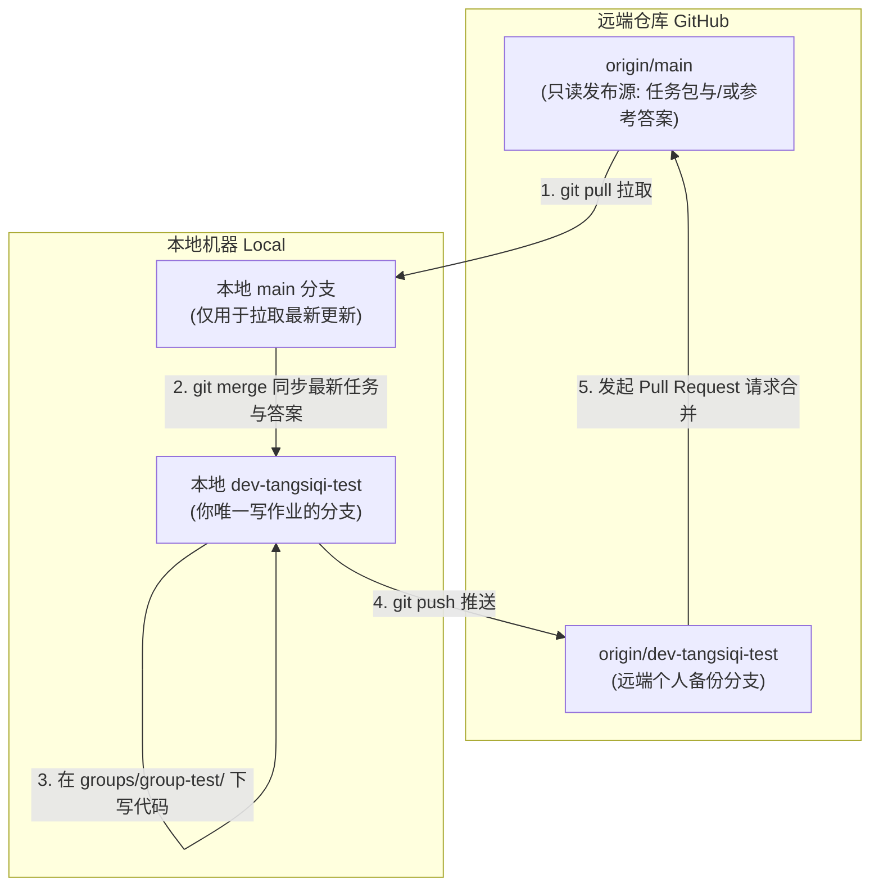

# 《环境规划与管理》随堂实践与 GitHub 协同排错指南

## 🧭 一、 Git 常规工作流说明

在课程实践大仓 [whu-course-cohort/LCA_Practice_Coursework-2026fall](https://github.com/whu-course-EnvironPlanManag/LCA_Practice_Coursework-2026fall) 中，全班同学共用一个大仓库。为了保证 15 位同学互不干扰、平稳完成本学期多次随堂 Coding 训练，仓库构建了**物理路径隔离机制**：

| 关键概念                         | 实际含义与角色         | 铁律操作要求                                                                   |
| :------------------------------- | :--------------------- | :----------------------------------------------------------------------------- |
| **`main` 分支**          | 课程公共发布源         | 教师发布任务包和参考答案的基准分支，**学生严禁直接在上面改写或提交代码** |
| **`dev-group-XX-name`**  | 个人专属开发分支       | 每位同学自主注册一个专属分支，后续本学期的所有作业都在该分支上持续演进         |
| **`starter_materials/`** | 教师任务发布与答案区   | 学生从此处复制任务到自己组，不要直接在该目录下撰写脚本                         |
| **`groups/group-XX/`**   | 你所在小组的专属工作区 | **所有 `git add` 操作，范围必须仅限于你所在的这个目录**               |



## 🌐 二、 场景一：初次 Clone 与网络连接障碍修复

### 1. 痛点报错：`Failed to connect to github.com port 443: Connection refused / Timed out`

* **原因分析**：校园网或国内局域网直连 GitHub 时 DNS 污染或 SSL 连接超时；或者本地代理软件（如梯子）端口与 Git 全局代理端口不一致。
* **排查与修复步骤**：
  ```bash
  # 步骤 1: 检查 Git 是否配置了错误的代理（若有报错，可先全部清空试试）
  git config --global --unset http.proxy
  git config --global --unset https.proxy

  # 步骤 2: 如果你开启了本地网络加速工具 (假设本地代理端口为 7890)，显式配置给 Git:
  git config --global http.proxy http://127.0.0.1:7890
  git config --global https.proxy http://127.0.0.1:7890

  # 步骤 3: 采用浅克隆 (Shallow Clone) 大幅加速下载速度（仅拉取最新深度）
  git clone --depth 1 https://github.com/whu-course-cohort/LCA_Practice_Coursework-2026fall.git
  ```

### 2. 避免克隆错路径或嵌套克隆

* 请将代码仓克隆在本地规范的纯英文路径下（如 `D:/WHU_Course/` 或 `~/Documents/WHU_Course/`），**严禁将仓库克隆到带有空格、特殊符号或桌面 OneDrive 同步文件夹中**，否则容易引起 Conda 虚拟环境路径解析错误。

## 🌿 三、 场景二：分支注册、日常切换与状态核对

### 1. 规范创建并切换到个人专属分支

#### 💡 标准创建与“一键同步远端”四步指令：

```bash
cd LCA_Practice_Coursework-2026fall

# 步骤 1: 确保本地 main 为最新基准
git checkout main
git pull origin main

# 步骤 2: 在本地创建并切换至个人专属分支 (严格使用: dev-group-XX-姓名全拼)
git checkout -b dev-tangsiqi-test

# 步骤 3: 【核心关键】立即将分支发布到 GitHub 远端并建立永久追踪绑定！
git push -u origin dev-tangsiqi-test
```

> **📌 为什么必须加 `-u`（即 `--set-upstream`）？**
>
> 1. **远端立即可见**：执行完第 3 步后，刷新 GitHub 仓库页面，左上角分支下拉菜单中**会立即显示你的分支**，同步成功！
> 2. **建立终身追踪关联**：本地 `dev-tangsiqi-test` 与远端 `origin/dev-tangsiqi-test` 绑定；

#### 🚑 修复措施：如果之前已经建了本地分支甚至写了代码，GitHub 远端没有同步怎么办？

只需在你的分支下执行一次：

```bash
# 1. 确保当前处于你的个人分支
git checkout dev-tangsiqi-test

# 2. 直接推送并强制绑定远端
git push -u origin dev-tangsiqi-test
```

### 2. 如何双重验证远端已成功同步？

* **方法 A（本地终端核对）**：

  ```bash
  git branch -vv
  ```

  如果回显如下，带有中括号蓝色的 `[origin/dev-tangsiqi-test]`，说明已成功绑定远端：

  ```text
  * dev-tangsiqi-test 7b2a9f1 [origin/dev-tangsiqi-test] feat: 初始同步
  ```
* **方法 B（GitHub 网页端核对）**：
  打开仓库网页 [LCA_Practice_Coursework-2026fall](https://github.com/whu-course-cohort/LCA_Practice_Coursework-2026fall)，点击左侧的分支选择器（默认显示 `main`），在弹出的搜索框中输入你的拼音，能看到并选中你的分支即代表远端同步完成！

### 3. 灵魂拷问：“我现在到底在哪个分支上？”

在开始写代码或暂存文件之前，**务必先打命令看一眼**：

```bash
git branch
```

* **控制台回显带星号 `*` 且高亮的即为当前分支**。如果发现带有 `* main`，**请**先执行 `git checkout dev-tangsiqi-test` 切换回来。

🔄 四、 场景三：后续多次作业如何将 main 的新任务与答案同步到自己分支

> 💡 **核心教学工作流场景**：
> 随堂测试开始前，老师在 `main` 分支发布了新作业包；测试结束后，老师将自己的参考代码实现（如存放在`code_implementation`文件夹）也 push 到了 `main` 分支。
> **学生怎么在不丢失自己已写作业的前提下，把老师的新内容拉下来？**

### 标准“四步同步法”：

```bash
# -------------------------------------------------------------
# 第 1 步: 在当前个人分支上，把手头没写完的代码暂存并提交保存
# -------------------------------------------------------------
# 必须先保存工作区，防止切换分支时因脏文件冲突导致代码被冲刷掉！
git add groups/group-test/
git commit -m "chore(group-test): 暂存当前未完成的工作快照"

# -------------------------------------------------------------
# 第 2 步: 切换到 main 分支，拉取老师发布的最新更新
# -------------------------------------------------------------
git checkout main
git pull origin main
# 此时，本地的 main 已经包含了老师发布的最新任务或参考代码

# -------------------------------------------------------------
# 第 3 步: 切换回你自己的专属开发分支
# -------------------------------------------------------------
git checkout dev-tangsiqi-test

# -------------------------------------------------------------
# 第 4 步: 将 main 分支的新成果平稳合并进你自己的分支
# -------------------------------------------------------------
git merge main
```

## 🗂️ 五、 场景四：多次随堂作业的目录规范（防止作业互相覆盖）

本学期后续将有多期随堂与课后任务，**严禁把第 3 次作业直接改写在第 2 次作业的文件里**！请严格遵循如下分级目录树结构：

### 1. 规范化的小组目录架构

```text
groups/group-test/                               # 第 1 小组根目录
├── README.md                                  # 本组成员分工与作业总索引
│
├── practice2_brightway2.5/                    # 【第 1 次实践】第六讲 Brightway 练习
│   ├── practice2.ipynb
│   └── data_collections/
│
├── lecture9-20261022-classroom_case1/         # 【第 2 次实践】第九讲 案例一 PET 物理再生（带日期）
│   ├── README.md                              # 案例导读与核心基准速查
│   ├── case_files/                            # 案例讲义与输入数据集 (MFA/LCA/TEA)
│   │   ├── case1_documentation.md
│   │   └── data_cohort/
│   └── code_implementation/                   # 成果提交区 (Python源码/高清流程图/分析报告)
│       ├── case1_solution_report.md
│       ├── plot_mfa_process.py
│       └── process_flow_diagram.png
│
├── lecture9-20261022-classroom_case2/         # 【未来任务】第九讲 案例二 绿氢合成甲醇
│   └── ...
│
└── lecture10-20261029-urban_mfa_lca/          # 【未来任务】第十讲 城市代谢分析
    └── ...
```

### 2. 领取任务的标准姿势

每次老师发布新任务后，通过上述“四步同步法”拉取后，只需一条复制命令：

```bash
# 进入目标目录
cd groups/group-test/

# 复制老师的任务包模板到本组（以第九讲 case1 为例，文件夹名字保留带日期的规范命名）
cp -r ../../starter_materials/lecture9-20261022-classroom_case1 ./lecture9-20261022-classroom_case1/

# 进入新目录开始写作业
cd lecture9-20261022-classroom_case1/
```

## 🚑 六、 场景五：Git 常见误操作修复指南

### 🚨 报错 1：一不小心在 `main` 分支上写了代码，还没 commit，怎么办？

* **修复指令**：
  ```bash
  # 1. 把所有改动打包临时存进口袋
  git stash

  # 2. 切换到你的专属个人分支
  git checkout dev-tangsiqi-test

  # 3. 把口袋里的修改原封不动掏出来还原到你的专属分支
  git stash pop
  ```

### 🚨 报错2：已经在 `main` 分支上误执行了 `commit`（但还没 push）

* **修复指令**：
  ```bash
  # 撤销刚刚的 commit，但保留你所有写好的文件改动
  git reset --soft HEAD~1

  # 然后重复车祸 1 的操作：暂存、切分支、恢复
  git stash
  git checkout dev-tangsiqi-test
  git stash pop
  ```

### 🚨 报错 3：手滑按了 `git add .`，把整个大仓、临时文件、虚拟环境全暂存了！

* **致命原因**：如果在仓库根目录下执行 `git add .`，会将 `.DS_Store`、Conda 缓存文件或者其他组的误修改全部添加进来，触发仓库CI 自动化拦截。
* **修复指令**：
  ```bash
  # 1. 彻底撤销全部暂存（文件不会丢失，仅移出暂存区）
  git restore --staged .

  # 2. 铁律：精准暂存！只 add 你自己的工作目录
  git add groups/group-test/lecture9-20261022-classroom_case1/
  ```

---

### 🚨 报错4：Jupyter Notebook（`.ipynb`）在合并时提示 CONFLICT

* ```bash
    git checkout --ours path/to/practice.ipynb
    git add path/to/practice.ipynb
    git commit -m "fix(merge): 冲突解决以本组代码为准"
  ```

---

### 🚨 报错5：Push 提示 `[rejected - non-fast-forward]`

* **原因分析**：你可能在网页端修改了什么，或者上一次 PR 之后远端有提交未同步到本地。
* 提醒：**严禁使用 `git push -f` 强推！强推会抹去他人或自己历史版本的代码！**
* **修复步骤**：
  ```bash
  # 先把远端个人分支的内容拉下来并在本地融合
  git pull origin dev-tangsiqi-test --rebase
  # 成功后再次正常推送
  git push origin dev-tangsiqi-test
  ```

---

## 🎯 七、 场景六：规范发起 PR、撤回修改与修复（Pull Request 全指南）

### 1. 网页端发起 PR 详尽图解步骤

#### 步骤一：本地最终自检与推送

在终端中确认本组所有文件均已保存并提交：

```bash
# 1. 检查工作区状态（确保所有作业文件都在 groups/group-XX/ 目录下且已 commit）
git status

# 2. 推送到远端个人专属分支
git push
```

#### 步骤二：进入 GitHub 仓库页面找到发起入口

* **途径 A（最便捷，强烈推荐）**：如果你刚在终端执行完 `git push`（15 分钟内），回到 GitHub 仓库主页顶部，会自动弹出一个亮眼的高亮横幅：`dev-tangsiqi-test had recent pushes less than a minute ago`👉 **直接点击横幅右侧绿色的 "Compare & pull request" 按钮即可！**
* **途径 B（常规手动入口，横幅消失时使用）**：
  1. 点击仓库上方的 **"Pull requests"** 标签页（位于 Code 右侧）；
  2. 点击右上角绿色的 **"New pull request"** 按钮；
  3. 在分支对比栏中，**严格核对两个下拉框**：
     * **左侧 `base: main`**（表示要合入课程主分支）；
     * **右侧 `compare: dev-tangsiqi-test`**（从下拉列表中选择你的专属分支）。

#### 步骤三：【关键自检】点击 "Files changed" 标签页核对修改范围

在点击最终创建按钮之前，先查看页面下方的差异，或者切换到 **"Files changed"** 标签页：

* 🟢 **绿灯安全**：改动的所有文件路径都带有 `groups/group-test/` 前缀；
* 🔴 **红灯预警**：如果你发现有根目录文件、`starter_materials/` 或其他小组的文件被改动了，**切勿提交！先按下方场景 D 剔除误改文件**。

#### 步骤四：填写 PR 标题与正文模板

* **PR 标题与自动化规范**：
  * 推荐标题标准格式：`[日期 第几讲 PR]: student_name - task_name (group-XX)`
  * *示范：`[2026-10-22 第九讲 PR]: tangsiqi - case1-pet-recycling (group-01)`*
  * 💡 **助教机器人自动规范**：即使你起错了标题或保持默认，**后台 CI 助教机器人会在提交后 3 秒内自动解析你的分支与正文，将标题统一规范重命名**并打上分组/讲次标签！
* **PR 描述内容（全自动预填）**：
  * 大仓已部署自动化模板，打开 PR 页面时 Description 输入框已**全自动预填充**通用底模；
  * 你只需像填空题一样，把方括号内的 `[YYYY-MM-DD]`、`[姓名全拼]` 等替换为真实信息，并勾选完成清单；
  * 点击下方绿色的 **"Create pull request"** 完成正式提交！
  * 提交后，助教机器人会自动在 PR 讨论区推送**本讲案例专属指标核验单**，协助对照自查。

---

### 2. 核心解惑：如果提交 PR 后想修改代码、撤回或发现提交错了，怎么办？

#### 🌟 场景 A（最常见）：PR 已经发出去了，突然发现代码有 Bug、计算错了或漏传了流程图

* **初学者的误区**：以为必须把这个 PR 关掉删掉，重新再开一个新的 PR。
* **不需要关闭 PR！可以直接edit。**

  > **Pull Request 本质上是一个“实时管道（Live Pipeline）”**，而不是一份固定的静态压缩包！只要这个 PR 还没有被老师合并（处于 Open 状态），它就会**永远自动追踪并同步你个人分支上的最新提交**。
  >
* **解决办法**：
  直接在本地继续修改你的代码，修改完成后正常执行三连指令：

  ```bash
  # 1. 暂存修改后的文件
  git add groups/group-test/lecture9-20261022-classroom_case1/

  # 2. 提交更新说明
  git commit -m "fix(group-test): 修正流程图配色与热洗蒸汽敏感度计算"

  # 3. 正常推送
  git push
  ```

  **推送完成后，你无需在 GitHub 上点任何多余按钮！刷新刚才的 PR 页面，GitHub 会自动把你的最新 commit 追加进去并更新代码差异！** 老师刷新看到的直接就是你最新修正后的版本。

---

#### 🌟 场景 B：完全提错了分支，或者作业报废想彻底撤回该 PR（关闭 PR）

* 如果你选错了对比分支，或者完全点错了想作废本次 PR：
* **操作方法**：
  1. 打开你发起的该 PR 页面；
  2. 滚动到页面最底部的评论框下方；
  3. 找到并点击带有红色圆圈图标的 **"Close pull request"**（关闭请求）按钮；
  4. 该 PR 状态会立刻变为 Closed（已关闭），老师和助教不会再批阅它。你的本地代码和分支**不受任何影响**，之后随时可以按正确流程重新发起新 PR。

---

#### 🌟 场景 C：刚刚在本地 `commit` 了，突然发现写错了，想撤销该 commit

* **情况 1（还没 push 到 GitHub 远端）**：
  ```bash
  # 撤销刚刚那次 commit，但你写的所有代码完好无损地保留在工作区！
  git reset --soft HEAD~1
  # 然后重新修改文件、重新 add 和 commit 即可
  ```
* **情况 2（已经 push 到 GitHub 个人分支了）**：
  推荐使用安全的反向抵消方式：
  ```bash
  # 创建一个新的“反向提交”来自动抵消上一次的错误提交
  git revert HEAD
  git push
  ```

---

#### 🌟 场景 D：不小心误改了公共文件或其他组的文件，导致 PR 触发 CI 红叉拦截！

* **原因**：大仓配置了自动化质量守卫，如果你碰了非本组目录，CI 会直接报红叉拦截合并。
* **修复方法**：
  ```bash
  # 假定你不小心误碰了 starter_materials 下的某个文件
  # 直接用 main 分支的原始纯净版本将其覆盖复原：
  git checkout origin/main -- starter_materials/

  # 提交该复原操作并推送到远端：
  git commit -m "chore: 复原误触的公共目录文件"
  git push
  ```
  推送后，PR 中的红叉会自动重新运行并转为绿灯 ✅！
